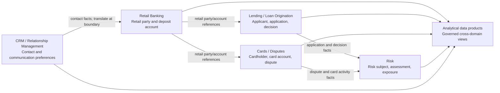

# Event Modeling and Domain-Driven Design

> **Stage:** 2D — Data Architecture  
> **Module:** 6 of 8 — Conceptual, Logical and Physical Data Modeling  
> **Level:** Foundational → intermediate → advanced

## Scope and roadmap alignment

This lesson follows Module 6 of `roadmap-Conceptual-Logical-and-Physical-Data-Modeling.md`. It builds on Modules 1–5 (modeling abstraction levels, entities and relationships, normalization, dimensional modeling, and historical modeling) and the roadmap dependencies on business capabilities and domain boundaries (2D.1 Topic 3), domain-oriented/data-product patterns (2D.3 Topic 4), and event-driven/data-sharing patterns (2D.3 Topic 6).

**Required in this module:** domain vocabulary and boundaries; entities, value objects and aggregates; business events; event attributes; domain-to-event alignment; context maps; cross-domain ownership and consistency; event design quality; evolution; and links to data products.

**Conceptual extensions used as teaching aids:** a lightweight loan-origination aggregate, a context-map diagram, and an illustrative event-envelope JSON example. These do not require adopting a particular broker, serialization format, DDD framework or implementation technology. Detailed physical messaging infrastructure and implementation-specific schema-registry configuration are outside this module's scope.

All Northbridge Bank names, identifiers and scenarios are fictional and illustrative.

## 1. Learning objectives

By the end of this lesson, you should be able to:

1. Explain a domain, subdomain, bounded context and ubiquitous language, and identify why an enterprise-wide vocabulary can be misleading.
2. Distinguish an **entity**, its **state**, a **value object**, an **aggregate**, and a **business event**.
3. Name business events in the past tense and distinguish them from commands, current-state snapshots and technical change-data-capture (CDC) records.
4. Define an event contract with event identity, event time, record time, subject, type, version, payload and causation/correlation information, while recognizing that local contracts determine exact requiredness.
5. Map domains and bounded contexts, including upstream suppliers, downstream consumers, semantic translation and ownership boundaries.
6. Align events with entities, aggregate state changes and business-process steps.
7. Explain eventual consistency, delays, duplicate processing and compensating actions without assuming cross-domain operations are atomic.
8. Evaluate payload sufficiency, sensitive-data exposure, ordering scope, schema evolution and semantic change.
9. Relate published events to event contracts and domain data products, and explain why event modeling complements rather than replaces entity, relational, historical and analytical models.

## 2. Why the topic matters in real-world Data Architecture

A data model can be structurally valid and still be semantically wrong. Retail, Lending, Cards, CRM and Risk may use the same word—such as *Customer*, *Account* or *status*—while applying different definitions, ownership rules and lifecycles. Forcing one definition across the enterprise hides translation rules, obscures accountability and creates fragile downstream reporting.

A state-only integration may tell a consumer what is true now while losing the sequence and meaning of how it became true. A well-designed event model preserves meaningful facts and provides an owned interface for downstream reaction and analytics. It does **not** automatically make an event complete, immutable, correctly ordered, legally sufficient or available to every consumer.

Domain-driven design (DDD) helps draw boundaries around models whose terms and rules are internally consistent. Event modeling describes significant business facts at those boundaries. Together they help architects decide who owns a definition, which facts can be shared, where translation is needed, what consistency delay is acceptable, and which events belong in a governed data-product interface.

**Architecture principle:** share facts and contracts deliberately; do not assume every domain should share one model or one universal `Customer` entity.

## 3. Prerequisite knowledge

Review the following roadmap dependencies:

- **Module 1:** conceptual, logical and physical modeling; separate business meaning from implementation.
- **Module 2:** entities, relationships, cardinality, identifiers and constraints.
- **Module 3:** normalization and relational modeling.
- **Module 4:** dimensional facts, dimensions and grain, including how downstream analytical models answer defined questions.
- **Module 5:** Data Vault and historical modeling, especially source history versus a domain's interpretation of business meaning.
- **2D.1 Topic 3:** business capabilities, domains and data ownership.
- **2D.3 Topics 1, 4 and 6:** architecture patterns, domain-oriented data products, and event-driven/data-sharing patterns.

A specific programming language, broker or DDD framework is not required to complete this conceptual module. Later technologies should implement the model, not define its business semantics.

## 4. Beginner-level learning sequence

### 4.1 Learn the vocabulary

| Term | Plain-language meaning | Northbridge example | Important boundary |
|---|---|---|---|
| **Domain** | Business area with coherent responsibilities and rules. | Lending, Cards, Retail Banking, Risk. | Not automatically a database, team or application. |
| **Subdomain** | Smaller problem area within a domain; often classified as core, supporting or generic. | Loan origination within Lending; card disputes within Cards. | A subdomain describes the problem space; it may map to one or more bounded contexts. |
| **Bounded context** | Boundary within which a model and its terms are intended to be consistent. | Lending's `Applicant` versus CRM's `Contact`. | Not necessarily identical to a team or deployment unit. |
| **Ubiquitous language** | Explicit vocabulary used by domain experts and builders within one context. | `LoanApplicationSubmitted` in Lending. | Context-specific, not a promise of enterprise-wide identical meanings. |
| **Entity** | Object whose identity persists when attributes change. | Loan application `APP-7041`. | Identity must be defined within a context and namespace. |
| **Value object** | Value described by attributes, normally compared by value rather than persistent identity. | Money `{amount: 100.00, currency: "USD"}`. | It is not automatically an entity. |
| **Aggregate** | Cluster treated as a consistency boundary; an aggregate root controls permitted changes. | `LoanApplication` enforcing its lifecycle rules. | Not a transaction spanning all enterprise domains. |
| **Business/domain event** | Fact that happened and matters to a domain or consumer. | `CardDisputeOpened`. | Past-tense fact, not an instruction. |

### 4.2 Entity, state and event are different

| Concept | Question answered | Northbridge example |
|---|---|---|
| **Entity** | Which thing has identity? | Account `A123` in the Retail Banking context. |
| **State** | What is true about that thing at a point in time? | Posted balance is `500.00 USD`. |
| **Event** | What meaningful thing happened? | `DepositPosted`: a deposit of `100.00 USD` was posted at 10:02. |

An event may cause a state transition, but it is not the state itself. If balance changes from 400 to 500 after a deposit, the event can explain the business fact behind the change. A snapshot containing only `balance = 500` does not explain whether the change came from a deposit, correction, fee, reversal or migration.

Conversely, an event is not always enough to reconstruct state. Reconstruction requires a sufficiently complete event history, defined semantics, duplicate/order rules and any reference data or business rules needed to interpret events. Missing events cannot reliably be inferred from a later state.

### 4.3 A simple account-opening process

1. A request to open an account is received (`OpenAccount` is a **command/request**, not an event).
2. Retail Banking validates eligibility and required information.
3. If accepted, the context creates the account and records `AccountOpened`.
4. A later `AccountFundingReceived` may record a separate business fact, if the process distinguishes it.
5. Downstream consumers use the events they need under an agreed contract.

Do not emit `OpenAccount` as if it were a fact that already happened. A command can be rejected; `AccountOpened` asserts that the account was actually opened. Exact sequence and names must follow the real business process and ownership decisions.

### 4.4 What makes an event useful?

A useful event has a past-tense name, a semantic owner, an identity for the occurrence, a defined event time, a subject, a meaningful payload, a relation to a process step and state transition, and version/lineage metadata sufficient for its contract. The roadmap's completion gate requires every catalogued event to have a past-tense name, owner, identity, time and subject. Additional fields depend on business, audit, operational and regulatory requirements.

## 5. Intermediate-level learning sequence

### 5.1 Northbridge Bank: define contexts before a universal model

Start from business capabilities, not existing table names. This illustrative map shows conceptual information relationships—not a guarantee of synchronous calls, a specific transport or an SLA.



- **CRM** owns its contact-management meaning and workflow; it does not automatically own legal customer identity, lending eligibility or cardholder status.
- **Retail Banking** owns its context-specific retail-party and deposit-account concepts.
- **Lending** owns loan applications, application status and lending decisions.
- **Cards** owns card lifecycle and dispute concepts.
- **Risk** owns risk assessments and classifications under its policies.
- An analytical product may integrate facts from several domains, but must document source ownership, translation, freshness and semantic differences.

This is a starting hypothesis to validate with domain experts. If the actual operating model assigns responsibilities differently, record the evidence and revise the map.

### 5.2 Why there may be no single `Customer`

| Context | Local concept | Example meaning | Unsafe assumption |
|---|---|---|---|
| CRM | `Contact` | Person or organization managed for relationship/communication. | Every contact is a verified bank customer. |
| Retail Banking | `RetailCustomer` | Party associated with retail banking under retail identity/servicing rules. | CRM status is authoritative retail status. |
| Lending | `Applicant` | Party participating in a specific loan application. | Every applicant is an existing customer. |
| Cards | `Cardholder` | Person authorized or associated with a card relationship. | Cardholder and account owner are always identical. |
| Risk | `RiskSubject` | Party or entity assessed for risk under a defined scope. | Risk status equals retail relationship status. |

A cross-context identity mapping may be needed, but DDD does not solve identity resolution by itself. Define matching authority, evidence, confidence, merge/split process, survivorship rules, effective dates and audit trail separately. Never merge identities only because two systems use the same numeric customer number.

### 5.3 Context-map requirements

For each context relationship, document:

- **Upstream supplier:** which context owns and publishes the source meaning.
- **Downstream consumer:** which context consumes it and for what purpose.
- **Contract:** events or data products shared and what they mean.
- **Translation boundary:** where identifiers, terms, status values or rules are mapped.
- **Consistency expectation:** tolerated staleness and behavior when updates are delayed.
- **Ownership/escalation:** who can clarify or change semantics.
- **Failure behavior:** what happens when the consumer cannot process an update.

A downstream team may derive a local interpretation, but should document the mapping and retain lineage. It should not silently redefine an upstream event.

### 5.4 Align events to entities and processes

1. Identify the bounded context and business process.
2. Identify the entities and aggregates involved.
3. State the invariants each aggregate protects.
4. Identify meaningful process milestones and state transitions.
5. Name events that assert those facts after they occur.
6. Map each event to owner, subject, affected entity/aggregate and consumers.
7. Check that the payload expresses business meaning, not merely a database diff or arbitrary snapshot.

An event need not correspond one-to-one with an entity. One state transition may produce multiple events if distinct facts occurred; one process can span several aggregates and contexts. Do not emit an event for every internal field mutation by default.

### 5.5 Illustrative loan-origination model

**Context:** Lending / Loan Origination. **Aggregate:** `LoanApplication`, root identity `application_id`.

Illustrative invariants protected by this aggregate:

- An application must be identified before it can be submitted.
- Submission requires the fields and consents defined by Lending policy.
- A final decision must refer to a submitted application and its applicable decision basis.
- A final decision cannot be silently overwritten as if no earlier decision occurred.

The bank's legal, product and underwriting policies determine real rules. Do not put every credit, customer, document and funding operation into one enormous aggregate. Cross-aggregate and cross-context rules need explicit coordination and consistency design.

| Process step | Command/request (not an event) | Event if action succeeds | Illustrative state effect |
|---|---|---|---|
| Start application | `StartLoanApplication` | `LoanApplicationStarted` | Identity and initial lifecycle state created. |
| Record applicant data | `RecordApplicantDetails` | `ApplicantDetailsRecorded` | Application details/reference updated. |
| Submit for assessment | `SubmitLoanApplication` | `LoanApplicationSubmitted` | Application enters submitted state after required checks. |
| Record assessment | `RecordCreditAssessment` | `CreditAssessmentCompleted` | Assessment result recorded under its owner's rules. |
| Decide application | `DecideLoanApplication` | `LoanApplicationApproved` or `LoanApplicationDeclined` | Decision state recorded subject to lifecycle rules. |
| Withdraw before final decision | `WithdrawLoanApplication` | `LoanApplicationWithdrawn` | Application marked withdrawn if permitted. |

These are plausible examples, not a claim that every bank uses this exact process. If assessment belongs to a separate Risk/Credit context, that context owns its assessment event and Lending consumes it through an explicit contract.

#### Example event-to-entity/process alignment

| Event | Owner/context | Subject entity/aggregate | State effect | Process step / boundary note |
|---|---|---|---|---|
| `LoanApplicationStarted` | Lending | `LoanApplication` (`application_id`) | Creates the application in its initial state. | Start request accepted. |
| `ApplicantDetailsRecorded` | Lending | `LoanApplication` | Records a defined set/version of details or a reference to them. | Does not imply verification unless verification occurred. |
| `LoanApplicationSubmitted` | Lending | `LoanApplication` | Moves the application to submitted after local checks pass. | Submission milestone; assessment can begin. |
| `CreditAssessmentCompleted` | Risk/Credit if it owns assessment; otherwise Lending under a documented model | Assessment entity/aggregate; application ID is a reference where permitted. | Records a completed assessment outcome; it does not itself decide the loan unless that context owns the decision. | Cross-context fact consumed through a contract. |
| `LoanApplicationApproved` | Lending, assuming it owns the lending decision | `LoanApplication` | Records the approved decision and governed basis/reference. | Decision step after required inputs are available. |
| `LoanApplicationWithdrawn` | Lending | `LoanApplication` | Marks the application withdrawn if the lifecycle permits it. | A new fact; does not erase submission or assessment history. |

These ownership and aggregate boundaries are assumptions to validate. Do not assign `CreditAssessmentCompleted` to Lending if Risk owns the assessment rules and state. A subject reference does not transfer ownership of the referenced entity.

### 5.6 Event contract: illustrative JSON

The envelope below is a conceptual example, not a mandate to use JSON or these exact field names.

```json
{
  "event_id": "evt-8d2a1",
  "event_type": "LoanApplicationSubmitted",
  "event_version": 1,
  "event_time": "2026-10-20T10:02:00Z",
  "record_time": "2026-10-20T10:02:03Z",
  "subject": {
    "type": "LoanApplication",
    "key": "APP-7041",
    "context": "Lending"
  },
  "producer": "northbridge.lending.loan-origination",
  "correlation_id": "corr-91f0",
  "causation_id": "cmd-2a4b",
  "payload": {
    "application_status": "SUBMITTED",
    "product_code": "HOME_LOAN",
    "submission_channel": "BRANCH"
  },
  "privacy_classification": "INTERNAL"
}
```

| Field | Meaning | Design caveat |
|---|---|---|
| `event_id` | Identity of this event occurrence. | Define global or producer/stream uniqueness. Retries should preserve occurrence identity when they redeliver the same event. |
| `event_type` | Stable semantic name of the fact. | Past-tense fact, not a command. |
| `event_version` | Version of contract/schema under the local convention. | A version number alone does not explain semantic changes. |
| `event_time` | Time the business fact occurred, as defined by the contract. | Document source clock, timezone, precision and late-arrival semantics. |
| `record_time` | Time a specified system recorded the event. | State whether this is producer, ingestion or durable-write time. |
| `subject` | Context-scoped entity or business-object identity. | Bare keys such as `customer_id` may collide across systems. |
| `producer` | Context/component publishing the event. | Transport operator and semantic owner may be different parties. |
| `correlation_id` | Groups actions/events related to a workflow or request. | Does not itself prove causality or atomicity. |
| `causation_id` | Identifies a command/event/action that directly caused this occurrence, if tracked. | Define allowed ID types; it may be unavailable. |
| `payload` | Business facts consumers need to interpret the event. | Specify units, enumerations, null/absence meaning, ownership and privacy. |
| `privacy_classification` | Contract-level classification used to drive handling. | Only effective when tied to access, retention and security policy. |

**Timestamp consistency:** this example uses `event_time` as the authoritative timestamp for the submission occurrence. Do not repeat it in a payload field such as `submitted_at` unless that field has a separately defined business meaning, precision and authority; duplicated timestamps can drift or be interpreted differently.

**Required versus optional:** for the roadmap exercise, every catalogued event must have a past-tense name, owner, identity, time and subject. The example adds producer, version, payload, correlation/causation and privacy metadata. Exact field requiredness is a local contract decision, not a universal property of every event system.

### 5.7 Event time versus record time

A loan application may be submitted at `10:02:00` and recorded in a durable event store at `10:02:03`. Under the contract, `event_time` describes the business occurrence; `record_time` describes when a named system recorded it. The gap can matter for freshness, late-arrival and incident analysis.

Neither timestamp automatically proves legal effective time, user intent, source-clock correctness or complete audit evidence. If a fact has a distinct business-effective time or interval, model that separately. If a consumer must know both when a fact applied and when it became known, specify both dimensions and their semantics. Detailed bi-temporal implementation is addressed through the historical-modeling and storage decisions, not fully implemented here.

### 5.8 Domain events versus technical CDC records

| Dimension | Domain event | Technical CDC/change record |
|---|---|---|
| Purpose | Communicate a meaningful business fact. | Describe a storage-level insert/update/delete. |
| Typical name | `CardDisputeOpened`, `LoanApplicationSubmitted`. | `lending.loan_application UPDATE`. |
| Semantics | Defined by domain language and owner. | Defined by source schema and capture mechanism. |
| Payload | Business facts and identifiers needed by consumers. | Often before/after row values, operation code, log position and source metadata. |
| Consumer coupling | Intended to reduce dependence on internal table layout. | Usually coupled to source tables and columns. |
| Analytics use | Useful if coverage, semantics and retention are adequate. | Useful for replication/history, but interpretation may be needed. |

CDC can be valuable without being a domain event. A row changing from `PENDING` to `APPROVED` may reflect a real decision, correction, migration or backfill. Unless source semantics establish which occurred, the row change alone does not prove the business fact.

## 6. Advanced-level learning sequence

### 6.1 Context maps, translation boundaries and ownership

| Pattern / choice | When it may help | Main risk/cost |
|---|---|---|
| **Explicit translation / anti-corruption layer** | A consumer protects its model from upstream terminology, lifecycle or schema assumptions. | Mapping logic needs tests, ownership and maintenance. |
| **Shared kernel** | Two closely collaborating contexts deliberately share a small, stable model and coordinate changes. | Shared governance can slow both contexts; the kernel can grow into a hidden enterprise model. |
| **Upstream supplier / downstream consumer** | One context owns a fact and publishes a contract consumed by another. | Supplier changes may affect consumers without disciplined evolution. |
| **Local model with upstream identity reference** | A context needs to relate to an external object without owning its lifecycle or attributes. | Identity mapping and stale-reference handling must be explicit. |

**Ownership rule:** the domain accountable for the business rule and authoritative state should own the event's meaning. A platform team may operate a broker, registry or pipeline, but operating transport does not make that team the semantic owner.

### 6.2 Who owns `CustomerAddressChanged`?

There is no universally correct enterprise-wide owner. The answer depends on what “address” means and which business action occurred.

| Candidate context | Possible event meaning | Consumers must not assume |
|---|---|---|
| CRM | A contact's preferred or communication address changed in CRM. | It is not automatically a legally registered or verified address. |
| Retail Banking | Retail customer's servicing/registered address changed under retail policy. | It does not necessarily change a loan collateral address or card delivery address. |
| Lending | Address relevant to a specific loan application or loan relationship changed. | It may be an application-specific snapshot, not a master party address. |
| Cards | Card delivery or billing address changed for a card relationship. | It does not mean every bank customer address changed. |

Possible scoped names include `CRMContactAddressChanged`, `RetailCustomerRegisteredAddressChanged` or `CardDeliveryAddressChanged`, if those distinctions reflect actual business language. Do not multiply names to avoid a real ownership decision; validate the meaning with business owners.

**Decision procedure:** (1) identify the business rule/workflow authorizing the change; (2) identify the authoritative record for that address purpose; (3) scope the subject and address type; (4) list consumers and purpose; (5) publish the smallest approved contract that conveys the fact; (6) define mapping, freshness, correction/retraction and reconciliation behavior; and (7) record the decision and revisit it if ownership or meaning changes. A request entered in CRM may be a request that Retail later verifies: `AddressChangeRequested` and `RetailCustomerRegisteredAddressChanged` are different facts if both are real milestones.

### 6.3 Eventual consistency and compensating actions

A workflow spanning Lending, Risk and Retail may not have one transaction that atomically updates all three contexts. Each context can commit its own state and publish/consume events; other contexts observe changes later. This is eventual consistency only if delivery, retry and processing guarantees are sufficient for convergence under stated assumptions. Sending a message does not prove every consumer applied it.

Illustrative sequence:

1. Lending records `LoanApplicationSubmitted`.
2. Risk consumes it, records an assessment and publishes `CreditAssessmentCompleted`.
3. Lending consumes the assessment result and records a decision.
4. If a later step fails or an accepted action must be counteracted, the relevant context evaluates a business-defined compensation, such as `LoanApplicationWithdrawn` or `CreditAssessmentSuperseded`, where that fact is valid.

A compensating action is a new business action that counteracts or mitigates a prior action; it is not necessarily a technical rollback and may not erase the original fact. Some actions are irreversible, legally constrained or require human review. Define timeouts, retries, idempotency, duplicate handling, reconciliation and escalation. Do not claim the workflow is automatically atomic or that compensation always restores the exact prior world.

### 6.4 Payload: sufficient context versus reference-only

| Strategy | Benefits | Costs/risks | Suitable when |
|---|---|---|---|
| **Sufficient business context** | Consumer can interpret the fact without an immediate lookup; helps delayed processing/replay. | Copies data; sensitive fields may spread; payload fields become contract commitments. | Consumers need a stable snapshot of occurrence-time facts and distribution is approved. |
| **Reference-only event** | Minimizes duplication and can reduce sensitive-data exposure. | Lookup may fail or return a newer state; replay may not reproduce original context. | Reference is stable and consumers tolerate lookup dependencies, or details are restricted. |
| **Hybrid** | Carries essential event facts plus a governed reference for details. | Requires clear snapshot-versus-reference semantics and consumer logic. | Consumers need immediate meaning but some details belong in a separately controlled product. |

Do not include identity documents, credentials, account secrets or unnecessary personal data merely for convenience. Balance data minimization with audit, replay and legal retention needs. Published payloads may be copied across consumers, so plan access, encryption, retention and sensitive-field handling before publication.

### 6.5 Ordering, identity and duplicate handling

Events can be delayed, duplicated, retried or observed out of order. A global total order across all domains is usually unnecessary; define the ordering scope that matters to the business invariant.

- If changes to one `LoanApplication` must be interpreted sequentially, define the aggregate/subject key and expected ordering guarantee for that key.
- Do not infer global order from timestamps alone: clocks can differ, precision can be limited, and events can be concurrent.
- Event IDs support duplicate detection only if producers preserve occurrence identity across retries and consumers implement idempotency.
- Sequence numbers or source positions may help establish order within a documented scope; they are not interchangeable with event time.
- If a later event arrives first, define whether the consumer buffers, retries, reconciles, applies version checks or tolerates the intermediate state.
- Correlation can group workflow activity, but a `correlation_id` does not prove causality or a distributed transaction.

### 6.6 Event evolution and semantic compatibility

Event evolution includes structural change and changes in business meaning. Adding an optional field may be structurally compatible for some consumers; changing the meaning of an existing field can break reports without changing the schema.

| Change | Example | Review questions |
|---|---|---|
| Add optional field | Add `submission_channel`. | Can old consumers ignore it? Is absence defined? Is it safe to publish? |
| Add required field | Require a decision-basis code. | Can all producers supply it before enforcement? Is migration needed? |
| Rename/remove/retype | Rename `status` or change its type. | Which producers, consumers, mappings and products break? |
| Split event | Replace overloaded `CustomerChanged` with scoped facts. | How will old consumers migrate, and are new owners explicit? |
| Change meaning without changing shape | `ACTIVE` changes from “relationship open” to “eligible for marketing.” | This is a semantic breaking change; define a new concept or migration/version policy. |

Module 7 covers schema evolution in greater detail. Here, produce an impact statement, list affected consumers and define a safe transition. Versioning alone does not resolve semantic change.

### 6.7 Events and domain data products

A domain data product is an owned, governed interface for a defined consumer purpose. Events may be one interface alongside curated tables, APIs, metrics or other outputs. A product contract should describe:

- owner and support/escalation path;
- business definitions and intended consumers;
- event names, subject keys, payload fields and timestamp semantics;
- quality, completeness, timeliness and known limitations;
- privacy classification, access, retention and lineage;
- identity and duplicate-handling expectations;
- ordering and delivery assumptions;
- schema and semantic change policy; and
- analytical models/views derived from the events.

Do not publish every internal event. Publish facts with clear domain meaning and consumer value. An event catalogue is not a substitute for a product contract, and a contract must not promise guarantees the producer cannot meet.

### 6.8 Limits of event modeling

Events describe facts that occurred; entities describe things with identity and relationships; state models describe what is true at a point or interval. A domain needs these concepts together. Some data is better represented as reference state rather than a stream of tiny events, and not every internal mutation deserves a business event. An event model does not determine the final warehouse fact grain, dimensional conformance, physical layout or retention policy; those are separate decisions informed by event semantics.

## 7. Industry-application exercises

Use fictional data only.

### Exercise 1 — Context map and glossary

For Northbridge Retail, Lending, Cards, Risk and CRM: define each context's purpose and boundaries; define at least five terms per context; identify supplier/consumer relationships; mark terms requiring translation; explain why `Customer`, `Account`, `Status` and `Address` may differ.

**Deliverable:** context map and context-specific glossary.

### Exercise 2 — Loan-origination event catalogue

Define at least six events. For each, record past-tense name, owner/context, event identity and subject, event-time and record-time definitions, payload and semantics, affected entity/aggregate and state transition, process step and cause/correlation relationship, consumers, privacy class and limitations. Identify the preceding command/request without labelling it as the event.

**Deliverable:** event catalogue and event-to-entity/process alignment table.

### Exercise 3 — Cards dispute process

Create a conceptual domain model and event model. Candidate milestones may include `CardDisputeOpened`, `EvidenceRequested`, `EvidenceReceived`, `DisputeDecisionRecorded` and `DisputeClosed` only if each is a meaningful fact in the defined process. Identify Cards-owned events and upstream facts consumed. Explain how this differs from raw row changes in a dispute table.

**Deliverable:** dispute model, event inventory and semantic review.

### Exercise 4 — Customer address ownership

Resolve `CustomerAddressChanged`: specify address purpose, authoritative context, event name and subject, payload versus reference, consumers, translation/freshness, correction/retraction process and what the event does not prove (for example, legal verification unless the process records it).

**Deliverable:** ownership decision with alternatives considered.

### Exercise 5 — Risk and Retail use “customer status” differently

Risk uses `HIGH_RISK` as an assessment outcome; Retail uses `ACTIVE` for an open relationship; CRM uses `SUBSCRIBED` for communication permission. Define context-specific fields and mappings. Explain why they must not be collapsed into one universal `customer_status`.

**Deliverable:** ownership/translation table and consumer-impact analysis.

### Exercise 6 — CDC mislabelled as domain events

A team publishes `customer UPDATE` records with before/after row values and calls the feed `CustomerChanged`. State what the feed guarantees, what business meaning it lacks, whether to retain it as a technical feed, add a domain-owned contract or provide both, and how consumers migrate.

**Deliverable:** recommendation, risks and at least one alternative.

## 8. Practical scenarios and case-based reasoning

### Scenario A — One enterprise `Customer` model

A central team proposes a universal object combining CRM, Retail, Lending, Cards and Risk attributes. Teams repeatedly translate status values and disagree about authority.

**Reasoning:** identify the capabilities/policies represented; split context-specific concepts where definitions or lifecycles differ; retain shared identity references only with a governed mapping and clear owner; translate explicitly at boundaries; document how the analytical product integrates the separate meanings. If every consumer reinterprets the same field, the shared model may be hiding multiple contexts.

### Scenario B — `CustomerAddressChanged` has disputed ownership

CRM says it owns the event because a change was entered in a CRM screen. Retail says it owns the registered customer address. Cards needs a delivery address.

**Reasoning:** the entry screen does not alone determine semantic ownership. Identify the business rule and authoritative record. A CRM-entered request that Retail later verifies is not the same fact as an accepted registered-address change. Separate the events only if those are genuine process milestones.

### Scenario C — One event drives operations and analytics but contains only state

A producer emits `ApplicationStatusChanged` with only `status = APPROVED`. Operations needs to act; analysts want to explain why and when it was approved.

**Risk:** a current-state value may omit the transition, decision basis, relevant time or process reference. Do not solve this by publishing every sensitive field. Define the business fact and include the minimum approved context, or publish separate purpose-fit contracts/products. State what cannot be reconstructed.

### Scenario D — CDC presented as a business event

A table update shows `PENDING → APPROVED`, but it could be a decision, correction, migration or backfill.

**Response:** preserve CDC for replication if useful, but do not claim it proves the business fact unless source semantics support that interpretation. Ask the domain owner to define the event and correction/backfill semantics; retain lineage to supporting records where appropriate.

### Scenario E — A cross-domain workflow partially fails

Lending publishes `LoanApplicationSubmitted`; Risk processes it, but Lending does not receive the result because its consumer is unavailable.

**Response:** define retry/replay, idempotency, timeout state, monitoring, reconciliation and operator escalation. Do not assume the assessment and Lending state changed atomically. If the application is later withdrawn, record a valid withdrawal fact and downstream actions rather than deleting history to pretend the workflow never began.

## 9. Expected outputs and deliverables

### 9.1 Context map

Include contexts, responsibilities, boundaries, upstream/downstream relationships, translation points, identity/reference dependencies, consistency expectations and escalation paths.

### 9.2 Context-specific glossary

Define important terms per context with non-circular, unambiguous definitions and accountable owners. Identify overloaded terms and concepts that must not be shared without translation.

### 9.3 Event catalogue

| Field | Required content for this exercise |
|---|---|
| Event name | Past-tense fact, not a command. |
| Owner/context | Domain accountable for meaning. |
| Event ID | Identity and uniqueness scope. |
| Time | Event-time definition; record-time definition and recording system. |
| Subject | Context-scoped entity/business-object key. |
| Type/version | Stable event type and contract/schema version convention. |
| Payload | Facts, units, enumerations, null/absence semantics and privacy class. |
| Cause/correlation | Available causal and workflow identifiers with defined semantics. |
| State/process alignment | Entity/aggregate, invariant, state effect and process step. |
| Consumers | Intended use, freshness expectation and limitations. |
| Evolution | Compatibility expectations and semantic-change owner. |

The exercise requires identity, time, subject, owner and a past-tense name for every event. Add other fields when justified by the use case.

### 9.4 Event-to-entity/process alignment table

For every event, identify the entity or aggregate, state transition and process step. If an event does not directly change an entity's state, explain why it is still a meaningful fact and how it relates to the process.

### 9.5 Ownership and translation table

| Shared term/fact | Context owning meaning | Consumers | Translation/mapping rule | Unresolved issue / decision owner |
|---|---|---|---|---|
| Retail registered address | Retail Banking, if confirmed by policy | Lending, Cards, Risk as needed | Map to each local address purpose; do not overwrite a card delivery address implicitly. | Verification, effective date and correction policy. |
| CRM communication preference | CRM / Relationship Management | Approved communication consumers | Map under policy; do not equate with identity or relationship status. | Access, retention and opt-out propagation. |
| Risk assessment outcome | Risk, if Risk owns the assessment policy | Lending, approved analytical products | Translate into allowed consumer vocabulary; preserve scope and time. | Freshness and reassessment behavior. |
| Retail relationship status | Retail Banking | Lending, Cards and analytical products as needed | Map only documented meanings; preserve source value and mapping version. | Closure implications and effective time. |

This is an illustrative template, not a statement of Northbridge's actual governance. Confirm owners and policies with stakeholders.

### 9.6 Practice-question answers

Use these as model answers, not as substitutes for validating Northbridge's real policies. A defensible answer identifies assumptions, the accountable owner and what remains uncertain.

1. **Why is `Customer` in Lending not automatically the same as `Customer` in Marketing/CRM?** Lending's `Applicant` or borrower concept is governed by application and lending rules; CRM's `Contact` is governed by relationship and communication rules. Their lifecycles, verification standards, identifiers and status meanings can differ. A governed identity map may relate them, but matching records does not make the concepts semantically identical.

2. **Which context owns `CustomerAddressChanged`, and which contexts need to know?** The name is underspecified, so there is no safe universal owner. If it means a registered/servicing address accepted under Retail Banking policy, Retail owns that fact; CRM may own `AddressChangeRequested`, and Cards owns a card-delivery-address change. Lending, Cards and Risk consume only the scoped fact needed for an approved purpose and translate it locally. Confirm the policy, subject key, verification status, effective time and correction behavior before finalizing the contract.

3. **Which concept should not be shared across contexts without translation, and why?** Do not share a generic `customer_status` as though it were universal. Retail `ACTIVE`, Risk `HIGH_RISK` and CRM `SUBSCRIBED` describe different dimensions and authorities. Preserve context-qualified concepts and define explicit mappings only for a named consumer purpose; do not map values merely because they are all called “status.”

4. **What consistency guarantees can be made across contexts, and what happens when a consumer is delayed?** Promise only the delivery and freshness guarantees actually supported by the producer/transport/consumer design. Separate contexts normally commit their own state independently; event publication does not make their updates atomic. Define retry/replay, idempotent handling, monitoring, reconciliation, timeout and escalation behavior. During delay, a consumer may hold stale state and must apply a documented policy rather than assume the event was applied.

5. **Why does a CDC row-change record not automatically qualify as a domain event?** CDC proves that a captured storage operation occurred according to the capture system; it may not establish the business intent or milestone. The change could be a correction, migration, backfill or technical rewrite. Keep it as CDC for replication if useful, and publish a domain-owned event only when the business meaning and lifecycle are defined. Both feeds can coexist with lineage between them.

6. **What changes when event meaning changes but schema shape does not?** The change can still be semantically breaking. For example, if `ACTIVE` changes from “relationship is open” to “eligible for marketing,” existing consumers may produce incorrect results despite an unchanged string field. Treat the definition change as a governed contract change: document impact, consult consumers, use a new concept or an explicit migration/version policy, and update mappings, tests and data-product documentation.

**Review check:** each answer should name the semantic owner, distinguish facts from requests or technical records, and state assumptions and limitations rather than claiming universal behavior.

## 10. Common mistakes and misconceptions

1. **One enterprise-wide definition for every term.** The same word can have different policies, lifecycles and meanings.
2. **Commands disguised as events.** `SubmitLoanApplication` is a command; `LoanApplicationSubmitted` asserts a fact.
3. **Treating entity, state and event as interchangeable.** `Account A123`, `balance = 500`, and `DepositPosted` answer different questions.
4. **Calling every row update a domain event.** CDC describes storage changes; domain events describe business facts.
5. **Putting only current state in an event.** A snapshot may not explain what happened or why consumers should react.
6. **Assuming events reconstruct everything.** Missing history, undefined semantics, absent reference data and incorrect ordering can prevent reconstruction.
7. **Treating event time as record time.** Business occurrence and system recording time can differ.
8. **Assuming the data-entry screen owns the meaning.** Ownership follows the authoritative business rule, not only the entry point.
9. **Using correlation IDs as proof of causality or atomicity.** They group activity under a convention; they do not create a transaction.
10. **Ignoring duplicates, delays and ordering.** Consumers need processing and reconciliation rules.
11. **Publishing excessive sensitive data.** Payloads may be copied, retained and replayed by many consumers.
12. **Reference-only payloads without replay semantics.** A later lookup may return newer state, not the value at event time.
13. **Assuming schema versioning protects semantics.** Field meaning can change without structural change.
14. **Event-izing every mutation.** Reference state or ordinary internal changes may not merit business events.
15. **Treating the event catalogue as the whole data product.** Consumers also need ownership, quality, freshness, privacy, lineage, support and evolution commitments.
16. **Ignoring aggregate boundaries.** An aggregate protects its own invariants; it does not automatically enforce atomic rules across domains.

## 11. Mastery criteria

You are ready to complete Module 6 when you can:

- [ ] Define domain, subdomain, bounded context and ubiquitous language accurately.
- [ ] Distinguish entity, state, value object, aggregate and event in a concrete scenario.
- [ ] Produce a Northbridge context map with suppliers, consumers and translation boundaries.
- [ ] Explain why `Customer`, `Account`, `Address` and `status` may have context-specific meanings.
- [ ] Define a LoanApplication aggregate and at least three meaningful invariants.
- [ ] Name events in the past tense and distinguish them from commands and CDC records.
- [ ] Give every event an owner, identity, time and subject, with field semantics documented.
- [ ] Map events to entities/aggregates, state effects and process steps.
- [ ] Resolve `CustomerAddressChanged` with a documented decision and alternatives.
- [ ] Explain eventual consistency, retries, duplicates and compensation without claiming cross-domain atomicity.
- [ ] Evaluate payload sufficiency, sensitive data, ordering scope and schema/semantic evolution.
- [ ] Explain how selected domain events form part of a data-product contract.
- [ ] Identify a concept that should remain context-specific and justify its translation boundary.
- [ ] Explain what cannot be inferred when source history, identity mapping or business intent is missing.

## 12. Completion gate

Do not mark the module complete until the evidence below has been reviewed and the practice questions have been answered and corrected.

- [ ] **Context map reviewed:** boundaries, upstream suppliers, downstream consumers and translation points are explicit.
- [ ] **Context glossary reviewed:** definitions are context-specific; ambiguity is not hidden behind a universal model.
- [ ] **Event catalogue reviewed:** every event has a past-tense name, semantic owner, identity, time and subject.
- [ ] **Event-to-entity/process alignment reviewed:** events, aggregate state transitions and process steps are consistent.
- [ ] **Ownership decision reviewed:** `CustomerAddressChanged` has a documented owner, scoped meaning, consumers and translation behavior.
- [ ] **Consistency and evolution reviewed:** eventual consistency, failure handling, sensitive payloads, ordering and schema/semantic-change limits are stated.
- [ ] **Topic 6 practice questions answered and corrected.**

**Completion evidence:** reviewed context map, context-specific glossary, event catalogue, event-to-entity/process alignment table, ownership/translation table, and corrected practice-question answers.

**Final quality test:** a reader should be able to identify who owns each business fact, what the event asserts, which entity or process it relates to, how consumers translate its meaning, and what guarantees the architecture does—and does not—provide.
