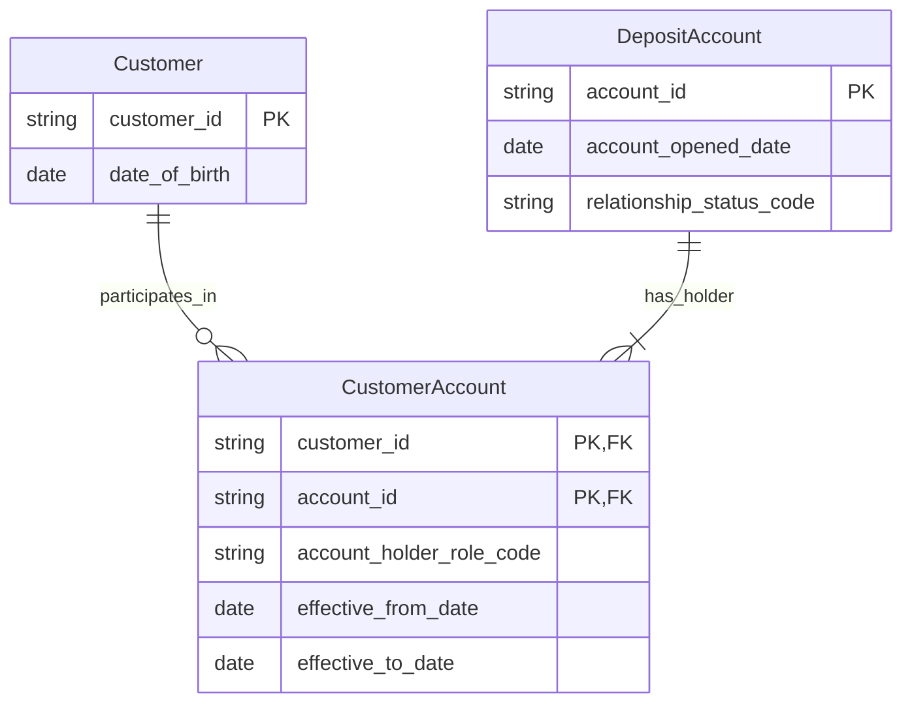

# Model Review, Naming Standards and Data Dictionaries

> **Stage:** 2D — Data Architecture  
> **Module:** 8 of 8 — Conceptual, Logical and Physical Data Modeling  
> **Level:** Foundational → intermediate → advanced  
> **Purpose:** Review models for semantic correctness, structural quality, consistent terminology, traceability and maintainable documentation before approval and implementation.

## Scope and roadmap alignment

This lesson follows Module 8 of `roadmap-Conceptual-Logical-and-Physical-Data-Modeling.md`. The roadmap prerequisites are Modules 1–7 in this sequence and Stage 2D.1 Topic 5 (governance and review). The project tree places this file under `Stage 2D — Data Architecture/04-Conceptual-Logical-and-Physical-Data-Modeling/`, after `07-schema-evolution-and-backward-compatibility.md`.

The roadmap requires review purpose; naming standards; business definitions and a dictionary; completeness, consistency and semantic accuracy checks; key, relationship, constraint and business-rule validation; review and issue resolution; cross-model consistency; roles and approval criteria; and maintainability. Its explicit completion gate requires actionable/prioritized findings, non-circular definitions, consistent naming, and corrected Topic 8 practice answers.

The bank examples and review findings below are fictional teaching examples. They do not assert that Northbridge Bank has these actual systems or policies. The naming conventions are a proposed project standard to adapt and approve, not a claim that the roadmap mandates one universal physical naming style.

---

## 1. Learning objectives

By the end of this lesson, you should be able to:

1. Explain why model reviews detect semantic, structural, naming and documentation defects before implementation.
2. Apply a consistent naming standard to entities, attributes, identifiers, dates, amounts, flags, codes and relationships.
3. Distinguish synonyms, homonyms and conformed concepts, and decide when a shared term needs a context-qualified definition.
4. Write business definitions that state what a concept is, avoid circular wording, and specify inclusions and exclusions.
5. Build a data dictionary containing definitions, technical descriptions where appropriate, constraints, allowed values, sources and accountable roles.
6. Review scope, traceability, entities, attributes, keys, relationships, optionality, constraints, normalization, history and schema evolution.
7. Classify defects by both type and severity and produce findings that an owner can resolve.
8. Establish entry criteria, exit criteria, review roles, approvals, conditional approval, issue tracking and time-bound waivers.
9. Compare related models and detect inconsistent concepts, duplicate entities and diverging dictionaries.
10. Maintain an auditable model package through iterative correction and re-review.

## 2. Why the topic matters in real-world Data Architecture

A model is not ready for implementation merely because a diagram renders or a database accepts the DDL. The model must express the right business meaning, preserve the required rules, identify keys and relationships correctly, and be understandable by people who did not create it. Many defects are discovered through structured review because tools can validate syntax and selected constraints but cannot reliably infer business intent.

Naming and documentation are part of architecture quality. A field named `status` may combine lifecycle, eligibility and communication preference; a dictionary definition such as “the status of the customer” does not resolve the ambiguity. A model that lacks explicit ownership or traceability makes later lineage, change impact and governance harder.

A disciplined review prevents four broad classes of risk:

- **Semantic risk:** the model represents the wrong business concept or an ambiguous rule.
- **Structural risk:** keys, relationships, cardinality, optionality or normalization are incorrect or incomplete.
- **Naming risk:** inconsistent or overloaded names mislead users and cause faulty joins or mappings.
- **Documentation/governance risk:** definitions, constraints, owners, assumptions or decisions are missing or stale.

Review is iterative, not a one-time sign-off. When a finding reveals a defect in an earlier model, trace it back to the original requirements and related conceptual, logical, physical, historical, event or analytical models. Correct the source of the inconsistency rather than patching only the latest diagram.

## 3. Prerequisite knowledge

Review the concepts from Modules 1–7:

- conceptual, logical and physical modeling;
- entities, attributes, keys, relationships, cardinality and optionality;
- normalization and justified denormalization;
- facts, dimensions and grain;
- historical modeling and time semantics;
- domains, bounded contexts and event contracts; and
- schema evolution, compatibility and deprecation.

Also review Stage 2D.1 Topic 5 on governance and review. This module does not replace the original scope of those modules: it checks their outputs for consistency and traceability. A reviewer should refer substantive design questions back to the relevant module instead of treating a review checklist as a substitute for design reasoning.

## 4. Beginner-level learning sequence

### 4.1 Why reviews exist

A review should catch defects early, establish shared understanding, enforce agreed standards and record decisions. It should evaluate meaning and evidence, not personal style preferences. A reviewer must be able to point to a requirement, business rule, approved standard or concrete implementation risk behind a finding.

### 4.2 A practical naming standard

The following is a proposed standard for the Northbridge exercises. An enterprise should publish one approved standard and state any exceptions rather than allowing each project to invent conventions.

| Element | Proposed rule | Good example | Poor example | Reason |
|---|---|---|---|---|
| Entity name | Singular business noun; meaningful full words | `Customer`, `DepositAccount` | `Customers`, `Cust`, `AcctTbl` | Names identify a concept, not a table's physical pluralization or an unexplained abbreviation. |
| Attribute name | Clear noun phrase that states the concept | `date_of_birth`, `account_opened_date` | `dob`, `date`, `dt1` | Avoid ambiguous abbreviations and generic labels. |
| Primary identifier | Use an explicit identifier suffix | `customer_id`, `account_id` | `id`, `custkey` | Makes identity and joins easier to review. |
| Foreign/reference key | Name the referenced concept and key role | `customer_id` in an account relationship | `ref1` | Relationship semantics should be obvious. |
| Date/time | Distinguish date from timestamp and event/effective meaning | `account_opened_date`, `recorded_at_timestamp` | `date`, `time` | Prevents mixing calendar dates, instants and business-effective time. |
| Amount | Include the business measure; define currency and scale in metadata or name when needed | `transaction_amount`, `fee_amount` | `amt`, `value` | Amount without a measure/unit is ambiguous. |
| Flag/boolean | State the condition in a readable form | `is_account_closed`, `has_valid_consent` | `flag1`, `active` | Boolean meaning and polarity should be clear. |
| Code | Use a specific concept plus `_code` | `account_status_code`, `country_code` | `type`, `cd` | Code values require a defined vocabulary. |
| Relationship | Use a meaningful verb phrase in diagrams and documentation | `Customer owns DepositAccount` | `has` with no defined meaning | Relationship names communicate business semantics. |
| Enumeration value | Stable, explicit, documented term | `SUSPENDED` | `3` without a code list | Values need definitions and lifecycle policy. |

**Case and word separation:** choose one style per model layer and apply it consistently. For this logical-model lesson, examples use `PascalCase` for entity names and `snake_case` for attribute names. A physical platform may require another case style; document the mapping and do not let physical constraints change the business definition.

**Naming rules to enforce:**

1. Prefer full, meaningful words; use only approved abbreviations with a maintained glossary.
2. Use singular entity names.
3. Do not reuse one name for two meanings within the same context.
4. Do not create two names for one concept unless the difference is intentional and documented.
5. Avoid generic names such as `status`, `type`, `value`, `data` and `flag` unless qualified by the concept and definition.
6. Do not encode transient implementation details in a conceptual name.
7. Do not use reserved words or names that are ambiguous in the target environment.
8. Define identifier stability and scope; `customer_id` is not automatically globally unique across systems.
9. Define date/time basis, amount unit/currency, precision and code-set ownership in the dictionary.
10. When a name changes, use the schema-evolution process from Module 7.

### 4.3 Names, synonyms, homonyms and conformed concepts

- **Synonyms:** different names used for the same or nearly the same concept, such as `client` and `customer`. Confirm whether they truly mean the same thing before standardizing them.
- **Homonyms:** the same word used for different concepts, such as `status` meaning relationship lifecycle in Retail and risk rating in Risk.
- **Conformed concept:** a concept with an agreed definition and compatible usage across models, such as a governed calendar date or a party identifier with explicit namespace and identity rules.

A conformed concept does not require every domain to share all attributes or lifecycle rules. For example, CRM `Contact`, Retail `RetailCustomer`, Lending `Applicant` and Risk `RiskSubject` may refer to overlapping people but are not automatically interchangeable. Record the context, owner, definition, allowed values and translation rule. If identity resolution is needed, document the authoritative mapping and uncertainty rather than merging records based only on similar names or matching numeric IDs.

Maintain two registers:

| Register | Fields | Example |
|---|---|---|
| Synonym register | Term, preferred term, contexts, equivalence evidence, owner, decision date | `client` → preferred `customer` only in a context where the business meaning is confirmed identical. |
| Homonym register | Term, context, definition, owner, disambiguating name, affected models | `status` → `relationship_status` in Retail; `risk_assessment_outcome` in Risk. |

### 4.4 How to write a business definition

A good definition says what the concept **is**, not merely what it is used for. It avoids using the term to define itself and states material inclusions and exclusions.

**Weak:** “Account status is the status of the account.” This is circular and does not say which lifecycle or values are meant.

**Better:** “Retail relationship status is the lifecycle state of a deposit account relationship as recognized by Retail Banking. It distinguishes pending opening, open, suspended and closed relationships. It does not represent credit risk, marketing consent or card authorization status.”

Definition checklist:

- Is the concept described directly and positively?
- Does the definition avoid circular phrasing?
- Are inclusion and exclusion boundaries stated?
- Are units, time basis, population and context clear where relevant?
- Are allowed values and constraints documented separately or referenced?
- Is the source of truth and accountable owner named?
- Can a business stakeholder distinguish it from nearby concepts?

### 4.5 Business definition versus technical description

| Documentation element | Purpose | Example |
|---|---|---|
| Business definition | Explains meaning to business and technical readers | “Date on which the deposit account relationship was opened under Retail Banking policy.” |
| Technical description | Explains representation or derivation | “Logical date attribute populated from the account-opening event's effective date; physical representation is `DATE` in the approved relational implementation.” |
| Constraint | States what values are allowed | “Required for accounts whose lifecycle has reached Open; cannot be later than the approved opening-effective date under the model's time policy.” |
| Allowed values | Enumerates or references the controlled vocabulary | `PENDING`, `OPEN`, `SUSPENDED`, `CLOSED`, with versioned definitions. |
| Source/lineage | Identifies origin and transformation | “Retail account lifecycle service; transformed by the governed customer/account integration pipeline.” |
| Ownership | Identifies accountability | “Business owner: Retail Account Product Owner; steward: Retail Data Steward.” |

Do not put all of these into one paragraph and call it a definition. Keeping fields separate makes review and maintenance more precise.

## 5. Intermediate-level learning sequence

### 5.1 Data dictionary template

A dictionary should be maintained alongside the model as a governed source of definitions. At minimum, the roadmap requires name, business definition, technical description where appropriate, data type at logical/physical level, constraints, allowed values, source and owner/steward. Add lifecycle and traceability fields when they improve governance.

| Dictionary field | Required use |
|---|---|
| Model / context | Identifies the model and bounded context. |
| Element name | Canonical entity, attribute or relationship name. |
| Element kind | Entity, attribute, key, relationship, code set or derived element. |
| Business definition | Non-circular definition with scope and exclusions. |
| Technical description | Representation, derivation or implementation behavior, where appropriate. |
| Model level | Conceptual, logical or physical. |
| Data type | Include only at logical/physical level; physical type belongs to the target implementation. |
| Requiredness / optionality | Required conditions, null/absent semantics and lifecycle applicability. |
| Constraints | Range, uniqueness, referential integrity, temporal rules or business invariants. |
| Allowed values | Explicit set or reference to a governed code list. |
| Unit / time basis | Currency, scale, time zone, event time/effective time, precision where relevant. |
| Source / derivation | Source system or requirement and any transformation rule. |
| Owner | Accountable business or data-product owner. |
| Steward | Role responsible for definition quality and maintenance. |
| Sensitivity / access | Classification and access constraints where applicable. |
| History notes | Historical changes, effective dates, old meanings and compatibility concerns. |
| Requirement trace | Requirement or decision identifier. |
| Status / version | Draft, reviewed, approved, deprecated; version and dates. |
| Assumptions / open questions | Explicit unresolved items, with owner and due date. |

### 5.2 Illustrative Northbridge Bank customer/account dictionary

The following is a complete illustrative dictionary for the stated mini-scope. Data types are shown at the **logical level** as examples; the physical database type must be selected and reviewed for the target platform. Values and policies are hypothetical and must be confirmed before real implementation.

| Element name | Kind / level | Business definition | Technical description | Requiredness / constraints | Allowed values / unit | Source | Owner / steward | History notes / trace |
|---|---|---|---|---|---|---|---|---|
| `Customer` | Entity / conceptual | A party recognized by Retail Banking as a customer under the bank's retail relationship policy. Excludes CRM-only contacts that have not met Retail's criteria. | Logical entity with a stable identifier within the Retail customer namespace. | One identity per governed Retail customer record; merge/split rules are separately governed. | Not applicable. | Retail customer onboarding and identity process. | Owner: Retail Customer Product Owner; steward: Retail Data Steward. | Identity merge/split and identifier reuse must be audited; requirement `RET-CUST-01` (illustrative). |
| `customer_id` | Identifier / logical | Identifier assigned to a Retail `Customer` record. It identifies the record within the declared namespace; it does not by itself prove cross-system identity. | Logical identifier attribute; physical representation selected by platform standard. | Required; unique within Retail customer namespace; immutable unless an approved migration/merge policy explicitly governs change. | Namespace: `RETAIL`; format governed by identifier policy. | Retail identity service. | Owner: Retail Customer Product Owner; steward: Retail Data Steward. | Preserve prior IDs and mappings after merges; `RET-CUST-01`. |
| `date_of_birth` | Attribute / logical | Calendar date of birth recorded for a customer. It excludes inferred age and does not itself establish identity verification. | Logical date; physical `DATE` only when the target platform supports the agreed date semantics. | Optional where not collected; if present, must be a valid date and satisfy policy-based plausibility checks. | Calendar date; no time-of-day. | Customer-provided evidence and approved verification process. | Owner: Retail Customer Product Owner; steward: Customer Data Steward. | Corrections require source/evidence and audit trail; do not overwrite history where policy requires retention. |
| `DepositAccount` | Entity / conceptual | A deposit account relationship administered by Retail Banking, with its own account identity and lifecycle. Excludes a card account or a loan facility. | Logical entity related to one or more account holders according to account-role rules. | Identity required; lifecycle and relationship cardinality must be explicit. | Not applicable. | Core deposit account system. | Owner: Deposit Product Owner; steward: Account Data Steward. | Account closure and key reuse policies must be documented; `DEP-ACCT-02` (illustrative). |
| `account_id` | Identifier / logical | Identifier for a Retail deposit account within the account identifier namespace. | Logical identifier; physical encoding is implementation-specific. | Required and unique within the declared namespace; foreign references must retain namespace if IDs are not globally unique. | Namespace: `RETAIL_DEPOSIT`. | Core deposit account system. | Owner: Deposit Product Owner; steward: Account Data Steward. | Never assume the same string identifies the same account across Cards or Lending. |
| `account_opened_date` | Attribute / logical | Business date on which the deposit account relationship was opened under Retail policy. Excludes application submission date and first funding date. | Logical date derived from the authoritative account-opening fact and its defined business time basis. | Required for accounts in Open or later lifecycle states; must be consistent with effective-date rules. | Calendar date; not a timestamp. | Core deposit account lifecycle record/event. | Owner: Deposit Product Owner; steward: Account Data Steward. | Corrected dates retain provenance and correction history; align with historical model. |
| `relationship_status_code` | Attribute / logical | Current lifecycle state of the Retail deposit account relationship. It does not represent credit risk, CRM consent or card authorization. | Logical code referencing a governed status vocabulary. | Required when the account has entered lifecycle management; unknown/unmapped source values must be flagged, not silently coerced. | `PENDING`, `OPEN`, `SUSPENDED`, `CLOSED`; definitions and effective dates maintained in a code list. | Core deposit account lifecycle. | Owner: Deposit Product Owner; steward: Account Data Steward. | New values require consumer impact analysis and schema-evolution review; `DEP-ACCT-02`. |
| `CustomerAccount` | Relationship / conceptual | Association between a Retail customer and a deposit account, with a defined account-holder role and effective period. | Logical associative entity when relationship attributes or history require them. | Cardinality: a customer may relate to zero or many accounts; an account may have one or more customers if joint ownership is permitted. Actual policy must confirm minimum/maximum participation. | Role code governed separately; effective dates use defined time basis. | Retail account-holder relationship source. | Owner: Deposit Product Owner; steward: Account Data Steward. | Role changes and relationship termination may require effective-dated history; `DEP-ACCT-03` (illustrative). |
| `account_holder_role_code` | Attribute / logical | Role held by a customer in relation to a deposit account. | Logical code on `CustomerAccount`, not a general customer attribute. | Required for each active association; one role per association and effective interval unless policy permits multiple roles. | Example: `PRIMARY_HOLDER`, `JOINT_HOLDER`, `AUTHORIZED_SIGNATORY`; code owner must confirm actual values. | Account-holder relationship source. | Owner: Deposit Product Owner; steward: Account Data Steward. | Changes should be effective-dated if past ownership/authority must be reconstructed. |

This dictionary demonstrates why types and physical implementation are not the whole definition. It also demonstrates that a relationship may require its own attributes and history rather than being represented as a bare foreign key. Where policy is not supplied, the entry explicitly says it must be confirmed instead of presenting an illustrative assumption as fact.

### 5.3 Structured model review checklist

Use the checklist as a review record. For every “No” or “Unknown,” create a finding or a tracked question; do not merely tick boxes.

| Review area | Questions / evidence required | Typical defect if not satisfied |
|---|---|---|
| Scope and traceability | Is scope explicit? Does each important model element trace to a requirement, rule or approved decision? Are exclusions recorded? | Unjustified entity/attribute; missing requirement coverage. |
| Entities | Is each entity defined, distinct and correctly named? Are missing or duplicate entities identified? | Two concepts collapsed; duplicate concepts with conflicting definitions. |
| Attributes | Is each attribute defined, atomic at the chosen level, correctly placed and required/optional status stated? | Composite field, misplaced fact, ambiguous `status`. |
| Keys | Is the identifier stable and unique in a declared namespace? Are candidate/natural keys and surrogate keys justified? | Unstable key, collision risk, missing uniqueness rule. |
| Relationships | Are relationship verbs meaningful? Are cardinality and optionality stated from both ends? Are associative entities required? | Unclear many-to-many relation, incorrect minimum participation, missing role. |
| Constraints and rules | Are business rules represented in model or linked to an authoritative rule record? Are units, allowed values and temporal constraints defined? | Invalid values accepted; conflicting rule definitions. |
| Normalization | Are update/insert/delete anomalies possible? Is any denormalization justified and documented? | Repeated facts, inconsistent updates, unjustified duplication. |
| Naming | Is case/word separation consistent? Are full words and approved abbreviations used? Are synonyms/homonyms handled? | Ambiguous or duplicate names; inconsistent suffixes. |
| Dictionary | Are all in-scope elements defined? Are definitions non-circular? Are types shown only at logical/physical levels? Are source, owner and steward present? | Model cannot be interpreted or governed. |
| Assumptions/open questions | Are assumptions explicit? Does every open question have an owner and due date? | Hidden design decision or unresolved policy. |
| History/temporal meaning | Are valid time, record time, corrections and historical meaning handled where required? | Past values cannot be reconstructed or timestamps are confused. |
| Schema evolution | Are published names, enums, constraints and meanings change-managed? Are compatibility and deprecation impacts known? | Breaking change without migration or notification. |
| Cross-model consistency | Are conformed concepts consistent? Are differences across bounded contexts intentional and documented? | Conflicting `customer_status` definitions or accidental duplicate entity. |
| Governance/approval | Are entry/exit criteria, reviewers, owner, approver, issue statuses and waivers defined? | Approval by silence or unresolved blocking defect. |

### 5.4 Defect type and severity are separate dimensions

**Type** describes what is wrong. **Severity** describes the impact and whether the model may proceed. A naming issue can be major if it changes meaning; a structural issue can be minor if it is a harmless, approved documentation inconsistency. Do not infer severity from defect type alone.

**Defect types:**

- **Semantic:** incorrect or ambiguous business meaning, scope, rule, value interpretation or ownership.
- **Structural:** missing/duplicate entity, incorrect key, relationship, cardinality, optionality, constraint or normalization defect.
- **Naming:** inconsistent, misleading, overloaded or noncompliant names.
- **Documentation:** missing or circular definitions, absent source/owner, unrecorded assumptions, stale dictionary or missing traceability.

**Severity levels:**

| Severity | Definition | Typical disposition |
|---|---|---|
| **Blocking** | Prevents safe approval or implementation because core meaning, identity, integrity, legal requirement or critical scope is wrong/unknown. | Reject or hold approval until corrected and re-reviewed; no silent waiver. |
| **Major** | Material defect that can cause incorrect interpretation, joins, reporting, controls or maintenance risk, but a bounded remediation plan may be possible. | Must be corrected before final approval unless an authorized, time-bound exception is explicitly permitted by governance. |
| **Minor** | Limited-impact inconsistency or documentation/style defect with no material change to business meaning or integrity. | Track and correct by an agreed date; may be conditionally approved if policy permits. |

A waiver must name the approving authority, rationale, affected models/consumers, compensating control, owner and expiry date. A waiver does not change the defect into a non-defect.

### 5.5 Actionable finding format

Every finding should contain:

- finding ID and review date;
- model, element and location (diagram, table, dictionary row or requirement reference);
- defect type and severity;
- evidence and why it matters;
- suggested correction or decision needed;
- accountable owner and target date;
- status, resolution evidence and reviewer verification.

Weak finding: “Status naming is bad.”

Actionable finding: “`RetailAccount.relationship_status_code` is documented as ‘the status of the account’ and includes both relationship lifecycle and credit-risk values. **Type:** semantic; **severity:** blocking. This permits a Risk outcome to be interpreted as Retail lifecycle state. Split the concepts, define Retail's allowed values and owner, update consumers and dictionary, then re-run the cross-model check. **Owner:** Retail Account Product Owner. **Exit evidence:** approved definition and tests showing each code maps only to the intended concept.”

### 5.6 Review entry and exit criteria, roles and approvals

**Entry criteria** — the author submits a reviewable package containing:

1. stated scope, purpose, model level and exclusions;
2. requirements/rules traceability and relevant prior decisions;
3. current model diagram or structured representation;
4. draft dictionary for all in-scope entities, attributes, keys and relationships;
5. naming standard and relevant cross-model references;
6. assumptions, open questions and known constraints;
7. version/change summary and any prior review findings;
8. identified author, domain expert, data owner and proposed approver.

If the package is materially incomplete, return it for preparation instead of pretending a full review occurred.

**Roles:**

| Role | Responsibility |
|---|---|
| Author/modeler | Produces the model and dictionary, supplies traceability and evidence, responds to findings. |
| Independent reviewer | Applies the checklist, challenges assumptions, classifies findings and verifies corrections. Should not simply approve their own work. |
| Domain expert | Confirms business meaning, rules, inclusions/exclusions, allowed values and ownership. |
| Data owner/steward | Confirms accountability, definition maintenance, governance, quality and lifecycle expectations. |
| Approver/architecture authority | Accepts the package, conditionally approves with permitted actions, or rejects/holds it under governance rules. |
| Issue coordinator, where needed | Tracks owners, dates, waivers, unresolved questions and evidence to closure. |

**Exit criteria:** scope and traceability are reviewed; critical definitions and identifiers are unambiguous; keys, relationships, cardinality, optionality and constraints are validated; dictionary entries pass the non-circular-definition check; naming is consistent; cross-model conflicts are resolved or documented with an approved translation; blocking findings are closed; major findings are closed or covered by an explicitly permitted time-bound waiver; minor findings have owners and dates; and the approver records a decision.

Approval states should be explicit, for example: `Approved`, `Conditionally Approved`, `Rejected`, or `Returned for Rework`. Approval by silence is not approval.

## 6. Advanced-level learning sequence

### 6.1 Cross-model consistency review

When two models share a term, compare definitions and semantics—not just strings. Check:

- whether they represent the same business concept or merely share a label;
- whether identifier scope and identity-resolution rules agree;
- whether units, time basis, status values and lifecycle rules align;
- whether a difference is intentional because of bounded-context ownership;
- whether a conformed concept or explicit translation is appropriate;
- whether changes in one model require a schema-evolution or data-product review; and
- whether the dictionary, lineage and requirements references point to the current approved version.

For example, Retail `relationship_status_code`, CRM `communication_preference_code` and Risk `risk_assessment_outcome_code` must not be conformed into a universal `customer_status_code`. They describe different concepts. A cross-domain analytical model may consume all three, but should preserve their names/definitions or create a derived classification with an explicit transformation rule and owner.

### 6.2 Iterative improvement and model maintenance

A review finding may expose a defect in earlier work. Follow the dependency chain:

1. Locate the requirement, decision or source model that introduced the concept.
2. Determine whether the defect is local or appears in other models, dictionaries, events, data products and reports.
3. Correct the authoritative definition or model first.
4. Update dependent models and mappings with traceability.
5. Run the relevant earlier-module checks again: normalization, grain, historical semantics, event ownership or schema compatibility as applicable.
6. Record the change, approver, effective date and migration/deprecation implications.
7. Verify the corrected result independently and close the finding with evidence.

Do not rewrite earlier modules' scope in this review. Use their concepts as review criteria and route design issues back to the relevant module. For example, a fact-grain defect should be corrected using Module 4 principles; a temporal-history defect should be reviewed against Module 5; an event ownership defect should be reviewed against Module 6; a breaking field rename should be managed using Module 7.

### 6.3 Review a Northbridge Bank customer/account model

#### Intentionally flawed model

```text
CUSTOMERS
  id                 integer
  name               string
  dob                string
  status             string
  acct               string
  address            string

ACCOUNT
  id                 integer
  customer_id        integer
  balance            float
  date               string
  status             string
```

Additional undocumented assumptions in the flawed draft: `id` may be reused between tables; `customer_id` is assumed globally unique; one customer is assumed to have exactly one account; joint account holders are not represented; `status` combines Retail relationship lifecycle and Risk assessment; `balance` has no currency, balance type or as-of time; `date` has no definition; address changes overwrite earlier values; and no dictionary, ownership or requirement trace exists.

#### Review findings (at least ten)

| ID | Location | Defect type / severity | Impact | Suggested correction | Owner |
|---|---|---|---|---|---|
| F-01 | `CUSTOMERS.id` and `ACCOUNT.id` | Structural / blocking | Ambiguous identifier names and namespace make joins and references unsafe. | Rename to `customer_id` and `account_id`; define uniqueness scope and stable-key policy. | Model author + data owner |
| F-02 | `CUSTOMERS.name` | Semantic / major | “Name” may combine legal name, preferred name or organization name. | Define party scope and name purpose; split attributes only where requirements justify it. | Retail domain expert |
| F-03 | `CUSTOMERS.dob` | Naming + documentation / major | Unexplained abbreviation and string representation allow invalid dates. | Rename to `date_of_birth`; define calendar-date semantics, optionality and validation. | Data steward |
| F-04 | `CUSTOMERS.status` | Semantic / blocking | Lifecycle, risk and possibly marketing meanings are mixed. | Replace with context-specific attributes, such as `relationship_status_code`; keep risk outcome separate and owned by Risk. | Retail + Risk owners |
| F-05 | `CUSTOMERS.acct` | Structural / blocking | Embedded account reference implies one account per customer and cannot represent joint ownership or many accounts. | Model `CustomerAccount` association with cardinality, role and effective period. | Model author |
| F-06 | `CUSTOMERS.address` | Structural + historical / major | One untyped string may combine lines/city/country; overwriting loses history and address purpose is unclear. | Define address purpose and component structure; add effective/history treatment if required by use case. | Retail domain expert |
| F-07 | `ACCOUNT.customer_id` | Structural / blocking | One foreign key prevents joint account holders and does not declare referential integrity. | Use the association model; define cardinality, optionality and FK/reference constraint. | Model author |
| F-08 | `ACCOUNT.balance` | Semantic / blocking | No currency, balance definition, unit or as-of time; `float` may introduce precision errors. | Define balance type and time basis; use appropriate exact numeric representation at physical level and document currency. | Deposit product owner |
| F-09 | `ACCOUNT.date` | Naming + documentation / major | Meaning could be opened date, application date, first funding date or update date. | Rename to the precise business concept, e.g. `account_opened_date`, only if that is the required fact; define source/time basis. | Domain expert |
| F-10 | `ACCOUNT.status` | Semantic / blocking | Allowed values and lifecycle transitions are undefined; could conflict with `CUSTOMERS.status`. | Define `relationship_status_code`, code set, owner, valid transitions and unknown-value handling. | Deposit product owner |
| F-11 | Both tables: `id` integer / key rules | Structural / major | Integer format does not itself prove stability or uniqueness; cross-system collisions are unaddressed. | Document identifier namespace, uniqueness, immutability and merge/reuse policy. | Data owner |
| F-12 | Relationship model | Structural / major | No relationship verb, cardinality or optionality in both directions. | Define “Customer holds DepositAccount”; specify minimum/maximum participation and joint ownership policy. | Domain expert + modeler |
| F-13 | Entire model / dictionary absent | Documentation / blocking | Definitions, source, owner, constraints and allowed values cannot be audited. | Create dictionary entries for every in-scope element and trace them to requirements. | Author + steward |
| F-14 | Entire model / traceability absent | Documentation / major | Reviewers cannot distinguish requirement-driven elements from assumptions. | Add requirement IDs, assumptions and open questions with owners/dates. | Author |
| F-15 | Cross-model status terminology | Semantic / major | Shared `status` label may be mistaken for a conformed concept. | Add homonym register and cross-model mapping; only conform concepts after semantic equivalence is proven. | Architecture reviewer |
| F-16 | Model version/history absent | Governance / major | No record of approved changes, compatibility or drift from implemented schema. | Add version, status, owner, effective date and Module 7 change-control link. | Data owner |

Severity is illustrative but reasoned from the stated impact. A real review must confirm severity against organizational risk and governance rules. The table intentionally includes multiple blocking findings because key identity, mixed status semantics and absent dictionary/traceability prevent safe approval.

#### Corrected logical model sketch

This is a **logical** model, not a conceptual-only diagram: it includes key roles and illustrative logical data types. Entity names follow the proposed `PascalCase` convention and attribute names use `snake_case`.



**Important modeling note:** the diagram is an illustrative logical starting point, not a final physical schema. The `CUSTOMER_ACCOUNT` key shown as a composite of `customer_id` and `account_id` assumes at most one association record for that pair. If the model must retain multiple non-overlapping role periods or multiple association instances, include a relationship identifier or temporal discriminator and define the uniqueness constraint accordingly. The `||--o{` and `||--|{` cardinalities illustrate an assumption that each association has one customer and one account, a customer may have zero or many associations, and an account has one or more holders. Confirm this with domain policy before approval; do not infer it from a diagram alone.

The corrected model removes the embedded `acct` attribute, separates Retail relationship lifecycle from Risk outcomes, clarifies names, and models the account-holder relationship explicitly. Address components and historical address rules should be added only after the requirements establish purpose, structure and history needs; the review should not invent these requirements.

### 6.4 Cosmetic versus substantive findings

A diagram layout preference is not automatically a model defect. If a reviewer says a diagram is “ugly,” ask whether the layout obscures a relationship, hides cardinality, causes a symbol to be misread, or violates an approved presentation standard. If it is purely aesthetic and does not impede interpretation, classify it as a presentation suggestion, not a semantic or structural defect.

By contrast, missing cardinality, a circular definition, an ambiguous identifier or a status field with mixed meanings is substantive. Reviewers should state evidence and impact, not personal taste. A model can be visually polished and still be blocking; a plain diagram can be approved if it is unambiguous and meets the standard.

## 7. Industry-application exercises

### Exercise 1 — Improve ten poor names and definitions

For each item below, propose a name, definition and dictionary fields. Explain whether the change is only naming or reveals a semantic issue.

- `dob`: date of birth or date of document issue?
- `status`: which lifecycle or assessment?
- `amt`: which amount, currency and unit?
- `date`: which business date and time basis?
- `flag1`: which true/false condition and polarity?
- `type`: which controlled concept?
- `cust`: which context-specific party concept?
- `acct`: identifier, relationship or account number?
- `active`: active for which purpose and at what time?
- `code`: which code set and who owns it?

### Exercise 2 — Review the flawed customer/account model

Use Section 6.3. Confirm or revise all 16 findings, provide severity rationale and produce corrected model elements. Every finding must include location, impact, suggested correction and owner. Ensure the corrected dictionary agrees with the corrected model.

### Exercise 3 — Naming standard and dictionary template

Write a one-page naming standard for entities, attributes, keys, relationships, dates/timestamps, amounts, flags and codes. Define the approval process for abbreviations, synonyms and exceptions. Create a reusable dictionary template with all fields in Section 5.1.

### Exercise 4 — Two models share `customer_status`

Retail defines it as relationship lifecycle; Risk defines it as risk assessment outcome. Determine whether these are synonyms, homonyms or conformed concepts. Produce a homonym-register entry, propose context-specific names and explain how a cross-domain data product should preserve the distinction.

### Exercise 5 — Review for two audiences

Prepare a business-readable conceptual view and a designer/engineer-readable logical view. Keep terminology consistent, but include different detail at each level. List which technical details belong only in logical/physical documentation.

### Exercise 6 — Review process and approval

Define entry criteria, review roles, severity policy, issue tracking, conditional approval, waiver expiry and exit criteria for Northbridge Bank data models. Apply the process to a model with one blocking and two major findings.


### 7.7 Model answers and self-check key

These are model answers for self-checking, not universal business policies. Where requirements or ownership are not supplied, the correct answer is to record an assumption/open question and assign an owner rather than inventing a rule.

#### Exercise 1 — Ten naming and definition repairs

| Poor input | Suggested name | Definition / decision needed |
|---|---|---|
| `dob` | `date_of_birth` | Calendar date on which the person was born; distinguish recorded value from verified evidence and state when optional. |
| `status` | Context-specific, e.g. `relationship_status_code` | Lifecycle state of a named relationship under a named policy; do not combine it with risk outcome or consent. |
| `amt` | e.g. `transaction_amount` | Monetary amount for a defined transaction; specify currency, sign convention, scale and gross/net meaning. |
| `date` | e.g. `account_opened_date` only if supported | Name the business event and whether the value is a date, timestamp, effective time or recorded time. |
| `flag1` | e.g. `has_valid_consent` | Boolean stating a defined condition and polarity; define what `true`, `false` and unknown mean. |
| `type` | e.g. `account_type_code` only if supported | Member of a governed account-type vocabulary; identify code-set owner, allowed values and version. |
| `cust` | e.g. `RetailCustomer` or `Applicant` | Choose the term from the bounded context and define inclusion/exclusion; do not assume all party concepts are interchangeable. |
| `acct` | `account_id` or `CustomerAccount`, depending on meaning | Decide whether it means an identifier, account entity or customer-account association; these are different model elements. |
| `active` | e.g. `is_account_open` only if supported | Define active for which lifecycle, at what effective time and under which policy. |
| `code` | e.g. `country_code` or `relationship_status_code` | Name the concept and identify the governed code set; a bare `code` is not sufficiently specific. |

The important result is not a mechanical rename: items such as `status`, `acct`, `date`, `active` and `type` require a semantic decision before a name can be approved.

#### Exercise 2 — Flawed model

Use all 16 findings in Section 6.3 as the baseline answer. A satisfactory submission preserves the finding location, evidence, impact, correction and owner; justifies why F-01, F-04, F-05, F-07, F-08, F-10 and F-13 are blocking under the stated assumptions; and records any severity change with evidence. The corrected model must not imply that a conceptual model requires physical types. If multiple customer-account role periods are permitted, the pair `(customer_id, account_id)` alone is not a sufficient key for all historical association rows; add a relationship identifier or a valid-time discriminator plus a non-overlap/uniqueness rule.

#### Exercise 3 — Naming standard and dictionary

A complete answer should adopt one documented case convention per model layer, singular entity names, meaningful full words, qualified identifiers and code attributes, explicit units/time basis, and an approved abbreviation register. The dictionary must include at least element/context, kind and model level, non-circular business definition, technical description where appropriate, type only at logical/physical levels, requiredness, constraints, allowed values, source/derivation, owner, steward, requirement trace, version/status and relevant history/assumptions. Physical types and platform-specific lengths belong in physical documentation, not a conceptual model.

#### Exercise 4 — `customer_status`

Treat the two uses as **homonyms** unless evidence establishes semantic equivalence. Use context-specific names such as `relationship_status_code` for Retail lifecycle and `risk_assessment_outcome_code` for Risk assessment. Record separate definitions, code sets, owners and effective/version history. A consumer-facing data product may publish both fields or an explicitly derived mapping, but must not collapse them into one field named `customer_status` without an approved semantic rule.

#### Exercise 5 — Two audiences

The conceptual view should show business concepts, definitions and relationships without implementation data types or physical constraints. The logical view should add attributes, candidate/primary identifiers, cardinality/optionality, integrity rules, associative entities and logical types where useful. The physical view adds platform-specific types, lengths, indexes, partitioning, physical constraints and implementation names. All three views must retain the same approved meaning and traceable identifiers.

#### Exercise 6 — Review and approval

**Entry:** scope and requirements, model/dictionary version, naming standard, assumptions/open questions, known constraints and review owner are supplied. **Roles:** author resolves defects; independent reviewer challenges evidence; domain expert validates meaning; owner/steward maintains definitions; approver records the decision; coordinator tracks issues and deadlines. **Disposition:** one blocking finding prevents approval until corrected and re-reviewed; two major findings require correction before approval unless governance explicitly permits a time-bound waiver with owner, rationale, compensating control and expiry. **Exit:** keys, relationships, rules and definitions validated; blocking findings closed; major findings closed or properly waived; minor findings owned and dated; cross-model conflicts resolved or documented; corrected artifacts independently checked; decision recorded explicitly.

#### Topic 8 practice questions — concise answers

1. **What is a good name for `status`?** There is no context-free answer. Name the specific lifecycle or assessment, such as `relationship_status_code`, and define the code set and owner.
2. **What makes a definition good?** It says what the concept is, avoids circular wording, establishes scope/inclusions/exclusions and identifies important time, population or unit semantics.
3. **Which dictionary fields are needed?** At minimum: name, business definition, technical description where appropriate, logical/physical type where applicable, constraints, allowed values, source and owner/steward; add level, requiredness, traceability, version and history where relevant.
4. **Which findings are cosmetic versus substantive?** A layout preference is cosmetic unless it obscures meaning or violates an approved standard. Wrong keys, missing cardinality, ambiguous definitions or mixed status semantics are substantive because they affect interpretation or integrity.
5. **What should happen when two models use `customer_status` differently?** Treat as a homonym until equivalence is proven; separate definitions/owners and document any translation rather than silently conforming the concepts.
6. **How should model drift be corrected?** Compare approved model and dictionary versions with deployed schema, source contracts and downstream lineage; log impact, update authoritative artifacts, assess compatibility under Module 7, test, obtain approval and record effective date/history.
7. **When should a model be rejected outright?** When blocking ambiguity or structural defects prevent safe interpretation or implementation, such as unresolved identity, materially wrong relationships, mixed meanings or untraceable critical requirements.
8. **Which checks can tools enforce?** Naming patterns, missing dictionary fields, duplicate names, basic referential/structural rules and version drift can often be automated. Business meaning, ownership, equivalence and policy must be validated by accountable people.

**Self-check:** each answer should cite the relevant model/dictionary evidence, distinguish an established rule from an assumption, and state the correction or follow-up action. Revise answers that merely restate a term or classify a defect without explaining impact.

## 8. Practical scenarios and case-based reasoning

### Scenario A — Two models define `customer_status` differently

**Problem:** Retail's value set is `OPEN`, `SUSPENDED`, `CLOSED`; Risk's value set is `LOW`, `MEDIUM`, `HIGH`. Both dictionaries say “customer status.”

**Decision:** these are homonyms, not a conformed concept. Rename them to reflect the meaning, assign separate owners and record a mapping only if a specific consumer needs a derived classification. Do not merge the code sets merely to make naming consistent. The review should be blocking if the ambiguity can lead to incorrect business decisions or reports.

### Scenario B — Reviewer says the diagram is ugly

**Problem:** The diagram has uneven spacing but all entities, keys, relationships and cardinalities are readable and meet the approved format.

**Decision:** treat the comment as a cosmetic suggestion unless it identifies a concrete readability or standards problem. Ask for the impact and evidence. Keep the review focused on meaning, structure and agreed standards; do not reject a model solely on personal taste.

### Scenario C — Approved model has drifted from production

**Problem:** A model was approved a year ago, but production added a new status value and changed the source of an opening date. The dictionary was not updated.

**Decision:** compare approved model version, deployed schema, source contracts, event/code-set history and downstream lineage. Raise findings for schema drift, stale definition and consumer impact. Apply Module 7 compatibility/deprecation procedures, update the dictionary and model version, assess affected historical reports, obtain owner approval and record the effective date. Do not simply edit the diagram without tracking the deployed change.

### Scenario D — A reviewer proposes a single universal `Customer`

**Problem:** CRM, Retail, Lending and Risk use different identity rules and lifecycle definitions.

**Decision:** establish whether there is a genuinely conformed party identity and an authoritative cross-context mapping. Keep context-specific concepts where definitions differ. Document translation and identity resolution; a common label is not evidence of common meaning.

### Scenario E — The dictionary and diagram disagree

**Problem:** The diagram marks `account_opened_date` mandatory, but the dictionary says optional, and the source system permits missing values for legacy accounts.

**Decision:** record a structural/documentation inconsistency and clarify lifecycle scope. The correct rule may be “required once the account has entered the Open lifecycle, while historical legacy records may be unknown.” Update both model and dictionary, test representative historical records and preserve the decision in traceability. Do not resolve the conflict by choosing one artifact arbitrarily.

## 9. Expected outputs and deliverables

The reviewed package must include:

1. **Review checklist** completed with evidence, not just ticks.
2. **Review findings log** with ID, location, defect type, severity, impact, suggested correction, owner, due date, status and closure evidence.
3. **Naming standard** covering case, singular entity names, word separation, identifier/date/amount/flag/code conventions, abbreviations and exceptions.
4. **Data dictionary template** and corrected entries for all in-scope elements.
5. **Scope and traceability record** linking requirements, entities, attributes, rules and decisions.
6. **Assumptions/open-question register** with owner, due date and resolution status.
7. **Cross-model consistency record** for synonyms, homonyms, conformed concepts and translations.
8. **Approval record** with entry/exit criteria, approver, decision, outstanding issues and any waiver expiry.
9. **Version/maintenance record** connecting model changes to schema evolution, lineage and deployed implementations.
10. **Practice-question answers** reviewed and corrected.

### Example review log entry

| Field | Example |
|---|---|
| Finding ID | F-04 |
| Location | `Customer.status`; dictionary row `Customer.status` |
| Type / severity | Semantic / Blocking |
| Evidence | The allowed values mix Retail relationship lifecycle and Risk assessment outcomes. |
| Impact | Consumers may interpret a risk classification as account lifecycle state. |
| Correction | Split into context-owned fields; define values, source, owner and translation rules. |
| Owner | Retail Customer Product Owner with Risk Data Owner |
| Due date | Before approval of the integrated customer model |
| Status | Open until corrected model and dictionary are re-reviewed |
| Closure evidence | Approved definitions, updated model, consumer mapping tests and reviewer sign-off |

## 10. Common mistakes and misconceptions

1. **Treating naming as cosmetic.** Names influence joins, interpretation, discovery and governance.
2. **Writing circular definitions.** Repeating the term does not explain it.
3. **Reviewing only the diagram.** Rules, dictionary entries, source, ownership and assumptions matter too.
4. **Using one name for different meanings or multiple names for one concept.** Record synonyms and homonyms explicitly.
5. **Treating every similar concept as conformed.** Conformance requires semantic agreement, not lexical similarity.
6. **Adding physical types to a conceptual model.** Types belong at logical/physical levels where they are meaningful.
7. **Assuming an identifier is globally unique because it is called `id`.** Define namespace, stability and collision rules.
8. **Leaving cardinality or optionality implicit.** Relationships must be understandable from both ends.
9. **Ignoring historical and temporal semantics.** A field can be structurally correct and historically misleading.
10. **Classifying defects by appearance alone.** Severity depends on impact, not whether a defect looks large or small.
11. **Writing vague findings.** “Fix status” has no location, impact, correction or accountable owner.
12. **Having no exit criteria.** Review becomes an endless opinion exchange or a rubber stamp.
13. **Approving by silence.** Approval must be recorded explicitly.
14. **Allowing waivers to expire never.** Every exception needs an owner, rationale, compensating control and expiry.
15. **Letting the dictionary diverge from the model.** Treat them as maintained parts of one model package.
16. **Fixing only the newest diagram.** Revisit earlier models and dependent artifacts when the root concept is wrong.
17. **Calling unknown historical values a default.** Missing evidence must not be converted into a fabricated business fact.
18. **Treating automated checks as sufficient.** Tools can catch many structural issues; domain experts must validate business meaning.

## 11. Mastery criteria

You are ready to complete Module 8 when you can demonstrate that you:

- [ ] Apply the approved naming rules consistently to entities, attributes, keys and relationships.
- [ ] Write definitions that explain what a concept is, avoid circularity and state inclusions/exclusions.
- [ ] Complete dictionary entries with definition, technical description where appropriate, constraints, allowed values, source, owner and steward.
- [ ] Distinguish synonyms, homonyms and conformed concepts using evidence.
- [ ] Review scope/traceability, entities, attributes, keys, relationships, constraints, normalization, naming, dictionary, assumptions and open questions.
- [ ] Identify at least ten defects in the flawed customer/account model and correct them consistently across diagram and dictionary.
- [ ] Classify each finding by type and severity and justify the impact.
- [ ] Produce actionable findings with location, impact, correction, owner and closure evidence.
- [ ] Define entry/exit criteria and roles for author, independent reviewer, domain expert, steward and approver.
- [ ] Identify cross-model inconsistencies and distinguish intentional domain differences from defects.
- [ ] Link findings to schema evolution, historical modeling and lineage where relevant.
- [ ] Re-review corrected artifacts and record an explicit approval decision.

## 12. Completion gate

Do not mark this module complete until the following evidence has been reviewed and Topic 8 practice questions have been answered and corrected.

- [ ] **Review findings are actionable and prioritized:** every material finding has a location, defect type, severity, impact, suggested correction, owner and status.
- [ ] **Dictionary entries pass the non-circular definition check:** definitions state what the concept is and define scope/inclusions/exclusions.
- [ ] **Naming standard is applied consistently:** entity names, attributes, keys, relationships, date/time, amount, flag and code conventions follow the approved standard or have documented exceptions.
- [ ] **Model checklist is complete:** scope/traceability, entities, attributes, keys, relationships, constraints/rules, normalization, naming, documentation, assumptions and open questions are reviewed.
- [ ] **Cross-model consistency is reviewed:** synonyms, homonyms, conformed concepts and context-specific meanings are recorded and reconciled or explicitly approved as differences.
- [ ] **Roles and approvals are explicit:** entry/exit criteria, author, reviewer, domain expert, owner/steward and approver are recorded; blocking defects are closed.
- [ ] **Maintenance and evolution are addressed:** model version, change history, lineage and Module 7 compatibility implications are documented.
- [ ] **Topic 8 practice questions answered and corrected.**

**Completion evidence:** completed review checklist, prioritized findings log, naming standard, corrected dictionary entries, assumption/open-question register, cross-model consistency record, approval record and corrected practice answers.

**Final quality test:** a business stakeholder can explain what each concept means; a modeler can validate structure and rules; an engineer can implement the approved logical/physical mapping; and an independent reviewer can trace each decision to evidence, owner and approved version.
