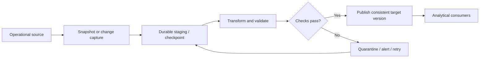

# OLTP, OLAP, and Operational–Analytical Separation

> **Module:** Stage 2D — Data Architecture / `05-Database-and-Storage-Architecture/`  
> **Topic:** 1 of 7  
> **Scope:** Vendor-neutral architectural reasoning. This is not a database administration tutorial.  
> **Scenario note:** Northbridge Bank and all scenario numbers in this lesson are fictional, illustrative assumptions—not real organizational facts, benchmarks, service guarantees, or universal targets.

## 1. Learning objectives

By the end of this lesson, you should be able to:

1. Define online transaction processing (OLTP), online analytical processing (OLAP), operational and analytical systems, workload, contention, and isolation.
2. Classify work from its access pattern and correctness needs rather than from the name of the application or database.
3. Compare typical OLTP and OLAP workload shapes, including point access, scans, joins, aggregation, concurrency, latency, data horizon, integrity, and data models.
4. Profile a workload with measurable evidence: read/write mix, keys versus ranges, rows touched, query frequency, concurrency, latency targets, freshness, peak factor, and data horizon.
5. Explain how shared resources can cause performance contention and how that differs from a logical consistency or isolation problem.
6. Compare four separation patterns: one database with scheduled analytics, a reporting/read replica, a separate analytical store populated by batch or change capture, and event-based publication.
7. Explain synchronization choices and failure modes, including full versus incremental transfer, change data capture (CDC), lag, ordering, deletes, partial loads, reconciliation, and point-in-time consistency.
8. Quantify illustrative data movement, state assumptions and units, and interpret the result without mistaking an estimate for a guarantee.
9. Recommend the simplest adequate architecture by weighing performance, freshness, correctness, cost, governance, security surface, operational ownership, and complexity.
10. Defend a decision to separate—or not to separate—using evidence, a measurement plan, and a revisit trigger.

## 2. Why the topic matters in real-world data architecture

An operational application may need to post a payment correctly and return quickly. An analyst may need to scan several years of transactions, join them to customer and product data, and calculate monthly exposure. Those requests are both legitimate, but they have different resource and correctness profiles.

If a large analytical query shares a constrained database with payment posting, it may consume CPU, memory, disk or network I/O, cache capacity, and connections needed by operational transactions. The operational service may become slower even if the analytical query is read-only. Conversely, creating a separate analytical platform without a measurable need adds data movement, infrastructure, security controls, monitoring, reconciliation, and operational ownership.

The architecture question is therefore not “Should OLTP and OLAP always be separate?” It is:

> **Given the observed workload, correctness requirements, freshness target, constraints, and operating cost, what is the least complex design that meets the need with measurable headroom?**

The answer may be separation, a limited hybrid, or keeping workloads together. It must follow evidence rather than habit.

### The decision chain

```text
Business need
    ↓
Workload profile → access patterns → correctness and freshness needs
    ↓
Candidate designs → quantify data movement and resource impact
    ↓
Compare cost, risk, security, and operational complexity
    ↓
Choose and record the design → measure → revisit when evidence changes
```

**Check your understanding:** Why can both overloading an operational database and building an unnecessary warehouse be architecture mistakes?  
**Answer guidance:** Both result from choosing a design before measuring the workload and its requirements; one risks operational performance, the other adds cost and failure modes without demonstrated value.

## 3. Prerequisite knowledge

The roadmap expects the learner to have passed the relevant gates in:

- **Requirements and constraints (Stage 2D, Module 2):** workload volume, growth, latency, throughput, freshness, availability, constraints, risks, trade-offs, and architecture decision records (ADRs).
- **Data architecture patterns (Module 3):** data warehouse, data lake, lakehouse, and event-driven patterns at a conceptual level.
- **Data modeling (Module 4):** entities, keys, relationships, normalization, dimensional models, and historical data.
- **Data engineering practice (Stages 2–2C):** SQL, batch and streaming pipelines, and file/table concepts. Deep database administration is not assumed.

If these terms are unfamiliar, pause and review the relevant prerequisite module before proceeding. This lesson introduces the vocabulary needed for this topic but does not replace those modules.

## 4. Beginner-level learning sequence

### 4.1 Core terms

| Term | Meaning | Why it matters | Example |
|---|---|---|---|
| **OLTP — online transaction processing** | Processing individual business transactions, commonly involving short reads or writes and explicit integrity rules. | A transaction must preserve business correctness while many requests may run concurrently. | Post a payment and update the corresponding account ledger. |
| **OLAP — online analytical processing** | Querying data to understand patterns, totals, trends, or segments, often across many records and a historical period. | Large scans and aggregations have different resource needs from small transactional requests. | Aggregate monthly payment totals by region for three years. |
| **Operational system** | A system that supports current business activity and records or serves operational state. | Its response time and correctness may directly affect users or business processes. | Payment service or account service. |
| **Analytical system** | A system or workload designed to analyze data, often combining history from multiple sources. | It supports reporting, exploration, trend analysis, and decision-making. | A reporting store for historical transactions. |
| **Workload** | The actual mix of operations a system performs, including query shapes, rates, concurrency, and resource demand. | A system name alone does not reveal its behavior. | 70% point reads, 20% updates, and 10% scans is a workload description if measured over a defined interval. |
| **Contention** | Competing requests needing the same limited resource or coordination mechanism at the same time. | Contention can increase queueing, wait time, retries, and tail latency. | A large scan and payment requests competing for disk I/O. |
| **Isolation** | The transaction property that controls how concurrent transactions observe one another's changes. Exact guarantees depend on the database's isolation model. | It helps prevent unacceptable anomalies, but stronger isolation can add coordination or waiting. | A balance update must not read an invalid intermediate state. |
| **Freshness** | How current a consumer's data are relative to the source or business event. | A dashboard that is five minutes behind may be acceptable; a payment authorization may not be. | “Most source changes visible within two minutes” is a target to measure, not an automatic guarantee. |

**Important distinction:** Contention is primarily a resource or coordination problem; inconsistency is a correctness problem. They can interact, but they are not the same. A system can be consistent and slow, or fast and incorrect. Isolation is one part of transaction correctness, not a synonym for performance.

**Check your understanding:** A query takes 40 seconds to scan a large history table. Is that enough to call it OLAP?  
**Answer guidance:** Not by itself. The query shape and purpose—large scan, aggregation, historical analysis—support the classification; elapsed time is an observation, not the definition.

### 4.2 Typical OLTP and OLAP tendencies

The following table describes common tendencies, **not universal laws**. Modern systems can combine row and column storage, parallel execution, transactions, and analytical features. Measure the actual workload and platform rather than relying on the label.

| Dimension | Typical OLTP tendency | Typical OLAP tendency | Architectural implication |
|---|---|---|---|
| Main operation | Insert, update, delete, or look up a business entity | Scan, join, group, aggregate, and compare records | Match the design to the dominant access pattern. |
| Access shape | Point lookups by key; small ranges | Broad ranges, large scans, multi-table joins | Indexes and selective access help point operations; scan-oriented layouts can help analytical reads. |
| Rows touched per request | Often a few rows, sometimes more for a transaction | Often many thousands to millions or more | A single analytical query can consume substantial shared resources. |
| Read/write mix | Commonly a mix of reads and writes; writes are business-critical | Often read-heavy, with batch loads or corrections | Analytics still has writes during ingestion, merges, and maintenance. |
| Concurrency | Frequently many concurrent short requests | Often fewer concurrent queries, each potentially resource-intensive | Count both concurrent requests and their resource intensity. |
| Latency expectation | Often low latency, sometimes milliseconds | May tolerate seconds or minutes for complex queries | These are broad tendencies; define targets per use case. |
| Data horizon | Current state and recent operational history | Current plus long historical periods | History increases scan volume and may need separate organization. |
| Integrity focus | Transactional rules, constraints, atomicity, and correct current state | Correctly defined analytical result and a consistent as-of view | Analytics must not silently combine incompatible snapshots. |
| Data model | Often normalized relational entities for update integrity; not always | Often dimensional, denormalized, wide, or column-oriented layouts; not always | Modeling follows query and maintenance needs. |
| Typical risk when overloaded | Slow or failed business transactions | Slow reports, delayed analysis, and increased compute cost | Separation is one possible control, not the only one. |

**Point access** retrieves a record or a small set using a specific key. A **range access** retrieves records across an ordered interval, such as all transactions in a date range. A **scan** examines many records or columns to find or aggregate relevant data. A **join** combines records based on a relationship. An **aggregation** computes a result such as `SUM`, `COUNT`, or an average over a set.

**Check your understanding:** Why can one query that touches millions of rows be more disruptive than many indexed lookups, even if both are read-only?  
**Answer guidance:** The scan can consume much more I/O, CPU, memory bandwidth, cache, and execution capacity; the actual impact depends on hardware, query plan, concurrency, and resource controls.

### 4.3 What a shared database does under pressure

A database has finite resources. Several mechanisms can make workloads interfere:

- **CPU:** analytical joins, sorts, and aggregations can occupy cores needed by short transactions.
- **Memory:** large hash joins or sorts may use memory that would otherwise cache frequently accessed operational pages. Memory pressure can trigger spills or extra I/O.
- **Storage and network I/O:** scans can compete with transaction reads, writes, log flushes, and replication traffic.
- **Locks:** transaction coordination may make one operation wait for another. Long transactions can hold locks longer, depending on the database and operation.
- **Latches and internal coordination:** short-lived synchronization protects internal in-memory structures. Latch contention is different from business-level row-lock contention.
- **Caches:** a broad scan may displace hot operational data from a cache, increasing later misses and reads.
- **Connection pools and worker capacity:** analytical queries can occupy connections or execution slots, leaving operational requests queued before they even execute.

These are mechanisms to investigate, not proof that every slow report will affect every database. Some systems isolate resources well; others permit resource controls, workload groups, query limits, or separate compute. A diagnosis requires metrics and a representative test.

**Check your understanding:** If payment latency rises while CPU is stable but storage wait time and connection-pool queueing rise, what should you investigate before buying a new database?  
**Answer guidance:** Correlate the timing with query activity, I/O, pool saturation, waits, query plans, and transaction duration; test whether limiting or rescheduling analytics resolves the contention.

## 5. Intermediate-level learning sequence

### 5.1 Profile evidence before classifying

Create a workload profile for each important operation or coherent group of operations. Record the observation window and how each metric was collected. If a number is unknown, mark it unknown; do not replace it with a confident guess.

| Profile field | What to capture | Why it matters |
|---|---|---|
| Business purpose and criticality | What outcome does it support? What happens if it is late or wrong? | Separates operational correctness from reporting convenience. |
| Read/write mix | Reads, inserts, updates, deletes as counts or percentages over a stated interval | Helps characterize load, but percentages alone do not measure query cost. |
| Access shape | Key lookup, range scan, full scan, join, aggregation; common predicates | Connects the workload to the physical access pattern. |
| Rows and bytes touched | Typical and high-percentile rows/bytes scanned or modified | Captures work per request, not just request count. |
| Query frequency and concurrency | Requests per second/minute, concurrent active requests, burst pattern | Shows demand and queueing risk. |
| Latency | Target and measured percentiles, such as p50/p95/p99, with time units | An average can hide slow requests that harm users. Do not invent a target. |
| Freshness | Maximum acceptable age or end-to-end lag, with units | Determines whether batch, micro-batch, CDC, or events are feasible. |
| Peak factor | Peak rate divided by average rate over a defined interval | Avoids sizing only for an average that hides bursts. |
| Data horizon | Current state, recent days, months, or years; expected retention | Determines scan scope and storage growth. |
| Correctness and consistency | Transaction boundaries, ordering needs, acceptable staleness, point-in-time requirements | Determines whether a copy is safe for the consumer's decision. |
| Constraints | Sensitive fields, residency, access rules, budget, skills, recovery needs | Eliminates designs that are not acceptable even if fast. |

#### Illustrative profile example

Assume, only for teaching, that a customer-service screen makes 800 requests per second at peak, each request performs three indexed lookups and reads about 8 rows total, and its p95 latency target is 150 ms. It may combine operational data with a recent-activity summary. These numbers are illustrative assumptions, not a benchmark or a claim about a real system. The profile suggests many short point accesses, but the summary's source and freshness still need analysis. A query count alone cannot prove the system has capacity.

**Check your understanding:** Why record both rows touched and requests per second?  
**Answer guidance:** Request rate describes frequency; rows/bytes and query shape approximate work per request. Two workloads with the same request rate can have very different resource demand.

### 5.2 Mixed workloads: decompose the need

“Mixed” is not a vague middle category. It means a use case contains sub-operations with materially different access patterns or correctness needs. Separate the sub-operations on paper before deciding whether they need separate systems.

- **Operational dashboard:** the current status tile may need a low-latency point lookup; a 12-month trend chart may scan history and aggregate many rows. The dashboard can combine a current operational endpoint with a precomputed or analytical trend.
- **Fraud scoring:** a decision may need current account status and recent transaction features, plus historical patterns. The decision path has a strict response budget and correctness constraints; feature generation or model training can be a separate analytical process. The design must specify how stale each feature may be.
- **Customer-service view:** current address and account state may come from operational entities, while historical interactions and aggregate activity may be analytical. The user interface may need a clear “as of” timestamp for the analytical portion.

A mixed use case can remain in one store if volume, concurrency, latency, correctness, and capacity evidence support it. It can also use precomputed summaries or a separate analytical read path. Avoid forcing the entire use case into one label.

**Check your understanding:** A fraud decision reads the current account status and a 90-day transaction-risk aggregate. Which part is operational and which is analytical?  
**Answer guidance:** The current status lookup is operational; producing or querying the historical aggregate is analytical in shape. The end-to-end decision is mixed and must define the aggregate's freshness and the decision's correctness needs.

### 5.3 Four separation options

Use the lowest-complexity option that meets measured requirements. These options are patterns, not product recommendations.

| Option | How it works | Benefits | Costs and limitations | Typical failure modes / use conditions |
|---|---|---|---|---|
| **A. Same database; schedule analytics off-peak** | Reports run on the operational database during a quieter window, perhaps with query limits or precomputed summaries. | Lowest data duplication and integration overhead; data can be current at query time. | Analytics still shares resources; month-end or unexpected bursts may overlap with operations; a long report can exceed its window. | Suitable when measured headroom exists, freshness is relaxed, and reports are bounded. Fails when “off-peak” is not actually quiet or workload growth consumes headroom. |
| **B. Reporting/read replica** | Changes from the primary are replicated to another database instance; reporting reads from the replica. | Can move read queries away from the primary's query execution resources; often preserves a similar schema and query interface. | Replication consumes primary and network resources; replica has lag and may be behind; schema and row-oriented layout may still be poor for large analytics. | Suitable for read offload and modest reporting. Fails if lag is ignored, heavy reports overwhelm the replica, or primary-side log/replication work is underestimated. |
| **C. Separate analytical store populated by batch or CDC** | Data are extracted periodically or changes are captured and applied to a warehouse, lakehouse, or other analytical store. | Independent analytical compute and layout; history and cross-source joins can be organized for analytics; consumers can be governed separately. | Pipeline build/run cost, duplicated data, transformation and schema management, monitoring, reconciliation, storage/compute cost, and additional security surface. | Suitable when scans/history or cross-source analysis justify a distinct store. Fails through stale or partial loads, missed deletes, broken mappings, or unclear ownership. |
| **D. Event-based publication** | The operational domain publishes business events; analytical consumers process them into their own views or stores. | Decouples producers and consumers; can support low-latency downstream updates and multiple consumers. | Requires event contracts, delivery/retry handling, ordering strategy, idempotency, schema evolution, replay and retention decisions; consumers may temporarily diverge. | Suitable when event semantics and low-latency distribution are useful. Fails through missing/duplicated/out-of-order events, incompatible contracts, or consumers that cannot rebuild state. |

A replica is not automatically a complete analytical architecture. It may offload query execution but still retain the source schema, limited history, and unsuitable access layout. A replica can also add load to the primary through change logging, shipping, network transfer, replay/apply work, and extra I/O. The amount depends on implementation and write rate; measure it.

**Check your understanding:** A reporting replica reduces report CPU on the primary, but payment latency still rises when replication lag grows. Is that impossible?  
**Answer guidance:** No. Replication can consume source-side resources and may compete for I/O or network capacity. Confirm the mechanism with metrics rather than assuming a replica is free.

### 5.4 Moving and synchronizing data

Data movement is not just copying rows. The architecture must define what changes are moved, when they become visible, how order is preserved, and how correctness is checked.

#### Full transfer versus incremental transfer

- **Full transfer:** read and copy the entire selected dataset. It is conceptually simple and may be appropriate for a small dataset, initial load, or controlled rebuild. Its cost grows with total data size, and a long-running copy can represent different moments in time unless a consistent snapshot is used.
- **Incremental transfer:** copy only records considered new or changed since a checkpoint, watermark, log position, or other reliable boundary. It usually reduces repeated movement, but requires a correct change-detection mechanism, checkpoint management, and recovery behavior.
- **Change data capture (CDC):** a family of techniques that identifies source inserts, updates, and deletes and makes them available downstream. At a conceptual level, CDC may be based on transaction-log changes or other capture methods. Exact guarantees, ordering, transaction boundaries, and retention depend on the source and capture mechanism; do not assume all CDC implementations behave identically.
- **Event-based publication:** a producer emits domain events, such as `PaymentPosted`, for consumers. Events represent declared business facts, not necessarily every physical database mutation. A consumer must understand event meaning and delivery semantics.

#### Synchronization properties to specify

1. **Freshness and lag:** measure the time between a source change and its usable visibility downstream. Define whether the target is average, p95, maximum observed, or a business-defined bound. A mechanism name alone is not a guarantee.
2. **Ordering:** related changes may need to be applied in source order, per key, or within a transaction. Global ordering can be expensive or unavailable; define the actual business requirement.
3. **Deletes:** a pipeline must propagate deletion or an explicit tombstone/soft-delete state. If it only copies inserts and updates, deleted source records can remain visible forever downstream.
4. **Idempotency and duplicates:** retries can repeat delivery. Applying the same change more than once should not corrupt the target; deduplication keys or idempotent upserts may be needed.
5. **Partial loads:** a failed job must not make half a dataset appear to be the complete new version. Stage data, validate it, and publish/advance a checkpoint only after the required checks succeed.
6. **Reconciliation:** compare source and target using appropriate controls—row counts, counts by partition/date, key coverage, sums/control totals, and targeted record checks. A matching row count alone cannot prove that every value is correct.
7. **Point-in-time consistency across related tables:** a report joining `accounts` and `payments` may be wrong if the account table reflects 10:05 while payments reflect 09:50 and the business requires a common snapshot. Use a consistent source snapshot, transaction-aware capture, coordinated watermarks, or an explicit as-of model where supported. If the design cannot guarantee a common point in time, document the limitation and assess whether the consumer can tolerate it.
8. **Schema and contract changes:** downstream transformations must handle source schema evolution. A new nullable field, renamed field, or changed meaning can break pipelines even when transport continues.

#### Illustrative synchronization flow



This is a conceptual flow. It does not imply that a particular platform provides atomic publication, transaction-aware capture, or a specific recovery guarantee. Those capabilities must be verified for the chosen implementation.

**Check your understanding:** A pipeline copies 100,000 rows, fails after 70,000, and consumers immediately query the target. What design problem is present?  
**Answer guidance:** Partial publication. The target needs a staging/validation/publish boundary or another explicit way to prevent consumers treating incomplete data as complete.

### 5.5 Quantify the data movement

Use the roadmap's illustrative method:

```text
daily_change_volume = changed_rows_per_day × average_row_size
required_sync_throughput = peak_change_rate × average_row_size
```

Here, `peak_change_rate` is measured in **rows/second** during the defined peak interval, and `average_row_size` is measured in **bytes/row**. The throughput result is **bytes/second**. These formulas estimate payload volume only; they do not include protocol overhead, metadata, indexes, compression, retries, replication logs, or transformation costs unless those are explicitly included in the row-size assumption.

#### Worked calculation — illustrative assumptions

Assume a fictional source changes **5,000,000 rows/day**, with an average transferred row payload of **400 bytes/row**. Use decimal units: **1 GB = 1,000,000,000 bytes** and **1 KB = 1,000 bytes**.

**Step 1: Daily payload volume**

Formula:

\[
\text{daily change volume} = \text{changed rows/day} \times \text{bytes/row}
\]

Substitution:

\[
5{,}000{,}000\ \text{rows/day} \times 400\ \text{bytes/row}
= 2{,}000{,}000{,}000\ \text{bytes/day}
\]

Therefore, the estimated payload is **2.0 GB/day** (decimal), before overhead.

**Step 2: Average rate across a 24-hour day**

There are **86,400 seconds/day**.

\[
\text{average rate} = \frac{2{,}000{,}000{,}000\ \text{bytes/day}}{86{,}400\ \text{s/day}}
\approx 23{,}148\ \text{bytes/s}
\]

That is approximately **23.1 KB/s** (decimal), averaged over the full day.

**Step 3: Peak rate using an illustrative peak factor of 10**

Assume the peak payload rate is **10 times** the average. This is a teaching assumption, not a universal peak factor.

\[
\text{peak payload rate} = 23{,}148\ \text{bytes/s} \times 10
\approx 231{,}480\ \text{bytes/s}
\]

That is approximately **231 KB/s** (decimal, rounded to the nearest whole KB/s), before overhead. Using the unrounded average rate gives approximately **231,481 bytes/s**, or **231.48 KB/s**.

Equivalently, the average row-change rate is:

\[
\frac{5{,}000{,}000\ \text{rows/day}}{86{,}400\ \text{s/day}}
\approx 57.8704\ \text{rows/s}
\]

At a peak factor of 10, the assumed peak is approximately **578.704 rows/s**. Multiplying by **400 bytes/row** gives:

\[
\left(\frac{5{,}000{,}000\ \text{rows/day}}{86{,}400\ \text{s/day}}\times 10\right)\times 400\ \text{bytes/row}
\approx 231{,}481.48\ \text{bytes/s}
\]

The two calculations agree when unrounded values are used. The peak estimate is a payload rate, not a guaranteed end-to-end synchronization capacity.

**Interpretation:** the simple payload estimate suggests that the average is around 23 KB/s and the assumed peak around 231 KB/s. It does **not** prove that the pipeline can meet a freshness target. Actual feasibility also depends on event/change overhead, source capture cost, batching, target write behavior, network conditions, retries, transformation, and whether a backlog must be cleared after an outage. Measure those separately and use a safety margin justified by evidence.

**Check your understanding:** If daily changed rows double but row size and the peak factor remain the same, what happens to the estimated daily payload and peak throughput?  
**Answer guidance:** Both double under the stated assumptions. This is arithmetic scaling, not a guarantee that system cost or latency doubles exactly.

### 5.6 Freshness, cost, and operational complexity

Faster visibility usually requires more frequent work, continuous infrastructure, lower-latency transport, or more careful coordination. That can increase compute, network, monitoring, failure-handling, and on-call complexity. Batch is not inherently wrong; it is wrong only when its achievable freshness conflicts with the consumer's requirement.

| Approach | Typical freshness shape (not a guarantee) | Cost/complexity tendency | Main question |
|---|---|---|---|
| Scheduled full or incremental batch | Often minutes to hours, depending on schedule and duration | Lower continuous-operation burden; may have large periodic work and batch windows | Can the consumer tolerate the schedule and the time to recover a failed run? |
| Micro-batch | Often minutes or another configured interval | More frequent execution and checkpointing; may balance latency and simplicity | Does the interval plus processing time meet the target under peak load? |
| CDC pipeline | Can be seconds or minutes when designed and provisioned for it | Continuous capture, apply, lag monitoring, and recovery responsibilities | Can it preserve required order and recover without losing changes? |
| Event-based consumers | Can be seconds or minutes when the producer and consumers keep up | Event contracts, replay, retries, idempotency, consumer ownership | Are event semantics and delivery/recovery behavior adequate? |

These are broad patterns, not product guarantees. The real freshness distribution must be measured end to end, including source commit, capture, transport, processing, and consumer visibility.

**Check your understanding:** A nightly report is accurate but becomes visible 12 hours after the business event; the requirement says data must be visible within 15 minutes. Is this a performance tuning issue alone?  
**Answer guidance:** No. The architecture's synchronization mechanism and schedule conflict with the freshness requirement. A different batch cadence, CDC, events, or a changed business requirement must be evaluated.

## 6. Advanced-level learning sequence

### 6.1 Distinguish performance contention from correctness defects

Use two diagnostic tracks:

- **Performance track:** latency percentiles, throughput, CPU, memory pressure, I/O wait, cache hit/miss behavior, lock/latch waits, connection-pool queues, active query shapes, replication apply pressure, and time correlation.
- **Correctness track:** transaction boundaries, isolation behavior, source/target watermarks, missing/duplicate keys, delete propagation, control totals, referential relationships, and whether joined tables represent a coherent point in time.

A query that waits for a lock may involve both performance and transaction coordination. However, a dashboard showing an old value may be a freshness/replication issue, not resource contention. A dashboard combining tables from inconsistent points in time may be a consistency design defect even when every query runs quickly.

Do not “fix” a correctness issue by simply increasing capacity. Do not “fix” a resource bottleneck by weakening integrity guarantees without a reviewed business justification.

### 6.2 Point-in-time consistency across tables

Suppose an account has a balance row and a set of payment rows. A downstream report sums payments and compares the result with the account balance. If the copy includes a payment committed after the account snapshot but before the next account update arrives, the join may represent no real state that ever existed in the source.

Possible controls depend on the source and target capabilities:

- Capture a transaction-consistent snapshot for the initial load.
- Carry a source commit position, transaction identifier, or coordinated watermark where available.
- Apply related changes in an order that preserves required invariants.
- Publish a target version only after all required tables reach the defined boundary.
- Include an explicit `as_of` or freshness marker so consumers understand the view.
- Reconcile domain-level invariants, not only table counts.

No single technique applies to every system. If cross-table consistency cannot be guaranteed, document what inconsistencies can occur, how long they may persist, and whether the business decision can tolerate them.

**Check your understanding:** Why can matching row counts in two tables fail to prove a correct analytical snapshot?  
**Answer guidance:** The same number of rows can contain different keys or values, miss deletes while duplicating other records, or combine changes from different source times. Counts are one control, not complete proof.

### 6.3 Failure cases and recovery design

| Failure case | Symptom and risk | Detection/control | Recovery consideration |
|---|---|---|---|
| Replica lag | Reports show old values; a dashboard may imply that a recent payment has not happened. | Track lag and source-to-visible timestamps; show “as of” time; define consumer-specific staleness limits. | Decide whether to wait, read from the primary for a specific query, or flag the view as stale. |
| Stale pipeline | A scheduled or continuous job stops while consumers keep querying old data. | Heartbeats, freshness SLO/target, alerts on watermark age, and job-failure monitoring. | Restart from a reliable checkpoint; communicate stale status; validate after catch-up. |
| Missing deletes | Deleted or deactivated source records remain in analytics. | Compare delete/tombstone counts and key-level samples; include deletion tests. | Replay retained changes or reconcile from a source snapshot; respect retention and legal deletion requirements. |
| Partial load published | Consumers see a mixture of old and new partitions or tables. | Stage, validate, and publish atomically where supported; track run/version identifiers. | Revert to the last known-good version or finish/rebuild the failed load before publication. |
| Reconciliation failure | Counts, totals, key coverage, or domain invariants differ. | Predefined control totals, partition-level checks, sampling, and exception thresholds. | Quarantine the affected range, find the first divergent checkpoint, replay or repair, and document disposition. |
| Out-of-order or duplicate changes | Older values overwrite newer state or repeated events double-count measures. | Sequence/version checks, idempotent application, deduplication keys, and per-key ordering where required. | Replay with ordering rules; rebuild affected state if safe correction cannot be isolated. |
| Sensitive data copied without equivalent controls | The analytical copy exposes fields or users that were restricted at the source. | Data classification, least privilege, masking/minimization, encryption, audit, retention/deletion controls, and access review. | Restrict access immediately, investigate exposure, remediate the copy and downstream extracts, and follow applicable incident processes. |
| Primary overloaded by replication | The replica helps report execution but increases source-side I/O, log work, or network demand. | Compare primary resource metrics and transaction latency before/after replication; observe lag and write rates. | Tune transfer/apply behavior, limit scope, reduce change volume, or reconsider the design. |

The security boundary expands when data are copied: every target, staging area, log, backup, export, and downstream consumer may become another place to govern. Copy only fields needed for the use case and preserve equivalent controls appropriate to the data classification and policy.

### 6.4 When separation is justified—and when it is not

Separation is more compelling when evidence shows one or more of the following:

- Analytical scans or aggregations materially degrade critical operational latency or throughput.
- The analytical data horizon and query shape are poorly served by the operational model.
- The business requires analytical history, cross-source joins, or a freshness pattern that the operational store cannot meet economically.
- Workload isolation is required by governance, security, or operational ownership constraints.
- Measured peak demand leaves insufficient headroom, and query controls or scheduling cannot meet the target.

Separation may not be justified when volume and concurrency are modest, query shapes are bounded, operational latency remains within its target at peak, there is adequate measured headroom, freshness is relaxed, and no policy requires isolation.

#### Explicit no-separation case — illustrative

Assume a fictional internal team has 20 users and runs four bounded reports each business day against a dataset of 300,000 rows. A 30-day observation period shows that reports complete within the team's stated 20-second target, payment or customer operations remain within their existing latency targets during the report window, peak CPU and I/O have documented headroom, and no policy requires a separate copy. The team needs data that are current at query time and does not need multi-year cross-source analysis.

**Provisional recommendation:** keep the workload in the existing database, schedule or limit the reports if needed, and continue measuring. This is not a claim that 300,000 rows is always small or that 20 users are always safe. It is justified only by the stated evidence and assumptions. Revisit if report duration, operational latency, data horizon, concurrency, or governance requirements change.

**Check your understanding:** Why is “the dataset is small” insufficient by itself to justify keeping workloads together?  
**Answer guidance:** Query complexity, peak concurrency, resource headroom, correctness, freshness, and governance can dominate row count. The decision needs observed workload and service evidence.

### 6.5 Recommendation framework: compare at least three viable options

Use this framework for a real decision. Start with a baseline and compare feasible alternatives, not every imaginable technology.

| Criterion | Option A: shared database with bounded/off-peak analytics | Option B: reporting replica | Option C: separate analytical store via batch/CDC | Option D: event-based publication |
|---|---|---|---|---|
| Operational performance | Best if headroom and controls are proven; otherwise shared-resource risk | Reduces report execution on primary, but replication still adds load | Stronger separation of analytical compute; source still pays capture/extraction cost | Consumer work is separated; producer pays event-publication cost |
| Freshness | Current-at-query for source data, but reports may be delayed by schedule | Depends on replica lag | Depends on batch cadence or CDC end-to-end lag | Depends on event delivery and consumer processing lag |
| Correctness | Direct source reads avoid copy lag but still require correct transaction semantics | Must account for replica visibility and lag | Must handle snapshot boundaries, updates, deletes, duplicates, and reconciliation | Must define event meaning, order, duplicate handling, replay, and consumer state |
| Analytical fit | Limited if large scans/history compete with operations | Often similar schema to source; not automatically optimized for analytics | Can model history and queries for analysis | Depends on consumer's target store and event contract |
| Cost | Usually lowest added infrastructure; possible opportunity cost from shared capacity | Added replica and replication operation | Added target storage/compute, pipelines, transformations, monitoring, and people | Event infrastructure and consumer operations, contracts, replay, and monitoring |
| Governance/security | Fewer copies, but shared access must still be controlled | Additional copy and access boundary | More copies and derived data to govern; can tailor access if designed well | Events and consumer copies expand the governance surface |
| Complexity/ownership | Lowest if the current team can operate it safely | Replication health and read-routing ownership | Pipeline, target model, data quality, and incident ownership | Producer contract plus each consumer's reliability and state ownership |
| Typical trigger to choose | Measured headroom and relaxed analytics requirements | Primary query contention is the main issue and source-like reporting is sufficient | History, cross-source analysis, or analytical layout merits a separate store | Multiple consumers or low-latency domain-event distribution justify the event model |

A defensible recommendation should explicitly state:

1. **Baseline and evidence:** observed workload, peak period, query shapes, and current performance.
2. **Business targets:** latency, freshness, correctness, availability, retention, and security constraints.
3. **Candidates:** at least three viable options, including the simplest baseline when feasible.
4. **Quantification:** daily change volume, peak throughput, approximate storage/compute implications where data are available, and uncertainties.
5. **Trade-offs:** performance, freshness, correctness, cost, governance, security surface, complexity, and operational ownership.
6. **Failure analysis:** how the chosen design detects stale, partial, missing, duplicated, or inconsistent data.
7. **Measurement plan:** metrics, baseline period, owner, alert thresholds derived from requirements, and success criteria.
8. **Revisit trigger:** a measurable condition that would change the decision.

Do not invent prices or performance results. If cost inputs are unavailable, provide a cost model with missing inputs rather than fabricating a total.

### 6.6 Measurement plan and revisit trigger

For the 30-day observation exercise in the roadmap, collect representative normal, peak, and month-end behavior if applicable. Thirty days is an illustrative study window from the roadmap, not a universal minimum.

| Measure | How to use it | Decision relevance |
|---|---|---|
| Operational p95/p99 latency and error rate | Compare report windows with baseline periods; segment by operation | Did analytics harm critical transactions? |
| Throughput and concurrency | Capture average and peak rates, including bursts | Are observed peaks within tested capacity? |
| CPU, memory, I/O, cache and wait indicators | Correlate with query windows and queueing | Which resource is constrained, if any? |
| Query shape and rows/bytes scanned | Identify the most expensive report patterns | Can query changes, summaries, or limits solve the problem more simply? |
| Replica/pipeline lag | Track source commit to consumer visibility and backlog recovery | Does the design meet freshness under peak load and after interruption? |
| Reconciliation exceptions | Count and classify missing keys, deletes, duplicate changes, and control-total differences | Is the copy trustworthy for the intended decision? |
| Cost and operator effort | Track compute/storage/transfer and engineering/on-call time | Does separation deliver enough value to justify its lifecycle cost? |
| Security/governance findings | Review access, sensitive fields, retention, deletion, and audit coverage | Does the new boundary preserve required controls? |

**Example revisit trigger (illustrative):** reconsider separation if, during two consecutive peak reporting windows, payment p95 latency exceeds its approved target and investigation links the regression to analytical queries, or if the analytical freshness target is missed in three of five measured peak periods. The actual thresholds and count must be set from the business's accepted service objectives; these sample triggers are not universal standards.

**Check your understanding:** Why should a revisit trigger be measurable and linked to a requirement?  
**Answer guidance:** It makes the decision falsifiable and prevents architecture changes based only on anecdotes or preference.

## 7. Industry-application exercises

Complete the exercises before reading the answer guidance in Section 8. Treat every numeric input below as an **illustrative assumption** for practice only.

### Exercise A — classify 20 operations

For each operation, label it **OLTP**, **OLAP**, or **mixed** and justify the answer using access shape, rows touched, concurrency, correctness, and/or data horizon. A mixed answer should name its operational and analytical parts.

1. Post a payment and record the ledger entry atomically.
2. Retrieve one account's current balance by account ID.
3. Calculate total transaction value by region for each month over five years.
4. Search a customer's recent transactions by account key and date range for a service agent.
5. Recalculate daily totals for every merchant across all transactions.
6. Check current account status before allowing a transfer.
7. Build a dashboard with current account status and a 12-month trend chart.
8. Score a transaction using current account status and a 90-day risk aggregate.
9. Load a daily source snapshot into a historical analytical table.
10. Update a customer's phone number while enforcing uniqueness rules.
11. Produce a regulatory report across multiple years with control totals.
12. Count failed logins per user over the last 30 minutes to trigger an alert.
13. Display a precomputed “today's transactions” total for one branch.
14. Compare product profitability across customer segments and quarters.
15. Retrieve the latest payment status for one payment ID.
16. Join current customer details with historical interactions for a service screen.
17. Find duplicate payments by grouping records across a full day's activity.
18. Delete or deactivate an account under the applicable business rules.
19. Rebuild a customer-risk feature from historical events for model development.
20. Display a customer-service view that combines current account state, recent transactions, and a historical risk summary.

For each answer, avoid treating “read” as synonymous with OLAP or “write” as synonymous with OLTP. A read can be a broad analytical scan; a write can be a large analytical load. Use the operation's purpose and actual access pattern.

### Exercise B — profile five illustrative workloads

Create a profile for each workload below. The rates and sizes are intentionally incomplete; state which measurements you would collect rather than inventing them.

| Workload | Illustrative description | Required profile questions |
|---|---|---|
| **Payment posting** | A service records a payment, checks applicable business rules, and updates related ledger state. | Which records/keys are touched? What is the transaction boundary? What are peak writes/s, concurrency, latency target, retry behavior, and correctness constraints? |
| **Balance enquiry** | A customer requests the current balance for one account. | Is access by account key? Is the balance stored or computed? What are request rate, p95/p99 target, cache behavior, and acceptable staleness? |
| **Fraud scoring** | A transaction decision uses current account data and historical risk features. | Which inputs must be current? Which features can be stale, and by how much? What is the end-to-end latency budget, feature-update rate, and behavior when a feature is missing? |
| **Regulatory reporting** | A report aggregates transactions and account attributes across a multi-year period. | How many rows/bytes are scanned? Which joins and totals are required? What is the report deadline, point-in-time requirement, retention, and reconciliation evidence? |
| **Executive dashboards** | Leaders view current indicators and trends by product, region, and period. | Which tiles require current values versus historical aggregates? What freshness is needed per tile, query frequency, concurrency, scan volume, and acceptable “as of” timestamp? |

### Exercise C — separation and contention analysis

For a fictional payment system, a month-end report is associated with payment API latency rising from an illustrative baseline p95 of 90 ms to 180 ms. Do not assume causation from correlation alone.

1. List the metrics and query evidence needed to test whether the report caused the regression.
2. Propose a low-cost, medium-cost, and higher-complexity option.
3. Compare at least three viable options using Section 6.5.
4. Calculate data movement using the supplied values in Section 5.5, then state which overheads remain unquantified.
5. Specify a measurement plan and a revisit trigger.

### Exercise D — synchronization failure tabletop

Assume a target table is updated incrementally. During an outage, the capture process stops; on restart, it replays some changes twice, omits deletes from its change contract, and publishes a partially updated date partition.

Write a recovery sequence that covers: detection, consumer notification, checkpoint inspection, duplicate handling, delete repair, reconciliation, safe publication, and prevention of recurrence. Identify which facts depend on the actual CDC/event mechanism and must be verified before implementation.

## 8. Practical scenarios and case-based reasoning

### 8.1 Fictional Northbridge Bank — illustrative teaching case

Northbridge Bank is a fictional organization used only to practice architecture reasoning. The following assumptions are invented for this lesson and are not claims about any real bank.

- Payment posting is business-critical and must preserve ledger correctness.
- Balance enquiry is a frequent point lookup.
- Fraud scoring combines current account state with historical features.
- Regulatory reporting needs reproducible historical totals and reconciliation.
- Executive dashboards combine current indicators with historical trends.

**Reasoning:** payment posting and balance enquiry are predominantly operational. Regulatory reporting is predominantly analytical. Fraud scoring and executive dashboards are mixed end-to-end, so profile their components separately. A separate analytical store is a plausible candidate for history-heavy reporting, but the decision still depends on observed volume, freshness, correctness, and cost. Fraud decisions may require a low-latency serving path even if the features are produced analytically.

A defensible proposal might keep payment posting on the operational transaction path, serve bounded balance enquiries from that path, and evaluate a separate analytical target for multi-year reporting. It should not assert that a particular database, replica, or event system is required without evidence. For fraud scoring, define which feature values must be fresh, how missing/stale features are handled, and whether the decision can proceed safely. For dashboards, label freshness and separate current tiles from historical aggregates if their needs differ.

**Check your understanding:** Why not send every fraud-scoring query directly to a large historical warehouse?  
**Answer guidance:** The decision path may have a strict latency and availability budget, and historical scans may be too expensive or unpredictable. A precomputed serving feature or bounded lookup may be more appropriate, but the correct design depends on measured requirements.

### 8.2 Scenario: a month-end report doubles payment latency

**Diagnosis before design:** correlate the report's start and query plan with payment p95/p99 latency, throughput, error rate, CPU, memory, I/O, cache behavior, lock/latch waits, and connection-pool queueing. Check other changes occurring at the same time. Confirm whether the report scans broad ranges, joins large tables, or holds long transactions. Reproduce the pattern safely if possible.

**Options at three complexity levels:**

1. **Lower complexity:** optimize the report's filters/joins, limit concurrency, schedule it away from payment peaks, or use a bounded/precomputed summary. This is appropriate if the measured impact can be eliminated and headroom remains.
2. **Moderate complexity:** evaluate a reporting replica. Verify source-side replication cost, replica lag, reporting capacity, and whether the source-like model serves the report efficiently.
3. **Higher complexity:** populate a separate analytical store using a batch/CDC pipeline or publish suitable events to analytical consumers. This can provide better workload and layout isolation, but adds synchronization, governance, cost, and operational responsibilities.

Choose based on measured success against requirements. Do not assume the highest-complexity option is best.

### 8.3 Scenario: a small lending team requests a warehouse

Ask what decisions the team needs to make, how often it queries, what history it needs, whether it joins data across sources, the freshness target, and whether the current system meets its targets. Measure query duration, scanned data, concurrency, and operational impact. If a modest workload already meets its target with headroom and there is no policy or history requirement, a separate warehouse may not be justified. If the request reflects a genuine need for cross-source history or repeatable governed reporting, a separate analytical store may be justified even with a small user count.

### 8.4 Scenario: dashboard balances differ from the app by a few minutes

This may be expected if the dashboard reads a replica or analytical copy with measured lag. It is not automatically acceptable: compare the observed lag with the business requirement and show an “as of” timestamp. If the dashboard is used for a decision requiring current balance, the staleness may be a defect. If it is a historical trend view with a documented freshness target, the same lag may be acceptable. Investigate whether all joined tables share a coherent point-in-time view; a small lag alone does not explain every discrepancy.

### 8.5 Scenario: keep workloads together

Use the explicit no-separation case in Section 6.4. Write a short decision record stating the evidence for keeping the workload together, what is monitored, which constraints are assumed, and the exact conditions that would cause a revisit. A no-separation decision is still an architecture decision; it is not a decision to ignore risk.

## 9. Expected outputs and deliverables

Produce the following learning artifacts for this topic:

1. **Workload classification sheet:** all 20 operations labelled OLTP, OLAP, or mixed, each with a one- or two-sentence justification.
2. **Five workload profiles:** payment posting, balance enquiry, fraud scoring, regulatory reporting, and executive dashboards. Include observed values where available, units, measurement window, unknowns, and assumptions.
3. **Contention analysis:** the resources likely to be shared, evidence to collect, and plausible alternative causes for a performance regression.
4. **Data-movement estimate:** daily payload, average rate, peak rate, assumptions, units, unquantified overheads, and a sensitivity case.
5. **Separation options comparison:** at least three viable options, including a baseline when feasible; compare performance, freshness, correctness, cost, governance/security, complexity, and ownership.
6. **Recommendation and measurement plan:** selected option, rejected alternatives, evidence, success criteria, owner, monitoring, and revisit trigger.
7. **Failure/recovery note:** handling of lag, stale data, deletes, partial publication, ordering/duplicates, and reconciliation failures.
8. **Practice answer key:** corrected classifications and explanations for any mistakes.

Keep the assumptions visible. A reviewer should be able to reproduce your arithmetic, understand your classification, identify which facts were measured, and challenge the recommendation without guessing what you meant.

## 10. Common mistakes and misconceptions

- **“Every analytical workload needs a separate platform.”** False. Separate only when workload evidence, requirements, or constraints justify the added system and operating model.
- **“A read-only query cannot hurt writes.”** False. Reads can consume CPU, memory, I/O, cache, worker slots, and connections; the actual impact depends on resource isolation and workload shape.
- **“A replica removes all load from the primary.”** False. Replication itself requires source-side work and transport; measure the impact.
- **“A replica is a warehouse.”** Not necessarily. It may have the same schema, insufficient history, and a layout poorly suited to scans and aggregations.
- **“Read means OLAP and write means OLTP.”** False. A read may be a single-key operational lookup or a multi-year scan. A bulk analytical load is a write.
- **“A system name tells me the workload.”** False. Profile the actual operations, rates, concurrency, rows/bytes touched, and correctness needs.
- **“A nightly job is fresh enough because it is reliable.”** Reliability and freshness are different properties. Compare measured visibility time with the business target.
- **“Incremental means no missing changes.”** False. Correctness depends on capture boundaries, checkpointing, retries, deletes, ordering, and recovery.
- **“Matching row counts proves the copy is correct.”** False. Use key coverage, value checks, control totals, deletes, and domain invariants as appropriate.
- **“All CDC mechanisms guarantee the same order and consistency.”** False. Verify the actual implementation's semantics and limits.
- **“A quick query is necessarily correct.”** False. Performance does not prove transaction isolation or point-in-time consistency.
- **“A correct query is necessarily fast.”** False. Correctness and performance require separate evidence.
- **“More frequent synchronization is free.”** False. It can increase compute, network, storage, operational complexity, and failure-handling work.
- **“Copied data inherits the source's controls automatically.”** False. Every target and downstream copy needs appropriate access, audit, retention, deletion, and sensitive-data controls.
- **“The illustrative numbers are benchmarks.”** False. They demonstrate calculation method only; real inputs must be measured or explicitly estimated.

## 11. Mastery criteria

You have mastered this topic when you can demonstrate all of the following without relying on memorized labels:

- Explain OLTP, OLAP, operational and analytical systems, workload, contention, and isolation accurately.
- Classify at least 90% of the 20 practice operations correctly and explain why mixed operations contain more than one workload shape.
- Produce five workload profiles that state access patterns, units, observation windows, concurrency, latency, freshness, data horizon, correctness, and unknowns.
- Explain at least three resource-contention mechanisms and distinguish them from consistency defects.
- Compare the four separation patterns and identify both their benefits and their failure modes.
- Quantify daily change volume and required peak payload throughput with correct units and independently checked arithmetic.
- Explain full versus incremental transfer, CDC/event synchronization, lag, ordering, deletes, duplicate handling, partial loads, reconciliation, and point-in-time consistency.
- Compare at least three viable options on performance, freshness, correctness, cost, governance/security surface, complexity, and operational ownership.
- Defend at least one justified separation decision and one evidence-based no-separation decision.
- State a measurement plan and a measurable revisit trigger linked to a business requirement.

If a reviewer cannot tell which numbers are measured, which are assumptions, what correctness property is required, or what evidence would change your decision, the work is not yet complete.

## 12. Completion gate

Complete every item before moving to Topic 2. If an item fails review, correct it and re-submit the relevant artifact.

- [ ] **Workload profiles and classification reviewed:** all 20 operations are classified with reasoning, and five workload profiles cover payment posting, balance enquiry, fraud scoring, regulatory reporting, and executive dashboards.
- [ ] **Quantified movement reviewed:** daily change volume and peak synchronization throughput include formulas, substitutions, units, decimal-unit assumptions, checked arithmetic, and unquantified overheads.
- [ ] **Cost/complexity comparison completed:** at least three viable options are compared for performance, freshness, correctness, cost, governance/security, operational complexity, and ownership.
- [ ] **Recommendation includes a measurement plan and revisit trigger:** metrics, observation window, success criteria, and a measurable trigger are stated; assumptions and unknowns remain visible.
- [ ] **At least one no-separation case is justified:** evidence shows why the shared design meets requirements, and the decision names conditions that would invalidate it.
- [ ] **Failure cases addressed:** replica lag, stale pipelines, missing deletes, partial loads, reconciliation failures, ordering/duplicates, and sensitive-data copies are covered with detection and recovery controls.
- [ ] **Practice questions answered and corrected:** review the 20-operation answer guidance below and correct every mismatch with an explanation.

### Answer guidance for Exercise A — self-check

These are suggested classifications based on the descriptions, not universal labels for every possible implementation. If you choose differently, justify it with a concrete alternative access pattern and requirements.

| # | Suggested label | Reasoning |
|---:|---|---|
| 1 | OLTP | A business transaction with an atomic ledger correctness requirement. |
| 2 | OLTP | A point lookup by account ID for current state. |
| 3 | OLAP | Multi-year aggregation by region and month. |
| 4 | Mixed | A customer-facing operational query over a bounded recent range; small ranges may be operational, while broad history and joins may become analytical. Profile actual range size. |
| 5 | OLAP | Broad aggregation across a day's transaction population. |
| 6 | OLTP | Current-state check on a critical decision path. |
| 7 | Mixed | Current status plus historical trend have different access and freshness needs. |
| 8 | Mixed | Current operational state plus historical risk features feed one decision. |
| 9 | OLAP / analytical ingestion | A bulk load into a historical analytical table; classification follows its role and bulk access pattern. |
| 10 | OLTP | A targeted update with a uniqueness/integrity rule. |
| 11 | OLAP | Multi-year reporting with aggregation and reproducible controls. |
| 12 | Mixed | Recent-window aggregation may be analytical in shape, while triggering an operational alert makes the end-to-end path time-sensitive. |
| 13 | Mixed | Serving a precomputed summary is a small read, but the summary's production is analytical; assess freshness and consumer purpose. |
| 14 | OLAP | Segment/quarter profitability comparison over historical data. |
| 15 | OLTP | A point lookup for the latest status of one payment. |
| 16 | Mixed | Current customer details plus historical interactions. |
| 17 | OLAP | Grouping and duplicate detection across a broad day's activity. |
| 18 | OLTP | A business-state change governed by transactional rules; downstream deletion propagation is a separate synchronization concern. |
| 19 | OLAP | Historical feature rebuild for model development. |
| 20 | Mixed | Current account state, recent activity, and a historical risk summary combine different needs. |

### Answer guidance for Exercises B–D — self-check

These are evaluation anchors, not the only acceptable designs. A different answer can be correct when its workload assumptions, guarantees, trade-offs, and validation evidence are explicit.

**Exercise B — workload profiles**

- **Payment posting:** classify as OLTP. Identify the atomic business transaction, keys/records touched, peak write rate, concurrency, retry/idempotency behavior, and latency/error targets. Unknown rates and targets must remain marked as unknown until measured or supplied.
- **Balance enquiry:** usually OLTP when it is a key-based current-state lookup. Establish whether the balance is stored, computed, cached, or read from a replica; specify the allowed staleness rather than assuming it is zero.
- **Fraud scoring:** mixed. Separate current-state inputs from historical features; give each input a freshness requirement and define timeout, missing-feature, and stale-feature behavior within the end-to-end decision budget.
- **Regulatory reporting:** usually OLAP. Specify scan volume, join/control-total requirements, reporting deadline, as-of semantics, and reconciliation evidence. The prompt does not establish any particular legal retention period.
- **Executive dashboard:** often mixed. Classify each tile separately; current indicators and historical trends may have different freshness, query shape, and storage needs. An “as of” timestamp is useful where data are delayed.

**Exercise C — separation and contention**

A defensible response correlates the latency change with report start/end, query plans and scanned rows/bytes, CPU/memory/I/O waits, cache pressure, connection/worker queues, lock waits, and other concurrent changes. Correlation alone is not proof. A low-cost option could bound or tune the query, schedule it, or precompute a summary; a medium option could use a reporting replica; a higher-complexity option could populate a separate analytical store. Event publication is another candidate only if event semantics and consumer needs justify it. Compare at least three feasible candidates against measured latency, freshness, correctness, total cost, security/governance, and operating ownership. Use the Section 5.5 payload estimate and list overheads separately; do not invent prices or capacity claims. A revisit trigger should name a metric, threshold derived from the requirement, observation window, and owner.

**Exercise D — synchronization failure tabletop**

A sound sequence is: detect lag/checkpoint failure and alert consumers that the affected range is stale; pause or fence publication so partial data are not represented as complete; inspect the last durable capture position and affected partitions; replay from a known checkpoint using idempotent application or deduplication; repair deletes from a reliable delete/tombstone source; reconcile counts, key coverage, control totals, and domain invariants; publish only after required checks pass; then document root cause and add regression/failure-injection tests and alerts. Verify the actual mechanism's replay, ordering, checkpoint, and transaction semantics before claiming these guarantees. If a common point-in-time snapshot cannot be guaranteed, document the limitation and confirm that consumers can tolerate it.

### Final self-review questions

Before submitting your deliverables, answer these in your own words:

1. What exact workload is protected by your recommendation?
2. Which metrics demonstrate that the current design is inadequate—or adequate?
3. What is the target freshness, and how is end-to-end lag measured?
4. What does your data-movement estimate omit?
5. How does the design handle deletes, duplicates, out-of-order changes, and partial publication?
6. How do you know joined tables represent an acceptable point-in-time view?
7. What new security and governance boundaries does the design create?
8. What measurable event would make you revisit the decision?
9. Why is your chosen option simpler or more appropriate than at least two rejected alternatives?
10. In what evidence-based situation would you keep the workloads together?

A complete answer demonstrates architecture reasoning: characterize the workload, derive the requirements, quantify what can be quantified, make assumptions explicit, compare viable designs, validate failure behavior, and define when the decision should change.
