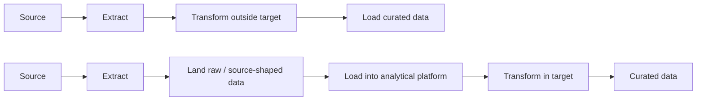
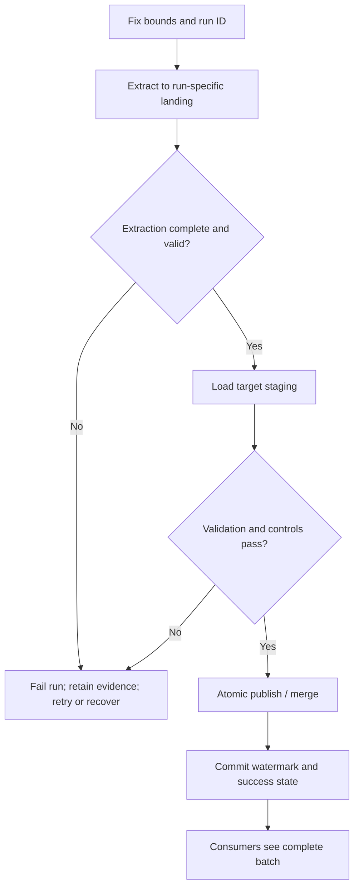

# Batch ETL/ELT and Incremental Ingestion

> **Stage:** 2D — Data Architecture  
> **Module:** 06 — Data Integration and Interoperability  
> **Lesson:** 01  
> **Audience:** Beginner → production-oriented Data Engineer / Data Architect  
> **Scope note:** This lesson follows the Module 2D.6 roadmap. Northbridge Bank, its volumes, limits, targets, and calculations are illustrative assumptions—not facts about a real bank or universal benchmarks.

## 1. Learning objectives and completion evidence

By the end of this lesson, you should be able to:

1. Describe batch ingestion and identify appropriate use cases.
2. Distinguish ETL from ELT and full from incremental loads, including their limitations.
3. Design an extract → land → transform → load flow.
4. Profile a source for volume, keys, change visibility, delete behavior, and operational limits.
5. Choose a change marker and define a safe watermark rule.
6. Estimate changed volume, extraction time, schedule fit, and freshness/staleness.
7. Explain timestamp hazards, lookback windows, late data, hard deletes, corrections, and backfills.
8. Design retries, partial-failure recovery, atomic publication, and overlap prevention.
9. Compare alternatives and defend a source-specific ingestion decision with evidence.

## 2. Why this topic matters in real-world Data Architecture

Batch ingestion is the baseline against which other integration patterns should be compared. It is often sufficient for analytical freshness requirements at lower operational complexity than a continuous pipeline, but only when the source exposes a usable snapshot or change boundary. Many batch defects arise from unclear change-detection semantics, unsafe watermark advancement, missed deletes, or retries that publish partial/duplicate results. The objective is not merely to make a job run; it is to define what source state was captured, what consumers received, and what evidence proves completeness.

## 3. Prerequisite knowledge

- Requirements, freshness windows, scheduling and staleness (Stage 2D, Topic 2D.2, Topic 4).
- Keys and relationships (Stage 2D, Topic 2D.4, Topics 2–3).
- OLTP/OLAP separation and data formats (Stage 2D, Topic 2D.5, Topics 1 and 3).
- Practical SQL and batch-pipeline experience from Stages 2–2C.
- Product-specific connector knowledge is not assumed.

## 4. Beginner level — establish the mental model

### 4.1 What is batch ingestion?

**Batch ingestion** collects a bounded group of records and transfers them at a scheduled or triggered time. A batch might contain all rows in a table, records changed since a prior run, one file, or one time interval.

Common uses include nightly finance reporting, hourly operational dashboards, daily partner settlement files, periodic CRM synchronization, and historical corrections. Batch is often the simplest baseline to compare with streaming or log-based change data capture (CDC). It is not automatically slow: an incremental batch may meet a minutes-level freshness target at substantially lower operational complexity than a continuous pipeline.

A batch has a defined scope (for example, `updated_at` in a time range), a start and end boundary, a run identity, and an outcome. The key architectural question is not only “Did the job run?” but “Which source state did it read, what did it publish, and what evidence shows the published result is complete?”

### 4.2 ETL versus ELT

- **ETL — Extract, Transform, Load:** extract from the source, transform in an integration or processing engine, then load the transformed result into the target.
- **ELT — Extract, Load, Transform:** extract and land the source representation first, then transform inside the target analytical platform or its processing engine.



| Dimension | ETL | ELT |
|---|---|---|
| Transformation location | Before the final target load, in an integration/processing engine | After raw or source-shaped data are loaded, in the target platform |
| Typical fit | Target has strict input requirements; sensitive fields must be minimized before landing in the destination; a dedicated transformation engine is appropriate | Analytical target has scalable compute; raw retention and repeated transformations are valuable |
| Reprocessing | Often requires retained extracts or re-extraction if raw data were discarded | Can often re-transform retained landed data without re-querying the source |
| Main benefit | Can reduce or validate data before target ingestion | Separates source capture from transformation and supports reproducible reprocessing |
| Main limitation | Transformation capacity and logic sit before target load; discarding raw data reduces recovery options | Raw storage, access controls, retention, and target compute need management; landing raw data does not remove the need for data-quality rules |

Neither approach is inherently more secure or cheaper. Decide based on target capabilities, data sensitivity, source load, transformation complexity, retention policy, recovery needs, and cost. If sensitive attributes must not enter a particular environment, filter or tokenize them before that boundary; “ELT” is not permission to land unrestricted data.

### 4.3 Full load versus incremental load

A **full load** extracts the complete in-scope dataset on each run. An **incremental load** extracts only records believed to be new or changed since a prior boundary. Incremental extraction normally relies on a source change marker or another change-detection mechanism.

| Dimension | Full load | Incremental load |
|---|---|---|
| Extraction scope | All in-scope rows | New/changed rows since a marker or within a defined range |
| Simplicity | Easy to reason about for small bounded datasets | Requires reliable change detection and explicit recovery rules |
| Source/transfer cost | Usually grows with total dataset size | Usually grows with changed volume, plus overhead for lookback and checks |
| Deletes | A full snapshot can reveal missing keys if compared with the target | Hard deletes are invisible unless separately signalled or detected |
| Recovery | Rebuild or compare from a known snapshot, subject to source consistency | Resume/replay a bounded interval; correctness depends on marker and target-merge semantics |
| Suitable when | Data are small, source offers no trustworthy marker, or a periodic authoritative snapshot is available | Data are large enough that copying everything is costly and changes can be identified reliably |

**Full load does not automatically mean safe replacement.** If the source changes while the extract is running, a multi-query export may combine inconsistent moments unless the source provides a consistent snapshot or the extract has a defined cutoff. Likewise, incremental does not mean “only inserts”: it may include updates, but only if the marker changes reliably.

### 4.4 The four-stage flow

```text
Producer / source
      │ 1. Extract a defined snapshot or bounded change range
      ▼
Landing area (immutable run files or source-shaped tables)
      │ 2. Validate schema, counts, marker range, and required fields
      ▼
Transform / staging
      │ 3. Standardize, validate, deduplicate as required, map keys
      ▼
Target staging → atomic publish / merge
      │ 4. Commit target and ingestion state together where possible
      ▼
Consumer-visible curated data + run evidence
```

- **Extract:** read only through an approved interface and bounded scope. Record the extraction cutoff and source context.
- **Land:** persist the source-shaped payload with a run ID and metadata. Landing can support audit, replay, schema-drift investigation, and re-transformation without repeatedly hitting the source. Retention and access must be controlled.
- **Transform:** normalize types, map keys, validate required fields, and apply business rules. Transformation rules should be versioned so a historical reprocess can state which logic was applied.
- **Load/publish:** make the validated batch visible to consumers. Stage first and publish atomically where the target supports it. Do not expose half of a replacement snapshot as if it were complete.

**Exercise 1 — draw the same customer feed twice.** Draw an ETL flow and an ELT flow for a customer extract containing `customer_id`, `name`, `email`, `updated_at`, and `is_deleted`. Mark where email masking, type validation, and business-rule transformation happen. State one advantage and one limitation of each design.

**Expected deliverable:** two labelled diagrams, plus a paragraph identifying the producer, consumer, interface, transformation boundary, and landing-retention decision.

## 5. Intermediate level — profile, quantify, and design the flow

### 5.1 Source profiling checklist

Do not choose incremental ingestion until the source has been profiled. Record evidence separately from assumptions.

| Profile item | Questions to answer | Why it changes the design |
|---|---|---|
| Dataset size and grain | Row count, average row width, bytes on disk/wire, what one row represents | Determines transfer time and whether full load is feasible |
| Primary/business key | Is the key unique, stable, non-null, and present in every extract? | Needed to merge updates and detect missing keys |
| Change marker | Timestamp, monotonically increasing sequence, version, or none? What updates it? | Determines whether changed rows can be found |
| Marker quality | Precision, timezone, update semantics, transaction/commit timing, ties, clock source | A marker can look reliable but still omit rows |
| Change rate | Fraction of rows changed per interval; average and peak | Drives incremental volume and schedule fit |
| Delete semantics | Hard delete, soft-delete flag, tombstone, separate audit table, or unknown | Determines whether target deletions can be detected |
| Source limits | Read replica, query budget, lock impact, rate limit, batch window, quota | Bounds extraction rate and allowable concurrency |
| Snapshot consistency | Can a consistent snapshot or high-water cutoff be obtained? | Prevents internally inconsistent extracts |
| Data sensitivity and location | Classification, allowed landing location, masking requirements | Constrains where and how data may be staged |
| Consumer requirements | Freshness, completeness, history, correction and delete semantics | Defines acceptable schedule and target model |

A **business key** identifies the business entity (for example, `account_id`). A **change marker** signals when a source row was inserted or updated. A **watermark** is the persisted boundary that represents progress through the source according to the chosen marker. They are not interchangeable: a primary key identifies a row; a marker helps discover changes; a watermark tracks processed progress.

### 5.2 Full versus incremental: worked estimate

The roadmap's illustrative example assumes 200 million rows, 500 bytes per row, and sustained extraction throughput of 50 MB/s. Use decimal units: 1 GB = 10⁹ bytes and 1 MB = 10⁶ bytes.

**Full volume**

\[
V_{full}=N\times s=200{,}000{,}000\times500=100{,}000{,}000{,}000\text{ bytes}=100\text{ GB}
\]

**Full extraction time** (idealized; excludes query startup, serialization, network overhead, retries, target writes, and throttling)

\[
t_{full}=\frac{100\text{ GB}}{50\text{ MB/s}}=\frac{100{,}000\text{ MB}}{50\text{ MB/s}}=2{,}000\text{ s}\approx33.3\text{ min}
\]

**Incremental volume at an assumed 2% change fraction**

\[
V_{changed}=N\times f\times s=200{,}000{,}000\times0.02\times500=2{,}000{,}000{,}000\text{ bytes}=2\text{ GB}
\]

\[
t_{incremental}=\frac{2{,}000\text{ MB}}{50\text{ MB/s}}=40\text{ s}
\]

At an assumed 20% change fraction, changed volume is 20 GB and idealized extraction time is 400 s (6 min 40 s). These are arithmetic estimates, not benchmark results or guaranteed run times. The 2% and 20% rates are scenario assumptions; validate them from source measurements. Incremental jobs also incur query, indexing, merge, lookback, validation, and publication overhead. A poorly indexed timestamp query can be slower than a full scan despite a small result set.

**When is a full load no longer acceptable?** There is no universal row-count threshold. Compare measured end-to-end duration, source impact, transfer/compute cost, required freshness, recovery time, and operational complexity. If the full load cannot finish inside its allowed window or harms the source, evaluate incremental extraction—but only after verifying marker reliability and delete handling.

### 5.3 Change markers and watermark semantics

Common markers include:

- **Last-modified timestamp:** easy to query but vulnerable to low precision, incorrect application behavior, clock skew, and commit timing.
- **Monotonic sequence/version:** useful when assigned consistently and ordered according to the source's documented semantics.
- **Append-only key or partition boundary:** useful only when new rows are truly append-only and existing rows are not silently corrected or deleted.
- **No reliable marker:** use a full snapshot, compare snapshots, obtain a source-maintained change feed, or negotiate a stronger interface. Do not invent an incremental guarantee.

A robust run records at least: run ID, start time, extraction cutoff, prior watermark, lookback duration, observed marker range, row counts, status, target publication ID, and error details. Store the watermark as explicit typed state, not merely in a log line.

**Core rule:** advance the committed watermark only after the corresponding target batch is successfully published. Prefer committing the target change and watermark in the same transaction. If they cannot share a transaction, design a recoverable protocol so a crash cannot mark un-published data as complete. It is generally safer to replay a bounded range than to skip a range.

For a timestamp marker, a common query shape is:

```sql
SELECT customer_id, name, email, updated_at, is_deleted
FROM source_customer
WHERE updated_at >= :lower_bound
  AND updated_at <  :upper_cutoff;
```

The lower bound may be the prior watermark minus a lookback interval; the upper cutoff must be fixed for that run. The exact operators depend on marker precision and source semantics. Use stable ordering when paging, and do not assume that a timestamp alone provides a unique order.

### 5.4 Source-specific designs: Northbridge Bank

The following source facts and requirements come from the roadmap's fictional scenario and remain illustrative assumptions.

| Source | Known assumed capability | Initial batch design | Main caveat / fallback |
|---|---|---|---|
| Core ledger (S1) | Read replica and readable transaction log; no reliable last-modified marker on every table; peak write rate ~2,000 changes/s | For a table with a reliable marker, incremental batch from the read replica; for tables without a reliable marker, use a consistent full snapshot or design CDC in the next lesson | Do not run broad repeated scans against the primary without evidence of safe load. A timestamp filter cannot repair missing markers |
| SaaS CRM (S3) | Paginated REST API, 10 requests/s limit, daily quota; weekly bulk export; ~12 million interaction records; assumed 3% monthly change | Prefer the bulk export for a complete baseline or periodic snapshot if its contents and delivery contract are sufficient; use API incremental pulls only if the API exposes a reliable update cursor and quota supports it | Pagination, rate limit, daily quota, API marker semantics, and deleted-record visibility must be verified |
| Payment partner (S4) | Daily file with manifest; ~2,000,000 settlement records/day and ~2 GB/day | Ingest each delivered file as a bounded batch; validate manifest, expected file identity, record count, and control totals before publishing | Do not treat file arrival as proof of completeness; missing, duplicate, or corrected files need explicit handling |
| Cards platform (S2) | Event publication and REST corrections; ~20,000 authorization events/s peak | Batch ingestion is suitable for analytical history or replay of bounded corrections, but not by itself for the fraud service's p95 ≤ 60 s target | Use the event flow for the latency-sensitive consumer; keep this lesson focused on batch and refer to Topic 4 for streaming design |

For the account table with no reliable change marker, the defensible choice is not automatically “incremental by `updated_at`.” First determine whether a full snapshot can be taken within source and freshness limits, whether a stable key allows snapshot comparison, and whether the source can expose a version/change feed. Record the trade-off and residual delete risk.

#### Required source-pattern examples

| Example source | Defensible starting design | Boundary and limitation to document |
|---|---|---|
| Customer table with a reliable `updated_at` | Incremental batch keyed by stable `customer_id`; fix an upper cutoff per run; use a measured lookback; merge only non-stale versions; publish data and watermark atomically where supported | Confirm that every relevant update changes the marker, timestamps have known timezone/precision, and commit visibility cannot exceed the lookback without detection. Use a soft-delete/tombstone mechanism or periodic snapshot comparison for deletes. |
| Account table with no reliable change marker | Prefer a consistent full snapshot plus key/value comparison if it fits source limits and freshness needs; otherwise request a source-maintained version/change feed or use an appropriate CDC mechanism | A key alone does not reveal updates to existing rows. A full snapshot reveals missing keys only if the snapshot is complete and internally consistent. Do not fabricate a timestamp watermark. |
| Truly append-only transaction table | Incremental batch by an immutable, source-defined committed sequence/offset or bounded immutable file manifest; persist the processed boundary only after publication | “Append-only” must be verified: if sequence values are allocated before commit, a lower sequence can become visible after the watermark has passed it. Use a lookback/reconciliation check or a commit-aware mechanism; handle corrections/deletes separately. |

These are starting patterns, not guarantees. Validate the source's actual transaction, snapshot, and delete semantics before approval.

### 5.5 Scheduling, throughput, and freshness

A schedule is a contract about when a run is expected to start and finish. Design around:

- **Cadence:** hourly, daily, or event-triggered batch; choose from consumer freshness needs.
- **Window:** when source queries are allowed and when the target must be published.
- **Dependencies:** wait for the upstream snapshot/file/manifest rather than starting on a guessed clock time alone.
- **Duration:** extract + transfer + validate + transform + target load + publication.
- **Concurrency:** prevent runs from interfering with the source, target, or watermark state.
- **Deadline and missed-run policy:** decide whether to skip, queue, or catch up when a prior run is still active.

A useful first-order staleness bound is:

\[
S_{max}\approx I+D+P
\]

where `I` = schedule interval (minutes), `D` = run duration (minutes), and `P` = publication delay after processing (minutes). This assumes an event may occur just after the previous extraction cutoff and the next scheduled run is the next opportunity to capture it. Actual staleness also depends on source visibility delay, upstream completion, marker behavior, and failures.

**Illustration:** hourly interval = 60 min, run duration = 10 min, publication delay = 5 min. Then `S_max ≈ 60 + 10 + 5 = 75 minutes`. This is not a promise if the source commits late or the job misses its window. If the consumer needs a hard maximum of 30 minutes, this schedule is not sufficient without a shorter interval, shorter runtime, or a different integration mechanism.

**Throughput formula**

\[
t_{extract}=\frac{B_{extract}}{R_{sustained}}
\]

where `B_extract` is bytes extracted and `R_sustained` is measured sustained bytes/s. Always use matching units. A 2 GB batch at 25 MB/s has an idealized transfer time of `2,000 MB / 25 MB/s = 80 s`, before overhead. Use observed lower-percentile capacity or a conservative range for planning, not a best-case burst number.

**Exercise 2 — calculate a run window.** A daily source export is 18 GB; measured sustainable extraction is 30 MB/s. Validation takes 6 minutes, transformation 9 minutes, target publication 4 minutes. Estimate total duration, ignoring overlap and startup overhead. If the allowed window is 25 minutes, state whether the design fits and what evidence you would gather before approval.

**Expected answer:** extraction is `18,000 MB / 30 MB/s = 600 s = 10 min`; total estimated duration is `10 + 6 + 9 + 4 = 29 min`, so it misses the 25-minute window by 4 minutes before overhead. The design needs measured optimization, a wider window, smaller/incremental batches, or a different approach.

## 6. Advanced level — design for imperfect sources and failures

### 6.1 Timestamp hazards and transaction timing

A `last_modified` timestamp is a claim made by the source application; it is not automatically a commit-order cursor. Consider a transaction that sets `updated_at = 10:00:00` but commits at 10:05:00. A batch that has already extracted through 10:02:00 may miss it if the next query only selects markers strictly greater than 10:02:00. The row's marker is older than the stored watermark even though the row became visible later.

Other hazards include:

- **Clock skew:** application servers disagree about time.
- **Timestamp precision:** multiple changes share one timestamp value; strict `>` can omit ties.
- **Bulk updates:** a process changes values without updating the marker, or stamps many rows identically.
- **Marker absent on child tables:** a parent change does not update related child rows.
- **Non-monotonic corrections:** a marker can move backward or be manually set.
- **Pagination races:** rows change while the extractor pages through a live table.

Mitigations, from simpler to stronger:

1. Use a fixed upper cutoff and a **lookback window** that re-reads an overlap before the prior watermark.
2. Merge/reconcile repeated records by stable key and source version/ordering rule; ensure the target load can tolerate replay. Full idempotency design is covered in Topic 7.
3. Prefer a source-defined monotonic version or commit-aware marker where available.
4. Use a consistent snapshot or a log-based CDC mechanism when timestamp polling cannot meet correctness requirements; CDC is covered in Topic 2.

A lookback window reduces risk; it does not prove correctness if commits can be delayed longer than the overlap or if markers are never updated. Choose the overlap from measured transaction delay, marker precision, source behavior, and acceptable risk. Document residual uncertainty.

### 6.2 Lookback example and boundary discipline

Suppose the committed watermark is `2026-10-20T10:00:00Z` and the configured lookback is 10 minutes. The next lower bound is `09:50:00Z`. The run fixes an upper cutoff, for example `10:15:00Z`, and extracts the half-open interval `[09:50, 10:15)`. The overlap deliberately re-reads some rows. The target merge must not create duplicates or overwrite newer target state with an older version.

Use UTC or a consistently defined source timezone; record the timezone and precision. For timestamp ties, use a compound cursor such as `(updated_at, primary_key)` only if the source query and state logic correctly handle ties and updates. A compound cursor solves ordering among visible rows but does not, by itself, solve late commits.

### 6.3 Hard deletes, soft deletes, and missed-delete detection

Incremental queries return existing rows that match the marker predicate. A **hard-deleted** row no longer exists to be selected, so it disappears silently from a simple incremental query. Options include:

- **Soft delete:** source keeps the row and sets `is_deleted` or `deleted_at`; incremental extraction can transfer the flag if the marker is updated.
- **Tombstone/change feed:** source emits a deletion record with the key and deletion position.
- **Periodic full comparison:** compare key sets or a snapshot/control summary and identify rows missing from the source snapshot.
- **CDC:** a source change log may expose deletes, depending on the documented mechanism.
- **Explicit delete API/table:** consume a separate deletion register where available.

Do not physically delete a target row merely because it was absent from an incomplete extract. First prove the source snapshot is complete and bounded. For financial/audit history, retaining a deletion status or history may be required by business policy. The correct target behavior depends on semantics, not just technical convenience.

**Verification:** track source and target counts at a defined grain; compare key sets or control totals; alert on unexpected drops; sample known deleted IDs; and retain the report. A count match alone is not proof of row-level equality, but it is useful evidence alongside key and value checks.

### 6.4 Late-arriving data, updates, and corrections

A **late-arriving record** is received after the business period it describes—for example, a settlement for Monday arriving on Tuesday. A **correction** changes a previously delivered fact or dimension. Arrival time, business/effective time, and source update time are different concepts:

- `event_time` / business date: when the real-world event applies.
- `updated_at`: when the source claims the row was changed.
- `ingested_at`: when the pipeline captured it.
- `published_at`: when consumers could see it.

Keep these fields distinct where relevant. Do not partition or filter only by business date if corrections can arrive later. A target may need an effective-dated history, a restatable snapshot partition, or a current-state table plus audit history. Select based on whether consumers need current truth, historical truth as known at the time, or both.

A correction workflow should identify the affected business keys or date partitions, re-extract or replay the needed source range, apply the approved transformation version, validate control totals, publish atomically, and record what was restated. If the source cannot reproduce historical versions, say so; do not promise exact historical reconstruction from a current-state table alone.

### 6.5 Backfills and 90-day corrections

A **backfill** intentionally reprocesses a historical range. Separate it from the normal scheduled run so it cannot unexpectedly seize source capacity or overwrite current progress state.

**Procedure for a 90-day settlement correction (illustrative):**

1. Record the request, affected dates/keys, reason, owner, and expected target impact.
2. Determine whether source data represent immutable events or corrected current-state rows; obtain authoritative files/snapshots and manifests where available.
3. Define a bounded backfill run ID and date range. Do not move the normal incremental watermark backward to perform a historical backfill.
4. Estimate volume and duration using measured throughput; reserve a source-safe window and set a throttle/concurrency limit.
5. Extract into an isolated landing path; preserve original files and correction versions according to retention policy.
6. Validate file identity, date coverage, schema, key uniqueness, record counts, and source control totals before transformation.
7. Transform with a recorded code/rule version; stage results separately from consumer-visible data.
8. Merge or replace only the approved keys/partitions; use a transaction or atomic partition swap if supported.
9. Compare source and target counts/totals and investigate every material delta. Publish only after checks pass.
10. Record the outcome, affected consumers, watermark treatment, and rollback/recovery steps. Resume normal scheduling without a gap or overlap.

**Duration estimate:** if 90 daily files average 2 GB each, total source bytes are `90 × 2 GB = 180 GB`. At a measured 40 MB/s, idealized transfer time is `180,000 MB / 40 MB/s = 4,500 s = 75 min`. This excludes validation, transformation, publication, throttling, and retries; schedule a wider window or calculate a conservative range from observed end-to-end throughput.

### 6.6 Retries, partial failure, and atomic publication

A retry is a new attempt to complete the same logical work. A retry is safe only when repeated extraction and loading cannot corrupt the target or advance state incorrectly. The detailed idempotency patterns are in Topic 7; this lesson requires the ingestion design to state its dependency on them.

A common failure-safe pattern is:

1. Allocate a unique run ID and fixed extraction bounds.
2. Extract and land data in a run-specific staging location.
3. Validate completeness and schema before publication.
4. Load into target staging, not directly into consumer-visible tables.
5. In one target transaction, merge/publish the batch and persist the associated watermark/run status when the database supports it.
6. Mark the run successful only after commit; otherwise preserve enough state to resume or replay.



If the target cannot atomically commit data and watermark together, use a recoverable state machine and reconcile the watermark with the published batch on restart. Never infer success solely from “the process exited” or update the watermark before publication.

**Partial failure example:** a job writes 85% of a batch to a target append table and crashes. Restarting from the beginning doubles those rows unless the target is staged and atomically published, or writes are keyed and replay-safe. A staging table should be isolated by run ID; consumers should read only the committed/published version.

### 6.7 Overlapping runs and concurrency

Two runs can overlap if the first exceeds its schedule interval or the scheduler starts a retry while the original process is still active. They may read different bounds, race on a shared watermark, or publish out of order.

Controls include a per-source/target lease or scheduler concurrency limit, a compare-and-set or transactional watermark update, unique run IDs, bounded source ranges, and an explicit policy for late or superseded runs. A later run must not commit an older source boundary after a newer one. If overlap is intentional for parallel partitions, partition ownership and publication order must be explicit.

### 6.8 Source-system impact and operating limits

Batch extraction consumes CPU, I/O, locks or MVCC resources, network bandwidth, and query slots. A read replica can reduce primary workload but may lag; the architecture must define acceptable replica lag. Use indexed predicates where possible, limit result sizes, throttle parallelism, prefer off-peak windows where appropriate, and measure impact with source owners. Do not assume that “read-only” means “no production impact.”

If the source cannot tolerate the required scan, compare a smaller incremental query, export endpoint, replica, source-maintained change table, or CDC. For SaaS APIs, rate limits and daily quotas may dominate the schedule; for files, manifest arrival and completeness dominate. Do not violate the source contract just to meet a downstream target.

### 6.9 Failure-mode matrix

| Failure mode | Likely symptom | Prevention/detection | Recovery and evidence |
|---|---|---|---|
| Watermark advanced before target commit | Missing source changes after restart | Commit data and state together; state transition tests | Re-read from last confirmed published boundary; compare source/target controls |
| Watermark never advances | Repeated extraction grows and freshness degrades | Monitor prior/current watermark and rows processed | Inspect query/commit errors; resume from confirmed boundary; document replay range |
| Marker not updated for a source change | Silent stale target row | Source profiling, periodic snapshot/key comparison, change-feed alternative | Correct affected keys/range; report marker defect to source owner |
| In-flight transaction commits late | Row falls behind stored timestamp boundary | Lookback, commit-aware marker, consistent snapshot, or CDC | Re-read overlap and reconcile; widen overlap only with evidence |
| Hard delete not represented | Orphaned target row | Soft-delete/tombstone, periodic full comparison, CDC | Identify missing keys; apply approved delete/restatement policy |
| Run fails after partial target write | Duplicate or partial rows visible | Run-specific staging and atomic publication | Drop/replace uncommitted staging and replay bounded batch |
| Overlapping runs race | Duplicates, older values, watermark regression | Concurrency lock/lease and monotonic state update | Stop conflicting run, reconcile published version, replay in order |
| Source column rename/type change | Extract fails or silently misreads data | Schema validation and source-change notification | Quarantine run; adapt mapping under review; replay after compatibility check |
| Backfill overwhelms source | Elevated latency/errors on operational workload | Throttle, dedicated window, concurrency budget | Pause, reduce rate, resume from bounded checkpoint; capture impact metrics |
| Partial or duplicate partner file | Wrong settlement total | Manifest, file identity, record counts and control totals | Hold publication, request resend/correction, reprocess under new run ID |

### 6.10 Runnable teaching example — SQLite incremental batch

This small local example demonstrates the mechanics of a bounded CSV extract, a lookback window, keyed target upserts, and transactional watermark persistence. It is intentionally not a production connector. Its source is a **complete, static CSV snapshot**; the example does not simulate concurrent source writes, API pagination, a database snapshot, or CDC. In a real source, the extractor must guarantee that the chosen upper cutoff and snapshot semantics are meaningful.

#### 6.10.1 Assumptions and files

- Python 3.10+; standard library only.
- Input CSV columns: `customer_id,name,email,updated_at,is_deleted`.
- `updated_at` must be ISO-8601 with timezone offset or `Z`; input is normalized to UTC.
- The CSV represents the current source snapshot. It contains at most one current row per customer key.
- A lookback re-reads recent rows. The target upsert is keyed by `customer_id`; the watermark and target updates commit in the same SQLite transaction.
- For this demo, the extraction cutoff is supplied explicitly so the test is deterministic.

Save as `incremental_batch_demo.py` alongside `customers.csv`:

```python
from __future__ import annotations

import csv
import sqlite3
from datetime import datetime, timedelta, timezone
from pathlib import Path
from typing import Iterable

REQUIRED_COLUMNS = {"customer_id", "name", "email", "updated_at", "is_deleted"}


def normalize_utc(value: datetime, label: str) -> datetime:
    """Require a timezone-aware datetime and normalize it to UTC."""
    if value.tzinfo is None or value.utcoffset() is None:
        raise ValueError(f"{label} must include a timezone")
    return value.astimezone(timezone.utc)


def parse_utc(value: str) -> datetime:
    """Parse an ISO-8601 timestamp with an explicit timezone and return UTC."""
    normalized = value.strip()
    if normalized.endswith("Z"):
        normalized = normalized[:-1] + "+00:00"
    parsed = datetime.fromisoformat(normalized)
    return normalize_utc(parsed, f"Timestamp {value!r}")


def read_source(path: Path) -> list[dict[str, object]]:
    """Read and validate a complete CSV snapshot before changing the target."""
    if not path.is_file():
        raise FileNotFoundError(f"Source CSV not found: {path}")

    rows: list[dict[str, object]] = []
    seen_ids: set[str] = set()
    with path.open("r", newline="", encoding="utf-8") as handle:
        reader = csv.DictReader(handle)
        if reader.fieldnames is None or not REQUIRED_COLUMNS.issubset(reader.fieldnames):
            raise ValueError(f"CSV must contain columns: {sorted(REQUIRED_COLUMNS)}")
        for line_number, row in enumerate(reader, start=2):
            customer_id = (row.get("customer_id") or "").strip()
            if not customer_id:
                raise ValueError(f"Empty customer_id on CSV line {line_number}")
            if customer_id in seen_ids:
                raise ValueError(f"Duplicate customer_id {customer_id!r} in source snapshot")
            seen_ids.add(customer_id)
            deleted_text = (row.get("is_deleted") or "").strip().lower()
            if deleted_text not in {"true", "false", "1", "0"}:
                raise ValueError(f"Invalid is_deleted value on line {line_number}")
            rows.append({
                "customer_id": customer_id,
                "name": (row.get("name") or "").strip(),
                "email": (row.get("email") or "").strip(),
                "updated_at": parse_utc(row.get("updated_at") or ""),
                "is_deleted": 1 if deleted_text in {"true", "1"} else 0,
            })
    return rows


def initialize(conn: sqlite3.Connection) -> None:
    conn.executescript("""
        CREATE TABLE IF NOT EXISTS customer_target (
            customer_id TEXT PRIMARY KEY,
            name TEXT NOT NULL,
            email TEXT NOT NULL,
            updated_at TEXT NOT NULL,
            is_deleted INTEGER NOT NULL CHECK (is_deleted IN (0, 1))
        );
        CREATE TABLE IF NOT EXISTS ingestion_state (
            source_name TEXT PRIMARY KEY,
            watermark_utc TEXT NOT NULL
        );
    """)


def run_incremental(
    source_csv: Path,
    database_path: Path,
    source_name: str,
    extraction_cutoff: datetime,
    lookback: timedelta,
    initial_watermark: datetime,
) -> tuple[int, str]:
    """Load rows in [watermark-lookback, cutoff), then commit target and watermark.

    The cutoff advances only after the complete source snapshot has been read and
    all selected rows are applied successfully. An equal cutoff is allowed for a
    replay; an earlier cutoff is rejected to prevent watermark regression. This is
    safe for this demo's static complete CSV snapshot, not a guarantee for a live,
    concurrently changing source. Absence from this CSV is not interpreted as a delete.
    """
    if not source_name.strip():
        raise ValueError("source_name must be non-empty")
    if not isinstance(lookback, timedelta) or lookback < timedelta(0):
        raise ValueError("lookback must be a non-negative timedelta")
    cutoff = normalize_utc(extraction_cutoff, "extraction_cutoff")
    initial = normalize_utc(initial_watermark, "initial_watermark")
    snapshot = read_source(source_csv)

    database_path.parent.mkdir(parents=True, exist_ok=True)
    conn = sqlite3.connect(database_path)
    try:
        initialize(conn)
        conn.execute("BEGIN IMMEDIATE")
        state = conn.execute(
            "SELECT watermark_utc FROM ingestion_state WHERE source_name = ?",
            (source_name,),
        ).fetchone()
        previous = parse_utc(state[0]) if state else initial
        if cutoff < previous:
            raise ValueError(
                f"extraction_cutoff {cutoff.isoformat()} is earlier than committed "
                f"watermark {previous.isoformat()}; refusing watermark regression"
            )
        lower_bound = previous - lookback
        selected = [
            row for row in snapshot
            if lower_bound <= row["updated_at"] < cutoff
        ]

        for row in selected:
            existing = conn.execute(
                "SELECT name, email, updated_at, is_deleted "
                "FROM customer_target WHERE customer_id = ?",
                (row["customer_id"],),
            ).fetchone()
            row_timestamp = row["updated_at"].isoformat()
            if existing is not None and row_timestamp == existing[2]:
                incoming_payload = (row["name"], row["email"], row["is_deleted"])
                existing_payload = (existing[0], existing[1], existing[3])
                if incoming_payload != existing_payload:
                    raise ValueError(
                        "Conflicting payload for customer_id "
                        f"{row['customer_id']!r} at identical updated_at marker; "
                        "the source marker cannot establish which payload is newer"
                    )
                # Same key, marker, and payload: replay is a no-op.
                continue
            conn.execute("""
                INSERT INTO customer_target
                    (customer_id, name, email, updated_at, is_deleted)
                VALUES (?, ?, ?, ?, ?)
                ON CONFLICT(customer_id) DO UPDATE SET
                    name = excluded.name,
                    email = excluded.email,
                    updated_at = excluded.updated_at,
                    is_deleted = excluded.is_deleted
                WHERE excluded.updated_at > customer_target.updated_at
            """, (
                row["customer_id"], row["name"], row["email"],
                row_timestamp, row["is_deleted"],
            ))

        conn.execute("""
            INSERT INTO ingestion_state (source_name, watermark_utc)
            VALUES (?, ?)
            ON CONFLICT(source_name) DO UPDATE SET watermark_utc = excluded.watermark_utc
        """, (source_name, cutoff.isoformat()))
        conn.commit()
        return len(selected), cutoff.isoformat()
    except Exception:
        conn.rollback()
        raise
    finally:
        conn.close()


def main() -> None:
    base = Path(__file__).resolve().parent
    rows_loaded, watermark = run_incremental(
        source_csv=base / "customers.csv",
        database_path=base / "demo.sqlite3",
        source_name="crm_customers",
        extraction_cutoff=datetime(2026, 10, 20, 12, 0, tzinfo=timezone.utc),
        lookback=timedelta(minutes=10),
        initial_watermark=datetime(2026, 10, 20, 9, 0, tzinfo=timezone.utc),
    )
    print(f"Rows selected for this run: {rows_loaded}")
    print(f"Committed watermark (UTC): {watermark}")


if __name__ == "__main__":
    main()
```

Example `customers.csv`:

```csv
customer_id,name,email,updated_at,is_deleted
C001,Ada,ada@example.test,2026-10-20T11:40:00Z,false
C002,Ben,ben@example.test,2026-10-20T11:55:00Z,false
C003,Chen,chen@example.test,2026-10-20T12:00:00Z,false
```

Run it:

```bash
python incremental_batch_demo.py
```

Expected output on the first run:

```text
Rows selected for this run: 2
Committed watermark (UTC): 2026-10-20T12:00:00+00:00
```

`C003` is excluded because the upper bound is exclusive (`updated_at < cutoff`). This boundary rule prevents the same instant from being ambiguously included in two adjacent half-open windows; the next run's lookback or later cutoff will pick it up if it remains in the snapshot and meets the lower bound. In a real source, prove that the source's marker and snapshot semantics make this rule safe.

#### 6.10.2 Representative tests

Save the following as `test_incremental_batch_demo.py` in the same directory. It uses `pytest` and a temporary database/source file.

```python
from datetime import datetime, timedelta, timezone
from pathlib import Path

import pytest

from incremental_batch_demo import parse_utc, read_source, run_incremental

UTC = timezone.utc


def write_csv(path: Path, body: str) -> None:
    path.write_text(
        "customer_id,name,email,updated_at,is_deleted\n" + body,
        encoding="utf-8",
    )


def test_parse_utc_requires_timezone() -> None:
    with pytest.raises(ValueError, match="must include a timezone"):
        parse_utc("2026-10-20T10:00:00")


def test_duplicate_source_key_rejected(tmp_path: Path) -> None:
    source = tmp_path / "customers.csv"
    write_csv(source,
        "C001,Ada,ada@example.test,2026-10-20T11:00:00Z,false\n"
        "C001,Ada2,ada2@example.test,2026-10-20T11:01:00Z,false\n")
    with pytest.raises(ValueError, match="Duplicate customer_id"):
        read_source(source)


def test_incremental_window_and_atomic_state(tmp_path: Path) -> None:
    source = tmp_path / "customers.csv"
    database = tmp_path / "demo.sqlite3"
    write_csv(source,
        "C001,Ada,ada@example.test,2026-10-20T11:40:00Z,false\n"
        "C002,Ben,ben@example.test,2026-10-20T11:55:00Z,false\n"
        "C003,Chen,chen@example.test,2026-10-20T12:00:00Z,false\n")
    loaded, watermark = run_incremental(
        source, database, "crm_customers",
        datetime(2026, 10, 20, 12, 0, tzinfo=UTC),
        timedelta(minutes=10),
        datetime(2026, 10, 20, 9, 0, tzinfo=UTC),
    )
    assert loaded == 2
    assert watermark == "2026-10-20T12:00:00+00:00"

    import sqlite3
    with sqlite3.connect(database) as conn:
        target_count = conn.execute("SELECT COUNT(*) FROM customer_target").fetchone()[0]
        stored_watermark = conn.execute(
            "SELECT watermark_utc FROM ingestion_state WHERE source_name = ?",
            ("crm_customers",),
        ).fetchone()[0]
    assert target_count == 2
    assert stored_watermark == watermark


def test_invalid_source_does_not_advance_watermark(tmp_path: Path) -> None:
    source = tmp_path / "customers.csv"
    database = tmp_path / "demo.sqlite3"
    write_csv(source, "C001,Ada,ada@example.test,2026-10-20T11:00:00,false\n")
    with pytest.raises(ValueError, match="must include a timezone"):
        run_incremental(
            source, database, "crm_customers",
            datetime(2026, 10, 20, 12, 0, tzinfo=UTC),
            timedelta(minutes=10),
            datetime(2026, 10, 20, 9, 0, tzinfo=UTC),
        )
    # Source validation fails before a database is opened or state is written.
    assert not database.exists()


def test_naive_cutoff_and_initial_watermark_are_rejected(tmp_path: Path) -> None:
    source = tmp_path / "customers.csv"
    write_csv(source, "C001,Ada,ada@example.test,2026-10-20T11:00:00Z,false\n")
    with pytest.raises(ValueError, match="extraction_cutoff must include a timezone"):
        run_incremental(
            source, tmp_path / "a.sqlite3", "crm_customers",
            datetime(2026, 10, 20, 12, 0), timedelta(minutes=10),
            datetime(2026, 10, 20, 9, 0, tzinfo=UTC),
        )
    with pytest.raises(ValueError, match="initial_watermark must include a timezone"):
        run_incremental(
            source, tmp_path / "b.sqlite3", "crm_customers",
            datetime(2026, 10, 20, 12, 0, tzinfo=UTC), timedelta(minutes=10),
            datetime(2026, 10, 20, 9, 0),
        )


def test_repeating_same_cutoff_is_safe_and_does_not_duplicate_rows(tmp_path: Path) -> None:
    source = tmp_path / "customers.csv"
    database = tmp_path / "demo.sqlite3"
    write_csv(source, "C001,Ada,ada@example.test,2026-10-20T11:55:00Z,false\n")
    args = (source, database, "crm_customers",
            datetime(2026, 10, 20, 12, 0, tzinfo=UTC),
            timedelta(minutes=10), datetime(2026, 10, 20, 9, 0, tzinfo=UTC))
    assert run_incremental(*args)[0] == 1
    assert run_incremental(*args)[0] == 1
    import sqlite3
    with sqlite3.connect(database) as conn:
        assert conn.execute("SELECT COUNT(*) FROM customer_target").fetchone()[0] == 1
        assert conn.execute("SELECT watermark_utc FROM ingestion_state").fetchone()[0] == "2026-10-20T12:00:00+00:00"


def test_stale_source_version_does_not_overwrite_newer_target(tmp_path: Path) -> None:
    source = tmp_path / "customers.csv"
    database = tmp_path / "demo.sqlite3"
    write_csv(source, "C001,Newer,new@example.test,2026-10-20T11:55:00Z,false\n")
    run_incremental(source, database, "crm_customers",
        datetime(2026, 10, 20, 12, 0, tzinfo=UTC), timedelta(minutes=10),
        datetime(2026, 10, 20, 9, 0, tzinfo=UTC))
    write_csv(source, "C001,Older,old@example.test,2026-10-20T11:50:00Z,false\n")
    run_incremental(source, database, "crm_customers",
        datetime(2026, 10, 20, 12, 5, tzinfo=UTC), timedelta(minutes=10),
        datetime(2026, 10, 20, 9, 0, tzinfo=UTC))
    import sqlite3
    with sqlite3.connect(database) as conn:
        row = conn.execute("SELECT name, email FROM customer_target WHERE customer_id='C001'").fetchone()
    assert row == ("Newer", "new@example.test")


def test_missing_change_marker_column_is_rejected(tmp_path: Path) -> None:
    source = tmp_path / "customers.csv"
    database = tmp_path / "demo.sqlite3"
    source.write_text(
        "customer_id,name,email,is_deleted\n"
        "C001,Ada,ada@example.test,false\n",
        encoding="utf-8",
    )
    with pytest.raises(ValueError, match="CSV must contain columns"):
        run_incremental(source, database, "crm_customers",
            datetime(2026, 10, 20, 12, 0, tzinfo=UTC), timedelta(minutes=10),
            datetime(2026, 10, 20, 9, 0, tzinfo=UTC))
    assert not database.exists()


def test_late_arriving_update_inside_lookback_is_applied(tmp_path: Path) -> None:
    source = tmp_path / "customers.csv"
    database = tmp_path / "demo.sqlite3"
    write_csv(source, "C001,Ada,ada@example.test,2026-10-20T11:55:00Z,false\n")
    run_incremental(source, database, "crm_customers",
        datetime(2026, 10, 20, 12, 0, tzinfo=UTC), timedelta(minutes=10),
        datetime(2026, 10, 20, 9, 0, tzinfo=UTC))
    write_csv(source, "C001,Ada Updated,updated@example.test,2026-10-20T12:04:00Z,false\n")
    run_incremental(source, database, "crm_customers",
        datetime(2026, 10, 20, 12, 10, tzinfo=UTC), timedelta(minutes=10),
        datetime(2026, 10, 20, 9, 0, tzinfo=UTC))
    import sqlite3
    with sqlite3.connect(database) as conn:
        row = conn.execute("SELECT name, email FROM customer_target WHERE customer_id='C001'").fetchone()
    assert row == ("Ada Updated", "updated@example.test")


def test_soft_delete_flag_is_propagated(tmp_path: Path) -> None:
    source = tmp_path / "customers.csv"
    database = tmp_path / "demo.sqlite3"
    write_csv(source, "C001,Ada,ada@example.test,2026-10-20T11:40:00Z,false\n")
    run_incremental(source, database, "crm_customers",
        datetime(2026, 10, 20, 12, 0, tzinfo=UTC), timedelta(minutes=10),
        datetime(2026, 10, 20, 9, 0, tzinfo=UTC))
    write_csv(source, "C001,Ada,ada@example.test,2026-10-20T12:01:00Z,true\n")
    run_incremental(source, database, "crm_customers",
        datetime(2026, 10, 20, 12, 10, tzinfo=UTC), timedelta(minutes=10),
        datetime(2026, 10, 20, 9, 0, tzinfo=UTC))
    import sqlite3
    with sqlite3.connect(database) as conn:
        assert conn.execute("SELECT is_deleted FROM customer_target WHERE customer_id='C001'").fetchone()[0] == 1


def test_equal_marker_with_conflicting_payload_is_rejected(tmp_path: Path) -> None:
    source = tmp_path / "customers.csv"
    database = tmp_path / "demo.sqlite3"
    write_csv(source, "C001,Ada,ada@example.test,2026-10-20T11:55:00Z,false\n")
    run_incremental(source, database, "crm_customers",
        datetime(2026, 10, 20, 12, 0, tzinfo=UTC), timedelta(minutes=10),
        datetime(2026, 10, 20, 9, 0, tzinfo=UTC))
    write_csv(source, "C001,Conflicting,other@example.test,2026-10-20T11:55:00Z,false\n")
    with pytest.raises(ValueError, match="identical updated_at marker"):
        run_incremental(source, database, "crm_customers",
            datetime(2026, 10, 20, 12, 5, tzinfo=UTC), timedelta(minutes=10),
            datetime(2026, 10, 20, 9, 0, tzinfo=UTC))
    import sqlite3
    with sqlite3.connect(database) as conn:
        assert conn.execute("SELECT name FROM customer_target WHERE customer_id='C001'").fetchone()[0] == "Ada"


def test_older_cutoff_cannot_regress_watermark(tmp_path: Path) -> None:
    source = tmp_path / "customers.csv"
    database = tmp_path / "demo.sqlite3"
    write_csv(source, "C001,Ada,ada@example.test,2026-10-20T11:40:00Z,false\n")
    run_incremental(source, database, "crm_customers",
        datetime(2026, 10, 20, 12, 0, tzinfo=UTC), timedelta(minutes=10),
        datetime(2026, 10, 20, 9, 0, tzinfo=UTC))
    with pytest.raises(ValueError, match="refusing watermark regression"):
        run_incremental(source, database, "crm_customers",
            datetime(2026, 10, 20, 11, 59, tzinfo=UTC), timedelta(minutes=10),
            datetime(2026, 10, 20, 9, 0, tzinfo=UTC))
    import sqlite3
    with sqlite3.connect(database) as conn:
        assert conn.execute("SELECT watermark_utc FROM ingestion_state").fetchone()[0] == "2026-10-20T12:00:00+00:00"


def test_target_failure_rolls_back_rows_and_watermark(tmp_path: Path) -> None:
    import sqlite3
    source = tmp_path / "customers.csv"
    database = tmp_path / "demo.sqlite3"
    write_csv(source,
        "C001,Ada,ada@example.test,2026-10-20T11:40:00Z,false\n"
        "C002,Ben,ben@example.test,2026-10-20T11:50:00Z,false\n")
    with sqlite3.connect(database) as conn:
        conn.executescript("""
            CREATE TABLE customer_target (
                customer_id TEXT PRIMARY KEY, name TEXT NOT NULL, email TEXT NOT NULL,
                updated_at TEXT NOT NULL, is_deleted INTEGER NOT NULL CHECK (is_deleted IN (0,1))
            );
            CREATE TABLE ingestion_state (source_name TEXT PRIMARY KEY, watermark_utc TEXT NOT NULL);
            CREATE TRIGGER reject_c002 BEFORE INSERT ON customer_target
            WHEN NEW.customer_id = 'C002'
            BEGIN SELECT RAISE(ABORT, 'forced target failure'); END;
        """)
    with pytest.raises(sqlite3.IntegrityError, match="forced target failure"):
        run_incremental(source, database, "crm_customers",
            datetime(2026, 10, 20, 12, 0, tzinfo=UTC), timedelta(minutes=10),
            datetime(2026, 10, 20, 9, 0, tzinfo=UTC))
    with sqlite3.connect(database) as conn:
        assert conn.execute("SELECT COUNT(*) FROM customer_target").fetchone()[0] == 0
        assert conn.execute("SELECT COUNT(*) FROM ingestion_state").fetchone()[0] == 0
```

Run tests:

```bash
python -m pip install pytest
python -m pytest -q
```

Expected test summary: `13 passed` (the exact duration varies by environment). These tests validate the teaching example's local logic; they do not prove production correctness against a live database, a changing source, or a distributed scheduler. The demonstration uses a static complete CSV snapshot and advances the watermark to the fixed cutoff after a complete scan. It propagates an explicit `is_deleted` flag, but it does **not** infer hard deletes from rows absent in the CSV. For a live system, confirm snapshot consistency, commit timing, source marker reliability, target transaction boundaries, and recovery semantics before adopting the pattern.

## 7. Industry application — architecture decision and design worksheet

### 7.1 Decision inputs

Use this order before selecting a mechanism:

1. State the business need and measurable freshness/correctness target.
2. Profile the source and consumer: interface, volume, change visibility, deletes, limits, and expected history.
3. Compare full batch, incremental batch, and stronger source change mechanisms only after requirements are clear.
4. Define key, marker, watermark, transformation boundary, landing policy, and publication semantics.
5. Walk through normal operation and failures: source, network, extractor, scheduler, target, and publication.
6. Define evidence: run metadata, counts/control totals, key checks, freshness measurements, and recovery logs.
7. Record the decision, rejected alternatives, assumptions, risks, and revisit triggers in an Architecture Decision Record (ADR).

### 7.2 Quantitative comparison example

Assume the CRM interaction dataset contains 12 million records at an illustrative average 400 bytes per record. The full payload estimate is `12,000,000 × 400 = 4,800,000,000 bytes = 4.8 GB`. Assume, only for illustration, that 3% change in a month: `12,000,000 × 0.03 = 360,000 records`, or `360,000 × 400 = 144,000,000 bytes = 144 MB` before protocol/encoding overhead.

If a measured extraction path sustains 20 MB/s, idealized payload transfer is `4,800 MB / 20 MB/s = 240 s (4 min)` for 4.8 GB and `144 MB / 20 MB/s = 7.2 s` for 144 MB. The CRM's assumed API limit of 10 requests/s may dominate instead. If each API page returns 1,000 records, `ceil(360,000 / 1,000) = 360` requests; at a strict maximum of 10 requests/s, the theoretical request-time lower bound is 36 seconds, before latency, retries, quota, and transformation. This calculation assumes the API actually supports that page size and exposes the required incremental filter; verify both. The roadmap does not guarantee either.

### 7.3 Required architecture worksheet

For each source, fill in this table and attach evidence where available.

| Field | Your answer |
|---|---|
| Source and owner |  |
| Consumer and business need |  |
| Freshness target and unit |  |
| Dataset size / row size / change rate |  |
| Interface and source-safe window |  |
| Stable key and grain |  |
| Change marker, precision, timezone, trust level |  |
| Delete/correction semantics |  |
| Full/incremental/ETL/ELT choice and rejected alternatives |  |
| Lower bound, upper cutoff, lookback, watermark update rule |  |
| Extract and end-to-end duration estimate (formula, units, assumptions) |  |
| Landing, transformation, and publication boundary |  |
| Retry, partial-failure, overlap, and backfill behavior |  |
| Completeness evidence and reconciliation controls |  |
| Source impact and throttling plan |  |
| Open risks, assumptions, owner, and review trigger |  |

## 8. Practical scenarios, exercises, and case-based reasoning

### 8.1 Northbridge failure scenarios and response

**Scenario A — nightly job fails at 85% and is restarted twice; target rows double.** The missing property is replay-safe publication. Use run-scoped staging and an atomic publish/merge or stable-key upsert. Verify that consumers saw either the prior complete batch or the new complete batch—not a partial mix.

**Scenario B — customer address changes but `updated_at` does not.** The marker is not trustworthy for that change. Stop claiming timestamp-based completeness; identify affected rows, compare against a full snapshot or authoritative change feed, correct the source contract, and document the residual risk. Widening lookback cannot recover a change whose marker never changes unless another check detects it.

**Scenario C — sponsor asks for near-real-time but source offers only a nightly export.** State the achievable freshness bound from the actual source delivery cadence. Options are to accept nightly freshness, negotiate a more frequent export/API/change feed, or redesign the consumer requirement. Do not promise minutes-level freshness from a nightly-only source.

**Scenario D — 90-day backfill overlaps normal hourly run.** Isolate the backfill's run ID and range, throttle it, and prevent it from writing the normal watermark. Coordinate target publication by partition/key and ensure that a late backfill cannot overwrite newer current-state values. Reconcile before announcing completion.


### 8.2 Exercise 3 — profile three Northbridge sources

For (a) a customer table with a reliable last-modified timestamp, (b) an account table without a reliable marker, and (c) an append-only transaction table, specify the ingestion method, key, change marker/watermark, delete strategy, freshness expectation, and recovery path. State which facts are assumed and which must be confirmed with the source owner.

**Expected deliverable:** three completed source profiles and three flow diagrams. The account design must explicitly justify a full snapshot/snapshot comparison or a stronger source mechanism; it must not invent a reliable timestamp.

### 8.3 Exercise 4 — five failure paths

For an hourly timestamp-watermark job, list at least five ways rows can be lost or duplicated. Include late commit, timestamp ties, missing marker update, hard delete, and a crash after partial target write. For each, specify detection, prevention/mitigation, recovery, and evidence.

**Expected deliverable:** failure-mode matrix with no row lacking all four fields.

### 8.4 Exercise 5 — 90-day correction

Write a runbook for a 90-day correction that states source scope, throttle/concurrency, isolated landing, validation/control totals, transformation version, target publication method, rollback/recovery, and how the normal watermark is protected.

**Expected deliverable:** numbered backfill procedure plus an estimate worksheet with byte units and assumptions.

### 8.5 Exercise 6 — choose ETL or ELT

For a sensitive customer feed destined for an analytics platform, compare ETL and ELT. Explain whether any fields must be filtered or masked before landing, who can access raw data, how long raw data are retained, and how a transformation correction is reprocessed.

**Expected deliverable:** a short decision table and a reasoned recommendation; no blanket claim that one pattern is always safer or cheaper.

## 9. Expected outputs and deliverables

Submit the following evidence for review:

- Two labelled ETL/ELT flow diagrams for the same customer feed, with transformation and sensitive-data boundaries identified.
- Source profiles for the customer, account, and append-only transaction examples, including keys, change visibility, delete behavior, source limits, and verified facts versus assumptions.
- An ingestion flow for each source showing fixed extraction bounds, marker/watermark semantics, target publication boundary, and rerun/recovery behavior.
- A reproducible full-versus-incremental calculation and a freshness/staleness worksheet with units, assumptions, intermediate steps, and schedule-fit conclusion.
- A failure-mode matrix that records detection, prevention/mitigation, recovery, and retained evidence.
- A throttled 90-day backfill runbook that protects normal watermark state and identifies publication/rollback controls.
- Completed answers to the exercises in Section 8, corrected using the stated expected outputs.
- For the SQLite teaching example, a passing local test run and a clear statement of the static-snapshot limitations; do not treat this as proof against a live source.

### Quick answer/check guide

Use these as correctness checks, not as a substitute for source-specific evidence:

- **Customer with reliable timestamp:** fixed upper cutoff, explicit timezone/precision, stable key, bounded lookback, stale-version protection, post-publication watermark advancement, and a separate delete-detection control.
- **Account without a reliable marker:** consistent full snapshot and key comparison when feasible; otherwise a source-maintained version/change feed or CDC. A primary key by itself cannot discover changed rows.
- **Append-only transactions:** immutable committed sequence/offset or complete file manifest; confirm late-commit behavior and replay boundaries before treating a high-water mark as safe.
- **Late commit or timestamp tie:** a lookback reduces risk but does not prove completeness when delays can exceed the overlap or markers are missing/unchanged. State the residual risk and add reconciliation or a stronger change mechanism.
- **Hard delete:** use an explicit delete marker/tombstone, a complete snapshot comparison, or a source change feed. Never infer a hard delete from a row missing in an incomplete incremental extract.
- **90-day correction:** isolate the run, throttle source access, validate source totals, publish the approved range atomically, keep normal watermark state separate, and retain before/after evidence.

## 10. Common mistakes and misconceptions

- Assuming a last-modified timestamp is always reliable or commit-ordered.
- Advancing the watermark before the target batch is published successfully.
- Using `>` without considering timestamp ties and precision.
- Forgetting that simple incremental extraction cannot see hard deletes.
- Treating a landing area as a substitute for validation, governance, or transformation design.
- Assuming ELT means “no transformation design” or that raw data can be retained without access/retention controls.
- Using a full scan against a production source without measuring its impact.
- Running backfills at full speed or letting them mutate the normal watermark.
- Publishing partial target data to consumers.
- Treating matching row counts as complete proof of row-level correctness.
- Claiming a freshness target without including schedule interval, run duration, publication delay, upstream lag, and missed-run behavior.
- Treating illustrative calculations as measured benchmark results.

## 11. Mastery criteria

You are ready to move on when you can, without copying the lesson:

- Explain ETL versus ELT and full versus incremental, including one limitation of each.
- Profile a source and identify the key, change marker, delete semantics, source limits, and trust gaps.
- Draw an ingestion flow that states the extraction bounds, watermark rule, target publication boundary, and rerun behavior.
- Reproduce the full/incremental volume and extraction-time calculations with correct decimal units and assumptions.
- Calculate and explain a schedule-based staleness estimate.
- Explain how late commits, clock skew, marker ties, missed deletes, late-arriving corrections, backfills, retries, and overlapping runs are handled.
- Defend a Northbridge source-specific design and identify where CDC or another lesson's mechanism is necessary instead of forcing batch to fit.
- Provide detection, recovery, and evidence for every documented failure scenario.

## 12. Completion gate

Do not mark this lesson complete until all items are satisfied:

- [ ] The flow states the change marker, watermark rule, fixed extraction bounds, and rerun behavior.
- [ ] The full-versus-incremental and staleness worksheet can be reproduced by a reviewer, with formulas, units, assumptions, and intermediate steps.
- [ ] Delete handling and partial-failure behavior are documented.
- [ ] Source profiles and ETL/ELT choices include reasons and limitations.
- [ ] The 90-day backfill procedure includes throttling and protection of normal watermark state.
- [ ] Topic 1 practice questions/exercises are answered and corrected.
- [ ] Each failure scenario has detection, recovery, and retained evidence.
- [ ] The lesson's code is clearly labelled as a teaching example, and its tests and limitations are understood.

**Final principle:** choose batch ingestion from measurable business requirements, source capabilities, consumer needs, data semantics, and operational constraints—not from familiarity or fashion. A design is incomplete until it explains how it detects change, tolerates repetition, publishes complete data, recovers from failure, and proves what was delivered.
