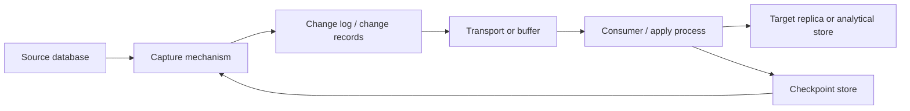

# Change Data Capture and Database Replication

> **Stage:** 2D — Data Architecture  
> **Module:** 06 — Data Integration and Interoperability  
> **Lesson:** 02 — Change Data Capture and Database Replication  
> **Audience:** Beginner to production-oriented Data Engineer / Data Architect  
> **Scope note:** Northbridge Bank, all volumes, rates, timelines, and targets in this lesson are illustrative teaching assumptions—not real benchmarks, vendor guarantees, or universal recommendations. This lesson is vendor-neutral.

## 1. Learning objectives

By the end of this lesson, you should be able to:

1. Explain change data capture (CDC), periodic extraction, database replication, and backup—and distinguish their purposes.
2. Compare log-based, trigger-based, and query-based CDC without assuming they have identical guarantees.
3. Design an initial snapshot followed by ongoing change capture without creating a gap or mishandling the snapshot/stream boundary.
4. Explain insert, update, delete, transaction, key, position, commit-time, and source-metadata fields in a change record.
5. Select an appropriate downstream representation: current-state replica, append-only history, event publication, or analytical merge.
6. Reason about per-key ordering, transaction boundaries, checkpoints, duplicate delivery, replay, and restart behaviour.
7. Calculate end-to-end lag, backlog growth, and catch-up time with explicit units and assumptions.
8. Assess source load, log retention, schema evolution, failover, and consistency limitations.
9. Document what a chosen mechanism guarantees, what it assumes, and what it does not guarantee.
10. Produce source profiles, a mechanism comparison, a failure/recovery analysis, and an auditable architecture decision.


## 2. Why CDC and replication matter in real-world data architecture

CDC can reduce freshness delay and expose deletes or intermediate changes that a periodic current-state extract may miss. It also introduces operational obligations: the snapshot and stream must meet at a proven boundary; changes must be applied in the supported ordering scope; checkpoints and replay must be safe; source changes must remain retained long enough for recovery; and schema changes must be coordinated. A target can be low-latency yet wrong, or complete yet temporarily behind. The design must state which consistency and freshness properties the business requires and which the selected mechanism actually provides.

Replication is useful for keeping another copy current, while data integration uses captured changes for a downstream purpose. Neither replaces a backup strategy with independent recovery points. The central architecture task is to select a mechanism that fits source capabilities and consumer needs, then verify its guarantees rather than infer them from the label “CDC.”


## 3. Prerequisite knowledge and key vocabulary

This lesson assumes you understand relational tables and keys, basic SQL, periodic batch ingestion, and the idea that a database transaction commits changes. Review the preceding lesson, **Batch ETL/ELT and Incremental Ingestion**, for watermark-based polling. The later lesson on idempotency and reconciliation covers those controls in greater depth; here they are discussed only where needed to reason about CDC.

| Term | Meaning |
|---|---|
| **Change Data Capture (CDC)** | A method for identifying and delivering changes made to source data, commonly inserts, updates, and deletes. |
| **Change record / change event** | A representation of a change, often containing operation type, key, values, position, and source metadata. |
| **Transaction log** | A database-maintained record used to recover or replicate committed changes. Its format and accessibility depend on the database. |
| **Log position / offset** | A source-specific location or sequence marker identifying progress in a change log. It is not necessarily a timestamp. |
| **Checkpoint** | Persisted progress information used to resume processing after interruption. |
| **Snapshot** | A point-in-time view of source state, often used to initialise a target before ongoing changes are applied. |
| **Replication** | Maintaining another copy of data by applying changes from a source to a destination. |
| **Replication lag** | The delay between a source change becoming committed and the corresponding change becoming visible at the target. |
| **Replay** | Reprocessing retained change records after restart, recovery, or rebuilding a target. |
| **Retention** | How long the source or capture system preserves changes that have not yet been consumed. |


## 4. Beginner-level learning sequence

### 4.1 Periodic extraction versus CDC

Periodic extraction reads source data at intervals. It may copy a full table or query for rows whose change marker falls in a range. CDC is designed to capture changes as they occur or are recorded by a source mechanism.

Suppose a customer row changes three times between two nightly extracts:

```text
10:00  address = "12 Pine Road"
14:00  address = "44 Lake Street"
18:00  address = "9 Hill Avenue"
23:00  nightly extraction reads the current row
```

A normal current-state nightly extract may see only `9 Hill Avenue`. It does not automatically preserve the intermediate states. A CDC stream may expose all three committed updates, if the chosen capture method records and retains them and the consumer reads them.

| Dimension | Periodic extraction / incremental batch | CDC |
|---|---|---|
| Change detection | Query filters, timestamps, versions, comparisons, or a full scan | Reads a change log, trigger-written table, or polled change marker |
| Freshness | Bounded by schedule and run duration | Can be seconds or minutes, but depends on capture, transport, and apply delays |
| Intermediate changes | Usually not preserved between snapshots | May be preserved if the capture mechanism records each change |
| Deletes | Often missed unless explicitly represented or compared | Often visible in log-based capture; not guaranteed for every CDC approach |
| Source impact | Repeated queries or scans can be expensive | Log reading can reduce repeated scans; triggers and polling can add source load |
| Operational complexity | Often simpler | More concerns: offsets, ordering, retention, restart, schema changes |
| Best fit | Simple sources, relaxed freshness, small/medium volumes | Frequent changes, lower latency, delete visibility, or change history needs |

**Important:** CDC is not automatically “real time,” lossless, globally ordered, exactly once, or self-healing. Those properties depend on the source, capture mechanism, transport, configuration, and consumer design.

### 4.2 CDC, replication, integration, and backup are different

- **CDC** is a way to capture changes.
- **Database replication** maintains a copy, often by continuously applying source changes to a replica.
- **Data integration** uses captured data to serve another purpose, such as analytics, risk reporting, or a customer data product.
- **Backup** preserves recoverable copies or historical recovery points so data can be restored after loss, corruption, or unwanted changes.

A replica is not a backup. If an authorised user accidentally deletes 10,000 accounts, a live replica may faithfully reproduce those deletes. A backup may provide a separate recovery point from before the incident, depending on retention and recovery design.

| Question | Replication | Backup |
|---|---|---|
| Main goal | Keep a copy current or near-current | Restore data after loss, corruption, or unwanted changes |
| Typical update pattern | Continuous or frequent change application | Scheduled snapshots, backups, or retained recovery logs |
| Does it preserve old versions by default? | Not necessarily | Often designed to retain recovery points, according to policy |
| Does it protect against logical mistakes automatically? | No; mistakes can replicate | Potentially, if a suitable clean recovery point is retained |
| Is it a substitute for the other? | No | No |

### 4.3 Three common CDC approaches

The roadmap covers **log-based**, **trigger-based**, and **query-based** CDC. They are patterns, not universal product specifications.

#### Log-based CDC

The capture process reads a database's transaction/change log or a supported logical change stream. It typically interprets committed changes and their source positions.

**Strengths**
- Can capture inserts, updates, and deletes without polling every row.
- May preserve transaction and ordering metadata.
- Often efficient for high-change-rate sources.

**Limitations**
- Requires supported access and correct log configuration.
- Retained logs can be exhausted if consumers fall behind.
- Schema changes, failover, and log-position changes need explicit handling.
- Exact guarantees vary: not all implementations expose identical before-images, transaction boundaries, or ordering scope.

#### Trigger-based CDC

Database triggers execute when rows are inserted, updated, or deleted. They commonly write a change record to an audit/change table in the same transaction.

**Strengths**
- Can make changes visible through ordinary tables.
- May capture deletes and application-level metadata.
- A transactional trigger table can couple the base change and audit record.

**Limitations**
- Triggers add work to source transactions and may increase latency or lock contention.
- Trigger logic can be disabled, bypassed, or become inconsistent if not managed carefully.
- Bulk operations, cascades, schema changes, and trigger failures need testing.
- It may capture row changes without providing a full transaction-log position or all intermediate semantics.

#### Query-based CDC

A job periodically queries for rows using a change marker such as `updated_at`, a monotonically increasing version, or a source-maintained change table. This overlaps conceptually with incremental batch ingestion.

**Strengths**
- Often easier to implement where log access is unavailable.
- Uses familiar query and access-control paths.
- Can be scheduled and throttled.

**Limitations**
- A marker may be missing, unreliable, low precision, or updated before commit.
- Hard deletes are invisible unless represented separately.
- Multiple updates may collapse into the latest row state between polls.
- Repeated queries can place load on the source.

A query-based mechanism should not be described as equivalent to log-based CDC merely because both deliver changed rows.

### 4.4 Worked example: choose based on source capability

Northbridge Bank (fictional) has three illustrative sources:

| Source | Illustrative behaviour | Candidate approach | Main risk to investigate |
|---|---|---|---|
| Customer OLTP table | Stable customer key, `updated_at`, but timestamps may be written before transaction commit | Query-based polling as a baseline; log-based CDC if lower latency and stronger change visibility are required | Late commit can fall behind a stored timestamp watermark |
| Account table | No reliable last-modified field; hard deletes are possible | Evaluate log-based CDC first if supported; trigger-based change table if log access is unavailable and source impact is acceptable | A full scan cannot by itself identify a deleted row without comparison or a tombstone |
| Transaction table | Append-only, immutable transaction ID | Periodic extraction by a reliable sequence/creation marker may be sufficient; CDC if low latency or commit ordering is required | Duplicate extraction, late commits, and source sequence semantics |

These are candidate designs, not unconditional recommendations. Confirm source interfaces, transaction semantics, change retention, source load tolerance, consumer freshness, and recovery requirements before selecting one.

### 4.5 Check your understanding

1. Why can a nightly snapshot miss intermediate customer updates?
2. Why is a live replica not an independent backup?
3. Which CDC approach reads a transaction log? Which adds work to row-changing transactions?
4. Why does query-based CDC often need explicit delete handling?

**Expected answers:** (1) It sees the row's current state at extraction time rather than necessarily recording every intermediate change. (2) Unwanted changes can replicate too. (3) Log-based; trigger-based. (4) Deleted rows no longer match ordinary queries, unless a tombstone, audit table, comparison, or other signal records the deletion.


## 5. Intermediate-level learning sequence

### 5.1 Basic architecture



This is a conceptual flow. Some implementations combine capture, transport, and checkpointing; others separate them. A checkpoint may live with the capture connector, consumer, or external state store. The actual boundary matters during recovery.

A safe design documents:
1. What source position identifies each change.
2. Whether changes are exposed only after commit.
3. How the capture process persists progress.
4. What happens when the consumer fails after applying data but before committing its checkpoint.
5. How duplicate delivery is handled.
6. How long source changes remain available.
7. How source and target schemas are coordinated.

### 5.2 Typical change-record fields

A change record may include:

| Field | Purpose | Important caveat |
|---|---|---|
| Operation (`INSERT`, `UPDATE`, `DELETE`) | Describes the kind of change | Operation vocabulary varies; truncate or DDL events may be separate |
| Primary/business key | Identifies the affected entity | Key updates may appear as delete-plus-insert or as a key-change event |
| Before image | Prior values | May be absent or partial |
| After image | New values | May be absent for deletes or partial for updates |
| Transaction ID | Groups changes from one source transaction | Not every mechanism exposes it |
| Log position / sequence | Establishes source progress and sometimes ordering | Scope and comparability are mechanism-specific |
| Commit timestamp | Approximate source commit time | Wall clocks can skew; timestamps are not always unique or a safe checkpoint |
| Source metadata | Database, table, schema version, capture time, etc. | Metadata availability varies |

Never design as if every change record contains complete before and after images, a global sequence number, and a trustworthy timestamp. Verify the actual contract.

### 5.3 Initial snapshot plus ongoing stream

A new target often needs both:
- an **initial snapshot** of existing rows, and
- the **ongoing change stream** for changes after the snapshot boundary.

The transition between them is the **snapshot/stream seam**. If the seam is mishandled, changes can be missed or applied twice.

Conceptual safe sequence:

```text
1. Establish a source-consistent snapshot boundary B.
2. Record the corresponding change-log position P(B).
3. Read the snapshot representing state at B.
4. Retain or consume changes after P(B).
5. Load the snapshot into the target.
6. Apply changes after P(B) in the mechanism's documented order.
7. Publish the target only when the chosen readiness condition is met.
```

The exact order of operations varies by capture implementation. Some systems stream while the snapshot is being read and coordinate row-level snapshot metadata with log positions. Do not assume a generic “take snapshot, then start CDC” sequence is safe: a change committed between those steps may be lost. Use a documented consistent-snapshot protocol or a controlled write boundary.

For a simple consumer design, retain changes after the boundary while the snapshot is loaded, then apply those retained changes in the documented order after the snapshot is complete. If the implementation applies stream changes concurrently with snapshot rows, it must provide a documented coordination protocol so an older snapshot row cannot overwrite a newer streamed change. Record the boundary position, snapshot completion marker, and first/last applied positions; test a row updated during snapshot and compare the final target state with an authoritative source view. A timestamp alone is not proof of a gap-free seam.

**Example:** If an account balance is 500 at boundary B, then changes to 450 and 420 after B, a current-state target should finish with 420. If the 450 event is missed but 420 is captured, the final balance may still be correct while the change history is incomplete; if 420 is missed too, the target remains stale. For an append-only history consumer, losing either event is a correctness defect. The seam must be proven, not guessed.

### 5.4 Applying changes to different targets

The same captured change stream can serve different purposes, but the consumer logic differs.

| Target pattern | How changes are applied | Useful for | Key concern |
|---|---|---|---|
| Current-state replica | Insert/update current row; remove or mark deleted rows | Operational read replica, current-state analytics | Correct order and delete semantics |
| Append-only history | Append every change with source position and metadata | Audit, temporal analysis, debugging | Preserve identity, order, and schema version |
| Event publication | Translate changes into domain/integration events | Multiple downstream consumers | A row update is not automatically a valid business event |
| Analytical merge | Merge latest state into curated tables or partitions | Reporting and feature data | Late changes and historical restatement |

A database row mutation does not necessarily describe a complete business fact. For example, changing `account.status` to `CLOSED` may be a state update; it is not by itself proof that all closure procedures completed.

### 5.5 Ordering and transaction boundaries

Ordering means the sequence in which changes must be applied to preserve intended state.

- **Per-key ordering**: changes to the same key are applied in source order. This is often essential for current-state correctness.
- **Partition ordering**: a transport may preserve order only within a partition or shard.
- **Global ordering**: a total order across every table or key. Many systems do not provide this.
- **Transaction boundaries**: several row changes may belong to one source transaction. If downstream consumers see only part of that transaction, they may observe a state that never existed in the source.

Illustrative example for key `account_id=71`:

```text
position 900: balance = 100
position 901: balance = 80
position 902: balance = 65
```

Applying 902 and then 901 to a current-state table can leave the balance at 80, which is stale. A target should apply changes in the ordering scope promised by the mechanism or use a validated version/position rule to reject stale updates. Do not compare opaque log positions from unrelated sources or partitions unless the system explicitly defines how to compare them.

When transactions span multiple tables, decide whether downstream consumers require transactionally consistent visibility. A per-row stream may not make a multi-table transaction atomic at the target unless the capture and apply design preserves and commits the group accordingly.

### 5.6 Checkpoints, restart, and duplicate delivery

A checkpoint records how far processing has progressed. After a crash, a consumer resumes from a stored position. A critical failure window occurs when:
1. a change is applied to the target,
2. the process crashes before its checkpoint is saved,
3. the same change is delivered again after restart.

Therefore, replay and duplicate delivery are normal design cases. A checkpoint alone does not guarantee that a business effect is applied exactly once. Common strategies include:
- transactional target apply plus checkpoint update where both can be committed atomically;
- idempotent target operations keyed by source identity/position;
- storing processed source positions alongside target changes;
- safely reapplying upserts or deletes where semantics allow.

These strategies depend on the target's transaction model. The later idempotency lesson covers the broader pattern.

### 5.7 Measuring end-to-end lag

A practical decomposition is:

\[
L_{\text{end-to-end}} =
L_{\text{capture}} + L_{\text{transport}} + L_{\text{apply}}
\]

Each term is a duration measured over the same observation window. For example, if capture delay is 8 seconds, transport delay is 12 seconds, and apply delay is 20 seconds:

\[
L_{\text{end-to-end}} = 8s + 12s + 20s = 40s
\]

This is a simple additive model; real systems may overlap stages, and reported metrics may use different definitions. State whether lag is measured by source commit time, log-position distance, queue age, or target visibility time. A difference between wall-clock timestamps can be misleading if clocks are unsynchronised.

### 5.8 Backlog growth and catch-up calculation

Let:
- \(A\) = incoming change volume, in records/second;
- \(P\) = processing capacity, in records/second;
- \(B\) = backlog, in records.

If \(A > P\), backlog grows at:

\[
G = A - P
\]

If processing capacity later exceeds arrivals, the idealised catch-up time is:

\[
T_{\text{catch-up}} = \frac{B}{P-A}
\quad \text{where } P>A
\]

**Illustrative calculation:** a consumer receives 1,200 records/s but processes 1,000 records/s. Backlog grows by:

\[
1{,}200 - 1{,}000 = 200 \text{ records/s}
\]

Over 30 minutes (1,800 s), assuming steady rates:

\[
B = 200 \times 1{,}800 = 360{,}000 \text{ records}
\]

If the arrival rate remains 1,200 records/s and processing capacity rises to 1,800 records/s:

\[
T_{\text{catch-up}} = \frac{360{,}000}{1{,}800 - 1{,}200}
= 600 \text{ s} = 10 \text{ minutes}
\]

This assumes constant rates, no new bottleneck, sufficient downstream capacity, and no source retention expiry. Real workloads fluctuate, records have different processing costs, and parallelism may be limited by ordering or partition count.

**Second worked check (the roadmap's illustrative rates):** arrivals are 1,000 changes/s and the consumer applies 800 changes/s for 600 s. Net growth is \(1{,}000-800=200\) changes/s, so backlog is \(200\times600=120{,}000\) changes. If arrivals then fall to 400 changes/s while processing remains 800 changes/s, net drain is \(800-400=400\) changes/s and idealised catch-up is \(120{,}000/400=300\) s (5 minutes). The calculation assumes stable rates and no other bottleneck.

### 5.9 Schema changes

A source schema can change while capture and consumers are running:
- adding a nullable column;
- renaming or dropping a column;
- changing a data type;
- changing key structure;
- truncating a table or performing DDL.

A connector may pause, fail, adapt, emit a schema event, or produce a record that downstream code cannot parse. These are mechanism-specific outcomes. A robust design specifies:
1. how source DDL is detected;
2. whether the change record includes a schema version;
3. how old and new schemas coexist during rollout;
4. whether consumers accept, ignore, or reject unknown fields;
5. how incompatible changes are rolled back or repaired;
6. how the target is reconciled after a schema-related interruption.

Do not assume that adding a source column automatically adds it safely to every target.


## 6. Advanced-level learning sequence

### 6.1 Failure modes and recovery actions

| Failure | Likely impact | Detection evidence | Prevention / repeat-safe or reconciliation control | Recovery direction | Accountable owner | Verification evidence |
|---|---|---|---|---|---|---|
| Capture process stops | Source changes accumulate or are not read | Capture heartbeat stops; source position stalls | Heartbeat alert; monitor source-position age and retention headroom | Restart from last validated position if still retained | CDC/platform operator | Position continuity and source/target reconciliation |
| Consumer stops | Apply lag and backlog increase | Queue age or source-to-target lag rises | Capacity alerts and catch-up worksheet | Restore capacity; estimate catch-up time before retention expires | Data-pipeline operator | Lag returns to target and backlog drains |
| Checkpoint advances too early | Changes can be skipped after restart | Position gap or target/source discrepancy | Commit checkpoint only with the defined successful processing boundary; reconcile | Stop publication; recover from retained changes or rebuild snapshot | CDC engineer | No unexplained position gap; control totals agree |
| Target apply succeeds but checkpoint fails | Changes may be replayed | Repeated source position or duplicate effects | Atomic target/checkpoint transaction where supported, or idempotent apply by source identity/position | Replay safely and reconcile affected keys | CDC engineer / target owner | Forced crash test shows no lost or duplicated business effect |
| Log retention expires before recovery | Required changes no longer available | Requested position is older than earliest retained position | Alert on retention headroom; define maximum recovery time | Re-snapshot and resume using a coordinated boundary, unless another justified history exists | Database owner + CDC owner | New boundary and target reconciliation recorded |
| Snapshot/stream seam is wrong | Missing or duplicate changes | Reconciliation discrepancy near initialisation boundary | Use a documented consistent-snapshot protocol and retain post-boundary changes | Rebuild or repair from a proven snapshot boundary | Source DBA + CDC engineer | Concurrent-update seam test passes |
| Events applied out of order | Stale or invalid current state | Target version/position regresses | Preserve documented ordering scope or validate per-key version comparisons | Pause, restore ordering, replay affected keys/range | Consumer owner | Reverse-order test leaves correct final state |
| Schema change breaks parser | Capture/apply stalls or records are rejected | Schema errors, rejected records, lag increase | Change review, compatibility checks, old/new schema test | Coordinate schema, repair consumer, replay retained records | Source schema owner + consumer owner | Schema-change drill and replay evidence |
| Source failover changes log identity/position | Resume point may be invalid | Position/epoch mismatch | Persist source timeline/epoch metadata; rehearse failover | Follow documented failover procedure; establish a new valid boundary if needed | Database owner | Failover drill proves valid resume or rebuild path |
| Delete or truncate semantics misunderstood | Target retains rows or loses too much data | Count/key-set mismatch | Explicitly test hard delete, cascade, key change, and truncate behavior | Apply mechanism-specific repair and reconcile | Source owner + target owner | Operation test matrix and key-set comparison |
| Transaction is only partly visible downstream | Target reflects an impossible intermediate state | Cross-table invariant violation | Preserve transaction metadata and apply/publish groups atomically where required and supported | Quarantine partial group; replay or rebuild affected scope | Data-product owner | Multi-table transaction test verifies visibility contract |

### 6.2 Log retention and expired positions

A log-based consumer can resume only if the source or capture layer still retains the required changes and the position remains valid. If a consumer is offline longer than the retention window, the missing log segment may be gone. Continuing from the earliest available position can silently omit changes.

Recovery decision:

```text
Can the required source position still be read?
  ├─ Yes → resume from a validated checkpoint, replay, then verify target.
  └─ No  → stop incremental apply; establish a new consistent snapshot,
           coordinate a new stream boundary, rebuild/repair target, verify,
           then resume publication.
```

A new snapshot is not always the only possible repair, but it is a common safe baseline when the change history needed to reconstruct state is unavailable. Choose the repair based on whether a complete authoritative source view or another trustworthy history exists.

### 6.3 Source failover and log-position identity

A log position may be meaningful only within a particular source timeline, log generation, shard, or database incarnation. After failover, restore, or reinitialisation, the same numeric offset may not refer to the same history. Record enough source identity/epoch metadata to validate resume points. Never assume that “offset 500” is globally meaningful without its source and log context.

### 6.4 Deletes, key changes, and truncation

- **Deletes:** A delete event should identify which target entity to remove or mark deleted. Some capture mechanisms provide the old key but not the full old row.
- **Key updates:** If a primary key changes, the target may need to remove the old key and create the new key. The exact event representation varies.
- **Truncate:** A table truncate may be emitted as a distinct operation or DDL event rather than one delete event per row. Consumer behaviour must be explicit.
- **Cascades:** A source database may delete child rows because of referential actions. Verify whether capture records each affected row and how transaction grouping is exposed.

Do not infer delete completeness from the fact that a connector is labelled “CDC.” Check its documented handling for each source operation.

### 6.5 Consistency limitations

CDC transfers changes; it does not by itself make source and target one distributed transaction.

Possible consistency models include:
- **Eventually consistent target:** the target catches up after a delay.
- **Transactionally consistent source capture:** the mechanism identifies committed source transactions correctly, within its documented scope.
- **Transactionally consistent target apply:** the target exposes related changes atomically, if the design supports it.
- **Point-in-time consistent snapshot:** the initial snapshot corresponds to a defined source boundary.

These are different properties. A source can emit a correct ordered change stream while a consumer applies it slowly. A target can be current for one table and behind for another. A replication stream can be complete but not yet applied. Define the required consistency boundary in business terms.

### 6.6 Monitoring that supports action

Monitor more than a single “healthy” status. Useful signals include:
- capture heartbeat and last successful source position;
- source position age and earliest retained position;
- consumer checkpoint and apply throughput;
- source commit-to-target visibility lag;
- backlog size and oldest-record age;
- errors by operation/table/schema;
- restart count and time spent recovering;
- snapshot progress and snapshot/stream boundary state;
- target row/key counts or other independent control totals.

Each alert should have a response. For example, if backlog grows for 15 minutes, determine whether arrivals exceed processing capacity, whether a partition is blocked, whether the target is slow, and how much retention headroom remains. The threshold is workload-specific and must be derived from freshness and recovery requirements, not copied as a universal standard.


## 7. Industry-application exercises

### 7.1 Guided exercises

### Exercise 1 — Compare periodic extraction and CDC

A customer row changes four times between scheduled extracts. Draw what a current-state batch target receives and what an append-only CDC history could receive.

**Expected deliverable:** Two labelled flows and a short statement of which business questions each can answer. Explicitly state the assumptions about capture completeness and retention.

### Exercise 2 — Choose a mechanism

For each source, choose a candidate mechanism and list one reason and two risks:
1. A small reference table updated once per day, with a reliable `updated_at`.
2. An account table with hard deletes and no reliable timestamp.
3. A high-volume transaction database where commit order matters.

**Expected check:** Do not automatically choose log-based CDC for every source. Explain source capabilities, freshness needs, deletes, and operational cost.

### Exercise 3 — Snapshot/stream seam

A snapshot starts at source boundary B. A row is updated after B while the snapshot is being read. Explain how a consistent-snapshot protocol prevents the update from being lost, and what evidence you would collect to prove the target is correct.

**Expected deliverable:** Boundary diagram, identified log position, test case, and target verification method.

### Exercise 4 — Lag and catch-up

A consumer receives 2,500 records/s and processes 2,100 records/s for 20 minutes. Then capacity is increased to 3,000 records/s while the arrival rate stays constant.

Calculate:
1. Backlog growth rate.
2. Backlog after 20 minutes.
3. Idealised catch-up time after the capacity increase.

**Worked answer:**
- Growth = 2,500 − 2,100 = **400 records/s**.
- 20 minutes = 1,200 seconds; backlog = 400 × 1,200 = **480,000 records**.
- Net catch-up capacity = 3,000 − 2,500 = **500 records/s**.
- Catch-up time = 480,000 / 500 = **960 seconds = 16 minutes**.

Assumptions: steady rates, no new bottleneck, enough parallelism, and no retention expiry.

### Exercise 5 — Failure analysis

The target applies changes through source position P=10,500, but the consumer crashes before checkpointing P=10,500. On restart, records from P=10,480 are delivered again.

Answer:
- What can happen if target apply is not repeat-safe?
- Which state should be used to determine whether an update is stale?
- What evidence confirms recovery did not skip changes?

**Expected deliverable:** Failure timeline, chosen recovery control, and a verification plan. Do not claim that a checkpoint alone prevents duplicate effects.

### Exercise 6 — Retention expiry

The consumer has been offline for 36 hours. The source retains the required change log for only 24 hours (illustrative assumptions).

**Expected response:** The needed position may have expired. Stop assuming incremental resume is safe; validate the earliest retained position. If required changes are unavailable, establish a new consistent snapshot and stream boundary or another independently justified repair path, then reconcile before publishing.

### 7.2 Mechanism selection and architecture decision

#### Source profiling checklist

For each source, record:

- business purpose and target consumers;
- source interface and supported CDC options;
- primary/business key and key-change behaviour;
- insert/update/delete/truncate behaviour;
- expected and peak change rate;
- transaction rate and transaction size;
- required freshness and target consistency;
- whether before/after images are available;
- ordering scope and transaction metadata;
- snapshot consistency method;
- source CPU, I/O, lock, and query-load tolerance;
- log/change retention and maximum tolerated outage;
- schema-change process;
- restart, replay, and re-snapshot procedure;
- ownership, access constraints, and sensitive fields.

#### Illustrative comparison matrix

| Criterion | Log-based | Trigger-based | Query-based |
|---|---|---|---|
| Source change visibility | Changes represented in supported log | Changes recorded by trigger logic | Rows matching a polling query |
| Hard deletes | Usually capturable if supported by source/log and connector | Can be captured by delete trigger | Invisible unless separately represented |
| Intermediate updates | Often retained if log records them and retention permits | Can be retained in change table | May collapse between polls |
| Source overhead | Log-reading and configuration overhead; often avoids repeated table scans | Adds work to source write transactions | Repeated query/read load |
| Ordering/transactions | May expose positions and transaction metadata; verify guarantees | Can order by generated IDs, but transaction semantics depend on design | Usually requires a reliable marker; may not preserve every intermediate state |
| Operational complexity | Log retention, offsets, failover, schema changes | Trigger lifecycle, table growth, write-path impact | Watermarks, timestamp quality, deletes, polling windows |
| Good candidate | Low-latency, high-change workloads where log access is supported | Environments where triggers are acceptable and log access is unavailable | Relaxed freshness and reliable queryable markers |
| Critical non-guarantee | Not automatically globally ordered or exactly once | Not automatically complete if triggers can be bypassed or misconfigured | Not automatically delete-complete or lossless |

#### Example architecture decision record (ADR)

**Title:** Select change capture for Northbridge Bank account data  
**Status:** Illustrative proposal pending source-owner validation

**Context**
- Account table has no reliable last-modified marker.
- Hard deletes are permitted.
- Illustrative target requirement: current-state account analytics should usually be within five minutes of source commit.
- Source write-path overhead must be limited.
- The target must be rebuildable after an outage longer than the available change-retention window.

**Candidates**
1. Query-based polling: rejected as the primary mechanism because there is no reliable marker and hard deletes are not visible to ordinary polling.
2. Trigger-based CDC: viable fallback if source log access is unavailable, but source owners must validate transaction overhead, trigger coverage, and operational ownership.
3. Log-based CDC: preferred candidate if supported and approved because it may capture committed changes and deletes with lower repeated query load.

**Decision**
Evaluate log-based CDC first. Do not approve production use until source support, transaction ordering, delete/truncate semantics, snapshot coordination, failover behaviour, schema evolution, retention, and security have been tested against the actual database.

**Consequences**
- Benefits: potentially lower-latency change visibility and explicit change positions.
- Costs: operational expertise for log retention, checkpoints, schema changes, and recovery.
- Non-guarantees: no assumption of global ordering, exactly-once business effects, or unlimited replay. These must be proven from the mechanism contract and target design.

**Evidence required before approval**
- Source-owner confirmation of supported log access and impact.
- Initial snapshot plus stream-seam test.
- Insert/update/delete/key-change/truncate tests.
- Restart after target apply but before checkpoint.
- Outage longer than normal recovery window and retention-expiry drill.
- Schema-change and failover drill.
- Lag/backlog dashboard and tested recovery runbook.
- Target/source reconciliation evidence.

#### Guarantee table: documented, assumed, and unknown

Before approving a CDC mechanism, maintain a table like this for the actual source and capture implementation. The entries below are a **template with illustrative evaluation status**, not claims about a specific product. Replace each status with evidence from the chosen mechanism's documentation and tests.

| Property | Status to record | Evidence to collect | Design response if unknown |
|---|---|---|---|
| Only committed changes are emitted | **Documented / assumed / unknown** | Source and connector semantics; rollback test | Do not publish as authoritative until verified |
| Insert, update, and hard-delete capture | **Documented / assumed / unknown** | Test each operation, including cascade behaviour | Add a supported delete signal or reject the mechanism |
| Per-key ordering | **Documented / assumed / unknown** | Contract documentation and out-of-order test | Preserve source sequence or reject stale updates |
| Cross-table transaction grouping | **Documented / assumed / unknown** | Transaction metadata and multi-table test | Do not promise atomic multi-table visibility |
| Initial snapshot and stream seam | **Documented / assumed / unknown** | Boundary protocol, position evidence, seam test | Use a supported coordinated snapshot procedure |
| Checkpoint durability and restart | **Documented / assumed / unknown** | Kill/restart test around apply and checkpoint | Design for replay and repeat-safe apply |
| Duplicate delivery behaviour | **Documented / assumed / unknown** | Forced restart/replay test | Add idempotent apply or processed-position controls |
| Replay retention and expired-position response | **Documented / assumed / unknown** | Retention settings, earliest-position monitoring, expiry drill | Define re-snapshot/rebuild recovery |
| Source failover and log identity | **Documented / assumed / unknown** | Failover test and position metadata | Validate source epoch/timeline before resume |
| Schema evolution and DDL handling | **Documented / assumed / unknown** | Add/rename/drop/type-change tests | Coordinate schema rollout and pause incompatible apply |

A property marked **assumed** has not yet been proven. A property marked **unknown** must not be treated as a guarantee. Approval should identify an owner and verification action for each material unknown.

### 7.3 Northbridge Bank industry exercise

Design CDC for customer and account data used by a risk analytics platform.

#### Illustrative requirements
- Customer and account current-state data should normally be visible within five minutes.
- Deletes must not silently leave stale target rows.
- A source outage longer than the retained change window must have a documented rebuild path.
- Multi-row source transactions must not be represented as transactionally atomic downstream unless the chosen mechanism and target apply process support it.
- Source-system load and operational ownership must be reviewed before approval.

#### Required deliverables
1. **Source profiles** for customer and account data, including keys, change types, transaction rate, retention, schema-change process, source impact, and consumers.
2. **Mechanism selection** with alternatives and explicit reasons.
3. **Flow diagram** showing snapshot boundary, change positions, transport, apply, checkpoints, and publication.
4. **Guarantee statement** separating documented mechanism guarantees, design assumptions, and non-guarantees.
5. **Lag worksheet** with measured or illustrative rates, units, and catch-up arithmetic.
6. **Failure-mode matrix** covering capture stop, consumer stop, duplicate delivery, ordering issue, log expiry, schema change, failover, and delete handling.
7. **Recovery runbook** including detection, containment, resume/re-snapshot decision, validation, and controlled republishing.
8. **Monitoring plan** that links each alert to an operator action.
9. **ADR** recording context, candidates, decision, trade-offs, evidence required, and rejected alternatives.

#### Review questions
- What source fact makes the selected mechanism feasible?
- How do you prove that snapshot and stream have no gap?
- Which ordering guarantee is required: per key, per partition, per transaction, or global?
- What happens if the checkpoint is behind the target?
- What happens if the required log position has expired?
- Which delete, key-change, truncate, and DDL operations have been tested?
- What does the design explicitly **not** guarantee?

## 8. Practical scenarios and case-based reasoning

**Scenario A — Consumer outage exceeds retention.** The CDC consumer was down for two days while the source retains one day of change history (illustrative). Do not resume from an expired position as if nothing were missing. Confirm the earliest retained position; establish a new consistent snapshot and coordinated stream boundary, or another independently justified repair path; then verify the target before republishing.

**Scenario B — Two updates arrive in reverse order.** Two changes for the same account are applied in reverse order. The control must use the documented source ordering scope or a validated per-key version/position rule to prevent stale state from overwriting newer state. If the source position cannot be compared in that scope, do not invent a comparison rule.

**Scenario C — A source column is dropped during a Friday release.** The consumer may fail parsing, reject events, or silently lose a field depending on the contract and implementation. The release should be coordinated: classify compatibility, deploy compatible consumers/target schema as needed, test old/new schema coexistence, monitor rejected records and lag, and define rollback/replay steps before the change.

## 9. Expected outputs and deliverables

Retain the following evidence in the lesson workbook or project repository:

- [ ] CDC-versus-periodic-extraction comparison for the Northbridge scenario, including what each can and cannot observe.
- [ ] Source profiles for customer and account data, including keys, operation types, source load tolerance, change visibility, retention, schema process, and consumer freshness.
- [ ] Snapshot-plus-stream procedure with a named boundary, source position, restart behavior, and a seam test demonstrating no unexplained gap or duplicate effect.
- [ ] Change-record field map identifying operation, key, available before/after images, transaction metadata, position, commit time, and source metadata.
- [ ] Mechanism comparison and ADR with alternatives, trade-offs, evidence required, and explicit non-guarantees.
- [ ] Guarantee matrix classifying each material property as documented, assumed, or unknown and recording verification evidence or a compensating control.
- [ ] Lag/backlog/catch-up worksheet with units, assumptions, and reviewer-reproducible arithmetic.
- [ ] Failure-mode matrix with detection, impact, control, recovery, owner, and validation evidence; include at least ten distinct failure scenarios.
- [ ] Recovery runbook covering restart, duplicate replay, retention expiry, schema changes, source failover, and controlled publication.
- [ ] Monitoring plan connecting each alert to an operator action.
- [ ] Answers to the guided exercises and Topic 2 practice questions, with corrections recorded.

Do not mark a deliverable verified merely because a design is written down. Label design-time assumptions separately from evidence obtained through documentation review, tests, or a live source-system exercise.

## 10. Common mistakes and misconceptions

- **“CDC always captures every change.”** Only if the chosen mechanism records the relevant operations, remains correctly configured, and retains changes long enough for consumers to read them.
- **“All CDC is log-based.”** Trigger-based and query-based patterns also exist, with different semantics and costs.
- **“A timestamp is an ordering guarantee.”** Timestamps can collide, skew, be assigned before commit, or fail to represent transaction order.
- **“Starting CDC after the snapshot is safe.”** Not unless the snapshot boundary and change-stream position are coordinated.
- **“A checkpoint means exactly once.”** A crash between target apply and checkpoint persistence can cause replay.
- **“The source stream is ordered globally.”** Ordering scope must be read from the mechanism contract; global ordering may not exist.
- **“Replication is backup.”** Replication can reproduce accidental deletes and corruption.
- **“Low lag means correct.”** A target can be current but wrong because of missed deletes, ordering defects, schema errors, or a bad snapshot seam.
- **“A connector can always resume.”** Required log positions may expire or become invalid after failover/reinitialisation.
- **“A row-level update is a business event.”** It may not contain the business meaning or transaction context consumers need.
- **“Schema changes are just adding a column.”** Renames, type changes, key changes, truncates, and old/new schema coexistence can break capture and apply.

## 11. Mastery criteria

You are ready to move on when you can, without relying on memorised product claims:

- Explain CDC, periodic extraction, replication, and backup in your own words.
- Compare log-based, trigger-based, and query-based CDC using source capability, freshness, deletes, source impact, and recovery.
- Draw an initial snapshot plus ongoing-stream flow and identify the seam that must be coordinated.
- Explain operation type, key, before/after image, transaction metadata, position, and commit time, including fields that may be absent.
- State the ordering scope required and what happens if changes are applied out of order.
- Explain the apply/checkpoint crash window and how duplicate replay is made safe.
- Calculate lag, backlog growth, and catch-up time with correct units and assumptions.
- Describe how retention expiry, failover, and schema changes affect recovery.
- Identify detection, containment, recovery, and evidence for each failure scenario.
- Defend a mechanism choice and state what it does **not** guarantee.

## 12. Completion gate

Do not mark this lesson complete until each item has evidence.

- [ ] **CDC versus periodic extraction:** explain what changes can be observed and what can be missed.
- [ ] **Replication versus backup:** explain why they are not substitutes.
- [ ] **Mechanism comparison:** compare log-based, trigger-based, and query-based CDC with source-specific assumptions.
- [ ] **Snapshot plus stream:** document a coordinated boundary and how the seam is verified.
- [ ] **Change record:** identify operation, key, available images, position, commit time, and metadata.
- [ ] **Ordering and transactions:** state ordering scope and transaction-boundary requirements.
- [ ] **Checkpoint and replay:** explain restart behaviour and duplicate delivery.
- [ ] **Lag worksheet:** calculate end-to-end lag and backlog/catch-up arithmetic with units.
- [ ] **Schema and retention:** document schema-change handling and the response to an expired log position.
- [ ] **Recovery evidence:** every failure scenario has detection, recovery action, and validation evidence.
- [ ] **Practice answers:** complete the exercises and correct errors.
- [ ] **Industry deliverables:** produce source profiles, mechanism decision, flow diagram, failure/recovery matrix, monitoring plan, and ADR.

### 12.1 Quick self-test

1. Which CDC approach reads the database transaction log?
2. What is the snapshot/stream seam, and why is it dangerous?
3. Why may a target apply a change twice after restart?
4. What is the difference between per-key and global ordering?
5. Why does a replication lag metric not prove correctness?
6. What should happen if the checkpoint's required source position is no longer retained?
7. Why is query-based CDC vulnerable to missed hard deletes?
8. What must an architecture decision state beyond the chosen mechanism?

**Answer key**
1. Log-based CDC.
2. The boundary between the initial snapshot and ongoing changes; an uncoordinated boundary can create gaps or duplicate application.
3. The target apply may succeed while checkpoint persistence fails.
4. Per-key ordering orders changes for one key; global ordering orders all changes across the source, which may not be available.
5. Low lag measures timeliness, not completeness, ordering correctness, schema correctness, or delete handling.
6. Stop assuming incremental resume is safe; use a new consistent snapshot or another justified recovery path, then verify before publication.
7. A deleted row no longer appears in a normal polling query unless a separate delete signal exists.
8. Source requirements and capabilities, alternatives, assumptions, trade-offs, failure behaviour, evidence, and explicit non-guarantees.

---

### 12.2 Further reading within this roadmap

Use the adjacent lessons only for their defined responsibilities:

- **01 — Batch ETL/ELT and Incremental Ingestion:** periodic extraction, watermarks, and incremental batch limitations.
- **05 — Data Contracts, Schema Registry, and Compatibility:** structural and semantic schema-change policy.
- **07 — Idempotency, Deduplication, and Reconciliation:** repeat-safe application and evidence that source and target agree.
- **08 — Integration Pattern Selection and Failure Handling:** broader pattern-selection method and cross-pattern failure review.

The core architecture principle remains: select CDC from business requirements, source capabilities, consumer needs, data semantics, and operational constraints. Document both the guarantees you rely on and the assumptions that still need testing.
