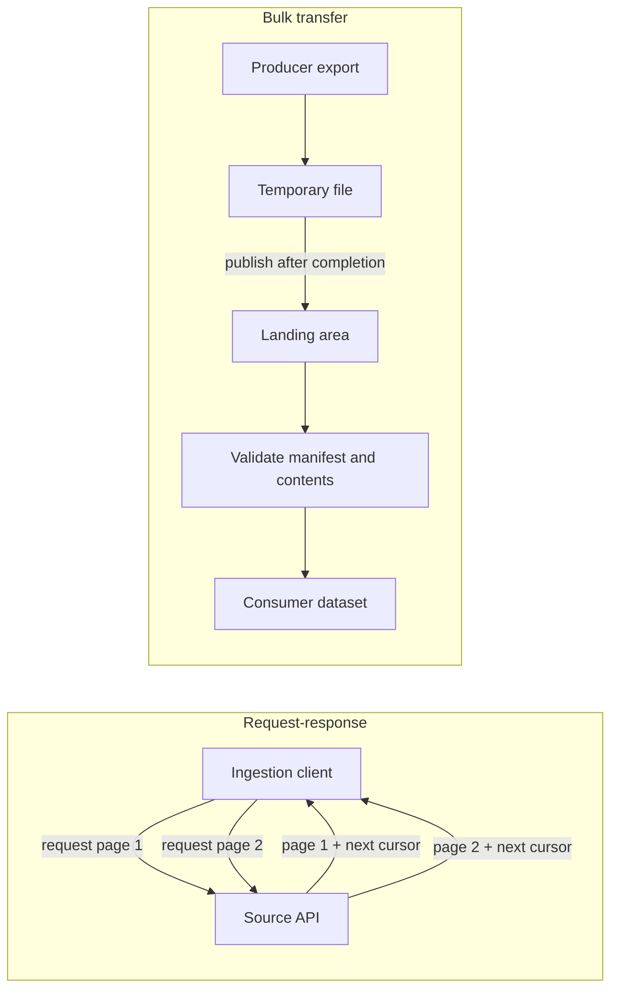
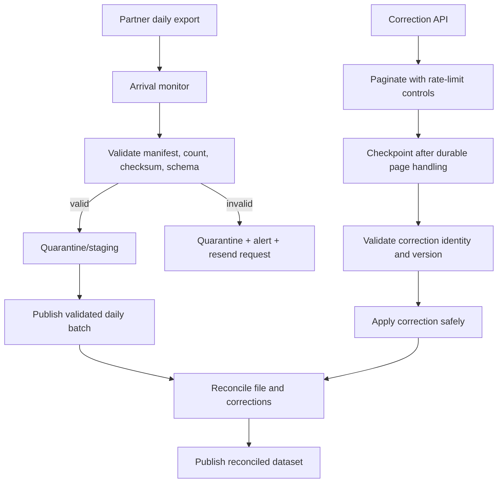

# APIs, Files, and Managed Connectors

> **Stage:** 2D — Data Architecture  
> **Module:** 06 — Data Integration and Interoperability  
> **Topic:** 03 — APIs, Files, and Managed Connectors  
> **Level:** Beginner → Intermediate → Advanced → Industry application  
> **Scope:** Vendor-neutral integration architecture. All organisations, volumes, rates, quotas, durations, and targets below are illustrative assumptions—not vendor guarantees or benchmarks.

## 1. Learning objectives

After completing this lesson, you should be able to:

1. Describe API-based ingestion, file-based exchange, and managed connectors, including their roles and limitations.
2. Contrast request-response integration with bulk transfer.
3. Explain authentication versus authorisation, least privilege, secret storage, and credential rotation.
4. Use the vocabulary of pagination, cursor, rate limit, quota, manifest/control file, checkpoint, and retry.
5. Profile a source and select an interface based on consumer needs and source constraints.
6. Design pagination, incremental extraction, rate-limit compliance, token refresh, and checkpoint handling.
7. Calculate API request count and estimated extraction duration with units and assumptions.
8. Design file naming, arrival detection, completeness checks, manifests, checksums, correction/resend handling, and duplicate controls.
9. Assess managed-connector boundaries, observability, schema drift, resync, supportability, maintenance, cost, and lock-in.
10. Design bounded retries, timeouts, backoff and jitter while distinguishing transient failures from permanent errors.
11. Explain recovery from unavailable APIs, partial responses, duplicate pages, incomplete files, expired credentials, connector stalls, and API version deprecation.
12. Produce an interface comparison, API/file design, failure table, and completion evidence aligned to the roadmap.

## 2. Why this topic matters in real-world Data Architecture

Many business sources expose only an API, a file exchange, or a packaged connector. These are not interchangeable transports with identical semantics. The interface determines what can be queried, how freshness is achieved, how much load is placed on the producer, which failures are visible, and who must repair the integration.

The architect must select the interface that meets the consumer's freshness and completeness needs with acceptable source impact and operational burden. A managed connector can reduce implementation effort but does not remove the need to monitor it. A file can efficiently carry millions of records but still be incomplete. An API can provide controlled access to current state but may impose pagination, quota, and version constraints.

## 3. Prerequisite knowledge

This lesson builds on:
- **Module 1 — Batch ETL/ELT and Incremental Ingestion:** source profiling, incremental markers, watermarks, retries, and safe publication.
- **Module 2 — Change Data Capture and Database Replication:** when CDC is available and how it differs from periodic extraction.
- **Stage 2D.5 Topic 3 — Object Storage and File Format Selection:** format and storage trade-offs.
- **Stage 2D.2 Topic 5 — Vendor Dependencies:** dependency and portability concerns.

This lesson does not attempt to teach general API development, all authentication protocols, or vendor-specific connector setup. It focuses on designing and operating data ingestion through these interfaces.

## 4. Beginner-level learning sequence

### 4.1 Three interface types

| Interface | What it is | Natural fit | Main limitation to investigate |
|---|---|---|---|
| API-based ingestion | A client requests records or pages from a service | Current state, moderate volumes, filters, business-logic-aware access | Rate limits, quotas, pagination, versioning, and source availability |
| File-based exchange | A producer delivers a data file or set of files through an agreed channel | Bulk transfer, partners, legacy systems, scheduled exports | Arrival time, completeness, schema/format, resend and duplicate handling |
| Managed connector | A packaged integration maintained by a vendor or platform and configured to read a source | Common SaaS/database sources when supported behaviour fits requirements | Connector coverage, opaque internals, support boundaries, resync behaviour, cost, and lock-in |

A managed connector may use an API, database interface, file, or another source mechanism internally. “Managed” describes who packages and operates some of the integration machinery; it does not guarantee correctness, freshness, exactly-once effects, or complete recovery.

### 4.2 Request-response versus bulk transfer



Request-response usually retrieves bounded portions of data through repeated calls. Bulk transfer moves a larger prepared unit, often with an explicit delivery schedule. APIs can also expose bulk-export jobs, and files can arrive frequently; the distinction is a pattern, not a rigid law.

Why it matters:
- An API can apply server-side filters and expose data according to business rules, but a large record-by-record extraction may take many requests.
- A file can efficiently carry a large volume and decouple producer and consumer schedules, but it needs a reliable completion signal.
- A connector can accelerate onboarding, but you must still understand what it extracts, how it checkpoints, how it handles deletes and schema changes, and how recovery works.

**Question:** Why is a successful first API page not proof of a complete extraction? Because more pages may remain, the cursor may be mishandled, a later page may fail, or a partial response may be mistaken for completion.

**Question:** Why is file arrival not proof of completeness? The producer may still be writing, a transfer may be interrupted, a part may be missing, or the delivered file may not match its manifest.

### 4.3 Authentication and authorisation

- **Authentication:** establishes the identity of the caller or workload.
- **Authorisation:** determines which actions and data that identity may access.
- **Least privilege:** grant only the permissions required for the integration.
- **Secret storage:** keep credentials in an approved secret manager or protected runtime configuration; do not embed them in source code, notebooks, logs, command history, or committed configuration files.
- **Rotation:** renew or replace credentials before expiry, test the rotation procedure, and alert on authentication failures.
- **Data minimisation:** request and land only the fields needed for the stated purpose; protect landed files as well as API credentials.

A successful authentication does not imply the caller is authorised to read every endpoint or field. A credential may expire, be revoked, lose a permission, or be scoped to a different environment. These are expected operational cases, not reasons to hard-code a replacement secret.

### 4.4 Vocabulary

| Term | Definition |
|---|---|
| Pagination | Splitting a result set across multiple responses |
| Offset pagination | Requesting records by a numeric offset and page size |
| Cursor pagination | Using a source-provided continuation token or position |
| Rate limit | A constraint on how frequently requests may be made |
| Quota | A usage allowance over a defined period or billing dimension |
| Checkpoint | Persisted progress that allows safe continuation after interruption |
| Incremental extraction | Requesting only data believed to have changed since a prior point |
| Manifest/control file | A metadata file describing expected data files, counts, checksums, sequence, or business date |
| Retry | Repeating an operation after a failure deemed potentially transient |
| Backoff | Waiting longer between repeated attempts |
| Jitter | Adding randomness to retry waits to reduce synchronized retry spikes |
| Partial response | A response that does not contain the complete expected result, even if some data is returned |
| Schema drift | A source's structure or types change from the expected schema |

### 4.5 Beginner exercise: classify six sources

For each source, choose a likely interface and name one risk. These are candidate choices; source capabilities and consumer requirements must be confirmed.

| Source | Candidate interface | One risk to investigate |
|---|---|---|
| SaaS CRM with filters and pagination | API or managed connector | API quota or connector's incremental/delete behaviour |
| Partner sends daily transactions | File exchange | Missing or incomplete delivery |
| Legacy finance system exports a fixed-width file nightly | File exchange | Format/version drift and positional parsing errors |
| SaaS support system with a supported connector | Managed connector | Resync duplicating records or hidden lag |
| Reference service with a small current-state lookup | API | Availability, authentication, and latency |
| Analytics vendor provides a bulk export plus correction endpoint | File plus API | Reconcile late corrections with the bulk snapshot |

**Expected response:** state why the interface fits, then name at least one failure mode. “Use a connector because it is managed” is not sufficient reasoning.

## 5. Intermediate-level learning sequence

### 5.1 Profile source and consumer requirements before choosing

Record the following for each source:
- owner and business purpose;
- available interface(s), supported query/filter semantics, and API/file version;
- estimated total volume, changed volume, row/file size, peak periods, and growth;
- freshness objective and the consumer's tolerance for late data;
- incremental extraction support, change marker reliability, and delete visibility;
- pagination and ordering semantics;
- rate limits, quotas, request cost, egress cost, and source load tolerance;
- authentication model, permission boundaries, and credential expiry/rotation process;
- file schedule, naming convention, delivery location, manifest, and resend process;
- schema/versioning policy and expected drift;
- checkpoint location, replay/resync behaviour, and operational owner;
- monitoring, alerting, runbook, vendor support boundary, and cost/lock-in concerns.

Do not assume a source offers a stable cursor, a reliable update timestamp, a manifest, a fixed quota, or a connector that exposes all source fields. Treat undocumented behaviour as unknown until tested.

### 5.2 Interface comparison matrix

| Criterion | API | File exchange | Managed connector |
|---|---|---|---|
| Freshness | Potentially frequent; limited by API and polling cadence | Usually tied to producer schedule, though can be frequent | Depends on connector schedule, source capability, and service tier |
| Bulk volume | May be inefficient for very large record-by-record pulls | Often efficient for large transfers | Varies by connector, source and pricing model |
| Incremental support | Filters, cursors, change markers, or source-defined endpoints | Incremental/delta files or periodic snapshots | Connector-specific; inspect supported sync modes |
| Completeness evidence | Pagination completion, response metadata, counts, reconciliation | Manifest, expected files, counts, checksum, sequence/business date | Sync state, metrics, logs, source-target reconciliation |
| Control | Fine control over requests and transformations | Control over validation and publication after receipt | Some controls abstracted or constrained by connector |
| Source impact | Request volume and query complexity | Export job and transfer load | Depends on the connector's extraction method and configuration |
| Failure transparency | HTTP/status details may help; partial success can be subtle | Missing/late/corrupt files can be explicit if monitored | Internals may be partly opaque; vendor status may not expose every failure |
| Ownership | Client team owns pagination, retries, auth, parsing and checkpoints | Producer/consumer must agree on delivery contract | Shared ownership: team owns config, monitoring, validation and escalation |
| Cost/lock-in | API charges, engineering and maintenance | Transfer/storage and partner operations | Licence/volume pricing, service dependency and portability |

**Selection rule:** prefer the interface that meets freshness and completeness needs at the lowest acceptable source impact and operational burden. Files are often suitable for bulk and partner exchange; APIs for controlled current-state access and business-rule-aware queries; managed connectors where control requirements are modest and supportability is proven.

### 5.2.1 Worked source comparison: SaaS CRM with an API and daily export

**Illustrative scenario:** A SaaS CRM offers a paginated API for filtered current-state reads and a daily bulk export. The consumer needs a daily full-ish baseline plus selected updates during the day.

| Need | Paginated API | Daily bulk export |
|---|---|---|
| Selected records needed quickly | Better fit if filters and freshness support the need | Usually waits for the next export |
| Large historical backfill | Can require many requests and may be constrained by quotas | Often more efficient if export coverage and delivery are complete |
| Intermediate updates between exports | Only if API/change endpoint exposes them and the client polls appropriately | Usually not preserved by a current-state export |
| Completeness evidence | Cursor exhaustion, page/item counts, and reconciliation | Manifest, expected file set, checksum/count validation, and arrival ledger |
| Main operational risk | Rate limits, cursor semantics, and partial pagination | Late/missing export, malformed/incomplete file, or schema drift |

**Defensible design:** use the bulk export for an initial historical load or large scheduled refresh if it has an agreed manifest and completeness contract. Use the API for bounded current-state lookups or incremental updates only if the source's filtering, change marker, and quota support the required freshness. Reconcile the two paths by stable CRM record ID and a trustworthy source version/update marker. If no reliable version exists, define a source-consistent cutover or an overlap-and-reconciliation procedure rather than assuming the two interfaces line up automatically.

This is not a universal recommendation. Confirm the export's contents, deletion semantics, timing, and schema; confirm the API's pagination, ordering, quota, and incremental semantics. A daily export alone may be insufficient for intraday freshness, while an API alone may be inefficient for a very large backfill.

### 5.3 API pagination design

#### Offset pagination

A request may specify `offset=0&limit=500`, then `offset=500&limit=500`.

Advantages: simple and easy to understand. Risks: if the source dataset changes while paging, insertions or deletions can shift offsets and cause skipped or repeated records. Large offsets can also be inefficient on some systems.

#### Cursor pagination

A response returns a continuation cursor. The next request uses that cursor.

Advantages: the source can maintain a stable traversal position more efficiently. Risks: cursor expiry, invalidation, inconsistent snapshot semantics, or source-specific ordering behaviour. A cursor is not automatically a durable checkpoint forever.

**Design controls**
1. Use the source's documented pagination contract; do not invent cursor rules. If page 7 fails after pages 1–6 were landed, mark the logical run incomplete, persist only a safe checkpoint for successfully handled pages, and resume/restart according to cursor validity and target duplicate-safety; do not publish the partial run as complete.
2. Check the response's continuation indicator. Stop only when the source says the result is complete.
3. Persist page progress only after that page has been durably landed or applied according to the chosen recovery model.
4. If a request fails, resume from a valid checkpoint or restart the extraction with duplicate-safe handling.
5. Use stable ordering or a source-defined snapshot/query boundary where supported.
6. Record request parameters, page count, item count, run ID, and final completion status.
7. Treat an empty page as terminal only if the API contract says so; do not guess.
8. For incremental extraction, record the time/sequence boundary and overlap strategy. A timestamp filter alone may miss late commits or updates that do not advance the marker.

### 5.4 API request-count and duration calculation

For \(N\) records and page size \(S\):

\[
\text{requests} = \left\lceil \frac{N}{S} \right\rceil
\]

If the allowed rate is \(R\) requests/second and the process can use that full rate continuously, the ideal request pacing time is approximately:

\[
T_{\text{pacing}} = \frac{\text{requests}}{R}
\]

This estimate excludes response latency, processing, retries, token refresh, and quota windows. If a quota is expressed as requests per minute, convert units before calculating.

**Illustrative example:** \(N=240{,}000\) records and \(S=600\) records/request.

\[
\text{requests} = \lceil 240{,}000/600 \rceil = 400
\]

At an allowed \(R=2\) requests/second:

\[
T_{\text{pacing}} = 400/2 = 200 \text{ seconds}
\]

If the allowed rate halves to 1 request/second, the ideal pacing time becomes \(400/1=400\) seconds, or 6 minutes 40 seconds. This is a rate-only estimate, not a promise of actual completion time. If each request takes 0.8 seconds end-to-end and requests are strictly sequential, the latency-limited duration may dominate; if requests run concurrently, concurrency limits and source policy also matter.

A rate limit and a quota are different: a system might permit a short burst while enforcing a longer daily or monthly usage allowance. Both must be checked, including whether multiple teams or jobs share the same quota.

#### Roadmap calculation: large paginated extraction

The roadmap uses an illustrative example of 12,000,000 records with 1,000 records per request:

\[
\text{requests} = \lceil 12{,}000{,}000 / 1{,}000 \rceil = 12{,}000
\]

At 10 requests/second:

\[
T = 12{,}000 / 10 = 1{,}200\text{ seconds} = 20\text{ minutes}
\]

If the allowed request rate halves to 5 requests/second, ideal pacing time doubles to:

\[
T = 12{,}000 / 5 = 2{,}400\text{ seconds} = 40\text{ minutes}
\]

This is a lower-bound pacing estimate. Confirm that both the short-term rate and the longer-term quota allow the extraction. Add response latency, processing time, retries, concurrency constraints, and any shared quota consumption by other teams before committing to a schedule.

#### Roadmap retry-budget calculation

For a conceptual exponential backoff with base delay 1 second, multiplier 2, and five waits before the next attempt:

\[
T_{\text{wait}} = 1 + 2 + 4 + 8 + 16 = 31\text{ seconds}
\]

This is the wait total **before jitter** and excludes request execution time. Be explicit about whether a configured “five retries” means five retries after the first attempt or five total attempts; the two interpretations produce different retry budgets. In a real implementation, cap each wait and total elapsed time, add jitter, and follow source-specific rate-limit instructions.

### 5.5 Incremental extraction and checkpoints

An API may support a filter such as `updated_since`, a change token, a sequence, or a source-provided delta endpoint. Verify:
- whether the marker is updated on every relevant change;
- whether hard deletes are represented;
- whether marker precision and commit timing can cause late records;
- whether the endpoint has a stable snapshot or ordering contract;
- whether the cursor expires;
- whether the source returns partial pages or warnings;
- whether the request can be safely repeated.

A safe high-level pattern:

```text
read committed checkpoint C
choose a bounded extraction window from C (with overlap if needed)
fetch every page and validate completion
land records with a stable run ID and source identity
validate counts/schema and apply duplicate-safe target logic
publish the successful run
advance checkpoint only after the required commit/publication succeeds
```

The exact checkpoint boundary depends on the source contract. If the extraction window overlaps prior data, the target needs a duplicate-safe strategy. If the source lacks a reliable change marker, periodic full comparison or a file/CDC alternative may be more honest than pretending an incremental query is complete.

### 5.6 Rate-limit and retry strategy

Classify failures before retrying.

| Failure class | Examples | Typical action |
|---|---|---|
| Transient | Network reset, temporary server error, short-lived overload | Bounded retry with backoff and jitter |
| Rate limited | Explicit rate-limit response or retry guidance | Respect the source's retry delay/headers and reduce request rate |
| Authentication | Expired/revoked token, invalid credentials | Refresh through approved flow or alert; do not loop indefinitely |
| Authorisation | Permission denied for endpoint/field | Fix permission or configuration; blind retry will not help |
| Validation/permanent request error | Invalid parameter, malformed query, unsupported API version | Stop and correct request/version |
| Partial/ambiguous result | Connection fails after some data was received; incomplete page | Do not mark complete; resume/re-fetch safely and deduplicate as required |

Exponential backoff with jitter is commonly modelled as:

\[
d_k = \min(d_{\max}, d_0 \times 2^k + J_k)
\]

where \(d_0\) is the initial delay, \(k\) is the zero-based retry number, \(d_{\max}\) is the maximum total wait, and \(J_k\) is a non-negative bounded random jitter value. Apply the cap after adding jitter so the total wait does not exceed \(d_{\max}\). This is a conceptual policy, not a source guarantee. Respect explicit retry-after guidance where provided, cap attempts and total elapsed time, and make retry behaviour observable.

Do not blindly retry non-idempotent operations such as creating a record or initiating a payment: a timeout may occur after the server performed the action but before the client received the response. For extraction GET-style requests, repeatability is often easier, but pagination and mutable source state can still create duplicates or gaps.

### 5.7 Runnable local example: cursor pagination and bounded retry (simulation)

The following example simulates an API in memory. **It does not call a real service, implement OAuth, persist a checkpoint, or prove any vendor's pagination guarantees.** It demonstrates client-side control flow: continue until there is no next cursor, retry a transient failure a bounded number of times, reject malformed pages, detect pagination loops, and return a result only after all pages have been read. Durable checkpointing and atomic publication are discussed above but are not implemented in this simulation.

Save as `mock_api_ingestion.py` and run with Python 3.10+:

```python
from dataclasses import dataclass
from typing import Optional


class TransientAPIError(Exception):
    """A simulated temporary service failure."""


class PermanentAPIError(Exception):
    """A simulated invalid request or non-retryable failure."""


class InvalidPageError(RuntimeError):
    """The simulated API returned a malformed page."""


@dataclass(frozen=True)
class Page:
    items: list[dict]
    next_cursor: Optional[str]


class MockAPI:
    """In-memory API simulation; no network access or credentials required."""

    def __init__(self) -> None:
        self.pages = {
            None: Page([{"id": 1}, {"id": 2}], "page-2"),
            "page-2": Page([{"id": 3}, {"id": 4}], "page-3"),
            "page-3": Page([{"id": 5}], None),
        }
        self.failed_once: set[str] = set()

    def get_page(self, cursor: Optional[str]) -> Page:
        # Simulate a transient failure on page-2, once only.
        if cursor == "page-2" and cursor not in self.failed_once:
            self.failed_once.add(cursor)
            raise TransientAPIError("simulated temporary service error")
        if cursor not in self.pages:
            raise PermanentAPIError(f"invalid cursor: {cursor!r}")
        return self.pages[cursor]


class StaticAPI:
    """Small injectable fake used to test error paths."""

    def __init__(self, pages: dict, failures: int = 0) -> None:
        self.pages = pages
        self.failures_remaining = failures

    def get_page(self, cursor: Optional[str]) -> Page:
        if self.failures_remaining:
            self.failures_remaining -= 1
            raise TransientAPIError("simulated repeated temporary failure")
        if cursor not in self.pages:
            raise PermanentAPIError(f"invalid cursor: {cursor!r}")
        return self.pages[cursor]


def fetch_all(api, max_attempts: int = 3) -> list[dict]:
    """Fetch all pages; max_attempts includes the initial attempt."""
    if not isinstance(max_attempts, int) or isinstance(max_attempts, bool) or max_attempts < 1:
        raise ValueError("max_attempts must be an integer of at least 1")

    cursor: Optional[str] = None
    records: list[dict] = []
    seen_cursors: set[Optional[str]] = set()

    while True:
        if cursor in seen_cursors:
            raise RuntimeError(f"pagination loop detected at cursor {cursor!r}")
        seen_cursors.add(cursor)

        for attempt in range(1, max_attempts + 1):
            try:
                page = api.get_page(cursor)
                break
            except TransientAPIError:
                if attempt == max_attempts:
                    raise
                # Production code should wait using bounded backoff + jitter
                # and respect Retry-After/rate-limit guidance when available.
            # PermanentAPIError and other unexpected errors deliberately propagate.
        else:  # Defensive guard; normally the loop breaks or raises.
            raise RuntimeError("page was not retrieved")

        if not isinstance(page, Page):
            raise InvalidPageError("response is not a Page instance")
        if not isinstance(page.items, list) or any(not isinstance(row, dict) for row in page.items):
            raise InvalidPageError("page items must be a list of record dictionaries")
        if page.next_cursor is not None and (not isinstance(page.next_cursor, str) or not page.next_cursor):
            raise InvalidPageError("next_cursor must be a non-empty string or None")

        records.extend(page.items)
        if page.next_cursor is None:
            return records
        cursor = page.next_cursor


if __name__ == "__main__":
    # 1. Successful traversal despite one transient failure; stable order retained.
    rows = fetch_all(MockAPI())
    assert [row["id"] for row in rows] == [1, 2, 3, 4, 5]
    assert len({row["id"] for row in rows}) == len(rows)

    # 2. Invalid retry configuration is rejected.
    try:
        fetch_all(MockAPI(), max_attempts=0)
    except ValueError:
        pass
    else:
        raise AssertionError("invalid retry count was not rejected")

    # 3. A transient error is bounded; it is not retried forever.
    try:
        fetch_all(StaticAPI({None: Page([], None)}, failures=3), max_attempts=2)
    except TransientAPIError:
        pass
    else:
        raise AssertionError("exhausted transient retries were not surfaced")

    # 4. Permanent errors propagate without being classified as transient.
    try:
        fetch_all(StaticAPI({"other": Page([], None)}))
    except PermanentAPIError:
        pass
    else:
        raise AssertionError("invalid cursor was not surfaced")

    # 5. A repeated cursor is detected instead of looping indefinitely.
    try:
        fetch_all(StaticAPI({None: Page([], "loop"), "loop": Page([], "loop")}))
    except RuntimeError as exc:
        assert "pagination loop" in str(exc)
    else:
        raise AssertionError("pagination loop was not detected")

    # 6. Malformed page contents are rejected rather than published as valid.
    try:
        fetch_all(StaticAPI({None: Page([None], None)}))
    except InvalidPageError:
        pass
    else:
        raise AssertionError("malformed page was not rejected")

    print(f"records={len(rows)} ids={[row['id'] for row in rows]}")
    print("checks=passed (6 scenarios)")
```

**Expected output**

```text
records=5 ids=[1, 2, 3, 4, 5]
checks=passed (6 scenarios)
```

The retry delay is intentionally omitted so the example runs quickly and deterministically. The six scenarios exercise successful pagination, invalid retry configuration, exhausted retries, permanent errors, cursor loops, and malformed pages. Production code must add actual waits, jitter, request timeouts, rate-limit handling, safe logging, the source's authentication/credential flow, durable checkpoint persistence, and a target publication transaction. Do not log access tokens or sensitive record contents.

**What this example does not prove:** it does not persist a checkpoint, test real cursor expiry, model a changing source dataset, guarantee a snapshot-consistent traversal, or show safe publication to a target. In production, persist page/run state only after the corresponding data is durably handled; if the process fails, replay must be safe and the target must not be marked complete until pagination is exhausted and validation passes.

### 5.8 File exchange: design for completeness

A file contract should specify:
- file naming convention, source identifier, business date/period, sequence or batch ID, and schema version;
- encoding, delimiter, quoting/escaping, newline conventions, null representation, decimal/date/timezone rules;
- expected file set and whether empty files are valid;
- arrival deadline and late-file alert;
- manifest/control-file format and required fields;
- expected record count and, where feasible, checksum/hash and byte size;
- duplicate delivery and correction/resend rules;
- encryption, access controls, retention, encryption in transit and at rest, and secure deletion requirements;
- validation, quarantine, publication, and replay policy.

Example illustrative naming pattern:

```text
partner_transactions_business-date=2026-10-20_batch=0042_schema=v3.csv
partner_transactions_business-date=2026-10-20_batch=0042.manifest.json
```

The producer should publish the data file only after writing is complete—for example, write to a temporary name and atomically rename where the storage/transfer mechanism supports that operation. The consumer should not process a file simply because a filename appeared.

Illustrative manifest:

```json
{
  "producer": "northbridge-partner-demo",
  "dataset": "transactions",
  "business_date": "2026-10-20",
  "batch_id": "0042",
  "schema_version": "v3",
  "files": [
    {
      "name": "partner_transactions_business-date=2026-10-20_batch=0042_schema=v3.csv",
      "record_count": 125000,
      "size_bytes": 18400000,
      "sha256": "REPLACE_WITH_ACTUAL_SHA256"
    }
  ],
  "complete": true
}
```

Every value is illustrative. The hash shown is a placeholder, not a valid checksum. In a real contract, define whether the manifest is signed, how it is delivered, and whether the count includes headers, rejected rows, or trailers.

**Completeness checks**
1. The expected business date/sequence arrived before the deadline.
2. The manifest exists and identifies the expected dataset and schema version.
3. Every listed file exists, has the expected byte size, and passes checksum validation if supplied.
4. Parsed row count matches the manifest's definition.
5. Required columns, types, keys, and business rules validate.
6. No unexpected extra/missing files exist when the contract specifies an exact set.
7. The batch is marked complete only after all required checks pass.
8. Failed batches are quarantined and alerted; they are not silently published.

A checksum proves byte-level consistency with the checksum value, not semantic correctness or completeness of the producer's intended dataset. A row count is a useful control, not proof that the right records were sent.

### 5.8 Managed connectors: what is managed and what is not?

A managed connector may provide configuration, scheduling, extraction, state tracking, schema mapping, logs, retries, and service-level support. Exact features vary; verify them rather than assuming they exist.

**Potential benefits**
- Faster setup for supported sources.
- Less custom pagination, extraction, and credential plumbing.
- Centralised monitoring and a repeatable operating model.

**Limitations**
- Supported tables, endpoints, fields, sync modes, and API versions may be restricted.
- Internal retries and checkpoints may be only partly visible.
- A resync can re-read historical data or duplicate rows unless target semantics handle it.
- Schema drift may pause sync, drop fields, or require configuration changes.
- Pricing may depend on rows, volume, compute, or connector tier.
- The service can create dependency and migration costs. Review vendor SLA wording and exclusions; an SLA is not proof that the data is complete or correct.

**Configuration boundary:** document which choices your team controls (source scope, filters, schedule, target mapping, access, alerts, retention) and which are determined by the connector (internal page size, retry algorithm, state format, sync implementation). For hidden behaviours, record “unknown” and design tests, monitoring, or compensating controls.

Operational ownership remains with the data team: monitor freshness and errors, respond to missing data, validate output, coordinate schema changes, manage credentials, contact vendor support, and prove gaps are repaired.

## 6. Advanced-level learning sequence

### 6.1 Timeouts, retries, and partial responses

Set connection and read timeouts according to the source's expected behaviour and the ingestion run's deadline. A timeout bounds how long the client waits; it does not prove the server did no work.

For an extraction request:
- use bounded retries for failures classified as transient;
- honour explicit rate-limit retry guidance;
- add jitter so multiple workers do not retry simultaneously;
- cap retry count and total elapsed time;
- log request ID, page/cursor identity, attempt number, status, wait time, and final outcome without logging secrets or sensitive payloads;
- never advance a checkpoint because a retry loop ended; advance only after the complete logical unit is validated and committed.

A partial response may contain valid records but still be incomplete. Record it as incomplete, preserve enough state to resume or restart, and do not silently treat the returned subset as the full page.

### 6.2 Duplicate pages and records

Duplicates can arise when:
- a client re-fetches a page after a timeout;
- a cursor is replayed after checkpoint failure;
- offset pagination sees a changing dataset;
- a connector resyncs after an outage;
- a producer resends a file;
- an upstream correction repeats a record with a new batch ID.

Record stable source identity where available (source record ID, source update/version, file batch ID, page/run ID). Distinguish an exact repeated delivery from a legitimate new update to the same entity. Deduplication rules should be based on documented source identity and version semantics, not “keep an arbitrary row.”

For current-state targets, a validated upsert/version rule can make repeats safe. For append-only history, preserve delivery and source identifiers so repeats can be detected without erasing legitimate history. See the later **Idempotency, Deduplication, and Reconciliation** lesson for the broader target-side design.

### 6.3 Malformed files and incomplete transfers

Common causes include interrupted upload, truncation, missing multipart segment, corrupt compression, invalid encoding, broken quoting, extra delimiters, unexpected header, wrong schema version, out-of-sequence delivery, and count/checksum mismatch.

Recovery procedure:
1. Detect and quarantine the file or batch.
2. Preserve the original bytes and metadata in a controlled area if policy permits.
3. Notify the producer/owner with batch ID, failed validation, and expected correction.
4. Request a resend or correction using a new version/batch identity; do not silently overwrite evidence.
5. Revalidate the replacement against manifest, schema, counts, and business rules.
6. Publish atomically only after validation.
7. Record which batch was superseded and reconcile the target so partial/previous application is not left behind.

If a batch was partially applied before the defect was discovered, the recovery plan must say whether to roll it back, replace the batch, or replay into a staging/temporary target and swap publication. Never assume the target is untouched merely because the file failed validation late.

### 6.4 Schema drift and API version changes

Changes may include added/removed fields, renamed fields, type changes, enum expansion, pagination contract changes, altered error codes, endpoint deprecation, or changed default filters.

Controls:
- maintain a source-interface inventory and version owner;
- track vendor release/deprecation notices and migration deadlines;
- test representative responses and files against schemas;
- distinguish additive compatible changes from breaking changes;
- tolerate unknown fields only when the consumer's contract permits it;
- alert on missing required fields, unexpected types, parse errors, and sudden zero-row results;
- support a parallel test period or dual-version client where feasible;
- coordinate deployment and define rollback, backfill, and replay steps.

A field being present in a response does not mean it is populated or semantically unchanged. Validate content and business meaning as well as structure.

### 6.5 Failure-mode table

| Failure | Data impact | Detection | Recovery/control | Owner/evidence |
|---|---|---|---|---|
| API unavailable | Data freshness gap | Request failures and run deadline breach | Bounded retry; alert; resume from checkpoint | Integration owner; run log |
| First page succeeds, later page fails | Partial extraction may be published | Expected page/cursor not exhausted; count mismatch | Mark run incomplete; resume/restart safely | Integration owner; page ledger |
| Rate limit reached | Delays or request failures | Rate-limit response and wait metrics | Respect source guidance; reduce concurrency/rate | Integration owner; request metrics |
| Credential expires | Extraction stalls | Authentication failures and expiry alert | Approved refresh/rotation; test access | Security + integration owner; rotation evidence |
| Cursor expires | Cannot continue prior page traversal | Cursor-invalid response | Restart bounded extraction and deduplicate; reconcile | Integration owner; new run ID |
| Duplicate page or connector resync | Duplicate target records/effects | Duplicate keys/versions or count anomaly | Repeat-safe merge and reconciliation | Data owner; reconciliation result |
| Nightly file missing | Entire period absent without a job error | Deadline-based arrival monitor | Alert producer; late-file runbook; hold publication if required | Partner owner; expected/received batch ledger |
| File transfer incomplete | Truncated or missing records | Manifest/count/size/checksum mismatch | Quarantine and request resend | File integration owner; validation report |
| Malformed file/schema drift | Parse failure or silent field loss | Schema/type checks and rejected-row metrics | Quarantine, coordinate schema, replay corrected batch | Producer + consumer owner; schema diff |
| Managed connector stalled | Growing freshness gap | Last-success time, lag, error rate | Inspect service state, restart/resync per documented process, reconcile | Data team + vendor support ticket |
| API version deprecated | Future extraction failure or changed semantics | Deprecation notice, version inventory, contract tests | Migration plan, test new version, controlled cutover | Source owner; migration test results |
| No records returned unexpectedly | Silent gap or changed filters | Zero-row anomaly compared with expected pattern | Validate source filters, access and source activity; alert | Data owner; source/target comparison |

### 6.6 Operational monitoring and ownership

Monitor the outcome, not just process status.

**API signals**
- last successful complete run;
- page count and item count;
- request rate, quota usage, rate-limit responses, retries, timeout count;
- authentication/authorisation failures;
- cursor age/expiry and checkpoint progress;
- schema validation failures and unexpected zero-result runs;
- source-to-target freshness and reconciliation discrepancies.

**File signals**
- expected versus received file/batch by business date and sequence;
- arrival lateness, size, checksum and row-count validation;
- schema version, rejected rows, duplicate batch IDs;
- quarantine age, resend status, and time to publication.

**Connector signals**
- last successful sync, lag/freshness, error counts and status;
- rows read/written, schema warnings, resync/reload events;
- credential expiry, connector configuration changes, vendor incidents;
- source-target counts and key/version reconciliation.

Every alert needs an owner and an action. “No data arrived” can be a failure even if the ingestion job itself reports success. Define the expected cadence and deadline, and distinguish a valid zero-record period from a missing delivery.

## 7. Industry-application exercises

### 7.1 Northbridge partner transactions: daily file plus correction API

**Scenario assumptions (illustrative):**
- A fictional partner sends a daily transaction file.
- The partner exposes an API to retrieve corrections for prior transactions.
- The analytics platform requires validated daily batches and must not silently omit corrections.
- The source's actual API quota, file schedule, schema, and correction semantics must be confirmed before implementation.

**Recommended conceptual flow**



**Interface choice**
- Use the file for bulk transactions because it decouples producer and consumer and avoids pulling every row through a record-by-record API.
- Use the correction API for the source's correction semantics, provided it exposes a stable cursor/version and adequate rate/quota.
- If a managed connector is considered, verify that it supports both required data surfaces and preserves the correction semantics; do not assume it does.

**File manifest fields**
- producer and dataset;
- business date and batch/sequence ID;
- schema version;
- list of file names, byte sizes, and checksums;
- record count and the definition of that count;
- completion indicator;
- creation time/time zone and correction/resend reference where applicable.

**Arrival/completeness rules**
- Alert if the expected batch has not arrived by its agreed deadline.
- Do not process a file still being written or one without required completion evidence.
- Validate manifest, file set, checksum, row count, schema, keys, and business rules.
- Quarantine failures; record producer acknowledgement and resend lineage.
- Reconcile corrections against transaction identity/version and publish only after required checks pass.

**API duration estimate**
Use the documented quota and rate limit. For example, if an illustrative extraction has 72,000 records, 400 records/page, and a confirmed allowed rate of 3 requests/second:

\[
\text{requests} = \lceil 72{,}000/400 \rceil = 180
\]
\[
T_{\text{pacing}} = 180/3 = 60 \text{ seconds}
\]

This is ideal request pacing only; it excludes response latency, processing, retries, and quota windows. If the rate limit halves to 1.5 requests/second, the ideal pacing estimate doubles to 120 seconds. Confirm actual source limits rather than using these illustrative numbers as a target.

### 7.2 Required industry deliverables

Produce:
1. Interface comparison tied to source limits and consumer needs.
2. API design including pagination strategy, rate limits/quotas, retry classification, incremental boundary, checkpoint and restart behaviour.
3. File design including naming, manifest, arrival deadline, completeness validation, correction/resend and publication rules.
4. Managed-connector assessment: supported scope, configuration boundaries, observability, resync, schema drift, cost, lock-in, and ownership.
5. Failure table for API unavailable, incomplete file, and stalled connector, including detection, recovery, owner and evidence.
6. Monitoring plan and runbook with an alert-to-action mapping.
7. Answers to the Topic 3 practice questions.

## 8. Practical scenarios and case-based reasoning

### Scenario A — The nightly file is missing on Monday

**Problem:** The pipeline has no file to process, so no task fails. The target silently remains stale.

**Response:** Maintain an expected-delivery calendar or batch ledger. Alert when the expected file/manifest has not arrived by its deadline. Distinguish “valid zero records” from “no delivery.” Contact the producer, record the incident, process a corrected/resend batch under a controlled identity, and reconcile the period before marking it complete.

### Scenario B — A connector re-syncs three days after an outage

**Problem:** Historical records are read again. Blind append may duplicate records; blind overwrite may lose legitimate updates.

**Response:** Inspect documented connector resync and checkpoint semantics. Use source identity/version and target merge rules that make repeat delivery safe. Track the resync range/run ID, reconcile source and target, and prove that the gap was closed. If connector semantics are undocumented, mark them unknown and test before relying on them.

### Scenario C — An API version is deprecated in 90 days

**Response:**
1. Inventory every job and connector using the affected endpoint/version.
2. Identify source owner, consumers, authentication changes, schema/field changes, pagination and error-contract changes.
3. Build contract tests using representative responses.
4. Run the new version in a test or parallel path where feasible.
5. Compare record counts, keys, fields, and incremental boundaries.
6. Plan controlled cutover, rollback, and recovery of any missed window.
7. Complete the migration before the source's stated deadline and retain evidence.

Do not assume a deprecation date guarantees that the replacement has equivalent semantics.

### Scenario D — API request times out after the server returns data

The client cannot tell from the timeout alone whether the server processed the request or whether the response was lost. For a read-only extraction, re-fetching may be acceptable if duplicate-safe handling exists and the cursor contract supports it. For a non-idempotent write operation, use a source-supported idempotency key or reconciliation method; do not blindly repeat it.

### Scenario E — A file has the expected name but half the rows

A filename is not a completion signal. Check the manifest, file size/checksum, record count, schema, and producer batch ID. Quarantine and request a controlled resend. If any rows were already applied, use a defined rollback/replace or staging-and-swap procedure, then reconcile.

## 9. Expected outputs and deliverables

Your completed work should include:

- [ ] **Interface comparison:** API, file, and managed connector evaluated against source limits and consumer needs.
- [ ] **API design:** pagination, rate-limit/quota handling, timeouts, retry classification, incremental filters, checkpointing, and recovery.
- [ ] **File design:** naming convention, manifest fields, arrival/completeness rules, validation, archive, correction/resend, and duplicate handling.
- [ ] **Connector assessment:** supported sync modes, configuration boundary, observability, schema drift, resync, vendor boundary, cost and lock-in.
- [ ] **Failure table:** unavailable API, incomplete file, stalled connector, and additional likely failure cases.
- [ ] **Calculation worksheet:** request count and duration with rate limit, units, and what the estimate excludes.
- [ ] **Industry scenario:** Northbridge partner daily file plus correction API design.
- [ ] **Practice questions:** answers to the questions below, reviewed and corrected.

## 10. Common mistakes and misconceptions

- **Using a record-by-record API for bulk by default.** Compare page count, rate limits, quota, and source-supported bulk exports first.
- **Treating first-page success as extraction success.** Completion requires exhausting the documented pagination contract and validating the logical run.
- **Treating file arrival as completeness.** Use manifest and content checks; a name alone proves little.
- **Ignoring absence of data.** Missing expected data must trigger detection even when no task failed.
- **Retrying non-idempotent operations blindly.** A timeout does not prove the source did not act.
- **Retrying permanent failures.** Invalid requests and missing permissions need correction, not endless backoff.
- **Advancing checkpoints too early.** Do not commit progress before the required page/batch is durably handled.
- **Assuming cursor pagination is immutable.** Cursors can expire or have source-specific semantics.
- **Assuming a connector removes ownership.** The team still owns data quality, access, monitoring, reconciliation, and escalation.
- **Assuming schema drift is harmless.** A dropped or retyped field can silently change downstream meaning.
- **Leaving landed files or secrets uncontrolled.** Protect credentials, raw files, logs, and sensitive fields.
- **Assuming a checksum proves business completeness.** It verifies bytes against a value; it does not prove the producer supplied every intended record.

## 11. Mastery criteria

You have mastered the topic when you can:

- explain the three interfaces and their roles without claiming one is universally superior;
- choose an interface using freshness, volume, incremental support, source impact, control, cost, security, observability, and ownership;
- design pagination and checkpointing without treating a partial response as complete;
- calculate request count and ideal rate-limited duration and explain excluded time;
- explain bounded retries, exponential backoff, jitter, and why permanent/non-idempotent failures need different handling;
- define a file manifest and completeness rules that catch missing, late, incomplete, duplicate, or malformed deliveries;
- explain managed-connector boundaries, resync risks, schema drift, and vendor ownership;
- identify what happens when an API is unavailable, a file is incomplete, or a connector stalls;
- provide a recovery step, an owner, and evidence that the gap was closed.

## 12. Completion gate

Do not mark this lesson complete until each item has concrete evidence.

- [ ] **Interface choice cites source limits and consumer needs.** Explain why API, file, or connector is appropriate and identify trade-offs.
- [ ] **File manifest and completeness rules defined.** Include naming, business date/sequence, schema version, expected file set, counts/checksum where available, deadline, and resend/correction rules.
- [ ] **API pagination, limits, and checkpoints designed.** Document page/cursor completion, request rate/quota, retry policy, incremental boundary, and checkpoint advancement.
- [ ] **Calculation reproduced.** A reviewer can recompute page count and duration, including a halved-rate scenario and units.
- [ ] **Failure table covers unavailable API, incomplete file, and stalled connector.** Each row states detection, data impact, recovery, owner, and evidence.
- [ ] **Security controls documented.** Authentication versus authorisation, least privilege, secret storage/rotation, and landed-file access are covered.
- [ ] **Connector boundaries documented.** Identify supported features, unknown behaviours, resync, schema drift, cost/lock-in, and vendor support limits.
- [ ] **Practice questions answered and corrected.**
- [ ] **Gap closure is provable.** State how reconciliation demonstrates that missing pages, files, or connector intervals were recovered.

### Topic 3 practice questions

1. Why is a successful first API page insufficient to declare a run complete?
2. What is the difference between a rate limit and a quota?
3. When can cursor pagination still fail to provide a complete, gap-free extraction?
4. Why is a file manifest useful, and what does a checksum not prove?
5. What should an integration do when an expected daily file does not arrive?
6. Why can blind retries be dangerous for a non-idempotent operation?
7. Which responsibilities remain with the data team when a managed connector is used?
8. How should a connector resync that re-reads three days of data be handled?
9. What is the difference between authentication and authorisation?
10. What evidence would convince you that an API outage, missing file, or connector stall has been recovered?

**Answer/check section**
1. More pages may remain; later pages can fail or be partial.
2. A rate limit controls request frequency over a short interval; a quota limits usage over a broader period or usage dimension.
3. The cursor may expire, the source may change during traversal, ordering/snapshot semantics may be weak, or the checkpoint may be mishandled.
4. It describes the expected batch and helps validate it; a checksum proves byte-level match to the supplied hash, not semantic correctness or complete source coverage.
5. Detect absence against an expected schedule, alert, contact the producer, follow a resend/late-file procedure, and reconcile before marking complete.
6. The server may have performed the action even though the response was lost; repeating it may duplicate the effect.
7. Monitoring, access/security, output validation, schema coordination, recovery, reconciliation, cost review, and vendor escalation.
8. Use source identity/version and duplicate-safe target semantics, track the resync range, reconcile, and prove the missing interval was closed.
9. Authentication establishes identity; authorisation determines allowed actions/data.
10. Run logs and page/file/connector ledgers, target/source counts or key/version reconciliation, and a recorded recovery/approval decision.

---

### Final design principle

Choose the interface from the producer's actual capabilities and the consumer's requirements—not from familiarity or convenience alone. Design for incomplete delivery, expired credentials, schema changes, duplicate work, and operational ownership before the first production run. Where the source contract is undocumented, label the behaviour **unknown**, test it, and add compensating controls rather than inventing a guarantee.
