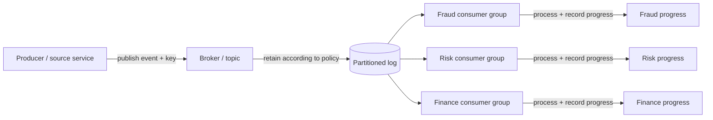
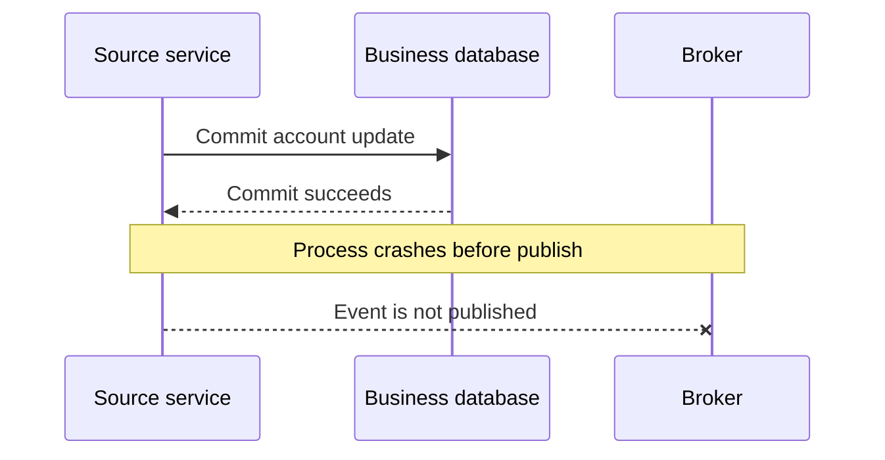
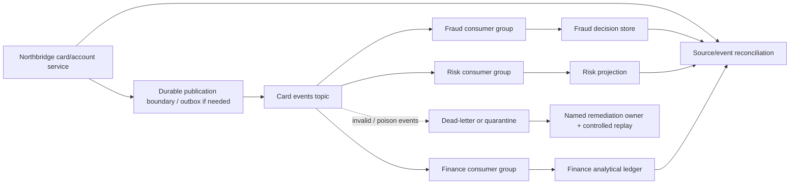

# Streaming Events and Message Contracts

> **Roadmap:** Stage 2D — Data Architecture  
> **Module:** 06 — Data Integration and Interoperability  
> **Topic:** 04 — Streaming Events and Message Contracts  
> **Progression:** Beginner → Intermediate → Advanced → Industry application  
> **Scope:** Vendor-neutral integration architecture. All organisations, rates, sizes, targets, and operating limits in examples are illustrative assumptions, not product guarantees or benchmarks.

## 1. Learning objectives

By completing this lesson, you should be able to:

1. Explain streaming integration and event-driven data movement.
2. Define events, messages, producers, consumers, brokers, topics/channels, partitions, consumer groups, and offsets.
3. Distinguish an event from a command and from a current-state record.
4. Design a message contract with identity, type, version, key, timestamps, source/classification, and payload.
5. Explain partition keys, partition-local ordering, consumer progress, event time versus processing time, retention, and replay.
6. Estimate stream throughput, partition count, retention storage, and replay/catch-up time using explicit assumptions and consistent units.
7. Design consumer behaviour for duplicate, late, out-of-order, malformed, and replayed events.
8. Explain at-most-once, at-least-once, and effectively-once processing without claiming that a broker alone guarantees exactly-once business effects.
9. Design restart, retry, dead-letter/quarantine, observability, and recovery controls.
10. Document schema evolution dependencies, sensitive-data controls, and producer/consumer ownership.
11. Produce a Northbridge card-event integration design with message contracts, partition rationale, retention calculation, failure-point controls, and a named dead-letter owner.

## 2. Why the topic matters in real-world Data Architecture

Streaming decouples producers from consumers and can deliver updates with low latency. A producer publishes an event; a broker retains it according to configured policies; multiple independent consumer applications read and act on it at their own pace. This makes it possible for fraud detection, risk analytics, finance, notifications, and other systems to react to the same business occurrence without the producer implementing each consumer's workflow directly.

The same decoupling moves responsibility into event identity, message contracts, ordering assumptions, replay safety, and operations. A broker transports and retains messages; it does not establish that a consumer charged a customer correctly, that two events were applied in the correct business order, or that a producer published every business change. Correctness must be designed across the producer, transport, consumer, and downstream effect.

Streaming is not always the best choice. If a consumer only needs a daily result, batch or incremental batch may be simpler and cheaper to operate. Choose streaming when its freshness and decoupling benefits justify its ongoing operational requirements.

## 3. Prerequisite knowledge

This lesson assumes familiarity with:
- **Module 1 — Batch ETL/ELT and Incremental Ingestion:** extraction, change markers, checkpoints, retries, and publication.
- **Module 2 — Change Data Capture and Database Replication:** change streams and source consistency.
- **Module 3 — APIs, Files, and Managed Connectors:** integration boundaries, failure handling, and ownership.
- **Stage 2D.3 Topic 6 — Event-Driven Patterns:** event versus command and outbox patterns.
- **Stage 2D.5 Topic 6 — Consistency:** consistency boundaries and the implications of asynchronous propagation.

This is an architecture-pattern lesson, not a vendor-specific broker configuration guide or a general distributed-systems course.

## 4. Beginner-level learning sequence

### 4.1 Core vocabulary

| Term | Meaning | Why it matters |
|---|---|---|
| Message | A unit of data sent through a transport | The consumer must know how to parse and interpret it |
| Event | A record that something happened | Events communicate facts that consumers can independently react to |
| Producer | The application or process that publishes messages | It owns event meaning, identity, and publication behaviour |
| Consumer | An application that reads and handles messages | It owns its processing, side effects, progress, and recovery |
| Broker | A service that receives, routes, and may retain messages | It decouples producer availability from consumer processing pace |
| Topic/channel | A named stream of related messages | It gives producers and consumers a logical contract boundary |
| Partition | A subdivision of a stream that can be processed independently | It affects parallelism and ordering scope |
| Offset/position | A location in a partition or stream used to track progress | It supports restart and replay, subject to the mechanism's semantics |
| Consumer group | A set of consumer instances coordinated to divide work for one logical subscription | It can increase parallel processing; exact assignment behaviour is mechanism-specific |
| Message contract | An agreement about fields, meaning, identity, versioning, and operational expectations | It allows independently deployed producers and consumers to interoperate |

These terms are common architectural vocabulary. Exact broker behaviour—such as retention, acknowledgements, ordering, offset commit rules, or group rebalancing—depends on the selected mechanism and must be verified before it becomes a design assumption.

### 4.2 Event, command, and current-state record

- **Event:** a fact that has occurred, usually named in the past tense: `PaymentPosted`, `AccountAddressChanged`.
- **Command:** a request for an action: `PostPayment`, `ChangeAccountAddress`. A command can be rejected; an event states that a fact occurred.
- **Current-state record:** a representation of what is true now, such as an account row with the latest address and balance. It may not preserve every change that led to that state.

Example:
- Command: `FreezeCardRequested`.
- Event: `CardFrozen`.
- Current-state record: `{ "card_id": "C-104", "status": "FROZEN" }`.

Do not publish a success event merely because a command was received. Publish the event when the source's defined business transition has actually occurred. If a service changes its database and publishes an event as separate operations, a failure between them can leave state changed without the corresponding event (or publish a duplicate). An outbox-style pattern can address this dual-write problem; see the roadmap's event-driven patterns topic.

### 4.3 Normal event flow



Each consumer group represents an independent logical subscription in this conceptual diagram. A fraud consumer can be behind while finance is caught up. One consumer's progress does not inherently mean every other consumer has processed the same event.

**Why retention matters:** retained messages can support restart, recovery, and a new consumer's initial read—until the required history expires. A stream should not automatically be treated as the permanent system of record. If the business requires longer history than the stream retains, a durable archive or authoritative source is needed.

### 4.4 Streaming compared with batch

| Dimension | Streaming | Batch / incremental batch |
|---|---|---|
| Freshness | Can be low-latency when source and consumers keep up | Bounded by schedule and run duration |
| Throughput | Handles continuous flow; burst/backlog capacity must be designed | Efficient for scheduled bulk movement |
| Decoupling | Multiple consumers can independently read retained events | Consumers often depend on published batches or tables |
| Replay | Possible within retained history or from an archive | Rerun/reload from landed data or source, subject to retention |
| Complexity | Requires continuous monitoring, ordering and recovery design | Often simpler scheduling and completion boundaries |
| Operational burden | Continuous lag, poison-event, partition and consumer management | Run failures, freshness windows, checkpoint and backfill management |
| Good fit | Fraud signals, account-change notifications, event-driven integrations | Daily reporting, large scheduled exports, workloads without strict low-latency needs |

Streaming is not automatically faster end-to-end. A slow consumer, source publication delay, partition skew, or downstream dependency can still create substantial event age.

### 4.5 Beginner exercise: payment-posted event

Draw one producer publishing `PaymentPosted` to a topic with three independent consumers: fraud, finance ledger analytics, and customer notifications. Label the producer, broker/topic, consumers, and each consumer's progress.

Your envelope should identify at least:
- event ID;
- event type and version;
- payment/business key;
- event time and publication time;
- source;
- payload;
- classification or sensitivity metadata if required by the organisation's governance policy.

**Expected result:** a diagram showing one publication path and three independent consumers, plus a short explanation of why one consumer's progress does not prove the other two have completed their work.

## 5. Intermediate-level learning sequence

### 5.1 Message contract and envelope

A message contract defines both structure and meaning. Field names alone are insufficient: producers and consumers need to agree on units, nullability, timestamps, identity, versioning, and the business meaning of each value.

#### Example contract: Northbridge account event

All names and values below are illustrative.

```json
{
  "event_id": "evt-8a91",
  "event_type": "AccountStatusChanged",
  "schema_version": 1,
  "source": "northbridge-account-service",
  "subject_key": "account-481",
  "event_time": "2026-10-20T09:41:22.145Z",
  "published_at": "2026-10-20T09:41:22.180Z",
  "classification": "confidential",
  "payload": {
    "account_id": "account-481",
    "status": "RESTRICTED",
    "entity_version": 27,
    "change_reason_code": "RISK_REVIEW"
  }
}
```

| Field | Purpose | Contract question |
|---|---|---|
| `event_id` | Stable identity for one logical event occurrence | Define the uniqueness scope (for example, producer namespace plus ID); retries or re-publication of the same occurrence preserve the ID, while a genuinely new occurrence gets a new ID |
| `event_type` | Defines the fact represented | Is the event named for a completed fact rather than a request? |
| `schema_version` | Identifies the structural version | How are old and new versions handled? |
| `source` | Producer identity and lineage | Which service is accountable for meaning and publication? |
| `subject_key` | Entity key used for routing and ordering decisions | Which related events must share an ordering scope? |
| `event_time` | When the business event occurred, according to the source's contract | Which clock and timezone semantics apply? |
| `published_at` | When the producer published or attempted to publish the event, as defined by the producer | Is this time measured before or after broker acknowledgement? |
| `classification` | Data sensitivity/governance label | Who may subscribe and how long may the payload be retained? |
| `payload` | The business facts | Are units, allowed values, nullability, and semantics documented? |
| `payload.entity_version` | Optional source-defined version/sequence for the entity (nested in this example's payload) | Is it monotonic and comparable for this entity, and what resets or gaps are possible? |

Do not assume `published_at` is a broker timestamp; the example defines it as a producer-supplied field. If the transport also provides a broker append timestamp, document that separately. Timestamps from different clocks may be skewed. Define `event_id` uniqueness explicitly: a retry or re-publication of the same logical occurrence must retain the same ID for deduplication to work; do not reuse that ID for a different occurrence. If IDs are only unique within a producer, consumers should use the documented composite identity rather than assume global uniqueness.

The contract should also document required versus optional fields, maximum payload size where relevant, key semantics, schema compatibility policy, error handling, retention expectation, and owner. Structural compatibility alone does not detect a field whose meaning silently changes.

### 5.2 Event time versus processing time

- **Event time:** when the business occurrence happened, according to the source's agreed clock/semantics.
- **Processing time:** when a consumer processes the message.
- **Publication/ingestion time:** when the event was published or accepted into the transport, if the mechanism exposes such a timestamp.

Example: a transaction occurs at 09:00, is published at 09:00:03, but the risk consumer processes it at 09:04 after a backlog. Its event time is 09:00 and processing time is 09:04. A report grouped by processing time would place it in a later bucket than a report grouped by event time.

Late events are normal when networks, retries, backlogs, offline producers, or upstream processing delay delivery. Consumers that aggregate by event time must define allowed lateness, what happens to older events, and whether corrections/recalculations are emitted. A watermark is a processing policy/estimate about event-time completeness; it is not proof that no earlier event can ever arrive.

### 5.3 Keys, partitions, and ordering scope

A **key** identifies the business subject or routing group. A **partition** is an independently processed subdivision of the stream. In many partitioned-log designs, a key determines the partition, but exact routing rules depend on the mechanism and configuration.

If all events for `account-481` must be applied in sequence, use a stable account-level key and verify that the selected mechanism preserves order within the resulting ordering scope. This does not imply a global order across all accounts or partitions.

| Key choice | Benefit | Trade-off / risk |
|---|---|---|
| Account ID | Keeps one account's related events in the same intended ordering scope | A very hot account may create a skewed partition |
| Transaction ID | Distributes work across many transactions | Does not order different transactions for the same account |
| No key / random distribution | Can spread load | Related events may be processed in different partitions; ordering may be lost |
| Customer ID | Can preserve customer-level sequencing | A customer with very high event volume can create a hot key |

Changing the key or partition count may remap future events. Do not assume old and new events for a key will remain in one uninterrupted ordering sequence after repartitioning. If key/partition strategy changes, plan a migration and verify ordering/replay semantics.

**Partitioning trade-off:** more partitions may enable more parallelism, but also increase coordination, state, and operational overhead. Parallelism is not unlimited: within a consumer group, active parallel consumption is commonly bounded by available partitions, though exact scheduling is mechanism-specific.

### 5.4 Throughput and partition sizing calculation

The roadmap's illustrative sizing example uses:
- event rate = 20,000 events/second;
- average event size = 1 KB = 1,000 bytes (decimal assumption);
- assumed sustainable per-partition throughput = 5 MB/second;
- desired headroom = 2×.

Ingress payload rate:

\[
20{,}000\ \text{events/s} \times 1{,}000\ \text{bytes/event}
= 20{,}000{,}000\ \text{bytes/s}
= 20\ \text{MB/s}
\]

The raw partition estimate is:

\[
\left\lceil \frac{20\ \text{MB/s}}{5\ \text{MB/s per partition}} \right\rceil
= 4\ \text{partitions}
\]

With 2× headroom:

\[
4 \times 2 = 8\ \text{partitions}
\]

This is a planning illustration, not a production recommendation. It excludes protocol overhead, compression, replication traffic, consumer processing limits, uneven key distribution, burstiness, and broker-specific constraints. Validate sustained throughput with representative payloads and load tests. Check key skew before trusting the arithmetic: eight partitions do not help if one hot key sends most events to a single partition.

### 5.5 Retention and replay storage calculation

The roadmap's illustrative example uses 20 MB/second of event payload, 86,400 seconds/day, seven days of retention, and a replication factor of three.

Daily logical payload:

\[
20\ \text{MB/s} \times 86{,}400\ \text{s/day}
= 1{,}728{,}000\ \text{MB/day}
= 1.728\ \text{TB/day}
\]

Seven days of logical payload:

\[
1.728\ \text{TB/day} \times 7 = 12.096\ \text{TB}
\]

Approximate replicated payload:

\[
12.096\ \text{TB} \times 3 = 36.288\ \text{TB}
\]

These are decimal units (1 TB = 1,000 GB = \(10^{12}\) bytes). The calculation is raw payload arithmetic only; actual storage may differ because of message framing, indexes, compression, segment overhead, replication implementation, retention policies, and additional metadata. If the average event size or event rate is measured in binary units, convert units explicitly before comparing.

Retention sets a bound on how far back a consumer can replay directly from the stream. If a new consumer needs six months but the stream retains seven days, options include a durable event archive, a snapshot/current-state bootstrap plus recent events, or re-reading an authoritative source and reconciling. Do not promise replay beyond the retained history.

### 5.6 Consumer groups, offsets, acknowledgements, and progress

A consumer reads messages and performs work. Its progress marker may be an offset, checkpoint, acknowledgement, or another mechanism-specific position.

- **Commit too early:** if progress is recorded before the business effect is durable, a crash can cause the event to be skipped on restart.
- **Commit too late:** if the business effect succeeds but progress is not recorded, the event may be delivered again after restart.
- **Process then commit:** reduces loss risk but can cause duplicates; consumer logic and downstream effects must be repeat-safe.
- **Commit then process:** can reduce reprocessing but risks losing work after a crash; use only if the mechanism and application provide a different durable handoff that makes the design safe.

Exact delivery and acknowledgement behaviour depends on the broker/client configuration. The architecture must define what “processed” means: parsed, validated, written to a database, committed in a transaction, or successfully completed an external side effect.

### 5.7 Replay and retention

Replay means reading retained events again from an earlier position or reprocessing an archived event set. Common reasons include:
- recovering after a consumer outage;
- rebuilding a derived dataset;
- onboarding a new consumer;
- correcting a bug in transformation logic;
- auditing or recomputing an event-time aggregation.

Before replay, define:
1. start and end positions/time range;
2. whether the destination is rebuilt, merged, or updated in place;
3. how external side effects (payments, emails, notifications) are suppressed or made repeat-safe;
4. how schema versions are interpreted;
5. how replay output is validated and reconciled;
6. how live processing and replay are coordinated so they do not race;
7. how to identify replayed events in logs and metrics.

Replay safety is a property of the full consumer workflow, not just the ability to seek to an earlier offset. A consumer that sends an email every time it sees `PaymentPosted` is not replay-safe unless it has a deliberate side-effect policy.

## 6. Advanced-level learning sequence

### 6.1 Delivery semantics: transport versus business outcome

| Term | General meaning | Important caveat |
|---|---|---|
| At-most-once | Within the defined transport/processing boundary, a message is handled zero or one time; loss is possible and redelivery is not expected as part of the guarantee | The exact loss boundary depends on acknowledgement/progress timing and mechanism semantics; this says nothing by itself about external side effects |
| At-least-once | A message may be delivered or processed more than once | Consumer effects must tolerate redelivery |
| Effectively once | Repeated deliveries produce one intended business outcome under a defined idempotency/transaction boundary | This requires application and downstream controls; it is not a universal broker property |
| Exactly-once transport/processing feature | A mechanism-specific guarantee within a documented boundary | Does not automatically include external databases, email, payment providers, or every producer-side failure |

A broker alone does not guarantee end-to-end exactly-once business processing. The producer may publish twice; the consumer may process a message and crash before committing its position; or a downstream effect may succeed while the acknowledgement is lost. To approach effectively-once outcomes, combine documented transport behaviour with stable event identity, idempotent application, version checks, transactional boundaries where supported, and reconciliation.

### 6.2 Duplicate publication and producer dual-write failure

A common failure sequence:



The business state changed, but the event is absent. The reverse problem is also possible: publish succeeds, then the producer crashes before recording publication and publishes again after restart. A consumer cannot fix every producer omission by deduplicating. A transactional outbox or equivalent source-supported pattern can atomically record the business change and an event-to-publish record, with a relay publishing it. This is a cross-reference to the roadmap's event-driven patterns topic, not a full implementation guide here.

### 6.3 Ordering failures and stale updates

Ordering must be defined at the scope where the mechanism actually preserves it—often within one partition. Cross-partition ordering should not be assumed. Retries, repartitioning, multiple producers, or separate topics may produce observations that differ from business order.

For state updates, include a source-defined entity version or sequence where available. The consumer can compare versions **only if the source contract defines their scope and comparison semantics**. For example, version 27 may supersede version 26 for the same account if the producer guarantees monotonic account versions. Do not compare unrelated account versions or infer ordering from timestamps alone.

If an older version arrives after a newer version:
- reject or quarantine the stale update for current-state projection;
- record the reason and identity for diagnosis;
- retain it for audit if the contract requires event history;
- reconcile against the source when the sequence is missing or ambiguous.

Do not silently drop a late event that represents a legitimate correction or an independent business fact.

### 6.4 Late events and event-time aggregation

For aggregations, define:
- the event-time field and timezone/clock assumptions;
- allowed lateness;
- whether late data updates a previous result, creates a correction event, or is quarantined;
- when a window is considered final for consumers;
- how backfills and replay recompute historical results.

A watermark is a policy/estimate used to decide how much event-time progress to expect; it does not prove that all earlier events have arrived. Consumers must document what happens when a later event falls outside the allowed lateness window.

### 6.5 Consumer restart and offset management

A safe conceptual restart procedure:
1. Load the last durably committed progress position.
2. Confirm the position is still within the retained history and valid for the current stream identity.
3. Resume from that position according to the mechanism's documented semantics.
4. Expect redelivery if processing may have completed before progress was committed.
5. Apply stable event identity and entity-version rules to avoid repeated or stale effects.
6. Commit progress only after the chosen durable processing boundary succeeds.
7. Monitor lag and reconcile the interval after recovery.

If the stored position has expired, the consumer cannot safely assume it has all events. Recover from an archive or authoritative snapshot plus a coordinated recent-event boundary, then reconcile. A restart does not by itself prove completeness.

### 6.6 Poison messages, bounded retries, and dead-letter/quarantine

A **poison message** repeatedly fails because it is malformed, violates the contract, references unavailable state, or triggers a deterministic processing defect.

A practical policy:
- retry only failures considered transient, with bounded attempts and backoff;
- do not retry permanent schema/validation failures forever;
- after the retry budget is exhausted, route the event to a controlled dead-letter/quarantine destination with event ID, source, topic/partition/position where available, schema version, error category, attempt count, and timestamps;
- restrict access because the original payload may contain sensitive data;
- alert an accountable owner and track remediation;
- replay the corrected event only after the root cause is fixed and the recovery is safe;
- preserve the original evidence and record the replay/recovery outcome.

A dead-letter destination is not a trash bin. Define retention, access, owner, triage deadline, and a controlled replay process. In some designs, moving one event aside permits the partition to progress; that decision must preserve ordering requirements and make the skipped event visible.

### 6.7 Lag, backlog, and catch-up capacity

- **Consumer lag:** the distance between the latest available position and the consumer's committed/processed position, measured in offsets, records, bytes, or time depending on the mechanism.
- **Event age:** current processing time minus event time or ingestion time, as defined by the metric.
- **Backlog:** accumulated unprocessed events/bytes.
- **Catch-up rate:** processing capacity remaining after accounting for new incoming traffic.

A simple backlog estimate is:

\[
\text{catch-up time} =
\frac{\text{backlog}}{\text{consumer processing rate} - \text{incoming rate}}
\]

The denominator must be positive. If the consumer processes at 30,000 events/s while new events arrive at 20,000 events/s, net catch-up capacity is 10,000 events/s. An illustrative backlog of 18,000,000 events would take:

\[
18{,}000{,}000 / 10{,}000 = 1{,}800\text{ s} = 30\text{ minutes}
\]

This assumes steady rates and no other bottlenecks. If processing rate is equal to or below the incoming rate, the consumer will not catch up without reducing input, increasing effective capacity, or accepting a longer lag. Adding consumer instances may not help once the partition count or downstream capacity becomes the bottleneck.

### 6.8 Schema evolution and semantic compatibility

A structural schema may add an optional field, remove a field, change a type, or rename a field. But a more dangerous change can preserve the same field name while changing its meaning—for example, `amount` changing from major currency units to minor units.

Controls:
- version the contract and document field semantics, units, allowed values, nullability, and timestamps;
- review changes with producer and consumer owners;
- test representative old/new messages;
- classify compatibility and plan deployment order;
- monitor parse failures, unknown values, missing required fields, and semantic anomalies;
- keep consumers tolerant only where the contract explicitly allows it;
- define how old versions are retained and replayed.

A schema registry or compatibility check can help validate structure, but it cannot guarantee that the producer's business meaning remains correct. The detailed compatibility rules belong in Topic 5.

### 6.9 Observability and data governance

Monitor outcomes, not only broker health.

| Signal | What it can reveal | Response |
|---|---|---|
| Consumer lag / event age | Consumers falling behind or source delays | Identify bottleneck; estimate catch-up; alert on freshness breach |
| Publish failures / producer retry rate | Producer cannot reliably publish | Inspect source-to-event path; verify outbox/retry state |
| Processing error rate | Contract, dependency, or application defects | Classify transient versus permanent errors |
| Duplicate rate | Re-publication, redelivery, or checkpoint problem | Check identity and repeat-safe processing |
| Out-of-order/stale-version count | Ordering changes or producer sequence issues | Validate key/version contract; quarantine ambiguous updates |
| Dead-letter volume and oldest age | Poison events are not being repaired | Page the named owner; track root cause and replay |
| Missing expected event | Producer omission or upstream gap | Compare expected business events with source state; reconcile |
| Schema-version distribution | Old/new versions in flight | Coordinate migration and deprecation |
| Replay duration and result differences | Recovery capacity or transformation defect | Compare expected output, source counts, and downstream effects |

Every alert needs a threshold, owner, runbook, escalation path, and evidence of closure. Avoid logging secrets or unrestricted sensitive payloads. Minimise data in events, apply topic-level access control, classify payloads, and consider retention and deletion obligations. Retained event logs can contain sensitive data long after an operational event has passed.

### 6.10 Failure matrix: from publish to business effect

| Failure point | Possible impact | Detection | Control / recovery | Owner and evidence |
|---|---|---|---|---|
| Business state commits but event is not published | Consumer view is stale or missing an event | Compare source changes with published event ledger | Outbox or equivalent; replay unsent records; reconcile | Producer owner; outbox/publish audit |
| Producer publishes same event twice | Duplicate delivery | Event-ID duplicate metric | Stable event ID and duplicate-safe consumer | Producer + consumer; duplicate report |
| Broker unavailable or publish rejected | Event delayed or lost if producer does not retain it | Publish errors and oldest unpublished item | Bounded retry and durable producer/outbox state | Producer/platform owner; publish ledger |
| Consumer crashes after side effect, before progress commit | Side effect may occur twice after restart | Restart log and duplicate effect check | Idempotency key, transaction boundary, reconciliation | Consumer owner; effect ledger |
| Consumer commits progress before durable effect | Event may be skipped after crash | Gap in target/source reconciliation | Move commit boundary after durable work or use a supported atomic pattern | Consumer owner; offset/effect audit |
| Event arrives out of order | Stale state overwrites newer state | Entity-version regression | Per-key ordering scope, version guard, quarantine ambiguous cases | Consumer owner; stale-event metrics |
| Poison message repeatedly fails | Partition or consumer progress stalls | Repeated failure count and lag | Bounded retries, dead-letter/quarantine, named owner | Consumer owner; DLQ ticket and replay record |
| Required history has expired | Replay cannot reconstruct all events from stream | Requested position older than earliest retained | Restore from archive or rebuild from authoritative source plus reconciliation | Data owner; recovery validation |
| Schema dependency unavailable/incompatible | Consumer cannot parse/interpret events | Schema lookup/validation errors | Compatible rollout, dependency alert, controlled replay | Producer/consumer contract owners; version test |
| Sensitive data overexposed in event | Privacy/security incident | Classification/access review and audit logs | Minimise payload, restrict subscriptions, manage retention | Data owner/security; access review |
| Partition key changes | Related events may no longer share prior ordering scope | Deployment diff and ordering regression | Migration plan and version/sequence guard | Architecture owner; change review |
| Alert/control plane fails | Data gap remains unnoticed | Synthetic monitoring or missed alert heartbeat | Monitor the monitoring path; periodic reconciliation | Operations owner; alert test evidence |

## 7. Industry-application exercises

### 7.1 Northbridge Bank: card events for fraud, risk, and finance

**Illustrative assumptions—not a real bank's requirements:**
- A card/account service emits transaction lifecycle events.
- Fraud detection requires low event age; risk analytics needs consistent entity updates; finance consumes posted/settled facts and performs reconciliation.
- A source-defined event ID and per-account or per-card version are available only if verified with the producer.
- The stream retains seven days for the worked sizing exercise; longer audit/replay needs require a separate archive or source recovery plan.
- The target freshness objective is under five seconds at the 95th percentile. This is an illustrative target to be validated, not a benchmark.
- **Correctness acceptance for the exercise:** no unexplained missing or duplicate posted/settled transaction effects remain after reconciliation within 15 minutes of the source declaring the relevant batch/window final. Duplicate-delivery and replay tests must produce zero duplicate financial effects. These are design targets for the exercise, not guarantees supplied by the broker.

**Conceptual architecture**



**Design choices to document**
- Contract: event ID, event type, schema version, source, entity/business key, event time, publication/ingestion time as defined, classification, payload, and source-defined entity version where available.
- Key: select card ID or account ID according to the entity whose events require ordered processing. If transaction lifecycle ordering is the real requirement, specify whether the key should be transaction ID instead. Do not assume one key can satisfy all ordering needs.
- Consumers: independent groups for fraud, risk, and finance; define each group's freshness objective, processing boundary, and replay policy.
- Delivery and correctness: document transport semantics after verifying the chosen mechanism. Use stable identity, duplicate-safe processing, version checks, and reconciliation where needed. Finance side effects must not be repeated merely because a message is replayed.
- Failure ownership: name a producer owner for missing events, a consumer owner for processing/DLQ issues, and an operational owner for broker/retention alerts.
- Privacy: minimise sensitive payload fields and restrict topic access according to consumer need.

### 7.2 Partition worksheet

Using the illustrative 20,000 events/s, 1 KB/event and 5 MB/s per-partition assumptions from Section 5.4:

| Item | Calculation | Result |
|---|---|---:|
| Ingress payload | 20,000 × 1,000 bytes/s | 20 MB/s |
| Raw partitions | ceil(20 / 5) | 4 |
| With 2× headroom | 4 × 2 | 8 |
| Main caveat | Key skew, protocol overhead, consumer bottleneck, burst traffic | Validate with tests |

A reviewer should reproduce the calculation and challenge the assumptions. Partition count is not selected by arithmetic alone: the key distribution, ordering needs, consumer parallelism, and operational limits matter.

### 7.3 Retention worksheet

| Item | Calculation | Result |
|---|---|---:|
| Daily payload | 20 MB/s × 86,400 s | 1.728 TB/day |
| Seven-day payload | 1.728 × 7 | 12.096 TB |
| Approx. replicated payload at factor 3 | 12.096 × 3 | 36.288 TB |
| Caveat | Metadata, indexes, compression, overhead and actual replication implementation excluded | Validate capacity |

**Illustrative replay/catch-up estimate:** assume replaying the seven-day logical payload of 12.096 TB at a sustained effective consumer throughput of 100 MB/s. If no live traffic competes for that capacity, estimated replay time is 12,096,000 MB ÷ 100 MB/s = 120,960 seconds = 33.6 hours. If live traffic continues at 20 MB/s and the same 100 MB/s capacity must serve both, net capacity for the existing backlog is 80 MB/s, so estimated catch-up time is 12,096,000 MB ÷ 80 MB/s = 151,200 seconds = 42 hours. These are decimal-unit estimates that exclude processing skew, downstream bottlenecks, event-size variation, retries, and time spent reconciling. A reviewer must validate the sustained *effective* rate with representative workload; broker read throughput alone is not consumer processing throughput.

### 7.4 Dead-letter handling design

Specify:
- what is considered poison/permanent versus transient;
- bounded retry count and wait policy;
- the dead-letter/quarantine destination and access controls;
- metadata preserved for diagnosis (event ID, source, type/version, error category, position if available, attempts, timestamps);
- named owner and triage SLA;
- criteria for fixing, replaying, or permanently rejecting an event;
- how replay results are reconciled and how the original event is traced;
- how to avoid replaying unsafe external side effects.

### 7.5 Required industry outputs

1. Message contract and envelope definition.
2. Partition key rationale and ordering scope for each event type.
3. Partition/throughput and retention worksheet with explicit assumptions.
4. Replay and catch-up plan, including what happens when required history has expired.
5. Failure-point table from publication to downstream effect.
6. Dead-letter/quarantine process with a named owner.
7. Monitoring, alerting, and reconciliation plan.
8. Answers to Topic 4 practice questions.

**Required behavioural verification matrix (design/test evidence):**

| Test case | Input/condition | Expected behaviour and evidence |
|---|---|---|
| Duplicate delivery | Deliver the same logical event twice with the same `event_id` | The intended business effect occurs once; duplicate detection is observable and the repeated delivery is recorded or safely ignored |
| Late event | An event arrives after its `event_time` window but has a valid identity and business meaning | Apply the documented allowed-lateness/correction policy; do not reject solely because processing time is later |
| Out-of-order state update | Entity version 27 is applied, then version 26 arrives | Version 26 does not overwrite current state; it is recorded/quarantined or handled according to the history contract, with a stale-version signal |
| Replay | Replay a range containing a previously processed `PaymentPosted` event while live traffic continues | Rebuild/merge behaviour follows the declared policy; external payment/notification side effects are suppressed or idempotent; counts and effects reconcile before cutover |

This is a required design/test matrix, not evidence that a real broker or consumer has been executed. If a concrete implementation is later built, turn each row into an automated integration test and record the environment, broker/client version, configuration, and result.

## 8. Practical scenarios and case-based reasoning

### Scenario A — Consumer crashes after charging a customer but before committing its offset

**What may happen:** the external charge succeeds, but the consumer's progress marker remains behind. On restart, the event may be delivered again and the charge may be repeated unless the payment operation is protected.

**Response:** use a stable business idempotency key accepted by the payment boundary where available; record the payment/effect outcome durably; define the commit boundary; and reconcile payment records against processed event IDs. Do not assume a broker's delivery feature makes the external charge exactly once.

### Scenario B — A new consumer needs six months of history but the stream retains seven days

**Response options:** restore from a durable event archive, build a current-state snapshot from the authoritative source and consume a coordinated recent stream boundary, or re-extract history from an authoritative source and reconcile. A snapshot may not reconstruct every historical event or prior state transition. Choose based on the new consumer's need: current state, event history, or both.

### Scenario C — Producer changes a field's meaning but keeps its name

A structural schema check may still pass. The control must include semantic contract review, documented units/meaning, producer-consumer ownership, contract tests with representative values, and business-level validation. For example, changing `amount` from major currency units to minor units without a version/meaning change can create a 100× error while preserving the field name and numeric type.

### Scenario D — Producer and consumer observe events in different orders

Confirm whether events are in the same ordering scope, whether retries or key/partition changes occurred, and whether a source sequence/version exists. Apply per-key ordering or version checks only within the contract's defined scope. Reconcile ambiguous cases rather than guessing order from timestamps.

### Scenario E — Poison event blocks progress

Classify the error, retry only if transient, and use a bounded retry budget. Quarantine the event with context and alert the named owner. Decide whether the consumer may skip ahead without violating business ordering; if not, pause the affected key/partition or use an explicit repair process. Do not silently drop the event.

### Scenario F — Replay begins while live traffic continues

Define whether replay writes to a separate rebuild target or merges into the live target. Prevent replay from repeating external side effects, version-check the writes, and specify how the replay result is reconciled before cutover. Record replay range and run identity.

## 9. Expected outputs and deliverables

- [ ] **Message contract and envelope definition** with event identity, type, version, time, key, source/classification, and payload semantics.
- [ ] **Partitioning, throughput, and retention worksheet** with reproducible calculations and explicit assumptions.
- [ ] **Ordering and replay design** that identifies the actual ordering scope and handles duplicate, late, out-of-order, and replayed events.
- [ ] **Failure-point table** from producer publication through consumer side effects.
- [ ] **Dead-letter/quarantine design** with retry limits, preserved context, named owner, and controlled replay.
- [ ] **Observability plan** for lag, event age, publish/processing errors, duplicate rate, DLQ volume, missing events, and schema-version distribution.
- [ ] **Privacy/access plan** for sensitive event fields and retained payloads.
- [ ] **Practice questions** answered and corrected.

## 10. Common mistakes and misconceptions

- **Assuming a broker guarantees exactly-once business effects.** External side effects and producer dual-write failures require additional controls.
- **Assuming global ordering.** Ordering is generally limited to a mechanism-defined scope such as a partition; verify the chosen system.
- **Committing progress before durable processing.** This can lose work after a crash.
- **Never committing progress.** This can repeatedly process the same messages and increase duplicates.
- **Treating event time as processing time.** Backlogs and late delivery can move processing time far beyond the business occurrence.
- **Using timestamps as a universal order.** Clock skew and coarse precision can make timestamps ambiguous.
- **Dropping poison messages silently.** It hides data loss and makes recovery impossible to prove.
- **Retrying indefinitely.** Unbounded retries can block progress and create a growing backlog.
- **Changing partition keys casually.** It can break ordering assumptions for related events.
- **Treating the stream as the permanent system of record.** Retention may be shorter than audit or replay requirements.
- **Assuming schema compatibility guarantees semantic compatibility.** Field meaning, units, and business rules must also be governed.
- **Publishing sensitive data to every consumer.** Minimise payload and enforce topic access and retention controls.

## 11. Mastery criteria

You have mastered this topic when you can:
- draw the producer → broker/topic/partition → consumer-group flow and explain independent consumer progress;
- distinguish event, command, and current-state record;
- define a message envelope and explain identity, event time, publish time, key, version, source, and payload semantics;
- justify a partition key from an explicit ordering requirement and state the scope of the ordering claim;
- reproduce throughput, partition, retention, and catch-up calculations with correct units;
- explain how offset timing changes loss-versus-duplicate risk on restart;
- design a replay policy that protects external side effects;
- handle late, out-of-order, duplicate, malformed, and poison events with explicit controls;
- separate transport guarantees from end-to-end business correctness;
- define dead-letter ownership, monitoring, and evidence that a gap was repaired.

## 12. Completion gate

Do not mark this lesson complete until each item has evidence that a reviewer can inspect.

- [ ] **Contract complete; partition key justified by ordering need.** Include required envelope fields, payload semantics, event-time definition, versioning and owner.
- [ ] **Throughput, retention, replay and catch-up arithmetic reproduced by a reviewer.** Show event rate × event size, partition estimate, retention period, replication factor, sustained effective throughput, live-arrival rate where applicable, units, and exclusions.
- [ ] **Ordering and replay scope documented.** State where order is expected, how late/out-of-order events are handled, and what happens when the required position has expired.
- [ ] **Failure-point table has a control for every failure.** Cover producer, broker/transport, consumer, schema dependency, poison event, and downstream side effect.
- [ ] **Consumer restart policy defined.** Explain when progress is committed and how redelivery is handled.
- [ ] **Dead-letter handling has an owner.** Include retry limits, context, remediation and controlled replay.
- [ ] **Observability and privacy controls defined.** Include lag, event age, errors, duplicates, dead-letter volume, missing expected events, and sensitive-data restrictions.
- [ ] **Topic 4 practice questions answered and corrected.**

### Topic 4 practice questions

1. Why can three consumer groups read the same topic independently, and what does that not imply?
2. What is the difference between an event, a command, and a current-state record?
3. Why should global ordering not be assumed?
4. Why is the partition key a business decision as well as a performance decision?
5. How do event time and processing time differ?
6. What can go wrong if a consumer commits progress before its business effect is durable?
7. What happens if a consumer's required replay position has expired?
8. Why does at-least-once delivery require duplicate-safe consumer behaviour?
9. How should a poison message be handled without silently losing it?
10. What controls are needed when a consumer can charge a customer or send a payment after receiving an event?
11. Reproduce the illustrative 20 MB/s throughput and seven-day retention calculation.
12. What should be checked when a producer changes a field's meaning but keeps the same name?

**Answer/check section**

1. Each group maintains its own logical progress/subscription; one group's progress does not prove the others processed the event.
2. An event records a fact; a command requests an action; a current-state record describes the latest known state.
3. Multiple partitions and mechanisms do not generally provide a single global order; scope depends on the mechanism.
4. The key affects which events share an ordering scope and how workload is distributed; skew can limit parallelism.
5. Event time describes when the business occurrence happened; processing time describes when a consumer handles it.
6. A crash may cause the event to be skipped even though the downstream effect did not complete.
7. Recover from an archive or authoritative source/snapshot and coordinate a recent-event boundary, then reconcile; do not assume completeness.
8. A message may be redelivered after processing but before progress is committed, so repeat processing must not repeat the intended business effect.
9. Use bounded retries, quarantine/dead-letter with diagnostic context, alert the owner, fix the cause, and replay under a controlled policy.
10. Stable idempotency key, durable effect record, defined commit boundary, replay-safe logic, and reconciliation.
11. \(20{,}000 \times 1{,}000 = 20{,}000{,}000\) bytes/s = 20 MB/s; daily = 1.728 TB; seven days = 12.096 TB; replication factor 3 gives approximately 36.288 TB of replicated payload before overhead.
12. Semantic contract review, unit/meaning documentation, versioning, contract tests, consumer impact analysis, and business-level validation.

---

### Final design principle

Treat a stream as a contract-driven integration path, not as a magic guarantee of correctness. Make identity, ordering scope, time semantics, retention, replay, failure ownership, and business-effect controls explicit. Where the selected mechanism's behaviour is undocumented, mark it **unknown**, verify it with evidence, and design a compensating control.
