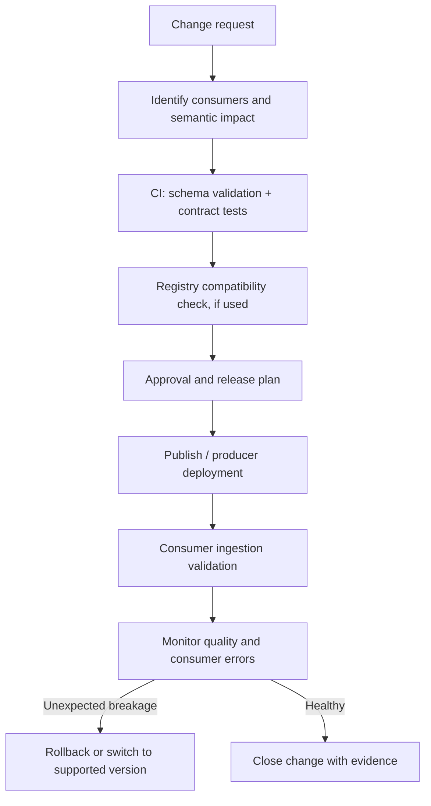

# Data Contracts, Schema Registry, and Compatibility

> **Roadmap:** Stage 2D — Data Architecture  
> **Module:** 06 — Data Integration and Interoperability  
> **Topic:** 05 — Data Contracts, Schema Registry, and Compatibility  
> **Learning progression:** Beginner → Intermediate → Advanced → Industry application  
> **Scope:** Vendor-neutral contract design and schema evolution. All organisations, dates, policies, and example values are illustrative. Compatibility classifications are conditional on the stated reader/writer assumptions and must be checked against the actual format, serializer/deserializer, registry rules, and consuming engine.

## 1. Learning objectives

By the end of this lesson, you should be able to:

1. Explain the purpose of data contracts and the responsibilities of producers and consumers.
2. Distinguish a data contract from a schema and a schema registry.
3. Describe contract dimensions: structure, semantics, quality, delivery, ownership, and change policy.
4. Classify schema changes using the roadmap's definitions of backward, forward, and full compatibility.
5. Evaluate required/optional fields, nullability, defaults, identifiers, names, types, enum values, and semantic changes.
6. Explain versioning, deprecation notices, sunset dates, supported-version policy, and consumer impact analysis.
7. Explain how a schema registry can store schema versions and enforce structural compatibility—and why it cannot automatically guarantee business meaning.
8. Design validation at publication, ingestion, and CI using schema validation and contract tests.
9. Plan a multi-consumer migration using parallel versions, expand-and-contract, tolerant readers, and a rollback plan.
10. Create a Northbridge Bank account-changed contract and evolution policy with a change-classification table, impact analysis, enforcement points, and deprecation notice.

## 2. Why the topic matters in real-world Data Architecture

Integration often joins systems that are owned by different teams and released on different schedules. A producer may publish a field that looks valid to its own application while a consumer interprets it differently, assumes it is always present, or cannot parse its type. Without an explicit contract, these assumptions are invisible until a downstream job, report, model, or business process breaks.

A **data contract** makes the agreement explicit and owned. A **schema** describes the formal structure of the data. A **schema registry** can manage schema versions and apply configured structural compatibility checks. These are related but not interchangeable. A registry can reject some unsafe structural changes, but it cannot automatically determine that `balance` has changed from available balance to ledger balance if the field name and type remain the same.

The goal is controlled change, not preventing all change. Strong contracts make producer and consumer expectations explicit, support automated checks, provide notice and migration paths, and clarify who approves changes and who responds to failures.

## 3. Prerequisite knowledge

This lesson assumes familiarity with:
- Modules 1–4 in `06-Data-Integration-and-Interoperability/`, especially ingestion, CDC, interfaces, event messages, and consumer behaviour.
- Stage 2D.4 Topic 7 (schema evolution) as referenced by the roadmap.
- Stage 2D.1 Topic 3 (ownership) as referenced by the roadmap.
- Basic JSON and the distinction between a field's structural type and its business meaning.

The topic stays focused on contracts, registries, compatibility, and change management. It is not a full governance-platform tutorial or a vendor-specific registry implementation guide.

## 4. Beginner-level learning sequence

### 4.1 What is a data contract?

A **data contract** is an explicit agreement between a producer and its consumers about the data being delivered and the conditions under which it is delivered and changed.

A useful contract covers at least six dimensions:

| Dimension | What it specifies | Example question |
|---|---|---|
| Structure | Fields, types, required/optional status, identifiers, relationships | Is `account_id` required and a string? |
| Semantics | Business meaning, units, time zones, null meaning, allowed values | Does `balance` mean ledger or available balance? |
| Quality | Completeness, validity, uniqueness, referential or range expectations | Must every event have a non-empty event ID? |
| Delivery | Channel, freshness, availability, update cadence, retention expectations | How quickly should changes be available? |
| Ownership | Producer owner, consumer contacts, escalation path | Who approves a field's meaning change? |
| Change policy | Versioning, compatibility mode, notice, deprecation, sunset, rollback | How long is a renamed field supported? |

A contract may also include examples, privacy classification, lineage, operational SLOs, and incident procedures where relevant. The exact content depends on the interface and data criticality.

### 4.2 Contract versus schema versus schema registry

| Concept | Definition | What it does not guarantee |
|---|---|---|
| Data contract | The full producer-consumer agreement covering structure, semantics, quality, delivery, ownership, and change | It is not enforced merely because it is written down |
| Schema | A machine-readable description of data structure and some constraints | It may not express the business meaning or operational obligations completely |
| Schema registry | A service or repository that stores schema definitions/versions and may check configured compatibility rules | It does not automatically discover every consumer, prove business correctness, or enforce every contract dimension |

A schema registry can help answer questions such as: “Which schema version is associated with this message?” or “Does this candidate schema pass the configured structural compatibility rule?” Whether schemas are identified by IDs in messages, how schemas are retrieved, and which compatibility rules are supported are implementation-specific.

### 4.3 Producer and consumer responsibilities

- **Producer owns the published contract:** it documents fields and meanings, publishes valid data, communicates changes, and provides a migration path.
- **Consumers own their use and expectations:** they document which fields and semantics they depend on, test changes, and migrate by the announced deadline.
- **Platform/governance function owns shared tooling and policy where assigned:** registry operation, policy defaults, access control, auditability, and escalation paths.
- **Architecture/domain owners resolve disagreements:** particularly when the same term has different meanings in different systems.

A compatibility check passing does not remove the producer's duty to notify consumers, nor does it remove a consumer's duty to test the actual data path.

### 4.4 A one-page contract template

Use this reusable template for an event, file, API response, table, or other interface. Mark fields not applicable rather than leaving the contract ambiguous.

| Contract section | Required content |
|---|---|
| Identity | Contract name, stable identifier, version, status |
| Purpose | Business capability and facts represented |
| Producer | Owning service/team, contact, source of truth |
| Consumers | Known consumers, owner, use, criticality; unknown consumers explicitly noted |
| Interface | Topic/API/file/table, encoding/format, delivery method |
| Structure | Field name, type, required/optional, nullability, default, identifier/key |
| Semantics | Definition, units, timezone, allowed values, null meaning, examples |
| Quality | Required-field checks, uniqueness, valid ranges, freshness/completeness expectations |
| Delivery | Frequency/freshness target, availability expectation, retention or history expectation |
| Compatibility | Mode, exact definition, supported versions, format/registry assumptions |
| Change process | Notice period, approval roles, migration, deprecation, sunset, rollback |
| Security | Classification, allowed access, minimised sensitive fields, retention obligations |
| Operations | Monitoring, failure handling, escalation owner, evidence and runbook |

### 4.5 Example: account-changed contract

The following is an illustrative contract for a fictional Northbridge Bank feed. It defines business meaning in addition to field shape.

| Field | Structural rule | Business meaning and quality rule |
|---|---|---|
| `event_id` | String; required; non-empty | Stable identifier for one logical event. Re-delivery of the same event preserves the ID. |
| `event_type` | String; required; enum defined by contract | `AccountChanged` means a committed account-state change, not a request to change it. |
| `schema_version` | Integer; required | Identifies the message shape/version; does not alone define semantic compatibility. |
| `account_id` | String; required; non-empty | Stable account identifier; must not contain display names or mutable account labels. |
| `occurred_at` | String timestamp; required | UTC timestamp for when the business change occurred, represented in the agreed format. |
| `published_at` | String timestamp; required if producer can reliably provide it | Producer-defined publication time; not assumed to be broker ingestion time. |
| `account_status` | String; required; controlled values | Status meaning is documented; new values require consumer-impact review. |
| `entity_version` | Integer; required if source guarantees it | Monotonically increasing version for this account only; do not compare across accounts. |
| `change_reason_code` | String; optional and nullable only if contract says so | A documented code; absence and explicit `null` have separately defined meaning. |
| `classification` | String; required | Data sensitivity category used by access and retention policy. |

This table is the contract's human-readable layer. A machine-readable schema can encode some structural requirements, while contract tests and domain review enforce other expectations.

### 4.6 A valid illustrative JSON Schema

The following is a **JSON Schema Draft 2020-12** example for the event envelope above. It is illustrative and has not been tested against a registry. JSON Schema can express structural constraints; it cannot independently prove that `account_status` has the correct business meaning or that `entity_version` is truly monotonic in the source system.

```json
{
  "$schema": "https://json-schema.org/draft/2020-12/schema",
  "$id": "https://schemas.example.invalid/northbridge/account-changed/v1",
  "title": "Northbridge AccountChanged Event",
  "type": "object",
  "additionalProperties": false,
  "required": [
    "event_id",
    "event_type",
    "schema_version",
    "account_id",
    "occurred_at",
    "account_status",
    "classification"
  ],
  "properties": {
    "event_id": {
      "type": "string",
      "minLength": 1,
      "description": "Stable identifier for one logical event."
    },
    "event_type": {
      "const": "AccountChanged"
    },
    "schema_version": {
      "const": 1
    },
    "account_id": {
      "type": "string",
      "minLength": 1,
      "description": "Stable account identifier."
    },
    "occurred_at": {
      "type": "string",
      "format": "date-time",
      "description": "Business occurrence time; contract requires UTC."
    },
    "published_at": {
      "type": "string",
      "format": "date-time",
      "description": "Producer-defined publication time."
    },
    "account_status": {
      "type": "string",
      "enum": ["OPEN", "RESTRICTED", "CLOSED"]
    },
    "entity_version": {
      "type": "integer",
      "minimum": 1,
      "description": "Source-defined version for this account."
    },
    "change_reason_code": {
      "type": ["string", "null"],
      "description": "Optional reason code; null is permitted when explicitly unknown."
    },
    "classification": {
      "const": "confidential"
    }
  }
}
```

**Important interpretation notes**
- In JSON Schema, a property listed in `required` must be present; that alone does not make it non-null unless its type excludes `null`.
- A property not listed in `required` may be absent. That is distinct from a present property whose value is `null`.
- `additionalProperties: false` rejects fields not declared in `properties`. This may be too strict for some evolution strategies; a tolerant-reader design may intentionally allow unknown fields.
- `format: "date-time"` support and enforcement can vary by validator configuration. The contract additionally states the UTC rule; the example schema does not, by itself, prove every timestamp is UTC.
- The example sets `published_at` and `entity_version` as properties but does not mark them required. If the production contract requires them, add them to `required` only after confirming the source can always provide them.
- The `$id` domain uses the reserved `.invalid` suffix as an example identifier, not a live schema endpoint.

### 4.7 Beginner questions and exercise

1. Why is a schema alone not a complete contract?
2. Who owns the published contract, and who owns consumer expectations?
3. What is the difference between an absent field and a field explicitly set to `null`?
4. Why might a registry accept a schema change that still breaks a consumer?
5. Write a one-page contract for a fictional `CustomerChanged` event using the template above.

**Expected output:** a contract with structure, semantics, quality, delivery, ownership, and change policy—not merely a list of field names and types.

## 5. Intermediate-level learning sequence

### 5.1 Compatibility terminology used by this roadmap

Use these definitions throughout this lesson. Some tools or documentation use compatibility labels from a different perspective; when using a particular registry, verify its exact terminology and map it explicitly to these definitions.

- **Backward compatible:** consumers using the **new schema** can read data written with the **old schema**.
- **Forward compatible:** consumers using the **old schema** can read data written with the **new schema**.
- **Full compatibility:** both directions hold.

Compatibility is always relative to a reader/writer format, its defaults and resolution rules, and the tested schema versions. A generic label such as “backward compatible” is not sufficient without identifying the format and version range.

### 5.2 What a compatibility mode is for

A compatibility mode is a policy used by a registry or release process to evaluate a candidate schema against one or more prior schemas. It reduces the risk of structural breakage, but does not replace:
- consumer impact analysis;
- semantic review;
- representative producer/consumer tests;
- deployment sequencing;
- operational monitoring;
- a rollback plan.

Compatibility policies commonly include backward, forward, and full modes. Some implementations also provide **transitive** variants. Exact support and behaviour must be verified in the chosen registry and schema format.

### 5.3 Compatibility matrix for common changes

The table below is a **reasoning aid**, not a universal registry verdict. It uses the roadmap definitions above and assumes:
1. a reader parses data using its declared schema;
2. the format's default and unknown-field behaviour is documented;
3. no application-level semantic validation changes;
4. each compatibility claim is verified against the actual format/registry before production use.

| Proposed change from V1 to V2 | Backward: new-schema consumer reads old-schema data | Forward: old-schema consumer reads new-schema data | Initial assessment and action |
|---|---|---|---|
| Add optional field; old records omit it | Often possible if new reader handles absence/default | Often possible if old reader ignores unknown fields | Candidate for full compatibility, **only if** reader/writer rules support it |
| Add required field with no default | New reader may fail on old records lacking it | Old reader may ignore new field, depending on format | High risk; do not assume backward compatibility; use a staged optional phase or a new version |
| Remove optional field | New reader may not need it; historical records may still contain it | Old reader may expect the field in new records | Depends on reader requirements and unknown-field rules; assess each consumer |
| Remove required field | New reader may tolerate historical field presence | Old reader may fail if new records omit a field it requires | Usually breaking for at least one direction; use deprecation and staged removal |
| Rename field | Structurally resembles remove + add | Old and new readers may expect different names | Treat as breaking unless an explicit alias/dual-field strategy is supported and tested |
| Widen numeric type (for example, 32-bit integer to 64-bit integer) | May work if old values remain representable and reader resolution supports it | May fail for new values outside the old type's range | Directional and format-dependent; test boundaries |
| Narrow type (for example, 64-bit to 32-bit integer) | May fail on historical values outside the new range | May fail when new values exceed old range | Breaking risk; avoid in-place narrowing without proof and migration |
| Add an enum value | New reader may handle it only if its logic tolerates the value | Old reader may reject an unrecognised value | Often structurally valid but consumer-breaking; test tolerant handling |
| Change meaning but retain name and type | Structural check may pass | Structural check may pass | **Semantic break**; registry compatibility is insufficient |
| Change unit (cents to major currency units) without type change | Structural check may pass | Structural check may pass | **Semantic break**; use a new field/version and migrate consumers |

The word “often” is deliberate. For example, JSON consumers may ignore unknown object fields in one implementation, while another validator may reject them due to `additionalProperties: false`. Avro, Protocol Buffers, JSON Schema, and custom formats have different resolution and default rules. Do not transfer a classification from one format to another without checking.

### 5.4 Required, optional, nullable, and default are different

| Property | Meaning | Typical risk |
|---|---|---|
| Required | The field must be present in a record under the contract/schema rules | Adding a required field can make historical records or old producers invalid |
| Optional | The field may be absent | Consumer must define behaviour when it is absent |
| Nullable | The field may be present with an explicit null value | Consumer must define what null means |
| Default | A value or rule used when the field is absent in a context that supports defaults | A default can hide missing source data or encode a wrong business assumption |
| Deprecated | Field remains supported temporarily but should not be newly depended on | Requires notice, usage tracking, and sunset plan |

Do not treat absent and `null` as interchangeable. For example, an absent `middle_name` might mean “field not supplied by this version,” while `middle_name: null` might mean “known to be unknown.” The contract must specify the distinction.

A default should reflect business meaning, not merely make validation pass. Defaulting an absent regulatory status to `ACTIVE` would be unsafe unless that meaning is explicitly justified and approved.

### 5.5 Choosing a compatibility mode from upgrade order

Use the roadmap's reader/writer definitions. First identify which reader schema is deployed and which writer schema produced the data; do not infer the required mode from the words *producer-first* or *consumer-first* alone.

| Deployment situation | Compatibility requirement to consider | Reason |
|---|---|---|
| Consumers upgrade first; producer still emits old-schema data during overlap | **Backward compatibility** is needed under this roadmap's definition | New-schema consumers must be able to read data written with the old schema |
| Producer upgrades first; some consumers still run old-schema readers against new-schema data | **Forward compatibility** is needed under this roadmap's definition | Old-schema consumers must be able to read data written with the new schema |
| Producer and consumers upgrade independently or consumer population is uncertain | **Full compatibility** is the safer candidate | Both directions are needed across the overlap |
| Unknown or unregistered consumers exist | Do not rely only on a mode label | Discover consumers, preserve a compatibility window, and use parallel versions if needed |

These are starting points, not a substitute for a deployment-state diagram. Write down which producer version emits which schema, which consumer version reads which schema, and whether historical data is read during migration.

### 5.6 Transitive versus non-transitive compatibility

A registry's compatibility check may compare a new schema only with the latest registered schema (**non-transitive**, in a common usage) or with all schemas in the applicable history (**transitive**, in a common usage). Exact terms and available modes vary by registry.

Illustrative example:
- V1 has `customer_name`.
- V2 adds `display_name` while retaining `customer_name`.
- V3 removes `customer_name`.

V3 might be compatible with V2 for a consumer that has already migrated, yet incompatible with V1 consumers or historical V1 records. A latest-version-only check may not reveal the full historical break. A transitive check is intended to consider a wider version history, but its exact range and rules must be verified in the implementation.

Choose transitive evaluation when long-lived consumers or historical data may still use older versions. Even a transitive structural check cannot detect a silent semantic change such as a currency-unit change.

### 5.7 Versioning and deprecation policy

A contract should state:
- the version identifier and what it represents;
- which versions are currently supported;
- the compatibility policy and format/registry assumptions;
- how changes are proposed and approved;
- notice period and consumer migration deadline;
- deprecation date and sunset date;
- how usage by known consumers is measured;
- how unregistered consumers are discovered or risk-managed;
- what rollback or parallel-version option exists;
- who can approve an exception.

A version number is not a compatibility policy. A new version does not automatically make a change safe, and leaving a version number unchanged does not make a semantic change compatible.

### 5.8 Contract enforcement at publication, ingestion, and CI



| Enforcement point | Checks | Limitations |
|---|---|---|
| CI / pre-merge | Schema syntax, sample payloads, contract tests, semantic assertions | Test data may not represent all production values or unknown consumers |
| Registry / publication | Registered schema and configured structural compatibility rule, where supported | Rules vary; registry may be unavailable; semantics and downstream logic may not be checked |
| Producer runtime | Validate outgoing payloads against the intended contract | Runtime validation adds cost and still cannot prove every business fact |
| Consumer ingestion | Validate shape and required values; quarantine invalid records | Must avoid silently dropping data; quarantine requires ownership and replay plan |
| Post-release monitoring | Parse failures, missing fields, unknown enum values, quality drift, downstream business metrics | Detection occurs after release; monitoring needs thresholds and owners |
| Manual semantic review | Meaning, units, domain rules, consumer assumptions, regulatory impact | Requires named reviewers and clear evidence |

### 5.9 Intermediate exercise: classify eight payment-event changes

Assume a `PaymentPosted` event has `payment_id` (required string), `amount_minor_units` (required integer), `currency` (required three-letter code), `status` (required enum), and `description` (optional string). A JSON consumer ignores unknown fields unless its own validation explicitly rejects them. These are illustrative assumptions, not a universal JSON rule.

For each change, record the compatibility direction, affected consumers, validation needed, and action:
1. Add optional `merchant_reference`.
2. Add required `regulatory_region` with no default.
3. Remove optional `description`.
4. Rename `payment_id` to `transaction_id`.
5. Widen `amount_minor_units` from 32-bit to 64-bit integer.
6. Narrow the amount type from 64-bit to 32-bit.
7. Add `REVERSED` to `status`.
8. Keep `amount_minor_units` as an integer but change its meaning to major currency units.

**Expected output:** a classification table. A strong answer distinguishes structural compatibility from semantic breakage, states assumptions, identifies affected consumers, and proposes a safe change path rather than simply labelling every change “compatible” or “breaking.”

## 6. Advanced-level learning sequence

### 6.1 Structural compatibility versus semantic compatibility

**Structural compatibility** concerns whether data can be parsed/resolved according to schema rules: fields, names, types, requiredness, defaults, and supported values.

**Semantic compatibility** concerns whether the data still means what consumers expect. A schema can remain structurally valid while meaning changes.

| Example | Structural check may pass? | Why business meaning can break | Appropriate control |
|---|---|---|---|
| `balance` changes from available balance to ledger balance; same decimal type | Yes | Consumer decisions now use a different financial quantity | Domain-owner review; new field or explicit new contract version; consumer migration |
| `amount` changes from cents to major currency units; same integer type | Yes | Values may be interpreted at a 100× different scale | New field name with unit in name; contract tests with value assertions |
| Timestamp changes from UTC to local time without timezone | Yes | Event ordering and reporting can shift | Explicit timezone semantics; tests around daylight-saving boundaries where relevant |
| `status = ACTIVE` is redefined to include accounts under review | Yes | Downstream eligibility logic may change | Domain approval, new value/meaning, consumer impact analysis |
| New enum value appears | Schema may accept it, but consumers may not | Consumer switch statements or rules may reject or mis-handle it | Unknown-value tests, tolerant handling policy, staged rollout |
| Required field is filled with placeholder values | Yes | Data is syntactically present but false or misleading | Business assertions and source-level quality controls |

A registry cannot infer the intended business definition from a field name alone. Controls should include:
- semantic descriptions and units in the contract;
- review by the domain owner for meaning changes;
- a new field or contract version when meaning changes;
- contract tests with representative values and assertions;
- consumer notification and approval;
- monitoring of business invariants after release.

### 6.2 Multi-consumer migration: expand and contract

The **expand-and-contract** pattern introduces the new representation before removing the old one.

Example: rename `customer_name` to `display_name`.

1. **Inventory:** identify known consumers and their deployed versions; search lineage, subscriptions, logs, and code references. Record unknown consumers as a risk.
2. **Expand:** add `display_name` while continuing to provide `customer_name`; document which is preferred.
3. **Migrate readers:** update consumers to read `display_name`, test against both old and new payloads, and record adoption evidence.
4. **Dual support:** run both fields for a time-boxed overlap; avoid contradictory values and define which field is authoritative.
5. **Verify:** confirm every critical consumer has migrated; monitor errors and usage of the deprecated field.
6. **Deprecate:** publish notice with dates, support contacts, and migration instructions.
7. **Contract:** remove the old field only after the agreed sunset gate passes and the compatibility policy permits removal.
8. **Rollback:** if consumers fail, restore the previous producer version or continue dual-field support. Do not assume a registry rollback reverses already-written data.

Parallel versions can be preferable when old and new semantics cannot safely coexist in one payload. The cost is temporary duplication of contracts, consumers, storage, monitoring, and operational ownership.

### 6.3 Tolerant readers and defaults

A tolerant reader ignores unknown fields or handles known optional fields that are absent. This can make additive changes easier, but tolerance must be deliberate:
- ignoring an irrelevant new field may be safe;
- ignoring a new field that changes the interpretation of another field may be unsafe;
- ignoring unknown enum values can be dangerous if the default branch means “approve” or “active”;
- accepting a missing required business field may silently corrupt downstream decisions.

Define per-field behaviour for absent, null, unknown, and invalid values. Use defaults only where the domain meaning is unambiguous and approved.

### 6.4 Change-management workflow and approval

A production change process should include:

1. **Change request:** describe the change, business reason, proposed release, and affected data products/interfaces.
2. **Automated compatibility check:** evaluate schema syntax and the configured compatibility policy against the intended version range.
3. **Consumer impact analysis:** use lineage/subscription information to list consumers, fields read, semantic assumptions, owner, criticality, migration status, and actions.
4. **Manual semantic review:** domain owner reviews units, meaning, null behaviour, enum expansion, time semantics, and quality expectations.
5. **Approval:** assign approval authority by change class; breaking or regulatory changes require stronger approval.
6. **Notification:** publish the contract diff, migration guide, dates, support channel, and sunset policy.
7. **Rollout:** use a staged or parallel-version plan; test actual producer and consumer versions.
8. **Monitoring:** inspect parse errors, missing/invalid fields, unknown enum values, data-quality metrics, and downstream business outcomes.
9. **Rollback or mitigation:** restore the previous producer/consumer version, continue dual support, route incompatible records to quarantine, or revert to a supported contract.
10. **Post-change verification:** document evidence, remaining consumers, data repair if needed, and closure approval.

### 6.5 Consumer impact analysis

A compatibility check is only as useful as the version history and consumer population it covers.

For each known consumer, record:

| Attribute | Example |
|---|---|
| Consumer and owner | `fraud-evaluator` — Fraud Platform team |
| Contract/version consumed | `AccountChanged` V1 |
| Fields read | `account_id`, `account_status`, `entity_version` |
| Semantic assumptions | `RESTRICTED` blocks some transactions |
| Criticality | High |
| Upgrade lead time | 2 weeks (illustrative) |
| Migration action | Add handling for new status values |
| Test evidence | Contract test suite and staged event sample |
| Status | Not started / testing / migrated / retired |

Known consumers may be discoverable through lineage, topic subscriptions, API logs, code search, and service catalogs. Unknown or unregistered consumers remain a risk. Do not claim a migration is complete just because the listed consumers are updated; state the discovery coverage and residual uncertainty.

### 6.6 Registry limitations and operational risks

| Risk | Impact | Mitigation |
|---|---|---|
| Registry unavailable during schema lookup | Producers/consumers may be unable to encode/decode messages if they depend on online lookup | Define availability requirements, cache/fallback behaviour only if supported, alerting and runbook |
| Schema ID embedded in messages but unavailable in registry | Consumers may not decode the payload | Preserve schema/version artifacts, backup/restore procedures, and test recovery |
| Registry schema differs from documented contract | Structural checks pass while consumers rely on stale semantics or constraints | Generate/review contract docs from controlled sources where possible; drift checks |
| Compatibility mode checks only a limited version range | Old consumers or historical data may break | Verify transitive/non-transitive semantics and test the full supported version range |
| Format/engine rules differ from assumptions | Classification table is wrong for actual serialization/deserialization | Pin format and library versions; test real reader/writer pairs before release |
| Unregistered consumer exists | Change causes an unanticipated failure | Consumer discovery, notice, parallel versions, staged rollout and observability |
| New enum value not handled | Runtime error or wrong business decision | Unknown-value tests, tolerant policy, staged rollout, metrics |
| Schema is valid but semantics changed | Silent business corruption | Domain review, value assertions, semantic contract tests, business metrics |

Do not claim that a registry provides compatibility modes, embedded IDs, offline caching, transitive checking, or a particular enforcement point until the selected implementation's documentation and behaviour are verified.

### 6.7 Strictness versus delivery speed

- **Strict contracts** are appropriate when consumers are numerous, data is regulated, or semantic mistakes are expensive. They reduce accidental breakage but can slow releases and require coordinated change.
- **Looser contracts** can suit exploratory feeds or rapidly evolving internal use, if consumers tolerate unknown fields and quality expectations remain clear. They move more risk to downstream teams.
- **Per-contract policy** is preferable to one universal rule for every dataset. Document why a policy is appropriate for its criticality, consumer diversity, and recovery cost.

### 6.8 Advanced questions

- Which changes should be prohibited in place, even if a registry accepts them?
- How will you discover unregistered consumers?
- How long will deprecated fields remain supported, and what evidence allows removal?
- What is the rollback plan if a semantic regression is detected after new data has been published?
- Which changes require a new field or parallel contract version instead of an in-place mutation?

### 6.9 Advanced exercise

Define a schema-evolution policy for a widely consumed `CustomerChanged` event. Include compatibility mode, semantic-change review, deprecation timeline, supported-version window, enforcement points, rollback, and how unknown consumers are handled.

**Expected result:** a policy that handles both structural and semantic change across multiple independently deployed consumers.

## 7. Industry-application exercises

### 7.1 Northbridge Bank: account-changed feed

**Illustrative scenario:** Northbridge publishes an `AccountChanged` feed consumed by fraud, risk, and finance. Fraud reacts to status changes; risk builds account projections; finance needs stable account identifiers and consistent financial semantics. The consumers do not deploy together.

Produce the following:
1. A completed contract for the feed, including structure, semantics, quality, delivery, ownership, and change policy.
2. A schema evolution policy that defines compatibility mode, supported versions, notice period, sunset, and enforcement.
3. A consumer-impact table for fraud, risk, and finance.
4. A change-classification table for adding an optional field, adding a required regulatory field, renaming a field, adding an enum value, and changing `balance` from available balance to ledger balance.
5. A migration and rollback plan for consumers upgrading at different speeds.
6. Automated and manual checks in the change pipeline.

### 7.2 Deprecation notice for a renamed field

Use the following **illustrative dates and policy**, and adapt them to the organisation's real release calendar.

```text
Subject: Deprecation notice — AccountChanged.customer_name

Contract: Northbridge AccountChanged
Current contract version: 1
New field: display_name
Deprecated field: customer_name
Notice issued: 2026-10-20
Consumer migration deadline: 2026-11-20
Planned sunset: 2026-12-04

Reason:
The contract is standardising the field name to display_name.

Migration:
1. Update consumers to read display_name.
2. During the overlap period, the producer will publish both fields with
   equivalent, documented meaning.
3. Consumers must run contract tests and confirm migration with their owner.
4. Consumers that cannot meet the deadline must request an exception before
   the deadline, including a named owner and retirement date.

Support:
Contract owner: Northbridge Account Data team (fictional)
Escalation: Data Architecture change review

Removal gate:
The old field will be removed only after critical consumers are confirmed
migrated, usage evidence is reviewed, the compatibility check passes for the
intended version range, and the designated approver authorises sunset.
```

The notice is a worked template, not a claim that the named dates or team exist. If dual publishing cannot preserve equivalent meaning, use parallel contract versions instead.

### 7.3 Automated and manual checks

| Stage | Automated check | Manual / accountable check | Evidence |
|---|---|---|---|
| Change proposal | Diff schema and contract version | State business reason and affected consumers | Approved change request |
| CI | Parse schema; validate sample payloads; run producer/consumer contract tests | Domain owner checks semantics, units, null meaning, and enum interpretation | Test report and review record |
| Registry/publication | Run configured compatibility check if supported | Confirm the check's version range and format semantics | Registry result and policy version |
| Staging | Test old/new producer-reader combinations | Confirm consumer rollout sequence and rollback | Integration test results |
| Production rollout | Monitor schema/parse errors and data-quality metrics | Verify consumer owners and business outcomes | Dashboard, alert record, sign-off |
| Deprecation | Measure usage of old field/version where observable | Confirm unknown-consumer risk and sunset approval | Usage report and approval |
| Closure | Confirm contract versions and docs updated | Review incidents and unresolved exceptions | Closure record |

### 7.4 Practical scenario A: `balance` changes meaning, same name and type

**Problem:** The producer changes `balance` from available balance to ledger balance, retaining the same numeric type and field name.

**Analysis:** A structural compatibility check may pass because the schema shape has not changed. Consumers may make incorrect credit, fraud, or reporting decisions because the value now means something different.

**Response:**
1. Stop the silent in-place semantic change.
2. Have the domain owner document both definitions and assess regulatory/business impact.
3. Introduce a distinct field (`available_balance` and/or `ledger_balance`) or a separately versioned contract with explicit migration.
4. Add value-level contract tests and downstream assertions.
5. Notify all known consumers and check for unregistered consumers.
6. Run the old and new representations in parallel if safe, compare results, and migrate consumers.
7. Roll back or restore the old field meaning if validation fails; do not overwrite the meaning of already-published historical data without a correction plan.

### 7.5 Practical scenario B: a new regulatory field must be mandatory for new records only

**Problem:** A new field `regulatory_region` must be mandatory for newly created records, but historical records and old consumers must continue to work.

**Response options:**
- Add the field as optional at the shared contract boundary during the expansion phase.
- Populate it for new records and backfill historical values where a reliable source exists.
- Add a quality rule that requires it for records created after an explicit effective date, rather than making it universally required for all historical records.
- Update consumers to handle absent values in legacy records and validate the field for new records.
- After the migration window, consider a new contract version or a stricter requirement only after the historical-data policy and consumer support are verified.

Do not fabricate historical values to satisfy a schema. If the correct value is unknown, represent that state explicitly according to the contract.

### 7.6 Practical scenario C: three consumers upgrade at different speeds

**Illustrative consumer state:** fraud can upgrade this week, risk needs two weeks, finance needs six weeks due to a release window.

**Plan:**
1. Choose a compatibility policy based on all supported readers/writers and historical data needs; do not infer the mode from the fastest consumer.
2. Introduce the new field or parallel version without removing the old contract.
3. Notify each consumer with a deadline, owner, migration test, and escalation route.
4. Track consumer migration status; use usage evidence to identify unregistered or still-active readers.
5. Time-box overlap but do not remove the old field until the sunset gate is satisfied.
6. If the new consumer release fails, retain the old field/version and roll back the consumer or producer according to the tested plan.
7. Complete post-change verification and update contract documentation.

## 8. Practical scenarios and case-based reasoning

### Scenario 1 — A field's meaning changes without a structural change

The producer changes `balance` from available balance to ledger balance, with the same name and numeric type.

**Expected reasoning:** this is a semantic breaking change even if structural compatibility checks pass. Require domain review, a distinct field or new contract version, value-level tests, consumer notification, migration, and post-release monitoring.

### Scenario 2 — A new regulatory field must be mandatory for new records only

**Expected reasoning:** distinguish new records from historical records. Introduce the field through an expansion phase, define an effective-date quality rule, populate it from a reliable source, and avoid fabricating unknown historical values. Preserve compatibility for old consumers until the migration gate passes.

### Scenario 3 — Three consumers upgrade at different speeds

**Expected reasoning:** choose the compatibility mode using the slowest supported consumer and the producer/consumer upgrade sequence; use parallel versions or expand-and-contract; time-box overlap; track migration; define rollback and post-change evidence.

### Scenario 4 — A registry accepts a schema but a consumer fails

Possible causes include an undocumented consumer assumption, a format-specific reader rule, a new enum value, semantic drift, a schema-ID lookup failure, or a mismatch between registry schema and actual producer payload.

**Expected response:** capture the failing payload and schema/version, identify the exact reader and validation path, check registry and serializer/deserializer assumptions, inspect semantic contract tests, quarantine invalid records where appropriate, roll back or restore the previous supported version, and add a regression test. Do not assume registry acceptance proves end-to-end compatibility.

### Scenario 5 — The registry is unavailable

A producer or consumer may be unable to retrieve a schema if the runtime path depends on an online lookup. Actual behaviour depends on the implementation, caching, and message encoding.

**Expected response:** follow the documented dependency and fallback behaviour; alert the registry/platform owner; avoid inventing an offline guarantee; preserve schema artifacts and test recovery. If decoding is blocked, retain messages safely and avoid discarding them.

### Scenario 6 — A consumer cannot be identified in the catalog

**Expected response:** search lineage, subscription records, logs, code references, and service ownership records. Mark the consumer population as incomplete, extend dual support or use a parallel version, communicate broadly, and do not claim migration completion without evidence or an approved risk acceptance.

## 9. Expected outputs and deliverables

- [ ] **Data contract template and one completed contract** covering structure, semantics, quality, delivery, ownership, and change policy.
- [ ] **Change classification and impact tables** covering field addition/removal/rename, requiredness, type changes, defaults, enum expansion, and semantic change.
- [ ] **Evolution and deprecation policy** with compatibility mode, format/registry assumptions, notice period, supported versions, sunset date, and rollback.
- [ ] **Consumer impact analysis** listing known consumers, owners, fields used, assumptions, actions, and unknown-consumer risk.
- [ ] **Change pipeline** defining automated compatibility checks, contract tests, manual semantic review, notification, approval, rollout, rollback, and post-change verification.
- [ ] **Answers to Topic 5 practice questions**, corrected after review.

## 10. Common mistakes and misconceptions

- **Equating a schema with a contract.** Structure alone does not define semantics, quality, delivery, ownership, or change policy.
- **Assuming a passing compatibility check means a safe change.** Semantic breakage and undocumented consumer assumptions may remain.
- **Making fields required “for quality” without migration planning.** This can block producers and invalidate historical data.
- **Renaming a field in one release.** A rename is often a remove-plus-add from a consumer's perspective; use a transition plan.
- **Ignoring unregistered consumers.** A consumer catalog is useful but may be incomplete.
- **Leaving contract ownership unassigned.** Changes then have no accountable approver or escalation path.
- **Confusing optional with nullable.** Absent and explicit `null` can have different meanings.
- **Assuming defaults are always safe.** Defaults can conceal missing data or introduce false business meaning.
- **Treating enum expansion as harmless.** Consumers may reject or mis-handle a new value.
- **Using compatibility labels without stating definitions.** Tool documentation may use a different perspective or version range.
- **Checking only the latest schema when historical consumers matter.** Transitive versus non-transitive policy must be understood and verified.
- **Assuming a registry catches semantic changes.** Units, timezone rules, and domain meaning require human and value-level checks.
- **Removing a deprecated field before migration evidence exists.** Notice, usage tracking, sunset gates, and rollback must be explicit.

## 11. Mastery criteria

You have mastered this topic when you can:
- write a contract covering structure, semantics, quality, delivery, ownership, and change policy;
- distinguish contract, schema, and registry;
- apply the roadmap's definitions of backward, forward, and full compatibility;
- classify changes while stating assumptions about format and reader/writer behaviour;
- identify at least one structurally valid but semantically breaking change and design controls for it;
- explain required, optional, nullable, and default values precisely;
- choose a compatibility policy for consumers that upgrade at different speeds;
- explain transitive versus non-transitive checks and why historical versions matter;
- design consumer impact analysis, CI checks, runtime validation, deprecation, migration, rollback, and post-change verification;
- identify registry limitations, unknown consumers, and ownership gaps.

## 12. Completion gate

Do not mark this topic complete until each item has inspectable evidence.

- [ ] **Contract includes semantics and ownership, not only structure.** The completed contract includes quality, delivery, owner/contact, and change policy.
- [ ] **At least one structurally valid, semantically breaking change is identified and handled.** Document the field, unchanged structural shape, changed meaning, detection controls, and migration.
- [ ] **Policy states mode, notice period, and enforcement points.** Include the compatibility definition, format/registry assumptions, supported versions, deprecation and sunset, CI/publication/ingestion checks, and post-release monitoring.
- [ ] **Change classification and consumer-impact tables are complete.** Include required/optional fields, rename/removal, type changes, enum expansion, defaults, and semantic changes.
- [ ] **Migration and rollback are explicit.** Address parallel versions or expand-and-contract and different consumer upgrade speeds.
- [ ] **Topic 5 practice questions answered and corrected.**

### Topic 5 practice questions

1. What is the difference between a data contract, a schema, and a schema registry?
2. What contract dimensions are missing if a document lists only field names and types?
3. Under this roadmap's definitions, what does backward compatibility mean? What does forward compatibility mean?
4. Why might adding an optional field be compatible in one format and not in another?
5. Why are requiredness, optionality, nullability, and default values distinct?
6. What is the risk of renaming a field without a deprecation window?
7. Why can a schema registry accept a change that breaks a consumer?
8. What is the difference between transitive and non-transitive compatibility checks?
9. How should a producer handle a new regulatory field required only for newly created records?
10. What should be included in a consumer impact analysis?
11. Why is changing `balance` from available balance to ledger balance a breaking change even if the type is unchanged?
12. What is the purpose of expand-and-contract, and what evidence should be required before removing the old field?
13. Which checks belong in CI, publication, ingestion, and post-release monitoring?
14. Who owns the published contract, consumer expectations, and shared tooling/policy?

### Answer/check section

1. Contract = full agreement; schema = formal structure/constraints; registry = stores schema versions and may enforce configured compatibility checks.
2. Semantics, quality, delivery, ownership, security/classification where relevant, and change policy.
3. Backward: new-schema consumers can read old-schema data. Forward: old-schema consumers can read new-schema data. Full: both.
4. Reader behaviour, defaults, unknown-field rules, schema format, validator configuration, and registry policy differ.
5. Required means present; optional means may be absent; nullable means may be explicitly null; default is a fallback rule in contexts where supported. Their semantics must be documented.
6. Old consumers may expect the old name and fail when it disappears; dual-field/parallel-version migration and notice are needed.
7. Structural checks may not cover semantic meaning, runtime engine behaviour, every consumer, enum handling, or the full historical version range.
8. Non-transitive commonly compares against the latest version; transitive commonly checks a broader history. Verify the exact registry definition and range.
9. Add it through an expansion phase, define an effective-date rule, populate from a reliable source, support historical records, and migrate consumers before tightening the shared contract.
10. Consumers/owners, versions, fields read, semantic assumptions, criticality, migration actions, deadlines, tests, status, and unknown-consumer risk.
11. The business quantity has changed even though the shape is the same; downstream decisions can become incorrect.
12. Add the new representation, migrate readers, verify adoption, keep overlap for a defined window, then remove the old representation only after the sunset gate passes. Evidence includes consumer migration status, usage checks, tests, approvals, and rollback readiness.
13. CI: syntax, compatibility, contract tests; publication: configured schema/contract checks; ingestion: payload validation and quarantine; monitoring: errors, quality drift, downstream outcomes, and usage.
14. Producer owns the published contract; consumers own their use/expectations; the designated platform/governance function owns shared tooling and policy.

---

### Final design principle

A compatibility label is evidence about a defined structural reader/writer relationship—not a promise that every consumer will continue to behave correctly. Make the contract's meaning, owner, supported versions, enforcement points, migration window, and rollback conditions explicit. When a classification depends on a specific format or registry, verify that implementation rather than treating this illustrative matrix as a universal guarantee.
