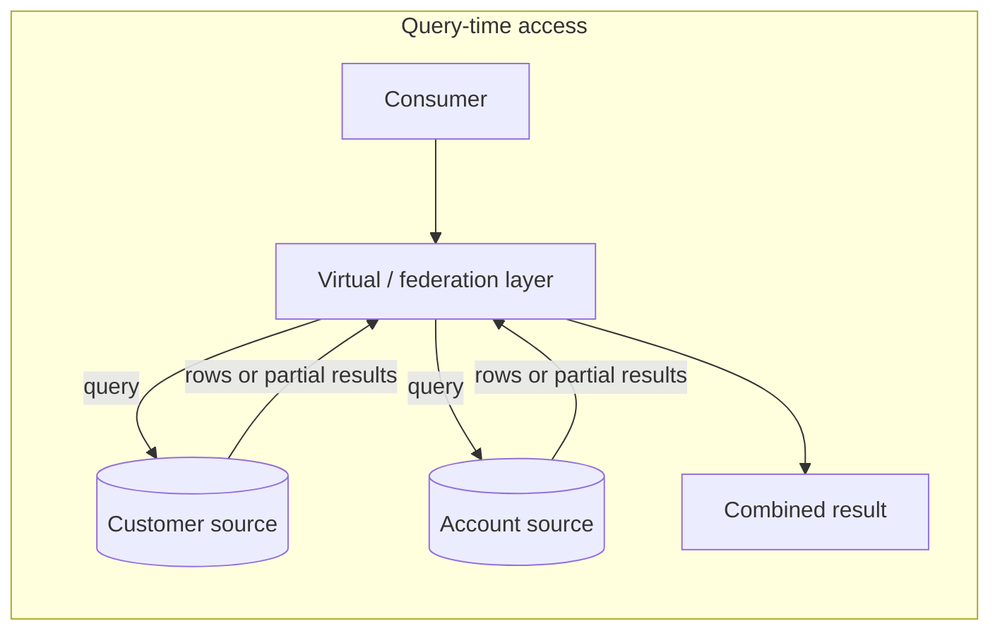
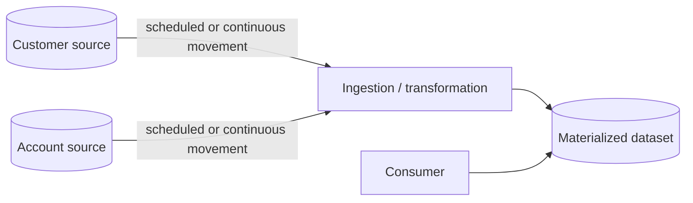
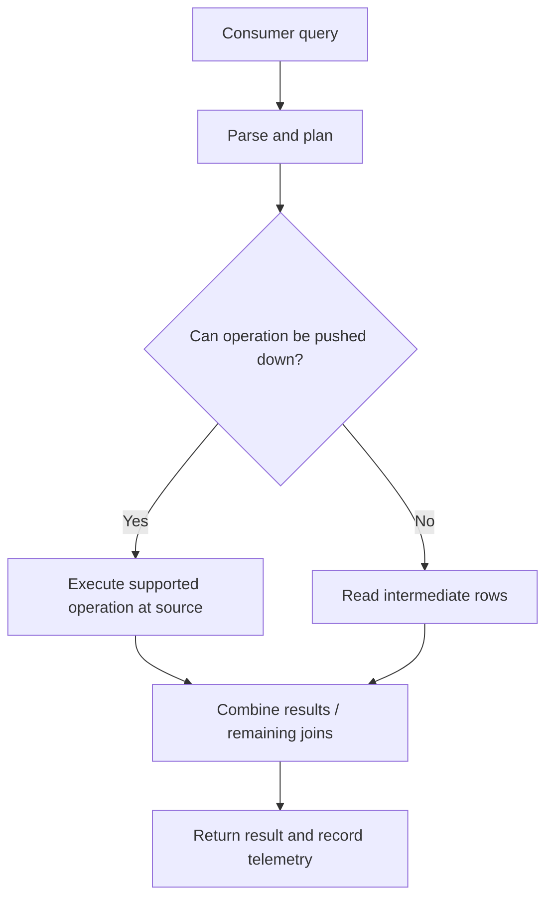

# Data Virtualization, Federation, and Data Sharing

> **Roadmap:** Stage 2D — Data Architecture  
> **Module:** 06 — Data Integration and Interoperability  
> **Topic:** 06 — Data Virtualization, Federation, and Data Sharing  
> **Learning progression:** Beginner → Intermediate → Advanced → Industry application  
> **Scope note:** Examples, organisations, targets, and calculations are illustrative. No benchmark or integration test is claimed. Select a pattern from requirements and measured behaviour, not from a universal claim that one architecture is always superior.

## 1. Learning objectives

By the end of this lesson, you should be able to:

1. Define data virtualization, federated querying, data sharing, replication, and materialization.
2. Distinguish logical access/query-time integration from physical movement and storage of data.
3. Explain where query planning, filtering, joins, and aggregation occur and how source capabilities affect performance.
4. Compare patterns by freshness, source load, query latency, availability, consistency, duplication, governance, ownership, and cost.
5. Explain why a federated query may not see one consistent cross-source snapshot.
6. Estimate serial dependency availability and query-driven source load with explicit assumptions.
7. Design access controls, ownership, audit, data residency, and failure handling across sources and access layers.
8. Identify when to favor virtualization/federation, when to favor replication/materialization, and when governed data sharing is appropriate.
9. Make a defensible Northbridge Bank recommendation for a customer-plus-account view, including rejected alternatives, limitations, and revisit triggers.

## 2. Why the topic matters in real-world Data Architecture

Organisations often need a unified view of information that remains distributed across operational databases, warehouses, SaaS applications, files, and domain-owned data products. There are two broad approaches:

- **Access data where it lives** at query time, possibly combining multiple sources through a virtual or federated layer.
- **Move or persist data** into a replica, cache, warehouse, lakehouse, or materialized view so consumers query a prepared copy.

A third concern is **data sharing**: how one producer grants another consumer governed access to a producer-owned dataset or data product. Sharing describes the access and ownership arrangement; it does not, by itself, determine whether the underlying technical mechanism uses a query endpoint, a file, a replica, or a controlled export.

Querying in place can reduce duplicate storage and refresh pipelines, but it couples consumers to source availability, network behaviour, source schemas, access rules, and query capacity. Copying data adds refresh lag and a new governance surface, but can isolate production sources and provide predictable analytical performance. The architect must make this trade explicit.

## 3. Prerequisite knowledge

The roadmap lists these prerequisites:
- Modules 1–5 in `06-Data-Integration-and-Interoperability/`.
- Stage 2D.3 Topics 4–6 (data products, fabric, and data sharing).
- Stage 2D.5 Topic 1 (workload separation).

You should be comfortable with source/consumer relationships, ETL/ELT, APIs, database and storage basics, access control, and the difference between operational and analytical workloads.

This lesson remains focused on access-pattern selection and integration architecture. It does not attempt to teach a full database, cloud, or governance platform.

## 4. Beginner-level learning sequence

### 4.1 Core definitions

| Pattern | Meaning | Where work happens | Does the pattern itself create a durable copy? |
|---|---|---|---|
| **Data virtualization** | A logical access layer presents data from one or more underlying sources through a common view or interface | Query planning occurs in the virtual layer; source reads and supported operations often execute at the sources | Usually not for a pure virtual view; caching or materialization may be added separately |
| **Federated querying** | A query is planned across multiple independent data stores and results are combined | Some operations execute at sources; coordination, joins, or remaining work may execute in the federation layer | Not necessarily; intermediate results may be transferred during query execution |
| **Data sharing** | A producer grants a consumer governed access to a producer-owned dataset or data product | Depends on the sharing mechanism: query endpoint, controlled storage access, API, or another mechanism | Not necessarily. Some sharing methods allow in-place access; others may export or copy data |
| **Replication** | Data is copied from a source to another system or location, continuously or periodically | Copy/replication process moves updates; consumer reads the replica | Yes, a second maintained representation exists |
| **Materialization** | A query result, view, or transformed dataset is persisted for subsequent access | A refresh/build process creates the stored result; consumers read that result | Yes, the result is persisted |
| **Direct source access** | A consumer connects directly to one source without a virtualization/federation layer | Query executes against the source | Not inherently; depends on what the consumer does with the result |

Virtualization and federation are related but not identical. Virtualization is often a logical presentation or abstraction layer. Federation specifically emphasizes query execution across multiple independent stores. A virtualization platform may support federation, but the terms should not be treated as exact synonyms.

Sharing is primarily about **governed access and ownership**, not a guarantee that no copy exists. For example, a producer may share a curated table through a query interface, or share a controlled export under an agreement. The contract must state which is permitted.

### 4.2 Logical access versus physical movement

The virtual/federation layer may send filters, projections, or aggregations to a source, then combine partial results. If a source cannot execute a requested operation, more data may need to travel to the layer for processing. The layer does not automatically remove the source's work or the network cost.

A materialized design pays the cost of ingesting, transforming, storing, securing, and refreshing the copy. In return, consumer queries can often run without reading the operational sources at query time. Freshness depends on the refresh process and its failure/recovery behaviour.

### 4.3 Why consider virtualization, federation, or sharing?

Potential benefits:
- Faster exposure of source data without first building a full copy pipeline.
- Fewer duplicate datasets and fewer refresh jobs for suitable workloads.
- Access to relatively current source data.
- Producer ownership can remain clear when consumers query a producer-managed interface.
- Useful temporary integration while migrating systems or exploring data.

These are conditional benefits, not guarantees. A virtual layer still requires engineering, observability, access control, support, and ownership. It may create another operational dependency and can hide source complexity rather than remove it.

### 4.4 Six access needs: classify the likely pattern

For each illustrative need, choose a plausible pattern and explain the trade-off.

1. An analyst occasionally explores a small, current result from two reliable domain sources.
2. A month-end dashboard performs thousands of complex joins against a production transaction database.
3. A partner needs approved access to a curated dataset while the producer retains access policy and ownership.
4. A risk model needs a reproducible point-in-time snapshot for historical backtesting.
5. A consumer needs low-latency queries during source maintenance windows.
6. A migration team needs a temporary common view across old and new systems.

**Answer guidance**
1. Virtualization/federation may fit if the query is light, source access is approved, and availability is adequate.
2. A replica or materialized analytical dataset is usually a stronger candidate; protect the operational source.
3. Governed data sharing is the access model; whether it uses query-in-place or a controlled export must be specified.
4. Materialize or snapshot the data with recorded as-of time and lineage.
5. A source-dependent virtual view is unsuitable if source outages must not affect the consumer; consider a replica/materialization or another independently available serving layer.
6. A virtual layer can be useful temporarily, with an owner, retirement plan, and explicit performance/security limits.

## 5. Intermediate-level learning sequence

### 5.1 Compare direct/federated access with materialized integration

| Dimension | Direct/federated query | Replication/materialization |
|---|---|---|
| Freshness | Can read current source state, subject to each source's transaction and cache behaviour | As of the last successful replication/refresh; freshness depends on lag and recovery |
| Source load | Consumer queries can hit sources; concurrency may multiply demand | Refresh/replication hits sources; consumer queries usually hit the copy |
| Consumer latency | Depends on source response, network, query planning, and cross-source work | Can be tuned independently; refresh and local query performance still need management |
| Availability | Query may depend on every required source and the access layer | Can remain available after refresh while sources are down, subject to copy/serving availability |
| Cross-source joins | May move intermediate data and have uneven pushdown | Can pre-join or optimise data for common queries |
| Consistency | Reads from sources may occur at different instants; no cross-source snapshot should be assumed | A snapshot can be internally reproducible, but may be stale and requires a consistent build strategy |
| Duplication | A pure virtual view avoids a durable integrated copy; intermediate data may still move | Data is copied/persisted, creating additional storage and lifecycle obligations |
| Governance | Source controls plus access-layer policy and audit | Copy needs its own access, retention, lineage, deletion, masking, and audit controls |
| Operational burden | Query planner, source connectors, network, source schemas, access layer, and source owners | Pipelines, refresh, reconciliation, storage, copy security, and consumer serving |
| Cost drivers | Query compute, source capacity, network/data transfer, platform operation | Storage, ingestion/refresh compute, pipeline support, serving compute, and duplicated governance |
| Historical analysis | Limited by source history and source query capabilities | Can retain explicit snapshots if policy permits |
| Suitable when | Low-frequency or exploratory access, small results, current data, robust sources, justified copy avoidance | Frequent/heavy workloads, large joins, strict performance/availability targets, source protection, historical snapshots |

No row is universally decisive. Compare against the actual freshness SLO, latency target, query volume, data volume, source capacity, outage tolerance, access constraints, and operating cost.

### 5.2 How a federated query is executed

A typical federated query passes through these stages:

1. **Parse and plan:** the access layer interprets the query and identifies source tables, connectors, predicates, and joins.
2. **Push down operations where supported:** filters, projections, and aggregations may be sent to sources to reduce transferred rows.
3. **Read source data:** connectors execute source queries and return rows or partial aggregates.
4. **Move intermediate results:** when a join or transformation cannot be pushed down, intermediate results may cross the network to the federation layer.
5. **Combine and return:** the layer performs remaining operations and returns the result.
6. **Audit and observe:** query identity, source calls, duration, bytes/rows transferred, errors, and policy decisions should be observable.

**Pushdown** is the execution of supported query operations at a source rather than moving all raw data to the federation layer. It can reduce network transfer and central compute, but it depends on connector and source capabilities. Different SQL dialects, data types, collations, functions, permissions, or query semantics may prevent a pushdown. Verify the actual execution plan and telemetry; do not infer successful pushdown from the query text alone.

#### Worked example: why filter pushdown matters

Assume, only for illustration:
- a source table has 10,000,000 rows;
- the selected predicate matches 1% of rows;
- each projected row is 200 bytes before transport overhead.

If the source can filter and project before returning data, the rough payload is:

\[
10{,}000{,}000 \times 0.01 \times 200
= 20{,}000{,}000 \text{ bytes} \approx 20 \text{ MB}
\]

If the federation layer instead receives all rows before filtering, the rough payload is:

\[
10{,}000{,}000 \times 200
= 2{,}000{,}000{,}000 \text{ bytes} \approx 2 \text{ GB}
\]

This simplified estimate excludes protocol overhead, compression, row encoding, metadata, retries, and the possibility that the engine transfers only selected columns. It demonstrates the possible magnitude of data movement; it is **not** a benchmark or predicted runtime.

### 5.3 Availability arithmetic for serial dependencies

The roadmap uses this illustrative model for a query requiring three serial source dependencies:

\[
A = A_1 \times A_2 \times A_3
\]

Assume:
- Customer source availability \(A_1 = 0.999\)
- Account source availability \(A_2 = 0.995\)
- Status source availability \(A_3 = 0.999\)

Then:

\[
A = 0.999 \times 0.995 \times 0.999
= 0.993010995 \approx 99.30\%
\]

The simple model says that if all three sources must be available for the query to succeed, and their failures are independent over the same observation period, the **source-only** availability is approximately 99.30%. It excludes the virtualization/federation layer, identity provider, network path, and consumer-serving path. Do not present this product as end-to-end service availability. In a simplified independent serial model, those additional required dependencies would also affect the result, but real systems may have correlated failures, different measurement windows, retries, caches, partial-result behaviour, failover, and degraded modes. Use measured end-to-end SLO/SLA evidence for a production claim.

**Design implication:** if the consumer's availability target is higher than this source-only estimate, a direct federated design cannot satisfy it under this simplified model without additional mechanisms. A cache, replica, materialized dataset, or degraded-mode response may help, but each has its own freshness and failure trade-offs.

### 5.4 Estimate source load for a federated dashboard

Use explicit assumptions to reason about demand. Suppose:
- 12 dashboard refreshes per minute;
- each refresh issues 3 source queries;
- each source query is counted as one source request for this simplified estimate.

The baseline request rate is:

\[
12 \times 3 = 36 \text{ source requests/minute}
\]

If 20 analysts refresh independently at the same rate, the simple request estimate becomes:

\[
20 \times 36 = 720 \text{ source requests/minute}
\]

This is not a capacity prediction. One “request” may have radically different cost from another; the example excludes query duration, concurrency, retries, caching, connection pooling, row counts, and existing source traffic. Use source metrics and query plans to validate the actual impact.

A safe assessment should include:
- query count and concurrency by source;
- query duration and rows/bytes scanned or returned;
- source CPU, I/O, connection usage, and workload queues;
- impact during peak periods and batch windows;
- rate limits, timeouts, query budgets, and cancellation;
- a fallback or materialization plan if source impact exceeds agreed thresholds.

### 5.5 Data sharing as governed access

A **shared data product** is a producer-managed dataset or interface that is made available to approved consumers under defined conditions. Sharing should state:
- who owns and maintains the product;
- who can request and approve access;
- permitted purpose and consumer rights;
- fields/rows the consumer may access;
- masking and sensitive-data rules;
- audit events and review frequency;
- freshness, availability, and support expectations;
- whether querying in place is required or a copy/export is allowed;
- retention, deletion, and revocation obligations;
- how schema or semantic changes are communicated.

Sharing does not automatically mean “free to copy.” The technical access mechanism and the usage agreement must be explicit. A producer may retain ownership while consumers receive read access; a separate export may create a new copy that requires additional controls.

### 5.6 Ownership and access boundaries

| Layer | Accountable concerns |
|---|---|
| Source/data-product owner | Source correctness, data meaning, source access approval, quality, change notice, source capacity |
| Virtual/federation layer owner | Query planning and routing, connector health, layer-level policies, observability, incident coordination, abstraction contract |
| Consumer owner | Query patterns, least-privilege use, workload behaviour, interpretation, business validation |
| Security/privacy owner | Classification, approved purposes, row/column restrictions, masking, audit, retention, residency requirements |
| Platform/operations owner | Capacity, availability, monitoring, network, secrets/identity plumbing, backup and recovery where applicable |

Responsibilities can be combined in a small organisation, but they must be named. When the virtual layer maps or renames source fields, it becomes responsible for maintaining that abstraction and communicating its own contract changes.

### 5.7 Freshness, consistency, and cross-source reads

A federated query can read source A at time \(t_1\) and source B at time \(t_2\). If one source changes between those times, the combined result may represent no single real-world instant. A federated query does not automatically provide a distributed transaction or a cross-source snapshot.

Ask:
- Does the consumer need current values or a consistent point-in-time view?
- Are source timestamps and update delays visible?
- Can the query tolerate partial results or time-skew?
- Does the consumer need reproducibility for audit or model backtesting?
- Can the result be reconciled with a snapshot or source-of-record totals?

If a snapshot is needed, materialize a result with an explicit as-of time and documented build consistency. A materialized copy is not automatically correct either; its ingestion process must handle partial refreshes, late updates, duplicates, and reconciliation.

### 5.8 Intermediate exercise: Northbridge pattern comparison

**Illustrative requirement:** Northbridge risk analysts need a customer-plus-account view for investigation. They want a current-enough view, access limited to approved staff, auditability, and acceptable query performance. The source systems are customer and account services; exact workload and SLOs must be measured before implementation.

Compare these options:

| Candidate | Strengths | Risks / limitations | Evidence to collect |
|---|---|---|---|
| Federated query | Can expose current source data quickly; avoids a permanent integrated copy | Source/network dependencies; join cost; no cross-source snapshot assumption; may affect operational systems | Query plan, source load, latency distribution, failure behaviour, permission tests |
| Nightly materialized table | Predictable query performance; isolates analysts from operational sources; can support reproducible snapshots | Up to a refresh interval of staleness under normal operation; stale if refresh fails; extra copy and governance burden | Refresh lag, completeness checks, source reconciliation, storage/access controls |
| Governed shared curated data product | Clear producer ownership and approved access; may avoid a consumer-managed copy if queried in place | Depends on sharing mechanism; producer remains a dependency; may still need a copy for some use cases; access boundaries must be enforced | Product contract, consumer permissions, audit evidence, freshness/availability SLO, permitted-use terms |

Do not select a winner before the actual query frequency, source capacity, availability target, data sensitivity, and freshness requirement are known. The industry exercise in Section 7 makes a conditional recommendation using an explicit illustrative profile.

## 6. Advanced-level learning sequence

### 6.1 Performance and concurrency

Performance is affected by:
- whether predicates and projections are pushed down;
- whether aggregates are computed at source or in the federation layer;
- cross-source join order and join cardinality;
- size of intermediate results transferred over the network;
- source indexes, partitioning, query plans, and workload queues;
- concurrent users, dashboard auto-refresh, retries, and scheduled jobs;
- connector limits, connection pools, network bandwidth, and data serialization;
- caches and their invalidation/freshness policy.

Concurrency can multiply source demand. A dashboard that is safe for one analyst may become disruptive when many users refresh at once. Apply workload controls where available: query timeouts, concurrency limits, source-specific budgets, read replicas, caching with explicit freshness, or materialization. Validate using representative workload tests and production telemetry; do not invent a safe request count.

### 6.2 Source-system impact and workload separation

Analytical access to an operational system can compete with customer-facing transactions for CPU, I/O, locks, connections, or cache. Even read-only queries can create load or interfere with latency targets.

Protect source systems by considering, in order:
1. Reduce query work: push down selective filters/projections, limit results, avoid accidental full scans.
2. Constrain workload: timeouts, concurrency caps, query budgets, scheduling, and cancellation.
3. Use a read replica or source-approved analytical endpoint if its lag and capacity meet the need.
4. Materialize/replicate the required data when workload is frequent/heavy or source protection is more important than query-time freshness.
5. Monitor both the consumer and source; do not judge success solely by the virtual layer's response time.

A replica reduces direct competition with the primary but introduces replication lag and replica operations. Materialization adds refresh and copy governance. Both require a recovery plan.

### 6.3 Heterogeneous sources and query planning limits

Federation may span relational databases, APIs, warehouses, files, or domain data products with different:
- query languages and supported functions;
- data types, time semantics, and null behaviour;
- transaction and consistency models;
- authentication methods and row/column security;
- pagination, rate limits, and timeout behaviour;
- performance characteristics and network locations.

The layer may be unable to push down a function or join to a source. It may retrieve more data than expected, convert types, or choose a poor join strategy. Verify query plans and compare result semantics against source-native queries. A common SQL interface does not guarantee identical semantics across all sources.

### 6.4 Caching and materialization are not the same as live access

A cache stores results temporarily to reduce repeated source reads. It improves response time and reduces source load only for requests that can reuse the cached result. It creates a freshness/invalidation problem: the result may be stale, and invalidation may fail or be delayed.

Materialization persists a dataset or query result as a managed object, often with a defined refresh process and lineage. It is more appropriate when data must be retained, queried heavily, or reproduced over time. The design must define:
- refresh cadence and maximum allowed lag;
- full versus incremental refresh and recovery after failure;
- atomic publication of a complete refreshed version;
- stale-data signalling;
- schema-change handling;
- reconciliation and data-quality checks;
- access, retention, deletion, and lineage.

### 6.5 Consistency, schema coupling, and contract ownership

Virtual/federated consumers are coupled to source schemas and semantics. A source field rename or type change can break the virtual query, and a semantic change can produce wrong results even when the query still runs.

A virtual layer can absorb source changes by maintaining a stable outward-facing contract, but then its owner must:
- define and document the outward schema and meaning;
- test source-to-virtual mappings;
- monitor schema drift;
- notify consumers about changes to the virtual contract;
- own the migration and rollback plan.

A federation layer does not automatically reconcile conflicting definitions of “customer,” “active,” “balance,” or “effective date.” Domain semantics need explicit mapping and ownership.

### 6.6 Security, privacy, and data residency

Virtualization does not remove governance. It may hide where data is being accessed or processed, so security controls must be applied and tested across the path.

Evaluate:
- **Identity propagation:** does the source see the end-user identity, a service identity, or both?
- **Least privilege:** can a consumer query only approved sources, rows, columns, and purposes?
- **Row/column controls:** are restrictions enforced at source, layer, or both? Can joins or derived values reveal restricted information?
- **Masking:** are sensitive fields masked before they reach an unauthorised consumer or intermediate layer?
- **Audit:** can the organisation answer who queried what data, when, under which identity and purpose?
- **Secrets and credentials:** are source credentials protected and rotated?
- **Data residency:** where does query processing occur, where can intermediate rows travel, and do cross-border transfers violate policy?
- **Copy controls:** are exports, downloads, caches, temporary files, and downstream persistence allowed?
- **Revocation:** how quickly does a removed entitlement take effect across the source and access layer?

If policy forbids data from crossing a boundary, verify the actual execution and network path. “No durable copy” does not mean no sensitive data moves: intermediate rows may cross networks or be cached, logged, or materialized by a component.

### 6.7 Operational observability and troubleshooting

A slow or failed federated query can originate in the consumer, planner, connector, source, network, identity layer, or concurrency controls. Record enough telemetry to distinguish these cases.

| Signal | Why it matters | Example owner |
|---|---|---|
| End-to-end query latency and percentiles | Shows consumer experience and tail-latency changes | Virtual-layer operations |
| Per-source query latency/error rate | Isolates slow or unavailable dependencies | Source owner plus integration operator |
| Rows/bytes scanned, returned, and transferred | Detects full scans and poor pushdown | Query/platform owner |
| Concurrent queries and queue time | Reveals contention and capacity limits | Platform operations |
| Cache age / refresh lag | Makes freshness visible | Cache/materialization owner |
| Access denials and policy decisions | Detects permissions issues and possible misuse | Security and source owner |
| Schema/connector errors | Detects drift or incompatible source changes | Source and virtual-layer owners |
| Partial-result / timeout / cancellation counts | Shows degraded query behaviour | Consumer and platform owners |
| Source resource utilisation | Detects harm to operational workloads | Source operations |
| Audit coverage and identity attribution | Supports incident review and compliance | Security/privacy owner |

Troubleshooting sequence:
1. Capture query ID, user/service identity, timestamp, parameters (redacted where necessary), and error.
2. Check whether the query reached the access layer and which source calls were attempted.
3. Inspect the plan: pushed-down predicates, joins, estimated/actual row counts if available, and data movement.
4. Check source health, query duration, queues, resource metrics, and rate limits.
5. Check network, DNS, authentication, credentials, and connector errors.
6. Check policy denials, row/column filters, masking, and residency constraints.
7. Decide whether to retry, cancel, return an explicitly marked partial result, use a materialized fallback, or fail closed.
8. Assign an owner, preserve evidence, and add a regression test or workload guardrail.

Never silently return partial data as if it were complete. Partial-result semantics must be explicit to the consumer.

### 6.8 Pattern-selection criteria

**Favor virtualization/federation when:**
- access is exploratory or low-frequency;
- result sets are small and queries can be selective;
- current source data is important;
- sources are robust and have approved query capacity;
- avoiding a durable copy is justified;
- temporary integration is useful during migration;
- the consumer can tolerate source-dependent latency and availability.

**Favor replication/materialization when:**
- queries are frequent or computationally heavy;
- joins are large or cross-source intermediate movement is expensive;
- strict latency or availability targets require isolation from source outages;
- analytical access would threaten production workloads;
- consumers need historical snapshots or reproducibility;
- independent consumer scaling is important;
- security/residency requirements permit a governed copy but not repeated live access.

**Favor governed sharing when:**
- a producer-managed data product already meets the consumer's needs;
- producer ownership and access boundaries should remain explicit;
- multiple domains or organisations need approved access;
- access terms, audit, freshness, support, and permitted-copy rules can be defined.

Sharing can use in-place query access or a copy/export mechanism. Choose and document the mechanism separately from the governance model.

### 6.9 Cost and trade-offs

Compare total operating cost, not just storage or query fees.

| Cost category | Query-time access | Replication/materialization | Governed sharing |
|---|---|---|---|
| Source compute | Potentially every consumer query | Refresh/replication workload | Depends on mechanism; producer may serve queries |
| Consumer compute | Federation planner and remaining query work | Querying the stored result | Depends on query/export mechanism |
| Network | Query requests and intermediate results | Initial and incremental data movement | Depends on where and how access occurs |
| Storage | Usually less durable integrated storage; caches may add copies | Persistent copy and retention | May be no copy, or may include governed exports |
| Engineering | Connectors, abstraction, planning, source coordination | Pipelines, refresh, reconciliation, schema handling | Product contract, access workflow, audit and support |
| Governance | Multi-layer access, query paths, source controls | New copy access, lineage, retention, deletion | Consumer rights, usage audit, revocation and permitted copies |
| Failure recovery | Source/network/access-layer diagnosis | Refresh recovery, stale-copy handling, reconciliation | Producer and access-mechanism recovery |

The correct decision is the one that meets the business requirement at an acceptable risk and operating cost. A low-cost prototype can become expensive if it becomes a high-concurrency production interface without guardrails.

### 6.10 Failure modes and controls

| Failure mode | Impact | Immediate response | Preventive / recovery control |
|---|---|---|---|
| Federated dashboard overloads production database | Transaction latency rises or source becomes unavailable | Throttle/cancel query load; notify source owner; switch to approved fallback if available | Query budgets, concurrency caps, replica/materialization, workload testing |
| One required source is unavailable | Query fails or result is incomplete | Fail clearly or use a documented degraded mode | Availability SLO, timeout policy, fallback and dependency monitoring |
| Network latency or packet loss | Slow or unstable query | Isolate path and source timings; avoid blind retry storms | Timeouts, bounded retries, network observability, capacity planning |
| Pushdown does not occur | Excessive intermediate transfer and high latency | Inspect execution plan; constrain/cancel expensive query | Connector tests, query limits, pre-aggregation/materialization |
| Source schema changes | Query fails or result meaning changes | Stop unsafe release or restore prior mapping | Contract/change notice, schema drift checks, staged rollout |
| Sources return different-time views | Inconsistent combined result | Mark limitations; reconcile or rerun under agreed rules | As-of timestamps, snapshots, explicit consistency requirements |
| Permissions differ between source and layer | Data leak or unexpected denial | Revoke/limit access and investigate audit trail | End-to-end identity tests, least privilege, policy parity checks |
| Sensitive data crosses residency boundary | Compliance/privacy breach | Stop affected path and engage security/privacy owner | Data-flow mapping, regional execution constraints, access review |
| Cache is stale | Consumer sees outdated data | Expose cache age; invalidate/refresh where safe | Freshness SLO, bounded TTL, stale-data alerting |
| Materialized refresh fails | Copy becomes stale or incomplete | Mark freshness status; block or warn consumers as defined | Atomic refresh, reconciliation, retry/runbook, last-success timestamp |
| Virtual layer has no clear owner | Incidents and schema changes go unresolved | Escalate to designated architecture/platform owner | Named owner, service SLO, runbook, contract and escalation path |

### 6.11 Advanced exercise: replace nightly ETL with a federated view?

Evaluate a proposal to replace a nightly materialized customer/account table with a federated view.

Your assessment must state:
- query frequency, concurrency, source capacity, result size, and query pattern;
- freshness and latency requirements;
- source and access-layer availability targets;
- security, residency, and copy restrictions;
- whether filters and joins are pushed down;
- expected source load and how it will be measured;
- failure and degraded-mode behaviour;
- conditions that would force a return to materialization.

**Expected reasoning:** do not accept or reject based on architecture preference alone. If the workload is heavy, the source is operationally sensitive, or strict availability and reproducibility are required, materialization or a replica is likely the safer choice. If access is low-frequency, selective, current-data-dependent, and sources are robust, federation may be reasonable with measured limits and a revisit plan.

## 7. Industry-application exercises

### 7.1 Northbridge Bank: risk analysts' customer-plus-account view

**Illustrative requirements and assumptions** (replace with measured requirements before production):
- Risk analysts need customer attributes joined to account state for investigations.
- Data should be no more than 15 minutes stale for routine analysis.
- Query response target is 5 seconds at the 95th percentile for the defined common query set.
- The access path must be auditable and restrict sensitive columns to approved users.
- Customer and account source owners require protection from uncontrolled analytical workloads.
- The organisation needs a reproducible historical view for selected investigations.

These are exercise assumptions, not measured or guaranteed performance results.

#### Candidate comparison

| Criterion | Federated query | Nightly materialized table | Governed shared curated product |
|---|---|---|---|
| Freshness target ≤15 min | Possible only if source updates and query path meet it; verify | A nightly refresh alone does not meet a 15-minute target | Depends on product's actual freshness SLA and mechanism |
| 5-second p95 query target | Must be measured under representative concurrency | Can be tuned, but must be tested | Depends on serving mechanism and producer commitments |
| Protect operational sources | Risk if queries reach transactional systems | Stronger isolation after refresh; refresh still consumes source capacity | Depends on whether access hits operational sources or a separate serving layer |
| Historical reproducibility | Not guaranteed by a live query | Can retain explicit snapshots if approved | Depends on product retention and snapshot support |
| Copy minimization | Strong for a pure virtual view | Creates a governed copy | Can avoid consumer-managed copy if accessed in place; export may still copy |
| Governance | Controls needed at sources and virtual layer | New copy requires its own controls and lineage | Producer owns product and access policy; consumer rights must be defined |
| Main concern | Query load, source availability, time-skew | Refresh lag, stale/incomplete copy, copy governance | Product SLO and access mechanism may not satisfy required latency/freshness |

#### Conditional recommendation

For the stated exercise, **do not use an unrestricted federated view directly against operational customer/account systems as the default production serving path**. The workload has a freshness target, latency target, sensitive access requirements, a requirement to protect operational sources, and a need for selected historical reproducibility. First determine whether a producer-managed curated data product already meets every requirement and offers a governed serving layer that does not overload operational sources.

**Case conclusion under the stated assumptions:** if no existing producer-managed product meets the freshness, latency, security, source-isolation, and historical-reproducibility requirements, a controlled materialized analytical view is required for the primary production serving path. This does not mean materialization is universally superior; it is the result of this case's constraints. A live federated view may remain a restricted secondary tool for low-frequency investigation or troubleshooting.

Build the **controlled, incrementally refreshed materialized analytical view** with:
- a refresh objective that supports the 15-minute freshness target;
- completeness and reconciliation checks;
- atomic publication or versioned snapshots so consumers do not read a partially refreshed table;
- visible `as_of` and last-success timestamps;
- access control, masking, audit, lineage, retention, and deletion controls;
- query performance tests for the defined workload;
- an operational fallback for refresh failure and an explicit stale-data policy.

A governed shared data product is preferable if its actual freshness, latency, availability, and access contract satisfy the requirements. A federated query can remain useful for low-frequency investigations or controlled troubleshooting, with source load limits and monitoring.

This recommendation is conditional on the assumptions above. Revisit it if workload measurements show that the sources can safely support federation, the query volume remains low, the required history is not needed, or the shared product already meets the SLOs.

### 7.2 Illustrative availability and source-load assessment

Using the three-source example from Section 5.3, the simplified **source-only** serial availability estimate is approximately **99.30%**; it excludes the access layer, identity provider, network path, and consumer-serving path. If Northbridge's requirement is higher, federation must be supplemented by a different serving/fallback design or the requirement must be revisited. The number is illustrative and assumes independent source availabilities over the same time period.

Using the dashboard assumptions from Section 5.4, 20 analysts at 12 refreshes/minute with three source queries per refresh produce an illustrative estimate of **720 source requests/minute**. This estimate does not indicate whether the sources can sustain that load. Measure actual query cost, concurrency, source resource usage, and current traffic in a representative test.

### 7.3 Security and governance ownership

For the recommended materialized analytical view:
- **Customer/account source owners** approve data access and define source semantics.
- **Risk data product owner** owns the materialized view's contract, freshness, quality, lineage, and consumer support.
- **Security/privacy owner** approves classification, column masking, row restrictions, retention, and audit requirements.
- **Platform/operations owner** monitors refresh, query latency, source load, and recovery.
- **Risk analytics consumer owner** validates business meaning and ensures use stays within approved purpose.

For a shared product, the producer still owns the product and its published contract; the consumer is granted defined rights, not unrestricted copying rights. For a virtual layer, the layer owner is accountable for the abstraction, mappings, query behaviour, and layer-level access controls.

### 7.4 Revisit triggers

Re-evaluate the pattern when any of these occurs:
- query latency or source load exceeds the agreed threshold;
- freshness target changes;
- the number of users or concurrent queries increases materially;
- source availability or maintenance patterns change;
- new historical reproducibility or snapshot requirements appear;
- a source schema or semantic change causes recurring consumer breakage;
- access, privacy, or data residency requirements change;
- cost of the virtual layer exceeds the cost of a managed copy;
- shared product SLOs no longer meet consumer needs.

### 7.5 Industry exercise deliverables

Create:
1. A source and consumer profile with explicit freshness, latency, availability, workload, history, and security requirements.
2. A comparison of at least three patterns: federation, materialization/replication, and governed sharing.
3. An illustrative availability estimate and source-load estimate with assumptions.
4. A recommendation with limitations, rejected alternatives, and revisit triggers.
5. Named ownership for access approval, audit, source protection, incident response, and contract changes.

## 8. Practical scenarios and case-based reasoning

### Scenario 1 — A federated report slows the core banking database at month-end

**Question:** What are options at three cost levels?

**Answer guidance:**
- **Low-cost first response:** cancel or throttle the expensive query; add query timeouts/concurrency limits; inspect the plan and reduce scans; schedule non-urgent work outside peak periods.
- **Moderate investment:** use an approved read replica, source-specific workload pool, or carefully governed cache with explicit freshness.
- **Higher investment:** build and operate a materialized analytical dataset with refresh, reconciliation, lineage, access controls, and a stale-data policy.

Do not simply increase source capacity without understanding query patterns and business impact. The chosen response depends on urgency, workload, and required freshness.

### Scenario 2 — A partner needs read access without a copy leaving the bank

**Question:** What must a sharing pattern include?

**Answer guidance:** a producer-owned data product/interface, approved identity and purpose, least-privilege row/column controls, masking, auditable queries, permitted-use terms, data residency validation, freshness/availability expectations, revocation, and a clear statement about whether export/download/caching is prohibited or allowed. Confirm the technical path does not create prohibited intermediate or durable copies.

### Scenario 3 — A business unit wants a virtual layer to avoid building pipelines

**Question:** How should the request be evaluated?

**Answer guidance:** ask for freshness and latency SLOs, query frequency/concurrency, source capacity, availability, cross-source consistency, historical needs, access constraints, ownership, and expected operating cost. Virtualization is not a way to avoid engineering; it shifts work toward query planning, source coordination, contracts, and operational observability. Use a time-boxed proof of concept with a defined workload and source-impact guardrails.

### Scenario 4 — One source fails halfway through a federated query

**Question:** Should the layer return the partial result?

**Answer guidance:** only if the contract explicitly permits partial results and labels their completeness. Otherwise fail clearly, preserve diagnostics, and avoid presenting an incomplete answer as complete. Retry only within a bounded policy; a retry storm can worsen the outage. If an approved materialized fallback exists, expose its as-of time and staleness.

### Scenario 5 — A partner's query is blocked by a residency boundary

**Question:** Can virtualization bypass the restriction because data is not persisted?

**Answer guidance:** no. Query execution and intermediate data movement can still cross a boundary. Map where each operation executes, where data travels, and where results are processed or logged. Work with the security/privacy owner to enforce a compliant execution path or reject the query.

### Scenario 6 — A virtual view silently changes after a source schema update

**Question:** Who owns the incident and what should happen?

**Answer guidance:** the source owner owns communicating source changes; the virtual-layer owner owns its outward contract and mapping; the consumer owns validating business use. Stop or roll back the unsafe mapping, compare source and virtual semantics, notify consumers, add a contract/schema-drift test, and verify downstream results before closing the incident.

## 9. Expected outputs and deliverables

- [ ] **Access-pattern comparison** covering virtualization/federation, sharing, replication, and materialization.
- [ ] **Availability and load estimates** with explicit formulas, assumptions, units, and limitations.
- [ ] **Recommendation with limitations and revisit triggers** for the Northbridge customer-plus-account use case.
- [ ] **Failure and ownership plan** for source outages, network/query problems, access denials, stale data, and schema changes.
- [ ] **Answers to Topic 6 practice questions**, corrected after review.

The recommendation must state why the selected pattern meets the requirements, why at least one alternative was rejected, and what evidence would cause the decision to change.

## 10. Common mistakes and misconceptions

- **Assuming virtualization removes source performance constraints.** Every live query still requires work somewhere; source work and intermediate movement must be measured.
- **Assuming virtualization or sharing removes governance.** Access, masking, audit, retention, purpose, residency, and copy controls still apply.
- **Ignoring availability multiplication across sources.** A query that needs every source may be less available than any individual source.
- **Treating a shared dataset as freely copyable.** Consumer rights and allowed mechanisms must be explicit.
- **Assuming federation gives a consistent cross-source snapshot.** Sources can be read at different instants.
- **Using virtualization as a permanent substitute for needed integration.** Heavy queries, strict SLOs, and historical snapshots may require a managed copy.
- **Ignoring query pushdown and data movement.** A query can transfer large intermediate results if filters/joins cannot be pushed down.
- **Treating read-only access as harmless.** Analytical queries can compete with operational transactions for resources.
- **Assuming a cache is always fresh.** Cache age, invalidation, and stale-data behaviour need a contract.
- **Returning partial results without marking them.** Consumers may make decisions from incomplete data.
- **Leaving the virtual layer without an owner.** Query incidents, source changes, and access-policy drift then go unresolved.
- **Assuming a materialized copy is automatically correct.** Refresh, atomicity, reconciliation, access control, and lineage still matter.

## 11. Mastery criteria

You have mastered this topic when you can:
- define and distinguish virtualization, federation, sharing, replication, and materialization;
- explain where query work happens and why pushdown can fail;
- compare freshness, source load, performance, availability, consistency, duplication, governance, and cost;
- calculate an illustrative serial dependency availability estimate and explain its assumptions;
- estimate query-driven source request load and explain why it is not a capacity benchmark;
- identify access-control, audit, privacy, residency, and ownership requirements;
- explain why federation may not provide a cross-source snapshot;
- recommend a pattern from explicit requirements and reject alternatives with evidence;
- name limitations, failure responses, owners, monitoring signals, and revisit triggers.

## 12. Completion gate

Do not mark this topic complete until the following evidence exists:

- [ ] **Comparison includes source load, availability, and governance.** Compare logical access with materialization and governed sharing; include freshness, performance, consistency, duplication, and cost.
- [ ] **Recommendation states limitations explicitly.** Include the selected pattern, rejected alternatives, assumptions, risks, ownership, and revisit triggers.
- [ ] **At least one case concludes that materialization is required.** State the requirements that make a live virtual/federated query unsuitable, and define the copy's refresh, quality, security, and recovery controls.
- [ ] **Availability and source-load estimates are reproducible.** A reviewer can recalculate them from the stated assumptions and units; the availability product is clearly labelled source-only, not end-to-end service availability.
- [ ] **Access and operational failure paths are addressed.** Cover source outage, network/query failure, source contention, permission drift, staleness, and partial results.
- [ ] **Topic 6 practice questions answered and corrected.**

### Topic 6 practice questions

1. How does data virtualization differ from federated querying?
2. Why is data sharing a governance/access model rather than a guarantee of a no-copy implementation?
3. What is the difference between replication and materialization?
4. Why can query pushdown reduce data movement, and what can prevent it?
5. Why can a federated query fail even when the virtual layer is healthy?
6. Under what assumptions can serial dependency availability be estimated by multiplying source availabilities?
7. Why does a federated query not automatically provide a consistent cross-source snapshot?
8. What risks arise when a dashboard directly queries an operational database?
9. Which requirements commonly favor materialization over virtualization?
10. What must a governed sharing agreement specify?
11. Why does virtualization not eliminate privacy, security, or residency concerns?
12. What telemetry helps diagnose a slow federated query?
13. What conditions should trigger revisiting an access-pattern decision?
14. When may partial results be returned, and what must the consumer be told?

### Answer/check section

1. Virtualization presents a logical access layer; federation specifically plans and combines a query across multiple independent sources. A platform can support both.
2. Sharing defines approved access and producer/consumer rights; the underlying mechanism may query in place or create a controlled export/copy.
3. Replication maintains a copy of source data; materialization persists a query result or transformed dataset for subsequent use.
4. Pushdown runs supported filters/projections/aggregations at the source and reduces transferred rows. It may be blocked by connector capabilities, unsupported functions/types, source dialects, or semantic differences.
5. A required source, network, identity service, connector, or query planner may be unavailable; a source may time out or reject access.
6. When all required sources are serial dependencies and the model assumes their availability values refer to the same period and failures are independent. Correlation, retries, partial-result semantics, caches, and other dependencies can change actual behaviour.
7. Sources may be read at different times and do not necessarily participate in one distributed transaction or snapshot.
8. Resource contention, higher latency for customer-facing workloads, connection exhaustion, and outages from unbounded scans or concurrency.
9. Frequent/heavy queries, large joins, strict latency/availability, source protection, independent consumer scaling, and historical reproducibility.
10. Owner, approved identities/purpose, accessible fields/rows, masking, audit, freshness/availability, permitted use and copies, residency, retention/deletion, revocation, and support.
11. Query processing and intermediate data may travel, be cached, logged, or copied; access controls must apply across all layers and boundaries.
12. End-to-end and per-source latency, query plan, rows/bytes scanned and transferred, source resource metrics, queue/concurrency, connector/network errors, access denials, cache age, and partial-result/timeout counts.
13. Changes in latency, source load, user/concurrency volume, freshness/history requirements, availability, security/residency, source schema, operating cost, or shared-product SLOs.
14. Only when the contract permits it and the result is explicitly marked as partial/incomplete, with missing sources or data and relevant as-of/freshness details. Otherwise fail clearly.

---

### Final design principle

Choose the access pattern that meets the consumer's freshness, performance, availability, consistency, security, and operating requirements with an acceptable total cost. Querying in place can reduce durable copies, but it does not eliminate source load, network movement, dependency risk, or governance. Materialization creates a new data asset to secure and maintain, but can isolate workloads and support reproducible results. Make the trade-off measurable, assign owners, and define the evidence that would trigger a different design.
