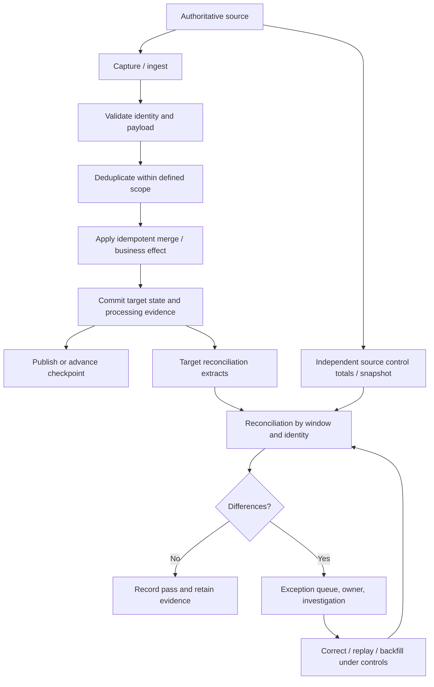

# Idempotency, Deduplication, and Reconciliation

**Roadmap location:** Stage 2D — Data Architecture / `06-Data-Integration-and-Interoperability/`  
**Target file:** `07-idempotency-deduplication-and-reconciliation.md`  
**Level:** Beginner → Intermediate → Advanced → Industry application  
**Scenario:** Northbridge Bank is fictional; all records, amounts, thresholds, and operational examples are illustrative.

---

## 1. Learning objectives

By the end of this lesson, you should be able to:

1. Define idempotency and explain why repeated execution is normal in data systems.
2. Distinguish duplicate delivery, duplicate processing, duplicate data, and duplicate business side effects.
3. Explain how idempotency, deduplication, and reconciliation solve related but different problems.
4. Choose and document stable identities: business keys, event IDs, source versions/sequences, and composite keys.
5. Design safe append, upsert/merge, version-guarded update, correction, and delete behaviour.
6. Explain the boundaries of deduplication windows, retention, late arrival, replay, concurrency, and checkpointing.
7. Design layered reconciliation using counts, control totals, checksums, key coverage, record-level comparisons, and domain-specific invariants.
8. Investigate missing, duplicated, mis-mapped, stale, conflicting, or incorrectly transformed data.
9. Design safe recovery after partial writes without advancing checkpoints or publishing incomplete output prematurely.
10. Produce operational evidence: reconciliation reports, exception ownership, recovery actions, and audit history.
11. State what every control detects, what it cannot detect, and what assumptions its guarantees depend on.

### The three controls at a glance

| Control | Primary question | Main purpose | Does not prove by itself |
|---|---|---|---|
| **Idempotency** | If this operation runs again, will the intended state or side effect remain correct? | Makes repetition safe within a defined boundary | That all required input arrived, transformations are correct, or a record was not wrongly excluded |
| **Deduplication** | Which repeated representations refer to the same logical event or entity? | Identifies and suppresses/merges duplicates according to an explicit identity rule | That the chosen key is correct, that no records were lost, or that the retained record is valid |
| **Reconciliation** | Does the target agree with the authoritative source and business expectations for a defined scope? | Detects discrepancies and provides evidence for investigation | Absolute correctness if the source, mapping, comparison logic, or business rules are themselves wrong |

A reliable pipeline needs all three where applicable, plus validation, transaction design, observability, and human-owned exception handling.

---

## 2. Why the topic matters in real-world Data Architecture

Data pipelines run in environments where timeouts, process crashes, broker redelivery, scheduled retries, operator restarts, replay, schema changes, and partial target failures are normal. A timeout is especially ambiguous: the caller may not know whether the remote operation committed before the connection failed.

Consider a transaction event sent from a source system to an analytical ledger:

1. The source publishes event `evt-8401`.
2. The consumer writes a debit record to the target.
3. The target commits successfully.
4. The acknowledgement is lost.
5. The consumer retries the event.
6. If the target blindly inserts or applies the debit again, the business result is wrong even though the transport behaved according to its delivery guarantee.

The core architecture problem is not simply “avoid duplicates.” It is to define **identity, effect, commit boundary, recovery behaviour, and evidence**.

### 2.1 Transport success is not business correctness

A transport acknowledgement commonly means that a particular delivery or write reached a defined technical boundary. It does not automatically mean:

- the consumer applied the business effect exactly once;
- every source record was included;
- the correct entity was updated;
- an older event did not overwrite newer state;
- the transformation was correct;
- the target and source agree;
- downstream side effects completed;
- or an independent reconciliation passed.

At-least-once delivery can redeliver. At-most-once delivery can lose work. “Exactly once” is always scoped to particular components and transactions; it is not a blanket guarantee across arbitrary databases, queues, APIs, and external side effects.

### 2.2 Architecture flow



**Important:** The diagram is a logical design, not a claim that all steps must be separate services. In a database-backed pipeline, target mutation and the processed-event record may need to commit in one transaction. If they commit independently, a crash between them can either repeat the business effect or mark an uncommitted effect as processed.

### 2.3 Why the three controls must remain distinct

- **Idempotency** governs the effect of repetition. Example: applying the same event twice does not debit twice.
- **Deduplication** decides whether two received items represent the same logical event or record. Example: two deliveries with the same trusted event ID are one event for processing.
- **Reconciliation** compares the resulting data with a source or independent expectation. Example: it detects that one source transaction is missing from the target even though no duplicate was applied.

A deduplication algorithm can silently drop valid data if its key is too broad. An idempotent upsert can repeatedly write the same wrong value. Reconciliation can fail to detect a defect if it uses the same faulty mapping as the load. None is a universal substitute for the others.

---

## 3. Prerequisite knowledge

Review these topics from the surrounding roadmap before treating this as production design:

- Batch ETL/ELT, incremental ingestion, landing zones, and watermarks.
- CDC, source sequence/version, delete events, and replay.
- APIs, files, managed connectors, and ambiguous timeout outcomes.
- Streaming events, message IDs, partitioning, delivery guarantees, and consumer offsets.
- Data contracts, schema evolution, key semantics, and compatibility.
- Consistency, transaction boundaries, primary keys, unique constraints, and upsert/merge behaviour.

### Vocabulary

| Term | Meaning |
|---|---|
| **Logical event** | The business occurrence the system intends to represent, such as one payment capture |
| **Delivery** | One attempt to transport a message or record to a consumer |
| **Processing attempt** | One attempt to execute consumer logic for an input |
| **Business side effect** | A change outside the mere transport, such as a debit, notification, or external API call |
| **Idempotency boundary** | The precise state change or side effect that must remain safe under repetition |
| **Business key** | A domain identity, such as `account_id` or `payment_id`, governed by business rules |
| **Event ID** | A stable identifier for one event occurrence, not merely for a delivery attempt |
| **Source version** | A monotonically comparable version/sequence for changes to one entity, if the source guarantees that property |
| **Watermark/checkpoint** | A persisted progress marker used to resume processing; it must not outrun durable processing |
| **Control total** | An independently computed aggregate used to compare source and target, such as count or amount by currency and window |
| **Reconciliation window** | The defined source/target scope being compared, including event-time or business-date boundaries |

---

## 4. Beginner-level learning sequence

### 4.1 Define idempotency

An operation is idempotent when repeating it one or more times has the same intended effect as performing it once, for the same logical request and under the same assumptions.

In state terms, an operation \(f\) is idempotent if:

\[
f(f(s, x), x) = f(s, x)
\]

where \(s\) is the initial state and \(x\) is the same logical input. This equation is a useful model, but production behaviour also depends on transaction boundaries, concurrency, identity stability, and external side effects.

| Operation | Idempotent? | Reason and caveat |
|---|---|---|
| Set a profile field to `status = "ACTIVE"` | Usually yes | Repeating the same assignment leaves the same state; audit side effects may still repeat |
| Insert a row with no uniqueness rule | No | Repeated insert can create multiple rows |
| Add 10 to a balance | No | Each execution adds another 10 |
| Upsert entity key `C-42` with the same complete payload | Often yes for final row state | Only if key and merge semantics are stable; triggers, timestamps, and emitted side effects may differ |
| Apply event `E-9` to a ledger with a durable unique event key and atomic processing record | Can be idempotent within that transaction boundary | The unique key and business effect must be coupled correctly |
| Send an email on each retry | No | Each request can cause another external side effect unless the email provider supports a durable idempotency key or the workflow compensates |

**Key point:** A state update can be idempotent while its surrounding behaviour is not. For example, setting `status = "PAID"` twice may leave the same row, yet sending two receipts or debiting twice remains a separate risk.

### 4.2 Distinguish three types of duplicates

1. **Duplicate delivery:** the same message is delivered more than once.
2. **Duplicate processing:** the consumer executes the same logical work more than once.
3. **Duplicate data or side effect:** the target contains duplicate rows, duplicate ledger entries, or repeated downstream actions.

They are related but not equivalent. Duplicate delivery does not necessarily create duplicate data if processing is safe. Duplicate data can also arise without redelivery—for example, a faulty join multiplies rows or two source systems describe the same business event.

### 4.3 Define deduplication

Deduplication identifies items considered the same logical event or entity under an explicit rule, then suppresses, collapses, or merges repeated representations.

A deduplication rule must specify:

- **Identity:** which fields identify the same logical item?
- **Scope:** one batch, partition, topic, source, tenant, entity, or global business boundary?
- **Time/retention:** how long must the system remember seen identities?
- **Conflict policy:** what happens if the same identity arrives with different payloads?
- **Replay policy:** can an old identity be replayed after its dedup record expires?
- **Audit:** how are suppressed items counted and investigated?

Never deduplicate by “all fields happen to be equal” unless the business meaning explicitly permits that. Two legitimate purchases can have identical amount and timestamp rounded to the same second. Conversely, the same event can have different transport metadata across deliveries.

### 4.4 Define reconciliation

Reconciliation compares source data, target data, and/or independent business expectations for a declared scope. It identifies discrepancies and drives resolution.

A useful reconciliation scope defines:

- source of truth for each field or business fact;
- source snapshot or extraction boundary;
- target snapshot or completed-run boundary;
- event-time/business-date window and timezone;
- treatment of late arrivals, reversals, corrections, and deletes;
- key and version comparison rules;
- numerical tolerance and rounding policy;
- checks performed, exceptions raised, owner, and evidence retention.

### 4.5 Why retries and replays happen

| Trigger | Example | Design response |
|---|---|---|
| Network timeout | Target commits but caller never receives response | Retry with stable identity; query durable outcome where possible |
| Consumer crash | Crash after target write but before message acknowledgement | Atomic target write plus processed-event record, or safe idempotent reapplication |
| Scheduler restart | Batch restarts after partially loading a partition | Deterministic batch/run identity; stage then publish atomically or use idempotent merge |
| Replay/backfill | Reprocess last month after a bug fix | Explicit replay mode, versioned transformation, stable event identity, scoped reconciliation |
| Duplicate upstream event | Producer retries after uncertain publish | Producer-generated stable event ID plus consumer enforcement |
| Concurrent workers | Same key is processed simultaneously | Database uniqueness/locking/transaction isolation or serialized partitioning; do not rely on a local set |

### 4.6 Beginner exercise: classify and make safe

For each operation, write (a) whether repeated execution is safe, (b) the identity required, and (c) the durable mechanism that enforces the rule.

1. `INSERT INTO transactions ...` with no unique constraint.
2. `UPDATE accounts SET status = 'FROZEN' WHERE account_id = ?`.
3. `UPDATE accounts SET balance = balance - 50 WHERE account_id = ?`.
4. `UPSERT customer by customer_id`.
5. Call a partner payment API after a timeout.

**Expected reasoning:**

- 1 is not safe under repeated insertion without a uniqueness/merge rule.
- 2 is idempotent for the row's state, but repeated audit events or notifications may not be.
- 3 is not safe unless each logical debit is applied at most once, usually by recording the event/transaction ID atomically with the ledger mutation.
- 4 can be idempotent for final state if key and merge semantics are stable; stale updates still require version rules.
- 5 requires the partner's documented idempotency-key behaviour or a query/reconciliation process to resolve uncertain outcomes. A client-side retry alone cannot guarantee a single external effect.

---

## 5. Intermediate-level learning sequence

### 5.1 Choose identity deliberately

Different identifiers answer different questions.

| Identity type | Example | Best use | Main limitation |
|---|---|---|---|
| Stable business key | `payment_id = PAY-901` | Identify a domain entity or transaction across systems | May be reused, corrected, scoped by tenant, or poorly governed |
| Event/message ID | `event_id = EVT-8842` | Identify one event occurrence across redelivery | If producer creates a new ID on each retry, duplicates evade detection |
| Source sequence/version | `(account_id, version=17)` | Reject stale entity updates and order changes | Sequence may only be comparable within one entity/partition/source |
| Composite key | `(source_system, tenant_id, transaction_ref)` | Disambiguate identifiers whose uniqueness is scoped | Missing or normalized fields can collapse distinct records |
| Natural key | `(country_code, tax_id)` | Domain matching when stable and authoritative | Can change, be missing, or require normalization and legal rules |
| Payload hash | SHA-256 of canonicalized payload | Detect byte/value-equivalent payloads or support integrity checks | Not a business identity; different legitimate events can have equal payloads |

Identity requirements should be documented per flow. For example:

| Flow | Logical identity | Version/order | Merge rule | Duplicate rule |
|---|---|---|---|---|
| Payment ledger events | `source_system + event_id` | Source event sequence if available | Append one immutable ledger entry | Same event ID + same canonical payload: suppress repeat; same ID + different payload: quarantine |
| Customer profile | `customer_id` | Source version / `updated_at` only if trustworthy | Upsert current state | Same key and version: no-op if same content; conflict if content differs |
| Account status CDC | `source_system + account_id + source_version` | Source sequence, not consumer arrival time | Apply only newer version | Tombstone/version retained long enough to stop stale resurrection |
| Daily transaction extract | `source_system + business_date + transaction_id` | Extract revision or source sequence | Stage then merge by transaction identity | Repeated file/run should not multiply rows; corrections require revision policy |

### 5.2 Event ID vs business key

A business key usually identifies an entity or business transaction. An event ID identifies one change/event occurrence.

Example: Payment `PAY-901` may have events:
- `EVT-1`: payment initiated;
- `EVT-2`: payment authorized;
- `EVT-3`: payment settled;
- `EVT-4`: payment reversed.

Deduplicating every event solely by `payment_id` would incorrectly collapse legitimate lifecycle events. Deduplicating by event ID protects against repeated delivery of the same occurrence, while payment ID groups events into the same business transaction.

### 5.3 Stable keys and canonicalization

If identity includes text fields, define normalization precisely. For example, trimming whitespace and uppercasing a case-insensitive source identifier may be correct, but changing Unicode normalization or leading zeros can change meaning. Do not normalize IDs based on convenience alone.

A robust identity policy states:

- namespace/source system;
- tenant or account scope;
- field types and null behaviour;
- canonicalization rules;
- uniqueness guarantee and who enforces it;
- lifecycle/reuse policy;
- migration plan if key semantics change.

A null or empty key should usually be rejected or quarantined for critical records, not converted into one shared key such as `"UNKNOWN"`.

### 5.4 Deduplication scope and retention window

A time-bounded deduplication cache only protects the time range it remembers. If an event is replayed after expiry, it can be processed again unless another durable invariant protects it.

Illustrative example:
- Maximum expected retry/replay delay: 72 hours.
- Deduplication record retention: 7 days.
- Operational replay allowed: up to 30 days.

A 7-day cache does **not** protect a 30-day replay. Options include durable event IDs in the target, longer-lived processing records, replay-specific idempotent merge, or explicit controlled reprocessing. Retention should follow the maximum replay horizon and business/audit requirements—not merely an arbitrary cache TTL.

A Bloom filter or approximate membership structure can reduce lookup cost but may have false positives and generally cannot be the only authoritative control for financial events. A false positive can suppress a legitimate event.

### 5.5 Safe append, upsert, and version-guarded merge

**Append** is suitable for immutable facts only when event identity is enforced. Blind append is unsafe under retries.

**Upsert/merge** inserts a missing entity or updates an existing entity based on a stable key. It is not automatically safe if updates arrive out of order or if the merge overwrites fields that the incoming record does not own.

**Version guard** accepts a change only when its source version is newer than the stored version. The comparison must be valid within the key's version domain.

Conceptual SQL (syntax varies by database):

```sql
-- Conceptual pattern, not portable SQL.
MERGE INTO customer_target AS t
USING customer_stage AS s
   ON t.customer_id = s.customer_id
WHEN MATCHED AND s.source_version > t.source_version THEN
  UPDATE SET
    name = s.name,
    status = s.status,
    source_version = s.source_version
WHEN NOT MATCHED THEN
  INSERT (customer_id, name, status, source_version)
  VALUES (s.customer_id, s.name, s.status, s.source_version);
```

Production checks still required:

- Stage must contain at most one winning row per target key before `MERGE`, or database semantics may reject or behave unexpectedly.
- If the same key/version has conflicting payloads, quarantine it; do not arbitrarily choose whichever arrived last.
- Define what happens when source versions are missing or reset.
- Ensure target uniqueness is enforced by a durable constraint or equivalent concurrency-safe mechanism.
- Handle deletes/tombstones with version semantics so a stale update cannot resurrect a deleted entity.
- Test the actual database's `MERGE` semantics and transaction isolation.

### 5.6 Corrections, deletes, and out-of-order changes

| Case | Safe rule | Risk if ignored |
|---|---|---|
| Late older update | Compare source version and reject stale update | Old data overwrites newer state |
| Same version, same payload | Treat as repeat/no-op | Unnecessary writes and side effects |
| Same version, different payload | Conflict; quarantine and investigate | Silent choice between contradictory facts |
| Correction to a previously accepted transaction | Model as correction/reversal or higher revision according to domain rules | Mutating history can hide the original event |
| Delete/tombstone | Retain deletion identity/version long enough to defeat stale replay | Old upsert recreates deleted record |
| Source key reused | Include lifecycle/generation identity or prohibit reuse | New entity merges into an old entity |

For event-sourced or ledger-like domains, do not silently overwrite immutable history to make totals match. Prefer an explicit reversal/correction event and preserve lineage.

### 5.7 Reconciliation methods and their coverage

| Method | Detects well | Cannot establish alone | Typical use |
|---|---|---|---|
| Record counts | Missing/extra records when scope and grain match | Values, mapping correctness, equal-count substitutions | Batch-level smoke check |
| Sums/control totals | Aggregate value drift, some omissions/duplicates | Offset errors that cancel, wrong entity mapping with same totals, non-additive fields | Monetary totals by currency and window |
| Hash/checksum | Differences in canonicalized data included in hash | Business-rule correctness; collisions are extremely unlikely with strong hashes but not logically impossible; canonicalization errors | Partition/file integrity and fast comparisons |
| Key coverage/anti-join | Missing source keys and unexpected target keys | Incorrect values for matching keys | Completeness check |
| Key + version comparison | Missing/stale/conflicting versions | Wrong values generated from same source version if fields are not compared | CDC/current-state tables |
| Full record-level comparison | Field-level mismatch for compared records | Fields omitted from comparison, incorrect source truth, common-mode transformation errors | Critical flows and targeted investigations |
| Sampling | Can reveal patterns with lower cost | Rare defects or defects outside sample; confidence depends on sample design | High-volume lower-risk feeds |
| Domain invariants | Violations of business rules (e.g. debits equal credits per ledger scope) | Rules not encoded or incorrect rule definitions | Financial, regulatory, and operational flows |
| Independent source extract/report | Common-mode errors between load and comparison may be reduced | Independence is not guaranteed if both derive from same defective source logic | Critical reconciliation |

**Independence matters.** If the load and reconciliation use the same flawed mapping function, both may misclassify a record in the same way and report a pass. Use an independently generated source control, a separate implementation of key business rules, or a trusted source-side report where feasible. Document any shared logic that remains.

### 5.8 Control totals, windows, and tolerances

A control total must have an explicit grouping grain. For transaction flows, a useful grouping might be:

`business_date × currency × transaction_type × source_system`

Never sum different currencies into one amount total unless a separately specified conversion policy, FX rate source, and valuation time are applied.

For a currency/window group \(g\):

\[
\Delta_g = \text{target total}_g - \text{source total}_g
\]

A pass condition may be:

\[
|\Delta_g| \leq \epsilon_g
\]

where \(\epsilon_g\) is a documented tolerance justified by the domain. For exact integer minor-unit amounts, tolerance is often zero. For floating-point measurements, tolerance may be appropriate; it should not conceal unexplained financial differences.

Illustrative control:
- Source settled payments in INR for business date `2026-10-19`: 12,480 records, total ₹8,450,000.00.
- Target settled payments in the same scope: 12,479 records, total ₹8,447,500.00.
- Count delta (target − source): `12,479 − 12,480 = -1`.
- Amount delta: `₹8,447,500 − ₹8,450,000 = -₹2,500`.

This indicates at least one mismatch, but does not prove that exactly one record is missing: a missing record and an extra record could coexist. Key-level comparison is needed to localize the differences.

### 5.9 Worked mismatch: counts match, values are wrong

Illustrative source:

| transaction_id | account_id | amount_minor |
|---|---|---:|
| T-100 | A-10 | 10000 |
| T-101 | A-20 | 25000 |
| T-102 | A-30 | 5000 |

Illustrative target:

| transaction_id | account_id | amount_minor |
|---|---|---:|
| T-100 | A-10 | 10000 |
| T-101 | A-30 | 25000 |
| T-102 | A-20 | 5000 |

Both have 3 rows and total `40000` minor units. Count and total controls pass, but accounts for `T-101` and `T-102` are swapped. A key-level comparison on `transaction_id` plus relevant fields detects it. If the regulatory report groups amounts by account, the result is materially wrong despite matching global totals.

### 5.10 Defect-to-control matrix

| Defect | Idempotency | Deduplication | Count/total | Key coverage | Record comparison / domain invariant |
|---|---|---|---|---|---|
| Same event delivered twice and applied twice | Prevents if business effect is safely guarded | Detects if stable event identity is used | May detect if totals change and do not offset | May detect duplicate key if checked | Usually detects with event/ledger comparison |
| Source record missing in target | No | No | Often, if count/total differs | Yes | Yes if source scope is complete |
| Extra target row | May prevent one class of repeat | May suppress if identity known | Often, but offsets can hide it | Yes | Yes |
| Wrong account mapping with same total | No | No | Often missed | Key coverage passes | Record-level/account-level invariant detects |
| Old version overwrites new state | Not without version logic | Not by itself | May or may not | Key coverage passes | Version/field comparison detects |
| Incorrect transformation applied consistently | No | No | Sometimes; not guaranteed | Often passes | Independent business validation is needed |
| Delete missed in target | No by itself | No by itself | May or may not | Key coverage or snapshot diff | Full comparison/tombstone audit |
| Duplicate side-effect outside target DB | Only if idempotency boundary includes side effect | May not apply | Target reconciliation may not see it | Depends on external reference | External provider query/audit is needed |

---

## 6. Advanced-level learning sequence

### 6.1 Define the idempotency boundary and atomic commit

The strongest common pattern for a database consumer is to couple the business mutation and the processed-event marker in the **same database transaction**:

1. Receive event with stable `event_id`.
2. Begin transaction.
3. Attempt to insert `(consumer_name, event_id)` into a table with a unique constraint.
4. If the key already exists, treat it as previously processed only after the stored outcome/identity semantics are checked.
5. If it is new, apply the business mutation.
6. Commit both marker and mutation together.
7. Acknowledge the message only after commit.

If the process crashes before commit, both changes roll back and retry can safely try again. If commit succeeds but the acknowledgement is lost, retry encounters the durable marker and does not apply the effect again.

This guarantee holds only when the marker and business mutation are in the same transactional store and transaction. It does not automatically include a separate email service, a payment provider, or a second database. For cross-system effects, use the receiving system's idempotency key, a transactional outbox/inbox pattern, a saga/compensation strategy, and reconciliation of uncertain outcomes as appropriate.

### 6.2 Concurrent workers and race conditions

A process-local set such as `seen_event_ids = set()` is insufficient because:
- it disappears on restart;
- separate workers have separate memory;
- two workers can both check “not seen” before either records the ID;
- it cannot coordinate a transaction with the target mutation;
- its retention and replay behaviour may be undefined.

Use durable uniqueness constraints, serializable/appropriate transaction isolation, row-level locking, atomic conditional writes, or partition ownership with fencing where supported. Even a unique constraint only prevents duplicate key rows; it does not automatically make a second non-transactional side effect safe.

### 6.3 Partial failures and checkpoints

A checkpoint records progress; it is not proof that all prior effects are correct. Consider three possible ordering choices:

| Ordering | Crash risk |
|---|---|
| Advance checkpoint before target commit | Input can be skipped permanently after crash |
| Commit target then advance checkpoint | Retry may repeat target work; target operation must be idempotent or deduplicated |
| Atomically commit target state and checkpoint in one transactional boundary | Strongest local consistency, if the platform supports it and all relevant writes share that transaction |

In many streaming platforms, the offset and database write cannot be committed in one transaction without a supported integration protocol. In that case, design for at-least-once delivery plus idempotent target writes and reconciliation; state the limitation.

For batch jobs, a robust publication pattern is:

1. Create a unique `run_id` and input manifest.
2. Write output to a staging area keyed by `run_id`.
3. Validate schema, record counts, control totals, key uniqueness, and business rules.
4. Reconcile staged output against the source scope.
5. Atomically publish by transaction, pointer/manifest swap, or supported table commit.
6. Mark the run successful only after publication.
7. On failure, keep staging isolated, record the failure, and safely resume or discard according to policy.

Atomicity depends on the storage engine and publication method. Object storage alone may not provide an atomic multi-file transaction; use a manifest/pointer commit or table format with documented atomic commit semantics.

### 6.4 Exactly-once claims: narrow the claim

“Exactly once” must name:
- the input identity and delivery scope;
- the system boundary;
- the state change or side effect;
- the transaction/commit mechanism;
- retention and replay horizon;
- concurrency model;
- failure assumptions;
- what happens when the external outcome is unknown.

A defensible statement is: “For a given `(consumer, event_id)`, the ledger row and processed-event marker are committed atomically in database X, with a unique constraint; repeated deliveries within the retained identity scope do not create another ledger row.” An indefensible statement is: “The whole platform is exactly once” without defining any boundary.

### 6.5 Event identity conflicts

If the same event ID arrives with a different canonical payload, do not silently treat it as a harmless duplicate. This can indicate producer ID reuse, corruption, or an upstream defect.

Recommended handling:
- persist the first accepted identity and canonical payload hash (or selected canonical fields);
- on repeated event ID, compare the payload;
- same identity + same content: safe duplicate candidate;
- same identity + different content: quarantine, alert, preserve both representations, and investigate;
- never overwrite the first event without a domain-defined correction policy.

A hash is an efficient comparison aid, not a replacement for defining canonicalization. Hash only the fields whose equality has business meaning, and keep enough source data to investigate conflicts.

### 6.6 Deletes and tombstone retention

Suppose version 18 deletes account `A-20`, and version 17 arrives later. If the target physically removed all evidence of version 18, the stale version 17 may be inserted as if the account still existed. Retain a tombstone or version watermark for the entity long enough to cover replay and late-arrival horizons. Purge policies must be aligned with source replay guarantees and recovery needs.

### 6.7 Reconciliation windows, late arrivals, and snapshots

A comparison is meaningful only if source and target scopes align. If the source extract was taken at 10:00 and the target includes updates through 10:15, differences may be expected rather than defects.

Document:
- snapshot time or source offset/LSN/sequence;
- event-time vs processing-time basis;
- timezone and daylight-saving boundary rules;
- whether late arrivals trigger re-reconciliation;
- correction/reversal policy;
- whether the target snapshot is stable during comparison;
- how a comparison is rerun and linked to the prior result.

For critical flows, reconcile a closed window and separately track late-arrival adjustments. Do not silently extend the source window while leaving the target window unchanged.

### 6.8 Layered reconciliation for a transaction ledger

For Northbridge's fictional transaction flow, use multiple independent layers:

1. **Run/scope control:** same source snapshot, business date, source system, currency, and transaction status.
2. **Count and total controls:** counts and amount totals by currency and transaction type.
3. **Key coverage:** source keys missing from target and unexpected target keys.
4. **Duplicate check:** duplicate logical event IDs and duplicate business transaction keys where uniqueness is expected.
5. **Version comparison:** stale, missing, or conflicting source versions.
6. **Record-level comparison:** compare amount, account, status, currency, effective date, and reversal link for each matched key.
7. **Domain invariants:** e.g., settled/reversed transaction rules, valid state transitions, balanced debit/credit entries when the ledger model requires balance.
8. **Independent check:** compare against source-side control totals or a separately implemented report, not only the same transformation output.
9. **Exception workflow:** assign severity and owner, block publication where necessary, remediate, replay/backfill, then rerun affected checks.
10. **Evidence retention:** store report, run ID, source/target snapshot identifiers, control values, exception list, decisions, remediation references, and sign-off.

No one layer proves correctness. The combination increases defect coverage and gives investigators enough evidence to localize a problem.

### 6.9 Worked investigation: payment event retried and debit applied twice

**Illustrative evidence**
- Source has one logical event `EVT-77`, amount 2,500 minor units, account `A-9`.
- Target ledger has two entries with the same event ID and amount.
- Source count for the window: 1.
- Target count: 2.
- Source amount: 2,500.
- Target amount: 5,000.

**Diagnosis:** Duplicate business effect. The likely missing control is a durable event identity constraint coupled atomically to the ledger insert, or an equivalent business-boundary idempotency mechanism. A broker delivery guarantee alone is not enough.

**Recovery**
1. Stop or contain the affected consumer/flow if further duplication is ongoing.
2. Preserve source messages, target rows, offsets, run logs, and timestamps.
3. Establish the authoritative event and whether both target rows caused real account effects.
4. Use an approved correction/reversal process; do not casually delete ledger history.
5. Add atomic deduplication/idempotency at the ledger boundary.
6. Replay only after the corrected rule is deployed and the replay scope is explicit.
7. Reconcile the affected window by event ID, account, amount, and business invariants.
8. Record root cause, corrective action, owner, and evidence.

### 6.10 Worked investigation: count and total match but regulatory report is wrong

**Illustrative symptom:** Source and target each contain 50,000 records; the total amount by currency matches, but a regulatory report misstates exposures by account segment.

Investigate:
- join multiplication and subsequent filtering that preserves global counts;
- account/customer mapping drift;
- incorrect effective-date or status logic;
- timezone boundary differences;
- values assigned to the wrong dimension while totals cancel;
- common-mode errors where load and reconciliation share the same flawed mapping.

Use key-level comparison for the relevant dimensions, independently sourced account/segment mapping, group-level controls, and domain-specific invariants. A global count or sum is not enough.

### 6.11 Worked investigation: old update overwrites newer state

**Illustrative events**
- `(account=A-9, version=22, status=FROZEN)` arrives first.
- `(account=A-9, version=21, status=ACTIVE)` arrives later.

If merge logic updates by arrival time only, the account can incorrectly return to `ACTIVE`. The target must compare a trustworthy source version and apply only newer changes. If both events claim version 22 with conflicting payloads, treat it as a conflict—not as a tie resolved by whichever arrives last.

### 6.12 Failure/defect scenarios and controls

| # | Scenario | Detection/control | Recovery | Owner/evidence |
|---:|---|---|---|---|
| 1 | Consumer crashes after target commit but before acknowledgement | Atomic processed-event marker + target mutation; replay test | Retry; marker prevents repeated mutation | Data platform; transaction/run logs |
| 2 | Checkpoint advances before target commit | Checkpoint/target consistency check; code review | Reprocess missing range from durable source | Pipeline owner; checkpoint and target counts |
| 3 | Two workers process same event concurrently | Durable unique constraint and transaction test | Resolve unique conflict; verify one business effect | Data platform; conflict metrics |
| 4 | Dedup TTL expires before replay | Replay-horizon policy; old-event test | Use durable target identity or controlled replay | Product/data owner; retention config |
| 5 | Same event ID has different payload | Payload conflict check and quarantine | Investigate producer identity defect or approved correction | Source owner; both payloads and hashes |
| 6 | Old version arrives after new version | Version-guarded merge | Reapply current state from authoritative source if needed | Domain owner; version history |
| 7 | Delete is missed and stale record is resurrected | Tombstone/version comparison; source-target key diff | Apply delete/tombstone and replay safely | Source + target owners; delete evidence |
| 8 | Counts match but values are mapped to wrong accounts | Key-level field comparison and group controls | Correct mapping, backfill affected scope, rerun checks | Data owner; mismatch rows and code version |
| 9 | Load and reconciliation share the same bug | Independent control/report or separately implemented invariant | Reconcile from independent source evidence | Control owner; logic provenance |
| 10 | Two errors cancel in aggregate totals | Key coverage and record-level comparison | Correct each identified row and rerun | Reconciliation owner; exception list |
| 11 | Batch publishes only some files | Staging + atomic manifest/pointer/table commit | Rebuild or republish complete run | Platform owner; run manifest |
| 12 | Exceptions are generated but never reviewed | Ageing dashboard, escalation SLA, sign-off gate | Assign owner; escalate overdue critical breaks | Data operations; exception audit trail |

### 6.13 Tolerance, rounding, and null handling

- **Currency:** use integer minor units or an exact decimal type; never use binary floating-point for authoritative financial amounts.
- **Tolerance:** define per measure and business purpose. For exact integer minor-unit totals, expected tolerance is normally zero unless a documented domain rule says otherwise.
- **Nulls:** distinguish unknown, not applicable, missing, and explicit null. Do not silently convert all nulls to zero or empty string.
- **Timezones:** use a declared timezone for business date, and store event timestamps with timezone/UTC semantics.
- **Rounding:** specify when rounding occurs and which rounding mode applies. Reconciliation must compare at the same declared precision but should not hide unexplained record-level differences.
- **Negative values/reversals:** define whether control totals include original transactions, reversals, and corrections, and whether the source's status filter matches the target's.

### 6.14 Operational reconciliation report

A useful report includes:

| Field | Purpose |
|---|---|
| `reconciliation_id` and `run_id` | Unique traceability |
| Flow/source/target names and code version | Reproduce the comparison |
| Source snapshot/offset/manifest | Define authoritative input scope |
| Target snapshot/commit identifier | Define compared output scope |
| Window, timezone, filters, currency | Make scope unambiguous |
| Source/target counts and deltas | Surface cardinality differences |
| Source/target control totals and deltas | Surface aggregate drift |
| Duplicate keys and key anti-join counts | Surface duplication and completeness defects |
| Version conflicts and record mismatch counts | Surface stale or conflicting state |
| Tolerance and pass/fail rule | Make judgement reproducible |
| Exception IDs, severity, owner, age, status | Ensure mismatches are acted on |
| Recovery action and rerun reference | Preserve lineage of remediation |
| Sign-off and timestamps | Evidence review and closure |

A report marked `PASS` means only that the declared checks passed for the declared scope. It is not an unqualified assertion that every business rule is correct.

---

## 7. Industry-application exercises

Use the fictional **Northbridge Bank**. The following is a learning scenario, not real banking data or an operational policy.

### Exercise A — Define identity and merge rules per flow

Design rules for these flows:

1. Payment lifecycle events.
2. Customer current-state updates.
3. Account status CDC including deletes.
4. Daily transaction files that may be resent with corrections.

For each, document:
- business key and event ID;
- key namespace/source/tenant scope;
- version/order field and its guarantees;
- deduplication scope and retention;
- merge/append/delete/correction behaviour;
- same identity/same payload behaviour;
- same identity/different payload behaviour;
- transaction boundary and replay policy.

**Expected output:** A flow-control table with no undefined key, conflict, delete, or replay rule.

### Exercise B — Design layered reconciliation and tolerance

Illustrative payment batch:
- Source: 12,480 settled payments, INR total ₹8,450,000.00.
- Target: 12,479 settled payments, INR total ₹8,447,500.00.
- Exact amount tolerance: ₹0.00.
- Same business date, currency, status, and declared source snapshot are assumed.

Calculate count and amount deltas, list likely causes, and define the next checks. Explain why one missing record is plausible but not proven.

**Expected output:** A reconciliation report plus key-level exception query/design.

### Exercise C — Defect-to-control coverage matrix

Evaluate at least these five defects:
- lost row;
- duplicate event;
- wrong account mapping;
- late update overwrites newer state;
- missed delete.

Mark each control as **detects**, **may detect**, or **does not detect**. Explain the assumptions for every “detects” claim.

**Expected output:** Coverage matrix with blind spots and an independent-check argument.

### Exercise D — Recover a partial run

A batch stages 100,000 rows, writes 60,000 rows to the target, then crashes. The checkpoint has already advanced. Design a recovery plan.

Your plan must identify:
- whether the target is staging or published state;
- how the source range is recovered;
- whether target writes are repeat-safe;
- how run IDs and manifests are tracked;
- when the checkpoint can be repaired;
- which reconciliation checks must pass before publication;
- how the incident and corrective action are recorded.

**Expected output:** A failure-state diagram or numbered runbook. Do not assume “rerun the job” is sufficient.

### Exercise E — Count and total pass, report fails

Source and target counts and global totals match, but amounts are attributed to the wrong account segments. Design checks that detect the issue and explain how to avoid a common-mode bug.

**Expected output:** Key-level comparison, group-level control totals, independent mapping validation, and investigation steps.

### Exercise F — Exactly-once claim review

Review this claim: “Our stream is exactly once because the broker deduplicates message IDs.”

Rewrite it into a defensible, bounded guarantee. State what happens after the broker retention window, during concurrent consumption, and when the target commits but the acknowledgement is lost.

**Expected output:** A scope-specific guarantee with transaction, persistence, identity, and replay assumptions.

---

## 8. Practical scenarios and case-based reasoning

### Scenario 1 — A retried payment event debits an account twice

**Question:** What control was missing?

**Reasoning:** The consumer likely lacked an idempotency mechanism at the business-effect boundary, a durable event identity constraint, or an atomic transaction coupling the dedup marker with the ledger effect. Broker-level deduplication alone cannot guarantee that an external or database side effect happened once.

**Recommended action:** Contain ongoing damage, preserve evidence, establish whether both entries caused real effects, use approved reversal/correction controls, deploy atomic event-key enforcement, replay only a declared scope, and reconcile.

### Scenario 2 — Counts and totals match but a regulatory report is wrong

**Question:** What class of defect is this and what check would catch it?

**Reasoning:** Likely semantic/mapping or dimension-attribution defect that preserves global aggregates. Compare relevant fields by stable business key, reconcile totals at the report's actual grouping grain, validate domain invariants, and independently verify the mapping/reference data.

### Scenario 3 — An old update overwrites a newer one

**Question:** How should it be fixed?

**Reasoning:** Use a trustworthy source version/sequence and conditional merge; do not order by consumer arrival time unless that is explicitly the authoritative ordering rule. Quarantine equal-version conflicting payloads. Retain tombstones/version evidence to stop stale resurrection.

### Scenario 4 — Source and target disagree by one record

Do not immediately insert the “missing” record. Confirm scope and snapshot alignment; compare source keys against target keys; inspect late arrivals, filters, rejected records, deletes, and duplicate target keys. Determine whether the source record is authoritative and whether target mutation is safe to replay. Record the mismatch and resolution.

### Scenario 5 — Duplicate key with different payload

Treat this as an identity conflict, not a routine duplicate. Preserve both payloads, source metadata, first-seen/last-seen times, and code version. Determine whether the producer reused an event ID, a correction should have a new revision, or the payload changed in transit. Do not silently choose the latest arrival.

### Scenario 6 — The replay window exceeds dedup retention

A replay of older events can pass a short-lived cache. Before replay, define the affected source range and transformation version; use durable event identity and target merge semantics; compare against the current target and reconcile before/after. If no durable identity exists, use a controlled rebuild into isolated staging rather than blind append.

---

## 9. Expected outputs and deliverables

Complete these artifacts for at least one real or simulated flow:

1. **Identity and merge/dedup rules per flow** — stable key, event ID, version, conflict policy, delete/correction semantics, scope, retention, and replay rules.
2. **Reconciliation design** — source of truth, comparison window/snapshot, counts, control totals, key coverage, record-level comparisons, domain invariants, tolerances, and limitations.
3. **Defect-to-control coverage matrix** — detected and undetected defect classes, including common-mode risks.
4. **Reconciliation report format** — reproducible run/snapshot metadata, controls, deltas, exceptions, owner, status, remediation, and sign-off.
5. **Exception workflow** — severity, ownership, ageing/escalation, safe correction, rerun, closure evidence, and conditions that block publication.
6. **Practice-question answers** — answer the questions in Section 12 and correct any weak answers.
7. **Recovery runbook** — explain how a partial failure is contained, recovered, replayed, reconciled, and documented.

A deliverable is not complete if it merely says “deduplicate by ID” or “compare row counts.” It must specify the identity guarantee, transaction boundary, scope, blind spots, and evidence.

---

## 10. Common mistakes and misconceptions

1. **Treating deduplication as idempotency.** Removing duplicate inputs does not make every business effect repeat-safe.
2. **Believing either guarantees complete correctness.** They do not detect every missing row, wrong mapping, or faulty transformation.
3. **Using unstable/non-unique keys.** A delivery attempt ID that changes on retry cannot deduplicate logical repeats; an overly broad business key can collapse legitimate events.
4. **Relying on an in-memory set.** It is not durable across restarts and does not coordinate concurrent workers or target transactions.
5. **Assuming a unique key solves all side effects.** It may prevent duplicate rows but cannot prevent a second external API call unless that boundary is protected too.
6. **Assuming an upsert is always safe.** Stale updates can overwrite newer state; merge semantics may mishandle nulls, partial payloads, or deletes.
7. **Advancing a checkpoint before durable output.** This can permanently skip data after a crash.
8. **Treating a successful transport acknowledgement as proof of business completion.** The acknowledgement scope may be much narrower.
9. **Relying on counts alone.** Equal counts can hide substitutions, wrong values, and offsetting defects.
10. **Relying on global totals alone.** Two incorrect rows can offset, and dimension mappings can be wrong while the grand total remains correct.
11. **Reconciling with the same faulty logic.** A common-mode defect can make both load and check agree incorrectly.
12. **Ignoring retention and replay horizon.** A dedup record may expire before an old event is replayed.
13. **Dropping tombstones too early.** A stale update can resurrect deleted state.
14. **Silently resolving identity conflicts by arrival time.** Same ID/different payload needs investigation or an explicit correction rule.
15. **Mixing currencies or inconsistent time windows.** Aggregates are not comparable unless scope and units match.
16. **Ignoring exceptions after generating a report.** Reconciliation without an owner, SLA, and recovery path is a dashboard, not a control.
17. **Claiming “exactly once” without scope.** State the system boundary, identity, transaction, retention, concurrency, and external side-effect assumptions.
18. **Using hashes as business truth.** Hashes compare canonicalized representations; they do not validate domain semantics.
19. **Publishing partial output.** Use staged output and an atomic commit/pointer/manifest pattern appropriate to the storage system.
20. **Overwriting financial history to force a match.** Preserve lineage and use approved reversal/correction events where the domain requires them.

---

## 11. Mastery criteria

You have mastered this topic when you can demonstrate that you can:

- [ ] Distinguish idempotency, deduplication, reconciliation, and validation in your own words.
- [ ] Choose stable business and event identities and explain their limitations.
- [ ] Define merge, version, conflict, correction, delete, and replay rules per flow.
- [ ] Explain why local memory or transport-level guarantees are insufficient for durable business correctness.
- [ ] State the transaction and persistence assumptions behind each idempotency claim.
- [ ] Design for concurrent duplicate attempts and partial failures.
- [ ] Reconcile using counts, totals, key coverage, record comparison, and domain invariants as appropriate.
- [ ] Explain the blind spots of every control and why common-mode errors matter.
- [ ] Define a source/target scope, snapshot/window, timezone, tolerance, and late-arrival policy.
- [ ] Investigate a duplicate payment, a count-and-total-matching semantic defect, and an out-of-order update.
- [ ] Define an exception workflow with owner, severity, ageing, recovery, rerun, and audit evidence.
- [ ] Provide a bounded, defensible “exactly once” statement rather than a blanket claim.

---

## 12. Completion gate

Do not mark this topic complete until every item below is satisfied:

- [ ] Identity, merge, version, and deduplication rules are documented per flow.
- [ ] The reconciliation design states its scope, source of truth, window/snapshot, tolerance, and layered checks.
- [ ] A coverage matrix shows detected and undetected defect classes.
- [ ] The design argues why reconciliation is sufficiently independent from the load path and identifies remaining common-mode risks.
- [ ] The exception workflow defines owner, severity, ageing/escalation, safe recovery, rerun, and evidence retention.
- [ ] At least one partial-failure/replay scenario has a step-by-step recovery plan.
- [ ] All practice questions below are answered and corrected.

### Practice questions

1. What is the difference between duplicate delivery, duplicate processing, and duplicate business side effects?
2. Why is an upsert by business key not necessarily sufficient for event processing?
3. What is the difference between a business key and an event ID? Give a case where both are needed.
4. Why is a process-local set unsafe as the only deduplication mechanism?
5. Which atomicity assumption allows a processed-event marker and business mutation to prevent duplicate effects?
6. How can a deduplication retention window fail during replay?
7. Why must same identity plus different payload be treated differently from same identity plus same payload?
8. How do version guards prevent stale updates, and what limitations do they have?
9. Why can equal source/target counts and global totals coexist with incorrect data?
10. What is a common-mode reconciliation error? Give one way to reduce it.
11. What are the risks of advancing a checkpoint before the target commit?
12. Why are tombstones important when deletes and late events coexist?
13. Which controls would you use to detect a missing record, a duplicate event, and a wrong account mapping?
14. Why must monetary controls be grouped by currency and aligned business window?
15. What information belongs in an auditable reconciliation report?
16. Rewrite “the pipeline is exactly once” into a bounded guarantee with explicit assumptions.

### Suggested answer-check guide

1. Delivery is transport; processing is execution; side effect is the durable business outcome. They can diverge.
2. A key upsert can overwrite newer data, collapse distinct events, or repeat external side effects.
3. Business key identifies the payment/entity; event ID identifies a lifecycle event such as authorization or reversal.
4. It is not durable, shared across workers, or atomic with target writes.
5. The marker and business mutation commit or roll back in the same transaction, with durable uniqueness for the event identity.
6. A replay outside retention is no longer recognized by the cache; use durable identity or safe rebuild/merge.
7. Same ID/same payload may be a repeat; same ID/different payload is an identity/data conflict.
8. Apply only a higher trusted source version; it cannot fix incorrect versions or common-mode mapping errors.
9. Wrong values can be swapped, errors can cancel, or a mapping defect can preserve global aggregates.
10. Load and check share the same bug; use independent controls or separate implementations.
11. A crash can cause skipped input because progress was recorded before durable output.
12. Tombstones preserve evidence of delete/version and prevent stale resurrection.
13. Missing: key coverage and record comparison; duplicate: event-ID uniqueness/dedup and counts; wrong mapping: key-level field comparison and domain checks.
14. Currencies have different units, and different windows represent different populations.
15. Scope/snapshots, run IDs, counts/totals/deltas, keys/versions, tolerances, exceptions, owners, actions, rerun, and sign-off.
16. Example: “For a stable `(consumer_name, event_id)`, the target ledger mutation and processed marker commit atomically in database X under a unique constraint; repeated deliveries do not create a second ledger entry. External effects are excluded and replay protection depends on retained identity records.”

---

## Appendix A — Runnable Python example: version-guarded state and reconciliation

This example uses only the Python standard library. It demonstrates deterministic identity checks and simple reconciliation logic in memory for teaching. **It is not a production persistence implementation**: its dictionaries disappear on process exit and do not provide database transactions or concurrency control. A production implementation must enforce uniqueness and atomically persist the business mutation and processed-event marker in a durable transactional store.

### Assumptions

- `event_id` is a stable ID for one logical event and is globally unique within this small demonstration processor. In production, namespace it by source/tenant/consumer scope when the source does not guarantee global uniqueness.
- `entity_id` identifies the current-state entity.
- `version` is a non-negative integer monotonically increasing per entity from the authoritative source.
- Repeating an event ID with the same canonical payload is a harmless repeat.
- Repeating an event ID with a different payload is a conflict.
- A newer version updates current state; an older version is ignored.
- Deletion is represented by a versioned tombstone, not physical removal from the teaching state.
- Amounts use integer minor units, not binary floating-point.

Save as `idempotency_reconciliation_demo.py` and run with `python idempotency_reconciliation_demo.py`.

```python
from __future__ import annotations

from dataclasses import dataclass
from typing import Dict, Iterable, Optional
import unittest


@dataclass(frozen=True)
class Event:
    event_id: str
    entity_id: str
    version: int
    status: str
    amount_minor: int
    is_deleted: bool = False

    def validate(self) -> None:
        if not isinstance(self.event_id, str) or not self.event_id.strip():
            raise ValueError("event_id must be a non-empty string")
        if not isinstance(self.entity_id, str) or not self.entity_id.strip():
            raise ValueError("entity_id must be a non-empty string")
        if isinstance(self.version, bool) or not isinstance(self.version, int) or self.version < 0:
            raise ValueError("version must be a non-negative integer")
        if isinstance(self.amount_minor, bool) or not isinstance(self.amount_minor, int):
            raise ValueError("amount_minor must be an integer")
        if not isinstance(self.status, str) or not self.status.strip():
            raise ValueError("status must be a non-empty string")
        if not isinstance(self.is_deleted, bool):
            raise ValueError("is_deleted must be a boolean")


class EventConflict(ValueError):
    """Same event identity was received with a different payload."""


class DemoProcessor:
    """In-memory teaching model; not durable or concurrency-safe."""

    @staticmethod
    def _state_signature(event: Event) -> tuple:
        """Compare entity state/version while excluding event identity."""
        return (
            event.entity_id, event.version, event.status,
            event.amount_minor, event.is_deleted,
        )

    def __init__(self) -> None:
        self.processed: Dict[str, Event] = {}
        self.current: Dict[str, Event] = {}

    def apply(self, event: Event) -> str:
        event.validate()

        previous_event = self.processed.get(event.event_id)
        if previous_event is not None:
            if previous_event != event:
                raise EventConflict(
                    f"event_id {event.event_id!r} was reused with a different payload"
                )
            return "duplicate-no-op"

        current = self.current.get(event.entity_id)
        if current is not None and event.version < current.version:
            # Remember this event so repeated stale delivery is deterministic.
            self.processed[event.event_id] = event
            return "stale-no-op"

        if current is not None and event.version == current.version:
            if self._state_signature(current) != self._state_signature(event):
                raise EventConflict(
                    f"entity {event.entity_id!r} has conflicting state "
                    f"at version {event.version}"
                )
            self.processed[event.event_id] = event
            return "same-version-no-op"

        # In production, this mutation and processed marker must commit atomically.
        self.current[event.entity_id] = event
        self.processed[event.event_id] = event
        return "applied"


def reconcile(source: Iterable[Event], target: Iterable[Event]) -> dict:
    """Compare source and target event sets by event ID and full event value."""
    source_list = list(source)
    target_list = list(target)

    def unique_by_event_id(rows: list[Event], label: str) -> Dict[str, Event]:
        indexed: Dict[str, Event] = {}
        for row in rows:
            if not isinstance(row, Event):
                raise ValueError(f"each {label} row must be an Event")
            row.validate()
            if row.event_id in indexed:
                raise ValueError(f"duplicate event_id {row.event_id!r} in {label}")
            indexed[row.event_id] = row
        return indexed

    src = unique_by_event_id(source_list, "source")
    tgt = unique_by_event_id(target_list, "target")
    missing = sorted(set(src) - set(tgt))
    unexpected = sorted(set(tgt) - set(src))
    mismatched = sorted(
        event_id for event_id in set(src) & set(tgt)
        if src[event_id] != tgt[event_id]
    )
    source_total = sum(row.amount_minor for row in source_list)
    target_total = sum(row.amount_minor for row in target_list)

    return {
        "source_count": len(source_list),
        "target_count": len(target_list),
        "source_total_minor": source_total,
        "target_total_minor": target_total,
        "missing_event_ids": missing,
        "unexpected_event_ids": unexpected,
        "mismatched_event_ids": mismatched,
        "pass": not missing and not unexpected and not mismatched,
    }


class DemoTests(unittest.TestCase):
    def setUp(self) -> None:
        self.processor = DemoProcessor()
        self.v1 = Event("EV-1", "ACC-9", 1, "ACTIVE", 1000)
        self.v2 = Event("EV-2", "ACC-9", 2, "FROZEN", 1000)
        self.deleted_v3 = Event("EV-3", "ACC-9", 3, "DELETED", 0, True)

    def test_repeated_event_has_no_second_effect(self) -> None:
        self.assertEqual(self.processor.apply(self.v1), "applied")
        self.assertEqual(self.processor.apply(self.v1), "duplicate-no-op")
        self.assertEqual(self.processor.current["ACC-9"], self.v1)
        self.assertEqual(len(self.processor.processed), 1)

    def test_same_event_id_different_payload_is_conflict(self) -> None:
        self.processor.apply(self.v1)
        changed = Event("EV-1", "ACC-9", 1, "FROZEN", 1000)
        with self.assertRaises(EventConflict):
            self.processor.apply(changed)

    def test_old_version_cannot_overwrite_newer_state(self) -> None:
        self.assertEqual(self.processor.apply(self.v2), "applied")
        self.assertEqual(self.processor.apply(self.v1), "stale-no-op")
        self.assertEqual(self.processor.current["ACC-9"], self.v2)

    def test_versioned_tombstone_blocks_stale_resurrection(self) -> None:
        self.processor.apply(self.deleted_v3)
        self.assertEqual(self.processor.apply(self.v2), "stale-no-op")
        self.assertTrue(self.processor.current["ACC-9"].is_deleted)
        self.assertEqual(self.processor.current["ACC-9"].version, 3)

    def test_same_entity_version_and_state_with_new_event_id_is_noop(self) -> None:
        self.processor.apply(self.v1)
        equivalent = Event("EV-1-ALIAS", "ACC-9", 1, "ACTIVE", 1000)
        self.assertEqual(self.processor.apply(equivalent), "same-version-no-op")

    def test_same_entity_version_with_conflicting_state_is_conflict(self) -> None:
        self.processor.apply(self.v1)
        conflicting = Event("EV-1-ALIAS", "ACC-9", 1, "FROZEN", 1000)
        with self.assertRaises(EventConflict):
            self.processor.apply(conflicting)

    def test_non_integer_version_is_rejected(self) -> None:
        bad = Event("EV-BAD", "ACC-1", 1.5, "ACTIVE", 100)
        with self.assertRaisesRegex(ValueError, "version"):
            self.processor.apply(bad)

    def test_reconciliation_detects_mismatch_when_counts_and_totals_match(self) -> None:
        source = [
            Event("EV-A", "ACC-A", 1, "SETTLED", 1000),
            Event("EV-B", "ACC-B", 1, "SETTLED", 2500),
        ]
        target = [
            Event("EV-A", "ACC-A", 1, "SETTLED", 1000),
            Event("EV-B", "ACC-X", 1, "SETTLED", 2500),
        ]
        result = reconcile(source, target)
        self.assertEqual(result["source_count"], result["target_count"])
        self.assertEqual(result["source_total_minor"], result["target_total_minor"])
        self.assertEqual(result["mismatched_event_ids"], ["EV-B"])
        self.assertFalse(result["pass"])

    def test_reconciliation_detects_missing_event(self) -> None:
        source = [self.v1, self.v2]
        target = [self.v1]
        result = reconcile(source, target)
        self.assertEqual(result["missing_event_ids"], ["EV-2"])
        self.assertFalse(result["pass"])

    def test_reconciliation_rejects_duplicate_event_ids(self) -> None:
        with self.assertRaisesRegex(ValueError, "duplicate event_id"):
            reconcile([self.v1], [self.v1, self.v1])

    def test_invalid_event_is_rejected(self) -> None:
        bad = Event("", "ACC-1", 0, "ACTIVE", 100)
        with self.assertRaisesRegex(ValueError, "event_id"):
            self.processor.apply(bad)

    def test_non_string_identity_is_rejected(self) -> None:
        bad = Event(None, "ACC-1", 0, "ACTIVE", 100)  # type: ignore[arg-type]
        with self.assertRaisesRegex(ValueError, "event_id"):
            self.processor.apply(bad)

    def test_non_string_status_is_rejected(self) -> None:
        bad = Event("EV-BAD", "ACC-1", 0, None, 100)  # type: ignore[arg-type]
        with self.assertRaisesRegex(ValueError, "status"):
            self.processor.apply(bad)

    def test_non_boolean_delete_flag_is_rejected(self) -> None:
        bad = Event("EV-BAD", "ACC-1", 0, "ACTIVE", 100, "false")  # type: ignore[arg-type]
        with self.assertRaisesRegex(ValueError, "is_deleted"):
            self.processor.apply(bad)

    def test_reconciliation_rejects_non_event_row(self) -> None:
        with self.assertRaisesRegex(ValueError, "must be an Event"):
            reconcile([self.v1], [object()])  # type: ignore[list-item]


if __name__ == "__main__":
    processor = DemoProcessor()
    event = Event("EV-100", "ACC-9", 1, "SETTLED", 2500)
    print("first:", processor.apply(event))
    print("retry:", processor.apply(event))

    result = reconcile([event], [event])
    print("reconciliation:", result)

    unittest.main(argv=["idempotency_reconciliation_demo.py"], exit=False)
```

### Expected output

The exact order of test messages depends on the Python test runner, but the leading demonstration should be equivalent to:

```text
first: applied
retry: duplicate-no-op
reconciliation: {'source_count': 1, 'target_count': 1, 'source_total_minor': 2500, 'target_total_minor': 2500, 'missing_event_ids': [], 'unexpected_event_ids': [], 'mismatched_event_ids': [], 'pass': True}
```

The example was executed with CPython 3.13.5 during this audit; all 15 unit tests passed. This validates the in-memory teaching example in that environment only. It does not validate a database transaction, durable persistence, concurrent workers, or any production integration.

### Production gaps in the teaching example

- **Persistence:** dictionaries are lost on process exit.
- **Concurrency:** two workers can race; no lock or database constraint exists.
- **Atomicity:** state and processed-event marker are separate in-memory assignments, not a database transaction.
- **Identity:** event IDs are assumed trustworthy and globally unique within the processor's scope.
- **Version:** integer versions are assumed monotonically increasing per entity; this must be a source guarantee.
- **Payload semantics:** dataclass equality compares all declared fields; production canonicalization must be deliberate.
- **Reconciliation scope:** this example compares event sets, not a consistent database snapshot or complete business ledger.
- **Business rules:** it does not validate all domain invariants, currencies, status transitions, or external side effects.
- **Deletion:** tombstone is represented as current state; retention and purge are not implemented.

For a production database design, implement the processed-event marker with a unique constraint and commit it atomically with the target mutation. Test transaction rollback, retry after commit-before-acknowledgement, concurrent duplicate attempts, retention expiry, conflict handling, and reconciliation against an independently scoped source snapshot.

---

## Appendix B — Review checklist for a production design

Before release, answer “yes” with evidence for each applicable item:

- [ ] Stable identity is generated by the right authority and preserved across retries.
- [ ] Identity includes source/tenant scope where needed and does not collapse legitimate events.
- [ ] Duplicate identity with conflicting content is quarantined rather than silently ignored.
- [ ] The idempotency boundary includes the actual business effect, not just message receipt.
- [ ] Processed-event evidence and target mutation share an atomic transaction where the guarantee depends on it.
- [ ] Concurrency is enforced by durable database/platform mechanisms, not only local memory.
- [ ] Replay horizon, dedup retention, and tombstone retention are aligned.
- [ ] Version guards handle late/out-of-order updates and same-version conflicts.
- [ ] Deletes, reversals, and corrections have explicit semantics.
- [ ] Checkpoints cannot advance ahead of durable output without a recoverable design.
- [ ] Staged output is not exposed until required validations and reconciliation pass.
- [ ] Reconciliation compares aligned snapshots, windows, units, currencies, and filters.
- [ ] Counts, totals, key coverage, field-level checks, and domain invariants are selected by risk.
- [ ] Independent verification and common-mode limitations are documented.
- [ ] Exceptions have owners, severity, ageing/escalation, remediation, rerun, and closure evidence.
- [ ] Any “exactly once” claim names its boundary and assumptions.
- [ ] Tests cover repeat input, conflicting payloads, stale versions, missing rows, duplicate rows, deletes, corrections, concurrency, and partial failures.
