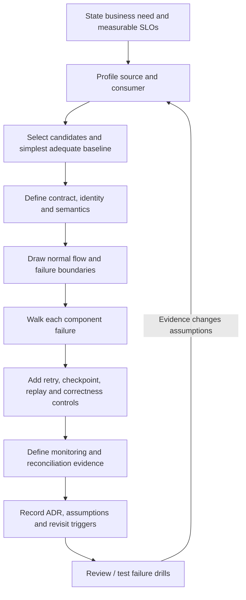
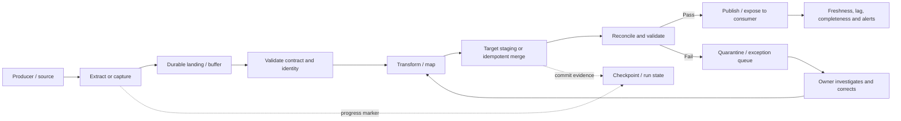

# Integration Pattern Selection and Failure Handling

**Roadmap location:** Stage 2D — Data Architecture / `06-Data-Integration-and-Interoperability/`  
**Target file:** `08-integration-pattern-selection-and-failure-handling.md`  
**Level:** Beginner → Intermediate → Advanced → Industry application  
**Scenario:** Northbridge Bank is fictional. All figures, service targets, systems, and examples below are illustrative assumptions—not benchmarks or prescribed production targets.

> **Core principle:** Select the integration pattern from business requirements, consumer needs, source capabilities, data semantics, constraints, and operational ownership—not familiarity, fashion, or vendor positioning. A complete recommendation includes a simple baseline, a reason to accept or reject it, and a recovery design.

---

## 1. Learning objectives

After completing this lesson, you should be able to:

1. Define an integration decision in measurable business and technical terms.
2. Compare full batch, incremental batch, change data capture (CDC), APIs, files, managed connectors, event streaming, virtualization/federation, and data sharing.
3. Profile source and consumer capabilities before choosing a mechanism.
4. Select the simplest adequate pattern using freshness, completeness, throughput, correctness, availability, source impact, data semantics, governance, cost, and operational complexity.
5. Define the data contract, identity, ordering, delete/correction behaviour, and replay requirements for each flow.
6. Identify failure boundaries across source, transport, processing, target, control plane, and operator/configuration.
7. Design bounded timeouts, retry budgets, exponential backoff with jitter, rate limits, checkpoints, replay, quarantine/dead-letter handling, and recovery.
8. Quantify API duration, extract time, backlog growth/catch-up, retry amplification, or serial availability when useful.
9. Combine idempotency, deduplication, reconciliation, schema contracts, and monitoring without confusing transport delivery with business correctness.
10. Produce a failure-mode and recovery matrix, monitoring specification, failure-drill plan, and Architecture Decision Record (ADR).
11. Explain the assumptions, rejected alternatives, limits, and revisit triggers behind an integration recommendation.

### Completion evidence

The final output is not a list of technologies. It is a reviewable design package in which **every flow has a measurable requirement, a selected pattern, a baseline comparison, a bounded correctness claim, and a recovery plan**.

---

## 2. Why the topic matters in real-world Data Architecture

Integration mechanisms are not interchangeable pipes. They expose different guarantees and constraints:

- A source may expose a reliable change marker, a transaction log, an API, a file drop, or no usable change interface.
- A consumer may require a current snapshot, ordered changes, immutable events, a history of changes, or exploratory access to small result sets.
- The business may tolerate hours of staleness for a report but require seconds-level fraud signals.
- A source may be unable to tolerate repeated analytical scans or high API request rates.
- A technically successful transfer may still omit records, duplicate effects, misinterpret fields, or publish an incomplete run.

A design must therefore answer both **how data move** and **how the system behaves when something fails**.

### 2.1 The integration-design loop

Use this loop for each flow. It follows the module roadmap's sequence.



1. **State the need:** why the data must move or be accessed, who consumes it, and what decisions depend on it.
2. **Make requirements measurable:** freshness, peak throughput, completeness, correctness tolerance, availability, history/replay, retention, security, and source impact.
3. **Profile source and consumer:** interfaces, limits, change visibility, deletes, ordering, volume, ownership, and failure behaviour.
4. **Select a mechanism:** compare realistic candidates against the requirements and the simplest adequate baseline.
5. **Define the contract:** schema, meaning, identifiers, timestamps, ordering scope, correction/deletion semantics, and compatibility.
6. **Draw the normal flow:** include control plane, checkpoints, staging, target publication, and downstream consumers.
7. **Break each component in turn:** source, network, extractor, connector, broker/file landing, processor, target, scheduler, schema/credentials.
8. **Add correctness controls:** idempotency, deduplication, checkpoint rules, reconciliation, and explicit exception handling.
9. **Prove operability:** monitoring, alert ownership, runbook, recovery steps, and failure-drill pass criteria.
10. **Record and review:** ADR with rejected alternatives, assumptions, residual risks, and revisit triggers.

### 2.2 What “correct” means for an integration flow

A flow's correctness claim must be scoped. For example:

> For each source transaction in the declared business-date window, the target will eventually contain one logically corresponding record with the agreed identity and field semantics; late corrections are applied within the stated recovery window, and count, key-coverage, control-total, and selected field checks are retained as evidence.

This is more useful than “the pipeline is reliable.” It still needs concrete identity rules, window definitions, tolerances, recovery objectives, and evidence. It does **not** promise that every business rule is correct unless those rules are explicitly validated.

### 2.3 Transport delivery vs end-to-end correctness

| Claim | What it may establish | What it does not automatically establish |
|---|---|---|
| API returned success | The API's documented request boundary accepted/completed the operation | That the downstream warehouse is complete or that a business side effect happened once |
| File upload succeeded | Bytes reached the receiving boundary | That all expected files/records arrived, the manifest is complete, or the data are semantically valid |
| Broker acknowledged publish | The broker's configured acknowledgement condition was met | That every consumer applied the event correctly |
| Consumer offset/checkpoint advanced | Progress was recorded at that boundary | That the target write committed unless the design couples the two |
| Target row count matches | Cardinality matches for the compared scope | That values, identity mapping, or business meaning is correct |
| “Exactly once” feature is enabled | A platform-specific guarantee within its documented boundary | Exactly-once effects across arbitrary external databases, APIs, emails, and business workflows |

A robust integration combines mechanism-specific guarantees with idempotency, deduplication, reconciliation, contract validation, and operational recovery.

---

## 3. Prerequisite knowledge

This topic integrates Topics 1–7 of `06-Data-Integration-and-Interoperability/` and the requirements/ADR method from Stage 2D.2.

| Prerequisite | How it is used here |
|---|---|
| Topic 1 — Batch ETL/ELT and incremental ingestion | Baseline, change markers, watermark, batch re-runs, extract time, staleness |
| Topic 2 — CDC and database replication | Log access, deletes, ordering, snapshot seam, lag, restart |
| Topic 3 — APIs, files, managed connectors | Pagination, rate limits, manifests, connector limitations and ownership |
| Topic 4 — Streaming events and message contracts | Event identity, partitions, consumer offsets, replay, event-time semantics |
| Topic 5 — Data contracts, schema registry, compatibility | Schema evolution, producer/consumer agreement, semantic changes |
| Topic 6 — Virtualization, federation, data sharing | Query-in-place alternatives, source load, access control, ownership |
| Topic 7 — Idempotency, deduplication, reconciliation | Repeat-safe effects, identity, replay safety, source/target evidence |
| Stage 2D.2 Topics 4–7 | Freshness/throughput/availability requirements, constraints and risks, trade-offs, ADRs |

This lesson deliberately cross-references those mechanisms rather than reproducing their entire technical treatment. It contains architecture diagrams, formulas, decision tables, and a copyable Markdown ADR/worksheet, but no executable application code; code execution testing is therefore not applicable to this lesson version.

---

## 4. Beginner-level learning sequence

### 4.1 The mechanisms available

| Mechanism | What it does | Typical fit | Benefits | Main limitations / failure concerns |
|---|---|---|---|---|
| **Full batch** | Copies a full source scope on a schedule | Small/medium datasets, periodic snapshots, simple rebuilds | Simple mental model; easy to compare complete snapshots | Cost and source load grow with data size; freshness bounded by schedule and run time |
| **Incremental batch** | Copies records changed since a marker/window | Hours-to-minutes freshness when a reliable change marker exists | Lower volume than full reload; easy to reason about in bounded runs | Marker precision, late updates, missed deletes, watermark mistakes, and backfill behaviour need explicit design |
| **CDC** | Captures source changes from a supported log/change interface | Low-latency updates when deletes/order matter and source supports capture | Can expose inserts, updates, deletes with less repeated scanning | Log retention, source permissions, snapshot-to-stream seam, schema changes, ordering scope, and connector lag |
| **API extraction** | Requests data through a service interface | API-only systems, governed business views, manageable volumes | Uses supported access rules and source logic | Rate limits, pagination, changing results between pages, request latency, partial responses, and throttling |
| **File integration** | Exchanges delimited, JSON, columnar, or other files | Partner bulk delivery, scheduled exports, regulator extracts | Decoupled; easy to retain immutable input artifacts | Missing/duplicate files, incomplete uploads, format drift, manifest and checksum requirements |
| **Managed connector** | Uses a packaged integration component | Standard source/target pair where connector capability fits | Faster adoption and less custom extraction code | Capability gaps, opaque retries/checkpoints, version dependence, limited error visibility, and unclear ownership if not assigned |
| **Event streaming** | Publishes events as they occur for one or more consumers | Multiple consumers need timely events; decoupling and replay are valuable | Independent consumers, buffering, replay within retention | Broker/consumer operations, partitions and ordering scope, schema discipline, lag, poison events, and end-to-end correctness |
| **Virtualization/federation** | Queries one or more sources at read time | Exploratory queries or small results where source capacity and availability suffice | Avoids a new copy and can expose current source state | Query load and latency remain tied to sources; cross-source consistency may not be snapshot-consistent |
| **Data sharing** | Producer grants governed access to a producer-owned data product | Multiple consumers need an agreed dataset with explicit ownership | Clear producer ownership and controlled access; may avoid unmanaged copies | Requires governance, access policy, product contract, usage monitoring, and platform support |

**Freshness labels are qualitative starting points, not guarantees.** Actual freshness depends on source change visibility, schedule, extraction duration, buffering, processing, target commit, and recovery.

### 4.2 Failure categories

| Category | Examples | First question |
|---|---|---|
| **Source** | Unavailable, slow, bad data, schema change, deleted history | Is the source healthy and is the required data still retrievable? |
| **Transport** | Network drop, timeout, throttling, partial file transfer | Did the operation complete, and is its outcome known? |
| **Processing** | Code bug, poison record, resource exhaustion, bad mapping | Can this input be retried after a correction, or must it be isolated? |
| **Target** | Unavailable, constraint violation, full storage, transaction conflict | Did the target commit, and can the write be repeated safely? |
| **Control plane** | Scheduler down, expired credentials, schema registry unavailable | Can the flow recover after the dependency is restored without skipping progress? |
| **Operator/configuration** | Wrong filter, bad secret, premature deployment, wrong replay range | What changed, what scope is affected, and how can it be safely rolled back? |

### 4.3 Response vocabulary

- **Timeout:** the caller stops waiting after a defined duration. It does not necessarily cancel work on the remote side or prove the remote operation failed.
- **Retry:** another attempt after a failure. Safe only when operation semantics and identity make repetition safe, or when the prior outcome is known not to have committed.
- **Backoff:** waits between attempts to reduce pressure during transient failure.
- **Jitter:** randomizes waits to avoid synchronized clients retrying at once.
- **Retry budget:** limits attempts or total retry time/load.
- **Checkpoint:** persisted progress used to resume; it must not outrun durable processing unless a recovery mechanism handles the gap.
- **Replay:** reprocesses retained input or an earlier range.
- **Quarantine/dead-letter handling:** isolates input that cannot be processed under the current rules; it needs restricted access, retention, ownership, and a replay path.
- **Runbook:** steps for detecting, containing, recovering, validating, and closing an incident.
- **Circuit breaker/bulkhead (conceptual):** stops repeated calls to a failing dependency or isolates resource pools so one flow does not exhaust others.

### 4.4 Transient vs permanent failures

| Failure | Default response | Why |
|---|---|---|
| Temporary network error | Bounded retry with backoff/jitter | May clear without intervention |
| API throttling | Honour documented retry hints; reduce rate | Repeating at the same rate can prolong throttling |
| Invalid schema/contract | Quarantine or stop affected flow; alert owner | Retrying identical invalid input usually repeats failure |
| Missing permission/expired credential | Alert and remediate configuration; retry only after fix | Repeated requests do not repair access |
| Target outage | Buffer within retention/capacity, alert, retry under budget, then catch up gradually | Immediate aggressive retries can worsen recovery |
| Poison record | Quarantine with record-level context; continue only if ordering/business rules permit | Infinite retry can block an entire partition or batch |
| Logic bug | Stop/contain, fix, replay a controlled range, reconcile | Repeating defective code reproduces the defect |
| Unknown timeout outcome for a non-idempotent side effect | Query status or use idempotency key/reconciliation before retry | The first attempt may have committed |

**Exercise — classify twenty failures.** For each item, identify the category, whether the default response is bounded retry, quarantine, pause/contain, or escalate, and what evidence changes that decision. The list is illustrative; actual response depends on the interface contract and operation semantics.

1. Source database refuses connections during a planned restart.
2. Source query latency increases beyond the agreed extraction window.
3. API returns a documented rate-limit response.
4. API returns an authorization failure after credential rotation.
5. Network timeout occurs after a create request may have committed.
6. File is present but its checksum does not match the manifest.
7. Expected partner file does not arrive by the deadline.
8. A file contains a duplicate manifest/run identifier.
9. Connector reports an unsupported source column type after an upgrade.
10. Stream event has an unknown schema version.
11. A single record violates a required field constraint.
12. A consumer crashes after target commit but before acknowledgement.
13. Target rejects a batch because a uniqueness constraint is violated.
14. Target storage is full.
15. Checkpoint store is unavailable while target writes are succeeding.
16. A scheduler misses a scheduled run.
17. A dead-letter queue grows continuously with the same validation error.
18. A transformation deployment changes account mapping semantics.
19. Reconciliation finds an unexpected source-target key gap.
20. An operator config change accidentally narrows the extraction date range.

**Expected output:** a 20-row classification table with failure category, action, retry safety, detection evidence, owner, and recovery evidence. A retry is not automatically correct for items 5, 12, 15, or 20; investigate commit/progress state and scope first.

---

## 5. Intermediate-level learning sequence

### 5.1 Define measurable requirements first

Write a requirement statement for each producer–consumer flow. Include the dimensions that affect pattern choice.

| Requirement | Example of a measurable statement | Design implication |
|---|---|---|
| Freshness | 99% of updates visible to consumer within 5 minutes under normal load | Constrains schedule, API pagination, CDC lag, processing time, and outage recovery |
| Throughput | Sustain 800 events/s and absorb a 2,000 events/s peak for 10 minutes | Requires peak sizing, buffering, and consumer capacity tests |
| Completeness | Every source transaction in a closed business-date window is represented or has a tracked exception | Requires source scope, key coverage, reconciliation, and exception workflow |
| Correctness | Duplicate ledger effects are not permitted; stale versions cannot overwrite newer state | Requires identity, idempotency, version guard, and transactional design |
| Availability | Consumer remains useful during a source outage or reports staleness explicitly | May favour a materialized copy over query-time federation |
| History/replay | Recover at least 72 hours of retained events or immutable input files | Requires retention, manifests, source-log horizon, and replay capacity |
| Ordering | Changes for one account must be applied in source-version order | Requires a trustworthy order key and an ordering/merge policy |
| Source impact | Extraction must remain within the source's approved query/API/log budget | Limits scan volume, request rate, and concurrency |
| Security/governance | Only approved consumers can access classified fields; all access is auditable | Shapes access model, landing/quarantine permissions, retention, and lineage |
| Cost/operations | Team can operate the flow with defined on-call and recovery skills | Include engineering effort, platform costs, failure visibility, and ownership |

Freshness should state the percentile and measurement boundary (for example source event time to target visibility), not just “near real time.” Peak throughput should include burst duration and payload size where they matter.

### 5.2 Profile the source and consumer

Use a source profile before selecting a pattern.

| Profile field | Questions to answer |
|---|---|
| Interface | Database query, transaction log, API, file export, event stream, connector, shared data product? |
| Data volume | Current rows/bytes, change fraction, average record size, growth and peak rate? |
| Change visibility | Reliable timestamp/version, CDC log, event publication, file manifest, or no marker? |
| Deletes and corrections | Visible? Tombstones? Hard deletes? Reversals? Can records be corrected after delivery? |
| Ordering and identity | Stable primary/business key? Event ID? Source version? What is the ordering scope? |
| Source constraints | Rate limit, query budget, maintenance window, log retention, export schedule, network limits? |
| History and replay | How far back can the source re-read? Is raw input retained? Who authorizes a backfill? |
| Consumer needs | Snapshot vs changes, current state vs history, one vs many consumers, ordering, join needs? |
| Data semantics | Event or entity grain, status transitions, effective time, timezone, currency, null meaning? |
| Security/governance | Classification, residency, least privilege, access audit, retention, deletion obligations? |
| Operational owner | Who owns producer, integration, consumer, schema changes, incidents, and sign-off? |

### 5.3 Requirements-to-pattern decision table

These are **candidate starting points**, not automatic choices.

| If… | Consider… | Validate before deciding |
|---|---|---|
| Hours-level freshness is enough and the source has a reliable change marker | Incremental batch | Marker precision, late updates, delete detection, re-run safety, source scan load |
| Seconds/minutes freshness is needed, deletes matter, and log capture is supported | CDC | Log retention, source permissions, snapshot seam, ordering/version semantics, lag recovery |
| Source exposes only a supported API | API extraction | Rate limit, pagination consistency, filters, retry semantics, completeness markers |
| A partner provides bulk data on a schedule | File + manifest/checksums | Atomic arrival convention, expected file list, duplicate file handling, schema/version, encryption |
| Many consumers need facts as they occur | Event streaming | Producer event identity, partition/order requirements, retention, consumer lag and ownership |
| A standard source/target pair fits a managed connector | Managed connector | Capability matrix, checkpoint/retry visibility, error routing, upgrade policy, vendor-specific assumptions |
| Exploratory queries need small results and source systems can handle them | Virtualization/federation | Query concurrency, source load, source availability, consistency, access and caching |
| A producer owns a governed dataset consumed by other domains | Data sharing | Data-product contract, consumer authorisation, audit, versioning, service expectations |
| Full current snapshot is needed and dataset is small enough | Full batch | Extract duration, source load, snapshot consistency, target publication and rollback |
| Source offers no reliable change signal and updates/deletes must be captured | Full snapshots with comparison, or change-interface remediation | Cost, compare strategy, delete semantics, and whether source capability is a blocker |

### 5.4 Always compare with the simplest adequate baseline

For each flow, state the baseline and why it is accepted or rejected.

| Baseline | When it may be adequate | When it may fail requirements |
|---|---|---|
| Scheduled full batch | Small source, daily reporting, modest source load | Dataset growth makes run time too long or freshness too poor |
| Incremental batch | Reliable marker and hours/minutes freshness | Deletes are invisible, marker is unreliable, or required latency is too low |
| API extraction | API is the only supported interface and volume fits limits | High-volume polling breaches rate/latency budget |
| File exchange | Partner bulk delivery and freshness can follow the schedule | Consumer requires rapid updates or producer cannot guarantee complete manifests |
| CDC/streaming | Continuous change visibility is required and operational ownership exists | Source/log/platform capability is absent or the team cannot operate recovery |
| Virtual/federated access | Low-volume exploratory queries, current data, source capacity available | Frequent/heavy queries or high availability requirements overload/tightly couple sources |

Do not reject a simple approach without evidence. Conversely, do not force a simple approach to meet a freshness or completeness requirement it cannot satisfy.

### 5.5 Example source and consumer profiles

The following profiles are illustrative.

| Flow | Source profile | Consumer profile | Candidate | Key decision questions |
|---|---|---|---|---|
| Ledger transactions → analytics | Database with stable transaction IDs and approved incremental extraction | Finance dashboards and regulatory reporting; historical windows; exact reconciliation | Incremental batch or CDC into a governed analytical store | Is the change marker reliable? Are reversals/deletes explicit? What is the closed-window control? |
| Card events → fraud detection | Event-capable source with event IDs and a supported stream | Fraud service needs seconds-level signals and bounded replay | Event streaming | Can the service absorb catch-up? What is partition ordering? What happens on duplicate/poison events? |
| Partner settlement → finance | Partner delivers daily bulk file | Finance needs complete file and audit evidence, not second-level freshness | File with manifest | How is completeness proven? How are duplicates, corrections, and partial upload handled? |
| CRM → customer domain | API with pagination and rate limit | Customer domain needs periodic current state and selected history | Incremental API extraction or managed connector | Is there a reliable updated-since token? Are pages snapshot-consistent? How are deletions represented? |
| Regulatory extract → regulator | Curated target dataset, approved reporting window | Regulator requires reproducible extract and audit trail | Versioned file/export from governed materialization | Can the exact source snapshot and transformation version be reproduced? |
| Cross-system exploratory customer view | Several operational sources, mixed availability | Analysts need small, occasional lookups | Federation may be considered | Are source load, permissions, cross-source consistency, and failure experience acceptable? |

### 5.6 Define the contract and correctness controls

Before implementation, document:

- producer and consumer owner;
- schema version and compatibility policy;
- field meaning, units, null semantics, timezone and business grain;
- stable entity key and event identity, including namespace/tenant scope;
- event-time, source-version and ordering rules;
- correction, reversal, delete/tombstone and late-arrival policy;
- delivery expectation and what its acknowledgement means;
- retry/replay scope, retention and deduplication horizon;
- source/target snapshot or manifest used for reconciliation;
- error/quarantine schema, sensitive-field handling and retention;
- alert thresholds, owner, escalation and closure evidence.

A schema can remain structurally compatible while changing business meaning. Pattern selection does not remove the need for semantic contract review.

### 5.7 Draw the normal flow and failure behaviour

A normal-flow diagram should identify both data path and control path.



The exact placement of the checkpoint depends on the platform. The design must state when progress is committed and how a crash between target mutation and checkpoint persistence is handled.

---

## 6. Advanced-level learning sequence

### 6.1 Failure boundaries and blast radius

A failure boundary is where a component's success/failure outcome is separated from the next component. Examples include source query → landing, broker publish → consumer, staging write → target commit, and target commit → checkpoint update.

Design for isolation:

- Separate flows or queues when one consumer's failure must not block unrelated flows.
- Use durable buffers only where retention and replay are understood.
- Apply per-source/per-consumer concurrency limits so a recovery does not overload dependencies.
- Keep poison records from blocking an entire batch or partition unless ordering semantics require blocking.
- Define whether a partially available dataset can be exposed, and show its freshness/completeness status to consumers.
- Avoid shared credentials, queues, worker pools, or retry loops that allow one failing flow to exhaust all resources.

### 6.2 Timeouts, retries, backoff, jitter, and budgets

A retry policy must account for operation semantics. Repeating a read is often safe, but repeated reads can still amplify source load. Repeating an insert, debit, external API call, or publication may duplicate effects unless a stable idempotency key and durable enforcement exist.

A reasonable policy describes:

1. **Timeout:** based on observed latency distribution and operation deadline; do not set it solely from a guess.
2. **Retryable classes:** transient network errors, temporary throttling, selected server errors—subject to interface semantics.
3. **Non-retryable classes:** invalid schema, authorization failure, deterministic validation error, or unsupported request until corrected.
4. **Attempt and time budget:** maximum attempts and maximum elapsed time, including downstream deadline.
5. **Backoff and jitter:** exponential delay with randomization; respect source-provided retry hints where documented.
6. **Rate/concurrency limit:** do not allow retry traffic to exceed the source's recovery capacity.
7. **Outcome ambiguity:** if timeout occurs after a possibly committed side effect, query status or use an idempotency key/reconciliation before retrying.
8. **Exhaustion action:** stop, quarantine, alert, or escalate; do not retry forever silently.

Illustrative backoff without jitter:

\[
w_i = \min(w_{\max}, w_0 \times 2^i)
\]

For \(w_0=1\) second and a cap \(w_{\max}=8\) seconds, waits before retries might be 1, 2, 4, 8, 8 seconds. Total wait is \(23\) seconds, excluding request durations. Jitter randomizes each delay around a chosen range; actual policy must fit the operation deadline.

#### Retry amplification calculation

If each of three layers allows 5 retries after its initial attempt, and all layers retry independently, the worst-case downstream attempt count can multiply:

\[
(1+5)^3 = 6^3 = 216
\]

This is an illustrative upper-bound model assuming every attempt triggers the next layer and all retry budgets are exercised. Real systems may behave differently, but it shows why retries should be coordinated, bounded, jittered, and usually concentrated at a clearly owned layer.

### 6.3 Checkpoints, replay, and partial success

A checkpoint records progress, not correctness. Common failure cases:

| Failure point | Risk | Required design response |
|---|---|---|
| Checkpoint advances before durable target commit | Data may be skipped after crash | Commit output first or couple progress/output atomically; repair and replay the gap |
| Target commits, acknowledgement/checkpoint update fails | Input may be repeated | Make target operation idempotent or deduplicate using durable identity |
| Some target partitions/files are written | Consumers may see partial output | Stage isolated run; validate; publish through an atomic table transaction or manifest/pointer swap where supported |
| Replay starts at wrong offset/window | Missing or duplicated scope | Record run ID, source offset/manifest, time window, transform version, and expected scope |
| Replay uses fixed but now-defective code | Defect repeats | Fix code/config, record version, replay controlled scope, reconcile afterward |
| Source retention expires before recovery | Data cannot be replayed from original source | Alert before retention risk; land durable input or agree recovery alternatives |

For a batch run, use a deterministic run ID and input manifest. Write to staging, validate schema and key uniqueness, reconcile counts/totals and selected business rules, then publish. If publication cannot be atomic, explicitly define the consumer-visible partial state and recovery process.

### 6.4 Backlog growth and catch-up capacity

When a consumer is slower than arrivals, backlog grows.

\[
\text{backlog growth rate} = \lambda - \mu
\]

where \(\lambda\) is arrival rate and \(\mu\) is processing rate, using the same units (for example events/second).

If the consumer is down, backlog accumulates at approximately the arrival rate. During recovery, if capacity exceeds the ongoing arrival rate:

\[
\text{catch-up time} =
\frac{\text{backlog}}{\text{recovery processing capacity} - \text{ongoing arrival rate}}
\]

**Illustrative assumptions**
- Consumer outage: 25 minutes.
- Arrival rate: 800 events/second, steady during outage.
- Recovery processing capacity: 1,000 events/second while new events continue arriving.
- Ignore message-size variation, retries, partition skew, downstream rate limits, and processing-time variance.

Backlog after outage:

\[
25 \times 60 \times 800 = 1{,}200{,}000 \text{ events}
\]

Net catch-up rate during recovery:

\[
1{,}000 - 800 = 200 \text{ events/second}
\]

Catch-up time:

\[
1{,}200{,}000 / 200 = 6{,}000 \text{ seconds} = 100 \text{ minutes}
\]

The consumer can process 1,000 events/second and still need 100 minutes to clear the backlog because most capacity is consumed by new arrivals. If recovery capacity is less than or equal to the arrival rate, backlog will not shrink. The Northbridge card-flow peak is separately specified as 2,000 events/second for 10 minutes: if that peak overlaps recovery while recovery capacity remains 1,000/second, backlog grows by a net 1,000 events/second during the overlap rather than shrinking. Size and test recovery against the actual arrival profile, not only the steady-state rate. Reassess freshness SLOs during recovery and throttle catch-up if downstream systems are fragile.

### 6.5 API extraction calculation

Illustrative assumptions:
- 100,000 records.
- Page size: 500 records.
- Documented sustainable request budget: 10 requests/second.
- One request per page; no retries or extra metadata calls included.

Number of pages:

\[
\lceil 100{,}000 / 500 \rceil = 200 \text{ requests}
\]

At a sustainable budget of 10 requests/second, the idealized rate-budget lower bound is:

\[
200 / 10 = 20 \text{ seconds}
\]

This lower bound assumes enough permitted concurrency to sustain 10 requests/second and excludes latency, processing, retries, throttling, and other calls. It is **not** a duration prediction. If requests are serial and each takes 300 ms, the request latency alone is roughly \(200 \times 0.3 = 60\) seconds (about 3.33 requests/second), before additional overhead. Concurrency must not exceed the source's documented limits. Measure the actual API and state the assumptions in capacity estimates.

### 6.6 Availability and dependency chains

For a purely serial request path whose dependencies must all be available, and assuming independent availability estimates, an illustrative approximation is:

\[
A_{\text{chain}} = A_1 \times A_2 \times \cdots \times A_n
\]

If source availability is 99.9%, integration service availability 99.5%, and target availability 99.9%:

\[
0.999 \times 0.995 \times 0.999 = 0.993010995
\]

This is approximately **99.30%** for the serial chain under those assumptions. It is not a prediction for a real architecture: dependencies may not be independent, and buffering, retries, caching, or degraded modes can change consumer-visible availability. A materialized target may decouple read availability from source availability while making freshness dependent on the ingestion path.

### 6.7 Monitoring specification: every alert needs an owner and action

| Signal | What it detects | Example trigger design | Owner/action |
|---|---|---|---|
| Data freshness age | Source is not reflected in target on time | Age of newest source/target event exceeds the flow SLO | Flow owner checks source, scheduler, lag, and target commit; publish stale status |
| Input absence | Expected data stopped arriving | No file/event/batch by an expected deadline | Producer + integration owner verify upstream schedule/interface |
| Throughput and backlog/lag | Consumer cannot keep up | Lag grows over a defined window or catch-up estimate exceeds recovery objective | Platform owner checks capacity, poison events, downstream limits; scale or throttle safely |
| Retry/error rate | Dependency failure or retry storm | Retry budget exhausted or errors exceed baseline threshold | On-call owner checks status codes, dependency health, and retry amplification |
| Schema/contract violations | Producer change or invalid payload | Any breaking contract violation for critical flow | Contract owner quarantines affected input, reviews compatibility and rollback |
| Duplicate/identity conflicts | Repeated or conflicting logical records | Duplicate IDs, same ID/different payload, uniqueness failures | Data owner investigates source identity and idempotency boundary |
| Reconciliation deltas | Missing/extra/mismapped data | Count, total, key coverage, or domain invariant outside tolerance | Reconciliation owner opens exception; publication gate depends on criticality |
| DLQ/quarantine age | Failed records accumulate unowned | Count/age exceeds policy; sensitive data retention near expiry | Flow owner triages, fixes, replays under change control, or disposes per policy |
| Source pressure | Integration harms operational source | Query latency, throttling, log lag, or load exceeds approved limit | Source owner throttles/pauses extraction; revisit pattern if sustained |
| Checkpoint/commit inconsistency | Progress and durable output diverge | Target commit and checkpoint state disagree | Platform owner stops progression, determines replay range, reconciles before resume |
| Cost/volume anomaly | Unexpected growth or loops | Extracted bytes, API calls, event volume, or storage deviates from expected range | Flow owner checks source change, loop, duplication, and retention |

Alerts must be actionable. “Pipeline failed” without scope, last good checkpoint, run ID, owner, and runbook is insufficient.

### 6.8 Failure-mode and recovery matrix

The matrix should cover every component in the selected architecture. The following generic matrix is a starting point; tailor it per flow.

| Component/failure | Detection | Data/consumer impact | Recovery | Prevention/control | Accountable owner (role) | Closure evidence |
|---|---|---|---|---|---|---|
| Source unavailable | Source health, failed calls, missing expected input | Freshness breach; possible source-history expiry | Bounded retry; alert; resume/catch up when source returns | Source SLO, approved query budget, retention planning | Source owner + integration on-call | Source range/manifest recovered; reconciliation passes |
| Source slow or throttled | Latency percentiles, 429/throttle responses, source load | Lag, retry amplification, source impact | Reduce concurrency/rate; jittered backoff; resume gradually | Rate limits, timeouts, retry budget | Source owner + integration on-call | Request/error/lag metrics recover without overload |
| Source schema changes | Contract test/registry validation | Rejects, mis-mapping, or silent semantic drift | Quarantine/stop affected scope; assess change; deploy compatible mapping or rollback | Contract ownership and change policy | Producer/schema owner + consumer owner | Versioned schema, test evidence, reconciled replay |
| Network timeout with unknown outcome | Timeout plus missing/ambiguous acknowledgement | Possible duplicate side effect | Query operation status or retry with durable idempotency key | Explicit timeout semantics and idempotency boundary | Integration on-call + target owner | One business effect per identity; audit/status evidence |
| Extractor crashes mid-page/batch | Run state, page/manifest gap, incomplete output | Missing or repeated records | Resume from safe checkpoint or replay whole idempotent scope | Durable progress and run IDs | Integration owner | Source-to-target counts/key coverage and run manifest |
| Connector checkpoint/upgrade issue | Lag jumps, offsets reset, connector errors | Duplicate or missing range | Pause; capture current offsets/config; restore supported state; replay/reconcile | Upgrade/change process, connector capability review | Connector/platform owner + integration owner | Before/after offset record, duplicate/missing checks |
| Broker/stream unavailable | Publish failures, consumer lag | Buffer growth or delayed events | Bounded producer retry; durable buffer if supported; catch up gradually | Capacity/retention plan, isolation | Streaming platform owner + producer owner | Offsets/identity range and reconciliation evidence |
| Poison event | Repeated parse/validation failure | Partition/batch stalls or partial processing | Quarantine/DLQ with restricted access; fix and replay | Contract validation and payload-size/schema limits | Consumer owner + data-quality owner | DLQ disposition, replay result, no missing scope |
| Consumer/downstream outage | Lag and service health | Backlog; freshness breach | Pause/limit intake if needed; buffer; rate-limited catch-up | Bulkheads, capacity margin, runbook | Consumer/service owner + integration on-call | Lag returns to target; downstream reconciliation passes |
| Target write/constraint failure | Transaction errors, rejected rows | Partial output or failed batch | Roll back transaction; stage/replay affected scope | Schema/constraint tests, staging, idempotent merge | Target/data-store owner + integration owner | Committed run manifest and reconciliation |
| Target commit succeeds but checkpoint/ack fails | Commit logs vs checkpoint | Re-delivery/reprocessing | Retry safely using durable event identity/upsert | Atomicity where supported; idempotency | Target owner + integration owner | One target effect per identity; checkpoint advances |
| Partial publication | Incomplete manifest or mixed target partitions | Consumers may see incomplete dataset | Keep staging isolated; complete and atomically publish or roll back | Atomic table commit/pointer/manifest swap | Data product/consumer owner + platform owner | Published version references complete validated run |
| Credential/permission failure | Auth errors and audit logs | Flow stops or accesses denied | Rotate/fix least-privilege credential; resume from safe checkpoint | Secret rotation, access reviews, expiry alerts | Security/IAM owner + integration owner | Access audit, successful scoped recovery |
| Scheduler/control-plane failure | Missed run/heartbeat | Freshness breach | Restore scheduler; run missed window with unique run ID | Redundant control plane where justified, runbook | Platform/scheduler owner + integration owner | Expected windows covered and reconciled |
| Operator/configuration error | Change audit, anomalous counts/filters | Wrong scope, data loss, or oversharing | Roll back config, isolate affected run, controlled backfill | Peer review, config validation, approvals | Flow owner + change approver | Change record, corrected scope, before/after reconciliation |
| Reconciliation logic shares load bug | Aggregate pass conflicts with consumer/report evidence | Silent semantic defect | Independent key/field/domain checks and targeted replay | Separate verification logic/source-side controls | Data-quality/reconciliation owner + domain owner | Documented independent check and corrected results |
| Sensitive data enters DLQ/landing unexpectedly | Data classification scan/access audit | Privacy, retention, or access exposure | Restrict access, follow incident procedure, purge only under approved policy | Minimise payload, encrypt, access control, retention policy | Security/privacy owner + data platform owner | Access logs, incident record, retention/deletion evidence |

### 6.9 Security, governance, and operational ownership

Integration creates additional copies, transient buffers, logs, quarantine records, and dead-letter stores. Apply the same data governance discipline to them as to the target:

- classify fields and minimise what is copied;
- use least-privilege identities per flow and separate production credentials;
- encrypt in transit and protect stored landing/quarantine content;
- restrict who can inspect raw rejected records, which may contain sensitive fields;
- define retention and deletion for source copies, logs, DLQs, and replay artifacts;
- capture lineage, schema version, run ID, transformation version, and source scope;
- define a producer owner, integration owner, consumer owner, and reconciliation/exception owner;
- set on-call, escalation, and sign-off requirements based on impact;
- review vendor/connector dependencies, supported recovery behaviour, and upgrade risks.

Do not assume a managed connector owns business correctness, or that a broker or file manifest automatically enforces the consumer's semantic contract.

### 6.10 When to switch patterns

Revisit the architecture when evidence shows the selected pattern no longer fits.

| Signal | Possible reconsideration |
|---|---|
| Incremental batch repeatedly misses deletes or cannot meet freshness | Add reliable delete/change capture, CDC, or redesign source change interface |
| API polling consistently breaches rate limits or cannot catch up | Negotiate bulk export/change feed or change the extraction strategy |
| Streaming backlog cannot recover within the freshness objective | Increase safe capacity, reduce work, adjust SLO, partition by valid key, or change downstream architecture |
| Federated queries overload operational systems | Materialize governed analytical data and decouple consumer availability |
| Connector hides failures or cannot resume within retention | Add observability/control around it, replace it, or use a more controllable mechanism |
| Consumers need incompatible semantics or different SLOs | Separate flows/contracts or publish a governed product suited to each use |
| Reconciliation repeatedly finds the same defect | Fix source contract/transformation/identity rather than adding only another alert |

A pattern change is a decision, not a reflex. Re-profile the source, state new requirements, compare alternatives, and update the ADR.

---

## 7. Industry-application exercises

### 7.1 Northbridge Bank scenario and assumptions

Northbridge has four illustrative flows:

1. **Ledger → analytics:** transaction data used for finance and regulatory reporting.
2. **Card events → fraud:** time-sensitive events used for fraud decisions.
3. **Partner settlement → finance:** scheduled bulk files.
4. **CRM → customer domain:** API-sourced customer updates.

These are teaching assumptions, not real bank requirements. The design must state which requirements are given and which would need stakeholder validation. The regulator-extract row is included as a fifth flow for the pattern-selection exercise; its exact format, deadline, retention, and delivery acknowledgement remain to be confirmed with the regulator.

### 7.2 Requirements table

| Flow | Illustrative requirement | Source constraints assumed | Candidate pattern | Baseline to compare |
|---|---|---|---|---|
| Ledger → analytics | 99% of changes visible within 5 minutes in normal operation; daily closed-window reconciliation; no duplicate transaction effect | Stable transaction identity; approved incremental marker; CDC capability must be confirmed | CDC if log access, deletes, ordering and support are confirmed; otherwise incremental batch with a documented freshness limitation | Scheduled incremental batch |
| Card events → fraud | Event visibility within 2 seconds at p99 during normal operation; support 800 events/s steady and 2,000 events/s for 10 minutes; replay at least 72 hours | Source can publish stable event IDs; fraud consumer must tolerate bounded replay and duplicate delivery | Event streaming | Frequent polling/incremental batch, likely inadequate for the stated latency if measurements confirm |
| Partner settlement → finance | Complete daily file by agreed deadline; exact record-level audit and corrections | Partner provides file and manifest or can agree to them | File + manifest/checksum + controlled staging | API polling only if partner interface supports bulk and is operationally better |
| CRM → customer domain | Updates visible within 30 minutes; obey API request budget; deletes/corrections captured | API-only; reliable update token and deletion endpoint are not yet verified | Incremental API extraction if change token and delete behaviour are reliable; otherwise periodic snapshot comparison or source-contract remediation | Full API extract |
| Curated regulatory extract → regulator | Reproducible, complete extract for a declared reporting window with retained evidence | Reporting data are curated; exact regulator format/deadline must be confirmed | Versioned file/export from a governed materialization, with manifest and reconciliation | Direct live query or streaming, unless the regulator's contract explicitly requires it |

**Important:** The ledger recommendation is conditional on actual CDC support. If log access, retention, source impact, or operational ownership is not confirmed, do not claim CDC is available; use the baseline or make source capability a decision blocker.

### 7.3 Pattern recommendation and rejected alternatives

#### Flow A — Ledger to analytics

**Candidate design:** capture changes through CDC if source capabilities and ownership are confirmed; land durable changes; validate contract and identity; apply version-aware, idempotent merge into analytical staging/target; reconcile by business date, currency, transaction type, key coverage, and selected fields; publish only after required controls pass.

**Decision gate:** if CDC is unavailable or unsupported, incremental batch is an acceptable fallback only if a measured end-to-end run (including schedule delay, extraction, processing, publication, and normal variance) still meets the 99%-within-5-minutes requirement and preserves delete/correction semantics. If it cannot, record a requirements conflict and seek source-interface remediation or stakeholder approval to change the SLO; do not silently call a slower pattern equivalent.

- **Why not full batch by default?** It may be simpler, but repeated scans can increase source load and may not meet a 5-minute target at scale. Measure extract time before rejecting it.
- **Why not federation as the default?** Finance and regulatory workloads need predictable performance and reproducible windows; query-time source dependency can harm operational systems and make source/target snapshots hard to align.
- **Why not streaming solely because it is modern?** If CDC already provides the needed change visibility and consumer latency, an additional event architecture may add cost without satisfying an unmet requirement.
- **Open assumptions:** CDC access/retention, transaction identity, reversal semantics, log lag, target merge semantics, reconciliation source.

#### Flow B — Card events to fraud

**Candidate design:** publish events with stable event IDs and a versioned message contract; partition according to the ordering key needed by fraud; buffer within a documented retention horizon; consumer validates and applies idempotently; monitor lag, age, error rate, and backlog; quarantine poison events with a replay workflow.

- **Why not daily or hourly batch?** It cannot meet the stated 2-second p99 freshness requirement.
- **Why not direct API calls from producer to fraud?** It tightly couples producer availability to the fraud service and makes fan-out/replay harder unless the business explicitly prefers synchronous coupling.
- **Risks:** consumer outage, event backlog, partition skew, poison records, schema incompatibility, duplicate side effects.
- **Open assumptions:** source event publication, ordering requirements, consumer throughput, payload classification, replay retention and business response to stale signals.

#### Flow C — Partner settlement to finance

**Candidate design:** partner sends an immutable file plus manifest containing expected file identity, record count, control totals, schema/version, business date, and checksum; landing validates completeness and checksum; data load to staging; reconcile and publish only when checks pass; quarantine incomplete/invalid deliveries.

- **Why not streaming?** Partner sends bulk on a schedule and the requirement is deadline-bound completeness, not event-level freshness.
- **Why not a file without a manifest?** The receiver cannot reliably distinguish a complete delivery from a truncated or partial one.
- **Risks:** duplicate resend, file arrives late, manifest/file mismatch, schema drift, sensitive content in quarantine.
- **Open assumptions:** manifest format, currency/amount rules, correction policy, encryption, retention and partner escalation.

#### Flow D — CRM API to customer domain

**Candidate design:** incremental API extraction only if the API exposes a reliable change token and a way to discover deletes/corrections. Persist pagination/checkpoint state, obey request budget, use overlap/lookback if the API's update semantics require it, upsert by stable customer identity with version/updated-time safeguards, and reconcile key coverage.

- **Why not CDC?** The source is assumed API-only and does not expose a transaction log.
- **Why not blind full extraction every few minutes?** It may breach rate limits and cannot be justified without volume, duration, and source-impact evidence.
- **Fallback:** if no reliable change marker or delete endpoint exists, use periodic snapshot comparison or require a better source contract; explicitly state completeness limitations.
- **Open assumptions:** API pagination consistency, rate limits, updated-since token semantics, deleted-customer handling, stable identity, and backfill limits.

### 7.3.1 Integrated architecture decision and decision gates

The following is the recommended **logical architecture for the illustrative requirements**, not a claim that source capabilities have been verified or that a production implementation exists. The pattern is selected per flow; a single mechanism is not forced across all sources.

| Flow | Recommended path | Decision gate / unresolved blocker | Explicitly rejected as default |
|---|---|---|---|
| Ledger → analytics | CDC → durable landing → contract/identity validation → version-aware idempotent merge → reconciliation → controlled publication | Confirm log access, retention, delete/reversal semantics, source impact, and whether the full path meets 99% freshness within 5 minutes. If CDC is unavailable, use incremental batch only if measured end-to-end performance and completeness meet that same SLO; otherwise remediate the source interface or formally renegotiate the SLO. | Full reload by default; federation for high-volume, reproducible finance windows; extra streaming layer without a demonstrated need |
| Card events → fraud | Event streaming → bounded durable retention → schema/identity validation → idempotent consumer → rate-limited recovery → reconciliation | Prove stable event IDs, partition/order key, 2-second p99 normal freshness, steady/peak throughput, at least 72-hour replay retention, and catch-up without overloading fraud services. | Scheduled batch or direct synchronous producer-to-fraud calls as the default |
| Partner settlement → finance | Immutable file + manifest → atomic landing/quarantine → schema/checksum/count/control-total checks → staging → reconciliation → publication | Agree manifest semantics, resend/correction identity, delivery deadline, encryption, and closure rules with partner. | Streaming for a scheduled bulk interface; publishing based on file existence alone |
| CRM → customer domain | Incremental API extraction → durable page/checkpoint state → version-aware upsert → delete/correction handling → key-coverage reconciliation | Confirm pagination consistency, request budget, update-token semantics, stable customer identity, and delete discovery. Snapshot comparison is a fallback only if a consistent snapshot is available and its cost and delete detection meet the 30-minute requirement; otherwise the source contract is insufficient. | Blind frequent full extraction; CDC without a supported log interface |
| Curated regulatory extract → regulator | Versioned, reproducible export from governed materialization → manifest and reconciliation evidence → approved delivery | Confirm regulator's format, deadline, acknowledgement, correction, retention, and residency rules before acceptance. | Live federation or streaming unless the external contract explicitly requires it |

**Decision status:** pattern recommendations are conditional until the listed capability gates are evidenced. A gate that fails is a decision blocker, not permission to silently weaken the stated SLO. Record evidence and approvals in the ADR before implementation sign-off.

#### Worked ADR summary (illustrative)

- **Status:** Proposed; not approved for production until capability gates and failure drills pass.
- **Decision:** Use different mechanisms per flow: conditional CDC/materialized analytics for ledger, event streaming for card-to-fraud, manifest-governed file exchange for settlement, incremental API extraction for CRM only if change/delete semantics are adequate, and a versioned export from governed materialization for the regulator.
- **Rejected alternative:** One universal streaming platform for every flow. It does not fit the partner's scheduled bulk interface by default, does not remove API quotas, and does not itself provide a reproducible regulatory extract.
- **Other rejected defaults:** Full source scans for frequent CRM updates; direct query federation for reproducible finance/regulatory windows; blind CDC recommendation without verified log access and retention. Each may become appropriate if the source contract or consumer requirement changes.
- **Key assumptions:** Northbridge's numerical targets are illustrative; source capabilities, source-impact budgets, data contracts, residency rules, retention, and regulator delivery requirements require owner confirmation.
- **Acceptance evidence:** Measured end-to-end freshness and peak throughput; verified delete/correction handling; duplicate-safe replay; source-to-target key/control reconciliation; recovery drills for source, target, and control-plane outages; signed-off monitoring/runbooks. Planned tests remain planned until executed and recorded.
- **Revisit triggers:** Any unmet freshness/correctness SLO, unavailable source capability, retention horizon shorter than recovery need, repeated reconciliation breaks, material volume growth, source-cost/pressure breach, or change in regulatory/consumer requirements.

### 7.4 Failure walk-throughs

For each flow, walk at least these conditions:
1. source unavailable;
2. network timeout after an ambiguous outcome;
3. target unavailable;
4. schema/contract change;
5. partial success;
6. duplicate/replayed input;
7. backlog exceeds recovery objective;
8. credentials or control plane unavailable;
9. invalid/poison record;
10. reconciliation break.

For every condition, write: detection signal, impact, immediate containment, safe recovery, accountable owner/escalation, and evidence required to close the incident.

### 7.5 Required industry deliverables

Produce:

- pattern selection table with requirement evidence;
- source/consumer profile for each flow;
- normal-flow diagrams and failure boundaries;
- contract/identity summary per flow;
- failure-mode and recovery matrix covering every component;
- monitoring and alerting specification, including alert owner and action;
- backlog/freshness/retry/capacity calculations with units and assumptions;
- failure-drill plan with pass criteria;
- ADR documenting options, chosen pattern, rejected alternatives, assumptions, risks, and revisit triggers;
- answers to the Topic 8 practice questions in Section 12.

---

## 8. Practical scenarios and case-based reasoning

### Scenario 1 — Fraud stream backs up after downstream outage

The fraud consumer is unavailable for 25 minutes. Events arrive at 800/s. After recovery, the consumer can process 1,000/s while new events continue.

- Calculate the backlog and catch-up time.
- Explain why restarting at full speed can overload downstream dependencies.
- Specify a recovery rate limit, lag/freshness alerts, and the pass evidence.

**Expected reasoning:** Under the stated assumptions, backlog is 1.2 million events and net catch-up rate is 200/s, so catch-up takes 100 minutes. Recover gradually, protect downstream services, and monitor lag until it returns to the target. Reconcile event identity/range and business effects, not only broker offsets.

### Scenario 2 — A vendor claims “exactly-once delivery”

Ask:
- What is the exact documented boundary—broker, connector, consumer state store, or target database?
- How are event identity, transaction commit, external side effects, retries, and retention handled?
- What happens if target commit succeeds but acknowledgement/checkpoint update fails?
- What does reconciliation still need to prove?

**Expected reasoning:** Verify the guarantee and assumptions. Still build stable identity, idempotent target effects, contract validation, monitoring, and reconciliation as appropriate. Do not translate a narrow platform guarantee into a whole-business guarantee.

### Scenario 3 — Sub-second freshness for a daily regulatory report

Do not accept “streaming” as the automatic answer. Clarify:
- Is sub-second freshness a genuine regulatory/business requirement or an aspirational request?
- Is the report consumed during the day or only after a daily close?
- What is the authoritative event time, correction policy, and consistency requirement?
- What is the cost and complexity of streaming versus a simpler scheduled or incremental design?

**Expected response:** Challenge the requirement with stakeholders and document the decision. If the report is only required after daily close, sub-second freshness may add complexity without business value. If intraday risk decisions genuinely require it, design to that requirement and verify source capability, correctness, and operational ownership.

### Scenario 4 — API timeout after a create request

The client times out while creating a downstream record. The remote service may have committed.

**Expected response:** Do not blindly retry a non-idempotent create. Use a documented idempotency key or query by stable business identity to determine outcome. Record the request ID, timeout, retry decision, and final reconciliation evidence.

### Scenario 5 — A partner file is present but incomplete

A file appears at the expected path, but the transfer was interrupted before all bytes arrived.

**Expected response:** Treat file existence as insufficient. Validate atomic arrival convention, size/checksum and manifest record count/control totals. Keep the file in quarantine until complete; request resend or use an approved recovery path. Do not publish partial content.

### Scenario 6 — Schema change coincides with replay

A producer adds a field and changes the meaning of an existing status while a prior week is being replayed.

**Detection:** contract/compatibility checks fail, or domain-level status distributions change unexpectedly. **Impact:** a structurally accepted payload may be interpreted with the wrong business meaning. **Recovery:** stop or quarantine the affected scope; obtain producer/domain-owner clarification; pin a compatible contract and transformation version; replay a bounded range. **Closure evidence:** approved semantic mapping, test results, source-range/run-version record, and reconciliation for the affected window. **Owner:** producer contract owner and consumer/domain owner.

### Scenario 7 — Duplicate event is delivered twice

The card stream redelivers the same event after a consumer restart. Both messages have the same stable event ID.

**Detection:** duplicate-ID metric or deduplication audit detects the repeated identity; business-effect counts are checked independently. **Impact:** without safe handling, a fraud counter or downstream side effect may be applied twice. **Recovery:** apply an idempotent target mutation or durable deduplication record keyed by the documented identity; ensure target commit and deduplication/checkpoint semantics cannot leave an unhandled gap. **Closure evidence:** one logical business effect per event ID, replayed offset/range recorded, and reconciliation passes. **Owner:** consumer owner and data-correctness owner.

### Scenario 8 — An older update arrives after a newer update

Two updates for the same account arrive out of order; version 12 is applied before version 11.

**Detection:** source-version/sequence regression or conflict metric; targeted key-level audit. **Impact:** an unguarded last-write-wins merge could overwrite newer state with stale values. **Recovery:** use source-authoritative version/sequence guards or a defined event-time correction policy; quarantine updates whose ordering cannot be established. **Closure evidence:** target version never regresses, affected keys are reconciled, and late-event disposition is recorded. **Owner:** domain-data owner and consumer owner.

### Scenario 9 — Source outage spans an incremental extraction window

The CRM API is unavailable past a scheduled run, then returns after the nominal watermark has moved.

**Detection:** missed-run heartbeat, freshness breach, missing expected window, or a gap between stored watermark and source change token. **Impact:** updates or deletes may be missed if the checkpoint advances based only on schedule time. **Recovery:** do not advance the successful watermark for an incomplete run; resume from the durable source token or use an approved overlap/lookback and deduplication strategy; reconcile key coverage and deletes. **Closure evidence:** recovered source range/token, run manifest, key/delete reconciliation, and restored freshness or documented SLO exception. **Owner:** integration owner and CRM source owner.

### Scenario 10 — Target commit succeeds but checkpoint update fails during replay

The target commits a batch, but the process crashes before the checkpoint/acknowledgement is persisted.

**Detection:** target commit/run audit is ahead of checkpoint state; restart redelivers the range. **Impact:** repeated processing can duplicate effects or create conflicting merges. **Recovery:** resume from the durable checkpoint and replay using idempotent target writes or durable deduplication; never assume the checkpoint proves the target did not commit. **Closure evidence:** target commit ID, checkpoint range, exactly one logical effect per identity, and independent reconciliation for the replayed range. **Owner:** integration owner and target owner.

---

## 9. Expected outputs and deliverables

The Topic 8 design package should contain the following reviewable artifacts.

### 9.1 Pattern selection table

For every flow, include:
- business purpose and consumer;
- measurable freshness, throughput, completeness, correctness, availability, and replay requirements;
- source and consumer capabilities/constraints;
- selected mechanism and why it fits;
- simplest adequate baseline and evidence for accepting/rejecting it;
- alternatives considered and reasons rejected;
- operational cost, owner, and unresolved assumptions.

### 9.2 Failure-mode and recovery matrix

Every relevant component needs a failure scenario with:
- failure signal and alert;
- expected data/consumer impact;
- containment;
- safe retry/replay/recovery procedure;
- owner and escalation;
- correctness evidence and closure criteria.

### 9.3 Monitoring and alerting specification

For each signal, record:
- metric or event;
- definition and scope;
- threshold/window and rationale;
- severity;
- owner/on-call route;
- first diagnostic steps;
- remediation/runbook;
- evidence that recovery succeeded.

Include failures, absence, lag/backlog, freshness/staleness, volume anomalies, duplicates, contract violations, source pressure, and reconciliation breaks.

### 9.4 Architecture Decision Record (ADR)

Use the template below. Fill every section; do not leave the decision as “use streaming” without requirements and evidence.

```markdown
# ADR: <Flow / integration decision>

- Status: Proposed | Accepted | Superseded
- Date:
- Decision owner:
- Reviewers:
- Related flows/contracts:

## 1. Context and business need
What business capability requires this integration? Who consumes it?

## 2. Measurable requirements
Freshness and percentile/window; peak and sustained throughput; completeness;
correctness/tolerance; availability; replay/retention; security/governance;
source-impact limits; cost/operational constraints.

## 3. Source and consumer profile
Interfaces, change visibility, deletes, ordering, volume, limits, history,
consumer access pattern, and ownership. Mark unknowns explicitly.

## 4. Options considered
For each option: benefits, limitations, cost/complexity, source impact,
failure behaviour, and evidence.

## 5. Baseline and selection criteria
What is the simplest adequate baseline? Why is it adequate or inadequate?
Which criteria are mandatory versus negotiable?

## 6. Decision
Selected mechanism and rationale tied to requirements.

## 7. Contract and correctness claim
Schema/semantic version, identity, ordering, correction/delete policy,
idempotency boundary, delivery scope, reconciliation controls, and limits.

## 8. Normal flow and failure boundaries
Source → interface → durable buffer/landing → validation/processing → target
→ reconciliation/publication; show checkpoint and commit boundaries.

## 9. Failure handling and recovery
Timeout/retry budget/backoff/jitter; rate limits; checkpoint/replay; DLQ or
quarantine; partial publication; outage catch-up; rollback and recovery tests.

## 10. Monitoring and operations
Signals, thresholds, owners, alerts, runbooks, escalation, SLO/error budget,
and evidence retained.

## 11. Security and governance
Classification, least privilege, encryption, retention, sensitive landing/DLQ
content, lineage, data residency, and owner.

## 12. Rejected alternatives
Why each realistic alternative was rejected, and under which changed
conditions it might become appropriate.

## 13. Assumptions, risks, and unknowns
Owner and due date for each material unknown.

## 14. Revisit triggers
SLO breach, source capability change, sustained volume growth, repeated
reconciliation breaks, cost threshold, new consumer, or operational ownership
change.

## 15. Validation and acceptance evidence
Contract tests, failure drills, recovery results, reconciliation evidence,
review/sign-off. Mark unperformed tests as planned, not passed.
```

### 9.5 Failure-drill plan

For each drill, define the injected failure, safe test environment, expected signal, expected recovery, data correctness check, rollback, and pass/fail criteria. Example drills: source outage, target outage, invalid schema, duplicate event, ambiguous timeout, consumer lag, checkpoint restart, and incomplete file. Do not perform destructive drills against production without approved change controls.

### 9.6 Verification boundary — not verifiable from this lesson alone

The following are implementation-specific and must remain **Not Verifiable** until the selected source, connector, broker, database, and deployment configuration are documented and tested:

- actual CDC/log access, retention, delete visibility, snapshot boundary and ordering;
- API quotas, pagination/snapshot consistency, timeout semantics and idempotency-key enforcement;
- file-transfer atomicity, manifest semantics, checksum algorithm and partner resend behaviour;
- managed-connector checkpoint persistence, retry visibility, upgrade/resync behaviour and error routing;
- broker acknowledgement, partition ordering, retention, replay and consumer progress guarantees;
- target transaction/commit boundaries, atomic publication and concurrent merge behaviour;
- measured freshness, throughput, source impact, recovery time and consumer-visible availability;
- regulator-specific format, acknowledgement, retention, residency and correction requirements.

Record evidence, test results, owner and date for each applicable item in the ADR. A planned drill or illustrative calculation is not a passed production test.

---

## 10. Common mistakes and misconceptions

1. **Choosing by fashion or vendor claim.** Start with measurable requirements and source capability.
2. **Designing only the happy path.** Recovery is part of the architecture, not an operational afterthought.
3. **Treating a mechanism as a guarantee.** CDC, streaming, APIs, connectors, and files all have failure boundaries.
4. **Assuming retry is safe.** A timed-out operation may have committed; repeated side effects need idempotency or outcome resolution.
5. **Retrying at every layer without a budget.** Independent retries can multiply attempts and create a retry storm.
6. **Retrying permanent errors forever.** Invalid schema, authorization, and deterministic validation failures need correction or quarantine.
7. **Advancing checkpoints before durable output.** A crash can skip records.
8. **Publishing partial runs.** Stage and validate before exposing a run, using the storage system's supported atomic publication mechanism.
9. **Assuming delivery guarantees equal business correctness.** Consumer processing, target commits, and external effects require their own controls.
10. **Monitoring only errors.** Missing expected data, stale data, growing lag, and silent zero-volume periods are failures too.
11. **Ignoring catch-up capacity.** A consumer can be healthy and still never reduce backlog if processing capacity does not exceed arrivals.
12. **Using federation for heavy recurring workloads without source-load analysis.** Query-in-place can couple analytical load to operational sources.
13. **Ignoring deletes and corrections.** A reliable update marker does not automatically expose hard deletes or business reversals.
14. **Assuming schema compatibility guarantees semantic compatibility.** A field can retain its type while its meaning changes.
15. **Treating a dead-letter queue as resolution.** Quarantined records need privacy controls, owner, retention, root-cause correction, and replay/closure evidence.
16. **Failing to assign operational ownership.** An alert without an owner and runbook is not a control.
17. **Skipping rejected alternatives in the ADR.** The decision cannot be reviewed or revisited if alternatives and constraints are absent.
18. **Claiming untested recovery.** A design review is not a failure drill; label planned, executed, and passed evidence separately.
19. **Ignoring sensitive data in transit artifacts.** Landing zones, retry logs, and DLQs may contain the same sensitive data as the target.
20. **Never revisiting the pattern.** Source capability, volume, consumer needs, and operating costs change; define explicit triggers.

---

## 11. Mastery criteria

You have mastered this topic when you can demonstrate that you can:

- [ ] Explain the purpose, strengths, and limitations of each mechanism in Section 4.
- [ ] Translate stakeholder requests into measurable requirements with scope, units, and time windows.
- [ ] Profile source and consumer capabilities, including change visibility, deletes, limits, ordering, history, and ownership.
- [ ] Select the simplest adequate pattern and defend it against realistic alternatives.
- [ ] Define contract, identity, ordering, correction/delete semantics, and replay policy.
- [ ] Draw the normal flow and identify data-plane, control-plane, commit, and publication boundaries.
- [ ] Distinguish transient from permanent failures and ambiguous outcomes.
- [ ] Specify bounded timeout/retry/backoff/jitter/rate-limit behaviour without unsafe duplicate effects.
- [ ] Explain checkpoint/replay rules and recovery after partial success.
- [ ] Calculate retry amplification and backlog catch-up using consistent units and explicit assumptions.
- [ ] Provide detection, recovery, owner, and correctness evidence for every material failure mode.
- [ ] Define actionable monitoring for failure, absence, lag, staleness, completeness, duplicates, and reconciliation.
- [ ] Produce an ADR with requirements, baseline, rejected alternatives, assumptions, risks, and revisit triggers.
- [ ] Separate planned validation from tests actually executed and passed.

---

## 12. Completion gate

Do not mark Topic 8 complete until all criteria below are satisfied:

- [ ] Every flow has a measurable requirement, a selected pattern, a baseline comparison, and a bounded correctness claim.
- [ ] The source/consumer profile records capabilities, limits, data semantics, security, and material unknowns.
- [ ] The selection table compares realistic alternatives and ties the decision to requirements.
- [ ] The contract and identity assumptions are explicit, including deletes/corrections, ordering, replay, and compatibility.
- [ ] The failure matrix covers every relevant component with detection, data impact, recovery, prevention/mitigation, owner, and evidence.
- [ ] The monitoring specification covers failures, absence, lag/backlog, freshness, completeness, duplicates, and reconciliation; every alert has an owner and action.
- [ ] Retry budgets, timeouts, backoff/jitter, checkpoints, replay, and partial-publication behaviour are defined.
- [ ] Calculations include units and assumptions; any unverified estimate is labelled illustrative.
- [ ] The ADR includes rejected alternatives, assumptions, residual risks, and revisit triggers.
- [ ] A failure-drill plan states pass criteria; unperformed tests are not represented as passed.
- [ ] Topic 8 practice questions are answered and corrected.

### Practice questions

1. What is the difference between a source interface, an integration mechanism, and a data contract?
2. Why is the simplest adequate baseline required in a pattern-selection decision?
3. Which conditions make incremental batch a reasonable candidate, and what can make it unsafe?
4. What source capabilities must be confirmed before recommending CDC?
5. When does a file manifest provide stronger completeness evidence than file existence alone?
6. What should be evaluated before adopting a managed connector?
7. Why is a broker acknowledgement not proof of end-to-end business correctness?
8. Which failure classes should be retried, quarantined, or escalated, and why?
9. How can retries at multiple layers amplify load? Calculate the maximum attempts for three layers with five retries each after the initial attempt.
10. Under what assumptions can the catch-up formula be used, and what happens if recovery capacity is not greater than arrivals?
11. Why can a target commit followed by a checkpoint failure produce duplicate processing?
12. How should a flow respond to a schema change that is structurally compatible but semantically breaking?
13. What monitoring signals reveal silent absence or staleness, rather than explicit errors?
14. What belongs in a failure-mode and recovery matrix?
15. What information makes an ADR reviewable and revisitable?
16. A business asks for sub-second freshness for a daily regulatory report. What questions must be answered before selecting streaming?
17. What does a defensible correctness claim say about scope, identity, recovery, and evidence?
18. What evidence is needed to close an incident after replay or catch-up?

### Answer-check guide

1. Interface is how data are accessed; mechanism is how it moves or is exposed; contract defines structure, meaning, identity, and behaviour.
2. It prevents unnecessary complexity and provides a defensible comparison point.
3. A reliable change marker and acceptable freshness/volume; deletes, late changes, marker precision, and rerun safety must be handled.
4. Log access/permissions, retention, delete visibility, ordering, snapshot seam, source impact, and operational ownership.
5. It declares expected files/records/control totals and can detect truncation or missing parts when validated.
6. Required source/target features, checkpoint and retry visibility, error handling, upgrade policy, support, cost, and owner.
7. It usually covers only a transport boundary; consumer application, target commit, and external side effects remain separate.
8. Retry transient errors under a bounded policy; quarantine poison/invalid data; escalate permanent configuration or authorization problems.
9. \((1+5)^3 = 216\) attempts under the stated multiplicative worst-case assumptions.
10. Backlog and rates must use the same units, arrival rate must be sufficiently stable, and recovery capacity must exceed arrivals; otherwise backlog does not shrink.
11. Input can be redelivered because the checkpoint did not persist after target commit; idempotent target writes or durable deduplication are required.
12. Stop/quarantine the affected flow, classify the semantic change, update contract/mapping with owner approval, and replay/reconcile a controlled scope.
13. Freshness age, expected-input absence, lag, volume anomalies, and reconciliation status.
14. Component/failure, signal, impact, containment, recovery, prevention, owner, and correctness evidence.
15. Context, measurable requirements, options, baseline, decision, rejected alternatives, contract/correctness claim, failure design, assumptions, risks, evidence, and revisit triggers.
16. Whether the freshness is truly required, when the report is consumed, consistency/correction needs, source capability, costs, and operating ownership.
17. It defines the population/window, identity and semantics, delivery/effect boundary, exception/recovery policy, controls, evidence, and limitations.
18. Reconciled input range, no unexplained key/total/domain deltas, lag/freshness restored or explicitly accepted, exceptions resolved/owned, and audit evidence linked to the incident.

---

## Appendix A — Compact design worksheet

Copy this worksheet for each integration flow.

```markdown
## Flow: <producer> → <consumer>

### Business need and consumer
- Business decision/use:
- Consumer owner:
- Required freshness (percentile + window):
- Peak/sustained throughput and payload size:
- Completeness/correctness requirement:
- Availability/degraded-mode expectation:
- Replay/history/retention horizon:
- Security/classification/residency constraints:

### Source and consumer capability
- Available interface(s):
- Change visibility and delete/correction semantics:
- Stable keys, event IDs, source versions/order:
- API/log/file/connector limits:
- Source impact budget:
- Unknowns and how they will be verified:

### Pattern decision
- Selected mechanism:
- Simplest adequate baseline:
- Why selected:
- Alternatives rejected and why:
- Revisit triggers:

### Contract and correctness
- Schema/semantic version:
- Identity and merge rule:
- Ordering/correction/delete rule:
- Retry/idempotency boundary:
- Checkpoint/commit/publish boundary:
- Reconciliation scope and checks:
- Known blind spots:

### Failure and operations
- Timeout/retry budget/backoff/jitter:
- Quarantine/DLQ and retention:
- Replay/catch-up strategy:
- Monitoring signals, thresholds, owner, action:
- Runbook/escalation:
- Recovery evidence and pass criteria:

### ADR and validation
- ADR link/owner/status:
- Failure drills planned:
- Tests executed and passed (with evidence):
- Tests not yet executed:
- Acceptance/sign-off:
```

## Appendix B — Review questions for a design review

Ask these before approving an integration design:

1. Which business requirement makes this pattern necessary?
2. What is the simplest adequate baseline, and what evidence rejects or accepts it?
3. What does the source actually guarantee about identity, change visibility, deletes, ordering, and retention?
4. What happens if each component fails immediately before and immediately after a commit?
5. Can an operation time out after its side effect committed? How is that outcome resolved?
6. Which retry layer owns the budget, and how are rate limits and jitter enforced?
7. What is the maximum expected backlog, and can the flow catch up before retention or freshness objectives are breached?
8. Which checks prove completeness, and which detect semantic errors that counts/totals miss?
9. What sensitive data can appear in landing, logs, retries, quarantine, and dead-letter stores?
10. Who owns each alert and exception, and what evidence closes it?
11. What tests have actually been run, and what remains an assumption?
12. What measurable event would cause the architecture decision to be revisited?
