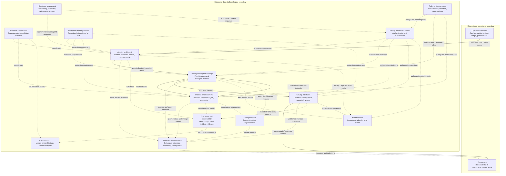

# 01 — Platform Capabilities and Logical Reference Architecture

**Roadmap location:** Stage 2D — Data Architecture / `07-Enterprise-Data-Platform-and-Lakehouse-Architecture/`  
**Lesson file:** `01-platform-capabilities-and-logical-reference-architecture.md`  
**Level:** Beginner → Intermediate → Advanced  
**Recommended study effort:** 6–8 hours (a roadmap estimate, not a requirement)  
**Primary artefacts:** capability inventory, vendor-neutral logical reference diagram, end-to-end flow trace, and one Architecture Decision Record (ADR)

> **Scope and source note.** This lesson follows Topic 01 of `roadmap-Enterprise-Data-Platform-and-Lakehouse-Architecture.md`. The supplied roadmap states that the topic lesson files and project files were empty when the roadmap was written; this lesson therefore treats the roadmap as the syllabus and does not claim to derive lesson content from those empty files. Examples, owners, priorities, and numbers below are illustrative design choices, not universal standards. This lesson is vendor-neutral and does not select cloud products.

## 1. Purpose and orientation

An enterprise data platform is not one pipeline and not simply a storage account. It is a shared set of capabilities that lets multiple teams acquire, store, transform, discover, govern, serve, and operate data safely. Platform architecture defines those capabilities, the boundaries between them, their interfaces, their owners, and the expectations they must meet.

A pipeline asks, “How does this dataset get from source A to destination B?” A platform asks, “What repeatable, governed capabilities should every pipeline and data product be able to use, and who is accountable for them?”

This lesson establishes the logical map for the rest of Module 2D.7. Later topics will add ingestion/storage/processing/consumption zones; bronze/silver/gold refinement and data-product boundaries; compute, storage and control-plane separation; catalogues and metadata; self-service; team isolation; and service levels. Here, those topics appear only as architectural concepts or short previews.

### Learning outcomes

By the end of the lesson, you should be able to:

1. Define **capability**, **component**, **interface**, and **data flow**, and distinguish them from one another.
2. Enumerate and classify the major capability families of an enterprise data platform.
3. Draw a vendor-neutral logical reference architecture and state the responsibility of each component.
4. Distinguish logical architecture from physical/vendor-specific architecture, and distinguish a reference model, reference architecture, and implementation blueprint.
5. Trace a card-transaction record from source through platform capabilities to a governed risk dashboard, with no unexplained hop.
6. Identify ownership, cross-cutting controls, failure dependencies, and trade-offs in a platform design.
7. Record a capability-scope decision in an ADR and justify the alternatives rejected.

## 2. Prerequisites and readiness check

### Required background

The module roadmap names P1, P5 and P6 as the core prerequisites for Topic 01, plus the vocabulary of reference models and reference architectures. You should also be comfortable with the following at least at a basic level:

| Prerequisite | What you should already know | Why it matters here | Quick review if weak |
|---|---|---|---|
| Capabilities, domains and ownership (P1) | A business capability describes what an organisation must be able to do; domains group related responsibilities and data | Platform capability and ownership boundaries should support real business responsibilities | Sketch five banking capabilities and assign a plausible accountable domain to each |
| Trade-offs and ADRs (P5) | Architecture decisions compare options against explicit criteria and record consequences | A reference architecture is a reasoned choice, not a universal diagram | Write three options for a platform decision and list one benefit and risk for each |
| Analytical patterns (P6) | A lake, warehouse, lakehouse, mesh and fabric describe different architectural concerns or patterns | A platform may use one or several patterns; none should be selected just because it is fashionable | Compare lake, warehouse and lakehouse in terms of data types, governance and workload needs |
| Quality attributes and measurable requirements (P2/P3) | Availability, freshness, throughput, security and cost need measurable definitions | Capability scope should be driven by outcomes and constraints, not by a tool list | Convert “fast data” into a measurable freshness requirement with an owner |
| Storage and integration foundations (P8/P9) | Storage is distinct from table format; ingestion has contracts, retries and failure handling | The logical diagram must show plausible interfaces and paths without detailing implementation | Explain how a source feed is validated, retried and reconciled |

### Two-minute prerequisite check

Try answering without looking anything up:

1. Why is “ingest transactions” a capability, while “the ingestion service” is a component that may provide it?
2. What is one trade-off between a single analytical store and separate stores for different workloads?
3. What makes a decision record useful after the original decision-maker has left?

If you cannot answer two of the three, review the relevant prerequisite before proceeding. You can still read this lesson, but do not treat the design exercises as passed until the gaps are closed.

### Essential vocabulary

- **Data platform:** shared capabilities, policies and operating practices used by multiple teams to build data flows, data products and analytical applications.
- **Lakehouse:** an architectural approach that combines flexible/open data storage with managed-table capabilities such as schema control, reliable updates and performance structures. It is not automatically superior to a warehouse; suitability depends on workloads and operating capacity.
- **Data product:** a curated, documented, owned data asset or interface intended for use by a defined consumer, with an explicit purpose and expectations. A table alone is not necessarily a product.
- **Metadata:** information describing data and its operation, such as schemas, ownership, classification, lineage, quality results and freshness.
- **Cross-cutting service:** a capability used across multiple stages, such as identity, policy enforcement, audit, lineage or observability.

## 3. Beginner foundations: the concepts and their boundaries

### 3.1 Platform versus pipeline

| Dimension | Individual pipeline | Enterprise data platform |
|---|---|---|
| Scope | One defined movement or transformation | Many pipelines, teams, data products and consumers |
| Primary design question | How should this flow work? | Which reusable capabilities, controls and interfaces should flows use? |
| Unit of design | Job, transformation, table or feed | Capability, component, interface, ownership boundary and service |
| Reuse | Often local to one use case | Intended to be reused across teams and domains |
| Success | Correct data arrive at the destination | Teams deliver trustworthy data safely, predictably and with acceptable friction and cost |
| Failure blast radius | Often limited to one flow | A shared failure can affect many flows and consumers |

A platform still contains pipelines. The distinction is that platform design makes common needs repeatable and governed instead of allowing every team to reinvent them.

### 3.2 Capability versus component versus interface versus data flow versus data product

These terms describe different architectural dimensions; they should not be used interchangeably.

| Term | Meaning | Example | What to ask |
|---|---|---|---|
| **Capability** | A responsibility or ability the platform must provide | Ingest a transaction feed reliably | What must the platform be able to do? |
| **Component** | A logical building block that performs or coordinates one or more capabilities | Ingestion service | Which part is responsible for doing it? |
| **Interface** | A defined way for components or users to interact, including contract, semantics and access rules | A validated file-ingestion endpoint or a table-access interface | What can cross this boundary, in what form, and under which rules? |
| **Data flow** | Data movement or transformation from one component/interface to another | Transaction events move from source through ingestion to managed storage | What moves, in which direction, and what is the next step? |
| **Data product** | An owned, consumer-oriented data asset or interface with a purpose and expectations | Governed card-risk dataset for analysts | Who uses this, what does it mean, and what does its owner promise? |

**Example:** “Discover data” is a capability. A metadata catalogue is a logical component that can provide it. Search and metadata APIs are interfaces. A query from an analyst to discover the card-risk dataset is an interaction/data flow. The published card-risk dataset, with an owner, definitions, quality expectations and access conditions, is a data product.

### 3.3 Logical versus physical architecture

**Logical architecture** describes responsibilities and relationships without committing to a particular vendor, product or deployment topology. It answers what capabilities exist and how they interact. A logical diagram should use terms such as *ingestion service*, *managed analytical storage*, *policy enforcement* and *serving interface*.

**Physical architecture** maps those responsibilities to real products, networks, accounts/projects/subscriptions, compute sizes, storage configurations, deployment regions, service tiers, identity integrations and operational settings. Those choices depend on requirements, skills, constraints and procurement; they belong in a later implementation design.

| Logical statement | Physical statement (illustrative, intentionally not selected here) |
|---|---|
| A managed table-storage capability retains versioned analytical tables | A specific table format and storage service are selected and configured |
| Identity and policy controls authorize access | An identity provider, roles, policies and network paths are configured |
| Processing executes scheduled transformations | A specific processing engine and orchestration service are deployed |

**Rule of thumb:** if a box names a vendor product, instance type, account ID, region, or deployment configuration, it is probably physical rather than logical. Physical detail can be useful later, but it should not distort the first capability map.

### 3.4 Reference model versus reference architecture versus implementation blueprint

| Artefact | What it provides | Typical detail | How to use it |
|---|---|---|---|
| **Reference model** | A vocabulary or classification of concepts and relationships | Capability categories and definitions | Use it to ensure teams discuss the same concepts |
| **Reference architecture** | A reusable arrangement of capabilities, components, interfaces and flows for a class of problems | Logical components, responsibilities, key relationships and cross-cutting controls | Use it as a starting point for a specific organisation; adapt it and record deviations |
| **Implementation blueprint** | Concrete instructions for implementing a chosen architecture | Products, configurations, network topology, deployment steps and operational settings | Use it after requirements and logical decisions are agreed |

A reference architecture is not a mandate to copy every box. A small organisation may combine capabilities into a few managed services; a regulated organisation may require more explicit separation and evidence. The right design depends on constraints and risk.

## 4. Capability families: what the platform must be able to do

The following eight families are a **design aid**, not a universal mandatory checklist. They help prevent omissions and support ownership discussions. An organisation may combine, split, outsource, or defer individual capabilities depending on its use cases, regulatory obligations, scale and operational capacity. A capability should not be added solely because it appears in this lesson.

### 4.1 Acquire and ingest

**Responsibility:** accept data from operational systems, files, APIs, events or partner exchanges; preserve source context; validate the agreed input contract; manage retries, deduplication or reconciliation where required; and make failures visible.

**Typical inputs:** records, files, events, change sets, source metadata and credentials/identity context.  
**Typical outputs:** accepted data plus ingestion status, rejection/quarantine information, source identifiers and operational evidence.  
**Key question:** Can the platform receive the required data with known semantics and recover safely from partial failure?

### 4.2 Store and manage data

**Responsibility:** retain data and managed analytical structures with appropriate durability, access boundaries, lifecycle, schema/table semantics and recovery options.

**Typical inputs:** accepted source data and transformed datasets.  
**Typical outputs:** addressable files/tables or other managed data assets and their storage metadata.  
**Key question:** Where does data persist, how is it protected, and how can consumers reliably read the intended version?

This lesson does not prescribe storage products, formats or zone layouts. Topic 02 will define the roles of ingestion, storage, processing and consumption zones; Topic 03 will cover refinement layers and data-product boundaries.

### 4.3 Process and transform

**Responsibility:** validate, standardise, join, aggregate, enrich and otherwise transform data into forms fit for defined consumers; coordinate dependencies; support repeatability and controlled publication.

**Typical inputs:** accepted data, transformation rules, reference data and processing parameters.  
**Typical outputs:** transformed datasets, quality results, run status and lineage evidence.  
**Key question:** Can transformations be repeated, tested, observed and explained?

### 4.4 Organise, describe and discover metadata

**Responsibility:** make data assets discoverable and interpretable through names, schemas, definitions, ownership, classification, lineage, quality indicators and freshness information.

**Typical inputs:** asset registrations, schema changes, job metadata, ownership declarations and quality results.  
**Typical outputs:** searchable asset descriptions, metadata interfaces, lineage links and discovery results.  
**Key question:** Can a user find the right data, understand what it means and identify who is accountable?

A catalogue, metastore and broader metadata system may be distinct logical responsibilities even if an implementation combines them. Topic 05 will examine these differences in depth.

### 4.5 Govern and secure

**Responsibility:** define and enforce who can do what to which data, for which purpose; apply classification, policy, encryption, audit and evidence requirements; and support controlled exceptions.

**Typical inputs:** identities, roles/attributes, policies, classifications, resource metadata and access requests.  
**Typical outputs:** authorization decisions, protected data access, policy outcomes and audit evidence.  
**Key question:** Are controls explicit, enforceable, reviewable and consistent across the platform?

A policy written in a document is not enough. Enforcement must occur at relevant interfaces and data paths. The exact enforcement points depend on the chosen architecture.

### 4.6 Serve and enable consumption

**Responsibility:** expose approved datasets through interfaces appropriate to consumers, such as analytical queries, dashboards, controlled extracts, APIs or feature-ready data. Provide definitions and access conditions so consumers can use data correctly.

**Typical inputs:** curated or approved data products, consumer queries and authorization context.  
**Typical outputs:** query results, governed tables/views, extracts, API responses or other consumption interfaces.  
**Key question:** Can each intended consumer access the right data with acceptable semantics, latency and protection?

### 4.7 Operate and observe

**Responsibility:** coordinate execution and dependencies; monitor health, freshness, quality, throughput, errors and resource use; alert the right owner; support incident response, replay/recovery and cost attribution.

**Typical inputs:** job events, logs, metrics, traces, lineage, run status, service objectives and cost/resource usage.  
**Typical outputs:** operational dashboards, alerts, run histories, incident evidence, recovery actions and cost reports.  
**Key question:** Can the team detect a problem, determine its impact, recover and learn from it?

### 4.8 Enable developer experience and self-service

**Responsibility:** make safe platform use easy through documented interfaces, templates, onboarding, test environments, reusable patterns, automated provisioning and clear support paths.

**Typical inputs:** team requests, approved templates, policy constraints, ownership information and platform conventions.  
**Typical outputs:** provisioned workspaces or access, validated pipeline scaffolds, documentation, reusable patterns and onboarding status.  
**Key question:** Can a team do routine work independently while required guardrails remain enforceable?

Self-service is not unrestricted access. Topic 06 will cover workflows and the balance between autonomy and governance.

### 4.9 How the families fit together

The primary data path often follows this pattern:

**Source → acquire/ingest → store → process → store/publish → serve → consumer.**

Metadata helps users and systems understand assets and their relationships. Governance and security apply across data movement and access. Operations observes the whole lifecycle. Developer experience helps teams request, build, test and operate flows using supported paths.

Not every flow uses every capability in the same way. A streaming use case may have different processing and latency needs from a daily batch report. A small team may use a single component to provide several capabilities. The architecture must make responsibilities and interfaces clear even when implementation components are combined.

## 5. Vendor-neutral logical reference architecture

The diagram below is a **logical reference**, not a physical deployment diagram. Boxes are logical components or consumer/source systems; labels describe responsibilities rather than products. The diagram shows the primary data path and a separate cross-cutting band. Dashed arrows indicate control, metadata or operational relationships rather than the primary movement of business records.

### 5.1 Read the diagram correctly

**Boundaries**

- The outer “External and operational boundary” contains systems that produce data and the people or applications that consume it. These are outside the logical platform boundary, although their interfaces still need contracts and access controls.
- The “Enterprise data platform logical boundary” groups the capabilities under platform design and operating accountability. It does not imply one network, one account, one deployment or one team.
- A logical boundary identifies responsibility and trust assumptions. Physical isolation, network segmentation and deployment topology are implementation decisions made later.

**Primary data arrows (solid)**

1. **Sources → Acquire and ingest:** operational systems send records, files or events through a defined input interface. The ingestion capability validates the agreed contract and records receipt or failure.
2. **Ingest → Managed analytical storage:** accepted data are persisted with enough context to identify source and ingestion run. Rejected or malformed inputs need an explicit failure/quarantine path in a detailed design; this lesson does not define the later zone layout.
3. **Storage → Process:** processing reads persisted data or another supported input. The read interface must expose a consistent dataset version or an explicit consistency model.
4. **Process → Storage:** transformations publish outputs back to managed storage. Publication must not silently expose partial results as complete; the detailed publication method is a later implementation/design concern.
5. **Storage → Serving interfaces:** approved data are exposed through controlled consumer-facing interfaces. The serving capability should not bypass policy merely because a table is curated.
6. **Serving → Consumers:** dashboards, analysts and applications receive query results or other authorised outputs. Access, semantics and freshness expectations remain relevant at this final boundary.

**Dashed cross-cutting arrows**

- **Metadata and discovery:** ingest, storage, processing and serving register asset descriptions, schemas, ownership, lineage links or interface metadata. Consumers use this metadata to discover and interpret assets. Metadata is not the business dataset itself.
- **Developer enablement:** onboarding and templates guide teams into supported ingestion and access workflows. The dashed relationship means it enables the work; it does not carry the transaction records.
- **Workflow coordination:** the coordinator orders or schedules ingestion and processing work and tracks run state. It coordinates execution; it is not the storage layer and does not replace the processing engine.
- **Operations and observability:** components emit status, metrics and operational events. Observability helps detect and diagnose failures; it does not by itself repair them.
- **Identity and access control:** authorization decisions are consulted at relevant entry points. A production implementation must ensure that every access path is covered; the diagram is a responsibility map, not proof that one central service can intercept every possible read.
- **Policy and governance:** rules inform access decisions, storage lifecycle and processing/publication requirements. Some policies are enforced centrally; others may be enforced by domain-owned controls under shared standards.
- **Encryption and key control:** the logical design requires protection in transit and at rest where applicable. Key custody, rotation and exact enforcement points belong to the physical design.
- **Audit evidence and lineage are separate logical responsibilities:** audit records attributable access, administrative and other significant actions; lineage records source-to-output dependencies and transformation relationships. One implementation component may support both, but the event semantics and questions answered remain distinct. The diagram shows them separately to prevent accidental conflation.
- **Cost attribution:** resource usage and run ownership are associated with teams, domains or products where practical. Cost attribution supports accountability; it does not itself control or reduce spend.

### 5.2 Interfaces are architecture, not decoration

For each interface, specify at least:

- **Contract:** accepted schema/format, semantics, versioning and compatibility expectations.
- **Identity and authorization:** who or what may call it, and what resource/action is permitted.
- **Reliability behaviour:** timeout, retry, idempotency, duplicate handling, failure reporting and recovery expectations where applicable.
- **Observability:** correlation/run identifier, status, measurable signals and owner for alerts.
- **Metadata:** asset identity, owner, classification, lineage and freshness where relevant.
- **Change management:** how changes are announced, tested and rolled out without silently breaking consumers.

An arrow without an interface is an incomplete design. The interface makes the relationship testable and governable.

## 6. Capability inventory: from boxes to accountable responsibilities

The following inventory is an example starting point for Northbridge Bank. Ownership is **provisional**: validate it against the actual organisation. “Dependencies” are logical dependencies, not a prescribed deployment order. Failure impact is the likely consequence if the capability is unavailable or incorrect.

| Capability / logical component | Purpose | Inputs | Outputs / interfaces | Provisional accountable owner | Key dependencies | Failure impact |
|---|---|---|---|---|---|---|
| Source integration and ingestion | Receive source data reliably and preserve receipt evidence | Source feeds, contracts, source identity | Accepted records, ingestion status, rejection details | Platform engineering with source-domain owner | Source availability, contract definitions, identity, storage write access | New data stop arriving; freshness degrades; retries may create duplicates if poorly designed |
| Managed analytical storage | Persist datasets and expose stable read/write semantics | Accepted and transformed data, schema/table metadata | Managed files/tables, read/write interfaces | Data platform team; data domain owns meaning and lifecycle requirements | Storage durability, access control, metadata service, encryption | Multiple pipelines and consumers may be blocked; recovery and consistency risks increase |
| Processing and transformation | Apply repeatable validation and business transformations | Persisted data, rules, reference datasets, run parameters | Curated outputs, quality results, lineage/run events | Data engineering or domain data team, depending on transformation | Input availability, compute capacity, workflow coordination, metadata | Outputs become stale or incorrect; downstream consumers may use incomplete data |
| Workflow coordination | Order dependent tasks and track run state | Schedules, dependencies, run requests | Run triggers, state, retries, completion/failure signals | Platform operations | Identity, component interfaces, state persistence, observability | Work may not start or may run out of order; recovery may be manual |
| Metadata and discovery | Describe and locate assets, schemas, owners and lineage | Asset registrations, schema/job events, ownership and quality metadata | Search/discovery interfaces, definitions, lineage links | Platform governance/metadata team with domain stewards | Metadata producers, identity/policy, consistent identifiers | Users cannot confidently find or interpret data; audits and impact analysis become harder |
| Identity and access control | Authenticate actors and authorize permitted actions | Identities, roles/attributes, policy context, resource metadata | Authentication and authorization decisions, access evidence | Enterprise security/IAM with platform integration owner | Identity lifecycle, policy definitions, component enforcement points | Unauthorized access may occur if bypasses exist; legitimate work may stop if unavailable |
| Policy and governance | Define classification, approved use, retention and control obligations | Regulatory/business rules, data classifications, domain policies | Policy definitions, enforcement requirements, exceptions and approvals | Data governance and security, with accountable domain owners | Asset metadata, ownership, identity, audit evidence | Inconsistent handling, policy violations, over-retention or uncontrolled exposure |
| Encryption and key control | Protect data in transit and at rest | Data paths, classification, key policy | Protected channels/storage, key-use events and status | Security/key-management owner | Key availability, component integration, identity | Confidentiality risk or data-access outage if keys/control paths fail |
| Serving interfaces | Make approved data usable by defined consumers | Published datasets, queries, access context | Governed tables/views, query/API responses, usage metrics | Platform team for shared interfaces; product owner for data semantics | Storage, identity/policy, metadata, query capacity, observability | Dashboards and downstream applications fail or serve stale/incorrect results |
| Operations and observability | Detect failures and support diagnosis/recovery | Logs, metrics, traces, run state, freshness and quality signals | Alerts, dashboards, incident evidence and runbooks | Platform operations/SRE with component owners | Telemetry emission, alert routing, ownership map, time/correlation consistency | Failures may remain undetected; recovery time and impact increase |
| Audit evidence | Record attributable access, administrative and other significant actions | Access events, policy decisions, administrative events, relevant run identifiers | Searchable audit records and investigation evidence | Governance/compliance with platform and security owners | Event capture, identity/resource context, retention, protected log access | Investigation and accountability become unreliable or incomplete |
| Lineage capture | Record source-to-output dependencies and transformation relationships | Asset identifiers, input/output versions, job and transformation metadata | Lineage links/graph and impact-analysis relationships | Platform metadata team with pipeline/domain owners | Stable asset/run IDs, metadata producers, transformation instrumentation | Provenance and downstream impact analysis become incomplete |
| Cost attribution | Associate usage with accountable teams or products | Resource usage, run identity, ownership/tag metadata | Allocation reports, unit-cost signals, anomaly indicators | FinOps/platform operations with domain owners | Usage telemetry, stable ownership tags, cost model | Shared costs become opaque; waste and budget disputes are harder to resolve |
| Developer enablement / self-service | Make safe, repeatable platform use easier | Team request, approved template, access and policy context | Onboarding flow, scaffolded pipeline, provisioned access, docs | Platform product/engineering team | IAM, templates, catalogue, policy checks, support path | Adoption slows; teams build unsafe workarounds or duplicate capabilities |

### 6.1 Ownership principles

- Give each capability one **accountable owner**, even if several teams contribute to it. A blank owner is an unresolved architecture risk.
- Distinguish **platform ownership** (shared interface, guardrails, reliability and common tooling) from **domain ownership** (business meaning, source correctness, data-product definitions and domain-specific quality rules).
- Mark uncertain ownership explicitly as **TBD** with a named decision owner and resolution date. Do not hide uncertainty behind “shared responsibility.”
- A capability may be implemented by a supplier or managed service, but the organisation still needs an internal owner for configuration, access, service expectations, incident handling and exit strategy.

## 7. End-to-end illustrative trace: Northbridge Bank card-risk dashboard

This is a fictional scenario for learning. All names, data fields, timings and responsibilities are illustrative assumptions—not a description of a real bank or a regulatory requirement.

### 7.1 Scenario and assumptions

Northbridge Bank is a fictional mid-sized bank. Its card transaction system emits transaction events. A risk analytics team wants a governed dashboard showing transaction volume and selected risk indicators by merchant category and time window.

**Illustrative assumptions for this trace:**

- The source event contains a transaction identifier, event timestamp, amount, currency, merchant category, account token and source sequence/version information.
- Direct cardholder identifiers are not needed for the dashboard; the account token is treated as sensitive and is not exposed to general dashboard users.
- The dashboard is an analytical use case, not a real-time card authorisation engine. A hypothetical freshness objective is “available within 15 minutes for 95% of events”; this is an exercise target only and must be validated against business need and feasibility.
- The risk analytics domain owns the dashboard definitions and analytical meaning. The platform team owns shared ingestion, storage, processing interfaces, identity integration, metadata and observability capabilities. Security/governance owners define policy; domain owners remain accountable for appropriate use.
- The design assumes an approved method exists to minimise or tokenise sensitive fields before broad analytical access. The exact transformation and zone placement are deliberately left for later lessons.

### 7.2 Trace each hop

| Step | From → to | What happens | Interface / contract | Evidence and controls | Owner at this step |
|---|---|---|---|---|---|
| 1 | Card transaction system → ingestion | Source emits transaction events with a stable transaction ID and event timestamp | Versioned event/feed contract defines required fields, types and compatibility | Source identity, encrypted transport, receipt timestamp, correlation/run ID, schema validation result | Card-system owner for source correctness; platform ingestion owner for acceptance |
| 2 | Ingestion → managed analytical storage | Accepted events are persisted with source/run context; malformed events are rejected or routed to an explicitly managed failure path | Write interface specifies accepted schema, idempotency/deduplication key and acknowledgement semantics | Ingestion status, counts, rejected-record reason, access and write audit; encryption and least privilege | Platform ingestion/storage owner |
| 3 | Storage → processing | A processing run reads a defined input snapshot/window and reference data needed for enrichment | Read interface identifies input version/window and required schema | Run ID, input watermark/window, input counts and access decision | Processing owner |
| 4 | Processing → managed analytical storage | The transformation validates records, standardises timestamps/currency handling, applies duplicate rules, minimises sensitive fields, and computes agreed risk indicators | Transformation contract defines semantics, null/late-record handling, output schema and publication criteria | Quality results, lineage from input to output, code/rule version, access audit; publication occurs only after checks pass | Risk analytics domain for business rules; platform/data engineering for shared execution conventions |
| 5 | Stored output → metadata/discovery | The published dataset is registered with a description, owner, classification, schema, freshness and lineage references | Metadata registration/search interface | Owner and classification are mandatory fields in this illustrative design; freshness is updated from successful runs | Metadata owner with risk-domain steward |
| 6 | Stored output → serving interface | The approved risk dataset is exposed through a governed table/view or query interface | Consumer contract states metric definitions, permitted fields, expected freshness and change policy | Identity and policy check; query/access telemetry; audit event | Platform serving owner; risk-domain product owner for semantics |
| 7 | Serving interface → risk dashboard | The dashboard queries the approved interface and displays aggregated risk indicators | Query contract and metric definitions; dashboard identity maps to approved permissions | Dashboard refresh time, query success/failure, freshness indicator, access audit | Risk analytics team |
| 8 | Whole path → operations and audit | Status, quality, lineage, access and resource usage are correlated across the flow | Shared run/asset identifiers and telemetry conventions | Alerts for failed runs or freshness breach; lineage and audit evidence retained according to policy | Platform operations, with source and domain owners responding to their respective failures |

### 7.3 Cross-cutting checks at every relevant hop

- **Identity/access:** the source identity can publish only to the intended ingestion interface; processing can read approved inputs and write approved outputs; dashboard users can read only the permitted published interface.
- **Policy/classification:** sensitivity is identified early enough to prevent accidental broad exposure. A curated dataset is not automatically non-sensitive.
- **Encryption:** protected communication and storage are applied according to classification and policy.
- **Audit:** record access and important administrative or policy events with enough context for investigation.
- **Lineage:** record which input assets and transformation version produced the dashboard dataset. Lineage should not be inferred only from naming conventions.
- **Observability:** capture ingestion delay, processing status, data-quality outcomes, output freshness and serving errors. Define alert ownership and a response path.
- **Cost attribution:** attach run/resource use to the platform or domain owner where feasible; use the evidence to understand cost, not as a substitute for optimisation.

### 7.4 Failure walk-through

**Failure A — ingestion accepts an incompatible schema.** The source changes a field type. Contract validation should fail or route the affected input to a controlled failure path. The ingestion owner and source owner receive an actionable alert. The flow should not silently publish malformed data. A replay/reprocessing path is defined in the integration design.

**Failure B — processing succeeds technically but produces wrong totals.** A job can return success while business logic is wrong. Quality checks and reconciliation against source counts or trusted control totals should detect the discrepancy. The domain owner decides whether the business output is valid; the platform team provides run evidence and repeatable execution.

**Failure C — metadata catalogue is unavailable.** Ingestion or processing may continue only if the design explicitly allows it and can preserve required metadata safely. Discovery and new access grants may be degraded. If policy enforcement depends on metadata lookups, access should fail closed for sensitive actions rather than bypass policy. The exact availability behaviour must be decided, not assumed.

**Failure D — identity service is unavailable.** New authorization decisions may fail, potentially blocking ingestion, processing or dashboard access. Cached decisions can improve resilience only if their lifetime and revocation risk are acceptable. Sensitive data access must not become unrestricted during an outage.

**Failure E — observability is missing or broken.** The pipeline might still run, but owners may not know data is stale or incorrect. This is a platform-level defect because downstream consumers can trust a dashboard that is no longer current. Telemetry delivery itself needs monitoring and a fallback escalation route.

**Failure F — no capability owner.** A policy violation, missing lineage or unassigned alert can remain unresolved because each team assumes another team is responsible. Resolve this by assigning one accountable owner and explicitly listing contributors and escalation paths.

### 7.5 Check the trace for unexplained hops

For each step, you should be able to answer: What data or signal moves? Which interface carries it? What capability owns the next action? What validates success? Which identity/policy applies? What happens on failure? Who responds? If any answer is missing, the trace is not complete.

## 8. Intermediate design: boundaries, ownership and operating patterns

### 8.1 Shared platform versus domain-owned responsibilities

A useful default is to centralise common guardrails and reusable interfaces while leaving business meaning and domain-specific decisions close to the teams that understand them. This is a starting hypothesis, not a universal rule.

| Responsibility | Commonly platform-owned | Commonly domain-owned | Shared boundary to define |
|---|---|---|---|
| Ingestion framework | Supported patterns, reusable interface, telemetry conventions, baseline security | Source contract, source semantics, source-side quality and change notification | Who resolves schema breaks and late/duplicate data? |
| Storage foundation | Shared storage interfaces, durability conventions, encryption integration, lifecycle mechanisms | Data meaning, retention needs, product-level access and quality expectations | Who approves lifecycle exceptions and sensitive access? |
| Transformation | Execution framework, test/run conventions, observability | Business logic, metric definitions, domain-specific quality rules | Who approves changes that affect consumers? |
| Metadata | Catalogue/search interfaces, required metadata fields and identifiers | Business definitions, owner/steward assignment, domain glossary | Which fields are mandatory and who corrects stale metadata? |
| Governance/security | Enterprise policy baseline, identity integration, audit standards | Domain-specific classification context, permitted business purpose, access approval within delegated authority | Where is policy enforced and who approves exceptions? |
| Serving | Shared access patterns, availability/usage telemetry, common interface standards | Product semantics, consumer documentation, domain support | Who handles query failures versus incorrect business meaning? |
| Operations | Shared monitoring, incident process, platform runbooks | Domain on-call for business logic/source issues | What severity triggers joint response and who leads? |
| Developer enablement | Templates, paved paths, onboarding and documentation | Team adoption, project-specific configuration and tests | What is mandatory, defaulted, recommended or exception-only? |

### 8.2 Centralised, federated and hybrid operating patterns

**Centralised platform:** one central team owns most shared services and often builds or operates many data flows.

- **Advantages:** consistent standards, simpler control enforcement, clear central expertise and less duplicated infrastructure.
- **Risks:** central team becomes a queue; domain context is lost; exceptions accumulate; teams may build shadow platforms.
- **More suitable when:** the organisation is small, controls must be tightly consistent, and a central team has sufficient capacity.

**Federated/domain-oriented platform:** domain teams own more of their data products and execution, while standards and shared services are distributed or coordinated across domains.

- **Advantages:** domain knowledge and accountability stay close to the data; teams can move independently; local priorities are easier to serve.
- **Risks:** duplicated capability, inconsistent controls, uneven skills and fragmented user experience if shared contracts are weak.
- **More suitable when:** domains have mature engineering capability, clear ownership and a strong shared governance model.

**Hybrid platform:** a central platform team provides shared capabilities and non-negotiable guardrails; domain teams own business data products and domain-specific transformations within those guardrails.

- **Advantages:** balances reuse and autonomy; centralises expensive/common controls while preserving domain context.
- **Risks:** the boundary can be ambiguous; teams may dispute responsibility for incidents or platform gaps; central APIs can still become bottlenecks.
- **More suitable under the illustrative Northbridge assumptions:** hybrid, because shared access, audit and operational conventions matter, while risk definitions and data-product meaning belong with the risk domain.

No pattern eliminates governance or operating costs. The right choice depends on team maturity, regulation, scale, skills, delivery urgency and the cost of inconsistency.

### 8.3 Boundaries that need explicit decisions

A capability boundary is useful when it clarifies ownership, change management, security or failure isolation. It is not useful merely because a diagram looks cleaner.

For each boundary, define:

1. **Responsibility:** what the component does and does not own.
2. **Input/output contract:** schema, semantics, versioning, errors and compatibility.
3. **Authority:** who can invoke, change or administer the capability.
4. **Failure behaviour:** timeout, retry, degraded mode, fail-open/fail-closed choice where relevant, and recovery owner.
5. **Evidence:** logs, metrics, audit events, lineage, run IDs and quality results.
6. **Change process:** compatibility policy, deprecation notice, rollout and rollback.
7. **Cost ownership:** how shared usage is allocated or at least made visible.

### 8.4 Cross-cutting controls: where to enforce

Controls may be implemented at multiple levels, but they must have clear authoritative enforcement points.

- **Identity and authorization:** enforce at service interfaces and data access paths; do not rely only on UI hiding or user instructions.
- **Policy:** express shared requirements centrally where possible, then enforce them at relevant ingestion, storage, processing and serving boundaries. Domain rules can supplement enterprise policy but must not weaken non-negotiable controls without an approved exception.
- **Encryption:** define minimum protection requirements and identify who manages keys and exceptions. The physical architecture will determine exact termination and key boundaries.
- **Audit:** make critical access and administrative actions attributable to an identity and resource. Define retention and review responsibility.
- **Lineage:** capture source-to-output relationships from execution and metadata events, with stable asset identifiers.
- **Observability:** standardise key signals and routing, but let component owners define domain-specific indicators when necessary.
- **Cost attribution:** collect usage evidence and assign owners/tags as early as feasible. A cost report with no accountable owner is informational but not actionable.

### 8.5 Reliability and failure dependencies

Shared capabilities create leverage and shared risk. A failure in a widely used service can affect many pipelines at once.

| Capability | Potential failure mode | Likely blast radius | Design questions / mitigations |
|---|---|---|---|
| Identity/access | Authorization service or identity integration unavailable | Ingestion, processing and consumption may be blocked; unsafe fallback risks exposure | Define fail-safe behaviour, availability expectations, bounded caching, recovery and break-glass audit |
| Metadata/catalogue | Catalogue lookup or registration fails | Discovery, new jobs, lineage or policy checks may degrade depending on coupling | Decide which operations can continue; avoid hidden dependency on metadata without a fallback contract |
| Workflow coordination | Scheduler/orchestrator unavailable or state corrupted | New runs stop, dependencies are missed, or duplicate work occurs | Durable run state, idempotent tasks, recovery procedure, backup/restore and controlled replays |
| Managed storage | Read/write or metadata operations unavailable | Most downstream data paths affected | Durability and recovery targets, replication/backup strategy, capacity and dependency analysis |
| Processing capacity | Resource saturation or engine outage | Outputs stale; queues grow | Quotas, backpressure, priority classes, scaling policy and workload isolation |
| Observability pipeline | Metrics/logs/alerts fail | Faults may remain invisible even if workloads run | Monitor telemetry health independently and define an alternate escalation path |
| Policy enforcement | Policy rules stale or enforcement bypassed | Inconsistent access or unauthorised disclosure | Version policy, test enforcement, log decisions, reconcile policy coverage and exceptions |

A component is a **single point of failure (SPOF)** when its failure can stop a required end-to-end service and no acceptable alternative or recovery path exists. A logical diagram cannot prove redundancy. Redundancy, failover, recovery time, recovery point, dependency availability and degraded-mode behaviour must be validated in the physical and operational design.

Do not automatically make every component highly available. Prioritise based on business impact, dependency centrality, recovery requirements and cost. A low-criticality discovery interface may tolerate temporary degradation; authorization for sensitive data may require stronger resilience without weakening security.

### 8.6 Isolation and service-level preview

A shared platform should prevent one team or workload from accidentally or deliberately exhausting resources or accessing another domain's data. At this stage, note the need for tenant boundaries, least privilege, quotas and workload isolation; Topic 07 will evaluate logical versus physical isolation and residual risks.

Likewise, platform users need measurable expectations for freshness, availability, support and incident response. Topic 08 will define service levels and product thinking. In this lesson, treat those expectations as inputs to capability scope and dependency analysis—not as targets to invent without evidence.

## 9. Advanced decisions: scope, build/buy/defer and extensibility

### 9.1 Capability scope: minimum viable platform versus broad platform

A **minimum viable platform** is not “no governance.” It is the smallest capability set that can safely deliver the first valuable use cases and expand without expensive redesign. A broad platform may be justified when regulatory, scale or cross-domain needs require it, but breadth increases cost, integration complexity and operational load.

A practical scope classification:

- **Must have now:** required to deliver the first use case safely and legally, with an accountable owner and a viable failure path.
- **Should have soon:** materially improves reuse, reliability, discoverability or delivery speed; can be staged if risk remains controlled.
- **Later / trigger-based:** add when a measurable need appears, such as new workload patterns, scale, audit requirements or consumer demand.
- **Explicitly out of scope:** not needed for the current use case; document what would trigger reconsideration.

For a regulated data platform, identity/access, classification, audit evidence and a minimum lineage strategy often belong in the initial core because retrofitting them can be expensive and risky. The exact mandatory scope must be confirmed against applicable obligations and business requirements; this is a design recommendation, not a universal legal statement.

### 9.2 Build, buy or defer

| Decision criterion | Build internally when… | Buy / use a managed capability when… | Defer when… |
|---|---|---|---|
| Differentiation | The capability encodes a meaningful competitive or domain-specific advantage | The capability is common infrastructure and not a source of differentiation | No current use case requires it and delay creates no unacceptable risk |
| Skills and operating capacity | The team has the skills and can support it over its lifecycle | A supplier can meet requirements with lower operational burden and acceptable exit options | The team cannot operate it safely yet and a safe temporary path exists |
| Time to value | Custom work is necessary to meet a critical requirement | An existing capability meets needs faster with acceptable trade-offs | The benefit is speculative and should be validated first |
| Cost | Total lifecycle cost is justified, including maintenance and staffing | Subscription/usage cost is lower or more predictable than internal operation | Cost and demand are not yet understood; run a bounded discovery first |
| Risk and control | Custom control is required and can be engineered and audited | Supplier controls, evidence, resilience and contract terms meet requirements | The risk can be safely accepted for a defined period with an owner and expiry |
| Portability and exit | The organisation needs control over interfaces or specialised behaviour | Standard interfaces and export paths limit lock-in enough | A choice is premature before requirements and interfaces are stable |

Compare **total cost of ownership**, not only licence price: engineering effort, integration, support, security review, training, on-call burden, failure recovery, data movement and exit costs all matter.

### 9.3 Extensibility without redesign

A logical reference architecture should allow a new capability to attach through stable interfaces rather than requiring every existing component to change. For example, if a future use case needs vector retrieval, the platform may add a retrieval/indexing capability that consumes approved, governed data and exposes a retrieval interface to an AI application. This is only an extensibility example; detailed retrieval architecture belongs in later modules.

Extensibility is helped by:

- explicit contracts and versioning;
- stable asset and run identifiers;
- capability boundaries based on responsibility rather than product names;
- consistent identity, policy, audit and observability integration patterns;
- ownership and deprecation rules;
- avoiding unnecessary assumptions that every consumer uses one query mode or one processing engine.

Extensibility does not mean designing every hypothetical future capability now. It means avoiding brittle coupling and documenting the cost of likely changes.

### 9.4 Scope waves and decision criteria

A reasonable illustrative sequence for Northbridge might be:

1. **Wave 1 — safe core:** ingestion, managed storage, repeatable processing, governed serving, identity/access, baseline encryption, audit, minimum lineage, observability and named ownership.
2. **Wave 2 — reuse and discoverability:** richer metadata, standard templates, automated onboarding, improved cost attribution and reusable quality checks.
3. **Wave 3 — workload and domain scale:** stronger tenant isolation, differentiated service classes, more advanced lineage/quality workflows, and additional serving patterns as evidence requires them.

This is not a prescribed roadmap. A legal obligation, a sensitive use case, or a high-impact operational dependency may move a capability into Wave 1. Conversely, a capability can be combined with another component if the required responsibility, evidence and ownership remain clear.

Evaluate candidate designs against criteria such as:

- business outcome and consumer need;
- regulatory, privacy and security constraints;
- required freshness, throughput, availability and recovery;
- team skills and operating capacity;
- time to value and implementation risk;
- lifecycle cost and cost visibility;
- degree of reuse across domains;
- supplier lock-in and exit strategy;
- blast radius and dependency concentration;
- evidence needed to prove controls work.

Do not assign numeric weights unless stakeholders agree on them. If weights are used, record who set them and test whether the decision changes under plausible alternative weights.

## 10. Architecture Decision Record (ADR): initial capability scope

The following ADR is illustrative and demonstrates how to record a decision. Replace assumptions with evidence during a real architecture review.

### ADR-001 — Start with a governed core and add capabilities in waves

**Status:** Proposed for the illustrative Northbridge design  
**Decision owner:** Enterprise data architecture lead (provisional)  
**Date:** Illustrative  
**Review trigger:** Before onboarding a new regulated domain, when workload requirements materially change, or after the first operational review

#### Context

Northbridge has ad hoc data pipelines, inconsistent ownership, and a need to deliver a governed card-risk dashboard. The organisation wants to avoid both a central team that becomes a delivery bottleneck and a fragmented platform where each team implements security and observability differently. Budget, team capacity and detailed workload requirements are not yet fully established. No specific vendor or deployment topology has been selected.

#### Decision

Adopt a **hybrid operating approach** with a minimum governed logical core. The shared platform provides reusable ingestion, managed storage, processing conventions, governed serving interfaces, identity integration, policy enforcement hooks, encryption requirements, audit/lineage evidence, observability and basic cost attribution. Domain teams own business definitions, domain-specific transformations and consumer-facing data-product meaning. Add advanced capabilities in waves when a documented requirement, risk or measurable bottleneck justifies them.

#### Alternatives considered

1. **Broad central platform before first use case:** implement an extensive set of shared capabilities up front.
2. **Minimal data movement/storage only:** provide basic ingestion and storage while each domain builds its own security, metadata, operations and serving patterns.
3. **Governed core with staged expansion (selected):** establish the non-negotiable controls and reusable interfaces first, then add capabilities in response to evidence.

#### Rationale

- Option 1 may reduce later fragmentation but risks over-building before requirements and usage are understood; it also increases initial integration and operating burden.
- Option 2 may appear faster but risks inconsistent controls, poor lineage, duplicate effort, weak cost attribution and difficult audits. Retrofitting core controls may be expensive.
- Option 3 aims to balance time to value with safe defaults. It protects key cross-cutting concerns while keeping the platform extensible and allowing domain ownership of business semantics.

#### Consequences

**Positive:** a clear initial boundary; shared security and observability conventions; faster repeatable onboarding; explicit domain accountability; scope can expand based on evidence.  
**Negative / risks:** the definition of “minimum core” can be disputed; shared capabilities can still become bottlenecks; metadata or identity dependencies may affect many flows; the platform team must maintain interfaces and support.  
**Required follow-up:** define the first-use-case requirements and measurable targets; name owners for every capability; define failure/recovery paths; validate the policy enforcement points; agree on data-product ownership and the support/escalation model.

#### Review triggers

Revisit this decision if any of the following occurs:

- compliance or privacy obligations require additional controls before the next use case;
- a shared service becomes a measured bottleneck or unacceptable single point of failure;
- domain teams cannot meet agreed delivery expectations using the paved path;
- the actual workload mix shows that one shared analytical store cannot meet consumer requirements;
- lifecycle cost, supplier risk or operational burden materially differs from the assumptions;
- a new capability such as real-time serving or vector retrieval requires a different interface or trust boundary.

## 11. Practical exercises

Complete the exercises in order. They require no infrastructure; the deliverables are architecture artefacts. Use Northbridge Bank unless your instructor assigns a different fictional organisation. Mark every assumption as illustrative and do not put vendor names into the logical diagram.

### Exercise A — Classify capabilities

**Scenario:** Northbridge has several ad hoc pipelines and wants a shared platform. Teams have requested source ingestion, managed storage, transformation, metadata search, access approvals, dashboard serving, monitoring, onboarding templates and cost reports.

**Tasks:**

1. List at least ten capabilities, grouped under the eight families in Section 4.
2. For each, write one sentence describing what it does and one question it answers.
3. Distinguish capability from component and interface for at least three examples.
4. Mark each capability **Must / Should / Later / Out of scope** for the first card-risk dashboard; justify the classification.
5. Assign a provisional accountable owner or mark **TBD** with a resolution action.

**Deliverable:** one-page capability map and an inventory table.  
**Objective validation criteria:**

- at least ten distinct capabilities are listed;
- every capability has a responsibility statement and a family;
- no product/vendor name is used as a capability;
- every owner is named or explicitly marked TBD with a next action;
- Must/Should/Later choices have a rationale tied to the scenario, constraints or risk.

### Exercise B — Build a logical reference diagram

**Inputs:** Exercise A output and the diagram in Section 5 as a reference, not a template to copy blindly.

**Tasks:**

1. Draw source systems, ingestion, managed storage, processing, serving interfaces and consumers.
2. Add metadata/discovery, identity/access, policy, encryption, audit/lineage, observability, workflow coordination, developer enablement and cost attribution where relevant.
3. Draw solid arrows for primary data movement and dashed arrows for control/metadata/operational relationships; add a legend.
4. Write one responsibility sentence for every box.
5. Label the platform boundary and source/consumer boundary.
6. State at least three assumptions and three design decisions that remain open for physical design.

**Deliverable:** vendor-neutral logical reference diagram plus a component-responsibility legend.  
**Objective validation criteria:**

- no product names, logos, regions, account IDs or configuration values appear in the logical diagram;
- each component has one clear responsibility;
- every solid data arrow has a plausible source, destination and named data/interface;
- cross-cutting controls are shown separately or clearly identified as cross-cutting;
- metadata, identity, policy, encryption, audit/lineage and observability are not omitted without a documented reason;
- no arrow implies that metadata, policy or observability is the same thing as business data movement;
- every boundary has an owner or an explicit TBD.

### Exercise C — Trace a card transaction to the risk dashboard

**Tasks:**

1. Trace one illustrative transaction from source to dashboard in 6–10 steps.
2. At each step identify the capability, data/interface, owner, validation/evidence and failure response.
3. Include a sensitive-field protection decision and explain why “curated” does not automatically mean “safe for everyone.”
4. Include at least three failure scenarios, including one cross-cutting service failure.
5. Confirm that every step in the trace maps to a component and arrow in your diagram.

**Deliverable:** numbered flow trace and failure table.  
**Objective validation criteria:**

- source, ingestion, persistence, processing, publication/serving and consumer are all present;
- each hop names the data or signal that moves and the interface or contract;
- no hop is unexplained or skips an owner;
- access, policy, audit/lineage and observability are considered at the relevant steps;
- failures have detection, owner, response and recovery/replay direction;
- assumptions and hypothetical targets are labelled as illustrative.

### Exercise D — Defend a scope decision

**Tasks:**

1. Compare broad central platform, minimal storage-focused platform and governed core with staged expansion.
2. Evaluate each against safety, time to value, skills, cost, reuse, operating burden, failure blast radius and extensibility.
3. Complete ADR-001 using evidence or explicitly labelled assumptions.
4. Ask a reviewer to challenge at least two assumptions and record whether the decision changes.

**Deliverable:** one ADR and a short decision summary.  
**Objective validation criteria:**

- at least three alternatives are documented;
- rationale refers to criteria rather than preference alone;
- positive and negative consequences are recorded;
- decision owner and review triggers are explicit;
- no unsupported numeric score is presented as fact;
- rejected alternatives are treated fairly and their selection conditions are stated.

### Exercise E — Architecture review simulation

**Reviewer role:** security lead, domain data owner or platform operations lead.  
**Tasks:** ask the reviewer to identify two missing capabilities, two unclear ownership boundaries, one likely single point of failure and one control that may be bypassed. Revise the diagram/inventory and record the changes.

**Deliverable:** review notes and revised artefacts.  
**Objective validation criteria:** every finding is either fixed or recorded as a risk with an owner, rationale and follow-up date. “The platform team owns everything” is not accepted as a complete ownership model.

## 12. Common mistakes and corrective actions

| Mistake / misconception | How to detect it | Why it matters | Corrective action |
|---|---|---|---|
| Drawing products instead of capabilities | The logical diagram is a collection of vendor names or product logos | Product choices obscure the responsibility map and prematurely constrain design | Replace products with logical capabilities; map products later in a physical design |
| Confusing capability, component and interface | A table calls an API a capability or calls “ingestion” a tool | Ownership and test boundaries become unclear | Label each item by what it is; describe capability, implementing component and interface separately |
| Treating a reference architecture as mandatory | Teams copy all boxes without checking requirements | Over-engineering and poor fit | State assumptions, adapt the model, document deviations and review triggers |
| Omitting cross-cutting controls | No identity, policy, encryption, audit, lineage or observability appears | Security, accountability and diagnosis are added too late or inconsistently | Add a cross-cutting band and check each primary flow against relevant controls |
| Adding controls only to the diagram | Policies are shown but no component/interface enforces them | A diagram can create false confidence | Identify enforcement points, bypass paths, evidence and owner |
| Leaving owners blank or saying “shared” | No single accountable person/team is listed | Incidents and policy gaps fall between teams | Assign one accountable owner and list contributors separately |
| Treating metadata, lineage and audit as synonyms | The design uses one box/field to mean all three without definitions | Discovery, provenance and action evidence answer different questions | Define each responsibility and ensure the required evidence is produced |
| Assuming curated data is non-sensitive | Broad access is granted because a dataset is “gold” or “approved” | Derived data may still reveal sensitive information | Classify the actual fields and use case; enforce least privilege and minimisation |
| Showing arrows without contracts | Diagram arrows have no data, interface or failure semantics | Teams cannot test compatibility or recover safely | Add contract, versioning, identity, error and observability expectations |
| Ignoring failure dependencies | Every component is assumed always available | Shared failures create a large blast radius | Identify critical dependencies, failure modes, degraded behaviour and recovery ownership |
| Over-building every possible capability | Scope includes speculative features without users or evidence | Cost and operating burden delay value | Prioritise by need, risk, skills and time to value; defer with explicit triggers |
| Building only the cheapest minimum | Identity, audit, lineage or recovery are postponed without risk analysis | Retrofitting may be expensive and unsafe | Define “minimum safe core” against actual obligations and use-case risk |
| Treating centralisation as always safer | Central team becomes a bottleneck and domain teams create workarounds | Formal central control may reduce actual adoption and consistency | Use a central, federated or hybrid pattern based on maturity, accountability and workload |
| Treating self-service as unrestricted access | Users can provision or access data without policy checks | Convenience bypasses governance | Use paved paths with automated guardrails, least privilege and auditable exceptions |
| Assuming logical isolation equals physical isolation | A shared boundary is described as complete protection | Logical controls may not isolate noisy neighbours or all threat paths | State the threat model and residual risk; evaluate isolation depth in Topic 07 |
| Inventing universal SLOs or cost targets | Illustrative numbers are presented as industry requirements | Targets become detached from business need and feasibility | Label assumptions, measure dependencies, and validate targets with stakeholders |

## 13. Compact glossary

| Term | Working definition |
|---|---|
| Capability | An ability or responsibility the platform must provide |
| Component | A logical building block that implements or coordinates responsibilities |
| Interface | A defined interaction contract between components or users |
| Data flow | Movement or transformation of data/signals between interfaces |
| Logical architecture | Vendor-neutral responsibilities and relationships |
| Physical architecture | Selected products, deployment topology and concrete configurations |
| Reference model | Shared vocabulary/classification of concepts |
| Reference architecture | Reusable arrangement of capabilities and relationships for a class of problems |
| Implementation blueprint | Concrete product/configuration/deployment instructions |
| Data product | Owned, consumer-oriented data asset/interface with purpose and expectations |
| Cross-cutting service | A capability used across multiple components or stages |
| Metadata | Descriptive and operational information about data assets and their lifecycle |
| Lineage | Relationships that show where data came from and how outputs depend on inputs |
| Audit evidence | Attributable records of access, changes and other significant actions/events |
| Policy enforcement point | An interface or component where a policy is actually evaluated and enforced |
| SPOF | A single point of failure whose outage can interrupt a required service without an acceptable alternative |
| Self-service | A supported workflow that lets users perform approved tasks with limited manual intervention |
| Tenant / domain boundary | A defined separation of ownership, access, resources or administration for teams/domains |
| SLI / SLO | A service-level indicator measures an aspect of service; an objective states the target for that indicator |

## 14. Review questions and answer key

Answer before reading the key. For design questions, more than one answer may be acceptable if assumptions and trade-offs are explicit.

### Questions

1. Define capability, component, interface and data flow in one sentence each.
2. Why should the first reference architecture be vendor-neutral?
3. Give two differences between a pipeline and a platform.
4. What is the difference between a reference model, a reference architecture and an implementation blueprint?
5. Name the eight capability families used in this lesson.
6. Why is the eight-family list a design aid rather than a mandatory checklist?
7. What is the difference between metadata, lineage and audit evidence?
8. Why is a published/curated dataset not automatically safe for every consumer?
9. In the Northbridge trace, what should happen if a source schema changes incompatibly?
10. Name two shared capabilities that could become a single point of failure and describe their blast radius.
11. Compare centralised and federated platform operating patterns. When might hybrid be appropriate?
12. What should an ADR contain beyond the chosen option?
13. Name three criteria for deciding whether to build, buy or defer a capability.
14. What makes an end-to-end flow trace complete?
15. Why should the platform's cost attribution capability not be mistaken for cost optimisation?

### Answer key

1. **Capability:** what the platform must be able to do. **Component:** the logical building block responsible for work. **Interface:** the defined contract through which interaction occurs. **Data flow:** the movement or transformation of data/signals between interfaces.
2. It separates enduring responsibilities from product catalogues, keeps alternatives open and makes the design reusable; vendor/product mapping follows after requirements and logical decisions.
3. A pipeline usually serves one flow; a platform supports many teams/flows. A pipeline is designed around a job/table; a platform around reusable capabilities, boundaries, interfaces, ownership and service expectations.
4. A reference model supplies vocabulary; a reference architecture arranges capabilities and relationships for a problem class; an implementation blueprint maps the selected architecture to concrete products and deployment settings.
5. Acquire/ingest; store/manage; process/transform; organise/describe/discover metadata; govern/secure; serve/consume; operate/observe; developer experience/self-service.
6. Organisations differ in size, workload, regulation, skills and operating capacity; capabilities may be combined, split, outsourced or deferred. The list is a completeness aid, not proof that every organisation needs a separate component for every family.
7. Metadata describes assets and context; lineage links inputs, transformations and outputs; audit evidence records attributable actions/events. They overlap in data sources but serve different questions.
8. Derived or aggregated data can still expose sensitive information; classification and access decisions depend on actual fields, purpose and threat model, not a layer name.
9. Validate against the contract, reject or quarantine incompatible input with a clear reason, alert the source and ingestion owners, and do not silently publish invalid data. A controlled compatibility/replay process should be defined.
10. Identity/access may block or weaken access decisions across ingestion, processing and serving; workflow coordination may stop new jobs or break dependencies. Other valid examples include storage, metadata or observability, with a plausible impact explanation.
11. Centralised offers consistency but may bottleneck; federated offers domain autonomy but risks duplication and inconsistent controls; hybrid shares guardrails/interfaces while domains own business semantics and products. Hybrid is useful when both consistent controls and domain accountability matter.
12. Context, decision, alternatives, rationale, positive/negative consequences, assumptions, decision owner and review triggers; useful ADRs also name follow-up actions.
13. Differentiation, skills/operating capacity, lifecycle cost, time to value, risk/control needs, reuse, supplier lock-in/exit, extensibility and blast radius are valid criteria.
14. Every hop names the source/destination, data or signal, interface/contract, capability, owner, success evidence/control and failure response; each hop maps to the diagram and assumptions are labelled.
15. Attribution makes usage visible and assignable; optimisation requires decisions/actions such as changing workload shape, retention, scheduling, capacity or design.

## 15. Mastery checklist and completion gate

Use this as an evidence-based gate, not a reading checklist.

### Mastery checklist

- [ ] I can explain capability vs component vs interface vs data flow vs data product without conflating them.
- [ ] I can explain logical vs physical architecture and distinguish reference model, reference architecture and implementation blueprint.
- [ ] I can list and classify the eight capability families and justify which are required for a specific use case.
- [ ] I have created a capability inventory with purpose, inputs, outputs/interfaces, provisional owner, dependencies and failure impact.
- [ ] I have drawn a vendor-neutral logical reference architecture with primary data flows, cross-cutting services, clear boundaries and a legend.
- [ ] Every diagram component has a one-sentence responsibility and every arrow has a meaningful interface or relationship.
- [ ] I have traced card transactions from source to a governed risk dashboard without unexplained hops.
- [ ] The trace identifies relevant identity/access, policy, encryption, audit, lineage, observability and cost-attribution considerations; audit events and lineage relationships are not treated as interchangeable.
- [ ] I have described at least three failure scenarios and identified detection, blast radius, owner and response.
- [ ] I have compared centralised, federated and hybrid operating patterns and justified a provisional choice.
- [ ] I have completed an ADR with alternatives, rationale, consequences and review triggers.
- [ ] I have labelled fictional systems, numbers, assumptions and recommendations as illustrative.
- [ ] A peer or reviewer has reviewed the inventory and diagram; I have fixed material defects or recorded unresolved risks with owners.

### Topic 01 completion gate

Topic 01 is complete only when all of the following are true:

1. **Concept gate:** you can explain capability versus component versus product, and logical versus physical architecture in approximately two minutes.
2. **Inventory gate:** the capability inventory has no unexplained blank owner; unknown ownership is explicitly flagged with an action.
3. **Diagram gate:** a second person has reviewed the vendor-neutral diagram, and each component's responsibility is clear.
4. **Trace gate:** the source-to-dashboard trace has no unexplained hop and maps to the diagram's interfaces and capabilities.
5. **Control gate:** cross-cutting services are present or omissions are explicitly justified; enforcement is not assumed merely because a policy box exists.
6. **Decision gate:** the capability-scope ADR records alternatives, rationale, consequences and review triggers.
7. **Revision gate:** any confusion about logical versus physical architecture is addressed by redrawing the diagram without product names.

**Evidence to retain:** capability inventory, diagram and legend, end-to-end trace, ADR, reviewer comments and a short gap list. Reading this lesson alone does not satisfy the gate.

## 16. Handoff to Topic 02 — Ingestion, storage, processing and consumption zones

This lesson established **what the platform does** and how the logical capabilities connect. Topic 02 will place more precise boundaries around where data arrive, persist, are transformed and are consumed. It will define zone responsibilities, entry checks, ownership, access, retention, movement/promotion rules, and reject/replay paths for batch, incremental and streaming flows.

Carry these artefacts forward:

- the logical reference diagram as the parent map;
- the capability inventory and provisional owners;
- the Northbridge card-transaction flow trace;
- the list of assumptions, unresolved decisions and failure scenarios;
- the ADR explaining why the platform starts with a governed core.

Do **not** pre-assign bronze/silver/gold layers in this lesson's logical diagram. Those refinement boundaries belong to Topic 03, after Topic 02 establishes the zone model. Likewise, defer detailed compute/storage/control-plane placement, catalogue/metastore design, self-service workflow design, tenant isolation and SLO definitions to their numbered topics.

**Ready for Topic 02 when:** the inventory and diagram have been reviewed, the trace is complete, and all unresolved issues have an owner or an explicit decision to defer.
