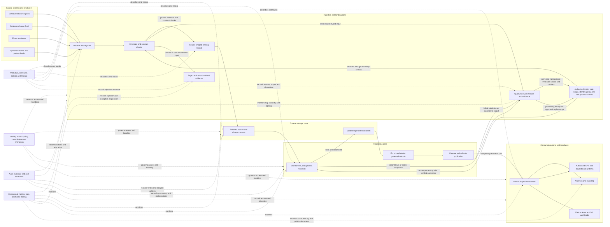

# Ingestion, Storage, Processing and Consumption Zones

**Roadmap location:** Applied AI Engineering Roadmap → Stage 2D — Data Architecture → `07-Enterprise-Data-Platform-and-Lakehouse-Architecture/`  
**Target file:** `02-ingestion-storage-processing-and-consumption-zones.md`  
**Topic sequence:** Module 2D.7, Topic 02  
**Level:** Beginner → Intermediate → Advanced

> **Source and scope note.** The module roadmap states that this topic file and the other module lesson files were empty when the roadmap was written. This lesson is authored from the roadmap's Topic 02 syllabus and its stated dependencies; it does not claim to reproduce pre-existing lesson content. Specific organisations, values, retention periods, roles, controls, and recommendations below are illustrative design assumptions, not universal requirements. This lesson is vendor-neutral and does not prescribe cloud products.

## 1. Purpose and orientation

Topic 01 established the platform's logical capabilities: acquire data, store it, process it, discover it, govern it, serve it, operate it, and enable teams to use it. This lesson adds a first structural model to that capability map: **zones**. A zone is a responsibility boundary that describes where a class of work happens, what may enter or leave, which controls apply, and who is accountable.

A useful analogy is a distribution centre:

- **Receiving dock (ingestion/landing):** shipments arrive and are identified.
- **Shelving/storage:** goods are kept under known conditions.
- **Packing and inspection (processing):** goods are checked, combined, or prepared for a purpose.
- **Dispatch/shop floor (consumption):** approved outputs are delivered to people and systems.

The analogy is not a physical deployment prescription. Several zones may be logical sections of one storage system, and one logical zone may span multiple systems. The design goal is to make data movement deliberate, secure, recoverable, and understandable—not to maximise the number of boxes in a diagram.

### Learning outcomes

By the end of this lesson, you should be able to:

1. Define ingestion/landing, storage, processing, and consumption zone responsibilities, including what each normally does and does not do.
2. Trace data from a source to a consumer through the zones without unexplained transitions.
3. Define boundary checks, ownership, access, retention, quality expectations, and exit criteria for each zone.
4. Evaluate promotion, copying, and exposure of data across boundaries, including quarantine and reprocessing paths.
5. Explain how batch, incremental/change-data, and streaming/event workloads affect zone design.
6. Choose between logical sections in shared storage and physically separate zones, and between quarantine and reject-at-ingress, using explicit trade-offs.
7. Document an illustrative zone-granularity decision and defend the assumptions behind it.

### Prerequisites

The module roadmap identifies Topic 01, storage architecture (P8), and data integration (P9) as prerequisites. In particular, be comfortable with:

- **Capabilities and ownership:** what a platform capability does and which team is accountable for it.
- **Object storage, file/table formats, and lifecycle:** storage is not the same thing as a table format or a platform.
- **Data contracts and schema compatibility:** what a source promises about fields, meaning, and change.
- **Idempotency, deduplication, reconciliation, and failure handling:** how retries avoid silently duplicating effects and how completeness is checked.
- **Requirements and trade-offs:** freshness, availability, throughput, privacy, cost, and replay needs may conflict.

### Quick diagnostic

Answer before continuing; short answers are enough.

1. What is the difference between a capability and a zone?
2. Why might a platform retain data as received before transforming it?
3. What should happen if a required field is missing from an incoming file?
4. Why is replay useful, and what makes it risky for sensitive data?
5. Is a bronze layer the same thing as an ingestion zone? Why or why not?

**Self-check:** A capability describes what the platform can do; a zone organises responsibility and controls around a stage of data handling. Retaining source-shaped input can support audit, reconciliation, and replay, subject to privacy and retention constraints. Invalid input needs an explicit reject or quarantine path with evidence and ownership. Replay supports recovery but can reintroduce sensitive data or duplicate effects if poorly controlled. Zones and refinement layers are different concepts; Topic 03 develops the layer distinction further.

## 2. Foundations: what a zone is—and is not

### 2.1 The four common logical zones

The four-zone model below is a useful starting point, not a mandatory architecture for every organisation.

| Zone | Primary responsibility | Usually does | Usually does not do | Example |
|---|---|---|---|---|
| **Ingestion / landing** | Receive and register source data reliably | Authenticate source, capture arrival metadata, preserve source payload where policy allows, record batch/event identifiers, perform safe envelope checks | Own complex business transformations or publish consumer-ready metrics | Store a partner file with source name, arrival time, checksum, and batch ID |
| **Storage** | Keep data durably under defined access and lifecycle rules | Persist data, protect it, maintain recoverable copies where required, support retrieval, track retention and deletion | Decide all business semantics or expose every stored record to all users | Hold received card events and validated transaction records in controlled datasets |
| **Processing** | Validate, standardise, enrich, reconcile, and prepare data | Apply schema and business rules, deduplicate, join, aggregate, derive records, emit quality outcomes | Silently discard rejected records or publish partially written results as complete | Join card events with reference data and calculate governed risk indicators |
| **Consumption** | Expose approved data for defined consumers and use cases | Publish stable tables, views, APIs, extracts, or semantic interfaces; enforce consumer access and freshness expectations | Become an unrestricted shortcut around upstream governance | Provide a governed risk dashboard dataset to authorised analysts |

**Convention, not absolute law:** landing commonly preserves data close to how they were received and avoids business transformation. Lightweight envelope checks, malware screening, encryption, format checks, or routing metadata may occur at ingress. Some architectures normalise envelopes immediately for technical reasons. If landing changes payload semantics, document the change and preserve enough source evidence for audit or replay where required.

### 2.2 Zone vs layer vs component vs data product

| Term | Meaning | Example | Design question |
|---|---|---|---|
| **Zone** | Responsibility boundary in the data lifecycle | Landing zone | Who controls movement into and out of this area? |
| **Refinement layer** | State or level of refinement of data | Bronze, silver, gold | How has the data been validated or transformed? |
| **System/component** | A technical or logical part implementing a capability | Ingestion service, table store, validation job | What responsibility and interface does this component provide? |
| **Data product** | A consumer-facing data offering with an owner, purpose, contract, and support expectations | Card-risk monitoring dataset | Who uses it, what does it mean, and what promise accompanies it? |
| **Interface** | A defined way for components or consumers to interact | File drop contract, table access, event subscription, query interface | What format, semantics, permissions, and failure behaviour apply? |
| **Data flow** | Movement or transformation of data between source, zones, and consumers | Card event → landing → validated storage → risk dataset | What moves, why, under which controls, and how is it tracked? |

Zones, layers, and products can intersect without being interchangeable. For example, a landing zone might contain data that later becomes bronze, but the terms answer different questions. A gold table may be published as part of a data product, but the table alone does not provide ownership, documentation, access policy, freshness commitments, or support. Exact zone names and whether boundaries are logical or physical depend on requirements, risk, workload, organisation, and operating capability.

### 2.3 What makes a boundary meaningful?

A boundary is meaningful when it defines at least:

- **Entry conditions:** what must be true before data enter.
- **Permitted operations:** what processing or mutation is allowed inside.
- **Ownership:** the team responsible for operation and exceptions.
- **Access and classification:** who can read, write, administer, and approve.
- **Exit conditions:** what must be true before data move onward or become visible.
- **Evidence:** identifiers, logs, quality results, lineage, and audit records needed to explain what happened.
- **Recovery:** how to retry, replay, quarantine, reconcile, or safely stop.

A zone label without these rules is just a box on a diagram.

### 2.4 Quick activity-classification exercise

Place each activity in its primary zone or mark it **cross-cutting**. Some activities touch more than one zone; choose the primary responsibility and note any required hand-off.

1. Receive a partner file and assign a batch ID.
2. Record arrival time and the source contract version.
3. Preserve the accepted source-shaped file under its retention policy.
4. Validate a required field and quarantine a recoverable schema defect.
5. Deduplicate change records using source position and entity semantics.
6. Join customer and account records to derive a business measure.
7. Publish a complete dashboard table through a governed interface.
8. Apply least-privilege access to sensitive landing records.
9. Set lifecycle expiry for a temporary replay buffer.
10. Monitor consumer lag and alert the owning team.
11. Compare input and output totals to establish reconciliation.
12. Register lineage from a source batch to a published output.

**Check:** ingestion/landing primarily owns 1–2 and the initial handling in 4; storage owns 3 and 9; processing owns 5–6 and the quality/reconciliation work in 11; consumption owns 7. Activities 8 and 10 are cross-cutting controls/operations. Activity 12 is a cross-cutting metadata/lineage responsibility recorded across the path. Quarantine itself is a cross-zone exception path, so activity 4 must include a hand-off and named owner rather than being treated as a normal landing outcome.

## 3. Vendor-neutral logical zone architecture

### 3.1 Reading the diagram

- **Solid arrows** represent the primary data path or an explicitly named recovery path. A transition is not complete merely because a job started; the implementation must define when data are considered durably accepted or published.
- **Dashed arrows** represent cross-cutting services that describe, govern, record, or observe work. They are not data transformation steps and do not replace data movement.
- **Receive and register** identifies the source, arrival, delivery/batch/event identifier, and expected contract. It should support safe retry and duplicate detection.
- **Envelope and contract checks** validate technical and contractual preconditions before the payload is treated as accepted. A source may pass envelope checks yet fail later business-quality checks.
- **Landing** preserves a source-shaped representation where policy and design permit. It gives the platform a stable recovery point and evidence of what arrived.
- **Quarantine** is a controlled holding and triage path for input or output that may be recoverable. It stores the reason, scope, identifiers, and handling status. **Reject** means the platform refuses to accept the item into the normal path; it still records enough evidence to explain the refusal. Depending on the design, a rejected item may be retained in a restricted evidence store, but it must not silently enter normal processing.
- **Replay is a controlled re-entry, not a bypass.** An ingress correction must pass the relevant identity, contract, classification, and security checks again. A processing replay must have a bounded authorised scope, verified correction/rule version, duplicate protection, and output validation. The exact implementation can differ, but a quarantine arrow must never imply automatic promotion.
- **Durable storage** separates persistence from processing. `RAW` and `VALID` are illustrative dataset categories, not prescribed layer names. Their exact physical layout is deferred to later topics.
- **Processing** performs standardisation, deduplication, reconciliation, enrichment, and derived calculations. Failed records or batches go to an explicit exception path rather than disappearing.
- **Prepare and validate publication** creates a complete publication unit and verifies its contract before it is visible. Consumers should not see half-written outputs as complete.
- **Consumption interfaces** expose approved outputs to different consumer types under policy. BI, APIs, and data science workloads may have different performance, access, and freshness needs.
- **Metadata, security, audit, and observability** apply across the path. They should be designed into each transition rather than bolted on only after incidents occur.

The diagram is a logical view: it does not claim that each box must be a separate server, storage account, network, process, or team. Topic 04 later examines compute, storage, and control-plane placement; Topic 05 develops metadata services in more depth.

## 4. Zone contracts: purpose, interfaces, and controls

The following is a **starter contract** for the illustrative platform. Replace provisional roles, retention values, and checks with decisions based on actual requirements, classification, regulation, and operational capacity. Retention is deliberately stated as a policy decision rather than a universal number.

| Zone | Purpose | Inputs | Outputs / interfaces | Provisional owner | Allowed operations | Access model | Quality checks | Retention / lifecycle | Exit or promotion criteria |
|---|---|---|---|---|---|---|---|---|---|
| Ingestion / landing | Receive reliably and preserve evidence | Files, API responses, CDC records, events | Registered batch/event, source-shaped object/record, receipt metadata | Platform ingestion team; source owner accountable for contract | Receive, identify, checksum, timestamp, validate envelope, encrypt, route | Writer identities for approved sources; tightly restricted operator access; no blanket analyst access | Source identity, schema/contract version, required envelope fields, size/format, checksum, event/batch ID | Defined per source using replay, audit, privacy, and cost needs; expire temporary buffers safely | Accepted and registered with an outcome; invalid inputs routed to quarantine or reject with evidence |
| Storage | Persist records and datasets durably | Accepted landing data and validated records | Durable dataset/table/object interface, partition or snapshot identifiers where relevant | Data platform storage owner; data owner defines meaning and retention need | Persist, retrieve, partition, protect, apply lifecycle, maintain recovery capability | Least privilege; separate read/write/admin roles; sensitive raw data restricted | Write completeness, schema compatibility, checksums/count reconciliation where appropriate, integrity checks | Policy-driven lifecycle; consider legal hold, deletion, archival, replay horizon, and derived-copy propagation | Data is durable, identifiable, access-controlled, and available to authorised processing |
| Processing | Convert persisted inputs into usable, checked outputs | Durable inputs, reference data, contracts, processing rules | Validated records, aggregates, exception records, publication candidates | Processing/pipeline owner; domain owner approves business semantics | Validate, standardise, deduplicate, join, reconcile, enrich, aggregate, stage | Job identity with scoped permissions; humans use controlled development/operations access | Business rules, null/range checks, duplicate rules, referential integrity, count/value reconciliation, freshness | Intermediate data retained only as needed for restart, audit, debugging, or replay; delete safely under policy | Quality thresholds and reconciliation pass, exceptions accounted for, lineage and run status recorded |
| Consumption | Publish approved data to defined consumers | Validated, publication-ready datasets | Governed tables/views, API responses, extracts, semantic interfaces | Data product/domain owner with platform support | Publish, query, serve, cache where approved, expose documented contract | Consumer-specific roles; purpose limitation and masking where needed; no bypass of policy | Contract compatibility, publication completeness, freshness, access checks, consumer-visible quality signals | Based on consumer purpose, contractual need, privacy, and source lifecycle; manage copies/caches | Output is complete, discoverable, documented, authorised, and meets its defined publication conditions |
| Quarantine / exception path (cross-zone) | Contain failures and enable safe triage/recovery | Invalid input, failed records, failed publication candidates | Restricted exception record, reason code, case/alert, replay request | Owning ingestion or processing team; data steward/security as needed | Isolate, inspect with permission, correct, approve, replay, or dispose | Highly restricted; access logged; avoid copying sensitive payload into tickets/logs | Reason recorded, affected IDs/counts known, retry eligibility determined, disposition tracked | Shortest period consistent with diagnosis, audit, legal requirements, and replay needs; periodically review backlog | Explicit disposition: corrected/replayed, rejected, waived with approval, or securely deleted |

### 4.1 Ownership is not just a team name

Every zone needs an accountable owner and an operational path. For each boundary, identify:

- who owns the source contract and who owns the receiving interface;
- who is paged when the transition stalls;
- who may approve a schema exception or replay;
- who confirms data quality and business semantics;
- who decides retention, deletion, and access exceptions;
- who can prove that an output was published completely.

Where responsibility is not yet decided, mark it **unknown** and treat that as an architecture gap. Do not hide the gap behind a generic label such as “data team.”

## 5. Data movement patterns across the zones

Batch, incremental/change-data, and streaming flows use the same responsibility model but differ in how data arrive, how progress is tracked, and how recovery works. A single platform may support all three. The following systems and targets are illustrative.

### 5.1 Batch flow: daily partner settlement file

**Assumptions:** Northbridge Bank receives a partner settlement file each business day. The file includes a batch identifier, expected record count, and a checksum supplied through an agreed delivery contract. The file may contain sensitive transaction details. No actual bank or regulatory target is implied.

1. **Source → receive/register:** the partner delivers `settlement_YYYYMMDD` with batch ID and checksum. The platform records source, arrival time, contract version, and delivery status.
2. **Receive → envelope checks:** check filename/identity rules, readable format, declared size, checksum, and required batch metadata. A missing checksum may be a hard rejection or a recoverable quarantine depending on the agreed contract.
3. **Envelope checks → landing:** once accepted, store the file or source-shaped records with a stable batch ID. A retry of the same delivery should be recognisable, not treated as a new business batch without review.
4. **Landing → durable storage:** persist the received representation and receipt evidence. A successful landing acknowledgement should mean the agreed durability condition was met, not merely that bytes entered a temporary buffer.
5. **Storage → processing:** parse records, validate field types and business constraints, check duplicates, and reconcile observed count and totals against the source manifest where available.
6. **Processing → exception path or validated storage:** malformed records may be quarantined at record level if safe and supported; a file-wide contract violation may quarantine the batch. The policy must say whether partial acceptance is allowed. Do not silently drop bad rows.
7. **Validated storage → publication candidate:** join approved reference data if needed and produce the settlement dataset. Validate totals, row counts, required keys, and business reconciliation rules.
8. **Publication candidate → consumption:** publish atomically or through a versioned/snapshot-based interface so readers see either the previous complete version or the new complete version—not a half-written one. Record publication version, run ID, and lineage.
9. **Recovery:** retry transient delivery or processing failures with idempotent identifiers. Replay from landing only after checking whether the batch or downstream effects were already applied. Reconcile counts/totals after recovery.

**Why retain landing evidence?** It can allow investigation and reprocessing when transformation logic is corrected. Retention must still respect sensitivity, deletion obligations, and the value of historical replay.

### 5.2 Incremental/change-data flow: account status updates

**Assumptions:** a source database emits change records with a source transaction position or monotonically trackable cursor. A change record identifies the affected entity and whether the change is an insert, update, or delete. Exact source semantics must be confirmed; not every feed includes all of these fields.

1. **Source → receive/register:** the change feed reader captures change records and the source position/cursor associated with them.
2. **Receive → landing/buffer:** append change records with source position and ingestion metadata. A short buffer may smooth bursts, but it is not the only durable recovery point unless the contract explicitly says so.
3. **Landing → durable change storage:** persist the change set before advancing the committed cursor when the design requires replay after process failure. The ordering of persist and checkpoint must avoid a gap where a cursor advances but the corresponding records are lost.
4. **Storage → processing:** apply changes using the source's ordering and key semantics. Deduplication may use source position/event identity; blindly deduplicating only on entity ID could erase legitimate successive updates.
5. **Processing → validated state/history:** maintain current state, history, or both according to the data model and consumer needs. Handle deletes explicitly; a delete may require a tombstone or a governed deletion action rather than simple omission.
6. **Validation/reconciliation:** compare source progress and destination progress; detect gaps, repeated positions, schema changes, and unexpected volume changes. A checkpoint says where the reader believes it has progressed; it does not prove the destination is correct.
7. **Validated storage → processing/publishing:** downstream transformations consume committed changes and create a complete output version. Consumers should not observe a partially applied logical transaction if the business contract requires transaction consistency.
8. **Recovery:** resume from a durable checkpoint or replay a known range. Ensure applying the same change range again is idempotent or protected by a deduplication/merge rule. Reconcile source and destination before declaring recovery complete.

**Key distinction:** incremental ingestion transfers changes since a prior position; it is not automatically real-time streaming, and it is not necessarily a complete history unless deletes, ordering, retention, and replay are specified.

### 5.3 Streaming/event flow: card authorisation events

**Assumptions:** card authorisation events arrive continuously. A risk-monitoring use case wants prompt updates, but the actual latency target is to be established from business requirements. Events can be duplicated, arrive late, or be delivered out of order.

1. **Producer → receive/register:** an event producer sends an event with an event ID, event time, producer/source identity, and schema version where the contract supports these fields.
2. **Ingress → durable buffer/landing:** append events to a replayable buffer or durable landing interface. The platform records ingestion time as distinct from event time. The buffer's retention and throughput are designed around expected outage and replay needs.
3. **Buffer → durable storage:** persist accepted events and preserve a replay path. Acknowledge only at the durability level promised by the interface. If the architecture intentionally processes before long-term persistence, document the loss/recovery trade-off explicitly.
4. **Storage/buffer → processing:** consumers process events in parallel where possible. Partitioning or keying may preserve order for a chosen entity or partition, but does not guarantee global order across all events.
5. **Processing rules:** deduplicate using a stable event identity, validate event schema and business rules, and define how event time and processing time affect calculations. A late event may revise a historical window or be routed for reconciliation according to the use case.
6. **Exception path:** malformed events, impossible timestamps, or rule violations go to quarantine or a dead-letter-style exception path with identifiers and reason codes. Avoid logging full sensitive payloads by default.
7. **Storage and publication:** write validated events/derived state to governed storage and publish a risk dataset only after its own completeness and freshness conditions are met. “Streaming” does not remove the need for durable storage, lineage, access policy, or reconciliation.
8. **Recovery:** checkpoint consumer progress in a manner coordinated with output commits. After failure, replay from a known position; deduplicate or make updates idempotent to handle at-least-once delivery. If exact once-only effects are claimed, define the scope and mechanisms carefully—delivery semantics alone do not guarantee exactly-once business outcomes across every external system.

### 5.4 How the three patterns coexist

| Concern | Batch | Incremental/change-data | Streaming/events |
|---|---|---|---|
| Arrival unit | File, extract, scheduled batch | Change record or bounded change set | Individual event or small event batch |
| Progress tracking | Batch ID, manifest, completion marker | Source cursor/position and committed destination progress | Offset/sequence/checkpoint plus output commit state |
| Main completeness evidence | Counts, checksums, totals, manifest | Cursor continuity, key/version rules, reconciliation | Event IDs, lag, checkpoint continuity, window/reconciliation checks |
| Replay source | Retained landing batch or source resend | Durable change log or retained source range | Replayable buffer/log or retained event storage |
| Ordering | File order may not imply business order | Source position/order semantics | Partition/key ordering only within its defined scope; late events remain possible |
| Typical recovery risk | Partial batch or duplicate batch | Gap from cursor/checkpoint mismatch | Duplicate delivery, lag, late/out-of-order events, checkpoint/output inconsistency |

All three should land in a governed storage and metadata model that makes source, schema, timing, ownership, access, and lineage visible. A separate ingestion path may be justified by latency or scale, but it should not become a separate ungoverned platform.

## 6. Boundary checks and movement rules

Every movement between zones is a controlled transition. The exact checks vary by source and use case; the following checklist is a design aid.

### 6.1 Entry checks

- **Identity and provenance:** is the producer authorised, and can the platform identify the source and delivery?
- **Contract/schema:** is the payload compatible with the expected contract version? Are required fields, types, and semantics present?
- **Integrity and completeness:** can size, checksum, record count, cursor continuity, or other source evidence be checked?
- **Classification:** what sensitivity and criticality apply? Apply classification as early as practical, before broad access is granted.
- **Security:** are data encrypted in transit and at rest where required? Are credentials handled outside payloads and logs? Is access scoped to least privilege?
- **Duplicate/retry handling:** does this delivery/event already exist? Which identifier distinguishes a retry from a new business event?
- **Resource limits:** are size, rate, and schema complexity within allowed bounds? Can the platform apply backpressure or reject safely?

### 6.2 Processing and promotion checks

- **Technical validity:** parsing, type conversion, schema compatibility, required columns, and format correctness.
- **Business quality:** ranges, nullability, valid state transitions, referential integrity, and domain-specific rules.
- **Deduplication and reconciliation:** distinguish duplicate delivery from legitimate repeated updates; compare counts or totals to independent evidence where possible.
- **Exception handling:** classify failures as transient, correctable, policy-blocked, or non-recoverable. Record reason, affected scope, and next action.
- **Lineage and run evidence:** preserve source IDs, transformation version, execution/run ID, input/output references, quality results, and who/what initiated the operation.
- **Publication atomicity:** define what makes a publication complete and how consumers discover the current valid version. Avoid exposing partial writes.
- **Access transition:** validate both the service identity writing the output and the consumer identities permitted to read it. A successful processing job does not itself authorise all users to consume its output.

### 6.3 Quarantine, reject, and reprocessing

**Quarantine** is appropriate when an item may be inspected, corrected, or retried and the organisation can hold it safely. **Reject-at-ingress** is appropriate when the input cannot safely enter the platform's normal data path—for example, an unauthorised source, a prohibited payload, or an unrecoverable format violation. Rejecting must still create suitable operational evidence; it does not mean “forget the failure.”

A reprocessing procedure should specify:

1. **Eligibility:** which error classes can be retried, corrected, or replayed?
2. **Authority:** who can approve replay, data correction, or a policy exception?
3. **Scope:** which batch IDs, event IDs, source positions, or record keys are affected?
4. **Safety:** how will the replay avoid duplicate downstream effects and prevent unapproved sensitive-data exposure?
5. **Evidence:** where are the reason, operator/automation identity, rule version, timestamps, and outcome recorded?
6. **Closure:** how are reconciliations performed and the quarantine backlog disposed of under retention policy?

Never route quarantined records back into the normal path simply because a timer expired. Retry should be conditional on an error being plausibly transient or on a correction being verified.

## 7. Failure scenarios: detect, contain, recover

The responses below are patterns, not universal prescriptions. Choose based on data criticality, recovery objectives, source guarantees, and business impact.

| Failure | Detection signals | Containment | Recovery / replay approach | Evidence and owner |
|---|---|---|---|---|
| Malformed input or incompatible schema | Contract validation failure, parse error, schema-version alert | Quarantine recoverable items; reject unsafe or prohibited inputs; block promotion | Correct source or mapping, validate against contract, replay scoped input; do not silently coerce meaningful values | Payload/batch/event ID, schema version, reason, decision, disposition; ingestion owner plus source owner |
| Partial write or incomplete publication | Missing completion marker, count mismatch, failed commit, consumer sees unexpected gap | Keep candidate output invisible; mark run failed; preserve last complete publication | Retry from durable input using idempotent writes or write-new-version-and-switch pattern; reconcile before publish | Run ID, output version, expected/actual counts; processing owner |
| Stalled consumer / buffer backlog | Lag growth, oldest-event age, checkpoint not advancing, storage pressure | Apply backpressure, scale within safe limits, pause noncritical consumers, protect source/buffer capacity | Restart from committed checkpoint; replay retained events; validate no gap or duplicate effect | Lag metrics, checkpoint, replay range, capacity incident; stream/ingestion owner |
| Late or out-of-order events | Event-time lateness distribution, corrections after window close, ordering violations | Apply defined late-event policy; isolate events outside supported lateness if needed | Recompute affected window/state, publish correction/version, or route to reconciliation according to contract | Event ID/time, processing time, affected output version; domain processing owner |
| Duplicate delivery or retry | Repeated batch/event ID, repeated source position, duplicate-key metric | Deduplicate at an explicitly chosen boundary; prevent duplicate side effects | Reapply only with idempotent merge/write or deduplication key; reconcile affected outputs | Original and retry IDs, dedup decision, counts; ingestion and processing owners |
| Processing job fails | Failed run, quality gate, exception rate, unavailable dependency | Do not publish incomplete candidate; retain last known-good output if safe | Retry transient failures; fix logic/data for deterministic failures; replay from durable checkpoint/input; compare results | Code/rule version, input range, failure class, retry history; pipeline owner |
| Storage exhausted or quota reached | Capacity forecast, write failures, rising backlog, lifecycle failures | Stop unsafe writes or apply backpressure; prioritise critical flows; avoid deleting data outside policy | Expand/relieve capacity, apply approved lifecycle rules, resume from durable checkpoint, reconcile gap | Capacity/retention actions, deleted/archived scope, recovery reconciliation; storage owner |
| Unauthorized access or policy failure | Denied access, anomalous reads, policy decision logs, unexpected export | Revoke/contain identity, block publication/access path, preserve audit evidence, invoke incident process | Validate scope, rotate credentials if needed, assess exposure, restore least-privilege policy, verify access tests | Identity, resources, timestamps, policy decision, incident actions; security and data owner |
| Quarantine backlog grows without closure | Age/count of exceptions, repeated retries, missing owner or disposition | Pause unsafe promotions; route to named owner; prevent uncontrolled access | Prioritise by impact, correct source/rule, replay in bounded batches, or dispose securely under policy | Age, reason distribution, owner, approval, final disposition; zone owner |

### 7.1 Avoid recovery that creates a second incident

- Do not advance a source cursor beyond data that are durably recoverable unless the contract explicitly accepts the risk.
- Do not replay a range until you know whether its prior effects committed.
- Do not “fix” missing fields by inventing defaults without a documented semantic rule.
- Do not expose candidate outputs to consumers before publication checks pass.
- Do not retain sensitive quarantine payloads indefinitely just because diagnosis is unfinished; define escalation and retention controls.
- Do not call a pipeline recovered solely because it is green. Reconcile input/output completeness and consumer-visible state.

## 8. Logical versus physical separation

A zone is a responsibility boundary; it need not map one-to-one to physical infrastructure. Two broad options are common.

| Design choice | Benefits | Costs and risks | More suitable when |
|---|---|---|---|
| **Logical sections in shared storage** | Fewer systems to operate; less copying; simpler cross-zone discovery; potentially lower cost | Access-policy mistakes can cross boundaries; shared capacity/noisy-neighbour effects; lifecycle and failure domains may be coupled; isolation may be insufficient for high-risk data | Workloads share trust requirements, controls can be enforced reliably, scale and failure isolation are acceptable, and ownership is clear |
| **Physically separate zones or stores** | Stronger separation of access, capacity, lifecycle, or failure domains; independent scaling and retention; clearer containment in some threat models | More copies and transfer paths; more interfaces and policy drift risk; duplicated operations, monitoring, and cost; cross-boundary consistency is harder | Regulatory, threat, residency, workload, or availability requirements justify the added boundary and the organisation can operate it |
| **Hybrid** | Shared standard path for most data plus isolated boundaries for exceptional domains/workloads | More architecture variants to document and support; exceptions can multiply if criteria are vague | A common platform is valuable but some data classes or workloads have materially different risk/performance needs |

Physical separation does not automatically guarantee security, and logical separation is not automatically unsafe. Evaluate identities, policy enforcement, administrator privileges, network boundaries, encryption keys, recovery design, and residual risk. If teams share an administrator role with broad privileges, a separate directory or folder alone may not provide the intended isolation.

### 8.1 Quarantine versus reject-at-ingress

| Option | Benefits | Costs / risks | Choose when |
|---|---|---|---|
| **Quarantine** | Preserves recoverable evidence; supports diagnosis, correction, controlled replay, and source feedback | Requires restricted storage, triage ownership, lifecycle, tooling, and backlog management; may increase sensitive-data exposure if poorly controlled | Errors may be correctable or transient, evidence/replay matters, and safe containment is feasible |
| **Reject at ingress** | Prevents invalid input entering the normal path; reduces downstream contamination and quarantine burden | Source resend may be required; evidence may be lost if rejection is poorly logged; transient problems can cause repeated delivery failures | Input is unsafe, prohibited, unauthenticated, or cannot be interpreted safely, and source-side correction/resend is viable |
| **Mixed policy** | Allows strict rejection for unsafe cases and quarantine for recoverable data-quality cases | Requires explicit classification and consistent error taxonomy | Most realistic when error types have different safety and recovery properties |

The recommended default is not “quarantine everything.” Define error classes and decisions. For example, an unauthorised producer may be rejected immediately with security evidence, while a valid partner's file with one recoverable formatting defect may be quarantined for correction.

## 9. Advanced design: capacity, reliability, security, and operations

### 9.1 Size zones from workload evidence

Do not select storage or zone topology by guessing a single universal volume. Estimate and validate:

- normal and peak arrival rate, including burst duration;
- average and worst-case record/file size and schema complexity;
- growth over the planning horizon and concurrent producer count;
- processing expansion (joins, intermediate data, retries, snapshots, indexes or equivalent structures);
- consumer concurrency and publication/query patterns;
- backlog growth during a dependency outage and the time needed to catch up;
- replication, backup, retention, and replay copies;
- cost of reprocessing versus retaining historical inputs.

For streaming, a buffer that absorbs a short burst may not handle a multi-hour downstream outage. For batch, one huge file can create a different bottleneck from many small files. For incremental ingestion, the source change rate and the maximum recoverable log range are key design inputs.

### 9.2 Parallelism and backpressure

Processing parallelism can improve throughput but introduces coordination, ordering, shared-resource contention, and skew risks. Partition by a key that matches ordering or access needs, while avoiding a small number of extremely hot keys. Define what happens when downstream processing cannot keep up: buffer, throttle, reject, or shed only explicitly noncritical work. The selected response must preserve the source contract and recovery objective.

### 9.3 Idempotent transitions and checkpoints

A transition is **idempotent** when repeating the same logical operation has the same intended result as performing it once. In practice, use stable delivery/event IDs, source positions, deterministic output keys, merge/replace semantics, or versioned publication—whichever fits the data semantics. Idempotency is not a substitute for reconciliation; a technically successful retry can still produce the wrong business result.

Checkpointing records progress. The design must coordinate checkpoints with durable input and output commits. If a checkpoint moves ahead of durable output, records may be lost. If output commits but the checkpoint does not advance, replay may repeat work. Safe designs make either case recoverable.

### 9.4 Retention, replay, and sensitive raw data

Retention is a trade-off among replay value, audit evidence, storage cost, privacy, legal requirements, and the risk of retaining unnecessary copies. Ask:

- What is the longest plausible time before an error is discovered?
- Can the source resend or reconstruct historical data?
- Is the raw representation more sensitive than derived outputs?
- Which copies, caches, quarantine records, logs, and backups contain the data?
- Can deletion be propagated and verified across derived datasets?
- Does a legal hold or audit rule override normal deletion, and who can authorise it?

Apply classification and restrictive access early. Use masking, tokenisation, minimisation, or selective field retention where justified by requirements. Do not assume raw or landing data are safe because they are “not curated.” Raw payloads may contain direct identifiers, secrets accidentally sent by a source, or data not required by the consumer.

### 9.5 Operational ownership and service boundaries

A zone needs a runbook, dashboards/alerts, on-call or support routing, change process, recovery procedure, and a way to communicate incidents to affected consumers. Define which issues belong to the source owner, ingestion team, storage owner, processing owner, domain data owner, and security function. Shared platform teams should provide safe paved paths, while domain teams remain accountable for business meaning and domain-specific quality rules where appropriate.

### 9.6 Illustrative controls and decision criteria

The following are candidate controls, not universal mandates:

- stable IDs and idempotent writes for retryable transitions;
- source-to-target reconciliation for critical feeds;
- a quarantine reason taxonomy with an assigned owner and ageing alert;
- least-privilege service identities and logged privileged access;
- publication through a complete version/snapshot or equivalent commit boundary;
- retention policy attached to source and data classification metadata;
- alerting on ingestion lag, processing failure, failed quality gates, and storage capacity;
- cost attribution by domain, source, workload, or consumer where it supports decisions.

Prioritise controls by impact, likelihood, recovery cost, compliance obligations, and whether failure can contaminate downstream consumers. A low-volume feed can still require strict controls if it is highly sensitive or business-critical.

## 10. Illustrative Architecture Decision Record (ADR)

> **All context and estimates in this ADR are fictional assumptions for learning.** Replace them with measured requirements before using this decision in a real architecture.

### ADR-02: Use logical zone sections by default, with explicit physical isolation exceptions

**Status:** Proposed for the illustrative Northbridge Bank design  
**Decision owner:** Data Platform Architecture Lead  
**Review triggers:** material change in data classification, regulator/auditor requirement, demonstrated noisy-neighbour issue, inability to enforce access policy, or a revised recovery/availability objective.

#### Context

Northbridge has four initial feeds: ledger changes, card authorisation events, a CRM API, and a partner settlement file. The platform team is small. The initial objective is to establish consistent intake, durable storage, controlled processing, and governed consumption without operating many separate environments. Some card and customer fields are sensitive, and source-shaped inputs may contain more information than the dashboard needs. Replay is useful for correcting transformation defects, but unrestricted raw retention would increase exposure and cost.

#### Decision

Use logically separated ingestion/landing, storage, processing, and consumption responsibilities with explicit contracts, identities, lifecycle rules, and publication checks. Use a restricted quarantine path for recoverable data errors and reject unauthorised or unsafe inputs at ingress with audit evidence. Add physical isolation only when a documented risk, regulatory, workload, or availability requirement cannot be met by the logical boundary and its controls.

#### Alternatives considered

1. **Physically separate every zone and source.** Stronger potential isolation and independent capacity, but high operational burden, more transfer paths/copies, and more policy configurations for a small initial team.
2. **One undifferentiated shared storage area.** Lowest initial complexity, but unclear responsibility, risk of broad access, weak lifecycle separation, and difficult failure containment.
3. **Logical zones with criteria-based physical exceptions (selected).** Common operating model and lower duplication for the default case, while preserving an escalation path for domains that need stronger isolation.

#### Rationale

The selected option balances speed to value and operational capacity with enforceable access and lifecycle boundaries. It avoids treating physical separation as a universal security solution while retaining it as an option when risk analysis justifies the cost. A mixed quarantine/reject policy distinguishes recoverable quality failures from inputs that must not enter the normal path.

#### Consequences

- The platform must implement and test access policy, audit, lineage, lifecycle, and publication completeness across logical sections.
- Each source needs a contract and named owner; each exception needs a disposition path.
- Shared capacity and administrative privileges remain residual risks and must be monitored.
- Physical-isolation exceptions add cost and operational work and require an owner and review date.
- Raw retention must be justified by replay/audit value and limited by classification and policy.

#### Review and evidence

Review after the first representative batch, incremental, and streaming flows are exercised. Evidence should include a source-to-consumer trace, access-policy tests, failure/replay test results, reconciliation evidence, quarantine ageing/closure metrics, and an updated cost/operational assessment. These are proposed review artefacts, not claims that tests have already been run.

## 11. Hands-on exercises

Complete both exercises without choosing vendor products. You may use a drawing tool or plain Markdown. Use the Topic 01 capability map as the starting point.

### Exercise A — Zone model for four Northbridge source feeds

**Scenario:** Northbridge Bank is replacing ad hoc pipelines with a shared platform. The four fictional feeds are:

1. **Ledger changes:** incremental records with a source position; updates and deletes may occur.
2. **Card authorisation events:** continuous events; duplicates and late arrival are possible.
3. **CRM API:** scheduled extraction; schema changes are announced but may not always be backward-compatible.
4. **Partner settlement file:** daily batch with a manifest; malformed rows or a count mismatch may occur.

**Inputs:** Topic 01 capability inventory; these illustrative source profiles; known requirements/constraints from your earlier architecture work. If a requirement is unknown, label it as an assumption or open question rather than inventing a fact.

**Tasks:**

1. Define each zone's purpose, inputs, outputs, provisional owner, allowed operations, access, quality checks, and retention/lifecycle decision.
2. Draw a logical flow for all four sources from source to at least one consumer. Include metadata, security, audit, lineage, and observability as cross-cutting services.
3. State which flows are batch, incremental/change-data, or streaming and explain their progress/recovery identifiers.
4. Mark must-have, should-have, and later capabilities. Justify the classification with risk, user need, cost, and operating capacity.
5. Identify at least three assumptions that must be validated before physical implementation.

**Deliverables:**

- Zone definition/contract table.
- Vendor-neutral zone diagram with a legend.
- Short end-to-end flow trace for each source.
- Assumptions and open-questions list.

**Objective validation criteria:**

- Every source reaches a named consumer through an explainable path.
- Every zone has a purpose, owner or explicit `unknown`, access rules, retention/lifecycle decision, and exit criteria.
- Batch, incremental, and streaming flows have appropriate identifiers/checkpoints and recovery paths.
- Invalid data cannot silently disappear or reach consumption without the stated checks.
- No product/vendor names are used to stand in for logical capabilities.
- Cross-cutting security, metadata/lineage, audit, and observability are represented and tied to flows.

### Exercise B — Movement and quarantine rules

**Scenario:** the partner settlement file is missing a required column and its manifest count does not match the received count. Separately, a card event arrives 12 minutes after its event time and appears to duplicate an earlier delivery. These details are illustrative test cases, not a latency standard.

**Inputs:** Exercise A zone model and its source contracts.

**Tasks:**

1. Classify each failure: transient, correctable, policy-blocked, or non-recoverable. If classification depends on missing facts, state the decision condition.
2. Decide whether to quarantine or reject at ingress, and explain why.
3. Define reason codes, required evidence, notification recipients, and the accountable owner.
4. Specify how a corrected file or replayed event re-enters processing without duplicate business effects.
5. Define how the team reconciles the final result and closes the exception.
6. State how the rule changes if the event payload includes a prohibited sensitive field or the producer is unauthorised.

**Deliverables:** movement-rules table and a reprocessing sequence/flow.

**Objective validation criteria:**

- Every failure has a detection signal, containment action, owner, and recovery/disposition path.
- The file count mismatch is not ignored; partial acceptance is either prohibited or explicitly justified and reconciled.
- Late event policy distinguishes event time from arrival/processing time and explains whether outputs are corrected, recomputed, or held for reconciliation.
- Duplicate handling uses a defined identity or idempotent operation rather than assuming repeated entity IDs are always duplicates.
- Replay has an explicit scope, authorisation, duplicate-protection rule, and post-replay reconciliation.
- Sensitive/unauthorised input is not made broadly readable merely to simplify diagnosis.

## 12. Common mistakes and how to correct them

| Mistake | How to detect it | Why it is risky | Corrective action |
|---|---|---|---|
| Treating zones as physical infrastructure by default | Every zone is drawn as a separate cluster/account without a requirement | Adds cost and operational burden without proving risk reduction | Start with logical responsibilities; justify physical boundaries against threat, scale, compliance, and recovery needs |
| Treating landing as universally safe or public | Broad analyst access to source-shaped data | Raw inputs may include sensitive or unexpected fields | Classify early; restrict access; minimise and mask where required |
| Doing undocumented business transformations at landing | Landing payload no longer matches source but no transformation lineage exists | Audit and replay become ambiguous | Preserve source evidence where required; document technical normalisation and business transformations separately |
| Confusing zones with bronze/silver/gold | Diagram uses the terms interchangeably | Responsibility and refinement semantics become muddled | Label lifecycle responsibility and refinement level separately; develop layers in Topic 03 |
| No reject/quarantine path | Failed rows vanish or the entire job only reports “failed” | Loss of evidence and repeated incidents | Define error classes, reason codes, ownership, retention, and replay policy |
| Retrying without idempotency | Duplicate records or repeated side effects after restart | Incorrect totals and inconsistent state | Use stable IDs, deterministic writes, checkpoint coordination, and reconciliation |
| Advancing a checkpoint too early | Source cursor advances even though output is not durable | Data gaps after a crash | Coordinate durable input/output and progress commits; test crash points |
| Publishing partial results | Consumers see mixed old/new data or changing counts during a run | Incorrect reports and decisions | Use complete publication units, versioning/snapshots, or equivalent commit semantics |
| Retaining everything forever “for replay” | No retention owner or review date | Privacy, security, and cost exposure accumulate | Set source-specific retention based on replay, audit, and legal needs; propagate deletion policy |
| Treating streaming as a separate ungoverned platform | Different catalog, access, or audit model for events | Duplicated controls and inconsistent definitions | Reuse shared governance and metadata; document justified path differences |
| Missing operational ownership | Alerts have no named receiver or quarantine items age indefinitely | Failure becomes permanent backlog | Assign owner, support path, escalation, and disposition targets |
| Assuming exactly-once delivery means exactly-once business effects | External side effects can repeat after retries | Financial or business actions may duplicate | Define semantics end to end; use idempotency keys, transactions, or reconciliation as appropriate |

## 13. Review questions with answer key

Try answering without looking at the key first.

### Questions

1. What is the main purpose of an ingestion/landing zone?
2. Why is a zone not the same as a bronze/silver/gold layer?
3. Name four controls that may apply when data cross from landing to storage or processing.
4. Why should a batch have a stable batch ID and a streaming event have a stable event identity where possible?
5. What is the danger of advancing a source checkpoint before corresponding data are durably recoverable?
6. Explain one situation in which quarantine is preferable to rejection and one in which rejection is preferable.
7. Why is a separate physical store not automatically more secure than a logical section?
8. How should a platform respond to a late streaming event?
9. What must be true before a processing result is exposed to consumers?
10. Give two reasons not to retain all raw data indefinitely.
11. What is the difference between an operational log and lineage evidence?
12. If a feed is technically valid but business reconciliation fails, should it automatically be published? Explain.

### Answer key

1. To receive and register data reliably, preserve source/provenance evidence where permitted, and establish a controlled entry point.
2. A zone describes where responsibility and controls apply in the lifecycle; a refinement layer describes the data's transformation/quality state. They can overlap but are not interchangeable.
3. Examples: schema/contract validation, completeness/checksum/count checks, classification, least-privilege access, duplicate handling, encryption, quality checks, lineage, audit, and resource limits.
4. Stable identities make retries recognisable, support deduplication, scope replay, and provide evidence for reconciliation. The identity must match source semantics; an entity key alone may not distinguish legitimate updates.
5. A crash can leave the source cursor ahead of persisted output, creating an unrecoverable gap unless another replay mechanism exists.
6. Quarantine is useful for a recoverable formatting error where inspection/correction is safe. Reject is suitable for unauthorised or prohibited input that must not enter the normal path. Both require evidence and ownership.
7. Security depends on identity, policy, administrator access, network controls, keys, monitoring, and operations. Physical separation adds boundaries but can still be misconfigured and increases complexity.
8. Apply an explicit event-time/late-arrival policy: revise a window/state, recompute and republish, or route for reconciliation. Preserve event identity and auditability; do not silently discard it.
9. The output must meet the defined quality/reconciliation and completeness criteria, have appropriate access policy, and be published through a complete/atomic or versioned interface with lineage/run evidence.
10. Raw data may contain sensitive fields, create privacy/legal exposure, increase cost, and complicate deletion; replay value must be weighed against those risks.
11. Logs record events and operational behaviour; lineage describes where data came from and how it was transformed across dependencies. They complement but do not replace one another.
12. No. A technical parse success does not prove business correctness. Hold or quarantine the affected scope according to the contract, investigate, reconcile, and publish only if the defined policy allows it.

## 14. Compact glossary

- **Batch:** a bounded set of records processed together, often on a schedule.
- **Checkpoint/cursor:** a marker of source or processing progress; it must be coordinated with durable outputs.
- **Contract:** an agreement about schema, semantics, delivery, compatibility, and expected behaviour between producer and consumer.
- **Consumption interface:** a governed way for a consumer to read or receive published data.
- **Data lineage:** recorded relationships showing the origin and transformation path of data.
- **Event time:** when an event occurred according to its source; distinct from arrival or processing time.
- **Idempotency:** a property that makes repeating a logical operation safe with respect to its intended result.
- **Landing:** the controlled entry area where data are received and registered, commonly close to source shape.
- **Late event:** an event that arrives after the time window or ordering expectation used by processing.
- **Promotion:** a controlled transition of data from one responsibility area or quality state to another.
- **Quarantine:** a restricted holding path for items requiring investigation, correction, or controlled replay.
- **Reconciliation:** comparing independent evidence—such as counts, totals, positions, or keys—to establish completeness/correctness.
- **Replay:** reprocessing retained or re-readable input after failure or logic correction.
- **Zone:** a logical responsibility boundary in the data lifecycle, with entry/exit rules, ownership, and controls.

## 15. Mastery checklist and Topic 02 completion gate

### Mastery checklist

- [ ] I can explain the four common zone responsibilities and name what each normally does not do.
- [ ] I can distinguish zones from refinement layers, components, and data products.
- [ ] I can read and redraw the logical architecture without using vendor names.
- [ ] I can trace a batch, an incremental/change-data, and a streaming/event flow end to end.
- [ ] I can explain how buffer durability, checkpoints, replay, duplicates, ordering, and late events affect recovery.
- [ ] Every zone has a purpose, owner (or explicitly marked unknown), access model, quality checks, retention/lifecycle decision, and exit criteria.
- [ ] Every flow has a path for invalid data, failure detection, recovery, and final disposition.
- [ ] I can justify logical versus physical separation and quarantine versus rejection using explicit trade-offs.
- [ ] I can explain how sensitive raw data are classified, restricted, retained, and deleted.
- [ ] I have written an ADR that records context, decision, alternatives, rationale, consequences, and review triggers.

### Completion gate

Do not mark Topic 02 complete merely because you have read it. Complete and review the artefacts below.

- [ ] **Zone table and flow diagrams reviewed:** every source is traced to a consumer, and no transition lacks an owner or boundary rule.
- [ ] **Zone contracts complete:** purpose, inputs, outputs, access, owner, quality, retention/lifecycle, and exit criteria are present for each zone.
- [ ] **Reject and replay paths exist for every source:** exceptions have an owner, evidence, recovery/disposition, and reconciliation step.
- [ ] **Batch and streaming coexistence explained:** show where events are buffered/persisted and how both patterns reach governed storage and metadata.
- [ ] **Sensitive data and raw retention justified:** explain why data are kept, for how long under the assumed policy, and how access/deletion are controlled.
- [ ] **ADR documented and reviewed:** zone granularity and quarantine/reject strategy are defended against at least one credible alternative.
- [ ] **Weaknesses addressed:** if failure paths are vague, revisit Stage 2D / Topic 06, especially integration-pattern selection and failure handling, then revise the zone model.

**Mastery standard:** you can place an activity in the correct zone and justify the placement, define entry/exit checks at each boundary, and explain how batch and streaming data coexist without losing governance or recovery guarantees.

## 16. Handoff to Topic 03

This lesson has defined **zones as responsibility boundaries**: where data arrive, persist, are transformed, and are consumed, along with the controls for moving between those responsibilities. Topic 03—**Bronze, Silver, Gold and Data Product Boundaries**—will refine the storage/processing view by describing stages of data refinement and explaining why a consumer-facing data product is more than a table. Keep the concepts separate: zones answer *where responsibility sits in the platform lifecycle*; bronze/silver/gold answer *how data are refined*; data products answer *what governed offering a consumer receives and who stands behind it*.
