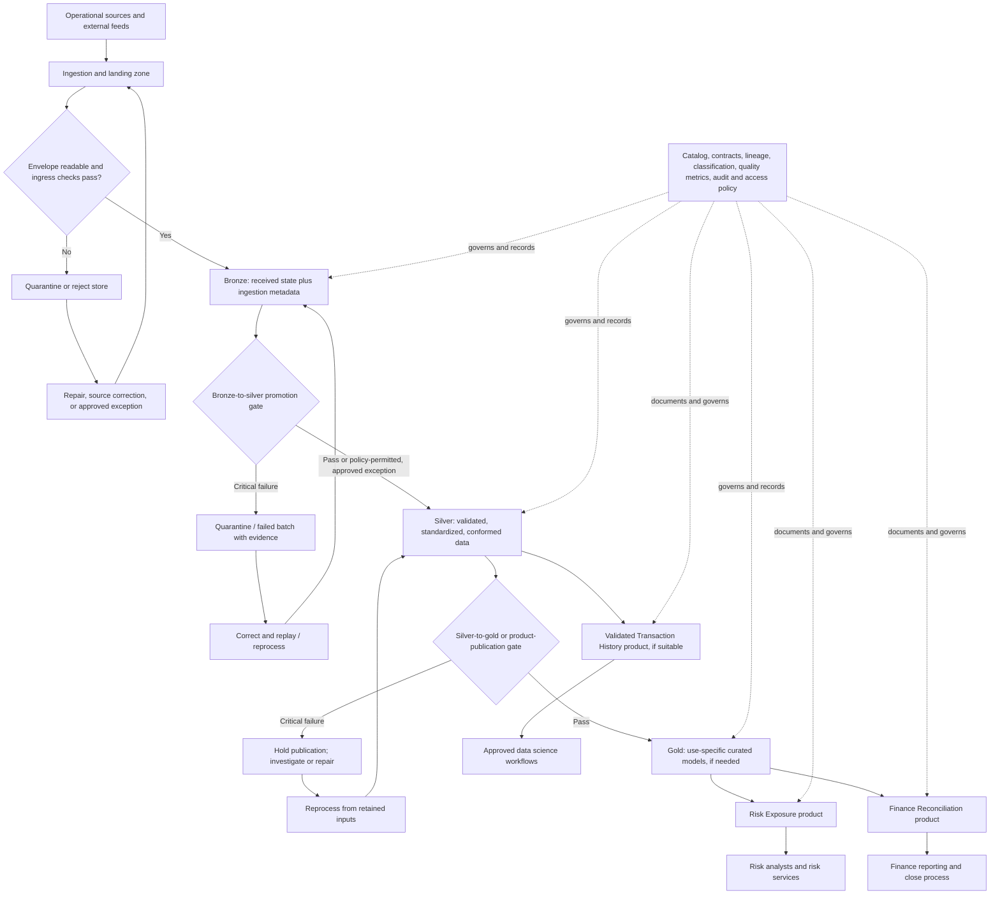

# Bronze, Silver, Gold, and Data Product Boundaries

**Roadmap location:** Stage 2D — Data Architecture → `07-Enterprise-Data-Platform-and-Lakehouse-Architecture/` → Topic 03  
**Estimated study time:** 6–8 hours (a recommendation, not a requirement)  
**Level:** Beginner → intermediate → advanced  
**Architecture stance:** Vendor-neutral. Bronze/silver/gold are common refinement patterns, not mandatory labels or a universal topology.

---

## 1. Lesson purpose

This lesson explains how data may be progressively prepared for reliable use and why **a refinement layer is not the same thing as a data product**. You will define layer responsibilities, assign ownership, specify testable promotion gates, preserve history for replay and correction, and design a consumer-facing product with a documented interface and measurable promises.

The lesson builds on Topic 01 (logical platform capabilities) and Topic 02 (ingestion, storage, processing, and consumption zones). It also relies on modeling concepts such as domain boundaries, grain, history, schema evolution, contracts, idempotency, and reconciliation.

### Learning outcomes

After completing this lesson, you should be able to:

1. Explain the purpose, content, and expected quality of bronze, silver, and gold **when those stages are useful**.
2. Distinguish platform zones, refinement layers, physical components, and consumer-facing data products.
3. Define layer ownership and testable promotion criteria, including failure and exception paths.
4. Explain how raw preservation supports reproducibility, audit, correction, and backfills—and its cost and privacy implications.
5. Design data-product boundaries around consumers, grain, semantics, interfaces, quality/freshness promises, access policy, support, and lifecycle.
6. Evaluate when to use fewer, more, or differently named stages and when to publish one or multiple products.
7. Document a layer model and product-boundary decision in an architecture decision record (ADR).

### Prerequisites

| Prerequisite | What you need to understand | Why it matters here |
|---|---|---|
| Topic 01 | Capabilities, logical architecture, ownership | Layers and products must fit a larger platform design. |
| Topic 02 | Ingestion/storage/processing/consumption zones, boundaries, reject and replay paths | A layer is implemented within platform zones; it does not replace the zone model. |
| Modeling (P7) | Domain boundaries, grain, historical modeling, schema evolution, backward compatibility | A technically valid table can still have ambiguous meaning or an unsafe change. |
| Integration (P9) | Contracts, idempotency, deduplication, reconciliation, failure handling | Promotion needs explicit checks and recoverable failure behavior. |

If you cannot explain the difference between an entity's grain and a table's physical layout, or between schema validity and business validity, review the relevant modeling and integration prerequisites before the exercises.

### Diagnostic questions

Try these before reading further. Record uncertain answers; revisit them at the end.

1. If a table is called `gold.customer_exposure`, does that automatically make it a supported product? Why or why not?
2. Why might an organization retain a faithful representation of source data after validated records have been produced?
3. Can a data product expose a silver-level entity? Under what conditions?
4. What should happen when a file is readable but fails a critical business-rule check?
5. What is the difference between a warning, a hard-blocking gate, and an approved exception?
6. If Risk and Finance use different meanings of “exposure,” should they necessarily share one gold table?

---

## 2. Why refinement stages exist

Source systems are designed to run business operations, not necessarily to provide stable, joined, analytically useful data. Their records may contain operational codes, repeated deliveries, late corrections, inconsistent units, changing schemas, missing relationships, sensitive attributes, and business rules that are implicit in application code.

Refinement stages make those changes visible and governable. Rather than silently transforming source records into a report-ready result, an architecture can preserve what arrived, validate and standardize it, then shape data for a specific use. Each boundary becomes a place to define ownership, evidence, checks, lineage, and failure handling.

The conventional names are:

- **Bronze:** a faithful record of what arrived, usually with ingestion metadata and minimal interpretation.
- **Silver:** validated, deduplicated, standardized, conformed, and sometimes integrated data with explicit semantics.
- **Gold:** curated data shaped for a defined analytical or operational use, such as reporting, risk analysis, or model features.

The ore → refined metal → finished item analogy can help, but it has limits: data may need to branch, a source may be trusted enough to skip a stage, and different consumers may need different “finished” forms. Refinement is not necessarily a single straight line.

### These are patterns, not laws

Do not force every dataset through all three labels. A small, trusted, low-risk source may need only a landing record and a tested consumer-facing model. A regulated or high-impact domain may need extra stages for identity resolution, temporal history, privacy review, or audit evidence. Another organization may use different names altogether.

Choose stages based on requirements: auditability, replay, data complexity, risk, consumer needs, freshness, cost, and the team's ability to operate them. If a stage is removed, document where its responsibilities—such as contract validation or reconciliation—will be performed instead.

---

## 3. Four concepts that must not be confused

| Concept | The question it answers | Example | What it does **not** tell you |
|---|---|---|---|
| **Platform zone** | Where does a responsibility occur in the platform flow? | Landing, processing, durable storage, consumption | How refined or business-ready a dataset is |
| **Refinement layer** | How has the data been prepared and what evidence supports it? | Bronze received events; silver standardized transactions; gold daily risk exposure | Who is allowed to rely on it as a supported interface |
| **Component/system** | Which logical or physical mechanism performs work? | Validation service, table engine, scheduler, catalog | The semantic promise made to consumers |
| **Data product** | What governed data offering can a named consumer depend on? | “Risk Exposure Daily” with an owner, contract, freshness target, access policy, and support path | That it must be stored as one table or reside only in gold |

A **zone** is about operational responsibility and flow. A **layer** is about refinement state. A **product** is about a managed consumer relationship and explicit promises. One dataset can pass through several zones and layers; a product may combine several datasets; and one silver entity may be exposed as a product if its semantics and support contract are suitable.

### 3.1 Five independent questions about a dataset

These properties interact, but none can be inferred solely from a zone or layer label.

| Property | Question | Example | What must not be inferred |
|---|---|---|---|
| **Rawness / refinement state** | How close is this representation to what the source sent? | Bronze preserves a received transaction event; silver applies documented parsing and correction rules. | Raw does not mean complete, accurate, safe, or approved. |
| **Data quality** | Does the data satisfy specified measurable rules? | Required fields are present; transaction IDs are unique under the stated key; totals reconcile within a defined tolerance. | A high pass rate does not prove the data suit every use. |
| **Trust / evidential confidence** | What evidence supports relying on this data for a particular decision? | Versioned transformations, reconciliation evidence, known limitations, accountable ownership, and monitored failures. | A `silver` or `gold` name is not evidence by itself. |
| **Sensitivity** | What harm or obligation follows from access or disclosure? | A raw payload may contain cardholder data even when the event is malformed; a curated aggregate may still be sensitive. | Refinement does not automatically remove classification or access restrictions. |
| **Consumer readiness / fitness for use** | Does the asset meet this consumer's semantics, grain, freshness, access, and support needs? | A reconciled daily Finance product may still be unsuitable for intraday Risk decisions. | Technical validity or a gold label does not make an asset ready for every consumer. |

A dataset can be raw but well-accounted-for, refined but low-confidence, high-quality but highly sensitive, or technically valid but unfit for a particular consumer. Evaluate each property explicitly at the relevant boundary and in the product contract.

### Practical consequences

- Bronze, silver, and gold may all physically live in the same storage technology. That does not erase their different policies.
- A processing zone may read bronze and write silver; processing is a zone responsibility, not a refinement layer.
- A gold table can be an internal implementation detail. It becomes part of a product only when ownership, interface, semantics, quality/freshness expectations, access, change management, discovery, and support are defined.
- A product may be backed by a view, table, API, file exchange, feature interface, or a combination. Product boundaries should follow consumer needs and operational promises, not a storage object name.
- Consumers should normally depend on published products rather than undocumented internal bronze/silver structures. A deliberate exception (for example, a controlled data-science workspace) still needs access approval, usage terms, and change expectations.

---

## 4. Logical flow: sources, layers, products, and consumers

The following is one possible logical flow. It is not a prescription for specific services or a requirement that every record follow every arrow.

**Diagram interpretation:** ingress checks can reject an unreadable envelope before bronze; accepted source states are retained according to policy; failed promotion does not silently disappear; and products can be built from gold or, where justified, directly from silver. The metadata/governance capabilities cut across all stages. An exception permits progression only when the relevant contract and policy allow it, an authorized owner records the scope and evidence, and mandatory legal, privacy, security, or material-correctness controls are not bypassed. Replaying through bronze must be idempotent or use explicit replacement/version semantics so the same source event does not create duplicate business effects.

### Trace one transaction

Suppose a card processor sends transaction `tx-9081`:

1. **Landing/ingress:** the file or event is authenticated, identified, and checked for basic readability. A malformed envelope is quarantined or rejected with a reason and correlation ID.
2. **Bronze:** the received representation is persisted with source, arrival time, ingestion batch/event ID, schema/version when available, and integrity metadata. It is not silently overwritten by a later correction.
3. **Silver:** a deterministic transformation parses timestamps, normalizes currency codes, resolves duplicate delivery, applies documented correction rules, and validates required relationships. Invalid records are isolated or held according to severity and policy.
4. **Gold, if required:** transactions are grouped to the grain required by a specific analytical model—for example, customer exposure by business date and risk segment. This is a business-defined model, not merely “cleaner silver.”
5. **Product publication:** Risk and Finance receive separate products if their semantics, freshness, access, or support needs differ. A product contract states what a consumer may rely on.
6. **Feedback/reprocessing:** if a source later corrects the transaction amount, the correction is recorded, silver is recomputed under the correction policy, affected gold outputs are updated, and dependent products publish or signal the change according to their contract.

---

## 5. Layer definitions and operating contract

The table below is a design aid. Owners and policies should be assigned explicitly for each domain and environment; the suggested roles are common patterns, not universal organization charts.

| Dimension | Bronze — received/raw | Silver — validated/conformed | Gold — curated/use-specific |
|---|---|---|---|
| **Purpose** | Preserve evidence of what arrived and support traceability/replay | Establish a trusted, consistently represented domain dataset | Answer a defined business or analytical question at a declared grain |
| **Typical transformations** | Minimal parsing, envelope checks, ingestion metadata, safe technical normalization | Type and unit normalization, deduplication, key resolution, contract checks, conformance, correction handling, selected joins | Aggregation, dimensional models, business metrics, risk features, consumer-specific denormalization |
| **Quality expectation** | Receipt accounting and provenance are recorded; individual records or deliveries may be invalid, incomplete, duplicated, or unclean | Explicit schema, uniqueness, relationship, domain-rule and reconciliation expectations | Business definitions tested; output fit for the stated use and consumer risk |
| **Schema/evolution policy** | Preserve original payload or a lossless representation where feasible; record source schema/version; tolerate unknown fields only under a documented policy | Explicit mapping and compatibility rules; schema changes tested; breaking changes routed through migration/versioning | Stable consumer-facing schema; change review and compatibility rules; avoid accidental semantic drift |
| **Lineage** | Source, arrival time, source event/batch ID, ingestion run, original schema and checksum where useful | Transformation version, input references, rule outcomes, correction/deduplication decisions | Inputs, model/metric definition, code/version, publication run, and dependent products |
| **Access/classification** | Often most restricted because source data may be sensitive, over-collected, or not yet minimized | Apply least privilege and minimization; mask/tokenize or remove fields where possible | Consumer-specific access; expose only approved fields and purposes; propagate classification and restrictions |
| **Retention/lifecycle** | Retain long enough to meet replay, audit, correction, and legal needs; apply deletion and legal-hold rules | Retain according to historical-analysis, reconciliation, and downstream dependency needs | Retain according to consumer, regulatory, and reporting requirements; rebuildability does not automatically justify deletion |
| **Likely owner** | Source/ingestion/platform team for pipeline operation; source domain accountable for meaning and permissions | Domain data owner/steward with platform engineering support | Domain/product owner or accountable consumer-domain team; cross-domain definitions need an agreed owner |
| **Promotion criteria** | Ingress acceptance, identity/provenance recorded, persistence verified, quarantine path works | Contract and required-field checks, deterministic deduplication, key/relationship checks, business rules, reconciliation, privacy and security controls | Grain and definitions approved, business metrics tested, freshness and completeness fit use, access reviewed, output reconciled, publication and rollback/recovery tested |
| **Typical consumers** | Restricted operators, engineers, auditors, approved investigators | Domain pipelines and approved downstream products | Product consumers through a supported contract; direct table access is not sufficient by itself |

### Ownership is not just “who runs the job”

Separate at least these responsibilities where appropriate:

- **Data owner:** accountable for permitted use, meaning, risk, and policy decisions.
- **Data steward/domain subject-matter owner:** defines business semantics, quality rules, and reference data.
- **Platform/ingestion operator:** runs and monitors the technical pipeline, retention mechanisms, and recovery controls.
- **Product owner:** accountable for the consumer-facing interface, documentation, service promises, change notices, and support path.
- **Security/privacy/compliance functions:** advise or approve controls according to organizational policy and applicable obligations.

One person or team can hold multiple roles in a small organization, but the responsibilities should remain explicit. A platform team cannot unilaterally decide the business meaning of “settled transaction” simply because it owns the pipeline.

---

## 6. Promotion gates: make “clean” testable

A promotion gate is an explicit decision point between refinement states or before product publication. It should produce evidence: pass/fail results, counts, exceptions, rule version, run ID, and a decision that can be explained later.

### 6.1 Common checks

| Check | Example test | Typical severity decision |
|---|---|---|
| Schema and contract validity | Required fields exist; types and version are compatible; required event envelope is valid | Hard block when downstream interpretation would be unsafe; compatible optional-field additions may be warnings |
| Completeness | Expected file received; required business date/partition present; source control totals supplied | Hard block for missing required delivery or incomplete financial close; warning only where the contract explicitly permits partial delivery |
| Deduplication and idempotency | Repeated event ID does not create a second business transaction; rerun produces the same intended state | Hard block if duplicate processing changes financial/risk results; quarantine ambiguous identity conflicts |
| Referential integrity | Every transaction references a known account/customer or enters a documented unresolved state | Hard block if the relationship is mandatory for the product; exception workflow for allowed late-arriving dimensions |
| Business-rule validation | Amount/currency combination valid; transaction state transition permitted; date within supported range | Severity based on use and policy; never label all domain-rule failures as harmless warnings |
| Reconciliation | Source record count, amount totals, control totals, and accepted/rejected counts balance within a defined rule | Hard block when required totals do not reconcile; tolerance must be explicit and justified |
| Freshness | Dataset publication timestamp meets the consumer's stated target | Block a time-critical publication or publish as degraded with explicit status if the product contract allows it |
| Privacy/security | Classification propagated; sensitive columns masked; grants match purpose; secrets not embedded | Hard block for unauthorized exposure or missing mandatory controls; no “warning-only” bypass for a prohibited disclosure |
| Publication readiness | Atomic/consistent publication, expected partitions present, lineage and version recorded, consumers can identify the version | Hold publication if a partial or ambiguous result could be mistaken for complete data |

These are examples, not universal rules. A control is hard-blocking when publishing would violate a safety, legal, contractual, or material correctness requirement. Warnings are appropriate only when the consumer can safely interpret the condition and the contract explicitly permits it.

### 6.2 Severity model

Use a small, explicit classification:

- **Block:** do not promote or publish the affected unit. Record evidence and route to repair, replay, or an approved exception process.
- **Quarantine:** isolate the affected record, file, partition, or batch so it cannot contaminate trusted outputs. Define whether unaffected data may proceed.
- **Warn:** allow progression only if the condition is contractually tolerated, visible to consumers where relevant, and monitored.
- **Exception:** an authorized, time-bounded decision to proceed under documented conditions. Include approver, reason, scope, expiry/review date, compensating controls, and consumer impact. An exception must not override law or policy.
- **Reject:** refuse input that cannot safely enter the platform, while retaining the minimum evidence needed for diagnosis and audit under policy.

**Do not confuse quarantine with deletion.** Quarantine is an isolation state with access controls, retention, reason codes, and a reprocessing or disposition procedure. Some data must be securely deleted rather than retained if policy or law requires it.

### 6.3 Two promotion examples

**Bronze → silver (illustrative card feed):** require a valid source schema version, non-null event identity, parseable event time, valid currency code, deduplication policy applied, and reconciliation of received/accepted/rejected counts. Unknown customer IDs may be quarantined or represented as unresolved only if the downstream contract allows it. An invalid required amount should not be silently set to zero.

**Silver → gold/product publication (illustrative Risk Exposure):** require agreed exposure definition and grain, valid currency conversion policy, tested aggregation boundaries, freshness within the product's illustrative target, access review, source-to-output reconciliation, and publication metadata. A technical table write completing successfully does not mean this gate passed.

### 6.4 Gate implementation principles

1. **Test at the boundary where the failure becomes observable.** Validate file readability at ingress; validate domain rules where the domain semantics are known.
2. **Make tests deterministic where possible.** Given the same inputs, transformation version, reference data version, and parameters, a replay should have explainable outcomes.
3. **Track denominators.** “99.9% passed” is meaningless without the count, unit of evaluation, time window, and definition of a pass.
4. **Separate data quality from business suitability.** A dataset can pass technical and domain checks yet still be unsuitable for a consumer because its grain, timeliness, coverage, or meaning does not fit the use.
5. **Expose status, not just rows.** Consumers need to know whether a publication is complete, delayed, partial, stale, or withdrawn.
6. **Never silently discard failures.** Record the reason, owner, disposition, and whether a replay is possible.

---

## 7. Raw preservation, history, corrections, and reprocessing

### 7.1 Why preserve a received state?

A retained bronze representation can answer: What did the source send at the time? Which schema and ingestion code interpreted it? Which records were rejected? Can we reproduce a prior output after a rule changes? Can we investigate a disputed report or backfill a newly requested attribute?

Preservation is useful for audit, replay, debugging, source correction, and reproducibility. It is not a blanket mandate to retain every field forever. Raw inputs may contain unnecessary personal data, credentials, payment data, or information whose retention is restricted. Apply minimization, classification, encryption, access restriction, retention limits, deletion obligations, and legal holds deliberately.

### 7.2 Received state vs corrected business state

Bronze should normally preserve received states rather than overwrite history without trace. Silver applies documented interpretation and correction rules; gold reflects a selected business view at a stated time or version.

For example, a processor first sends a transaction amount of 100.00 and later issues a correction to 90.00. The architecture must distinguish:

- what was first received;
- the correction event and its effective/arrival time;
- which rule determines the current accepted transaction state;
- how historical reports are restated, if at all;
- whether consumers can query “as known at the time” versus “currently corrected.”

The exact policy depends on the business and regulatory requirements. Do not assume every correction should mutate history or every report should be restated.

### 7.3 Late-arriving data

Late data may arrive after a daily partition, aggregation, or report has been published. Define:

- event time versus processing/arrival time;
- allowed lateness or closure policy;
- whether a late record reopens a period;
- which aggregates or products must be recomputed;
- whether a consumer receives a correction notice or new version;
- how finality is represented (for example, provisional vs closed).

If a monthly Finance report is finalized, a late transaction may require a controlled adjustment rather than a silent overwrite. A streaming risk feature may instead accept updates within a short correction window. These are different contracts.

### 7.4 Backfills and reproducibility

A **backfill** reprocesses historical inputs to fill a gap, apply a corrected rule, or generate new outputs. Reliable backfills require:

- retained inputs or another documented reconstruction source;
- transformation code/version and parameter history;
- reference data and exchange-rate versions where they affect results;
- idempotent writes or explicit replacement semantics;
- bounded date/key scope and capacity planning;
- reconciliation before republishing;
- dependency impact analysis and a consumer communication plan.

A replay is not automatically safe just because it reads bronze. If the job appends duplicate outputs, uses today's exchange rates for historical transactions, or overwrites a finalized result without versioning, it can make history less correct.

### 7.5 Schema evolution by layer

| Change | Bronze consideration | Silver consideration | Gold/product consideration |
|---|---|---|---|
| New optional source field | Preserve it if feasible and record schema version; avoid silently losing source evidence | Map it only after meaning and privacy are understood | Add only if useful and compatible with the published contract |
| Rename or type change | Preserve original representation and identify source version | Use an explicit mapping/migration; test old and new forms | Treat as a consumer-facing change; version or provide a compatibility window if breaking |
| Field removal | Retain historical evidence according to policy | Keep historical handling clear; do not infer missing means zero | Announce semantic/schema impact; update docs and consumers |
| New business definition | Keep source evidence unchanged | Apply versioned interpretation logic and document the effective point | Version or explicitly migrate product semantics; prevent silent definition drift |

A source schema change and a product contract change are not the same event. The platform may absorb a source change in silver while keeping the product interface stable; conversely, a business-definition change may require a product version even if the physical schema does not change.

### 7.6 When raw retention is not justified

Consider a shorter retention period, selective retention, tokenization, or a different evidence strategy when raw data are highly sensitive, expensive, legally restricted, or not needed for replay. Document what capability is lost—such as full replay—and how incidents, audits, or corrections will be handled instead. Retention policy should balance operational value, legal obligations, privacy risk, and cost.

---

## 8. Data-product boundaries: from table to supported offering

A data product is a **consumer-facing data offering** with accountable ownership, a documented interface, defined semantics, and supportable promises. It may consist of multiple tables, views, files, APIs, or feature interfaces. A table is an implementation object; a product is a managed relationship with consumers.

### 8.1 Required boundary elements

| Element | Questions the specification must answer |
|---|---|
| Consumer and use | Who consumes it? For what decision or workflow? What uses are explicitly out of scope? |
| Owner and steward | Who is accountable for meaning, policy, quality, changes, incidents, and support? Who resolves cross-domain definition conflicts? |
| Product scope and grain | What entity/event/aggregate does one record represent? What dimensions and time semantics apply? |
| Interface | Table/view, API, file, event stream, feature interface, or combination? How is it discovered and accessed? |
| Schema and contract | Required/optional fields, types, keys, nullability, units, allowed values, compatibility rules, versioning and deprecation |
| Semantics | Business definitions, metric formulae, inclusion/exclusion rules, currency/time-zone conventions, correction and finality rules |
| Quality expectations | Testable completeness, validity, uniqueness, reconciliation, and coverage expectations, with a defined measurement unit |
| Freshness/availability | Publication cadence, freshness target, availability window, degraded/partial-state behavior, and measurement method |
| Documentation/discovery | Description, examples, owner contact, lineage, classification, known limitations, usage guidance, and catalog entry |
| Access policy | Who may access which fields for which purposes? How are approvals, masking, auditing, and revocation handled? |
| Version/change management | What changes are compatible? How are breaking changes announced, migrated, and retired? |
| Support and incidents | Support channel, severity, response expectations, incident communication, recovery and correction process |
| Lifecycle | Experimental/preview, production, deprecated, retired; review cadence; retention; deletion and consumer migration |

### 8.2 Data quality is not the same as fitness for use

A product may have high row-level validity but still be unfit for a consumer. Examples include:

- Risk requires intraday freshness, but the dataset refreshes daily.
- Finance needs posted transactions at month-end, but the table includes pending authorizations.
- A model needs event-time history, but the product only exposes current state.
- Marketing's “active customer” definition differs from Risk's definition.
- A report needs a consistent currency basis, but the product mixes local and converted amounts.

Fitness for use is assessed against the consumer's decision, semantics, grain, timeliness, coverage, and risk—not just a generic quality score.

### 8.3 A gold table is not automatically a product

A gold table may lack a named owner, stable schema, semantic definition, access rules, freshness target, lineage, support path, version policy, or deprecation process. It might be a useful internal intermediate model, but consumers cannot infer those promises from its name or location.

Likewise, a silver entity can be a product if its validated domain semantics are useful to consumers and the product contract is complete. Product maturity is not determined by the bronze/silver/gold label.

### 8.4 Product dependencies and boundary discipline

Consumers should depend on a product interface, not on a producer's undocumented internal layers. The product may be implemented by one gold table today and several models tomorrow; the contract provides the stable boundary.

If a consumer needs direct access to silver for approved exploration or data science, define the scope, access controls, schema expectations, and support limitations. Avoid allowing every downstream report to depend on internal tables: it multiplies coupling and makes internal refactoring a consumer-breaking event.

---

## 9. Coherent fictional example: Northbridge card transactions

**Everything in this example—including names, volumes, thresholds, targets, and ownership assignments—is illustrative, not a recommended universal standard.**

### 9.1 Business context

Northbridge is a fictional financial services organization. A card processor sends transaction events and correction files. Risk needs customer exposure by business date and risk segment. Finance needs reconciled posted transactions and period-close totals. Data Science needs reproducible transaction history for approved model development.

The word **exposure** is not automatically identical across consumers. Risk may count pending authorizations under a documented policy; Finance may report only posted/settled transactions. A single physical source does not imply a single consumer definition.

### 9.2 Layer model

| Stage | Illustrative content and grain | Owner/accountability | Example rules |
|---|---|---|---|
| Bronze `processor_received` | One source event or correction as received, plus source event ID, arrival timestamp, batch ID, schema version, and payload fingerprint | Ingestion team operates; Card domain owns source relationship and permitted use | Validate envelope and persist evidence; restricted access; preserve corrections as separate received events; quarantine malformed files |
| Silver `card_transaction_current` | One accepted transaction in its current corrected business state; transaction key and state/effective-time metadata | Card domain owner and steward; platform supports execution | Deduplicate deliveries deterministically; normalize amount/currency/time; apply correction precedence; reconcile source counts and amounts; classify and minimize fields |
| Optional silver history `card_transaction_history` | One transaction-state version per effective interval or correction event, depending on chosen temporal model | Card domain owner | Preserve the distinction between effective time and arrival time; ensure keys/intervals are non-overlapping where required; support as-known-at-time queries if needed |
| Gold `risk_exposure_daily` | One customer × business date × risk segment × currency basis, with explicit inclusion rules | Risk domain owns the risk definition and product semantics | Test aggregation, late-event restatement policy, currency conversion, freshness, access, and reconciliation to accepted transaction inputs |
| Gold `finance_posted_transactions` | One posted/settled transaction with finance-approved status and period attribution | Finance owns posting/close semantics; Card domain supplies validated inputs | Exclude pending authorizations according to Finance rules; reconcile totals; control period-close adjustments |

The optional history model is not automatically required. It is justified if audit, corrections, model reproducibility, or “as known at the time” analysis requires it. The current-state table and history table answer different questions.

### 9.3 Products from shared refined data

| Product | Consumers and purpose | Interface/grain | Illustrative promises and limits |
|---|---|---|---|
| **Risk Exposure Daily** | Risk analysts and approved risk services; monitor exposure | Published table/view or API; customer × business date × risk segment × currency basis | Illustrative target: available by 06:30 local time on business days; required segments present; exposure definition versioned; stale/partial status visible; restricted access to customer-level data |
| **Finance Posted Transactions** | Finance reporting and period-close processes | Published table/view; one posted transaction with period attribution | Illustrative target: daily delivery by 07:00; source-to-output count and amount reconciliation; close-period changes explicitly flagged; not a substitute for the official ledger |
| **Research Transaction History** | Approved Data Science users; reproducible historical analysis | Versioned dataset or governed query interface; one transaction state/version per defined temporal grain | Illustrative target: daily refresh; documented historical correction behavior; sensitive identifiers tokenized or removed as appropriate; access limited to approved purpose; not approved for real-time decisions |

The products share validated transaction inputs but do not need to share the same gold table or definition. Each product has a different grain, consumer, semantics, freshness expectation, access profile, and lifecycle. Reuse shared silver logic where definitions truly align; keep purpose-specific interpretations explicit.

### 9.4 Failure and correction scenario

A processor correction arrives after Risk's daily product has been published. The correction is recorded in bronze. Silver applies the documented precedence rule and records the transformation version. Risk's policy may require recalculating the affected business date and publishing a correction marker; Finance may defer the change to a controlled close adjustment; Data Science may need a new dataset version for reproducibility. These differences belong in product semantics and lifecycle—not in undocumented manual edits.

---

## 10. Design trade-offs and decision guidance

There is no single correct answer for every platform. Evaluate the requirements, operational maturity, and failure cost; record the decision and what would cause it to change.

| Decision | Option A | Option B | Main trade-off / failure mode | Useful decision rule |
|---|---|---|---|---|
| One canonical gold model vs purpose-built products | One shared gold model for all consumers | Multiple products with explicit definitions and shared silver foundations | One model reduces duplication but can force incompatible semantics; many products can diverge and cost more | Prefer shared definitions where semantics genuinely match; split when grain, policy, purpose, or service promises materially differ |
| Central standards vs domain autonomy | Centrally prescribed layers, checks, and definitions | Domain-owned models within shared platform guardrails | Central control improves consistency but can bottleneck domain work; autonomy can create incompatible definitions and uneven controls | Centralize mandatory security, metadata, interoperability, and minimum evidence; let domains own business semantics within those guardrails |
| Copies vs shared tables/views | Materialized copies for consumers | Shared table/view or virtual interface | Copies improve isolation/performance and can decouple release timing but add storage, refresh, reconciliation, and drift risk; shared objects couple availability and changes | Choose by latency, isolation, query workload, consumer independence, and recovery requirements—not ideology |
| Strict promotion vs controlled exceptions | Block all failures | Allow documented partial/exceptional publication | Strict gates protect trust but may delay useful data; exceptions improve continuity but can normalize unsafe bypasses | Block safety/legal/material correctness failures; allow only contractually safe degraded states with visible status, approval, expiry, and compensating controls |
| Three stages vs fewer/more stages | Uniform bronze/silver/gold | Adapt stage count and responsibilities | More stages clarify evidence but add latency, compute, storage, ownership, and failure points; fewer stages can hide responsibilities | Add/remove stages based on distinct control or semantic needs; document where each responsibility is performed |
| Retain raw for replay vs minimize retention | Long retention of source representations | Short/selective retention or derived evidence | Longer retention improves replay/audit but raises cost and privacy exposure; shorter retention limits reconstruction | Determine minimum retention from legal, business, recovery, and reproducibility requirements; minimize sensitive payloads and document replay limitations |
| Materialized gold vs computed-on-read | Precompute outputs | Compute from refined data at query time | Materialization can meet latency targets but increases freshness and storage operations; compute-on-read may be slow/expensive or inconsistent under load | Measure against the product's actual latency, freshness, cost, and consistency requirements |
| One “active customer” definition vs distinct definitions | Enterprise-wide metric | Separate risk and marketing definitions | One definition is simpler but may obscure real business differences; separate definitions can confuse if names are vague | Use one definition when mandated and semantically valid; otherwise publish clearly named, governed definitions on shared domain entities |

### Central standards and domain autonomy

A practical balance is to standardize the **minimum platform contract**—identity, classification, lineage, auditability, schema compatibility, access controls, operational telemetry, and publication status—while allowing domains to define business rules, products, and fit-for-purpose models. Shared definitions that cross domains require an explicit decision owner and conflict-resolution process.

### Strict gates and exceptions

A documented exception is not a way to declare bad data good. It is a controlled decision to publish a known condition when the consumer can safely interpret it. The record should say what is missing, which consumers are affected, who approved, what compensating controls apply, and when the exception expires. Prohibited disclosure, mandatory compliance failure, or material ambiguity should remain blocking.

---

## 11. Illustrative specifications

The following specifications demonstrate the level of detail expected. Replace the example values and roles with validated requirements in a real design.

### 11.1 Layer specification: `silver.card_transaction_current`

| Field | Illustrative specification |
|---|---|
| Purpose | Provide the current accepted business state of card transactions for approved downstream models |
| Grain | One row per processor transaction key in its current corrected state |
| Inputs | Bronze processor events and correction events; versioned reference mappings |
| Owner/steward | Card domain owner accountable for meaning; designated steward approves rule changes; platform team operates jobs |
| Key fields | Transaction key, account/customer reference, amount, currency, transaction event time, state, source version, correction/effective-time metadata |
| Transformations | Deterministic parsing, currency/time normalization, deduplication, correction precedence, reference resolution, sensitive-field minimization |
| Required checks | Required keys/types, permitted state transitions, duplicate policy, amount/currency validity, relationship handling, source-to-silver reconciliation, classification propagation |
| Failure handling | Invalid required values quarantined with reason and run ID; unresolved references follow an explicit late-arrival or reject policy; no silent zero/default substitution |
| Idempotency/replay | Rerunning the same input and rule version must not create duplicate business transactions; replacement/upsert behavior documented |
| Schema evolution | Additive fields reviewed for meaning and privacy; breaking changes use an explicit mapping/version migration; old source versions remain interpretable while retained |
| Access | Least privilege; raw payment/card identifiers excluded or tokenized unless approved and required |
| Retention | Based on approved history, reconciliation, audit, privacy, and legal requirements; no indefinite retention by default |
| Promotion evidence | Test report, accepted/rejected counts, reconciliation totals, transformation version, input references, exception list, publication status |
| Known limitation | “Current” means current under the defined correction policy; it does not automatically answer what was known at a prior point in time |

### 11.2 Data-product specification: `Risk Exposure Daily`

| Field | Illustrative specification |
|---|---|
| Product purpose | Support daily monitoring of card exposure by customer and risk segment |
| Accountable owner | Risk domain product owner; Card domain supplies transaction semantics; a named steward approves exposure definition |
| Consumers | Approved Risk analysts and risk services; not a general-purpose customer master or Finance ledger |
| Grain | One record per customer × business date × risk segment × currency basis |
| Interface | Governed published table/view or API, registered in the catalog; interface choice depends on consumer access pattern |
| Semantics | Exposure includes only the transaction states specified by a versioned definition; pending/posted treatment and currency conversion are explicit |
| Contract | Required keys and dimensions; amount/currency types; nullability; business date/time zone; schema version; correction and late-arrival behavior |
| Quality promises | Illustrative: no duplicate product grain keys; required segments present; aggregation reconciles to the accepted silver input within defined tolerances; failed critical checks block publication |
| Freshness promise | Illustrative target: available by 06:30 local time on business days; measure source availability to publication and report missed target/degraded state |
| Partial/stale behavior | Do not present partial output as complete; publish explicit status and notify consumers if the approved contract permits a degraded state |
| Security | Approved Risk groups only; customer-level fields classified and audited; no access merely because a user can query the underlying storage |
| Discovery/docs | Catalog entry, owner/contact, grain, metric formula, examples, lineage, known limitations, classification, support and incident channel |
| Version/change policy | Backward-compatible additions may be minor changes after tests; changed exposure semantics require explicit versioning or approved migration and advance notice |
| Support | Named support route; severity and response expectations set by organizational service model; incident updates include affected dates/segments and correction status |
| Lifecycle | Production; periodic owner review; deprecation only after consumer inventory, migration plan, notice, and retirement date |
| Explicit non-goals | Not the official ledger, not guaranteed intraday, and not a substitute for individually approved credit decisions unless separately assessed and contracted |

A product specification is incomplete if it lists a freshness target without defining how freshness is measured, or a quality percentage without defining the unit, denominator, window, and failure behavior.

---

## 12. Illustrative ADR: choose a refinement model and product boundaries

**ADR ID:** `ADR-007`  
**Status:** Proposed for review  
**Decision scope:** Northbridge card transaction analytics  
**Note:** Scenario and decision are illustrative, not a claim about a real organization.

### Context

Risk, Finance, and Data Science use the same processor transaction source but need different business interpretations, grains, freshness, and access. The source sends corrections and occasional late records. The organization needs replay and traceability, but raw data may contain sensitive identifiers. Three named stages are being considered as a convention, not a platform mandate.

### Decision drivers

- Preserve sufficient evidence to investigate corrections and reproduce accepted outputs.
- Make validation and reconciliation visible at explicit boundaries.
- Share common transaction normalization without forcing one definition on all consumers.
- Publish stable, governed interfaces instead of allowing consumers to depend on internal tables.
- Control sensitive data access and retention.
- Keep the number of stages proportionate to risk, operating cost, and latency requirements.

### Alternatives considered

1. **Single transformed table:** ingest and transform directly into a consumer-facing table.
   - Advantages: fewer jobs and copies, potentially lower latency and cost.
   - Disadvantages: weak separation of received evidence and corrected state unless separately implemented; replay and audit may be difficult; consumer-specific logic can become entangled.
2. **Uniform bronze → silver → one gold model for all consumers.**
   - Advantages: clear refinement progression and a shared consumption model.
   - Disadvantages: one gold model may conflate Risk and Finance semantics; all datasets pay for all stages whether needed or not.
3. **Retained bronze evidence → domain-owned silver → purpose-specific gold models/products where required.**
   - Advantages: separates source evidence, shared domain semantics, and consumer-specific models; supports different product promises and controlled replay.
   - Disadvantages: extra storage and compute; needs disciplined ownership, lineage, testing, and lifecycle management.

### Decision

Adopt Option 3 for this illustrative transaction domain. Use bronze to retain received states under a restricted, policy-based retention schedule; silver to apply versioned parsing, deduplication, correction, conformance, and reconciliation; and separate Risk and Finance gold models/products where their semantics differ. Offer a governed transaction-history product for Data Science only if its history, privacy, and access contract is explicitly defined. Do not require all future datasets to use these exact three labels.

### Consequences

- Every transition has an owner, test suite, evidence, and reject/quarantine/replay path.
- Risk and Finance product definitions may differ, but the differences must be documented and discoverable.
- Product consumers use published contracts; internal bronze/silver tables are restricted by default.
- Raw retention, field minimization, classification, and deletion controls require explicit review.
- Compute, storage, freshness, and lineage overhead increases compared with a single-table design.
- Product owners must manage versioning, consumer communication, support, and retirement.

### Review triggers

Revisit this decision if source replay is not required or cannot lawfully be retained; the source becomes sufficiently trusted and low-risk to justify fewer stages; product freshness targets cannot be met; costs materially exceed approved budgets; a mandated enterprise definition supersedes separate semantics; data volume or retention policy changes; or incidents show that current promotion and correction rules are inadequate.

---

## 13. Practical exercises

## Exercise A — Define layer responsibilities and promotion rules

**Scenario:** Northbridge receives daily card transaction files and correction events. Assume the source contract identifies a transaction key, event time, amount, currency, transaction state, and source event ID. Some deliveries are duplicated; some customer references arrive late; corrections can change amounts or states.

**Your tasks**

1. Define whether the design uses bronze, silver, gold, or an adapted set of stages. Explain any stage you omit or add and where its responsibilities are performed.
2. Create a layer table with purpose, grain, content, owner, quality expectation, access/classification, schema-evolution policy, retention, and promotion criteria.
3. Define at least six promotion tests across bronze → silver and silver → gold/product publication. Include schema/contract, completeness, deduplication, referential/business rules, reconciliation, and privacy/security.
4. Classify each test as hard block, quarantine, warning, or approved exception; justify why. Include a path for malformed input, ambiguous duplicates, and late customer references.
5. Explain how you would process a correction received after a daily product was published and how you would safely backfill a historical date.
6. State what evidence a reviewer can inspect to determine which input and transformation produced a published result.

**Expected deliverables**

- Layer responsibility/specification table.
- Promotion matrix listing test, unit of evaluation, threshold/rule, severity, owner, evidence, and failure action.
- One end-to-end flow showing reject/quarantine and replay.
- A short note on retention, sensitive fields, correction, and backfill policy.

**Objective validation criteria**

- Every layer has a stated purpose, grain/content, accountable owner, and access policy.
- Every promotion gate is testable; “clean” or “good quality” alone does not pass.
- Critical failures cannot silently pass; every failure has a disposition path.
- Duplicate handling is deterministic and reruns do not create duplicate business outcomes.
- Reconciliation specifies what is compared and how mismatches are handled.
- Late-arriving references and corrections have explicit semantics rather than arbitrary dropping or silent overwriting.
- A reviewer can trace one output to its source input and transformation version.
- Raw retention is justified against replay value, privacy, legal constraints, and cost.

## Exercise B — Define a consumer-facing data product

**Scenario:** Risk and Finance both request “customer exposure.” Risk needs an early daily view that may include pending authorizations; Finance needs posted/settled exposure for reconciliation and period close. Both use the same validated transaction source.

**Your tasks**

1. Decide whether to publish one product or two. State the decision and the conditions that could change it.
2. For at least one product, define consumer, purpose, accountable owner/steward, grain, interface, schema/contract, semantic definitions, quality/freshness promises, access policy, lineage/discovery, versioning, support, and lifecycle.
3. Define at least three testable product promises and how each is measured. Label any chosen numbers as illustrative.
4. Specify how partial/stale output, a breaking schema change, a semantic change, and a corrected historical result are communicated.
5. Explain why consumers should depend on the product interface rather than internal bronze/silver tables.

**Expected deliverables**

- A product specification using Section 11.2 as a model.
- A small consumer-to-product map showing which teams depend on which contract.
- A change/deprecation note and a short rationale for one vs multiple products.

**Objective validation criteria**

- Product has a named accountable owner and identifiable consumers.
- Grain and business semantics are unambiguous; Risk and Finance definitions are not silently conflated.
- Interface and schema/contract are documented and discoverable.
- Quality and freshness promises have measurable definitions and explicit failure behavior.
- Access is purpose-based and classification-aware.
- Versioning, support, correction, and retirement are addressed.
- Consumer dependencies are on product interfaces, not undocumented internal layers.
- The specification distinguishes technical data availability from a supported product promise.

---

## 14. Common mistakes and how to avoid them

| Mistake | Why it fails | Better practice |
|---|---|---|
| “Every dataset must have bronze, silver, and gold” | Adds cost and delay without proving each stage is needed | Select stages based on risk, complexity, audit, and consumer needs; document responsibilities if stages are skipped |
| “Gold means trusted” | A table may be technically produced but semantically wrong, stale, or unowned | Test business definitions and define publication readiness and ownership |
| “Gold table = data product” | No guaranteed contract, owner, service promise, access policy, support, or lifecycle | Treat the table as an implementation until the product boundary is specified and operated |
| “Silver is always clean” | Quality is contextual; valid records may still be incomplete or unsuitable | State explicit checks and known limitations; assess fitness for each use |
| “A warning is harmless” | Warnings can conceal material gaps if not visible to consumers | Define severity, thresholds, owner, consumer impact, and expiry/escalation |
| Silently dropping bad records | Destroys evidence and makes counts/reconciliation unreliable | Quarantine/reject with reason codes and a disposition/replay process, subject to retention policy |
| Overwriting raw data with corrections | Makes “what arrived” and prior outputs hard to reconstruct | Preserve received states where justified; model correction/effective time explicitly |
| Replaying without versioned rules | Same input can produce unexplained results after code or reference data changes | Record transformation, parameter, and relevant reference-data versions; reconcile replays |
| Using one gold definition for incompatible consumers | Creates semantic disputes and hidden business risk | Share common domain entities; publish separately named products when definitions differ |
| Duplicating every consumer dataset | Increases cost and allows copies to drift | Copy only where performance, isolation, resilience, or release independence justifies it; monitor freshness/reconciliation |
| Treating schema compatibility as semantic compatibility | Same fields can change meaning without a type change | Version definitions, document effective dates, and review semantic changes |
| Letting everyone query bronze/silver | Couples consumers to internal implementation and may expose sensitive fields | Publish governed products and restrict internal layers; make exceptions explicit |
| Retaining raw forever “for audit” | Increases privacy exposure and cost and may violate retention rules | Set a documented retention basis, minimization, deletion, and legal-hold policy |
| Product SLO without measurement | A promise cannot be tested or managed | Define start/end events, unit, time window, exclusions, and breach behavior |

---

## 15. Review questions with answer key

Attempt the questions before reading the answer key.

### Questions

1. In one or two sentences, distinguish a platform zone, a refinement layer, and a data product.
2. Why retain bronze if silver contains validated records?
3. Does every data product have to be backed by a gold table? Explain.
4. Name at least five checks that may be part of bronze-to-silver or silver-to-product promotion.
5. Give an example of a condition that should usually hard-block publication and one that could be a warning if the contract permits it.
6. How can a technically valid dataset fail a consumer's fitness-for-use requirement?
7. A processor sends a correction after month-end close. What architectural decisions are needed before changing a published result?
8. What makes a backfill reproducible and safe?
9. Why might Risk and Finance publish separate exposure products from shared silver data?
10. When might a two-stage model be preferable to bronze/silver/gold?
11. What must a controlled exception contain?
12. List at least six elements that turn a table into a supported data product.

### Answer key

1. A **zone** locates a responsibility in the platform flow; a **layer** describes a refinement state; a **product** is an owned consumer-facing offering with a documented interface and promises.
2. Bronze can preserve source evidence and support audit, replay, correction, and reproducibility. Retention must still be justified by privacy, legal, business, and cost requirements.
3. No. A product may expose a suitable silver entity or be implemented through several tables, views, files, APIs, or other interfaces. Its contract—not its layer label—defines the product boundary.
4. Examples: schema/contract validity, completeness, deterministic deduplication, referential integrity, business rules, source-to-output reconciliation, freshness, privacy/security, lineage, and publication consistency.
5. Hard block: unauthorized disclosure, missing required financial control totals, or a broken required key that makes results ambiguous. Potential warning: a non-critical optional attribute is missing where the product contract explicitly permits it and consumers can safely interpret the gap.
6. It may be stale, at the wrong grain, use the wrong business definition, omit required history, include the wrong transaction states, or be incomplete for the consumer's decision.
7. Define correction precedence, effective vs arrival time, historical restatement policy, period-close controls, audit evidence, dependent product impact, publication/version behavior, and consumer communication.
8. Retained inputs or reconstruction source, transformation and parameter versions, relevant reference data, idempotent/replacement semantics, bounded scope, reconciliation, and controlled republishing.
9. They may have different definitions, grain, freshness, access, and lifecycle. Shared silver data can prevent duplicated basic conformance while separate products preserve semantic clarity.
10. When a source is simple/trusted and risk is low, or when checks can safely occur at ingress and the required evidence/replay needs are met without a distinct middle stage. The responsibilities of omitted stages must still be assigned.
11. Authorized approver, reason, scope, consumer impact, compensating controls, expiry/review date, evidence, and remediation owner. It cannot override law or mandatory policy.
12. Any six of: named owner, consumer/use, grain, interface, schema/contract, semantic definitions, quality/freshness promises, discovery documentation, access policy, lineage, versioning/change policy, support, incident handling, lifecycle/deprecation.

---

## 16. Glossary

- **Backfill:** Reprocessing historical inputs to repair gaps, apply changed logic, or produce additional historical outputs.
- **Bronze:** Common name for a layer that preserves received source state with provenance and minimal transformation.
- **Business grain:** What one record represents in business terms, such as one transaction or one customer per day.
- **Contract:** Explicit agreement on interface, schema, semantics, quality, access, and change expectations between producer and consumers.
- **Data product:** Owned, documented, discoverable data offering with defined consumers, interface, and supportable promises.
- **Data quality:** Measurable properties of data such as validity, completeness, uniqueness, consistency, timeliness, and accuracy relative to a defined rule.
- **Fitness for use:** Suitability of data for a specific consumer's purpose, decisions, timing, and risk.
- **Gold:** Common name for curated data shaped for a defined analytical or business use.
- **Idempotency:** A repeated operation has the same intended business effect as performing it once, under its defined assumptions.
- **Late-arriving data:** Data received after the event-time period or processing deadline it relates to.
- **Lineage:** Traceability of data from source through transformations to outputs and consumers.
- **Promotion gate:** A decision boundary that evaluates whether data may move to the next refinement state or be published.
- **Quarantine:** Controlled isolation of suspect or invalid data with reason, access, retention, and disposition/reprocessing rules.
- **Reconciliation:** Comparing counts, totals, keys, or other control measures across stages to detect unexplained differences.
- **Schema evolution:** Controlled change to fields, types, structure, or representation over time.
- **Silver:** Common name for validated, standardized, deduplicated, or conformed domain data.
- **SLO (service-level objective):** A measurable target for a service or product, such as freshness or availability, with a defined measurement method.
- **Versioning:** Identifying and managing changes to schemas, semantics, transformations, or product interfaces so consumers can understand compatibility and history.

---

## 17. Mastery checklist and Topic 03 completion gate

Mark each item only when you can demonstrate it with your own diagram, table, or explanation—not merely recognize the terminology.

- [ ] Explain bronze, silver, and gold by purpose and quality expectation without claiming that every dataset must use all three.
- [ ] Distinguish platform zones, refinement layers, components, and data products using a concrete example.
- [ ] Draw an end-to-end flow that includes a failure/quarantine path and a correction/replay path.
- [ ] Define layer grain/content, owner, schema-evolution policy, classification/access, retention, and promotion criteria.
- [ ] Write testable promotion gates for contract validity, completeness, deduplication, business/referential rules, reconciliation, freshness, privacy/security, and publication readiness.
- [ ] Distinguish hard-blocking checks from warnings and controlled exceptions; explain who approves and what evidence is retained.
- [ ] Explain how raw preservation, historical corrections, late data, schema evolution, and backfills affect reproducibility and published outputs.
- [ ] Produce a data-product specification with consumer, owner, interface, grain, semantics, quality/freshness promises, discovery, access, versioning, support, and lifecycle.
- [ ] Explain why a gold table is not automatically a product and why a suitable silver entity may be one.
- [ ] Decide when to use a canonical model versus multiple purpose-built products and defend the choice.
- [ ] Complete Exercise A and Exercise B with the expected deliverables and meet every objective validation criterion.
- [ ] Write an ADR with alternatives, decision rationale, consequences, and review triggers.

### Completion gate

Topic 03 is complete when a reviewer has checked:

1. The **layer purpose/quality/ownership table**, with testable promotion rules.
2. The **promotion tests and failure paths**, including quarantine/replay and correction behavior.
3. At least one complete **data-product specification** with measurable promises and an accountable owner.
4. The **ADR** explaining why the chosen layer model and product boundaries fit the stated requirements.
5. Your explanation of layer vs product to a non-specialist.
6. Your consumer map, showing that downstream consumers depend on published products rather than undocumented internal layers, except for explicitly governed exceptions.

If the layer/product boundary or grain is unclear, revisit the roadmap's domain data product and data-modeling prerequisites before proceeding. If promotion or reconciliation paths are weak, revisit Topic 02 and the data-integration topics on contracts, idempotency, reconciliation, and failure handling.

---

## 18. Bridge to Topic 04 — Compute, storage, and control-plane separation

This lesson defines **what** data states and product promises mean; the next topic explains **which responsibilities run where**. Topic 04 will separate compute (engines that transform/query), storage (durable data and table state), and control-plane capabilities (orchestration, metadata, access, policy, and coordination). Use the layer and product specifications from this lesson to ask where transformations execute, where durable state lives, how metadata and permissions are enforced, and how compute can scale independently without breaking the published product contract.
