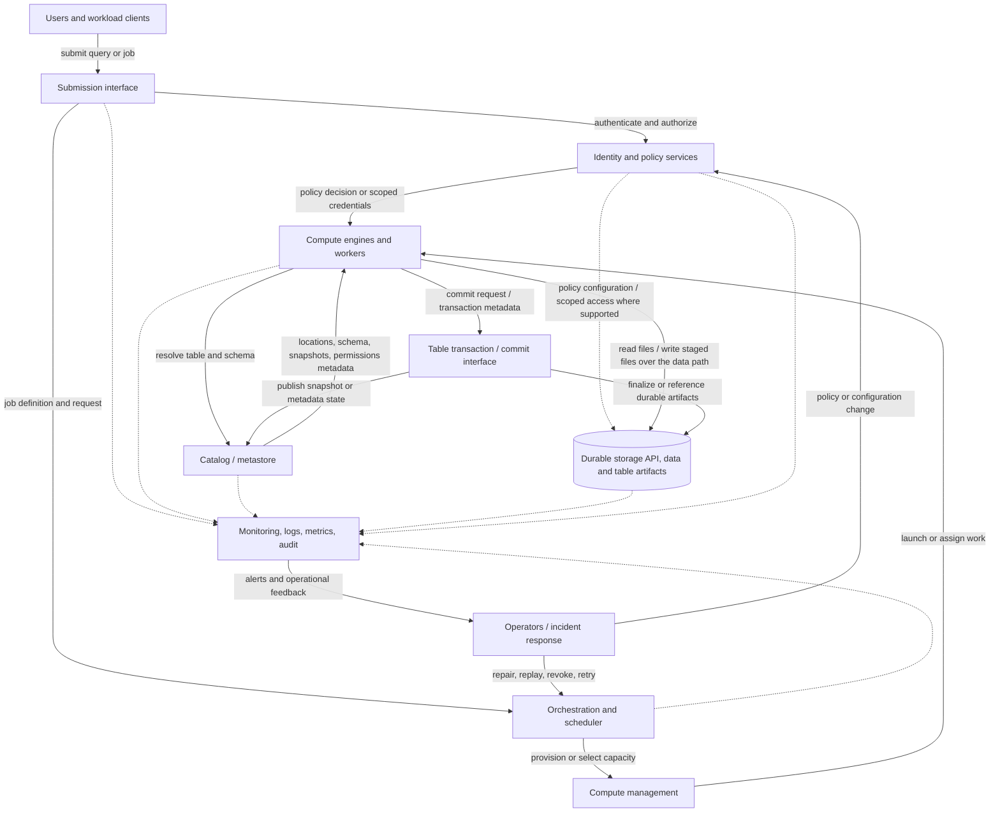

# Compute, Storage, and Control-Plane Separation

> **Roadmap location:** Stage 2D — Data Architecture → 07 — Enterprise Data Platform and Lakehouse Architecture → Topic 04  
> **Audience:** Beginner to advanced data engineers, data architects, platform engineers, and applied AI engineers  
> **Estimated study time:** 5–7 hours (roadmap recommendation; adjust to your experience)  
> **Architecture stance:** Vendor-neutral. All scenarios, assumptions, sample thresholds, cost figures, and recovery targets in this lesson are illustrative—not universal requirements.

## 1. Purpose and learning outcomes

A data platform is more than storage plus a query engine. It also needs services that decide who may do what, discover table definitions, schedule work, allocate resources, record metadata, and observe operations. Those responsibilities interact, but they do not have to be packaged or deployed as three separate products.

This lesson teaches you to reason about **responsibility boundaries** among compute, storage, and control-plane capabilities; trace read, write, and job execution; evaluate coupling and separation; and design for failure, security, operations, and cost.

By the end, you should be able to:

1. Define compute, storage, control plane, and data plane without relying on a specific vendor's product names.
2. Assign a platform capability to one primary responsibility plane and document its dependencies.
3. Distinguish logical separation from physical deployment separation.
4. Trace a job from submission and authorization through scheduling, execution, data access, commit/publication, and monitoring.
5. Explain why plane separation may improve elasticity, isolation, and engine choice—but can also add latency, dependencies, and operational burden.
6. Analyze control-service, catalog, compute, storage, credential, commit, and observability failures.
7. Compare coupled and separated designs using explicit workload, reliability, security, and cost assumptions.
8. Produce a responsibility matrix, dependency/failure analysis, and an architecture decision record (ADR).

### Prerequisites

Review Topics 01–03 in this module: logical platform capabilities and reference architecture; zones and end-to-end data movement; and refinement layers/data-product boundaries. Also review the Stage 2D storage-architecture prerequisite on replication, consistency, and transaction boundaries (2D.5 Topic 4), especially if atomic commits, metadata consistency, or recovery semantics are unfamiliar.

### Diagnostic check

Try to answer before reading further. Revisit the relevant sections if you cannot explain these clearly.

1. If an analyst submits a query, which responsibility checks authorization and resolves table metadata? Which component actually executes the query?
2. If a compute process crashes, does that imply the stored data has been lost?
3. Can a managed service logically separate control and data paths while hiding their physical deployment?
4. Why might a catalog outage prevent a new job from starting even when the data files remain intact?
5. Why is “separate compute and storage to save money” an incomplete design argument?

**Self-check:** A strong answer distinguishes responsibilities, describes dependencies, and qualifies implementation-dependent behavior rather than assuming every platform behaves identically.

## 2. The four terms to keep separate

### 2.1 Storage plane — durable data and table state

The **storage plane** is the set of capabilities responsible for retaining data and the durable artifacts needed to interpret it. Examples include object or block storage, table data files, transaction logs/manifests, snapshots, and retained checkpoints. The exact boundary depends on the table format and platform design.

Typical responsibilities:

- Store data durably and expose read/write interfaces.
- Enforce storage-level permissions and encryption where supported.
- Provide durability, versioning, lifecycle, replication, and recovery mechanisms.
- Serve data and metadata artifacts to authorized clients or engines.
- Report storage errors, throttling, capacity, and availability signals.

The storage plane usually does **not** decide the business meaning of a dataset, schedule every workload, or calculate query results. However, real products can bundle storage access policy, table transactions, metadata, and compute-facing APIs. Use responsibility boundaries for architecture analysis, not simplistic product labels.

Typical failure modes include unavailable objects or volumes, request throttling, network path failure, corruption, quota exhaustion, incorrect lifecycle deletion, and durability/replication lag.

### 2.2 Compute plane — execution of work

The **compute plane** executes queries, transformations, streaming operators, data validation, model training, or other workload logic. It consumes compute resources such as CPU, memory, accelerators, local disk, and network bandwidth.

Typical responsibilities:

- Parse, plan, schedule internally, and execute work within an engine.
- Read input and write output through authorized interfaces.
- Perform joins, aggregations, transformations, inference, and validation.
- Manage execution-local state, caches, shuffle files, and checkpoints where applicable.
- Expose query/job status, resource utilization, logs, and execution metrics.

A compute engine may have its own scheduler or metadata cache. That does not make every internal component a separate enterprise control plane; identify the primary responsibility and dependencies. A compute process can fail while durable inputs remain intact, but an incomplete write may leave temporary artifacts or require transaction recovery.

Typical failure modes include worker loss, out-of-memory errors, resource starvation, deadlocks, software defects, query skew, retry storms, and exhausted quotas.

### 2.3 Control plane — management, coordination, and policy

The **control plane** manages or coordinates the platform: who can act, what resources should exist, which jobs should run, what tables and schemas are registered, which policies apply, and how operations are initiated or governed.

Typical capabilities include:

- Identity integration, authorization decisions, policy distribution, and credential issuance.
- Catalog/metastore lookup and schema or table registration.
- Workflow orchestration, job submission, scheduling, and retry coordination.
- Compute provisioning, configuration, quotas, and resource lifecycle management.
- Table-level coordination and commit metadata, where the architecture places those functions.
- Audit events, configuration state, deployment state, and management APIs.

The control plane is not necessarily one central service. It can be a set of services owned by different teams, a managed control system, or functions embedded in an engine. It may store important durable state—such as table definitions, job definitions, policies, or transaction metadata—so “control plane” must not be interpreted as “stateless” or “safe to lose.”

Typical failure modes include API unavailability, stale policy, catalog inconsistency, scheduler backlog, expired credentials, unavailable provisioning, configuration drift, and a control database or metadata service failure.

### 2.4 Data plane — the path that carries or processes data

The **data plane** is the path along which data is read, written, transferred, shuffled, or processed. It is a path/responsibility term, not necessarily a fourth product or independent deployment. A compute engine may read files directly from storage after control-plane authorization and metadata resolution. The data itself may not pass through the control service.

Examples:

- A query engine reads table files from storage.
- A distributed job shuffles partitions between workers.
- A streaming processor consumes events and writes a checkpoint.
- A model-training job reads feature data and writes model artifacts.

The control plane commonly establishes or authorizes the data path; the data plane carries out the work. Exact flows differ by implementation. Some services proxy data, some issue temporary credentials, and some use gateways or coordinators.

### 2.5 A simple analogy

Imagine a research library. **Storage** is the shelves and preserved materials. **Compute** is the researchers and workrooms where material is analyzed. **Control** is the catalogue, access rules, reservations, and facilities coordination. The **data plane** is the actual movement and examination of books. The analogy is imperfect: real metadata can be transactional state, and access checks may occur at multiple points.

## 3. Logical separation versus physical separation

These are two distinct decisions.

- **Logical separation:** Architecture and operations identify different responsibilities, interfaces, state, owners, and failure modes—even if a single managed service provides them.
- **Physical separation:** Responsibilities run in separate processes, clusters, accounts, networks, regions, services, or independently operated deployments.

A vendor-neutral architecture should show responsibility boundaries even when the deployed implementation bundles them. A single managed lakehouse product might provide compute orchestration, catalog access, table transactions, and storage integration behind one interface. Conversely, an organization may operate separate engines over shared storage with an independent catalog and scheduler.

Physical separation can enable independent scaling or security boundaries, but it does not guarantee them. Two “separate” services can still share a network, identity provider, control database, region, or operator account and therefore share a failure domain. A bundled service can offer strong internal isolation, redundancy, and service-level controls that are invisible to the user. Evaluate the actual failure and ownership boundaries.

### Deployment patterns

| Pattern | Logical responsibilities | Possible physical arrangement | Common benefits | Common costs/risks |
|---|---|---|---|---|
| Tightly coupled engine and storage | Engine owns execution and tightly coordinates storage/table behavior | One appliance or integrated service | Simple operations; low coordination overhead; predictable local access | Limited engine choice; scaling may be coupled; maintenance windows may affect both |
| Shared durable storage with separate compute | Storage/table state is shared; workloads use separate engines or clusters | Shared storage service plus per-workload compute | Independent compute scaling; workload isolation; multiple engines can reuse data | Network dependency; catalog/table-format compatibility; shared-storage contention |
| Managed/serverless compute | Control provisions execution capacity on demand | Provider-managed execution plus managed storage/control APIs | Less cluster management; elasticity for variable loads | Cold-start effects; quotas; opaque internals; potentially variable cost |
| Hybrid platform | Some components bundled, others independently operated | Mix of managed and self-managed components | Fit boundaries to requirements and skills | Complex support boundaries, credentials, networking, and change coordination |

**Design rule:** Separate responsibilities in the logical model first. Choose physical separation only when a requirement—such as isolation, scaling, availability, data locality, regulatory boundary, or cost profile—justifies the added complexity.

## 4. Reference architecture and dependency paths

The diagram is conceptual, not a prescription for a particular vendor. It shows a user/workload initiating work, control services authorizing and coordinating it, compute using metadata to interpret tables, and the data plane reading or writing durable storage. Monitoring and audit receive events from several points because no single component can observe every failure.



### How to read the arrows

1. **User → submission interface:** A person, BI tool, workflow, API, or application requests a query or job. The interface validates request shape and identity context; it may be embedded in a managed engine.
2. **Submission → identity/policy:** Authentication establishes who or what is calling. Authorization checks the requested action and resource. Some implementations authorize synchronously here; others also enforce policy at query planning, compute, storage, or multiple points.
3. **Submission → scheduler:** The job definition, parameters, priority, and resource requirements are handed to orchestration. Some interactive queries bypass a general-purpose scheduler and are routed directly to an engine's coordinator.
4. **Scheduler → compute management → workers:** The platform selects existing capacity or provisions resources. A job can wait in a queue; provisioning can fail independently of storage availability.
5. **Compute ↔ catalog/metastore:** The engine obtains table definitions, schema, location, partitioning, and relevant snapshot or transaction metadata. Metadata may be cached, so freshness and cache invalidation matter.
6. **Identity/policy → compute/storage:** The engine receives an authorization result or scoped credentials; storage may enforce a second check. The exact credential flow is implementation-dependent. Credentials should not be broadly exposed to users or unrelated workloads.
7. **Compute → storage:** The engine reads input and writes output through the storage API, shown directly as a data path. The catalog, scheduler, and identity service are not assumed to proxy bulk data. Storage may enforce its own access policy; in some implementations the enforcement point is bundled with another service.
8. **Identity/policy ⇢ storage:** The dotted relationship represents policy configuration or scoped-access enforcement where supported, not a claim that identity services sit inline on every read/write. Some systems issue short-lived credentials; others mediate access or enforce policy at the engine, storage, or both. Verify the actual path and revocation behavior.
9. **Compute → transaction/commit interface:** A table-aware write coordinates durable output with the table's commit protocol. Depending on the table format, the commit interface may be in the engine, a catalog service, a transaction coordinator, or a combination. The diagram separates the responsibility for clarity; it does not assert a universal topology.
10. **Commit interface → catalog and storage:** The system makes a new table state visible only according to its commit protocol. Some formats store transaction logs/manifests in storage and use conditional writes; others rely on a catalog or service. Do not assume these are one atomic cross-system transaction unless the implementation explicitly guarantees it.
11. **Components → observability:** Services emit logs, metrics, traces, audit records, and state transitions. Collection can fail, be delayed, or omit signals, so critical workflows need independent health checks and durable audit where required.
12. **Observability → operators → control actions:** Alerts trigger diagnosis and controlled action—retry, pause, replay, repair, credential rotation, or policy change. Recovery actions must respect idempotency, transaction semantics, and data-product contracts.

The dotted lines indicate telemetry/operational feedback, not necessarily a separate network or service. The diagram intentionally includes catalog, identity, and orchestration because they are common dependencies; a specific platform may combine or distribute them.

## 5. Responsibility matrix

Assign each capability **one primary plane for the purpose of this exercise**, while recording cross-plane dependencies. This is an architectural classification convention, not a claim that a deployed product has only one responsibility. If a service genuinely owns two distinct responsibilities, split the row into capabilities instead of making the matrix ambiguous.

| Capability / service | Primary plane | Owns | Consumes | Exposes | State held | Critical dependencies | Accountable owner (example) | Failure impact |
|---|---|---|---|---|---|---|---|---|
| Durable object/file storage | Storage | Durable data objects, versions, lifecycle | Authorized read/write requests | Object/table-file APIs, availability and throttling signals | Data bytes, object versions, lifecycle metadata | Network, keys, quotas, storage control APIs | Storage/platform team | Reads/writes fail or slow; data may remain intact but become inaccessible |
| Table-format transaction artifacts | Storage* | Durable logs/manifests/snapshots if stored with table files | Commit/read protocol operations | Transaction history and snapshot artifacts | Commit records, manifests, checkpoint artifacts | Correct conditional-write semantics; compatible table clients | Data platform team | Snapshot visibility, recovery, or concurrent writes can fail |
| Query / batch engine | Compute | Query and transformation execution | Plans, data, scoped credentials | Query/job API, result sets, execution metrics | Runtime state, caches, shuffle and temporary files | Storage, catalog, identity, network, capacity | Analytics platform team | Work slows or fails; incomplete jobs may need retry/recovery |
| Stream processor | Compute | Continuous event processing | Events, schemas, checkpoints, offsets | Output, lag metrics, processing status | Operator state/checkpoints, offsets (placement varies) | Broker/source, storage, schema and identity services | Streaming platform team | Lag, duplicate processing, missed SLA, or state recovery work |
| Orchestrator / scheduler | Control | Workflow definitions, dependencies, trigger and retry policy | Job definitions, events, quotas | Runs, schedules, task state, launch requests | Workflow/run state and schedules | Identity, compute management, metadata, durable scheduler DB | Data platform / workflow operations team | New work may not launch or coordinate; already-running work may or may not continue |
| Compute provisioning / cluster manager | Control | Capacity allocation and lifecycle | Resource requests, quota/policy | Launch, scale, terminate, status APIs | Desired/actual capacity and configuration | Cloud/resource APIs, identity, network | Platform engineering team | New or scaled capacity unavailable; current workers may persist |
| Catalog / metastore | Control** | Table definitions, schemas, locations, metadata references | Registration, discovery and lookup requests | Metadata API | Schema/table/snapshot references, ownership tags | Durable metadata store, identity, network | Metadata / data platform team | New planning/registration may fail; cached or active queries may continue or fail depending on implementation |
| Identity / policy service | Control | Identity federation, authorization policy, credential issuance/revocation | Principals, resource/action requests | Decisions, tokens/credentials, audit events | Principals, policy, grants, keys/credential metadata | Identity source, key service, network, enforcement points | Security / IAM team | Access can fail closed/open depending on unsafe design; avoid assuming one universal behavior |
| Monitoring / audit pipeline | Control*** | Collection, retention, alerting, audit search | Signals from all planes | Dashboards, alerts, audit queries | Logs, metrics, traces, alert and retention state | Agents/exporters, network, storage, time sync | SRE/platform operations | Incidents may go undetected; evidence may be incomplete |
| Table commit coordinator/interface | Control-or-compute*** | Coordinates visibility of a committed table version | Staged files, prior snapshot, commit request | Commit result and new snapshot/reference | Transaction state or commit metadata (placement varies) | Storage conditional writes, catalog, concurrency control | Data platform team | Partial/ambiguous publication risk; writes may require reconciliation |
| Network and private connectivity | Shared infrastructure dependency | Routes and isolates traffic | Data/control traffic | Connectivity, firewall and DNS services | Route/firewall/DNS configuration | Network control systems, identity, provider fabric | Network/platform team | Cross-plane dependency breaks; shared blast radius can be broad |


i. `*` The table transaction artifacts are assigned to storage when their durable representation is the primary responsibility. If a separate service coordinates transactions, represent that coordinator separately.  
`**` Catalog/metastore is placed in control for this lesson because it manages definitions and coordination; some implementations embed metadata access within the engine or table service.  
`***` Monitoring and commit responsibilities can be split between a control service, engine, and storage-backed protocol. Model the real system's ownership and state explicitly.

### Matrix validation rules

- Every row has a primary plane and an accountable owner; avoid ownerless shared services.
- Dependencies point to named capabilities, not vague phrases such as “the platform.”
- State is identified: losing a service process differs from losing its durable state.
- Failure impact says what stops, degrades, or remains available; it does not assume every implementation behaves the same.
- Cross-plane components are split into separate capability rows when ownership or recovery differs.

## 6. Trace a representative data job

Consider a fictional nightly job that reads validated transaction data, computes daily risk aggregates, and publishes a new table snapshot for downstream consumers. The workflow below is illustrative; exact ordering, commit protocol, and atomicity depend on the engine, table format, catalog, and storage system.

### 6.1 Submission and authorization

1. The orchestrator reaches the scheduled time and submits a run with a job ID, parameters, expected input versions or watermarks, output target, and resource request.
2. The submission interface authenticates the workload identity and checks permission to run the job. Authorization may also validate access to source and destination resources.
3. The scheduler checks dependencies, quotas, concurrency policy, and capacity. It queues the run or asks compute management to provision/select workers.
4. The platform issues or supplies narrowly scoped credentials. These may be short-lived credentials, an identity-bound service token, or a mediated access mechanism. Do not hard-code long-lived secrets in job definitions.

**If these steps fail:** the job should fail visibly before it publishes output. An authorization failure must not silently degrade into unrestricted access.

### 6.2 Plan and read

5. The engine obtains the source and destination table definitions, schema, location, partition/snapshot information, and applicable policy metadata from the catalog or equivalent interface.
6. The engine plans the transformation, obtains any needed execution resources, and reads authorized data files from storage. It may use caches or metadata snapshots. The job should record the input snapshot/version or an equivalent reproducibility marker when the platform supports it.
7. Compute executes transformations and validations. It writes output to a staging path or prepares new immutable files, along with row counts, checksums, and reconciliation statistics as appropriate.

Storage and compute are often separate at this stage: the engine moves data over a network. A local cache or colocated storage can change performance but not the logical responsibilities.

### 6.3 Validate and commit

8. Before publication, the job evaluates schema/contract validity, completeness, duplicate behavior, business rules, reconciliation, privacy policy, and expected freshness. A hard-blocking failure prevents promotion; a warning may allow a documented exception with an owner and expiry.
9. The engine or table protocol submits a commit operation. It must handle concurrent writers, retries, and uncertain responses. A timeout after the commit request is ambiguous: the caller must check the authoritative table state before blindly repeating a non-idempotent write.
10. The commit protocol makes the new snapshot/version visible according to its guarantees. For a table format with atomic snapshot publication, readers should see either the old committed snapshot or the new committed snapshot—not a partially written collection of files. Orphaned staged files may still exist and require cleanup. This guarantee is specific to the protocol; ordinary file writes do not automatically provide table-level atomicity.
11. The job records output snapshot/version, input watermark, row counts, quality results, code/config version, run ID, and commit outcome. Catalog registration or publication may be part of the commit or a later step; if it is separate, define a reconciliation/retry process for a committed table whose discovery metadata is stale.

### 6.4 Observe and close the run

12. Engine metrics, scheduler events, storage errors, catalog calls, authorization decisions, and audit events are emitted to observability services.
13. The orchestrator marks success only after the defined publication condition is satisfied. “Compute finished” and “consumer-facing output is available” are not always the same state.
14. On failure, the run is classified: safe retry, resume from checkpoint, reprocess from durable input, reconcile commit state, or manual intervention. Every retry policy must account for idempotency and duplicate output risk.

### 6.5 Atomicity assumptions to document

| Concern | Question to answer | Unsafe assumption to avoid |
|---|---|---|
| Data file writes | Are writes temporary, immutable, or in-place? | “The output directory is complete because the job started writing it.” |
| Table commit | What is the atomic visibility boundary? | “Multiple files and catalog updates are always one atomic transaction.” |
| Catalog registration | Is it in the commit protocol or a separate operation? | “The table is discoverable as soon as files exist.” |
| Retry after timeout | How is commit outcome determined? | “Timeout means commit failed; retry everything.” |
| Concurrent writers | How are conflicts detected and resolved? | “Only one writer can exist because we did not plan for concurrency.” |
| Consumer publication | What exact state signals readiness? | “A successful compute exit automatically fulfills the product contract.” |

## 7. Coupling, elasticity, isolation, and portability

### 7.1 Coupling

**Coupling** describes how tightly the operation, scaling, failure, and maintenance of one capability depend on another. Tight coupling can be intentional: a single integrated engine may optimize local execution and simplify transactions. It becomes a liability when one capacity limit or maintenance event constrains unrelated workloads, or when a change cannot be made independently.

Ask:

- Can compute scale without changing storage capacity or topology?
- Can storage remain available during compute maintenance?
- Can a second engine read the same table state safely?
- Can control services be upgraded without interrupting data access?
- Which shared service becomes a bottleneck or a broad failure domain?

### 7.2 Elasticity and independent scaling

With shared durable storage and separate compute, BI can scale during business hours while ML training runs overnight, without duplicating the entire dataset. Ephemeral compute can be shut down when idle. However, elasticity is bounded by quotas, startup time, network throughput, storage request limits, metadata concurrency, and workload skew.

Independent scaling can also create contention: many small ephemeral jobs may overwhelm a catalog or storage request budget. Compute cost may fall while storage requests, egress, catalog operations, logs, or operational costs rise. Measure end-to-end cost and latency, not just compute runtime.

### 7.3 Workload isolation

Separate compute pools or queues can protect latency-sensitive BI from resource-intensive ETL or ML. Isolation can be logical (queues, quotas, admission control) or physical (separate clusters/accounts/networks). Physical isolation usually provides stronger blast-radius boundaries but can increase idle capacity, duplicated configuration, and maintenance burden.

Isolation is incomplete if workloads still share a saturated catalog, identity provider, network path, storage account, or quota. Record these shared dependencies in the failure analysis.

### 7.4 Portability and engine choice

Shared storage can make it possible for more than one engine to access the same durable data. Portability depends on more than file format: table-format compatibility, transaction semantics, catalog integration, encryption, permissions, schema evolution, timestamp/decimal behavior, and engine-specific SQL or UDFs matter. Multiple engines must coordinate commits and respect table semantics; sharing a bucket does not itself make concurrent access safe.

### 7.5 Control-plane outages and already-running work

A control-plane outage can affect **launching new jobs**, **scaling capacity**, **resolving uncached metadata**, **refreshing credentials**, or **changing policies** differently from work that is already running. Depending on implementation, an active job may continue using cached metadata and valid credentials; it may also fail immediately if it needs a catalog call, lease renewal, token refresh, scheduler heartbeat, or control-mediated data access.

Never use “the control plane is down, but running jobs will continue” as a universal guarantee. For each critical workflow, test and document:

- Can an active query continue reading data with current credentials?
- Can a long-running write commit without the catalog/control API?
- Can a worker renew credentials or leases during the outage?
- Can the scheduler recover task state after restart?
- Are policy revocations enforced promptly when a control service is unreachable?
- Does the service fail closed, use cached decisions, or behave differently by operation?

## 8. Failure scenarios and recovery

All incidents below are illustrative. Real outcomes depend on topology, caching, retries, consistency guarantees, timeouts, and failure policy. Recovery should preserve evidence and avoid unsafe retries.

| Scenario | Detection signals | Likely blast radius | Immediate response | Recovery and residual risk |
|---|---|---|---|---|
| Control API / scheduler outage | Submission errors, queue age, missing heartbeats, failed provisioning | New work may not launch; queued workflows stall; running jobs may continue or fail | Freeze risky retries; distinguish control API from data-path health; communicate delayed workloads | Restore service/state, reconcile scheduled vs actual runs, release backlog gradually; duplicate triggers or stale state may remain |
| Catalog/metastore unavailable | Lookup latency/errors, planning failures, metadata error rates | New query planning and table registration often fail; cached or active queries may be partially available | Check catalog health and metadata-store dependencies; avoid uncontrolled client retry storms | Restore metadata service and verify consistency; test cached metadata expiry and commit recovery; stale cache can expose old schema/snapshot references |
| Compute saturation | Queue depth, CPU/memory pressure, spill, task retries, latency | Affected workload pool; shared pools can impact unrelated tenants | Apply admission control, pause low-priority jobs, inspect skew and concurrency | Scale or tune workload; verify quotas and fair scheduling; scaling may hit catalog/storage/network limits |
| Storage throttling or unavailable path | Request throttles, elevated read/write latency, network errors, retry counts | All engines relying on the affected storage namespace/path | Reduce retry amplification; protect critical workloads; check quota, request pattern, and network | Backoff with jitter, smooth concurrency, retry idempotently; throttling may recur under peak load or hot partitions |
| Credential expiry or identity outage | Authentication failures, token refresh errors, denied operations | Workloads needing new credentials; scope can span several planes | Stop broad fallback credentials; identify token issuer vs resource-policy failures | Restore issuer/clock/network, rotate secrets if needed, retry safe operations; active work may fail if credentials are not renewable |
| Data/metadata commit inconsistency or ambiguous commit | Job timeout around commit, unexpected snapshot/version, orphaned files, row-count mismatch | One table or a broader catalog/table namespace depending on shared protocol | Do not rerun blindly; query authoritative committed state and preserve run IDs/files | Reconcile transaction log, catalog pointer, and output; use protocol-specific recovery and cleanup; cross-system atomicity may not exist |
| Monitoring/audit gap | Missing heartbeats, stale dashboard, alert pipeline lag, unexplained gaps in audit sequence | Incident detection and evidence collection across planes | Verify telemetry path independently; use service health endpoints and durable local logs | Restore collection, backfill if possible, quantify evidence gap; events lost before buffering may be unrecoverable |
| Network or DNS partition | Connection timeouts across catalog, identity, or storage; asymmetric reachability | Depends on subnet/route/shared network boundary; may affect several planes simultaneously | Identify affected path and direction; avoid declaring service down solely from one vantage point | Restore routes/DNS, validate private connectivity and failover; split-brain or retry backlog may persist |
| Incorrect lifecycle/deletion policy | Missing old files, snapshot read failures, restore alarms | Data needed for replay, audit, or old snapshots | Stop destructive lifecycle actions; preserve logs and remaining versions | Restore from replica/backup if available; assess replay and compliance gaps; replication does not protect against every logical deletion |

### Failure-analysis method

For each service, answer these questions in order:

1. **Trigger:** What exactly failed—process, durable state, network path, identity, quota, or policy?
2. **Detection:** Which independent signal tells you it failed? What if the main monitoring pipeline is also down?
3. **Blast radius:** Which workloads and data products share this dependency? Are tenants isolated at the actual failure boundary?
4. **Safety:** Could retries duplicate writes, bypass authorization, or publish incomplete output?
5. **Recovery order:** Restore durable metadata and identity/control prerequisites before launching uncontrolled workloads. Verify storage/table state before replaying jobs.
6. **Validation:** Reconcile source/input watermark, output snapshot, row counts, quality checks, and consumer freshness.
7. **Residual risk:** What evidence, state, or availability may still be missing after service restoration?

## 9. Separation trade-offs

Separation is an option with costs, not a guaranteed improvement. Use workload evidence and explicit assumptions to decide.

| Dimension | More coupled / bundled | More separated | Questions for the decision |
|---|---|---|---|
| Performance | May reduce network hops and coordination; integrated optimizations possible | Adds network transfer, remote metadata calls, cold caches, and protocol coordination; can still scale reads independently | Is the workload latency-sensitive? Is data locality important? What are measured throughput and tail latency? |
| Resilience | Fewer independently operated components; a shared failure can stop more functions at once | Failure boundaries may be narrowed, but shared dependencies and cross-service failure modes increase | Does separation actually create independent failure domains or only more APIs? What remains shared? |
| Security boundaries | Centralized policy may be simpler; broad bundled role can be risky | Can isolate tenants, credentials, and network access more precisely | Where is authorization enforced? Can workers access only required tables/paths? How are revocations handled? |
| Operations | Fewer systems, less integration, potentially simpler support | More services, upgrades, runbooks, telemetry, and cross-team handoffs | Who owns each service 24/7? Are dependency and recovery procedures tested? |
| Cost | May include always-on bundled capacity; simpler operations | Elastic compute and shared storage can reduce idle compute; networking, requests, logs, metadata, and staff costs may rise | What is total cost at actual utilization, including start-up, transfer, idle capacity, and support? |
| Vendor coupling | Integrated features can create stronger platform-specific dependence | Open interfaces and shared formats may improve choice, but implementation details still matter | Are schemas, table transactions, policy, SQL, and UDFs portable in practice? What is the migration cost? |
| Failure-domain complexity | Fewer visible components but potentially broad blast radius | More explicit boundaries, but more failure combinations and partial-outage states | Can operators distinguish control, compute, storage, identity, and network failures quickly? |
| Governance and audit | Central policy path can simplify consistent enforcement | Distributed enforcement can be stronger if policy is consistent, or weaker if implementations drift | How are policy versions distributed, audited, and tested across engines? |
| Change and maintenance | Bundled release may coordinate changes but limit independent timing | Independent upgrades are possible but compatibility must be managed | What compatibility matrix, rollout, rollback, and deprecation policy is required? |

### Coupled versus separated: a decision checklist

Prefer a more coupled arrangement when simplicity, integrated transactional semantics, predictable local access, and limited operations capacity outweigh independent scaling or engine diversity. Prefer a more separated arrangement when workload profiles vary materially, multiple engines must reuse data, independent scaling/isolation is valuable, and the organization can operate the extra dependencies.

Neither choice is permanent. An architecture can start bundled, measure real constraints, and separate one responsibility later. It can also consolidate an over-fragmented system when operational overhead exceeds the value of independent control.

## 10. Advanced design considerations

### 10.1 High availability for control services

- Identify critical control capabilities individually: scheduler, identity, catalog, provisioning API, policy store, and commit coordination may have different recovery objectives.
- Remove unnecessary single points of failure, but do not add replicas without defining consistency, leader election, failover, and split-brain behavior.
- Define recovery time objective (RTO) and recovery point objective (RPO) for **durable control state**, not just service process uptime. Example targets should be set by business impact; any numeric target is organization-specific.
- Ensure backups and replicas are protected against accidental deletion, malicious changes, and correlated region/account failure.
- Test recovery of queued jobs, workflow definitions, policy state, catalog references, and in-flight commits—not merely health-check success.

### 10.2 Metadata durability and consistency

Catalog or table metadata may determine which files comprise a table snapshot, which schema an engine applies, and which policy is relevant. Losing or corrupting this state can make intact data difficult to discover or interpret. Store and back up metadata according to its role and recovery requirements. Document which system is authoritative for schema, table location, snapshot/version, access policy, and ownership.

If metadata is cached, define cache TTL/invalidation and behavior during outage. Stale metadata can be safe for some reads and dangerous for schema changes, access revocation, or concurrent writes. Never assume a cache provides consistency merely because it improves availability.

### 10.3 Dependency chains and graceful degradation

Represent dependencies as a directed graph. A query may depend on identity → catalog → compute provisioning → network → storage. A workflow may additionally depend on scheduler state, secrets, schema registry, and telemetry. Identify critical paths and optional paths.

Graceful degradation must be explicit. Examples might include serving a last-known-good dashboard snapshot when fresh compute is unavailable, while clearly labeling its timestamp; it should not silently substitute stale results where freshness is safety-critical. Likewise, cached metadata may permit some reads but must not bypass security revocation or unsafe write coordination.

### 10.4 Least privilege and credential boundaries

- Use distinct identities for orchestration, compute workloads, data publication, and human administration where useful.
- Scope permissions by action, resource, environment, and time; prefer short-lived credentials and rotation.
- Do not pass broad administrator credentials from the scheduler into every worker.
- Enforce access at the appropriate layers: policy decisions may be centralized, but storage and compute enforcement must match the threat model.
- Audit grants, denials, policy changes, credential issuance, and sensitive data access. Protect audit records from alteration by the identity being audited.
- Treat logs, crash dumps, temporary files, caches, and shuffle storage as possible sensitive-data locations.

### 10.5 Network boundaries

Map control traffic separately from bulk data traffic, even if both share a network. Identify private endpoints, egress paths, DNS, firewall rules, service-to-service authentication, and cross-account access. Network separation can reduce exposure but does not replace identity and authorization. Conversely, one shared network or DNS dependency can defeat apparent plane independence.

### 10.6 Scheduling, quotas, and noisy neighbours

Define admission control, workload priority, concurrency limits, queue policy, retry budget, and quotas. Separate pools for interactive BI, ingestion, batch transformations, streaming, and ML when the workload evidence supports it. Do not assume one cluster or queue is optimal for every latency, throughput, and cost profile.

Control-plane scale can be a hidden limit: high job-launch rates, many small tables, excessive schema lookups, or retry storms may overwhelm schedulers/catalogs before compute is saturated. Batch submissions where safe, apply backoff with jitter, and measure metadata calls per job.

### 10.7 Disaster recovery and recovery order

A recovery runbook should state the order and conditions for restoring:

1. Network, DNS, and identity prerequisites.
2. Durable storage access and encryption/key availability.
3. Authoritative catalog/table metadata and transaction state.
4. Control services and scheduler state.
5. Compute capacity and safe queue draining.
6. Workflows, replay, reconciliation, and consumer publication.
7. Monitoring/audit verification and incident evidence capture.

The exact order can vary—for example, identity may rely on a separate recovery environment, or storage access may be needed to restore catalog backups. Write dependencies down rather than treating this list as universal. Before replay, reconcile which runs and commits actually succeeded.

### 10.8 Cost attribution and total-cost model

Attribute cost by workload, team, environment, and product where possible. Include compute runtime, idle capacity, storage bytes and requests, replication, network transfer/egress, metadata/control service usage, logs/audit retention, backup, and engineering/operational effort.

Illustrative model:

```text
compute_cost = compute_rate_per_hour × billable_hours
storage_cost = stored_GB_months × storage_rate
request_cost = request_units × request_rate
transfer_cost = transferred_GB × transfer_rate
platform_total = compute_cost + storage_cost + request_cost
               + transfer_cost + control/observability/backup costs
               + allocated operational cost
```

The roadmap's illustrative comparison is a fixed cluster running 24 hours per day versus elastic compute used 6 hours per day:

```text
always_on_cost = hourly_rate × 24 × days
elastic_cost   = hourly_rate × active_hours × days + startup/other overhead
```

At the same hourly rate, six active hours are 25% of 24 hours **before** startup, minimum charges, storage requests, transfer, idle warm capacity, and operational overhead. This is a simplified arithmetic comparison, not a forecast. The saving shrinks as utilization rises or overhead grows. Compare the same delivered workload and service level, and include cost of failed runs/retries.

### 10.9 Reliability targets and ownership

Set service objectives for the outcomes users need: job-start latency, query latency, data freshness, commit success, recovery time, or metadata lookup availability. A control API's uptime alone does not prove that a consumer-facing product is usable. Assign ownership for each plane and for cross-plane workflows, including escalation and vendor support boundaries.

## 11. Illustrative architecture decision record (ADR)

> **Status:** Proposed for a fictional Northbridge analytics platform.  
> **All workload figures and targets are illustrative assumptions, not requirements.**

### ADR-004: Keep plane responsibilities logically separate; separate compute pools physically

**Context**

Northbridge has three workload classes: interactive BI during business hours, nightly batch ingestion/refinement, and periodic ML feature preparation/training. The workload profiles vary in concurrency and duration. The organization wants to reuse durable datasets while reducing interference between BI and batch/ML. It has a small platform team and cannot justify independently operating every metadata and control service.

**Decision**

- Model storage, compute, and control responsibilities separately in the architecture and operational matrix.
- Use shared durable storage and a table/metadata interface with documented transaction semantics.
- Physically isolate interactive BI and batch/ML compute pools using separate quotas and scheduling policies; allow ephemeral capacity where startup latency is acceptable.
- Keep catalog/metastore, identity/policy, and orchestration as shared logical services initially, with explicit ownership, backup, monitoring, and failure procedures.
- Require table-aware publication, input/output version tracking, idempotent retry behavior, and reconciliation after ambiguous commit outcomes.
- Do not promise that active jobs survive catalog or identity outages until behavior has been tested for the selected implementation.

**Alternatives considered**

1. **One tightly coupled, always-on compute environment:** simpler to operate and may offer efficient local execution, but creates workload contention and can pay for idle capacity. Could be appropriate if measured utilization is consistently high and workloads are homogeneous.
2. **Physically separate catalog, identity, scheduler, storage, and compute for every workload:** offers more potential isolation but multiplies integration, policy synchronization, on-call, backup, and compatibility responsibilities. Rejected initially due to team capacity and insufficient evidence of a need for separate metadata/control domains.
3. **Shared compute pool with queue-level isolation only:** lower idle capacity and simpler provisioning, but may not provide enough blast-radius protection during peak BI periods. Retain as a fallback if separate pools prove uneconomical and measured isolation remains adequate.

**Consequences**

- BI and batch/ML can scale and be governed separately; durable data need not be copied solely to obtain separate compute.
- Shared catalog, identity, network, and storage remain common dependencies and must appear in failure tests and incident runbooks.
- Cross-engine/table compatibility, data-transfer latency, catalog concurrency, and commit semantics require verification.
- Cost attribution must include compute, storage, requests, transfer, observability, backups, and operations.
- The team must maintain a dependency graph, service owners, recovery runbooks, and compatibility tests.

**Assumptions**

- Workloads can use the selected table format and metadata interface consistently.
- Shared storage throughput and request capacity are adequate at expected peak concurrency.
- Compute pools can use scoped identities and distinct quotas.
- Control-service recovery can meet the business impact of delayed jobs; exact objectives will be agreed separately.

**Review triggers**

- Measured storage or catalog contention breaches workload objectives.
- BI latency or batch completion degrades despite tuning and queue controls.
- New tenant, regulatory, or data-residency requirements require a stronger boundary.
- A second engine cannot safely read/write shared tables under current compatibility rules.
- Total cost shows that duplicated pools, idle warm capacity, or transfer overhead outweigh the isolation benefit.
- A control-plane outage or ambiguous commit exposes an unhandled recovery path.

## 12. Practical exercises

### Exercise A — Plane responsibility matrix

**Scenario:** Northbridge operates BI, ingestion, and ML workloads. Use the capabilities in Section 5 and add any missing capabilities from your Topic 01 inventory.

**Tasks**

1. Assign a primary plane to each capability: durable storage, table transaction artifacts, query engine, stream processor, scheduler, compute manager, catalog/metastore, identity/policy, monitoring/audit, commit coordinator, and network connectivity.
2. Name the owner, state held, dependencies, exposed interface, and failure impact for each row.
3. Identify which services are shared by all three workload classes and which can be isolated.
4. State which rows would need to be split if one deployed product combines responsibilities.
5. Classify these events by primary plane, affected dependencies, and likely user impact: add an analyst, delete a table, revoke access, launch a nightly job, lose a compute worker, and make a storage bucket/path unavailable. Note when an event spans more than one plane.
6. Draw the dependency path for one query and one write, marking control and data traffic separately.

**Deliverables**

- Completed responsibility matrix.
- One query and one write interaction diagram.
- A short note explaining logical versus physical boundaries.

**Objective validation criteria**

- Every capability has exactly one primary plane in the matrix; cross-plane services are split into separate responsibility rows where necessary.
- Every row names an owner, state, interface, dependency, and failure impact.
- Query/write paths include identity/policy, metadata resolution, compute, storage, commit/publication, and observability where relevant.
- The diagram does not imply all bulk data flows through the control plane.
- The design identifies shared dependencies that remain after compute isolation.

### Exercise B — Cost and failure analysis

**Scenario:** BI load peaks during business hours; ML training runs overnight. Compare (A) a coupled always-on compute design and (B) shared storage with separate elastic compute pools. For the base case, assume an hourly compute rate of 1,000 currency units for comparable capacity, 30 days per month, 24 hours/day for the always-on option, 6 active hours/day for the elastic option, and 10,000 units/month of elastic startup and operational overhead. These are illustrative assumptions, not market prices or a forecast.

**Tasks**

1. Calculate monthly compute cost for both options in the base case before and after the stated elastic overhead.
2. Perform a sensitivity analysis for elastic usage of 4, 6, and 10 active hours/day and overhead of 10,000 and 40,000 units/month. Keep the hourly rate and month length constant; show the range and identify the break-even condition against the always-on compute cost.
3. State which cost categories are missing from the simplified arithmetic (e.g., storage requests, transfer, idle warm capacity, logs, backups, support, failed retries).
4. Analyze at least five failure cases: scheduler/control outage, catalog outage, compute saturation, storage throttling, and credential expiry. Add a commit inconsistency case.
5. For each case, describe detection, blast radius, immediate response, safe recovery, and residual risk.
6. State the assumptions under which separation is preferred and two facts that would reverse your recommendation.

**Deliverables**

- Reproducible cost table with units and assumptions.
- Failure/dependency table or diagram.
- Recommendation with alternatives and review triggers.

**Objective validation criteria**

- Arithmetic is correct and labels currency units and period.
- Comparison uses the same nominal capacity and explicitly notes that actual workloads may not be equivalent.
- Base-case arithmetic and the 4/6/10-hour, 10,000/40,000-unit sensitivity table are correct and clearly labeled.
- Break-even reasoning is explicit; overhead is added only to the elastic option as stated, and missing cost categories are acknowledged rather than assumed zero.
- Every failure scenario has a detection signal, bounded blast radius, recovery step, and residual risk.
- Recommendation discusses both benefits and costs and does not claim that separation automatically improves resilience or reduces total cost.

## 13. Common mistakes and misconceptions

| Mistake | Why it is wrong | Better practice |
|---|---|---|
| “Compute, storage, and control must be three separate products.” | Logical responsibility boundaries do not imply three physical deployments. | Model capabilities and interfaces first; choose deployment topology from requirements. |
| “Control plane is only the vendor's private infrastructure.” | Catalog, scheduling, policy, and provisioning may be organization-managed capabilities. | Place every relevant capability in the responsibility model. |
| “Control outage means all running jobs stop” or “running jobs always continue.” | Active work may depend on metadata refresh, credentials, leases, commit APIs, or scheduler heartbeats. | Test and document behavior per operation and implementation. |
| “The data files exist, so the table is committed.” | Table visibility may depend on a transaction log, manifest, catalog pointer, or commit protocol. | Define the authoritative commit boundary and reconcile ambiguous outcomes. |
| “Separate compute always saves money.” | Transfer, storage requests, startup, idle capacity, control services, and operations may offset compute savings. | Compare total cost for the same delivered workload and service level. |
| “Separate compute means isolated failure domains.” | Catalog, identity, network, storage, quotas, or operations can still be shared. | Map the full dependency graph and test shared failures. |
| “A shared storage path makes all engines compatible.” | Table format, transactions, schema behavior, security, and SQL semantics may differ. | Test engine compatibility and concurrent access guarantees. |
| “Retries are always safe.” | Retrying after an ambiguous commit can duplicate or corrupt output. | Use idempotency keys/run IDs and verify authoritative commit state before replay. |
| “Monitoring is independent because it is a separate service.” | Telemetry can share network, credentials, storage, or region with the platform. | Test alerting and evidence capture during dependency failures. |
| “One owner can own the whole platform informally.” | Shared services can become ownerless, and cross-team boundaries obscure escalation. | Assign explicit service and workflow ownership, including on-call responsibilities. |

## 14. Review questions with answer key

Try each question first. The answer key gives the expected reasoning, not the only valid architecture.

### Questions

1. Define compute, storage, control plane, and data plane in one or two sentences each.
2. What is the difference between logical and physical separation? Give one example where responsibilities are logically separate but physically bundled.
3. Why might a catalog outage stop a new query from starting while some active queries continue?
4. Trace a write from job submission to publication. Where can the output exist without being visible as a committed table version?
5. Why is a timeout after a commit request not proof that the commit failed?
6. Name four benefits and four costs or risks of separated compute and storage.
7. Why does separate compute not guarantee workload isolation?
8. What should an architecture team test before claiming active jobs can survive a control-plane outage?
9. What information should the failure analysis include for storage throttling?
10. In Exercise B, calculate the base-case monthly costs, the sensitivity range, and the elastic active-hours/day break-even point against always-on compute cost.
11. A table is present in storage but not discoverable in the catalog. Is the data necessarily lost? What should be checked before retrying publication?
12. Name at least four cost categories beyond compute runtime that may change after separation.
13. Why should identity and policy be modeled as dependencies of both control and data paths?
14. When might a coupled design be better than a separated design?
15. What evidence should trigger review of the ADR?

### Answer key

1. **Compute** executes jobs/queries; **storage** durably retains data and table artifacts; **control plane** manages or coordinates identity, policy, metadata, scheduling, provisioning, and configuration; **data plane** is the path by which data is read, written, transferred, and processed. Exact product boundaries vary.
2. Logical separation documents responsibilities and interfaces; physical separation deploys them independently. For example, a managed lakehouse service may expose compute execution and catalog/authorization as distinct responsibilities behind one managed product.
3. New queries may need uncached schema/location/policy metadata during planning. Active queries might have cached metadata and valid credentials, but may still fail if they need a refresh or commit operation. This behavior is implementation-dependent.
4. Submission → authorization → scheduling/provisioning → metadata resolution → read/transform → staged write → validation → commit protocol → snapshot/catalog publication → observability/success. Files may exist in a staging path or as orphaned immutable files before the table's commit state exposes them. The exact protocol determines the visibility boundary.
5. The commit may have succeeded while the response was lost. Check authoritative snapshot/transaction state and run identifiers before retrying, or a duplicate write may result.
6. Benefits can include independent scaling, elastic pay-per-use compute, workload isolation, reuse of one durable dataset, and engine choice. Costs/risks include network latency, cold caches, shared control dependencies, compatibility work, more operations, and less predictable total cost.
7. Workloads may share a catalog, identity provider, network, storage quota, metadata limit, or control database. Separate compute pools do not remove these shared dependencies.
8. Test active reads, long-running writes, credential renewal, catalog refresh, lease/heartbeat dependencies, policy revocation, scheduler restart, and commit behavior. Record the behavior for each operation; do not extrapolate from one successful test.
9. Include throttling metrics, request rate, storage namespace/hot partition, network path, affected workloads, retry amplification, backoff, concurrency reduction, recovery validation, and residual risk.
10. Always-on: `1,000 units/hour × 24 hours/day × 30 days = 720,000 units/month`. Elastic base case: `1,000 × 6 × 30 = 180,000`, plus `10,000` overhead = `190,000 units/month`, before other cost categories. Sensitivity: 4 hours/day costs `120,000` before overhead, or `130,000–160,000` with `10,000–40,000` overhead; 6 hours/day costs `180,000` before overhead, or `190,000–220,000` total; 10 hours/day costs `300,000` before overhead, or `310,000–340,000` total. Break-even occurs when `1,000 × active_hours × 30 + overhead = 720,000`, so `active_hours = (720,000 − overhead) / 30,000`; this is about `23.67 hours/day` with 10,000 overhead and `22.67 hours/day` with 40,000 overhead. These values are illustrative and exclude other cost categories.
11. No. Data files may be intact while metadata registration/publication is incomplete or stale. Check the authoritative table transaction log/snapshot, commit result, run ID, catalog state, schema/location, permissions, and whether the original publication actually succeeded before retrying.
12. Storage bytes/requests, network transfer/egress, logs and audit retention, backup/replication, startup/minimum charges, metadata/control usage, idle warm capacity, and operational effort are examples.
13. Identity may authorize job submission and control API calls, while data access must also be authorized or enforced at compute/storage. Scoped credentials and audit evidence cross these boundaries; policy propagation and failure behavior must be explicit.
14. A coupled design may be better when workloads are homogeneous, low-latency/local access is important, transactional integration is valuable, operations capacity is limited, or utilization is consistently high enough that elastic separation offers little benefit.
15. Evidence includes storage/catalog contention, breached latency/freshness objectives, incompatibility with a new engine, changed regulatory/tenant requirements, cost overhead exceeding isolation benefit, or an outage/commit ambiguity that reveals an unhandled recovery path.

## 15. Glossary

- **Atomic visibility / atomic commit:** A defined operation in which readers see a complete committed state rather than an intermediate partial state, within the guarantees of a particular protocol.
- **Blast radius:** The set of workloads, data, tenants, or services affected by one failure.
- **Catalog:** A discoverable inventory and/or service that exposes dataset and governance context; exact scope varies. Topic 05 differentiates it from a metastore.
- **Compute engine:** A system that executes queries, transformations, stream operators, or model workloads.
- **Control plane:** Capabilities that manage, coordinate, configure, authorize, or schedule platform activity.
- **Data plane:** The path for data access, movement, and processing; not necessarily a separate deployment.
- **Elasticity:** Ability to change allocated capacity with demand.
- **Failure domain:** A boundary within which one fault can cause correlated impact.
- **Idempotency:** Repeating an operation with the same identity/inputs does not create additional unintended effects.
- **Logical separation:** Distinct responsibilities and interfaces in the architecture model, whether or not physically bundled.
- **Metastore:** Service or state store that provides table definitions and related metadata needed by engines; implementations may combine it with a catalog.
- **RPO:** Recovery point objective—the acceptable amount of data/state loss expressed in time or another defined measure.
- **RTO:** Recovery time objective—the target time to restore a service or capability after disruption.
- **Scoped credential:** Credential limited by resource, action, identity, or time.
- **Table snapshot/version:** A committed view of a table's data and metadata according to its table protocol.
- **Workload isolation:** Controls that prevent one workload or tenant from unduly affecting another; logical or physical controls may be used.

## 16. Mastery checklist and Topic 04 completion gate

Mark an item complete only when you can explain or demonstrate it without relying on vendor-specific names.

- [ ] I can define compute, storage, control plane, and data plane and explain their interfaces.
- [ ] I can distinguish logical responsibility boundaries from physical deployment boundaries.
- [ ] I can redraw the interaction diagram and explain the purpose and dependency represented by every arrow.
- [ ] I have a responsibility matrix with one primary plane per capability, named owners, state, dependencies, and failure impacts.
- [ ] I can trace a read, write, and job run, including authorization, metadata lookup, storage access, commit/publication, and telemetry.
- [ ] I can explain table commit/metadata consistency assumptions and why ambiguous outcomes require reconciliation.
- [ ] I have documented how control-plane, catalog, identity, compute, storage, and monitoring failures affect both new and already-running work.
- [ ] I can compare coupled and separated designs with explicit workload and cost assumptions.
- [ ] I have identified shared dependencies that remain even after compute isolation.
- [ ] I can explain security boundaries, scoped credentials, quotas, workload scheduling, recovery order, and cost attribution.
- [ ] Exercise A passes its objective validation criteria.
- [ ] Exercise B includes correct arithmetic with units, cost assumptions, failure effects, recovery, and residual risks.
- [ ] I have an ADR that records alternatives, rationale, consequences, assumptions, and review triggers.

### Completion gate

Proceed to Topic 05 when:

1. The responsibility matrix and cost/failure analysis have been reviewed.
2. You can state both the benefit **and the cost** of separation for a specified workload.
3. Control-plane failure behavior is documented per operation, including uncertainties and implementation-specific guarantees.
4. You can explain a read, write, and job failure across planes without claiming a universal transaction or availability model.
5. If table consistency or commit behavior remains unclear, revisit Stage 2D → Database and Storage Architecture → Topic 4 on replication, consistency, and transaction boundaries.

## 17. Bridge to Topic 05 — Catalogs, metastores, and platform metadata

This lesson places catalogs and metastores among the control-plane responsibilities for architectural clarity, while acknowledging that implementations may embed or combine them with compute or table services. Topic 05 goes deeper: it distinguishes a **metastore** (definitions engines need to interpret tables), a **catalog** (discoverable inventory with business and governance context), and broader **platform metadata** (technical, business, operational, security, and ownership information).

That next topic depends on the boundaries established here. Before moving on, identify for your chosen architecture: which service is authoritative for schema and table location; where snapshot/transaction state lives; who owns metadata durability and recovery; how multiple engines observe changes; and what happens to reads, writes, discovery, and policy enforcement during a metadata outage. Precise placement and ownership make the difference between metadata as a useful shared service and metadata as an invisible platform-wide failure dependency.
