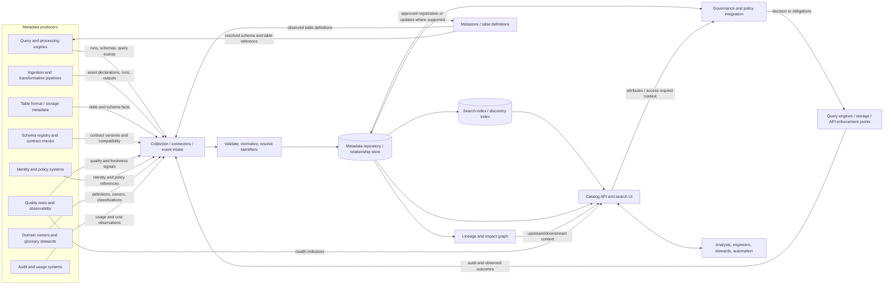

# Topic 05 — Catalogs, Metastores, and Platform Metadata

**Roadmap location:** Stage 2D — Data Architecture → `07-Enterprise-Data-Platform-and-Lakehouse-Architecture/`  
**Lesson file:** `05-catalogs-metastores-and-platform-metadata.md`  
**Level:** Beginner → Intermediate → Advanced  
**Estimated study time:** 5–7 hours, consistent with the module roadmap  
**Architecture stance:** Vendor-neutral. Product names, record values, targets, and the fictional organization in this lesson are illustrative—not universal requirements.

---

## 1. Purpose and orientation

A data platform can store petabytes of files and expose powerful query engines, yet still be difficult or unsafe to use if people and systems cannot answer basic questions:

- What data assets exist, and which one should I use?
- What does this table mean, what is its grain, and how current is it?
- Who owns it and who can explain or correct it?
- What schema does a query engine use to interpret the data?
- Where did the data originate, which transformations changed it, and what depends on it?
- What sensitivity rules apply, and where are access decisions actually enforced?
- Is the metadata current enough to trust for a decision or a production job?

**Metadata** is descriptive and operational information about data assets and the systems that create, manage, govern, and consume them. Metadata helps make data discoverable, interpretable, reproducible, governable, and operable. It does not make the underlying data correct by itself.

This lesson follows Topic 05 of the module roadmap. It builds on Topic 03's distinction between refinement layers and consumer-facing data products, and Topic 04's compute/storage/control-plane vocabulary. The roadmap identifies the key outputs as a metadata model, catalog topology and registration/ownership workflow, metadata-quality indicators, and an ADR on catalog topology.

### Learning outcomes

By the end, you should be able to:

1. Distinguish a data catalog, metastore, and broader platform metadata, and explain where related services overlap.
2. Classify technical, business, operational, quality, lineage, security, ownership, and usage/cost metadata.
3. Define mandatory metadata fields, authoritative sources, producers, consumers, maintainers, sensitivity, and freshness expectations.
4. Draw a logical metadata architecture with collection, storage/indexing, discovery, metastore, lineage/quality, governance, and synchronization paths.
5. Trace discovery, schema resolution, access evaluation, lineage lookup, and reproducibility through metadata services.
6. Identify and detect stale, incomplete, conflicting, or exposed metadata.
7. Compare centralized, federated, and hybrid metadata topologies against concrete needs.
8. Produce a metadata model, an ownership/discovery workflow, and an ADR with alternatives and review triggers.

### Prerequisites

- **Topic 03 — Bronze, silver, gold, and data-product boundaries:** refinement stages, contracts, owners, and consumer-facing product promises.
- **Topic 04 — Compute, storage, and control-plane separation:** compute engines, durable storage, control services, and their dependencies.
- **P6 — Data fabric and metadata-driven architecture:** metadata as a cross-cutting architecture capability.
- **P9 — Data contracts:** schemas, semantics, compatibility, and explicit producer/consumer expectations.

You do not need a specific vendor's catalog or metastore product to learn the architecture.

### Diagnostic check

Try answering these before continuing. The answers appear later in the review section.

1. How does a metastore differ from a searchable catalog?
2. If a catalog says a table is public, does that fact alone authorize a query?
3. Is a column's schema technical metadata, business metadata, or both?
4. What can go wrong if an ingestion pipeline changes a table schema but its catalog description and policy tags are not updated?
5. Who should be accountable for a business definition: the catalog tool owner or the domain that defines the term?

---

## 2. Metadata fundamentals

### 2.1 Data, metadata, and reference data

- **Data** records observations or facts: a transaction amount, a customer identifier, an event timestamp.
- **Metadata** describes the data or its lifecycle: the amount's decimal precision, the table's owner, when the last load completed, or which job produced the field.
- **Reference data** provides controlled values used to interpret data, such as currency codes or country codes. Reference data can have metadata of its own, but it is not synonymous with metadata.

Example: a transaction record may contain `currency_code = "INR"`. Metadata may say that `currency_code` is a required ISO-style currency code, that the field is classified as business data, that its semantic definition is owned by Finance, and that a particular pipeline last refreshed the table at a given time. The approved list of currency codes is reference data.

### 2.2 Metadata is not one undifferentiated object

Metadata categories are useful lenses, not mutually exclusive boxes. One metadata record can be technical and security-relevant; a quality result can be operational and business-critical; an owner contact is ownership metadata and may itself be personal information.

| Metadata class | Questions it answers | Typical fields or records | Common source of truth |
|---|---|---|---|
| **Technical** | How is the asset represented and stored? | Asset ID, schema, column types, format, location reference, partition keys, table properties | Metastore/table format, schema registry, infrastructure definitions |
| **Business / semantic** | What does the asset mean? | Business name, definition, domain, grain, metric definition, glossary term, allowed interpretation | Domain glossary, approved semantic model, data-product contract |
| **Operational** | Is it running and when did it last change? | Last successful run, refresh timestamp, job ID, status, run duration, ingestion watermark | Orchestrator, pipeline telemetry, platform runtime |
| **Quality** | What validation evidence exists? | Rule ID, pass/fail, measured value, sample size, evaluated time, severity, exception link | Quality test runner and governed rule definitions |
| **Lineage / provenance** | Where did it come from and what depends on it? | Upstream/downstream asset IDs, job/run ID, input/output version, transformation reference, capture method | Orchestrator, transformation parser, runtime events, declared lineage |
| **Security / classification** | How sensitive is it and what controls may apply? | Classification, data subject category, retention class, masking requirement, policy reference | Governance authority, classification workflow, policy repository |
| **Ownership / stewardship** | Who is accountable and who supports it? | Domain, accountable owner, technical maintainer, steward, support channel, escalation path | Domain ownership registry or approved ownership workflow |
| **Usage / cost** | Who uses it and what does it cost? | Query count, consumer identities, access events, storage size, compute attribution, last access | Query audit, metering, billing, observability systems |

A classification such as `confidential` may attach to a dataset, column, glossary term, or product. A field can simultaneously be technical metadata (`column_type=string`), business metadata (`customer email`), security metadata (`personal data`), and lineage metadata (derived from a source field).

### 2.3 Why metadata matters operationally

Metadata supports several different workflows:

- **Discovery:** a user searches by domain, meaning, owner, freshness, quality, or classification.
- **Interpretation:** a query engine resolves a table name and its schema; an analyst learns the intended grain and metric definition.
- **Governance:** a policy decision can use identity, asset, tag, classification, and purpose-of-use attributes.
- **Reliability:** a pipeline detects a changed schema, missing partition, stale refresh, or failed quality check.
- **Impact analysis:** an owner identifies downstream products and jobs before changing a column.
- **Reproducibility:** a team records the exact source versions, transformation version, parameters, and run ID used to create an output.
- **Cost management:** platform operators link storage and compute usage to assets, teams, and workloads.

A metadata system improves the ability to make decisions about data; it does not replace data validation, domain accountability, access enforcement, or operational monitoring.

---

## 3. Distinguish the systems and responsibilities

The names of commercial products are inconsistent. A single managed platform may bundle several responsibilities, while a large organization may implement each responsibility with a different service. Design from the responsibility boundary first, then map it to actual products.

### 3.1 Core definitions

| Concept | Primary responsibility | Typical information | Main consumers | What it does **not** guarantee by itself |
|---|---|---|---|---|
| **Metastore / table metadata service** | Provide table and namespace definitions that engines need to resolve and interpret data | Namespaces, table identifiers, schema, storage locations or references, partitioning, table properties, format-specific metadata | Query and processing engines, table-management APIs | Business discoverability, accurate lineage, or complete governance metadata |
| **Data catalog** | Provide a searchable inventory and context for people and governance workflows | Asset descriptions, domains, owners, tags, classifications, quality/freshness signals, lineage links, documentation, access-request entry points | Analysts, engineers, stewards, governance and platform teams | Correct data, current metadata, or direct enforcement of every policy |
| **Schema registry** | Govern machine-readable schemas and compatibility for messages or data interfaces | Schema definitions, versions, compatibility rules, subject/interface identifiers | Producers, consumers, serialization libraries, CI/CD | Full table catalog, business glossary, or runtime correctness of all records |
| **Business glossary / semantic dictionary** | Establish shared meaning for business terms and metrics | Definitions, synonyms, approved terms, accountable domain, relationships, calculation rules | Business users, analysts, data product owners, governance | Physical schema, actual table location, or proof that a pipeline follows the definition |
| **Lineage / provenance service** | Record or derive relationships between sources, transformations, runs, and outputs | Upstream/downstream edges, job/run IDs, field mappings where available, capture method, timestamps | Impact analysis, auditors, engineers, stewards | Complete lineage when instrumentation is absent or opaque; correctness without validation |
| **Metadata repository / store** | Persist and query metadata records and relationships | Asset records, version history, relationships, event history, source provenance | Catalog, governance, lineage, platform APIs | A user-friendly discovery interface or authoritative truth for every field |
| **Policy / authorization service** | Evaluate access decisions and/or provide policy administration | Policy rules, identities, attributes, entitlements, purpose constraints, decision logs | Enforcement points, identity systems, governance workflows | Enforcement unless connected to a point that actually mediates access |
| **Quality / observability service** | Execute checks and collect runtime health signals | Rule results, freshness, volume anomalies, failures, latency, incidents | Pipeline operators, owners, catalog users, support | Business suitability unless the right rules and expectations are defined |

These are architectural roles, not a required product count. A catalog may include glossary, lineage, quality indicators, and request-access workflows. A metastore may be part of a catalog service. A schema registry may publish schema metadata into a catalog. A policy service may read catalog classifications. The responsibilities remain distinguishable even if one product implements several.

### 3.2 Catalog versus metastore

A useful simplified distinction:

- The **metastore** helps an engine answer, “What is this table's identifier, schema, and location or table reference, and how do I resolve it?”
- The **catalog** helps a person or governance workflow answer, “What is this asset for, can I trust it for this use, who owns it, what does it contain, and how do I request access?”
- **Platform metadata** is the wider set of descriptive and operational records that both may use or reference.

The catalog and metastore can share a database or API. That implementation detail does not erase their distinct consumers and failure modes.

### 3.3 Catalog versus policy enforcement

A catalog may display a classification, route an access request, or provide attributes to a policy decision. It should not be treated as the enforcement point unless it actually mediates the read/write operation. Enforcement may occur in a query engine, storage gateway, API, table service, or another control that every relevant access path must pass through.

If one engine enforces column masking but another engine bypasses the policy integration, a correct catalog tag does not protect the second path. The architecture must map policy decision points to enforcement points and test the paths that can access the underlying data.

### 3.4 Catalog versus lineage

A catalog can display lineage, but lineage may be generated by separate instrumentation, query parsing, pipeline declarations, or runtime events. Coverage varies. Dynamic SQL, external scripts, manual file transfers, and opaque transformations can create gaps. A lineage edge should ideally include provenance such as `capture_method`, `observed_at`, and confidence/coverage status so users do not mistake inferred or partial lineage for a complete proof.

---

## 4. Logical metadata architecture

The diagram below separates responsibilities without implying that each box must be a separate deployed service. Arrows indicate data or metadata flows; the actual API and consistency model vary by implementation.



### 4.1 Reading the arrows

1. **Metadata producers → collection:** engines, pipelines, table services, registries, quality runners, policy systems, owners, and audit systems emit or declare facts. Some are event-driven; others are periodically harvested or manually curated.
2. **Collection → validation/normalization:** records are checked for required fields, valid identifiers, controlled vocabulary, timestamps, and source provenance. Invalid records should be rejected, quarantined, or marked incomplete—not silently published as authoritative.
3. **Validation → repository:** accepted records are stored with identifiers, source, observed time, version, and update semantics. A repository can be a database, graph store, event log plus projections, or a capability bundled into a product.
4. **Repository → search index:** a search index is usually a derived view optimized for discovery. Index lag can make a catalog temporarily stale even when the underlying record has updated.
5. **Repository and metastore synchronization:** the diagram shows observed table definitions flowing from the metastore through collection, while approved registration or updates may flow from the repository to the metastore where the implementation supports that path. Other platforms may use events or a separate registration API. Do not infer unrestricted bidirectional writes: avoid competing authorities for the same field, and specify the authoritative source and permitted write path for each attribute.
6. **Repository → lineage:** relationships may be built from pipeline declarations, runtime events, query parsing, and table identifiers. Lineage records should preserve capture method and coverage limitations.
7. **Repository ↔ policy integration:** governance metadata can inform policy evaluation, and policy references or outcomes can be reflected in metadata. Do not store secrets or unnecessary sensitive policy details in broadly searchable records.
8. **Catalog ↔ consumers:** users and automation search, inspect, request access, or view quality and lineage signals. Asset registration and description corrections are permitted only through governed, role-appropriate write paths; read access to metadata itself must also be controlled.
9. **Catalog → policy → enforcement point:** catalog context can inform a request; a policy service evaluates it; the actual engine, storage gateway, or API must enforce the result. This is a logical flow, not a universal call sequence.
10. **Metastore → engine:** an engine resolves the table definition and then reads data using the applicable table/storage protocol. Some systems cache metadata or combine table and catalog APIs.
11. **Enforcement → collection:** access events and observed outcomes can feed audit and usage metadata. Logs should avoid recording secrets or unnecessary payload values.

### 4.2 Logical boxes versus deployed products

The diagram is a responsibility map. One managed service could provide the catalog UI, metastore API, repository, and policy integration. Another architecture may use separate services and connectors. In either case, document:

- authoritative owner and source for each metadata attribute;
- read/write API and permitted update path;
- synchronization frequency and consistency expectations;
- failure behavior and caching assumptions;
- access controls for the metadata itself;
- recovery, retention, and audit of metadata changes.

---

## 5. Metadata inventory and data model

A useful metadata model does not merely list fields. Each field needs a defined meaning, stable identifier, authoritative source, producer, consumer, maintainer, freshness expectation, sensitivity, and consequence if missing or stale.

### 5.1 Illustrative inventory

The following records are fictional and illustrative. Freshness expectations are example design targets, not universal standards.

| Metadata type | Example fields | Source of truth | Producer | Consumer | Accountable owner / maintainer | Illustrative freshness | Sensitivity | Failure impact if wrong or absent |
|---|---|---|---|---|---|---|---|---|
| Technical | `asset_id`, `schema_version`, `columns`, `format`, `table_ref` | Metastore/table API; contract registry for declared schema | Table service, deployment pipeline, schema registry | Query engines, catalog, developers | Platform metadata team for service; asset owner for declared contract | On every schema/table change | Location and schema may be sensitive | Query failures, wrong schema interpretation, accidental exposure |
| Business | `business_name`, `definition`, `grain`, `domain`, `metric_formula` | Approved domain model/glossary | Domain steward, product owner, semantic-model pipeline | Analysts, risk, finance, AI feature teams | Domain owner/steward | On approved definition change; periodic review | Often internal; may reveal business strategy | Incorrect analysis or conflicting metric definitions |
| Operational | `last_success_at`, `run_id`, `watermark`, `status` | Orchestrator / runtime telemetry | Pipeline and scheduler | Operators, catalog users, consumers | Pipeline owner / SRE | Event-driven or within a defined telemetry delay | May expose workload patterns | Stale data appears current; missed incidents |
| Quality | `rule_id`, `result`, `measured_value`, `evaluated_at`, `severity` | Quality rule registry and test-run store | Quality runner | Owner, consumer, catalog, incident workflow | Data product owner with platform support | Each run or agreed test cadence | Could reveal business anomalies | Bad data promoted or good data unnecessarily blocked |
| Lineage | `upstream_asset_ids`, `job_id`, `run_id`, `capture_method`, `observed_at` | Pipeline definitions and observed execution events | Orchestrator, parser, lineage collector | Impact analysis, audit, engineering | Pipeline owner; platform team owns capture service | Each run/change; lag clearly indicated | Can reveal sensitive sources and relationships | Incomplete impact analysis, weak audit evidence |
| Security / classification | `classification`, `contains_personal_data`, `retention_class`, `policy_ref` | Approved governance/classification authority | Scanning and classification workflow; steward review | Policy service, enforcement point, catalog | Data owner accountable; security/governance defines standards | At registration and every schema change; re-evaluate periodically | High: classification may reveal sensitive data | Over-permission, over-restriction, compliance breach |
| Ownership | `domain_id`, `owner_id`, `steward_id`, `support_route` | Ownership registry / approved domain workflow | Registration automation, domain owner | Catalog users, incident and access workflows | Domain leader accountable; steward maintains details | Validate at registration and on personnel/team changes | Contact details and org structure may be sensitive | Orphaned asset, slow incident response, unreviewed access |
| Usage / cost | `last_access_at`, `query_count`, `storage_bytes`, `cost_center`, `consumer_group` | Query audit and billing/metering systems | Query engine, storage meter, billing pipeline | FinOps, asset owner, platform team | FinOps/platform; domain validates allocation | Daily or billing-cycle cadence, according to source | May reveal behavior and business priorities | Incorrect chargeback, inability to retire unused assets |
| Contract / interface | `contract_id`, `version`, `compatibility_policy`, `breaking_change_date` | Product contract repository or schema registry | CI/CD and product owner | Producers, consumers, self-service automation | Product owner | At release or contract change | Internal interface details | Undetected breaking changes and consumer failures |

### 5.2 Recommended core entity model

At minimum, define stable entities and relationships. A conceptual model might include:

- **Asset:** a table, view, file collection, stream, model feature set, dashboard, or data product.
- **Asset version:** a schema, contract, or release version with effective time and lifecycle state.
- **Field/column:** a named component of a versioned asset.
- **Domain:** an organizational boundary that owns definitions and assets.
- **Person/team role:** owner, steward, technical maintainer, support group.
- **Contract:** schema, semantic rules, quality/freshness promises, compatibility, and consumer interface.
- **Policy/classification:** sensitivity labels, policy references, and applicable control requirements.
- **Process/job/run:** transformation definition and an execution instance.
- **Lineage edge:** directed relationship between versioned assets, fields, jobs, or runs.
- **Quality result:** a rule execution against a specific asset version or data interval.
- **Usage observation:** access/query/storage/cost measurement over a defined period.

Each entity should have a stable identifier that does not depend solely on a mutable display name. Relationships should use IDs, not free-text names, wherever feasible.

### 5.3 Illustrative sample asset record

```yaml
asset_id: urn:example:domain:risk:table:transaction_events
asset_type: table
canonical_name: risk.transaction_events
display_name: Transaction Events
business_definition: "Validated transaction events available for approved risk analysis."
domain_id: risk
owner_team_id: risk-data-products
steward_role: risk-data-steward
technical_maintainer: platform-data-operations
schema_version: "3.2"
contract_id: transaction-events-contract
contract_version: "3.2"
classification: confidential
contains_personal_data: true
retention_class: risk-analytics-standard
freshness_expectation: "within 15 minutes of source availability" # illustrative
last_success_at: "2026-10-20T10:15:00Z" # illustrative
quality_status: passed_with_warnings
lineage_capture_method: runtime_plus_declared
lineage_observed_at: "2026-10-20T10:16:00Z" # illustrative
lifecycle_state: published
```

This record is a discovery-oriented projection, not necessarily the physical metastore record. The actual table location, storage credentials, secrets, and low-level access grants should not be copied into a broadly readable catalog record. The `freshness_expectation` is a promise; `last_success_at` is an observation. Those are different fields and should not be conflated.

### 5.4 Authority is attribute-specific

Avoid declaring one entire system “the source of truth for metadata” without qualification. A catalog may aggregate records from multiple authoritative sources. For example:

- physical schema: table/metastore API;
- declared contract: version-controlled contract repository;
- business definition: domain glossary;
- owner: approved ownership registry;
- runtime freshness: orchestrator or pipeline telemetry;
- quality outcome: quality test-run store;
- classification: governance workflow;
- lineage: runtime events plus declared transformation metadata.

The catalog can present these together while preserving provenance and showing when each was last observed. If two sources disagree, the system should apply an explicit precedence rule or raise a conflict—not silently choose whichever record arrived last.

---

## 6. Metadata lifecycle and quality controls

Metadata is not “set once and forget.” It changes as tables evolve, teams reorganize, pipelines are redeployed, policies change, and assets are retired.

### 6.1 Lifecycle stages

1. **Create or capture.** Generate metadata at asset creation, schema registration, pipeline deployment, job execution, scanning, or steward entry. Capture the source and observed time.
2. **Validate.** Check required fields, identifier syntax, schema references, approved classifications, owner resolvability, and contract compatibility. A syntactically valid record may still be semantically wrong.
3. **Normalize.** Apply naming conventions, canonical types, controlled vocabularies, timezone conventions, and identifier formats. Preserve the original source value when needed for audit.
4. **Resolve and link.** Connect aliases and physical objects to a canonical asset ID; link owners, domains, contracts, policies, lineage edges, and versions.
5. **Publish and discover.** Make the approved metadata searchable to the appropriate audience. Apply metadata access controls and avoid publishing incomplete records as fully trusted.
6. **Update and version.** Record changes to schema, meaning, owner, classification, retention, or contract. Keep effective dates and compatibility information where change history matters.
7. **Reconcile.** Compare the catalog with metastore, contract registry, pipeline inventory, policy source, and observed runtime. Detect missing assets, stale fields, orphan entries, duplicate IDs, and mismatches.
8. **Retire.** Mark the asset deprecated or retired, block new dependencies as appropriate, preserve required history, notify consumers, and remove discovery visibility only according to lifecycle policy.
9. **Audit.** Retain evidence of who changed metadata, what changed, why, when it became effective, and which automated checks or approvals were applied.

### 6.2 Manual and automated capture

| Method | Strengths | Risks | Good fit |
|---|---|---|---|
| Manual steward entry | Rich business meaning, nuanced classification, accountable review | Incomplete fields, stale descriptions, inconsistent wording | Definitions, domain ownership, semantic approvals |
| Automated harvesting | Scales for schema, table properties, locations, job runs | May collect technical facts but not business meaning; can be stale or incorrect | Technical metadata and observed runtime facts |
| CI/CD declarations | Versioned, reviewable contracts and intended ownership | Drift if deployment bypasses pipeline or declaration differs from reality | Schemas, product contracts, expected lineage, resource labels |
| Runtime instrumentation | Evidence of actual execution and usage | Gaps from unsupported engines, sampling, opaque code, instrumentation outages | Observed lineage, quality, freshness, usage, cost |
| Hybrid workflow | Combines automation and accountable review | Needs conflict resolution and ownership rules | Enterprise metadata lifecycle in most mixed environments |

A sound default is **automate observable facts and require accountable human/domain approval for semantic decisions**. This is a design pattern, not a universal mandate; low-risk assets may use lighter controls, while regulated or high-impact assets need stronger evidence.

### 6.3 Metadata quality dimensions

- **Completeness:** required fields are present.
- **Accuracy:** values reflect reality or an approved definition.
- **Timeliness:** values are updated within the declared freshness window.
- **Consistency:** shared concepts, identifiers, classifications, and definitions agree across systems.
- **Uniqueness:** one canonical asset is not accidentally represented as multiple unrelated records.
- **Validity:** values conform to types, vocabularies, and rules.
- **Provenance:** the system records where a metadata value came from and how it was produced.
- **Coverage:** expected assets, fields, jobs, or domains are represented.

Example indicators (illustrative only): percentage of active production assets with an accountable owner; percentage with current classification; percentage of production pipelines with observed lineage; median age of technical metadata; count of conflicting owner records; percentage of catalog entries reconciled with the metastore in the last day. A metric is useful only if its population, numerator, denominator, source, and collection schedule are defined.

### 6.4 Metadata drift

**Metadata drift** is divergence between a metadata record and the current asset, contract, owner, policy, or runtime behavior.

Examples:

- a table column is added directly, but the catalog's classification remains unchanged;
- a pipeline renames a field, while the glossary and downstream contract still use the old name;
- a team is reorganized, leaving a retired owner in the catalog;
- a table is dropped but remains searchable as active;
- lineage refers to a job version that no longer exists;
- an access tag says `internal` while the approved governance record says `confidential`.

Controls include change events, periodic reconciliation, schema diff checks, required registration in CI/CD, orphan detection, owner review reminders, drift dashboards, and explicit exception queues. A catalog's display of a field is not evidence that the field was reconciled against the current source.

---

## 7. Metadata-driven workflows

The following workflows show how catalog, metastore, policy, lineage, and quality services can cooperate. Specific call order and caching vary by implementation.

### 7.1 Table discovery

1. A user searches by business term, domain, asset name, owner, classification, freshness, or quality status.
2. The catalog queries its discovery index and authoritative metadata repository.
3. The result shows a canonical asset ID, description, grain, schema summary, owner, last observed refresh, quality status, classification, and available lineage.
4. The user inspects the product contract and support route before choosing the asset.
5. If access is needed, the user starts a governed request workflow rather than copying storage credentials or bypassing controls.
6. Before query execution, the selected engine resolves the table reference and schema using its configured metastore/table API.

**Important:** a successful search does not mean the data are correct, current, authorized, or suitable for the user's purpose. Those properties require separate evidence and enforcement.

### 7.2 Schema resolution and compatibility

1. A producer proposes a schema or contract change.
2. Validation checks syntax, compatibility policy, required fields, semantic impact, and classification for new or changed fields.
3. The authoritative contract/schema registry stores a versioned record if the change is approved.
4. Deployment updates the table/metastore representation and emits a metadata-change event.
5. The catalog and lineage views reconcile to the new version; downstream dependencies are identified.
6. Consumers receive notifications or CI checks, and breaking changes follow the declared migration/deprecation policy.

A metastore's current schema and a producer's declared contract can disagree. The architecture must decide which checks block deployment, which differences are allowed temporarily, and how runtime drift is detected.

### 7.3 Access decision and enforcement

1. A consumer requests access to an asset for a stated purpose.
2. The workflow resolves the canonical asset ID, consumer identity, domain, classification, applicable policy references, and request context.
3. The policy service evaluates the applicable rules and returns a decision and any obligations (for example, mask a column or limit purpose).
4. The enforcement point—such as a query engine, storage gateway, or API—applies the decision to the actual access path.
5. The request, decision, and enforcement outcome are audited with enough context to reconstruct the event.
6. Metadata and policy integrations are reconciled so a new field or changed classification cannot remain silently ungoverned.

A catalog can initiate the workflow and supply context. It is not sufficient protection if users can access the underlying storage through a path that bypasses enforcement.

### 7.4 Lineage and reproducibility

To reproduce a result, metadata should connect:

- the output asset and version;
- input asset identifiers and versions or source offsets/watermarks;
- transformation code or artifact version;
- job/run ID, parameters, and execution time;
- contract and quality-rule versions;
- relevant reference-data versions;
- policy decisions or data-handling obligations where required;
- output publication state and quality results.

A lineage graph alone is often insufficient to reproduce exact results if source data are mutable, the run parameters are missing, code was not versioned, or reference data changed. Reproducibility requires both relationships and versioned execution evidence.

### 7.5 Illustrative workflow: publish a transaction data product

**Fictional scenario:** Northbridge Bank (illustrative) ingests transaction events. A Risk domain owns a validated transaction dataset; Finance consumes an aggregate product; a Data Science team consumes a feature-oriented product. This is a teaching scenario, not a real institution or universal architecture.

1. **Register intent:** the Risk product owner declares the asset ID, owner, business definition, grain, schema contract, classification, retention class, expected freshness, and support route.
2. **Capture technical facts:** deployment and table APIs publish schema, format, table reference, and schema version to the metastore and metadata collection path.
3. **Validate required metadata:** the registration gate checks a resolvable owner, contract ID/version, classification, and stable asset ID. Missing security classification blocks publication in this example.
4. **Capture lineage:** the pipeline declares its source and transformation, while runtime events attach actual job/run IDs and observed inputs/outputs. Declared and observed lineage are distinguished.
5. **Publish quality and freshness:** quality tests report results for the current run. The catalog shows both the agreed freshness expectation and observed last-success time.
6. **Synchronize views:** the catalog index updates from the repository; the metastore exposes the table definition to query engines. The source of truth for each field remains documented.
7. **Discover and request access:** Finance finds the aggregate product by semantic definition; Data Science finds the approved feature product. Each product has a separate contract and access policy even if both depend on the same refined transaction data.
8. **Enforce and audit:** the policy service evaluates the request; the actual query engine enforces the decision; audit events return to usage/security metadata collection.
9. **Reconcile:** a scheduled check compares live schema, contract, classification, owner, and catalog index. A mismatch opens an owned exception and is not silently ignored.

**Illustrative acceptance criteria:** the asset has a stable ID; all required metadata fields have a source and maintainer; contract and metastore schema are reconciled; owner and classification are present; lineage coverage status is visible; quality and freshness observations are timestamped; the policy enforcement path is documented; and the product is not marked published until blocking checks pass.

---

## 8. Ownership, identifiers, naming, and domain boundaries

### 8.1 Ownership is accountability, not just a contact field

Every active production asset should have an accountable owner or owning team. A technical maintainer may operate the pipeline, and a steward may maintain definitions and classification, but these roles should not blur accountability.

- **Accountable owner:** accepts the asset's meaning, intended use, quality expectations, and lifecycle decisions.
- **Technical maintainer:** operates the pipeline, metadata integration, or table implementation.
- **Steward:** coordinates definitions, classification, metadata completeness, and governance workflows.
- **Platform owner:** operates shared catalog/metastore services and the collection, indexing, and reconciliation mechanisms.
- **Security/governance authority:** defines classification and policy standards, and reviews exceptions according to the operating model.

One person or team may hold multiple roles in a small organization. The roles still need to be explicit. “The platform team owns all metadata” is usually too broad: the platform team can own the service and standards while domains own their business definitions and data-product promises.

### 8.2 Stable identifiers and naming

Display names are useful to people but are not reliable keys. Names change; schemas and namespaces can be reused; assets can have aliases across engines.

Recommended design properties:

- stable canonical asset ID, independent of display name;
- namespace/domain context and asset type;
- versioned schema and contract identifiers;
- explicit aliases and physical representations where the same logical asset appears in multiple systems;
- normalized timestamps and declared time semantics;
- controlled vocabularies for classification and lifecycle state;
- documented rules for rename, replacement, clone, and deprecation.

Do not use a storage path as the only canonical ID if the path may change. Store a location reference as technical metadata and manage it through an authoritative interface.

### 8.3 Domain boundaries and federation

Domains are accountable for business meaning and products. A central platform can provide common identifiers, API conventions, classification vocabulary, required fields, and reconciliation mechanisms. Domain teams can contribute local definitions and assets under those standards.

Federation should not mean “each team invents its own incompatible catalog.” It means delegated stewardship and ownership within agreed interoperability rules. Enterprise discovery can aggregate or federate metadata while retaining domain authority for the fields the domain owns.

### 8.4 Duplicate and conflicting metadata

Common causes include multiple harvesters, duplicate registrations, renamed tables, cloned environments, copied descriptions, and manual edits that conflict with automated facts.

Define conflict rules by attribute:

- source precedence (for example, metastore wins for observed schema, contract repository wins for declared interface);
- observed timestamp and version comparison;
- merge rules for multi-valued fields such as tags or aliases;
- conflict state and human review route for semantic disagreements;
- audit trail and rollback path;
- clear distinction between `declared`, `observed`, `inferred`, and `manually_curated` values.

Never use “last write wins” blindly for fields like classification, owner, or business definition unless the source and semantics make that safe.

---

## 9. Failure modes and recovery

A metadata service can fail independently of the underlying data. The impact depends on caching, architecture, and which workflow is being attempted. Do not assume every metadata outage stops all running queries, nor that cached metadata always makes an outage harmless.

| Failure scenario | Likely symptoms / detection | Potential impact | Recovery and prevention | Residual risk / decision to document |
|---|---|---|---|---|
| **Catalog unavailable** | Search, registration, owner lookup, or access-request UI fails; API health alert | Users cannot discover assets or complete governed workflows; already-running jobs may continue if they do not need catalog calls | HA for critical service, backups, runbooks, cached discovery snapshots if safe, API monitoring, recovery drills | Cache may be stale; new users may bypass the catalog; decide which operations fail closed or can continue |
| **Metastore unavailable** | Engines cannot resolve names/schema; errors opening tables or listing partitions | New queries/jobs may fail; running work may continue or fail depending on cached metadata and when it needs commits | HA, connection pooling, bounded retries, backups, tested restore, capacity limits, controlled cache policy | Cached schema can hide a breaking change; write/commit semantics vary by engine/table layer |
| **Stale schema or schema/contract mismatch** | Schema diff, query errors, incompatible producer release, missing field classification | Wrong interpretation, failed jobs, downstream breakage, security gap | Versioned contracts, compatibility gates, change events, reconciliation, impact analysis, controlled migration | A syntactically compatible change may still change business meaning |
| **Missing or stale owner** | Required owner field empty, departed identity, failed support escalation | Slow incidents, access requests without accountable review, orphaned asset | Registration gate, group-based owner IDs, ownership review, escalation fallback, retirement policy | A valid group can still be inactive or lack authority; test reachability |
| **Broken/incomplete lineage** | Expected edge absent, job ID unresolved, lineage freshness/coverage indicator drops | Impact analysis and audit become incomplete; users may assume false provenance | Instrument supported engines, capture runtime events, declare unsupported paths, reconcile jobs to outputs, display coverage and capture method | Opaque external transformations may remain unobserved; never represent partial lineage as complete |
| **Policy metadata mismatch** | Classification differs between catalog and authoritative governance source; newly added field lacks tag | Over-permission or over-restriction; a bypass path may expose data | Fail closed for defined high-risk cases, schema-change classification gate, policy-source precedence, enforcement tests, audit | Fail-closed behavior may interrupt legitimate work; exceptions need expiry and approval |
| **Metadata exposure** | Sensitive descriptions, locations, lineage, query history, or owner details visible to broad audience | Metadata reveals customers, regulated domains, security posture, business strategy, or access patterns | Separate metadata read permissions, field-level redaction, audience-specific views, retention limits, audit, avoid secrets in metadata | Even asset names and lineage edges can reveal sensitive facts; test inference risk, not only direct PII |
| **Search index lag or stale record** | Search result disagrees with repository or live metastore; last-reconciled timestamp exceeds policy | Users select retired or incorrect assets | Index lag SLI, reconciliation timestamp, tombstones, read-through verification for critical actions | Search may be eventually consistent; communicate lag and provide authoritative links |
| **Metadata collection pipeline failure** | Missing run events, flatlined freshness/lineage updates, growing event backlog | Catalog appears healthy while facts become stale | Monitor ingestion lag and dead-letter queue, replay events idempotently, alert on missing source heartbeats | A monitoring system can fail with the collector; use independent health signals |
| **Duplicate canonical records** | Search returns two assets for same logical dataset; conflicting owners and tags | Split usage counts, inconsistent policy context, confused consumers | Stable IDs, alias mapping, dedup workflow, provenance-aware merge, ownership review | Similar names may represent legitimate different versions/environments; avoid destructive automatic merges |

### 9.1 Fail closed, fail open, and degraded operation

There is no single correct outage behavior for every metadata dependency.

- **Fail closed** means a request is denied or publication is blocked when required security/contract metadata cannot be trusted. This protects high-risk paths but reduces availability.
- **Fail open** means work continues despite missing metadata or policy evaluation. This may preserve availability but can create unacceptable exposure; it should not be a default for sensitive data access.
- **Degraded operation** means a bounded set of actions can proceed using explicitly validated cached metadata, while risky writes, grants, or schema changes remain blocked.

For each critical workflow, document which metadata is required, maximum acceptable age, fallback behavior, audit evidence, and recovery steps. Caching is a design choice with a freshness budget, not a substitute for an authority model.

---

## 10. Centralized, federated, and hybrid topologies

### 10.1 Centralized topology

A central catalog and metadata control service provides one enterprise discovery interface and common governance workflow. Domains may contribute records, but a central team controls the shared service and core standards.

**Benefits:** consistent search, easier enterprise reporting, centralized identity integration, simpler cross-domain discovery, uniform quality metrics.  
**Costs and risks:** central bottleneck, shared failure domain, slower domain-specific change, central team becoming a metadata curation queue, possible mismatch between global standards and local semantics.

### 10.2 Federated topology

Domain teams own metadata for their assets and can operate domain catalogs or metadata endpoints. An enterprise layer aggregates or federates discovery under shared conventions.

**Benefits:** domain autonomy, closer alignment between meaning and ownership, local changes can be faster, ownership remains near the asset.  
**Costs and risks:** uneven completeness, duplicate terminology, inconsistent identifiers, federation/search latency, harder enterprise-wide policy reporting, and uneven operational maturity.

### 10.3 Hybrid topology

A hybrid design centralizes shared contracts and technical capabilities—canonical IDs, classification vocabulary, common APIs, global search, minimum metadata rules, reconciliation, and audit—while domains remain authoritative for business definitions and product metadata.

This often balances consistency and autonomy, but it is not automatically optimal. It requires clear attribute-level ownership, conflict rules, and a workable domain onboarding process.

### 10.4 Trade-off matrix

| Dimension | Centralized | Federated | Hybrid / federated discovery with shared standards |
|---|---|---|---|
| Discoverability | Consistent enterprise search; central bottleneck possible | Local discovery strong; cross-domain search requires federation | Shared search with domain-owned source records |
| Consistency | Easier to enforce global vocabulary and required fields | Greater risk of incompatible models and missing fields | Common identifiers and standards, domain-specific semantic control |
| Autonomy | Lower if every change requires central approval | Higher; domains own local workflows | Domain autonomy within defined contracts and guardrails |
| Latency | Central lookup may be fast but can be a hotspot | Local lookups can be fast; federation may add hops | Depends on cache/index strategy and federation path |
| Operations | Fewer control services but large central blast radius | More distributed service ownership and operational variance | Shared platform operations plus delegated stewardship |
| Security | Uniform integration possible; broad catalog can expose more metadata | Domain-local controls; policy consistency harder to audit | Central policy standards with domain-scoped visibility and enforcement |
| Metadata quality | Central team can measure quality, but may lack semantic context | Domains understand context, but maturity varies | Domain accountability plus central completeness/drift monitoring |
| Cost | Shared service economies; scaling/bottleneck costs centralize | Duplicated tooling and support may rise | Shared platform costs with distributed stewardship effort |
| Best fit | Small/medium domain count, low autonomy need, immature federation | Strong domain maturity and distinct regulatory/operating boundaries | Multiple domains needing enterprise discovery and local accountability |

### 10.5 Choosing a topology

Evaluate at least:

1. Number of domains and assets, and how quickly they change.
2. Existing domain ownership and stewardship maturity.
3. Required enterprise-wide search, audit, and policy consistency.
4. Cross-region/network latency and data residency boundaries.
5. Metadata sensitivity and audience-specific visibility.
6. Existing catalogs, registries, metastore APIs, and interoperability needs.
7. Availability targets and the effect of central-service outages.
8. Operations capacity, cost, and ability to reconcile drift.

The roadmap's illustrative case of many domains with varied maturity suggests federation can help autonomy only when paired with enterprise standards. If governance maturity is low, start with a central minimum metadata contract and a gradual delegation path rather than allowing unconstrained catalog fragmentation.

---

## 11. Advanced architecture considerations

### 11.1 Availability and consistency

Metadata has different consistency requirements by use case:

- Search descriptions can tolerate a small, visible indexing delay in many contexts.
- Schema resolution and table commits may require stronger consistency guarantees from the table/metastore protocol.
- Classification changes and access revocations may need rapid propagation and fail-safe enforcement.
- Usage/cost aggregates may be delayed if their reporting contract says so.

Avoid one global statement such as “metadata is eventually consistent.” Define consistency and staleness by attribute and workflow. If policy tags propagate asynchronously, specify the window during which a new or changed field is blocked from sensitive access.

### 11.2 Versioning and temporal semantics

For important metadata, distinguish:

- **Current value:** the value now considered authoritative.
- **Observed value:** what a system reported at a specific time.
- **Effective time:** when a change should apply to the asset or policy.
- **Recorded time:** when the metadata platform learned of it.
- **Version:** the schema, contract, policy, or metadata record revision.

This distinction matters when investigating a historical incident. A classification discovered today may have applied to data months ago; a backfilled lineage event may describe a run that happened earlier. Preserve enough temporal information to answer both “what do we believe now?” and “what did the system know at the time?”

### 11.3 Metadata and least privilege

Metadata may contain or reveal:

- direct personal information in descriptions or sample values;
- sensitive schema names and column names;
- physical locations, account/project names, or internal network details;
- lineage linking sensitive sources to derived outputs;
- owner contacts and organization structure;
- query history, usage patterns, and business priorities;
- policy exceptions or security-control gaps.

Apply least privilege to metadata APIs and interfaces, not only to the underlying data. Use separate audiences or views for public discovery, authenticated enterprise users, stewards, and platform administrators as appropriate. Avoid putting secrets, credentials, or raw sensitive values in metadata. Define retention for query/audit metadata and preserve evidence only as long as needed under policy.

### 11.4 Lineage completeness and trust

Lineage can be declared, parsed, observed, inferred, or manually curated. Store the capture method and last-observed time. For critical assets, define what coverage means: table-level versus column-level, successful runs versus attempted runs, supported versus unsupported engines, and whether external transfers are included.

A lineage graph is useful evidence, not an infallible oracle. Compare expected job inventories to observed lineage, alert when known pipelines stop emitting edges, and expose gaps in the UI. Never claim “complete lineage” unless the scope and verification method are defined.

### 11.5 Interoperability and lock-in

Evaluate whether metadata can be exported or accessed through documented interfaces, whether identifiers and lineage relationships survive migration, and whether business definitions are trapped in a proprietary format. Interoperability is more than exporting a CSV: preserve stable IDs, versions, relationships, access-control semantics, and provenance where feasible.

A single product can reduce integration work but increase migration cost. Multiple products can reduce dependency on one tool but add reconciliation and operational complexity. Decide based on interfaces, operational maturity, requirements, and exit strategy—not on “open” or “proprietary” labels alone.

### 11.6 Cost and metadata volume

Catalog and lineage systems can become expensive through high-cardinality events, field-level lineage, frequent schema scans, query-log ingestion, and duplicate asset representations. Cost controls may include event filtering, retention tiers, sampled usage analytics, deduplication, partitioning, incremental harvests, and separate storage for detailed audit history.

Do not optimize by dropping metadata needed for security, audit, or reproducibility. Define a minimum evidence set by asset criticality and regulatory context; keep detailed event history according to retention requirements; use summaries or aggregates for lower-value analytics where appropriate.

---

## 12. Illustrative specifications and architecture decision record

### 12.1 Illustrative minimum registration contract

The following is an example policy for a production data asset. A real organization should adjust the fields and blocking rules to its risk, regulatory, and operating requirements.

| Field | Required for publication? | Validation rule | Authoritative source / maintainer | Failure handling |
|---|---|---|---|---|
| Stable `asset_id` | Yes | Unique, immutable, valid namespace | Registration service; platform metadata owner | Block registration on collision or invalid ID |
| Canonical name and asset type | Yes | Conforms to naming convention and type vocabulary | Asset deployment / owner | Block or route exception |
| Domain and accountable owner | Yes | Domain exists; owner resolves to active team/role | Ownership registry; domain owner | Block production publication; assign escalation route |
| Technical schema reference/version | Yes for structured assets | Resolves to live metastore/contract version | Metastore and contract repository | Block or mark unregistered until reconciled |
| Business description and grain | Yes for curated/data-product assets | Definition reviewed; grain explicit where relevant | Domain steward/product owner | Block product publication; internal experimental assets may be exempt with expiry |
| Classification | Yes | Approved classification vocabulary; changed fields evaluated | Governance workflow | Block access/publication for high-risk data until classified |
| Contract ID/version | Yes for supported products/interfaces | Version exists and compatibility status is recorded | Contract repository / schema registry | Block product release on invalid contract |
| Retention class | Required when policy applies | Maps to approved retention policy | Governance authority / owner | Hold publication or apply conservative retention workflow |
| Freshness expectation | Required for operational products | Unit, scope, and clock semantics defined | Product owner | Block “supported product” status if no measurable promise |
| Quality evidence | Required at a level proportional to risk | Current result, timestamp, rule set, severity | Quality runner / owner | Hard block for critical failures; warnings/exception for agreed non-critical cases |
| Lineage status | Required for critical/regulated assets; recommended otherwise | Capture method and coverage are explicit | Lineage collector / pipeline owner | Publish with limitation only if policy permits; otherwise block |
| Lifecycle state | Yes | Draft, published, deprecated, retired vocabulary | Product lifecycle workflow | Prevent discovery as active if retired |

### 12.2 Illustrative metadata-quality dashboard

These are example measures; thresholds must be justified by service criticality and policy.

| Indicator | Definition | Example target (illustrative) | Owner | Response if breached |
|---|---|---:|---|---|
| Owner coverage | Active production assets with a resolvable accountable owner / all active production assets | 100% for production assets | Domain leads + platform governance | Open orphan-asset incident and block new publication where applicable |
| Classification coverage | Assets/fields requiring classification with current approved classification | 100% for regulated/sensitive scope | Data owners + governance | Quarantine publication or restrict access pending review |
| Schema reconciliation lag | Time between live schema change and catalog/contract reconciliation | Within 15 minutes for critical pipelines | Platform metadata operations | Alert; block incompatible deployment or mark stale |
| Lineage coverage | In-scope production jobs with observed or validated declared lineage / all in-scope jobs | 95% for critical jobs, example only | Pipeline owners | Identify unsupported paths and remediation owner |
| Stale active entries | Active catalog entries whose source reconciliation exceeds the declared age | Below agreed threshold | Catalog operations | Mark stale, investigate source collector, retire if confirmed obsolete |
| Duplicate asset IDs | Number of conflicting active records for one canonical ID | Zero unresolved conflicts | Metadata platform owner | Freeze conflicting updates and reconcile provenance |

A percentage target is meaningless without a defined denominator and an inventory of what should be covered. Exclude assets only through an explicit, reviewable scope rule.

### 12.3 ADR — Hybrid metadata topology with attribute-level authority

**Status:** Proposed (illustrative)  
**Decision owner:** Enterprise Data Platform Architecture  
**Context:** A fictional organization has multiple data domains, several query/processing engines, and shared lakehouse storage. It needs enterprise search and consistent security standards while preserving domain accountability for business meaning. The numbers and organizational details here are illustrative.

#### Problem

A single central team cannot reliably author every business definition and product contract. Fully independent domain catalogs risk inconsistent IDs, classifications, stale entries, and fragmented discovery. Technical metadata must remain synchronized with the metastore and actual runtime, while business and ownership metadata need accountable domain sources.

#### Decision

Adopt a **hybrid logical topology**:

1. Provide a shared enterprise catalog/search interface and common metadata APIs.
2. Define canonical asset IDs, required fields, lifecycle states, classification vocabulary, and interoperability rules centrally.
3. Keep each metadata attribute's authoritative source explicit. The metastore is authoritative for observed table definitions; the contract repository is authoritative for declared interface versions; the domain glossary is authoritative for business definitions; the ownership registry is authoritative for owner roles; the governance workflow is authoritative for classifications; runtime systems are authoritative for observed freshness and run status.
4. Allow domains to create and maintain their business descriptions, grain, product contracts, and owner/steward assignments through governed workflows.
5. Harvest technical and runtime metadata automatically, preserving source, version, and observation time.
6. Reconcile catalog projections against authoritative sources and surface conflicts rather than silently overwriting them.
7. Enforce access at the relevant query/storage/API enforcement point using policy services; catalog labels provide context but are not the sole enforcement mechanism.
8. Restrict access to metadata itself based on sensitivity and audience.

#### Alternatives considered

- **One centrally curated catalog for all attributes:** stronger uniformity, but creates a bottleneck and risks weak business context if central staff do not own domain semantics.
- **Independent domain catalogs without shared standards:** faster local autonomy, but makes cross-domain search, consistent classification, identity, and audit harder.
- **Separate catalog products for every function:** clear service boundaries, but increases integration, synchronization, support, and failure-mode complexity.
- **Single bundled metadata product:** reduces integration effort, but may couple discovery, schema management, lineage, and policy lifecycle more tightly than desired.

#### Rationale

The hybrid option keeps domain meaning with domain owners while standardizing identifiers, minimum metadata, classification vocabulary, and reconciliation. It avoids assuming that all responsibilities must be separate products. It also makes conflicts and stale metadata observable rather than relying on implicit trust.

#### Consequences and controls

**Positive:** enterprise discovery, clearer accountability, more explicit provenance, common quality indicators, and reduced reliance on manual curation for technical facts.  
**Negative:** requires ownership registry maintenance, reconciliation jobs, clear conflict handling, integration testing, and a central service with its own availability and cost profile. Federation and indexing can introduce lag.  
**Risks to manage:** policy metadata drift, incomplete lineage, catalog index staleness, overexposure of metadata, and domains bypassing the registration path.

#### Assumptions

- Domains can nominate accountable owners and stewards.
- The platform can identify assets consistently across engines.
- Authoritative systems expose APIs, events, or scheduled exports sufficient for reconciliation.
- Access-control enforcement points can evaluate approved policies.

#### Review triggers

Revisit the decision if the number or autonomy of domains changes materially; if central catalog availability becomes a critical bottleneck; if metadata standards cannot be adopted; if regulatory/data-residency constraints require separate metadata boundaries; if tool interoperability is inadequate; if the cost of federation exceeds its value; or if audit reveals persistent metadata drift or access-control gaps.

---

## 13. Practical exercises

Complete both exercises without selecting a specific vendor. Use the fictional Northbridge scenario consistently. All policies and numbers are illustrative.

### Exercise A — Build a metadata model

**Scenario:** Northbridge has a transaction table, a customer dimension, a Finance aggregate product, and a Risk feature dataset. The catalog has inconsistent owners and incomplete lineage.

**Inputs:** the metadata inventory in Section 5, the Topic 03 data-product contract concepts, and the Topic 04 plane responsibility model.

**Tasks:**

1. Define at least 12 metadata fields across at least six metadata classes.
2. For each field, document its meaning, type, example value, authoritative source, producer, consumer, accountable owner/maintainer, freshness expectation, sensitivity, and failure impact.
3. Define stable IDs for all four assets and show how aliases/physical table references map to canonical IDs.
4. Define mandatory registration fields for production assets and identify which missing fields block publication.
5. Define at least four metadata-quality indicators with formula, scope/denominator, collection source, owner, and response to breach.
6. Identify at least three fields that are multi-class (for example, schema plus classification) and explain why categories overlap.

**Deliverables:**
- Metadata model/inventory table.
- Canonical ID and relationship sketch.
- Mandatory registration contract.
- Metadata-quality indicator definitions.

**Objective validation criteria:**

- Every field has a defined meaning, authoritative source, and named maintainer; no field says only “someone will fill it in.”
- Every asset has a stable ID distinct from its mutable display name.
- Each source-of-truth conflict has a precedence rule or an explicit exception workflow.
- At least six metadata classes are represented and multi-class fields are explained.
- Each quality indicator has an observable numerator/denominator, time basis, owner, and response action.
- Security-sensitive metadata is identified and has an access/retention treatment.

### Exercise B — Trace a metadata-driven workflow

**Scenario:** a producer adds a new `device_fingerprint` column to the transaction feed. The field is not present in the current contract, may be sensitive, and is used by a downstream Risk feature job. A consumer searches for the table while the catalog index is briefly stale.

**Tasks:**

1. Draw the change flow from producer proposal through contract/schema validation, classification, deployment, metastore update, catalog reconciliation, lineage impact analysis, and consumer notification.
2. Choose a centralized, federated, or hybrid catalog topology for the fictional domains and justify it against discoverability, consistency, autonomy, security, and operational ownership.
3. Define the registration process and owner-assignment workflow, including how an unregistered table is detected and escalated.
4. Trace how the query engine resolves the schema and how an access request is evaluated and enforced.
5. Specify hard-blocking conditions, warning conditions, and approved exception conditions.
6. Define a harvesting/reconciliation rule for the metastore, contract registry, owner registry, and runtime lineage; include source precedence for conflicts.
7. Describe how the stale search index is detected and what the user sees before the index catches up.
8. Define rollback/recovery if the schema is deployed but classification propagation fails.
9. Show which records are versioned and which run/audit identifiers allow later reconstruction.

**Deliverables:**
- Metadata-driven workflow diagram and topology rationale.
- Registration, owner-assignment, and access-request workflow.
- Step table with actor, input, metadata read/written, validation, and failure path.
- Harvesting/reconciliation rules and source-precedence table.
- Failure/recovery table.
- A short policy on stale catalog records and classification propagation.

**Objective validation criteria:**

- The workflow distinguishes declared contract from observed metastore schema.
- The chosen topology has explicit domain ownership and enterprise standards.
- An unregistered table is detectable; owner assignment and access request have named actors and outcomes.
- Harvesting specifies source, cadence/trigger, reconciliation behavior, and conflict handling.
- A new potentially sensitive field cannot silently become broadly accessible due to missing classification.
- The policy decision and enforcement point are both identified.
- The stale index is observable through a timestamp/lag signal and does not silently override authoritative schema/policy data for a critical operation.
- Each failure has an owner, detection signal, recovery action, and audit evidence.
- Lineage identifies the downstream Risk feature job and communicates any capture gap.

---

## 14. Common mistakes and how to correct them

| Mistake | Why it fails | Better practice |
|---|---|---|
| Treating catalog, metastore, glossary, lineage, and policy as synonyms | Hides different consumers, consistency needs, owners, and failure modes | Model responsibilities separately; then document which product bundles them |
| Assuming the catalog is the source of truth for every field | Harvested or cached fields can be stale; business definitions may belong to domains | Define authority per attribute and retain provenance |
| Assuming a catalog enforces all access | Direct storage/API paths may bypass catalog workflows | Map policy decisions to enforcement points and test every access path |
| Treating a harvested schema as a complete contract | Physical types do not fully express business semantics or compatibility promises | Keep observed schema and declared contract distinct; reconcile them |
| Treating lineage as automatically complete | Unsupported engines, dynamic SQL, manual transfers, and collection gaps are common | Record capture method, coverage, observation time, and known gaps |
| Storing everything in one broadly searchable metadata record | Metadata can reveal personal information, security posture, or sensitive relationships | Apply least privilege, audience-specific views, redaction, and retention |
| Making every metadata field manually maintained | Creates stale descriptions and unowned operational facts | Automate observable facts; assign human accountability for semantic fields |
| Making every metadata field automatically authoritative | Automated harvesting cannot infer every business meaning or policy decision | Require steward/domain review for meaning and classification where needed |
| Using mutable names as IDs | Renames and clones create duplicates and broken lineage | Use stable canonical IDs with aliases and versioned references |
| Allowing “last write wins” for all conflicts | A stale source can overwrite a valid owner or classification | Define precedence and human conflict resolution per attribute |
| Publishing assets with no owner or classification | Discovery and incident workflows have no accountability or security context | Gate production publication according to risk and mandatory metadata rules |
| Confusing freshness expectation with last successful refresh | Users cannot tell the promise from the observed state | Store target and observation separately; show lag and breach status |
| Assuming centralization guarantees consistency | A central index can still be stale or poorly governed | Reconcile, measure metadata quality, and assign maintainers |
| Assuming federation means every domain uses different rules | Fragmentation damages discovery and governance | Share identifiers, required fields, classification vocabulary, and interoperability contracts |
| Retiring an asset by deleting its metadata immediately | Breaks lineage, audit, and downstream impact analysis | Deprecate, notify, preserve required history, then retire according to policy |

---

## 15. Review questions with answer key

Answer the questions first, then compare with the key.

### Questions

1. In one or two sentences, distinguish a metastore from a data catalog.
2. What is platform metadata, and why are metadata classes allowed to overlap?
3. Name at least four responsibilities that a catalog may bundle but that remain conceptually distinct.
4. Does a catalog classification automatically prevent an unauthorized read? Explain the enforcement requirement.
5. Why should observed schema and declared contract be tracked separately?
6. What should happen when two systems disagree about an asset's classification?
7. Give three examples of metadata drift and one detection control for each.
8. Why is a stable asset ID preferable to using a table name or storage path as the only identifier?
9. What is the difference between a freshness expectation and a last-success timestamp?
10. Name three ways lineage can be collected and one reason it may be incomplete.
11. Compare one benefit and one cost of centralized and federated metadata topologies.
12. What makes metadata sensitive even if the underlying table values are not shown?
13. During a catalog outage, can already-running jobs continue? What should the architecture specify?
14. List the minimum information needed to make a metadata-quality indicator actionable.
15. Why is a lineage graph alone insufficient for exact reproducibility?
16. What must be true before a new potentially sensitive field is published for broad use?
17. Explain the difference between an authoritative source and an aggregation/indexing layer.
18. What is the key Topic 05 completion deliverable set?

### Answer key

1. A **metastore** primarily provides table/namespace definitions and schema/location references used by engines. A **catalog** provides searchable inventory and business/governance context for people and workflows; a product may bundle both roles.
2. Platform metadata is the broader collection of technical, business, operational, quality, lineage, security, ownership, usage, and related descriptive records. Categories overlap because a single field can have several meanings and control implications.
3. Examples: search/discovery, glossary, lineage display, quality indicators, schema registration, metadata repository, request-access workflow, and policy integration. These should be mapped as responsibilities even if bundled.
4. No. The actual access path must pass through a policy enforcement point (such as an engine, gateway, or API) that evaluates and applies the decision. Direct storage paths must not bypass required controls.
5. Observed schema tells what the table/metastore currently exposes; a declared contract expresses the producer's intended interface and compatibility promise. They can diverge, and that divergence is a risk signal.
6. Apply an explicit source-of-truth precedence rule or raise a controlled conflict for review. For high-risk access, use a fail-safe behavior defined by policy; do not silently accept whichever record arrived last.
7. Examples: schema changed but catalog did not—schema-diff/reconciliation job; owner departed—owner-resolution and periodic review; table dropped but still active—metastore-to-catalog reconciliation/tombstone event; policy tag missing—classification gate on schema change.
8. Names and paths can change, be reused, or differ across engines. A stable ID allows aliases, versioning, and lineage relationships to survive rename or physical relocation.
9. A freshness expectation is the promised maximum lag or service target; a last-success timestamp is an observation of what happened. Both are needed to assess whether the promise is currently met.
10. Declared lineage in code/contracts, parsed SQL/transformation metadata, and observed runtime events. It may be incomplete because of dynamic SQL, unsupported tools, manual transfers, missing instrumentation, or collection failure.
11. Centralized: easier uniform search and standards, but central bottleneck/blast radius. Federated: stronger domain autonomy, but risk of inconsistent identifiers, incomplete metadata, and harder enterprise audit. Hybrid combines common standards with domain ownership but adds integration/reconciliation work.
12. Names, lineage, locations, owner details, query history, usage patterns, and policy gaps can reveal people, business priorities, system structure, or security posture.
13. It depends on caching and whether the running job needs fresh metadata or commits. Specify which operations can continue, cache age limits, fail-open/closed/degraded behavior, and recovery steps.
14. A defined formula and scope/denominator, source, time basis/freshness, accountable owner, target or threshold, and response action when breached.
15. Exact reproduction also needs immutable/versioned inputs or offsets, code/artifact version, parameters, reference-data versions, run ID, and relevant output/publication state.
16. The contract/schema change must be validated; classification and policy obligations must be resolved; downstream impact should be known; metastore and catalog must reconcile; enforcement must apply to all relevant paths; audit evidence must exist. The exact blocking gates are policy-dependent.
17. An authoritative source owns the value for a specific attribute. An aggregation/index layer combines or accelerates access to metadata but should preserve source, version, and observation time rather than silently becoming the authority for every field.
18. A metadata model with field sources and maintainers; catalog topology and registration/ownership workflow; metadata-quality indicators; and an ADR. The learner must also demonstrate discovery, ownership, drift detection, and completion-gate criteria.

---

## 16. Glossary

- **Asset:** A discoverable data object or interface, such as a table, view, stream, file collection, dashboard, or data product.
- **Authoritative source:** The designated system or accountable workflow that owns the value for a particular metadata attribute.
- **Business glossary:** A governed set of business terms and definitions.
- **Canonical asset ID:** A stable identifier used to refer to an asset across names, locations, tools, and versions.
- **Catalog:** Searchable inventory and context for data assets and related governance workflows.
- **Classification:** A label or category describing sensitivity or handling requirements.
- **Data contract:** A versioned declaration of interface/schema and, as applicable, semantic, quality, compatibility, and operational expectations.
- **Data lineage:** Relationships connecting source data, transformations, runs, and outputs.
- **Data provenance:** Evidence about the origin, history, and capture of a data or metadata record.
- **Drift:** A mismatch between metadata and the current asset, contract, owner, policy, or observed runtime.
- **Federated metadata:** Metadata owned across domains and made interoperable/searchable through agreed interfaces and standards.
- **Freshness expectation:** A defined promise about how recent data or metadata should be.
- **Metadata:** Descriptive or operational information about data assets and the systems that manage them.
- **Metadata repository/store:** A persistence and query capability for metadata records and relationships.
- **Metastore:** A service or repository holding table and schema definitions used by data engines.
- **Observed value:** A value reported by a system at a particular time, as distinct from an intended or approved value.
- **Policy decision point (PDP):** A component that evaluates an access request against applicable rules and attributes.
- **Policy enforcement point (PEP):** A component that mediates the actual operation and enforces the decision.
- **Schema registry:** A service for registering/versioning machine-readable schemas and compatibility rules for interfaces such as event streams or APIs.
- **Steward:** A role responsible for maintaining or coordinating definitions, classifications, and metadata quality under an ownership model.
- **Temporal metadata:** Time and version information that explains when a value was effective, observed, or recorded.

---

## 17. Mastery checklist and Topic 05 completion gate

Use this checklist to decide whether you can move to Topic 06. Do not mark an item complete merely because you have read the section; produce the corresponding artifact or explain it without relying on memorized labels.

### Mastery checklist

- [ ] I can explain catalog vs metastore vs platform metadata with concrete examples.
- [ ] I can distinguish schema registry, glossary, lineage service, metadata store, and policy/authorization responsibilities, including common bundling patterns.
- [ ] I can classify at least 20 metadata fields across the metadata classes and explain overlapping classifications.
- [ ] I can build a metadata inventory where every field has a source of truth, producer, consumer, maintainer, freshness expectation, sensitivity, and failure impact.
- [ ] I can draw and explain the metadata architecture, including collection, validation, repository/index, metastore, lineage/quality, governance, consumers, and synchronization.
- [ ] I can describe registration, validation, normalization, linking, publication, versioning, reconciliation, retirement, and audit.
- [ ] I can trace discovery, schema resolution, access decision/enforcement, and lineage/reproducibility workflows.
- [ ] I can identify metadata drift and specify observable detection and recovery controls.
- [ ] I can explain why metadata itself needs access controls, retention, and audit.
- [ ] I can compare centralized, federated, and hybrid topologies using explicit criteria.
- [ ] I can explain the behavior expected during catalog, metastore, lineage, or policy integration failure.
- [ ] I have completed both practical exercises and checked them against the objective criteria.
- [ ] I have documented an ADR with alternatives, rationale, consequences, assumptions, and review triggers.

### Completion gate

- [ ] **Metadata model reviewed:** every field has a source and maintainer; mandatory fields and conflict rules are explicit.
- [ ] **Catalog/ownership workflow reviewed:** the design can answer “who owns this asset and where did it come from?” through a traceable workflow.
- [ ] **Drift detection documented:** at least one reconciliation/control detects stale or conflicting records, with an owner and response path.
- [ ] **Security boundary documented:** metadata read access and data access enforcement are distinguished; policy enforcement points are identified.
- [ ] **Failure behavior documented:** catalog/metastore outage, stale schema, missing owner, broken lineage, policy mismatch, and metadata exposure have detection and recovery plans.
- [ ] **Topology ADR reviewed:** the selected topology is justified against alternatives and has review triggers.
- [ ] **Mastery demonstrated:** I can explain catalog vs metastore vs platform metadata, define mandatory metadata with sources/owners, and show how drift is detected.

If lineage or quality indicators remain unclear, revisit the roadmap's data-product and lineage prerequisites, then preview the governance/observability material in the later governance and reliability stages. Do not treat the catalog's presence as proof that the metadata is correct.

---

## 18. Bridge to Topic 06 — Self-service platforms and developer experience

Topic 05 makes data assets discoverable and accountable. Topic 06 asks how a team can safely use that information to provision, develop, validate, publish, monitor, and retire data assets without a ticket for every step.

A self-service workflow can use the metadata model to:

- create a catalog entry and stable asset ID from a template;
- require owner, domain, contract, classification, retention, and cost attribution before production publication;
- provision the right permissions through approved policy workflows;
- generate schema and lineage metadata from CI/CD and runtime instrumentation;
- run compatibility, quality, and metadata-reconciliation checks before promotion;
- expose documentation, support route, freshness, and quality signals to consumers;
- apply lifecycle rules and retire stale assets without losing required lineage or audit evidence.

The core design principle is that **metadata should be part of the paved road, not a cleanup task after deployment**. Automate the facts that systems can observe, preserve domain accountability for meaning, and enforce security controls at the real access path. Topic 06 will turn these foundations into a measurable, safe developer workflow.

---

## Final takeaway

A metastore helps engines resolve data structures; a catalog helps people and governance workflows discover and understand assets; platform metadata spans the technical, semantic, operational, quality, lineage, security, ownership, and usage information needed to operate a data platform. These responsibilities may be bundled in one product, but the architecture must still define authoritative sources, ownership, synchronization, access controls, metadata quality, and failure behavior. A catalog is only as trustworthy as the lifecycle and controls that keep its metadata accurate, current, safe, and accountable.
