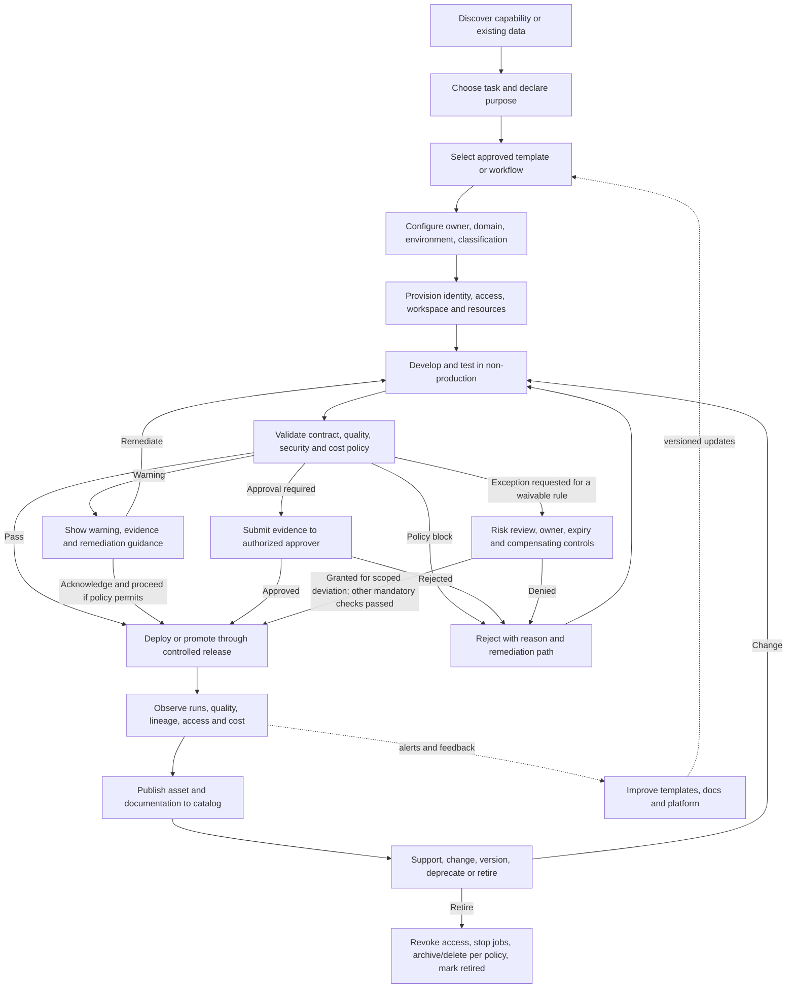

# 06 — Self-Service Platforms and Developer Experience

**Roadmap location:** Stage 2D — Data Architecture → `07-Enterprise-Data-Platform-and-Lakehouse-Architecture/`  
**Topic:** 06 — Self-service platforms and developer experience  
**Level:** Beginner → Intermediate → Advanced  
**Estimated study time:** 5–7 hours, matching the module roadmap  
**Architecture stance:** Vendor-neutral. All organization names, workflows, roles, example policies, measurements, and targets below are illustrative—not universal requirements.

---

## 1. Purpose and orientation

A data platform should let authorized teams deliver reliable data assets without a separate human ticket for every routine operation. It must also prevent unsafe defaults, uncontrolled spend, unmanaged production assets, and access that violates policy. **Self-service means routine work can be completed through supported, repeatable interfaces inside enforceable guardrails—not that every user can do anything.**

Developer experience (DX) is the experience of discovering, learning, building, testing, deploying, operating, changing, and retiring data assets. It includes time and cognitive effort, but also clarity, feedback, reliability, support, and confidence that the platform's safe path works.

This topic builds on earlier roadmap concepts:

- **Topic 01:** platform capabilities and logical architecture establish the services the platform offers.
- **Topic 02:** zones and movement rules establish where data can flow and what checks apply at boundaries.
- **Topic 03:** refinement layers and data-product contracts establish what is being published and what consumers may rely on.
- **Topic 04:** compute, storage, and control-plane responsibilities help place provisioning and runtime dependencies.
- **Topic 05:** catalog and metadata capabilities make assets, owners, schemas, lineage, and classifications discoverable.

The outcome is a workflow design that makes the preferred path easy, the required controls enforceable, and exceptions visible and accountable.

## 2. Learning outcomes

By the end of this lesson, you should be able to:

1. Define self-service, internal developer platform, golden path, template, guardrail, policy-as-code, and DX—and identify common misuse of each term.
2. Map the jobs-to-be-done of platform users and identify friction that can be automated safely.
3. Design an end-to-end workflow from discovery and provisioning through validation, publication, operation, change, and retirement.
4. Assign each control to an enforcement point and distinguish a hard block from a warning, human approval, or time-bounded exception.
5. Define reusable templates, safe defaults, ownership, support boundaries, and versioning policies.
6. Measure developer experience and adoption using observable metrics rather than vanity counts alone.
7. Compare ticket-based provisioning, unrestricted self-service, and guarded self-service using explicit trade-offs.
8. Produce a workflow diagram, responsibility table, control classification, and architecture decision record (ADR).

## 3. Prerequisites and diagnostic check

Review Topics 01–05, especially capability inventories, data-zone boundaries, data contracts, compute/control-plane dependencies, catalog metadata, classification, and ownership. From the roadmap's general prerequisites, governance (P2) and contracts/idempotency (P9) are especially relevant.

Before continuing, try answering these questions. Answers appear in Section 17.

1. Why is a web form that creates a ticket not necessarily self-service?
2. What is the difference between a documented rule and a rule enforced by the system?
3. Which should happen if a pipeline template tries to grant broad access to sensitive data?
4. Why must a data product have an owner and an operational support path after publication?
5. Name one DX metric that measures user outcome rather than platform output.

## 4. Core terminology

| Term | Meaning | Useful when | Common misuse to avoid |
|---|---|---|---|
| **Self-service** | A user can complete a supported task through a documented interface without a human manually executing every routine step | Provisioning a workspace, creating a pipeline, requesting access, publishing a product | Treating it as unrestricted access or a guarantee that no review is needed |
| **Internal developer platform (IDP)** | The capabilities, workflows, interfaces, and guardrails that help internal teams build and operate software/data assets | Coordinating templates, identity, metadata, deployment, observability, and lifecycle | Equating the platform with one portal or one tool; APIs, CLI, templates, and automation may be the actual platform interface |
| **Paved road / golden path** | A supported, opinionated route that makes common tasks easier and safer through reusable defaults | Common ingestion, transformation, testing, and publication patterns | Treating the golden path as a one-size-fits-all architecture or assuming every exception is wrong |
| **Template / scaffold** | Versioned starting material that generates a pipeline, repository, project, policy, or deployment configuration | Standardizing repeatable patterns and reducing setup work | Copying stale boilerplate with no owner, update path, or tests |
| **Guardrail** | A control or constraint that prevents, detects, or limits unsafe actions | Least privilege, quota enforcement, data classification, production readiness | Calling a warning or documentation page an enforced security control |
| **Policy-as-code** | Policy expressed in machine-evaluable rules and checked at defined enforcement points | CI checks, provisioning APIs, authorization decisions, deployment admission | Assuming a policy file is effective when no runtime or deployment path evaluates it |
| **Developer experience (DX)** | How easily, safely, and predictably users accomplish their work with the platform | Reducing onboarding time, confusion, rework, and operational friction | Measuring only portal visits, template count, or number of pipelines created |
| **Paved-road adoption** | The degree to which teams use supported patterns for relevant use cases | Understanding whether the platform meets user needs | Maximizing adoption regardless of whether the road fits a legitimate use case |

A mature platform is not measured by how many controls it has or how many tasks it automates. It is measured by whether users can accomplish legitimate work with a low-friction, supportable path while required controls remain effective.

## 5. Users and jobs-to-be-done

The following personas are illustrative. In a small organization, one person may fill several roles; in a large organization, a role may be split across teams.

| User / role | Job to be done | Common friction | Helpful platform capability | Responsibility that remains with the user/team |
|---|---|---|---|---|
| Data engineer | Ingest, transform, test, deploy, and operate pipelines | Repeated setup, unclear contracts, manual permissions, missing runbooks | Pipeline templates, CI checks, lineage registration, deployment automation | Correct transformation logic, source semantics, incident response for owned pipelines |
| Analyst / BI developer | Discover trusted data and create governed analytical assets | Unclear definitions, unknown freshness, access ambiguity | Searchable catalog, semantic definitions, access request, approved query workspace | Validate interpretation and business use; respect data-use restrictions |
| Data scientist / ML engineer | Build reproducible datasets and features for experiments or production | Environment drift, data-access delays, inconsistent versions | Reproducible environments, approved data access, experiment metadata, resource profiles | Model and feature validity, model lifecycle, workload cost and support commitments |
| Domain/data-product team | Publish a reusable asset with a clear contract | No standard publication checklist, unclear owner/steward | Product specification, contract validation, versioning and discovery | Business meaning, quality/freshness promises, support and deprecation notices |
| Platform operator | Keep shared services secure, available, maintainable, and economical | Snowflake of one-off deployments, no ownership tags, manual recovery | Provisioning APIs, standard templates, telemetry, quotas, policy enforcement | Platform SLOs, upgrades, incident handling, guardrail maintenance |
| Security/governance reviewer | Ensure access, classification, privacy, and retention requirements are met | Late review, incomplete evidence, untraceable exceptions | Policy checks, approval workflows for genuine high-risk cases, audit evidence | Risk decisions, policy interpretation, time-bound approvals and review |
| Data consumer / product owner | Find an asset, understand whether it is fit, request access, and rely on its promise | Stale documentation, unclear freshness, surprise schema changes | Catalog, contract/SLO display, support contact, change notifications | State needs clearly, report issues, use the product within its contract |

### Design principle: automate steps, not accountability

Automation can provision a workspace or execute a quality check. It cannot automatically make an ambiguous business definition correct, determine every legal interpretation, or remove the need for an accountable owner. The platform should make ownership explicit and make required evidence easy to produce.

## 6. Reference self-service workflow

The workflow below represents logical responsibilities, not a required set of separate tools. A portal, CLI, API, repository template, or integrated workflow may expose the same path. Some steps can be skipped when the asset type does not need them; required security and production controls must not be silently skipped.

### How to interpret the workflow

1. **Discover:** The user can find available capabilities, templates, existing data products, owners, documentation, and limitations. Discovery should reveal enough to make a decision without exposing restricted metadata.
2. **Declare intent:** Collect only the information needed to route the request and apply policy—for example, domain, purpose, environment, expected data sensitivity, and owner. Avoid a large form full of fields nobody uses.
3. **Select a supported path:** A template defines an opinionated starting point, supported dependencies, tests, observability, and lifecycle hooks. Template selection does not itself authorize access.
4. **Configure identity, ownership, and resources:** Identity and authorization must be enforced by the relevant identity, provisioning, and runtime services—not merely displayed by the UI. Every production asset has an accountable owner and support contact.
5. **Develop and validate:** Tests include relevant code checks, contract/schema compatibility, quality rules, secrets detection, access scope, lineage registration, logging, and cost/resource configuration.
6. **Gate release:** Automated controls block violations that cannot safely proceed. Warnings explain risks that may be accepted within policy. Human approvals are reserved for decisions that require accountable judgment. Exceptions have an owner, evidence, scope, expiry/review date, and compensating controls.
7. **Operate and publish:** Deployment does not complete the job. The asset must emit telemetry, expose lineage and quality status, record cost attribution, and publish usable documentation and product promises.
8. **Change or retire:** Changes follow version and compatibility rules. Retirement stops execution, revokes obsolete access, updates discovery metadata, and handles retained data according to approved retention and deletion policy.
9. **Learn:** User feedback, failed runs, support tickets, onboarding timing, adoption, and policy outcomes feed a prioritized improvement backlog.

The workflow is complete only when each state has a defined owner, a success condition, a failure outcome, and recorded evidence.

## 7. Workflow responsibility and evidence matrix

The matrix is a worked design example. Adapt responsibilities to the organization's operating model; do not leave ownership as “the platform” without naming a team or role.

| Step / user action | Automation | Guardrail | Approval / exception | Evidence recorded | Accountable owner | Failure / rollback behavior |
|---|---|---|---|---|---|---|
| Discover capability/data | Search catalog and service catalogue; display freshness, classification, owner, supported interface | Filter restricted metadata; show usage limitations | Access request only if the user needs restricted content | Search/request ID, selected asset, user identity | Catalog/service owner for discovery quality; data owner for product content | Show stale/unavailable status; do not imply search result means access is granted |
| Request workspace or asset | Validate inputs; create resource plan; attach cost/domain tags | Allowed regions, resource types, quotas, owner required | Approval only for defined high-risk resources or policy exceptions | Request parameters, policy results, identity, timestamps | Platform provisioning owner | Idempotent retry; clean up partial resources or mark them for reconciliation |
| Select template | Pin approved template version; generate repository/config | Only approved sources/dependencies; template signature/integrity where supported | Exception for unsupported use case, with expiry/review | Template ID/version, generated artifact version | Template maintainer; consuming team owns generated asset | Fail clearly on unsupported version; do not silently fall back to an older insecure template |
| Configure owner and access | Resolve identity groups; create narrowly scoped grants; set classification | Least privilege, separation of duties, no embedded secrets | Sensitive access may require data-owner approval based on policy | Grant/revoke events, scope, policy version, approver | Data owner for data access; identity/platform owner for mechanism | Fail closed for denied/unknown authorization; revoke partial grants on rollback |
| Develop and test | Run tests in CI; scan secrets/dependencies; validate contracts and lineage | No production credentials in development; synthetic/masked data where required | Exception only under documented risk process | Test results, commit/build ID, contract version, lineage events | Asset team; platform owns shared CI mechanism | Block promotion on mandatory checks; retain diagnostics and allow safe retry |
| Promote/deploy | Apply declarative configuration and staged rollout; verify health | Environment policy, resource limits, change record, production-readiness checks | Approval only when risk class or change policy requires it | Release ID, approver, policy decisions, deployment result | Service/asset owner; platform owns deployment service | Roll back to last known good version where safe; stop rollout if health gates fail |
| Operate and monitor | Emit run, freshness, quality, lineage, security and cost telemetry | Required alerts, owner routing, budgets/quotas, retention | Escalation based on severity; override for urgent recovery is audited | Run IDs, SLI measurements, cost tags, incident timeline | Asset owner for pipeline/product; platform team for shared service | Retry/replay only under idempotency and data-correctness rules; preserve incident evidence |
| Publish/document | Register metadata; validate required fields; expose product contract | Owner, description, classification, schema/grain, quality/freshness and support info required as applicable | Waiver for noncritical metadata only if policy allows and has expiry | Catalog record version, contract, publication timestamp | Data-product owner; catalog team owns publishing mechanism | Do not mark as supported/published if mandatory fields or checks fail |
| Change/version | Compare schema/contract; notify subscribers; run compatibility tests | Versioning and deprecation policy; no silent breaking change | Consumer/domain approval where the contract requires it | Diff, compatibility results, notices, migration plan | Product owner | Revert incompatible release or publish a new major contract version with migration path |
| Retire | Stop schedules, remove grants, mark catalog entry retired, execute retention workflow | Retention/legal hold and deletion controls | Data owner/legal approval when required by policy | Retirement ticket/change ID, access revocation, data disposition evidence | Asset owner with platform/data-governance support | If deletion fails, mark pending and alert; never report complete without evidence |

## 8. Safe defaults and enforceable guardrails

A safe default is a choice that is applied automatically unless a permitted, reviewed reason justifies another choice. Some defaults can be overridden; baseline security requirements may be mandatory. For every control, specify its enforcement point and the consequence of failure.

| Control area | Recommended baseline pattern | Where it must be enforced | Evidence / test |
|---|---|---|---|
| Identity and least privilege | Use named identities/groups, narrow scopes, short-lived credentials where supported, and separate human and workload identities | Identity provider, authorization service, resource APIs, runtime/data access layer | Negative test proves an unauthorized identity cannot read or modify the asset |
| Classification-aware access | Require classification before production publication; propagate restrictions to derived assets as policy requires | Provisioning/publishing workflow plus policy enforcement at access time | Missing/unknown classification blocks exposure when policy requires it; derived assets are checked |
| Secrets | Use approved secret-management mechanism; never commit secrets into generated repositories or logs | CI secret scan, deployment mechanism, runtime secret provider, repository protections | Test secret scanning and verify rotation/revocation path |
| Templates and dependencies | Pin supported template versions; use maintained dependencies and documented upgrade path | Template registry/repository, CI, build/release pipeline | Template test suite and version inventory; unsafe versions can be blocked |
| Resource limits and cost | Require owner/domain/cost tags; set default quotas, budget alerts, concurrency limits, and cleanup for abandoned resources | Provisioning API, scheduler/compute quota service, billing/usage pipeline | Attempted over-quota request is rejected or constrained; untagged resources are detected |
| Data contracts and quality | Validate schema compatibility, key/quality rules, reconciliation, and business semantics appropriate to the product | CI/release gate and runtime quality monitoring | Failed mandatory test prevents promotion; runtime breaches alert the owner |
| Logging and lineage | Register pipeline/run identifiers and lineage where feasible; redact sensitive values | Shared libraries/templates, execution platform, metadata collection and log pipeline | Trace a representative input to output and verify logs contain no secrets or prohibited payloads |
| Production readiness | Require owner, support contact, rollback/recovery plan, alert route, SLO/expectation, and change policy proportional to criticality | Release gate and operational inventory | Simulated failure routes to the named owner; release record includes readiness results |
| Environment safety | Use synthetic or masked data in non-production where required; isolate credentials and resource scopes | Data access policy, environment provisioning, CI/CD | Test that development identities cannot use production-only credentials or bypass data restrictions |
| Retirement and retention | Make schedules, grants, catalog status, and data disposition part of retirement | Orchestration, identity, catalog, storage lifecycle/deletion process | Retirement checklist reconciles all resources and records residual exceptions |

**Important distinction:** a UI warning is a usability aid. It is not equivalent to authorization enforcement. A policy is only effective if a relevant execution path evaluates it and refuses, constrains, or records the operation according to the policy's semantics. Likewise, a template can include a security configuration but cannot guarantee it remains correct if users can bypass the deployment path or edit the resource out of band. Detect drift and reconcile actual state with desired state.

### Classify controls by consequence

| Class | Expected behavior | Appropriate examples | Required design detail |
|---|---|---|---|
| **Automated block** | The operation cannot proceed until the violation is corrected or an explicitly allowed exception is granted | Unauthorized access, missing mandatory owner, prohibited region, exposed secret, incompatible breaking schema | Enforcement point, clear error, remediation, audit event, safe retry/rollback |
| **Automated warning** | User sees a non-blocking risk or recommendation; proceeding is permitted by policy | Potentially high compute cost within approved quota, optional description improvement, noncritical freshness risk | Explain impact, record acknowledgement where useful, define when warning becomes a block |
| **Human approval** | A named authorized person makes a decision that requires context or accountability | Access to particularly sensitive data, production change with material risk, a regulated exception | Decision criteria, evidence, approver role, turnaround target if appropriate, audit trail |
| **Exception with expiry** | A scoped deviation is permitted temporarily under compensating controls | A legacy source cannot yet emit required lineage; a migration needs a temporary unsupported connector | Requester and risk owner, reason, exact scope, compensating controls, expiry/review date, monitoring, renewal/revocation path |
| **Recommended practice** | Guidance is available but not enforced because the requirement is advisory or context-dependent | Naming style, optional helper library, preferred documentation format | Rationale, examples, adoption feedback; do not label advisory guidance as mandatory policy |

Not every workflow needs all five classes. The important thing is to choose deliberately, document the reason, and ensure that every mandatory rule has an actual enforcement point.

## 9. Golden path versus mandatory path

A **golden path** is the easiest well-supported route for a common use case. A **mandatory path** is a required route or control because a policy, security risk, legal obligation, or operational contract makes bypass unacceptable. They overlap, but they are not synonyms.

| Question | Golden path | Mandatory path / control |
|---|---|---|
| Why it exists | Reduce effort and improve consistency for common work | Enforce a non-negotiable requirement or risk boundary |
| Can it be bypassed? | Sometimes, through a documented alternative or exception | Not without an authorized exception process where policy permits one |
| Examples | Standard batch ingestion template, default project scaffold, recommended folder layout | No public exposure of restricted data, mandatory identity checks, required retention control |
| How success is measured | Adoption, time-to-first-success, reduced rework, user satisfaction | Policy compliance, prevention/detection effectiveness, auditability, exception risk |
| Failure response | Improve the path or document a justified alternative | Block, contain, remediate, or use an authorized time-bounded exception |

### Exception path design

A defensible exception record should include:

- a unique request or change identifier;
- the requester and the accountable risk/data owner;
- the exact asset, environment, action, and scope covered;
- why the standard path cannot meet the legitimate need;
- risk assessment and compensating controls;
- approval by a role authorized for that risk;
- an expiry date or scheduled review date, plus renewal criteria;
- telemetry or tests that detect the exception's continued use;
- a remediation/exit plan and revocation mechanism;
- an audit trail of approval, changes, review, and closure.

An exception without an owner, expiry/review, and exit path is likely to become permanent shadow infrastructure. Where an organization cannot legally or safely waive a requirement, the workflow must not offer an exception button that falsely implies the requirement is negotiable.

## 10. Developer experience: reduce friction without weakening controls

DX improvements start with user journeys and observed pain, not with the assumption that a portal is the answer. A portal may be useful, but an API, CLI, repository workflow, or documentation-first experience can be equally important.

### 10.1 Onboarding and cognitive load

Good onboarding tells a new user:

1. what the platform supports and does not support;
2. which path fits the task;
3. what inputs are required and why;
4. what the system will create or change;
5. what policy checks will run;
6. how to diagnose a failure;
7. who owns the resulting asset and how it is supported;
8. how to change or retire it later.

Prefer progressive disclosure: ask for details when needed, explain unfamiliar terms, validate input early, provide examples, and return actionable errors. Avoid both extremes: a giant form with dozens of opaque fields and a minimal form that hides major consequences until production deployment.

### 10.2 Documentation and discoverability

Documentation should be versioned with the template or service it describes. At minimum, document intended use, prerequisites, inputs/outputs, limitations, security implications, costs or resource profile, examples, failure handling, supported versions, support owner, and migration/retirement path. The catalog and service catalogue should link to the authoritative documentation rather than accumulate conflicting copies.

Measure whether users can find and successfully use the right capability. Page views alone do not prove discoverability; observe search-to-use conversion, failed searches, repeated support questions, and task completion.

### 10.3 Portal, API, CLI, and repository interfaces

| Interface | Strengths | Risks / design needs |
|---|---|---|
| Portal/UI | Discoverability, guided forms, visual status, access-request journeys | Can become a thin ticket wrapper; UI-only checks can be bypassed by API/CLI |
| API | Composable automation, integration with internal tools, consistent provisioning contract | Requires versioning, authentication, authorization, idempotency, rate limits, and good error semantics |
| CLI | Fast for technical users; scriptable and suitable for local workflows | Needs clear help, safe defaults, credential handling, and predictable output |
| Repository templates | Versioned configuration and reviewable changes; fit naturally into CI | Template copies drift unless upgrades and compatibility are managed |
| Documentation/command examples | Low setup cost, helpful for discovery and learning | Documentation cannot enforce security; examples can become stale |

Interfaces should call the same authoritative provisioning and policy mechanisms wherever practical. A policy enforced only in the portal can be bypassed if the API or direct resource interface allows the same unsafe operation.

### 10.4 Template lifecycle and compatibility

Treat templates as maintained platform products, not one-time snippets.

- Assign a maintainer, supported use cases, version, changelog, and deprecation policy.
- Pin a template version in generated projects so an upstream update does not silently rewrite a user's code.
- Define compatibility rules: what changes are safe, which require migration, and what constitutes a breaking change.
- Test new template versions against representative generated projects and policy checks.
- Notify users of security fixes and required upgrades; set deadlines proportionate to risk.
- Offer migration tooling or clear manual steps; detect abandoned or unsupported template versions.
- Avoid both automatic silent upgrades that break production and indefinite opt-in upgrades that leave critical vulnerabilities unpatched.

### 10.5 Support boundaries

State who supports shared platform services, templates, identity mechanisms, pipeline code, data semantics, and consumer-facing products. A common split is: platform team supports the provisioning/runtime mechanisms; the asset team supports its transformations and product promises; security/governance owns policy interpretation and designated risk approvals. This is illustrative—make the actual split explicit.

## 11. DX and adoption measurement

Use a balanced set of leading and lagging indicators. Define numerator, denominator, event source, time window, segmentation, and owner for each metric. Targets must be derived from user needs and current baselines; the example targets below are illustrative only.

| Measure | Example definition | What it reveals | Caveat |
|---|---|---|---|
| Time to first successful pipeline | Median elapsed time from an eligible team's first valid request to first successful non-production run | Onboarding friction and template quality | Segment by workload complexity; a simple pipeline and a complex streaming job are not comparable |
| Time to production-ready asset | Median time from request to a product that passes release gates and has an owner/support path | End-to-end delivery friction | Track waiting time separately from active engineering time |
| First-pass success rate | Eligible onboarding or release attempts that pass required checks without a retry / all eligible attempts | Clarity, template quality, input validation | A high rate may hide overly weak tests or excluded failures |
| Golden-path adoption | Relevant new assets created using a supported path / all relevant new assets | Fit and usability of the paved road | Do not penalize legitimate use cases that the path does not support |
| Support burden | Support requests per active team or per newly onboarded asset, categorized by root cause | Documentation and platform gaps | Lower ticket volume is not always good; users may have given up or moved to shadow systems |
| Failed-search rate | Searches that return no useful result or lead to no relevant asset, using a defined proxy | Discoverability and metadata gaps | A search ending without a click is not necessarily failure; use user feedback or query categories |
| Policy exception rate and age | Count/rate of active exceptions, median age, overdue review rate | Guardrail fit and risk debt | A low rate can mean the process is inaccessible rather than that policies fit well |
| Template currency | Active assets on supported template versions / assets governed by that template | Upgradeability and security posture | Requires an inventory of generated assets and ownership |
| User-reported effort/satisfaction | Short task-specific survey after onboarding or a workflow | Perceived effort and confidence | Pair with behavioral measures; sentiment alone cannot locate the failure |
| Operational outcome | Change failure rate, recovery time, freshness breach rate, or incidents per active asset | Whether faster creation remains supportable | Segment by criticality and workload; do not optimize speed at the cost of reliability |

A useful dashboard includes both speed and safety: delivery time alongside change failures, policy violations, support burden, stale templates, and overdue exceptions. Otherwise, the team may optimize a misleading metric.

## 12. Failure modes and improvement strategies

| Failure mode | Likely cause / signal | Detection | Improvement / recovery |
|---|---|---|---|
| Templates drift from standards | Generated projects diverge; security fixes do not reach existing assets | Inventory template/version, scan generated configuration, compare with current baseline | Version templates, publish migration guidance, automate conformance checks, assign maintainers |
| Unsafe defaults | Broad permissions, public resources, unbounded compute, missing classification | Negative authorization tests, configuration scans, cost anomaly detection, policy audit | Fix default and enforce at provisioning/runtime; rotate exposed credentials; assess blast radius; notify affected owners |
| Unclear ownership | Alerts go nowhere; product documentation has no accountable contact | Publication gate, owner completeness metric, alert-routing tests | Require named team/role and backup; block production publication when ownership is mandatory |
| Permission overreach | Templates grant broad group access or privileges persist after a project changes | Periodic access review, privilege-diff checks, unusual-access alerts | Narrow grants, expire temporary access, remove orphaned identities, test least-privilege behavior |
| Excessive approval queues | Routine low-risk requests wait for manual review | Measure queue age and approval rate by risk class; sample reasons for approval | Automate deterministic checks; reserve humans for judgment; use risk-based tiers and delegated authority |
| Poor documentation/discoverability | Repeated questions, failed searches, teams bypass the platform | Search analytics, support taxonomy, task observation, documentation freshness checks | Link authoritative docs from templates/catalog; improve examples and errors; retire duplicate guidance |
| Low adoption / shadow systems | Golden path is slow, incomplete, or mismatched to real work | Adoption segmented by use case; interviews; compare cycle times and incident rates | Fix root friction, support legitimate alternatives, expose safe APIs, enforce only justified mandatory controls |
| Automation creates unmanaged cost | Resource creation is easy but cleanup/tags/quotas are absent | Cost allocation gaps, idle-resource reports, quota alerts | Require owner and cost tags; default quotas; automatic idle cleanup with safe grace period; chargeback/showback if appropriate |
| Policy-as-code is not actually enforced | Rules exist in a repo but not in all execution paths | Test portal, API, CLI, and direct-resource paths; audit policy evaluation logs | Put enforcement in authoritative APIs/runtime; fail closed for critical policy; monitor out-of-band changes |
| Exception becomes permanent | No expiry or remediation owner | Exception-age dashboard and overdue review alerts | Require expiry/review, renewal evidence, compensating controls, and revocation path |
| Template upgrade breaks users | No compatibility contract or migration test | Pre-release generated-project tests and canary upgrades | Semantic versioning or equivalent policy, changelog, migration tooling, staged rollout, rollback plan |
| Automation fails halfway | Partial grants/resources remain after timeout | Reconciliation job, request state machine, orphan detection | Use idempotent operations, explicit states, compensating actions, and a safe manual recovery runbook |

The improvement loop is: detect a recurring problem → identify the actual friction or control gap → prioritize by user impact and risk → change the paved road or enforcement point → test the change → measure the outcome → communicate it.

## 13. Operating model comparison

| Dimension | Centralized ticket-based provisioning | Fully self-service with few guardrails | Guarded self-service (recommended default pattern for many shared platforms) |
|---|---|---|---|
| Speed | Often slow; queue and handoffs dominate | Fast for routine tasks | Fast for standard cases; targeted approval for high-risk cases |
| Control | Potentially strong but depends on reviewer consistency and evidence | Weak if users can bypass controls | Enforced baseline plus explicit human judgment where needed |
| Auditability | Tickets may create evidence but decisions can be inconsistent | May be poor without automated records | Workflow records policy results, changes, ownership, and exceptions |
| Autonomy | Low; platform team becomes a bottleneck | High but may exceed legitimate authority | High within supported boundaries |
| Operating cost | High manual support cost as volume grows | Hidden incident, remediation, and shadow-platform costs | Investment in automation and ongoing template/policy maintenance |
| Risk | Approval fatigue, queue workarounds, key-person dependency | Permission sprawl, unsafe configurations, unmanaged spend | Residual risk from policy defects, automation errors, and bad exceptions; must be monitored |
| Best fit | Rare, bespoke, high-risk operations that need expert handling | Low-risk sandbox tasks with strong external constraints or isolated scope | Repeated workflows with predictable policy and a need for both speed and control |

“Fully self-service” is not necessarily reckless in every context: low-risk sandbox tasks may need little friction if isolated and budget-capped. Likewise, ticket-based handling remains appropriate for rare operations that cannot be safely standardized. The architectural decision should follow task frequency, risk, reversibility, and the cost of a mistake—not ideology.

## 14. Illustrative golden-path workflow and policy classification

### Scenario

*Illustrative scenario:* the fictional Northbridge Analytics team wants to publish a daily customer-exposure data product for risk analysts. It uses an approved batch-ingestion and transformation template, reads governed source products, and publishes a versioned product contract to the catalog. The example is not a universal banking design.

### Golden path

1. The team discovers source products and approved batch pipeline capability through the catalog/service catalogue.
2. It submits an asset declaration with domain, named owner, environment, purpose, data classification, expected consumers, and cost attribution.
3. The platform creates a repository from a pinned template version and provisions a non-production workspace with least-privilege identity.
4. The team implements transformations and tests schema, key uniqueness, reconciliation, business rules, and expected grain. Secrets and dependencies are checked by CI.
5. A policy engine evaluates environment, classification, access scope, resource quota, required metadata, and production-readiness criteria. UI warnings are informative only; the API/release gate enforces mandatory policy.
6. If required tests pass, the release pipeline deploys the job with bounded compute, schedule, logging, lineage registration, and alert routing. If a high-risk condition requires review, the workflow pauses and presents evidence to the authorized approver.
7. The team verifies a successful run, freshness/quality signals, rollback behavior, and cost attribution.
8. The publication workflow registers the product's owner, description, schema/grain, semantic definitions, quality/freshness expectations, access path, version, lineage, support contact, and change policy.
9. Consumers discover the product, review its contract and status, and request access through the governed workflow. Discovery does not itself grant permission.
10. Later schema changes trigger compatibility tests and consumer notification; retirement removes schedules and grants, updates catalog state, and follows retention/deletion policy.

### Control classification for this example

| Rule | Class | Why | Enforcement/evidence |
|---|---|---|---|
| A production asset must have an accountable owner | Automated block | Without ownership, incidents and product promises cannot be managed | Publication/release API rejects missing owner; stores owner ID and result |
| A production workload cannot exceed its approved resource quota | Automated block or constrained request, depending on policy | Prevents runaway spend and shared-capacity impact | Provisioning/scheduler enforces quota; records request and usage |
| A likely expensive configuration is within quota but above a recommended profile | Automated warning | The choice may be valid but needs cost awareness | Cost estimate shown and recorded if user acknowledges; no false claim that this is security enforcement |
| Access to highly sensitive data | Human approval where required by policy | Requires accountable risk/data-owner decision | Authorization service enforces grant only after approval; approval identity and scope audited |
| A temporary connector cannot yet emit full lineage | Exception with expiry, only if permitted | Avoids silently accepting a permanent governance gap | Named risk owner, compensating manual lineage, expiry/review date, monitoring and migration plan |
| Naming convention is recommended but not required | Recommended practice | Consistency helps but may not warrant a release block | Linter suggests correction; exceptions are not elevated into security incidents |

### Illustrative ADR — autonomy versus approval boundary

**ADR ID:** `ADR-DP-006`  
**Status:** Proposed for the fictional scenario  
**Decision scope:** provisioning and publishing routine data assets

**Context.** Teams wait for manual tickets to create routine pipelines. Manual review adds latency, while unrestricted resource creation could grant excessive access, omit ownership, or create unbounded cost. The organization needs a safe route for common use cases without pretending that every risk decision is automatable.

**Decision.** Adopt guarded self-service for approved workload patterns. Enforce identity, resource limits, required owner/classification, contract tests, secrets checks, and production-readiness requirements through provisioning and release mechanisms. Use human approval for explicitly designated high-risk access or production changes. Permit exceptions only when policy allows them, with a named risk owner, exact scope, compensating controls, expiry/review, and a remediation path. Provide an alternative documented path for use cases not covered by the standard template rather than encouraging shadow systems.

**Alternatives considered.**

1. **Ticket-based for every operation:** easy to centralize initially, but manual effort and queue time scale with demand; repeatable decisions are difficult to keep consistent.
2. **Unrestricted self-service:** low initial friction, but unsafe defaults, uncontrolled costs, weak ownership, and incomplete audit evidence become likely failure modes.
3. **Guarded self-service (selected):** requires investment in templates, policy enforcement, observability, and maintenance, but balances speed and accountable control.

**Consequences.** The platform team must maintain templates, policy rules, telemetry, and recovery paths. Domain teams must own pipeline correctness and product promises. Security/governance must define risk categories and delegated approval authority. The organization must track exceptions and template versions. Automation reduces repetitive manual work but does not eliminate operational responsibility.

**Assumptions.** The platform has an authoritative identity mechanism, a provisioning interface where policy can be enforced, an inventory of production assets, and owners able to respond to incidents. These assumptions are illustrative and must be verified before adoption.

**Review triggers.** Revisit the decision if policy bypasses are detected, exception age grows, the golden path has low adoption for eligible use cases, production incidents increase, approval queues remain long, or the platform cannot reliably inventory ownership and resource costs.

## 15. Practical exercises

### Exercise A — Design a self-service workflow

**Scenario:** Domain teams report that a new data pipeline takes weeks to launch. The platform team wants a repeatable route that preserves security and operational readiness. Treat all details as illustrative.

**Inputs:**
- a capability inventory from Topic 01;
- a zone and movement model from Topic 02;
- a data-product contract from Topic 03;
- plane and metadata responsibilities from Topics 04–05;
- organizational policy constraints that you state explicitly.

**Tasks:**
1. Draw the workflow from discovery to retirement, including non-production development, release, publication, support, change, and rollback.
2. For every step, name the user action, automation, guardrail, approval/exception condition, evidence, accountable owner, and failure behavior.
3. Identify which actions are idempotent and how partial provisioning is reconciled.
4. Define the minimum production-readiness checklist.
5. Identify at least three friction points and how you would measure improvement.

**Deliverables:** user-journey map with friction points; workflow diagram; responsibility table; production-readiness checklist; short list of DX measures.

**Objective validation criteria:**
- Every workflow transition has an explicit success condition and failure path.
- Every production asset has a named accountable owner and support route.
- Every mandatory control maps to an enforcement point and evidence record.
- Every human approval has a stated reason and authorized role.
- Exception paths include scope, owner, expiry/review, compensating controls, and closure.
- Partial failures have a reconciliation/rollback strategy; retries do not blindly duplicate resources.
- Each DX measure has a definition, data source, time window, and owner.

### Exercise B — Classify controls and define DX measures

**Scenario:** Leadership wants faster onboarding but fears that self-service will weaken governance.

**Tasks:**
1. Classify at least 12 controls across automated block, automated warning, human approval, exception with expiry, and recommended practice. You do not need to use all classes if a category is genuinely not relevant, but justify omissions.
2. For each enforced control, identify the enforcement point and a positive/negative test.
3. Define five observable DX measures, including at least one onboarding measure, one adoption/discoverability measure, one safety/exception measure, and one operational outcome.
4. Compare ticket-based, unrestricted, and guarded self-service for one low-risk sandbox task and one sensitive production task.
5. Define a review cadence and the signals that would cause a template, policy, or workflow to change.

**Deliverables:** control classification table; enforcement/evidence map; DX measure definitions; short trade-off analysis.

**Objective validation criteria:**
- No UI-only warning is described as an enforceable security boundary.
- Each mandatory control has a real enforcement point; bypass paths are considered.
- Human approvals are justified by a specific risk or accountability requirement.
- Every exception is auditable, scoped, owned, time-bounded or scheduled for review, and revocable.
- All five measures are observable and have defined calculation rules, sources, windows, and owners.
- Recommendations distinguish low-risk sandbox tasks from sensitive production tasks.

## 16. Common mistakes and how to correct them

| Mistake | Why it fails | Better approach |
|---|---|---|
| Calling a ticket form “self-service” | The human queue remains the execution engine | Automate routine provisioning and use approval only where judgment is needed |
| Treating self-service as unrestricted access | Convenience can bypass security, ownership, or cost controls | Enforce authorization and quotas in authoritative services |
| Relying on a UI warning for mandatory policy | API/CLI/direct access may bypass the UI | Enforce in provisioning/runtime/release path and test bypasses |
| Building a golden path without user research | The path may not solve real jobs-to-be-done | Observe journeys, interview users, measure failed attempts, iterate |
| Making every step require approval | Approval fatigue and long queues reduce adoption | Automate deterministic checks; reserve approval for material risk or judgment |
| Removing all review to improve speed | Important contextual decisions have no accountable owner | Use risk tiers, evidence, delegated approval, and auditable exceptions |
| No template maintainer or versioning | Copies become inconsistent and security fixes do not propagate | Version, test, inventory, migrate, and deprecate templates deliberately |
| No asset owner | Alerts and change decisions have nowhere to go | Require an accountable owner and support contact before production publication |
| Measuring only adoption | High usage can coexist with incidents, rework, or forced compliance | Pair adoption with cycle time, first-pass success, incidents, exception age, and user outcomes |
| Assuming automation removes operations | Failed jobs, incorrect data, and incidents still need decisions and recovery | Define on-call/support boundaries, runbooks, reconciliation, and incident review |
| Permanent exceptions | Temporary workarounds become shadow architecture | Set expiry/review, compensating controls, owner, monitoring, and exit plan |
| Treating every deviation as misconduct | Legitimate use cases are pushed into unmanaged systems | Offer a transparent alternative and a proportionate exception process where safe |

## 17. Review questions with answer key

### Questions

1. What distinguishes self-service from a ticket portal?
2. Explain the difference between a golden path and a mandatory path.
3. Why is a UI warning not an adequate enforcement mechanism for a mandatory security policy?
4. List at least six fields that make an exception auditable and manageable.
5. Give two examples of controls that should usually be automated and one example where human judgment may be appropriate.
6. Why should a template have a maintainer, version, compatibility policy, and deprecation plan?
7. What is a balanced set of metrics for evaluating DX?
8. What should happen when provisioning succeeds partially and then times out?
9. Why does publishing a data product require an owner, contract, support route, and change policy?
10. What evidence would show that the self-service platform is causing teams to bypass governance?
11. Compare ticket-based provisioning and guarded self-service for a low-risk sandbox workspace.
12. How does self-service design lead into multi-team isolation and tenant boundaries in Topic 07?

### Answer key

1. Self-service allows the user to complete supported routine tasks through automation without a human manually performing each step. A ticket portal may merely submit work to a queue.
2. A golden path is a supported, opinionated route that simplifies common tasks and may have alternatives. A mandatory path/control exists because a policy or risk boundary requires it; bypass needs an authorized exception only if policy allows one.
3. The UI may be bypassed through API, CLI, or direct resource access. Mandatory policy must be evaluated at an authoritative enforcement point, and bypass paths must be tested.
4. Any six of: unique ID; requester; accountable risk owner; exact scope/asset/environment; reason; risk assessment; compensating controls; authorized approver; expiry/review date; monitoring; remediation/exit plan; audit trail.
5. Automated examples: secret detection, quota enforcement, schema compatibility checks, required owner/classification validation. Human judgment example: approval for access to especially sensitive data or a material risk exception.
6. Generated projects persist and diverge. Versioning and compatibility define safe change; a maintainer owns fixes; deprecation and migration ensure users do not remain indefinitely on unsupported or unsafe versions.
7. Combine measures such as time to first successful pipeline, production-ready lead time, first-pass success, relevant golden-path adoption, support burden, failed-search rate, exception age, template currency, satisfaction, and operational outcomes. Define sources and windows.
8. Record explicit state, retry idempotently where safe, reconcile actual resources with the request, and remove or mark partial resources for cleanup. Do not blindly repeat non-idempotent operations.
9. Consumers need to know what the asset means, whether it meets expectations, who responds to incidents, how changes are handled, and when the product is retired. A table's existence is not a supported product promise.
10. Signals include unregistered resources, missing owner/cost tags, rising use of unsupported templates, unexplained access grants, manual deployments outside the release path, exception growth, or interviews showing that the golden path is too slow or incomplete.
11. Ticket-based handling may be unnecessarily slow for a low-risk, isolated, quota-limited sandbox. Guarded self-service can automate it with safe defaults and observable usage; sensitive production access may need stronger controls and review.
12. Self-service creates resources for many teams. Topic 07 defines what separates tenants' data, access, compute, network, cost, and failure impact; quotas and isolation stop one team's work from harming another.

## 18. Glossary

- **Approval queue:** Work waiting for an authorized human decision.
- **Asset owner:** Accountable person/team for a data asset's correctness, support, and lifecycle.
- **Guardrail:** A preventive, detective, or limiting control that shapes safe platform use.
- **Golden path / paved road:** A supported, opinionated route for common tasks.
- **Internal developer platform:** Integrated capabilities and workflows that let internal teams create and operate assets safely.
- **Policy-as-code:** Machine-evaluable policy connected to an actual enforcement or decision point.
- **Provisioning:** Creating/configuring resources, permissions, and supporting metadata.
- **Rollback:** Returning to a previous safe state or version when a release fails.
- **Safe default:** A preselected configuration that reduces risk without requiring every user to understand every control.
- **Shadow platform / shadow IT:** Unmanaged tools or workflows used outside supported governance and operational boundaries.
- **Template drift:** Difference between generated projects or deployed resources and the currently supported baseline.
- **Time to first success:** Elapsed time until a user completes a defined first successful task.
- **Exception:** A formally authorized deviation from a rule, with scope, risk ownership, evidence, and a review/expiry path.
- **DX (developer experience):** The effort, clarity, safety, and predictability of completing work through the platform.

## 19. Mastery checklist and Topic 06 completion gate

Mark each item only when you can show the evidence, not merely explain the words.

- [ ] I can map a user journey from discovery through operation and retirement, including failure paths.
- [ ] I can distinguish self-service, a golden path, a mandatory control, and an exception.
- [ ] I can name the users, jobs-to-be-done, and accountable owners for the workflow.
- [ ] Every mandatory guardrail in my design has an actual enforcement point and testable evidence.
- [ ] I have classified controls as enforced, default, recommended, approval-required, or exception-based with a clear rationale.
- [ ] Every exception has a requester, accountable risk owner, scope, evidence, compensating controls, expiry/review, and exit/revocation plan.
- [ ] My workflow includes contract/quality checks, identity/access, secrets, cost/resource limits, observability, lineage, documentation, and support proportional to the asset's risk.
- [ ] My template lifecycle includes versioning, compatibility, migration, deprecation, and security updates.
- [ ] I can define five DX measures with calculation, source, window, and owner.
- [ ] I can explain how partial provisioning, failed release, unsafe configuration, and retirement are handled.
- [ ] I can compare ticket-based, unrestricted, and guarded self-service without claiming one is always best.
- [ ] I have completed Exercise A's workflow diagram/responsibility table and Exercise B's control classification/measure definitions.
- [ ] A peer can inspect the workflow and identify the owner, enforcement point, evidence, and rollback/exception path for each important transition.

### Completion gate from the roadmap

- [ ] Workflow and control classification reviewed by a peer.
- [ ] Every approval step has a stated reason.
- [ ] DX measures are observable.
- [ ] If controls seem unjustified, revisit the governance-proportionality material referenced by the roadmap before proceeding.

**Exit criterion:** you can design a self-service path that reduces routine friction while keeping required security, governance, ownership, and operational controls enforceable and auditable.

## 20. Bridge to Topic 07 — Multi-team isolation and tenant boundaries

Self-service increases the number of people and teams able to provision resources. Without explicit tenant boundaries, a fast workflow can create cross-team data exposure, noisy-neighbour contention, shared quota exhaustion, cost disputes, and unclear failure ownership.

Topic 07 builds on this lesson by asking: **what does each team actually share, and what must be isolated?** It examines logical versus physical isolation across data, access, compute, network, failure, and cost dimensions; tenant responsibilities; quotas and priorities; and residual risks. Self-service should provision resources inside that isolation model—not invent a new boundary each time a user creates an asset.

The design handoff is therefore concrete: carry forward the workflow's identity scope, domain/team owner, resource quotas, shared-service dependencies, cost tags, approval rules, and exception inventory. Those become inputs to the tenant-boundary and isolation decisions in Topic 07.

---

## Reference alignment

This lesson follows the Topic 06 syllabus in `roadmap-Enterprise-Data-Platform-and-Lakehouse-Architecture.md`: user friction, templates and safe defaults, discoverability and automation, autonomy versus governance, DX measures, two exercises, expected deliverables, mastery criteria, and the stated completion gate. The source roadmap describes the lesson files as empty at the time it was authored; this lesson is newly authored learning content rather than a summary of pre-existing Topic 06 text.
