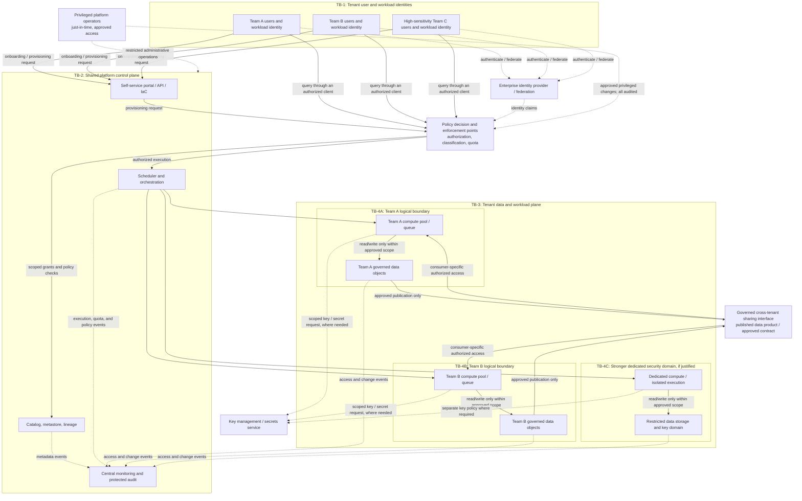

# 07 — Multi-Team Isolation and Tenant Boundaries

> **Stage 2D — Data Architecture · Enterprise Data Platform and Lakehouse Architecture**  
> **Level:** Beginner → Intermediate → Advanced  
> **Estimated effort:** 6–8 hours, plus design review  
> **Scope:** Vendor-neutral architecture and security design. Examples are illustrative, not claims about every product or a substitute for a legal, regulatory, or security assessment.

## 1. Purpose and source-of-truth note

Enterprise data platforms are shared by teams with different data classifications, workload shapes, budgets, recovery needs, and administrative responsibilities. The architecture problem is not simply to give each team a separate name or workspace. It is to define and enforce boundaries so that one tenant's identities, data, workloads, mistakes, costs, and failures do not create unacceptable effects for another tenant.

This lesson follows Topic 07 of `roadmap-Enterprise-Data-Platform-and-Lakehouse-Architecture.md`. The roadmap records the lesson files as empty when it was authored; this file is newly authored learning content following that syllabus. Topic 07 depends on Topics 04–06 (compute/storage/control-plane separation, catalogs and metadata, and self-service/DX), governance principles, and an understanding of failure domains and transaction boundaries. Examples below use the fictional **Northbridge Bank** scenario solely to make trade-offs concrete.

**Design principle:** choose boundaries from a documented threat model and service requirements. Do not infer security from labels, names, folder structure, schema names, workspaces, or accounts alone. A mechanism provides only the guarantees its implementation, configuration, identity model, and operating practices actually enforce.

## 2. Learning outcomes

By the end of this lesson, you should be able to:

1. Define tenant, tenant boundary, logical and physical isolation, administrative boundary, workload isolation, data isolation, and noisy neighbour.
2. Map isolation requirements across identity, data namespace, compute, network, keys, metadata/catalog, control plane, audit, quotas, and administrative privileges.
3. Read and explain a vendor-neutral shared-platform diagram, including trust boundaries and data/control flows.
4. Compare shared logical controls, dedicated workspaces/accounts/projects, dedicated compute, separate storage/security domains, and fully separate environments.
5. Threat-model accidental access, privilege escalation, metadata leakage, resource starvation, identity misconfiguration, compromised workloads, shared credentials, and administrator misuse.
6. Select preventive, detective, and corrective controls, and explain their evidence and residual risks.
7. Design a tenant lifecycle from onboarding and classification through monitoring, incident containment, offboarding, retention, and deletion.
8. Defend an isolation choice using sensitivity, regulation, blast radius, threat model, interference, recovery needs, and total cost/operability.
9. Define tenant responsibilities, quota/priority policies, and reproducible cost allocation.
10. Produce an isolation model, options matrix, threat model, and architecture decision record (ADR) suitable for peer review.

## 3. Prerequisites and diagnostic check

### 3.1 Prerequisites

| Prerequisite | Why it matters | Review action if weak |
|---|---|---|
| Topic 04: compute, storage, and control-plane separation | Boundaries can differ across data, execution, and management services. | Draw which services store data, execute workloads, and administer resources. |
| Topic 05: catalogs, metastores, and platform metadata | Catalog names, lineage, schemas, and ownership may themselves be sensitive. | List metadata fields and who should see each field. |
| Topic 06: self-service and developer experience | Self-service needs enforced guardrails, safe defaults, and exception paths. | Trace a tenant request from provisioning through policy validation. |
| Governance and data classification | Isolation level depends on sensitivity, purpose, and obligations. | Classify three datasets and name the accountable owner. |
| Failure domains and consistency/transaction boundaries | Shared services and recovery paths can cross tenant boundaries. | Identify one shared dependency that could cause a multi-team outage. |
| IAM fundamentals | Authentication proves identity; authorization determines permitted actions. | Explain principal, role/group, resource, action, and policy. |

### 3.2 Diagnostic check

Answer before reading the lesson. Revisit after Section 16.

1. Does a separate schema automatically prevent cross-team reads? Why or why not?
2. If data access is isolated but all teams share one compute pool, what risk remains?
3. Name one security risk in a shared catalog even when table contents are protected.
4. What is the difference between an access-denied log and a control that prevents access?
5. If a team has a dedicated account, which risks may still remain?
6. Why is cost tagging not the same thing as a hard quota?

**Diagnostic key:** (1) No; it depends on authorization, object ownership, execution paths, service identities, and admin privileges. (2) Contention/noisy neighbour and shared failure effects. (3) Sensitive names, descriptions, lineage, owners, or existence may leak. (4) Logging detects/evidences; an enforced policy blocks the operation. (5) Shared provider/control-plane, identity federation, network, software supply chain, weak in-account permissions, or common administrators. (6) Tags attribute spend; a quota constrains consumption when enforced.

## 4. Core terminology

| Term | Working definition | Important qualification |
|---|---|---|
| **Tenant** | A unit assigned a defined scope of resources and responsibilities, such as a team, business unit, environment, or customer. | A tenant may contain multiple projects or data products; its definition must match the use case. |
| **Tenant boundary** | The enforceable rules and technical/operational mechanisms defining what a tenant can access, change, consume, administer, observe, and recover. | It is a set of controls and guarantees, not a name or label. |
| **Isolation** | Limiting cross-tenant access and unacceptable interference across data, identity, compute, network, failures, and cost. | Perfect isolation is not implied; state residual risk. |
| **Logical isolation** | Separation enforced through software, policies, identities, namespaces, quotas, or configuration on shared infrastructure. | A defect, misconfiguration, privileged bypass, or shared-plane compromise may cross it. |
| **Physical isolation** | Separation using dedicated infrastructure or hardware/resource domains, to the extent actually provided by the design. | Dedicated infrastructure does not eliminate weak IAM, malicious insiders, supply-chain risks, or poor operations. |
| **Administrative boundary** | A scope within which a defined set of principals can create, configure, grant access to, or delete resources. | The scope and inherited permissions matter more than the product's label for it. |
| **Workload isolation** | Limits on how a tenant's jobs affect another tenant's execution, latency, capacity, or failure behavior. | Separate compute helps but may not isolate shared storage, metadata, network, or control-plane bottlenecks. |
| **Data isolation** | Controls preventing unauthorized discovery, reading, modifying, deleting, or exporting another tenant's data. | Include copies, caches, logs, temporary files, backups, and derived data. |
| **Noisy neighbour** | A tenant whose resource use or failure degrades other tenants sharing capacity or services. | Can be accidental (large query) or adversarial (resource exhaustion). |
| **Blast radius** | The scope of systems, data, tenants, and services affected by one event. | Boundaries should limit both compromise and operational failure. |
| **Quota** | An enforced limit or allocation on a resource or activity, such as concurrency, storage, requests, or spend. | A warning or dashboard is not a hard quota unless a control actually rejects/throttles excess use. |
| **Showback / chargeback** | Showback reports attributable usage/cost; chargeback assigns or bills that cost to a team or cost centre. | Both require defensible meters, allocation rules, and treatment of shared overhead. |
| **Trust boundary** | A point where identity, authority, data classification, or assumptions change and controls must be applied. | Draw it where enforcement happens, not merely where boxes are drawn. |

### 4.1 Apartment analogy—and its limits

An apartment building resembles logical isolation: tenants have separate locks, but share foundations, utilities, hallways, and building management. Separate houses resemble stronger physical separation. The analogy helps explain shared dependencies, but real systems have complex identity inheritance, privileged control planes, software defects, backups, networks, and cryptographic key paths. Evaluate those explicitly rather than relying on the analogy.

## 5. Isolation dimensions: design the whole boundary

A tenant boundary is only as strong as its weakest relevant path. For every dimension, document the required guarantee, enforcement point, owner, evidence, and residual risk.

| Dimension | Design question | Example controls | Common gap / residual risk |
|---|---|---|---|
| **Identity and permissions** | Which human, workload, service, and administrator principals can perform each action on which tenant resources? | Federated identities, tenant-scoped roles/groups, least privilege, explicit resource policies, short-lived credentials, separation of duties. | Broad inherited roles, wildcard grants, stale memberships, confused-deputy behavior, or a shared service identity with access to every tenant. |
| **Data namespace** | Can one tenant list, read, alter, delete, or export another tenant's objects? | Separate storage prefixes/containers/buckets, schemas, databases, ownership, object-level grants, row/column policies where appropriate. | Namespace is only organization unless authorization and all access paths enforce it; path traversal, wildcard grants, shared write identities, or admin bypass. |
| **Compute/resources** | Can one tenant monopolize capacity or cause another's jobs to fail? | Per-tenant pools, concurrency limits, workload classes, queues, memory/CPU limits, reservations, admission control, cancellation policies. | Shared scheduler, memory pressure, cache contention, storage I/O, or unbounded jobs still create interference. |
| **Network** | Which tenant workloads and services can communicate, and over which routes/ports? | Segmentation, private endpoints, egress allowlists, service-to-service authorization, network policies, DNS controls. | Network reachability does not prove data authorization; shared egress, permissive routing, or control-plane endpoints may remain common. |
| **Encryption and keys** | Who can use, administer, rotate, disable, or recover keys protecting each tenant's data? | Managed encryption, tenant-scoped keys where justified, key policies, rotation, separation of key admins from data users, audited decrypt/use paths. | A separate key is not useful if shared principals can use it broadly; encryption does not prevent authorized exfiltration or misuse after decryption. |
| **Metadata and catalog** | Who can discover object existence, names, schema, tags, owners, lineage, query history, or classifications? | Catalog authorization, metadata field classification, filtered search, scoped lineage, audited administrative APIs. | Metadata may expose business activity or sensitive relationships even when underlying records are unreadable. |
| **Control plane** | Who can create, reconfigure, grant, impersonate, or delete tenant resources and policies? | Scoped admin roles, approval workflows, policy-as-code, protected configuration, change review, separate platform/tenant duties. | Shared control-plane compromise or an overly privileged operator can bypass many data-plane controls. |
| **Logs and audit** | Can each tenant access its own evidence without seeing another tenant's secrets or activity? Can security staff correlate events across tenants? | Central protected audit sink, tenant-aware fields, restricted log access, tamper resistance, retention and alerting. | Logs can leak query text, identifiers, tokens, or row values; tenant filtering can hide signals from central security. |
| **Quotas and cost** | Can a tenant exceed its fair allocation or create unbounded spend? Is usage attributable? | Enforced quotas, budgets/alerts, concurrency limits, metering, labels/tags, allocation rules, cost anomaly detection. | Alerts arrive after spend; tags can be missing or spoofed; shared fixed costs require explicit allocation rules. |
| **Administrative privileges** | Who can grant themselves access, disable controls, export data, or alter audit settings? | Privileged access management, just-in-time elevation, dual control for high-risk actions, break-glass process, immutable audit export, periodic review. | Administrators may retain broad power; controls require independent evidence and an incident path for suspected misuse. |
| **Failure and recovery** | Can one tenant's incident, deletion, deployment, or recovery operation affect another? | Separate failure domains, scoped deployment permissions, per-tenant backup/restore, rate limits, circuit breakers, tested recovery. | Shared identity, catalog, network, KMS, scheduler, or metadata dependencies can still create correlated failure. |

**Data isolation is not data quality.** A perfectly isolated dataset can still be incorrect, stale, duplicated, or incomplete. **Data isolation is not availability.** Access controls do not guarantee that a shared catalog, scheduler, network, or storage service remains available. Track quality, security, and reliability as distinct attributes, even where controls interact.

## 6. Vendor-neutral reference architecture

The diagram is a logical pattern, not a claim that every deployment has exactly these components. The trust-boundary labels identify where policy must be enforced and audited. Solid arrows show request/data paths; dashed arrows show policy, administration, or telemetry paths.



### 6.1 How to interpret the diagram

- **TB-1 — identity boundary:** human and workload identities are authenticated and mapped to scoped roles. A user's permission must not automatically be inherited by every workload they can launch. The identity arrows are conceptual; federation and token issuance vary by implementation.
- **TB-2 — shared control plane:** portal, catalog, scheduler, and audit services may be shared for efficiency. They are high-value dependencies; their administrators and service identities require careful scoping.
- **TB-3 — data/workload plane:** a shared platform can host different degrees of isolation. The architecture should explicitly identify shared dependencies that remain outside a tenant's boundary.
- **TB-4A/B — logical tenant boundaries:** separate resources and compute queues are useful only if policy enforcement covers every relevant API and execution path. They may still share a control plane, physical host, storage system, or provider service.
- **TB-4C — stronger security domain:** shown for a tenant whose threat model warrants dedicated execution, storage, or key controls. It is not automatically required for every tenant, nor does it eliminate in-domain access-control risk.
- **Cross-tenant sharing:** data moves through a governed publication interface with an owner, purpose, classification, contract, authorized consumers, and audit trail. Do not solve sharing friction by granting broad direct access to another tenant's raw area.
- **Key and secret use:** the diagram shows workloads requesting scoped key or secret access. Some systems instead have a storage or platform service call the key service as part of envelope encryption; the real call path, principal, and key policy must be documented for the chosen implementation.
- **Telemetry:** monitoring should preserve enough tenant context to detect abuse and allocate cost, while restricting log visibility and redacting secrets or sensitive payloads.

### 6.2 Data plane vs control plane

The **data plane** reads, writes, transforms, and serves data. The **control plane** provisions, configures, schedules, grants, catalogs, and governs resources. The same platform may share a control plane while isolating data-plane resources. That can be a reasonable cost/operability choice, but it means a control-plane compromise or privileged misconfiguration may have a larger blast radius than a single tenant. Document this residual risk explicitly.

## 7. Isolation options matrix

These categories are illustrative. Actual semantics vary by implementation and deployment configuration. A label such as “project,” “workspace,” “account,” “schema,” or “cluster” is not itself evidence of a particular security guarantee.

| Option | Typical strengths | Limitations / residual risks | Operational burden | Relative cost | Suitable conditions |
|---|---|---|---|---|---|
| **Shared resources with logical controls**: shared storage/compute/control services, tenant-scoped policies and quotas | Highest density; centralized upgrades; low fixed overhead; fast onboarding; consistent governance if well automated. | Policy/configuration errors can cross tenants; shared admin plane; noisy-neighbour and shared-failure risk; hard boundaries depend on complete enforcement coverage. | Lower environment count but high need for policy tests, tenant-aware observability, and careful change management. | Usually lowest incremental cost; engineering and incident risk still count. | Low-to-moderate sensitivity, trusted internal teams, strong platform controls, limited regulatory separation needs, and acceptable shared failure domains. |
| **Dedicated workspace / namespace / account / project** | Can scope administration, resource ownership, quotas, billing, policies, and discoverability; helps reduce accidental coupling. | Guarantees vary; shared provider, identity federation, network, control plane, or platform admins may remain; separate namespaces may not isolate storage or physical execution. | More provisioning, policy drift prevention, quotas, inventories, upgrades, and cross-boundary sharing work. | Moderate; increases with the number of dedicated scopes and duplicated baseline services. | Teams need clearer admin or billing boundaries; workloads have distinct ownership; risk warrants more than object-level separation. |
| **Dedicated compute / workload pool** | Predictable capacity; better performance isolation; independent scaling and workload scheduling; reduces contention. | Does not by itself isolate data, catalog, network, keys, or control plane; dedicated pool may still share hosts or underlying services. | Pool sizing, utilization tracking, capacity planning, priority policy, patching, and idle-capacity management. | Moderate to high depending on reservation and utilization. | Latency-sensitive BI, heavy ML training, bursty workloads, or a noisy-neighbour problem. |
| **Separate storage and security domain**: distinct storage boundary, scoped identities/policies, possibly tenant-scoped keys and network path | Stronger data access and administrative separation; clearer retention/residency; may reduce cross-tenant data blast radius. | Shared catalog, compute, identity, backup, network, and administrators may remain; keys alone do not prevent authorized exfiltration; copies and derived data must be controlled. | More storage policies, lifecycle/backup/restore operations, key governance, lineage, and approved data-sharing workflows. | Moderate to high; duplicated storage and operational overhead. | Sensitive data, distinct retention/residency obligations, customer/BU separation, or an elevated data-exposure threat. |
| **Fully separate environments**: separate infrastructure and independently operated critical dependencies where justified | Strongest practical reduction in shared resource and failure coupling when boundaries are genuinely independent; can support stricter control and recovery objectives. | Not absolute isolation: common staff, identity federation, software supply chain, management tooling, physical/provider dependencies, and poor in-environment IAM remain risks. | Highest: duplicated platform services, upgrades, incident response, monitoring, disaster recovery, and integration; configuration drift risk rises. | Usually highest; dedicated capacity may be underutilized. | High sensitivity, strict contractual/regulatory constraints, low tolerance for shared-plane compromise, materially different recovery needs, or documented threat-model requirement. |

### 7.1 Selection questions

For each tenant, record an answer and evidence for these questions before selecting an option:

1. What data classifications, legal/contractual constraints, and approved purposes apply?
2. What are the credible threat actors and paths: mistake, compromised workload, malicious tenant user, administrator, or shared-service compromise?
3. Which dimensions require isolation: data, access, compute, network, keys, metadata, administration, failure, or cost?
4. Which shared dependencies remain, and what is their failure/compromise blast radius?
5. What recovery point/time objectives, availability promises, and incident-containment needs apply?
6. How much resource interference is acceptable, and how is fairness enforced?
7. What is the full cost: infrastructure, engineering, monitoring, support, duplication, and expected incident impact?
8. What evidence will demonstrate that controls work, and how often will they be tested?
9. What approved cross-tenant sharing is needed, and what interface/contract governs it?
10. What event forces re-evaluation: reclassification, new regulation, incident, acquisition, growth, workload change, or platform migration?

## 8. Threat modeling and abuse/failure cases

Threat modeling is a structured way to identify what must be protected, who or what could cause harm, the paths through which harm could occur, the controls that interrupt those paths, and the risk left after controls. It is not a prediction that every scenario will occur.

### 8.1 Lightweight method

1. **Set scope:** identify tenants, datasets, workloads, shared services, trust boundaries, and excluded components.
2. **Classify assets:** data, metadata, credentials, keys, compute capacity, audit evidence, and control-plane privileges.
3. **Identify actors and failure sources:** accidental user action, compromised tenant workload, malicious insider, misconfigured service, shared dependency failure, or external attacker.
4. **Trace paths:** identity issuance → policy evaluation → catalog lookup → execution → storage/network/key use → logs/backups/exports.
5. **State abuse cases:** what an actor could read, alter, delete, exhaust, conceal, or cause to fail.
6. **Map controls and evidence:** preventive, detective, and corrective controls; owner; test method; alert or response route.
7. **Rate risk:** likelihood and impact using the organization's method; include uncertainty and assumptions rather than inventing precision.
8. **Record residual risk and decision owner:** accept, mitigate, transfer where meaningful, or avoid; set review triggers.

### 8.2 Threat-model table

The cases below are plausible design scenarios, not claims that every platform is vulnerable in the same way. “Example controls” must be verified against the actual platform.

| Threat / failure case | Example path and impact | Preventive controls | Detective evidence | Corrective response | Residual risk / test idea |
|---|---|---|---|---|---|
| **Accidental cross-team read** | Analyst selects the wrong schema, path, or shared view and sees another tenant's data. | Deny-by-default grants; scoped roles; explicit object ownership; approved views/data products; policy checks on all access paths. | Denied/allowed access logs with tenant, principal, object, action, and purpose where appropriate; access anomaly alerts. | Revoke grant, contain exports, assess exposure, preserve evidence, notify response owner. | A broad privileged role or untested API may bypass expected controls. Test cross-tenant reads through SQL, APIs, notebooks, jobs, exports, and backup/restore paths. |
| **Privilege escalation** | Tenant principal obtains a platform-admin role through group nesting, permission inheritance, or a vulnerable service. | Separation of duties; restricted role-assignment permissions; just-in-time elevation; approval and policy-as-code checks. | Role-change logs, periodic entitlement diff, alerts for high-risk grants. | Disable/revoke principal, rotate affected credentials, restore known-good policies, investigate activity. | Identity-provider compromise or a legitimate but overpowered admin can still escalate. Test inherited and nested groups, not only direct grants. |
| **Metadata leakage** | Search results, lineage, schema names, query history, or tags reveal another team's activity or sensitive fields. | Catalog authorization; field-level metadata classification; filtered discovery; scoped lineage and query-history access. | Catalog/API access logs; tests for unauthorized discovery; review of metadata exposure. | Restrict affected fields, remove accidental publication, review copies/caches and downstream logs. | Search indexes, logs, and caches may retain metadata after a policy change. Test discovery, autocomplete, lineage, and error messages. |
| **Resource starvation / noisy neighbour** | Large query, runaway job, or repeated requests exhaust CPU, memory, concurrency, I/O, or API capacity and degrade another team. | Quotas, workload queues, concurrency and runtime limits, rate limiting, reservations, fair scheduling, cancellation policy. | Per-tenant utilization, queue depth, latency, throttling, saturation, and spend metrics. | Throttle/cancel workload, scale or rebalance, adjust priority/quotas, run incident review. | Shared storage, cache, network, scheduler, or metadata bottlenecks may remain. Load-test contention and validate isolation under peak and burst. |
| **Misconfigured service identity** | Pipeline uses a shared identity with broad access, or a token is reused across tenants. | Per-workload identities; scoped short-lived credentials; no embedded long-lived secrets; permission boundary tests; secret rotation. | Identity-to-workload mapping, token issuance/use logs, anomalous cross-tenant access. | Disable/rotate identity, stop affected workloads, reduce grants, determine scope of access. | A platform component may need broad service permissions; constrain and audit the broker/impersonation path. Test that Team A's workload identity cannot act as Team B. |
| **Shared credentials** | Teams share an admin password, token, or service account, defeating attribution and revocation. | Individual/federated identities; workload identity; secrets manager; no shared human accounts; rotation and ownership. | Credential inventory, secret scanning, authentication logs, unusual source/device detection. | Revoke and rotate; migrate to named identities; investigate actions that cannot be attributed. | Emergency workarounds can reintroduce sharing. Audit actual use, not just policy documents. |
| **Compromised workload** | Malicious or compromised code exfiltrates accessible data, abuses egress, or attacks shared services. | Least-privilege identity; network egress restrictions; isolated execution; dependency controls; secrets scoped to workload; input validation. | Egress, process/job, API, identity, and data-access telemetry; behavioral alerts. | Quarantine workload, revoke identity, block routes, rotate secrets, preserve artifacts and investigate. | Data legitimately accessible to the workload may still be exfiltrated. Test egress paths and ensure logs avoid storing secrets. |
| **Administrator misuse** | Privileged operator reads data, changes grants, disables monitoring, or deletes resources. | Privileged access management; just-in-time grants; separation of duties; dual approval for high-impact actions; protected audit export. | Independent audit logs; alerts on policy/logging changes; periodic privileged-access review. | Suspend privileged access; preserve external audit evidence; incident/legal process as applicable; rotate keys if warranted. | A sufficiently powerful or colluding administrator may bypass controls. Define independent oversight and test the break-glass process. |
| **Shared catalog/control-plane failure** | Common metadata, identity, scheduler, or policy service is unavailable or compromised, affecting many tenants. | Minimize privileges; high availability; segmented admin access; change control; resilient dependencies; tested rollback. | Service health, configuration drift, auth failures, cross-tenant impact signals. | Fail over/rollback, restrict risky operations, communicate impact, recover from tested backups. | Shared-plane independence may be limited by architecture or provider. Map dependency and recovery boundaries. |
| **Deletion or recovery crosses tenant boundary** | A broad deployment or restore identity deletes/overwrites another team's objects. | Scoped destructive permissions; tenant-scoped backup/restore; change plans; approval for broad changes; dry-run and blast-radius checks. | Change audit, deletion/restore events, integrity checks, reconciliation alerts. | Stop rollout, restore only affected scope, reconcile lineage/consumers, revise permissions and tests. | Shared tables or cross-tenant dependencies can complicate selective recovery. Run restore and rollback exercises. |

### 8.3 Risk statements and assumptions

Use precise wording. Prefer: “If the shared catalog service identity is compromised, the attacker may be able to enumerate metadata across tenants because the current design grants it broad read access; we will restrict scope and test catalog authorization.” Avoid: “The catalog is insecure.” The first statement identifies a condition, path, impact, and control; the second is not testable.

Every threat entry should state, as applicable:

- **Assumption:** e.g., workload identities are supported and can be scoped independently.
- **Asset and tenant impact:** which information, service, or boundary is at risk.
- **Preconditions:** what access or failure is needed for the path to work.
- **Control dependency:** which identity, policy, network, or logging component must work correctly.
- **Evidence:** the test, log, configuration review, or operational metric that supports the control claim.
- **Residual risk:** what remains possible after the control is applied.

## 9. Defense in depth: controls and evidence

No single control is sufficient for every threat. Controls should be layered, independently reviewable where practical, and tied to evidence. A control classification describes its primary purpose; some controls can serve more than one role.

| Control | Primary class | What to implement | Evidence / validation |
|---|---|---|---|
| Least privilege and tenant-scoped roles | Preventive | Grant only required actions on required tenant resources; separate human and workload roles; avoid broad wildcard access. | Automated policy tests; entitlement review; attempted cross-tenant access tests. |
| Strong identity and workload identity | Preventive | Federate human identity; use distinct workload identities and short-lived credentials; prevent token reuse across tenants. | Identity mapping, token lifetime configuration, logs showing principal/workload association. |
| Central policy enforcement | Preventive | Enforce policy at every relevant access path (catalog, query engine, object API, job runner, export, admin API). | Coverage matrix of access paths; negative tests; drift checks. |
| Namespace and object-level authorization | Preventive | Apply ownership and grants to actual resources; ensure list/read/write/delete are all considered. | Permission snapshots and cross-tenant tests for each action. |
| Separate secrets and key policies | Preventive / corrective | Store secrets centrally, scope retrieval to workload, rotate on compromise; define key use/admin roles separately where supported. | Secret scanning, access logs, key-policy review, rotation drill. |
| Network boundaries and egress policy | Preventive | Segment tenant workloads where warranted; restrict unnecessary outbound paths; authenticate service-to-service calls. | Route/policy review, connectivity tests, egress logs. |
| Quotas, rate limits, and fair scheduling | Preventive | Enforce hard limits, concurrency, priorities, reservations, and admission controls. | Load tests; saturation and throttling metrics; quota-exceed test. |
| Audit and monitoring | Detective | Capture identity, tenant, resource, action, outcome, and time; protect logs and redact secrets/payloads. | Sampled event traces, alert tests, retention/access review, tamper-resistance evidence. |
| Periodic access review | Detective / preventive | Recertify users, groups, service identities, admin grants, and exceptions at a risk-based cadence. | Signed review outcomes; revoked stale grants; aged-exception report. |
| Incident containment and revocation | Corrective | Revoke identities/grants, isolate workloads, block egress, preserve evidence, restore known-good configuration. | Tabletop and recovery exercise results; time-to-contain; action-owner records. |
| Backup, restore, and scoped recovery | Corrective / resilience | Keep tenant-aware recovery paths and test restoration without overwriting other tenants. | Restore tests, integrity reconciliation, recovery time and data-loss measurements. |
| Configuration-as-code and drift detection | Preventive / detective | Version policies, review changes, test in CI, reconcile actual state to approved state. | Change history, automated drift report, rollback test. |

### 9.1 Enforcement beats documentation

A policy that says “teams must not read each other's data” is an intent, not a security control. Name the component that evaluates and blocks the action. If the platform supports multiple paths (SQL, API, notebook, export, admin API, backup tooling), identify how each path is covered. A user-interface warning, naming convention, or training document cannot replace authorization enforced by the system.

### 9.2 Cross-tenant sharing pattern

Use a governed data product or another explicit interface for approved sharing. At minimum define:

- producer and consumer owners;
- approved purpose and classification;
- contract/schema and quality expectations;
- row/column filtering or de-identification where required;
- consumer identity and grant scope;
- freshness, retention, and revocation behavior;
- lineage and access evidence;
- process for emergency access and expiry.

The goal is not to prohibit legitimate collaboration. It is to make collaboration explicit, reviewable, and limited to the intended scope.

## 10. Tenant lifecycle and operational ownership

Isolation is not a one-time provisioning action. Tenant boundaries change as data classifications, teams, workloads, contracts, and risks change.

| Lifecycle phase | Required activities | Control/evidence | Owner (typical; assign explicitly) |
|---|---|---|---|
| **1. Request and onboarding** | Record business owner, technical owner, purpose, expected consumers, environment, data types, workload profile, support contact, and cost centre. | Approved request and unique tenant/resource identifiers. | Tenant owner with platform onboarding. |
| **2. Classification and risk assessment** | Classify data; identify legal/contractual constraints, threat actors, residency, retention, recovery, and workload interference needs. | Classification record, threat-model notes, risk decision, approval if needed. | Data owner, security/governance, architecture. |
| **3. Boundary selection** | Choose shared/logical/dedicated controls per dimension; list shared dependencies and residual risks. | Boundary matrix, options rationale, ADR, risk acceptance owner and expiry if applicable. | Architecture/security with platform team and tenant owner. |
| **4. Provisioning** | Create identities, storage, compute scopes, catalog entries, keys/secrets, network rules, quotas, monitoring, and cost labels from approved templates. | Reproducible IaC/configuration, change history, owner and tenant tags. | Platform team or controlled self-service workflow. |
| **5. Policy validation** | Run positive and negative tests: allowed actions succeed; disallowed cross-tenant actions fail; quota and admin paths are checked. | Test results, policy coverage, peer approval for high-risk boundaries. | Platform engineering/security; tenant validates use cases. |
| **6. Production readiness** | Confirm runbooks, on-call, backup/restore, incident contact, SLO expectations, spend alerting, and access review schedule. | Readiness checklist, restore evidence, support contract, dashboards. | Tenant service owner and platform operations. |
| **7. Ongoing monitoring and review** | Watch access anomalies, resource contention, cost, drift, stale identities, exceptions, metadata exposure, and control effectiveness. | Alerts, monthly/quarterly metrics as risk warrants, access recertification, exception register. | Shared: platform, security, tenant owner. |
| **8. Change / reclassification** | Reassess when data sensitivity, consumers, workload, regulations, scale, ownership, or platform dependencies change. | Updated classification, threat model, ADR, regression tests. | Data owner and architecture/security. |
| **9. Incident containment** | Determine affected tenant scope; revoke identities/grants; isolate workloads; preserve evidence; assess data access/export and downstream copies. | Incident timeline, logs, containment record, recovery decision, required notifications through established process. | Incident commander/security, platform ops, tenant owner. |
| **10. Offboarding** | Stop new workloads, revoke users/service identities, transfer ownership, archive or export approved assets, remove routes/grants, cancel capacity. | Deprovisioning record, owner sign-off, residual identity and access scan. | Tenant owner with platform operations. |
| **11. Retention and deletion** | Apply retention/legal hold, delete or anonymize data and derived copies when authorized, account for backups, replicas, caches, logs, and catalog entries. | Deletion/retention evidence, exception for immutable backups if applicable, verified expiry path. | Data owner, records/privacy function, platform operations. |

### 10.1 Lifecycle control points

- **Do not create an unowned tenant.** A tenant needs an accountable owner, a technical contact, a purpose, and a support route.
- **Do not promote an untested boundary.** Include negative authorization tests and an operational review before production use.
- **Do not treat deprovisioning as deleting a workspace.** Search for identities, keys, scheduled jobs, storage objects, data products, catalog records, copies, and billing commitments.
- **Keep exceptions explicit.** Record scope, justification, risk, compensating controls, approver, expiry/review date, monitoring, and revocation/exit plan.
- **Separate evidence from assumption.** “We use separate projects” is not evidence of isolation; tests and effective policies demonstrate what the boundary enforces.

## 11. Logical isolation limits and stronger isolation choices

Logical isolation can be effective and appropriate when the enforcement mechanisms are complete, tested, monitored, and operated reliably. It is not inherently weak; neither is it equivalent to physical separation. Its risk depends on the shared components and assumptions it relies on.

### 11.1 Common limits of logical isolation

1. **Policy/configuration error:** one missing condition, wildcard grant, inherited role, or wrong owner can expose another tenant.
2. **Shared privileged plane:** a control-plane administrator, service identity, catalog, scheduler, or policy service may affect many tenants.
3. **Incomplete path coverage:** SQL may be protected while object APIs, exports, notebooks, logs, backups, or administrative APIs are not.
4. **Shared resource interference:** compute limits may not isolate storage I/O, caches, network bandwidth, metadata service capacity, or scheduler queues.
5. **Metadata side channels:** object names, timing, errors, query history, lineage, and usage metrics can reveal sensitive information.
6. **Credential and workload compromise:** a shared service identity or compromised workload can use whatever access it legitimately has; a broad identity increases blast radius.
7. **Shared failure and recovery:** a common service outage or broad restore/deployment may affect tenants that have separate namespaces.
8. **Assumed but unverified provider semantics:** resource labels and product boundaries may not mean physical or administrative separation in the way a design assumes.

### 11.2 What physical separation does—and does not—buy

Dedicated infrastructure or independently operated environments can reduce resource contention, shared data-plane exposure, and correlated failure. Stronger separation can make incident containment, residency controls, recovery, and evidence collection easier to reason about. However:

- separate hardware does not fix excessive permissions inside the environment;
- common identity providers, administrators, CI/CD pipelines, software dependencies, DNS, monitoring, and provider management planes may remain shared;
- data can still be exported to the wrong destination by an authorized user;
- duplicated environments can drift, remain unpatched, or have weaker monitoring;
- physical separation can increase recovery and operational complexity if skills, runbooks, and ownership are fragmented.

Therefore, treat “physical” as a design description that needs precise scope, not as a guarantee of zero risk.

### 11.3 Decision criteria

| Criterion | Favors stronger separation when… | Questions before deciding |
|---|---|---|
| Sensitivity and impact | Exposure could cause material harm, large-scale privacy impact, or unacceptable business loss. | Which datasets, derived assets, logs, and backups are in scope? |
| Regulation / contract / residency | Obligations explicitly require distinct controls, evidence, location, or administrative scope. | What exactly is required, and who has authority to interpret it? Do not infer a requirement from a vague label. |
| Threat model | Shared control-plane compromise, malicious tenant, or privilege escalation is credible and high-impact. | Which shared component can cross the boundary? Can it be independently scoped or monitored? |
| Blast radius | One identity, service, deployment, or failure could affect many tenants. | Can permissions, service identities, failure domains, and recovery be narrowed? |
| Workload interference | Shared workloads violate latency, throughput, or fairness objectives. | Is a separate queue enough, or must storage/network/control services also be separated? |
| Recovery needs | Tenants require different recovery objectives or independent restore/deletion. | Can tenant-scoped backup and recovery be proven? What dependencies remain shared? |
| Administrative trust | Teams or operators should not be able to grant access across a boundary. | Who can change the policy that enforces separation? Is privileged action independently audited? |
| Cost and operability | The risk reduction justifies duplicated capacity and operating burden. | Include people, tooling, monitoring, patching, support, recovery, and expected incident cost—not just infrastructure. |

### 11.4 Practical selection pattern

Use the least complex architecture that meets documented risk and service requirements, but do not weaken a required control merely to reduce cost. A possible pattern is:

- low-risk shared telemetry: shared platform with tenant-scoped identities, catalog policies, quotas, and audited access;
- domain teams with distinct budgets and compute patterns: separate administrative scopes and workload pools, while sharing well-controlled platform services;
- sensitive customer or regulated datasets: separate storage/security domain, restricted key use, tighter egress, stronger administrative controls, and possibly a dedicated environment where the threat model or obligations justify it;
- exceptionally high-impact workload: dedicated environment with separately reviewed identity, network, key, monitoring, recovery, and administration paths.

These are starting hypotheses, not universal recommendations. Confirm actual product guarantees, threat paths, and governance requirements before approving a design.

## 12. Ownership, quotas, capacity fairness, and cost allocation

### 12.1 Responsibility model

| Responsibility | Platform team | Tenant/data-product team | Security/governance | Finance/FinOps |
|---|---|---|---|---|
| Shared service availability, patching, baseline controls | Accountable for platform services | Consume and report issues | Set/control-review requirements | Understand shared platform cost |
| Tenant data ownership, purpose, classification | Provide required metadata workflow and enforcement | Accountable for data, consumers, quality, retention requests | Advise/review classifications and obligations | Map ownership to cost centre |
| Tenant pipeline and workload behavior | Provide safe templates, scheduling and telemetry | Own code, runbooks, data product, on-call for tenant assets as agreed | Review higher-risk patterns | Track usage and unit economics |
| Identity/policy design | Implement enforcement and platform roles | Request least-privilege access and maintain owners | Review privileged access and exceptions | — |
| Quota and priority policy | Implement enforceable controls and capacity planning | Declare needs and honor limits | Review abuse/risk impact where relevant | Validate cost guardrails |
| Incident response | Contain platform/shared-service incidents | Assess tenant data/product impact | Lead security/privacy response as assigned | Support spend impact analysis |
| Offboarding and deletion | Automate revocation and cleanup | Confirm disposition of owned assets | Validate retention/legal hold requirements | Stop cost allocation/commitments |

The exact RACI can vary, but every activity needs one accountable owner. Shared ownership without a decision-maker often leaves unpatched identities, unreviewed exceptions, and unresolved incidents.

### 12.2 Quotas, guarantees, and bursting

A quota is useful only if the system enforces it at the relevant point. Separate:

- **hard quota:** excess work is rejected, paused, or throttled;
- **reservation/guarantee:** a tenant has a defined minimum or protected capacity;
- **soft budget/alert:** notification is generated, but consumption may continue;
- **priority:** determines who gets scarce capacity first;
- **burst allowance:** temporary use of capacity not currently consumed by others.

**Illustrative capacity arithmetic (not a sizing recommendation):** a shared pool has 100 compute units. Five tenants each receive a guarantee of 15 units.

```text
guaranteed_total = tenant_count × guaranteed_each
                 = 5 × 15 = 75 compute units
burst_pool       = total_pool − guaranteed_total
                 = 100 − 75 = 25 compute units
```

This arithmetic is valid only if the units are comparable and the guarantees are actually enforceable. Define a policy for simultaneous bursts. For example: protect guaranteed allocations first; distribute remaining capacity by weighted priority; cap each tenant's burst; reject or queue work when capacity is exhausted; allow only approved emergency preemption; record every preemption. Test this with representative peak loads and check the effect on latency-sensitive consumers.

A reservation can reduce interference but increase idle cost. A shared pool can improve utilization but requires fairness controls and may still have shared bottlenecks. Do not promise a tenant a performance SLO unless the end-to-end dependencies and capacity model support it.

### 12.3 Cost allocation

A defensible cost model separates direct, shared, and exceptional costs.

| Cost class | Example meter or rule | Allocation consideration |
|---|---|---|
| Direct compute | CPU/GPU/compute units, runtime, warehouse/cluster usage | Attribute by tenant and workload identity; account for failed/retried jobs where relevant. |
| Storage | Bytes stored by tenant, storage class, retention duration, snapshots/replicas | Include backup and replica overhead; define how shared files or deduplicated storage are apportioned. |
| Data transfer/network | Bytes transferred, egress, cross-zone/region traffic | Attribute source/destination where possible; identify shared service traffic. |
| Shared control-plane services | Catalog, scheduler, monitoring, identity, support | Use a transparent allocation basis (usage, active tenant count, capacity reservation, or fixed platform charge). State why it is fair. |
| Dedicated capacity | Reserved compute or dedicated environment | Assign idle reserved capacity according to the reservation agreement, not only actual use. |
| Incident/exception cost | Emergency capacity, bespoke integration, extended retention | Define the attribution policy before disputes arise. |

**Showback** gives teams visibility; **chargeback** assigns costs to budgets. Neither is meaningful without reliable tenant identifiers, meter quality, and an agreed allocation formula. Example: if shared service cost is allocated by compute-hours, explain how a tenant with low compute but heavy catalog or support use is treated. Review for incentives that encourage unsafe behavior (for example, avoiding audit because audit costs money).

## 13. Illustrative architecture decision record (ADR-DP-007)

> **Status:** Proposed for the fictional Northbridge Bank scenario. This is an example ADR, not a recommendation for every enterprise.

### 13.1 Context and assumptions

Northbridge has six teams: Retail Analytics, Risk Reporting, Fraud, Finance, Marketing, and Data Science. The platform is shared. Risk and Fraud use more sensitive customer and decision data than general marketing analytics; Data Science runs bursty compute-heavy training; Finance needs reproducible cost allocation. The example assumes the platform can enforce tenant-scoped identities and policies, collect tenant-aware audit logs, and provision separate compute pools. It does **not** assume that any workspace/project name creates physical isolation or that all regulatory obligations are known.

### 13.2 Decision drivers

- Prevent unauthorized cross-team reads and broad service-identity access.
- Keep bursty Data Science workloads from violating Risk Reporting's latency target.
- Preserve a shared, discoverable platform and governed data-product reuse where risk permits.
- Improve cost attribution and keep provisioning supportable.
- Provide a stronger boundary for the most sensitive data, subject to confirmation by security/compliance owners.

### 13.3 Options considered

| Option | Rationale for / against |
|---|---|
| A. One shared namespace, shared compute, broad central administration | Lowest fixed overhead, but unacceptable ambiguity around permissions, noisy-neighbour risk, and large shared blast radius for this scenario. Rejected as the default. |
| B. Shared platform with tenant-scoped identities/policies, separate namespaces, quotas, per-tenant compute pools for sensitive/latency-critical workloads, governed sharing | Preserves common catalog/portal and operational efficiency while adding explicit data, access, and workload controls. Selected as the baseline, conditional on negative tests and audited admin controls. |
| C. Dedicated account/project and storage/security domain for Risk/Fraud, with separate compute and keys; shared platform services only through tightly scoped interfaces | Stronger administrative/data boundary for higher-sensitivity workloads; more provisioning, cost, and integration burden. Selected as a risk-tiered enhancement if the threat assessment or obligations require it. |
| D. Fully separate environment for every team | Strongest reduction in some shared dependencies but duplicates operations, increases drift and cost, and complicates governed sharing. Not selected for all teams without evidence that the added separation is necessary. |

### 13.4 Decision

Adopt **Option B** as the platform baseline, with **Option C** as a risk-tiered boundary for Risk/Fraud data where approved by security and governance. Give Data Science a separately governed compute pool or queue with explicit concurrency and burst limits. Keep catalog and identity services shared only if their administrative roles, tenant-aware authorization, audit, recovery, and service-level dependencies are documented and tested. Cross-tenant reuse must occur through approved data products or equivalent scoped interfaces.

### 13.5 Controls and validation conditions

1. Separate human roles and workload identities per tenant; no shared human credentials.
2. Deny-by-default grants and negative tests for list/read/write/delete/export across all supported paths.
3. Test metadata discoverability separately from record access.
4. Restrict and independently audit policy changes, key administration, break-glass access, and audit configuration.
5. Enforce quotas and workload priorities; run contention tests including simultaneous bursts.
6. Meter direct usage and define the allocation rule for shared service costs.
7. Test tenant-scoped backup/restore, identity revocation, and offboarding cleanup.
8. Review the actual security and regulatory requirements before representing Option C as sufficient.

### 13.6 Consequences and residual risks

**Benefits:** less accidental cross-team access; more predictable critical workload capacity; clearer ownership and cost visibility; shared self-service remains available for lower-risk cases.

**Costs:** more policies, identities, compute pools, audit volume, provisioning automation, access reviews, and support complexity. Some capacity may remain idle. Shared catalog, identity, monitoring, provider, and platform-admin dependencies may still create common-mode risk. A compromised tenant workload can still exfiltrate data legitimately available to it. Dedicated domains do not replace in-domain least privilege, monitoring, or recovery testing.

### 13.7 Review triggers and ownership

Review at least on the organization's risk-based cadence and whenever data is reclassified, a new regulation/contract applies, a security incident occurs, a tenant/customer is added, workload contention breaches objectives, a shared dependency changes, a privileged access model changes, or costs/operational burden materially diverge from assumptions. The architecture owner maintains the ADR; data owners confirm classification; security/governance validates obligations; platform operations supplies control and recovery evidence; FinOps validates allocation.

## 14. Practical exercises

All names and data classifications in these exercises are fictional. Treat the stated classifications as scenario inputs, not as a universal classification standard.

### Exercise A — Design a tenant boundary model

**Scenario:** Northbridge has six teams:

| Team | Illustrative data/workload profile | Main concern |
|---|---|---|
| Retail Analytics | Customer transactions and aggregated reporting | Controlled access to customer data; predictable BI. |
| Risk Reporting | Sensitive risk metrics, scheduled reporting | Stable latency, restricted access, reproducible recovery. |
| Fraud | High-sensitivity case data and investigative workflows | Strict access, auditability, limited exports. |
| Finance | Ledger-derived reporting and cost data | Integrity, controlled sharing, reproducible cost allocation. |
| Marketing | Campaign performance and approved customer segments | Purpose limitation and least-privilege access. |
| Data Science | Experimentation, notebooks, large/bursty training jobs | Workload isolation, controlled access to approved training data. |

**Tasks**

1. Define the tenant unit for each team (team, domain, environment, or a combination) and explain why.
2. Choose an isolation mechanism per dimension: identity, data namespace, compute, network, keys, metadata, control plane, audit, quotas, and administration.
3. Identify shared services and mark each as an accepted common dependency or a service that needs stronger separation.
4. Define platform-owned vs tenant-owned responsibilities and the break-glass process.
5. For every selected mechanism, write at least one explicit residual risk.
6. Define the approved cross-tenant sharing interface for each required collaboration path.
7. Write an ADR with assumptions, alternatives, rationale, consequences, residual risks, and review triggers.

**Deliverables**

- Tenant boundary and responsibility model.
- Isolation mechanism matrix with enforcement point and residual risk.
- Trust-boundary diagram and data-flow paths.
- Threat-model table with control/evidence/owner.
- ADR and a test plan.

**Objective validation criteria**

- Every team has a named accountable owner, classification, purpose, and support route.
- Every isolation dimension is addressed, or explicitly marked not applicable with rationale.
- The design distinguishes namespace separation from enforceable authorization.
- Shared control-plane, identity, catalog, key, audit, and recovery dependencies are named.
- Every threat has a path, impact, preventive/detective/corrective control, evidence, owner, and residual risk.
- Every cross-tenant sharing path has a governed interface and scoped consumer authorization.
- A peer can trace each control to a trust boundary and test it without guessing.

### Exercise B — Contention, quota, priority, and cost allocation

**Scenario:** A Data Science training job degrades Risk Reporting. Finance disputes whether shared services are allocated fairly. Use the illustrative pool of 100 compute units and five tenants guaranteed 15 units each from Section 12.2.

**Tasks**

1. Reproduce the guarantee and burst-pool arithmetic with units.
2. Define what happens when two or more tenants request burst capacity simultaneously.
3. Specify hard quotas, soft budgets/alerts, priority, reservation, cancellation, and emergency preemption behavior.
4. Define metrics for per-tenant utilization, queue delay, query latency, throttling, failure rate, and cost.
5. Define a cost-allocation formula for direct compute, storage, data transfer, and shared services. Include idle reserved capacity and failed/retried workloads where relevant.
6. Describe a load test that proves the critical workload retains its agreed objective under contention.

**Deliverables**

- Quota and priority policy.
- Capacity arithmetic and burst rule.
- Cost-allocation worksheet with units, meters, and formulas.
- Test plan and sample evidence expected.

**Objective validation criteria**

- `5 tenants × 15 compute units = 75 compute units guaranteed`; `100 − 75 = 25 compute units` remain as burst capacity under the stated assumptions.
- The design explains simultaneous bursts, fairness, rejection/throttling, and emergency priority.
- Every cost component has a meter or an explicit allocation basis; formulas can be reproduced by a reviewer.
- Metrics are attributable to a tenant and workload; alerts have an owner and response action.
- The load test specifies workload mix, contention level, success threshold, evidence, and rollback/mitigation if it fails.

### Exercise C — Small diagnostic scenarios

For each scenario, identify the main isolation dimension(s), one preventive control, one detective signal, and a residual risk.

1. An analyst runs an expensive query that delays another team's dashboard.
2. A team deletes a shared table used by another team.
3. A workload credential leaks.
4. A pipeline floods storage with retries.
5. A user can see a sensitive schema name but cannot query its rows.
6. A platform administrator changes a cross-tenant grant.

**Suggested answer outline**

| Scenario | Dimension(s) | Preventive control | Detective signal | Residual risk |
|---|---|---|---|---|
| 1 | Compute, availability, cost | Queue/concurrency quota or dedicated pool | Queue latency, saturation, per-tenant usage | Shared storage/network bottleneck may still degrade service. |
| 2 | Data, administration, recovery | Scoped delete rights, protected deployment path, tenant-scoped recovery | Deletion audit, integrity/reconciliation alert | Shared dependency or overprivileged restore identity may affect others. |
| 3 | Identity, secrets, data, network | Short-lived scoped workload identity, secret manager, least privilege | Token-use anomaly, unexpected cross-tenant access | Attacker can use data the workload is legitimately allowed to access. |
| 4 | Compute/storage, availability, cost | Retry budget, rate limit, storage quota, idempotent pipeline behavior | Ingestion rate, storage growth, retry metrics | Legitimate bursts may resemble abuse; quotas need safe operating thresholds. |
| 5 | Metadata/catalog | Metadata-level authorization and filtered discovery | Catalog/search access logs and negative tests | Metadata may already have been cached or copied elsewhere. |
| 6 | Control plane, administration, audit | JIT privilege, approval, separation of duties | Independent alert on grant changes | A powerful administrator may disable local evidence; protect logs independently. |

## 15. Common mistakes and misconceptions

| Mistake | Why it fails | Better practice |
|---|---|---|
| “A separate schema means secure isolation.” | Namespaces may be organizational only; grants, service identities, and admin APIs may bypass intended separation. | Verify enforcement at every path and test forbidden actions. |
| “A separate account/project guarantees physical isolation.” | Administrative scoping may improve without separating provider services, identities, staff, or failure domains. | State exact boundary semantics and shared dependencies. |
| “We isolated the data, so the tenant is isolated.” | Compute, metadata, network, keys, control plane, audit, and costs can still cross boundaries. | Use the complete dimension matrix. |
| “Encryption solves cross-tenant access.” | Authorized principals or shared identities may still decrypt; data may leak after decryption. | Scope key use, identity, egress, and auditing. |
| “Separate compute pools isolate everything.” | Storage I/O, catalogs, networks, identity, and control plane may remain shared. | Identify and test non-compute bottlenecks. |
| “Physical separation means no risk.” | Weak IAM, administrators, supply chains, and bad operations still matter. | Keep in-domain controls and independently review shared dependencies. |
| “Central administrators are outside the threat model.” | Privileged misuse or compromise can bypass tenant boundaries. | Use JIT elevation, dual control where warranted, protected audit, and incident procedures. |
| “Audit logs mean access is prevented.” | Logs provide evidence; they may detect after the fact. | Pair logs with enforceable authorization and negative tests. |
| “Alerts are quotas.” | Alerts may not stop excess use. | Distinguish hard quotas, soft budgets, reservations, and priorities. |
| “Cross-team collaboration requires broad grants.” | Broad access expands blast radius and complicates revocation. | Publish governed data products with scoped consumer permissions. |
| “Offboarding means deleting the workspace.” | Credentials, keys, copies, schedules, catalog entries, backups, and cost commitments may remain. | Use a verified lifecycle checklist and residual-resource scan. |
| “One boundary fits every team.” | Sensitivity, threat model, workload shape, and recovery needs differ. | Use risk-tiered patterns and document exceptions. |
| “More isolation is always better.” | Duplicated systems can increase cost, drift, unpatched services, and recovery complexity. | Compare marginal risk reduction with full operational cost. |
| “Data isolation proves data quality.” | Isolated data can still be wrong, stale, or incomplete. | Measure quality and security independently. |

## 16. Review questions with answer key

Try to answer without looking at the key first.

1. Define a tenant boundary in terms of enforcement rather than naming.
2. Why can a separate schema be useful without being a strong security boundary?
3. Give three risks that remain when data objects are isolated but compute is shared.
4. What is the difference between logical and physical isolation? Name one limitation of each.
5. Why is catalog metadata part of the threat model?
6. Explain the difference between authentication, authorization, and audit.
7. Classify a role-change alert as preventive, detective, or corrective. What additional control is needed to prevent an unauthorized role change?
8. How do a hard quota, a soft budget alert, a reservation, and a priority policy differ?
9. In the illustrative capacity example, calculate guaranteed and burst capacity and state one assumption.
10. Name three common control-plane dependencies that can create cross-tenant blast radius.
11. Why do separate encryption keys not by themselves prevent data exfiltration?
12. What should be included in a tenant offboarding checklist beyond deleting data objects?
13. How should cross-tenant data sharing be enabled without relaxing raw-data boundaries?
14. Name at least four conditions that should trigger review of an isolation ADR.
15. Explain why stronger isolation can increase operational risk as well as reduce it.

### Answer key

1. A tenant boundary is the set of enforceable identity, resource, policy, network, administrative, monitoring, and operational rules that determine what the tenant can access, change, consume, observe, and recover.
2. A schema can organize objects, but security depends on grants, inherited roles, service identities, execution paths, metadata visibility, and administrative bypasses. It is a boundary only to the extent controls enforce it.
3. Noisy-neighbour contention; shared scheduler or metadata outage; capacity/cost starvation; shared cache/I/O effects; workload-induced failures affecting another tenant.
4. Logical isolation uses software/policies/namespaces on shared infrastructure and is exposed to policy defects, misconfiguration, or shared-plane compromise. Physical isolation dedicates infrastructure/resources and can reduce some shared dependencies, but does not fix weak IAM, privileged misuse, supply-chain issues, or bad operations.
5. Names, schemas, lineage, owners, query history, tags, and usage patterns can reveal sensitive business activity even without row-level access.
6. Authentication establishes who/what the principal is; authorization decides permitted actions on resources; audit records activity and supports detection/investigation. Audit does not itself block an action.
7. A role-change alert is detective. Preventive controls include restricting role-assignment permissions, requiring approval/JIT elevation, and enforcing policy on the grant operation.
8. A hard quota blocks/throttles excess; a soft alert notifies but may not stop it; a reservation protects capacity; priority determines allocation when resources are scarce.
9. Guaranteed = 5 × 15 = 75 compute units; burst = 100 − 75 = 25 compute units. Assumptions include comparable units and enforceable guarantees that reserve the stated capacity.
10. Identity provider/federation, catalog/metastore, scheduler/orchestrator, policy service, key management, network, central logging/monitoring, platform admin tooling.
11. A principal that can use the key can decrypt; a compromised authorized workload can exfiltrate plaintext; key policies and data access must be scoped and audited.
12. Revoke human and workload identities, remove grants/routes/schedules, rotate or disable secrets/keys as appropriate, transfer ownership, handle catalog/data-product records, backups/caches/replicas/logs, retention/legal holds, and stop billing commitments.
13. Publish through a governed data product or equivalent interface with owner, purpose, classification, contract, scoped consumer identity, retention/revocation, lineage, and audit evidence.
14. Reclassification, new law/contract, incident, new tenant/customer, changed workload or contention, changed shared dependency, privilege model change, recovery objective change, platform migration, or material cost/operational divergence.
15. Duplication raises cost, configuration drift, patching and support burden, and can create inconsistent monitoring or recovery. These new risks need automation, standard baselines, and operational ownership.

## 17. Glossary

| Term | Definition |
|---|---|
| **Access path** | A route through which a principal can reach or operate on a resource, such as SQL, API, notebook, export, backup, or admin interface. |
| **Blast radius** | The set of tenants, services, data, and operations affected by an incident or mistake. |
| **Break-glass access** | Exceptional, time-bounded privileged access for urgent situations, with justification, monitoring, and review. |
| **Chargeback** | Assigning costs to a team, business unit, or cost centre. |
| **Control plane** | Services that provision, configure, authorize, catalog, and coordinate platform resources. |
| **Data plane** | Services that execute data reads, writes, transformations, and serving. |
| **Defense in depth** | Multiple complementary controls so one failure does not automatically defeat the whole design. |
| **Logical isolation** | Software-enforced separation on shared infrastructure. |
| **Noisy neighbour** | Tenant workload or behavior that degrades another tenant's service or resource availability. |
| **Policy enforcement point** | Component that applies a policy to an attempted action and allows, denies, or constrains it. |
| **Residual risk** | Risk that remains after planned controls are applied. |
| **Showback** | Reporting usage and cost to the teams responsible for it. |
| **Tenant** | A defined unit of ownership and isolation on a shared platform. |
| **Trust boundary** | A point where identity, authority, data classification, or assumptions change. |
| **Workload identity** | A non-human identity assigned to an application, job, service, or execution process. |

## 18. Mastery checklist and Topic 07 completion gate

Use this checklist to decide whether the topic is complete. A checkbox should be backed by an artifact or demonstrated explanation, not just familiarity with the terms.

- [ ] I can define tenant boundaries and explain the difference between a label and an enforced boundary.
- [ ] I can distinguish logical, physical, administrative, workload, and data isolation.
- [ ] I have assessed identity, data, compute, network, keys, metadata, control plane, logs, quotas, administrators, and recovery.
- [ ] My diagram marks trust boundaries, shared services, data paths, policy enforcement, monitoring, and privileged access.
- [ ] My options matrix states strengths, limitations, operational burden, cost, and suitable conditions.
- [ ] My threat model includes accidental cross-team reads, escalation, metadata leakage, resource starvation/noisy neighbour, misconfigured service identities, shared credentials, compromised workloads, administrator misuse, and shared-plane failure.
- [ ] Every threat includes assumptions/preconditions, impact, preventive/detective/corrective controls, evidence, owner, and residual risk.
- [ ] I can explain the limits of logical isolation and why physical isolation does not remove all risk.
- [ ] I have a tenant lifecycle plan from onboarding/classification to monitoring, incident containment, offboarding, retention, and deletion.
- [ ] Quotas and priority rules define simultaneous bursts and failure behavior; arithmetic has been reproduced by a reviewer.
- [ ] Cost allocation identifies meters and rules for direct and shared costs and can be reproduced.
- [ ] The ADR documents assumptions, options, rationale, residual risks, consequences, ownership, and review triggers.
- [ ] Cross-tenant sharing uses a defined, authorized, auditable interface.
- [ ] Negative access tests, contention tests, and tenant-scoped recovery/offboarding tests are defined or executed with evidence.
- [ ] A peer has reviewed the boundary model and can trace each major control to an enforcement point.

### Completion gate

Topic 07 is complete when:

1. **Boundary model:** every tenant has a stated classification, owner, isolation level, shared dependencies, and residual risks.
2. **Mechanism evidence:** each selected mechanism is described by what it protects against and what it does not protect against.
3. **Capacity and cost:** a reviewer reproduces the capacity arithmetic, bursting rule, and allocation formula.
4. **Governed sharing:** all approved cross-tenant access has a named interface and scoped consumer authorization.
5. **Peer review:** a reviewer checks the threat model, ADR, negative authorization tests, and recovery assumptions.

If threat reasoning is weak, revisit Topic 06 (self-service guardrails and safe defaults) and preview Stage 2D's Data Governance, Security, Privacy, and Compliance module—especially data classification, IAM/least privilege, encryption/key management, audit, and incident response. Also revisit the prerequisite on replication consistency and transaction boundaries if failure-domain reasoning is unclear.

## 19. Bridge to Topic 08 — Platform service levels and product thinking

Isolation is not only a security configuration; it changes what the platform can promise and how it should be operated as a product.

- **Support model:** shared services need platform-level ownership and incident communication; tenant-specific pipelines need named tenant owners. Stronger separation may enable more independent support and recovery, but it also multiplies runbooks and on-call surface.
- **Service promises:** dedicated compute or environments may support clearer latency, capacity, recovery, and blast-radius commitments. A shared service can still be reliable, but its SLO must account for contention and common dependencies rather than implying independent failure domains.
- **Cost and fairness:** quotas, reservations, dedicated capacity, storage domains, audit, and recovery all affect unit economics. Showback/chargeback must be transparent enough for teams to understand the trade-off between isolation and price.
- **Developer experience:** safe defaults and automated provisioning make the approved boundary the easiest path. The portal should explain available isolation tiers, who qualifies, what is shared, what evidence is collected, and what approval is needed for an exception.
- **Product feedback:** measure onboarding lead time, policy-test pass rate, cross-tenant access denials, noisy-neighbour incidents, quota-related failures, exception age, cost per tenant/workload, recovery-test success, and user satisfaction. Metrics should reveal friction without incentivizing teams to bypass controls.

Topic 08 closes the module by translating architecture choices into explicit users, service levels, support responsibilities, and measurable product outcomes. The platform should promise only the isolation, performance, recovery, and support guarantees that its architecture and evidence can sustain.

---

## Source alignment and scope note

This lesson follows Topic 07's syllabus: tenant boundaries and shared responsibilities; data/access/compute/network/cost isolation; logical vs physical guarantees; noisy-neighbour mitigation; ownership and cost allocation; capacity arithmetic; risk-tiered decisions; an ADR; exercises and validation; common mistakes; review questions; mastery criteria; and the completion gate. The diagram, threat scenarios, Northbridge Bank examples, ADR, and numerical capacity example are illustrative. Actual isolation guarantees depend on the chosen implementation, configuration, identity model, operating procedures, and verified evidence.
