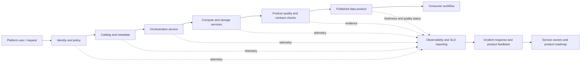

# 08 — Platform Service Levels and Product Thinking

> **Audience:** Applied AI / data engineers, platform engineers, data architects, SREs, service owners, governance practitioners, and technical product leaders.
>
> **Level:** Beginner → intermediate → advanced architecture and operations.
>
> **Estimated study time:** 5–7 hours, consistent with the module roadmap; allow additional time for the two exercises and peer review.
>
> **Source-of-truth note:** The Stage 2D module roadmap says topic files were empty when it was written. This lesson is newly authored against Topic 08’s stated syllabus. It is vendor-neutral. Northbridge and all named users, targets, metrics, and service decisions below are fictional and illustrative—not universal targets or compliance advice.

## 1. Purpose

An enterprise data platform is not successful merely because it has storage, compute engines, catalogs, pipelines, and dashboards. It must help identifiable users complete important jobs with predictable outcomes, clear ownership, support when things fail, and a credible path for improvement. Product thinking provides the user and value lens; service management and Site Reliability Engineering (SRE) practices make operational promises measurable and actionable.

This topic closes the sequence from platform capabilities and data movement through metadata, self-service, and isolation. It asks three connected questions:

1. **What do users need to accomplish?**
2. **What service does the platform provide, and what can it credibly promise?**
3. **How will the team measure, support, prioritize, and improve that service?**

A platform service and a data product are related but not interchangeable. A platform service might provide managed orchestration or catalog availability. A data product is a consumer-facing data asset or interface with its own owner, semantics, quality expectations, and freshness or availability promises. A reliable orchestration service cannot by itself guarantee that a source system delivered correct data on time.

## 2. Learning outcomes

After completing this lesson, you should be able to:

1. Identify platform user groups, their jobs-to-be-done, constraints, and desired outcomes.
2. Describe platform services in a service catalogue with explicit scope, exclusions, ownership, support, and dependencies.
3. Define measurable service-level indicators (SLIs), service-level objectives (SLOs), and—where applicable—service-level agreements (SLAs).
4. Explain error budgets and define coherent actions when reliability is below target.
5. Distinguish platform service levels from data-product quality and freshness promises.
6. Compose dependency availability cautiously and identify when redundancy or a lower promise is required.
7. Define service ownership, tiering, support hours, incident communication, escalation, runbooks, change management, deprecation, onboarding, and feedback loops.
8. Measure product adoption and user/business outcomes rather than relying only on platform output counts.
9. Explain cost transparency, allocation, unit economics, quotas, and how service tiers can affect cost and promises.
10. Produce a service catalogue, SLI/SLO table, support model, and platform product canvas that can feed the module’s final enterprise lakehouse reference architecture.

## 3. Prerequisites and diagnostic check

### 3.1 Prerequisites

The roadmap places this topic after Topics 01–07 and identifies service-target requirements as a prerequisite. Review these concepts if needed:

| Dependency | What to bring forward | Why it matters here |
|---|---|---|
| Topic 01 — Capabilities and logical reference architecture | Capability inventory and major platform interfaces | You cannot define a service catalogue without knowing what the platform does. |
| Topic 02 — Ingestion, storage, processing, consumption zones | End-to-end data path and zone ownership | Freshness and pipeline success depend on the full path, not one engine. |
| Topic 03 — Bronze/silver/gold and data products | Refinement, promotion, product owner, consumer interface | Product promises need a defined data product and its boundary. |
| Topic 04 — Compute, storage, control plane | Service dependencies and failure domains | SLO feasibility depends on the services a user journey needs. |
| Topic 05 — Catalogs, metastores, metadata | Ownership, lineage, classification, discoverability | Service support and measurement require trustworthy metadata. |
| Topic 06 — Self-service and developer experience | Golden paths, safe defaults, friction and adoption | Onboarding and time-to-first-success are product measures. |
| Topic 07 — Isolation and tenant boundaries | Tenant-scoped responsibilities, quotas, residual risks | Service promises and costs may differ by tenant or tier. |
| Requirements and architecture decisions | Latency, throughput, freshness, availability targets; assumptions and constraints | Targets must derive from requirements and feasibility—not round numbers chosen by habit. |

### 3.2 Diagnostic check

Answer before reading further. Suggested answers follow each question in brief; use them to identify topics to revisit.

1. Is “99.9% available” an SLI, SLO, or SLA? **Check:** it is not complete by itself; with a defined measurement it is an SLO target, while an SLI is the observed measurement and an SLA is an agreement with specified terms/consequences.
2. Does 500 successful pipeline runs prove users are better served? **Check:** no; it is an output/operational measure. It does not prove that the right data arrived on time or that users completed their jobs.
3. If a platform job runs successfully but the upstream source delivered late, who owns the entire freshness outcome? **Check:** responsibility is shared across source, pipeline, platform, and product/consumer boundaries; the end-to-end promise needs explicit attribution and caveats.
4. Can a service promise exceed the availability of a required serial dependency chain? **Check:** not without redundancy, failover, graceful degradation, caching, or another architectural change that changes the dependency model.
5. Should every platform metric be an SLO? **Check:** no. Use only indicators tied to user needs, risks, and actionable service responsibilities.
6. What should happen after an error budget is exhausted? **Check:** follow a pre-agreed policy, often prioritizing reliability work and restricting risky changes; avoid automatic punitive responses or a vague “work harder” instruction.

## 4. Core concepts and terminology

### 4.1 Platform as a product

A **platform as a product** is a continuously operated internal capability designed around user needs, clear interfaces, adoption, support, outcomes, and a managed roadmap. It is not simply a project that ends at launch or a collection of tools the platform team happens to own.

Product thinking does not mean every internal platform must charge money or behave like a consumer app. It means the team makes explicit choices about who it serves, what problems it solves, which capabilities it standardizes, how it measures value, and how it handles feedback and retirement.

### 4.2 Essential terms

| Term | Meaning | Practical test |
|---|---|---|
| **Platform user/customer** | A person or team that uses or depends on platform capabilities. “Customer” may be internal; it does not imply an external sale. | Can you name a user group and the job they need to complete? |
| **Job-to-be-done (JTBD)** | The task or progress a user seeks in a particular context. | “Publish a governed, trusted dataset for risk reporting by the reporting deadline,” not “use the catalog.” |
| **Output** | An artifact or activity produced by the platform team. | Number of templates, pipelines, clusters, or training sessions delivered. |
| **Outcome** | A change in a user’s ability, experience, risk, time, or business result. | Time to first trusted data product decreases without increased incident rate. |
| **Service catalogue** | A discoverable inventory of services, scope, consumers, ownership, hours, support, dependencies, request path, and service-level commitments. | Can a team determine what it receives and what remains its responsibility? |
| **Support model** | The channels, coverage hours, severity definitions, response expectations, escalation paths, and ownership used to resolve issues. | Does the user know where to ask and who responds at 02:00? |
| **SLI — service-level indicator** | A measured value representing an aspect of service delivered to users. | Is the numerator, denominator or measurement method, window, and source defined? |
| **SLO — service-level objective** | A target or acceptable range for an SLI over a stated window. | Is the target measurable and derived from requirements and feasibility? |
| **SLA — service-level agreement** | A formal or operational agreement defining service commitments and terms, often including remedies or consequences. | Does it state scope, measurement, exclusions, reporting, and what happens on breach? |
| **Error budget** | The amount of unreliability permitted by an SLO over its window. For a 99.9% success objective, the budget is the remaining 0.1% of eligible events. | Is budget consumption measured and connected to an agreed decision policy? |
| **Support tier** | A defined service class with specified coverage, response, escalation, and sometimes resource priority. | Is the tier based on user criticality and funded operational capability? |
| **Data-product promise** | A product-specific statement about semantics, ownership, quality, freshness, availability, access, and change communication. | Does it describe the consumer-visible data interface, not merely the platform engine? |

**A promise is not the same as a metric or implementation detail.** “Risk reports are available by 07:00 on business days” is a consumer-oriented promise. “At least 98% of eligible scheduled runs finish by the agreed deadline over a rolling 30-day window” is a measurable objective that may support it. “Use engine X with six workers” is an implementation choice; it may change without changing the promise if outcomes remain within contract.

### 4.3 SLI, SLO, SLA, and internal target

- **SLI:** what is observed, using a defined measurement method.
- **SLO:** the target for that observation, over a stated window and scope.
- **SLA:** the agreement that surrounds the service, including obligations, exclusions, reporting, and possible remedies. Some organizations use the term more loosely; document the local meaning explicitly.
- **Internal target:** a planning or engineering threshold used to manage the service. It may be stricter than the external or internal-customer SLA to provide operating margin, but this is a deliberate design choice rather than a universal rule.

Example (illustrative):

- SLI: eligible catalog read requests that return a valid response within 500 ms ÷ all eligible catalog read requests.
- SLO: at least 99% of eligible requests meet that latency criterion in each rolling 30-day window.
- SLA: an agreement defining the covered catalog interface, support obligations, exclusions, reporting, and remedies if contractual commitments are missed.
- Internal target: an engineering alert threshold that fires before the SLO is likely to be missed.

Latency SLIs are often percentile-based rather than averages. Averages can hide a poor tail. A percentile SLI should state the percentile, threshold, eligible request set, and measurement window. For low-volume services, percentiles can be statistically unstable; use a sample-size rule or an alternative indicator.

### 4.4 Platform service vs data product

| Question | Platform service | Data product |
|---|---|---|
| Example | Orchestration, managed compute, catalog search, access provisioning, monitoring | Curated customer, fraud, finance, or risk dataset/API/feature interface |
| Primary owner | Platform service owner | Named domain/product owner, supported by its engineering team |
| Typical measures | API availability, provisioning lead time, scheduler success, query latency, support response | Freshness, completeness, validity, semantic correctness, consumer availability, change compatibility |
| Failure examples | Scheduler unavailable; access provisioning queue delayed | Source feed late; records duplicated; business definition changed unexpectedly |
| Main promise | The platform capability and support the user can rely on | The consumer-facing data interface and its behavior |
| Shared dependency | Uses the platform and may depend on other services | Depends on sources, pipelines, platform services, and consumer usage patterns |

The platform team can own tools, orchestration, shared compute, catalog, baseline controls, and operational processes. A data-product team usually owns domain semantics, source agreements, product-level tests, and the product’s consumer promise. Some responsibilities are joint; make the boundary explicit rather than assigning all failures to “the platform.”

## 5. Identify users, jobs, and outcomes

Start with users and jobs, not with a list of technologies. One person can occupy several roles, but the needs and service expectations still differ.

| User group | Typical job-to-be-done | Common friction | Relevant platform capabilities | Outcome measure examples |
|---|---|---|---|---|
| Data engineer | Ingest, validate, transform, operate a pipeline | Repeated boilerplate, unclear failures, hard-to-debug permissions | Ingestion patterns, orchestration, observability, templates, CI/CD | Median time to first successful production pipeline; first-pass deployment rate; recovery time |
| Analyst / BI developer | Discover approved data and deliver trusted reporting | Unknown owners, unclear definitions, stale tables | Catalog/search, certified products, access workflow, quality/freshness status | Time to find approved data; report delivery lead time; product reuse |
| Data scientist / ML engineer | Build reproducible training and inference datasets | Unstable schemas, shared compute contention, poor lineage | Isolated compute options, versioned data interfaces, lineage, quotas | Time to reproducible dataset; failed runs attributable to platform; cost per successful workload |
| Domain/product owner | Publish and maintain a usable data product | No clear contract, unclear support boundary, adoption unknown | Product registration, contract/quality checks, consumer feedback | Active consumers; product reuse; promise attainment; consumer satisfaction |
| Security/governance reviewer | Ensure access is justified and auditable | Manual reviews, incomplete metadata, unclear exceptions | Classification, identity/policy, audit, ownership metadata, approval workflow | Access-decision lead time; percentage of assets with owners/classification; remediation time |
| Finance / cost owner | Understand and manage spend | Shared costs opaque; usage not attributed | Tags, usage meters, showback, quotas, unit-cost reporting | Percentage of spend attributed; cost per successful outcome; forecast variance |
| Platform operator / SRE | Maintain dependable shared services | Unclear ownership, noisy alerts, repeated incidents | Observability, runbooks, incident management, capacity planning | SLO attainment; alert precision; mean time to restore; repeat-incident rate |
| Auditor / risk stakeholder | Obtain evidence that controls and commitments are operating | Evidence spread across systems; unclear scope | Audit logs, change history, ownership register, service reports | Evidence retrieval time; overdue control findings; coverage of required evidence |

### 5.1 Connect outputs to outcomes

| Output-only statement | Better outcome-oriented question |
|---|---|
| “We launched 20 templates.” | What percentage of eligible new pipelines use the supported path, and did time-to-production or incident rate improve? |
| “We ingested 5 TB.” | Was the required data available at the needed time, with agreed quality and lawful access? |
| “We trained 100 users.” | Can users now complete their job with less support and fewer errors? |
| “We provisioned 300 workspaces.” | Were the workspaces used, safely configured, and valuable enough to justify their cost? |
| “We closed 200 tickets.” | Did time to resolution improve, and did recurring causes get eliminated? |

Output metrics are still useful for capacity and delivery planning. They become misleading when presented as proof of user value without outcome evidence. Pair leading indicators (onboarding friction, first-pass success) with lagging outcomes (incident impact, time to deliver a trusted product, user adoption).

## 6. Service catalogue and ownership model

A service catalogue should be concise enough to use and complete enough to avoid ambiguity. Each entry should include:

1. Service name and intended users.
2. Capability and interface provided.
3. In-scope and out-of-scope responsibilities.
4. Owner and operational contact; primary and backup escalation.
5. Support tier and coverage hours, including holidays/time zone if relevant.
6. SLIs/SLOs and measurement source, with a link or location for service status.
7. Dependencies and external-provider responsibilities.
8. Request/onboarding path and required inputs.
9. Security, privacy, tenant, and data-classification constraints.
10. Cost attribution, quota, and tiering rules where applicable.
11. Change, maintenance, compatibility, deprecation, and retirement policy.
12. Runbook, incident communication channel, and review cadence.

### 6.1 Example service catalogue (illustrative)

| Service | In scope | Not promised by the platform service alone | Owner | Support approach |
|---|---|---|---|---|
| Managed orchestration | Scheduler, worker control, retry framework, run metadata | Source availability, correct business logic, all jobs finishing before arbitrary deadlines | Orchestration service owner | Tiered incident queue; runbook; escalation for scheduler-wide failure |
| Catalog and discovery | Metadata search, technical schema, ownership/classification fields, lineage integrations where configured | That every asset is correctly described unless owners complete required metadata | Metadata service owner + asset owners | Service status plus metadata-quality workflow |
| Managed compute | Supported execution environment, quotas, workload controls, base monitoring | Unlimited capacity or application-code correctness | Compute service owner | Priority based on service tier; capacity and quota escalation |
| Access provisioning | Workflow, policy enforcement, decision/audit trail | Approval of every request; a business owner’s decision on entitlement | Identity/policy service owner + data owner | Standard queue; urgent path only for justified critical incidents |
| Product publication path | Registration, contract validation, deployment/promotion mechanics | Domain semantics or upstream data correctness | Platform product owner + domain product owner | Shared runbook with clear fault attribution |
| Observability and cost | Service telemetry, usage metering, dashboards, alerts | Perfect attribution if tags/meters are missing or allocation rules are disputed | Observability/cost service owner | Operational incident channel plus cost review process |

A catalogue is a contract of expectations, not a claim that every dependency is under the platform team’s control. State caveats and ownership in plain language.

### 6.2 Service journey and measurement boundaries

The following is a logical example, not a vendor-specific deployment diagram. Each service owner measures the part they control; the end-to-end journey remains visible to the user and product owner.



**How to read it:** identity, catalog, orchestration, compute/storage, and product checks are distinct measurement and ownership points. The consumer’s experience crosses them. Telemetry helps attribute failure, but it must not replace the end-to-end outcome measure. If an upstream dependency fails, report both the user impact and the component cause.

## 7. Designing meaningful SLIs and SLOs

### 7.1 Start from user-visible failure

For each service, ask:

1. What user job would fail or become materially worse?
2. What observable event represents success or failure?
3. What events are eligible for measurement? Are retries, cancellations, maintenance, and user errors included?
4. What is the denominator? What measurement window is meaningful for the user’s cadence?
5. What target follows from business requirements, dependency feasibility, and operating cost?
6. Who can act on the signal, and what action follows when it drifts?

Do not put every available metric into an SLO. Use SLOs for user-relevant service outcomes and use diagnostic metrics to help explain them. A metric without a decision owner or action may belong on a dashboard rather than in a formal objective.

### 7.2 Candidate indicators and their caveats

| Indicator | Possible definition | Caveats / when it fits |
|---|---|---|
| Availability | Eligible requests that return valid responses ÷ all eligible requests | Define synthetic vs real traffic, valid response, maintenance handling, and whether a degraded response counts as success. |
| Successful job completion | Eligible jobs reaching an accepted terminal-success state ÷ all eligible jobs due in the window | A “success” state does not prove the output is correct. Exclude or include user cancellations deliberately. |
| Latency | Request duration; report a percentile such as p95 or p99 under stated load | Averages hide tail latency; specify request class, payload, and measurement point. |
| Freshness | Difference between event/source timestamp and time the product becomes queryable; or percentage of due deliveries meeting deadline | End-to-end and source-to-consumer ownership must be explicit. Do not measure only the last pipeline task if upstream delay matters. |
| Throughput | Valid records/bytes/jobs processed per time unit under defined workload | Throughput is capacity/quality-of-service relevant only when tied to required demand and a workload profile. |
| Recovery | Time from incident start/detection to restoration of the defined service | State start/end markers and whether recovery means service restored or backlog fully drained. |
| Onboarding lead time | Elapsed time from a complete, eligible request to a working first production use | Define start/end, pause conditions, and distinguish user-caused delay from platform-controlled delay. |
| Support response | Eligible cases receiving a meaningful human acknowledgement within the target ÷ eligible cases | A bot acknowledgement is not necessarily a meaningful response; separate response from resolution. |
| Adoption | Eligible teams or workloads using the supported path ÷ eligible teams or workloads | Define eligibility and active-use window; adoption is a product measure, not necessarily an SLO. |
| Cost transparency | Spend with a valid owner/cost attribution ÷ total in-scope spend | Attribution coverage does not itself prove the allocation is fair or economically efficient. |
| Data quality | Records or checks meeting a defined product contract ÷ eligible records/checks | Usually a data-product SLI, not a generic platform SLI; define rules, severity, and sampling. |

### 7.3 Measurement windows and event eligibility

Choose a window that matches the user’s need and the volume of observations. A minute-by-minute alert may protect a critical service, while a rolling 30-day SLO can summarize the user experience. A daily batch product may need a per-delivery deadline metric rather than request availability. A monthly aggregate can hide repeated daily misses; report both aggregate attainment and per-run failures when the delivery cadence matters.

Define exclusions before incidents occur. For example, a source provider’s outage may be outside the platform team’s direct control, but silently excluding it from an end-to-end user promise can make the promise meaningless. Better options include:

- publish both the **end-to-end consumer SLI** and **component/attribution SLIs**;
- define external dependency responsibilities and escalation paths;
- distinguish a service objective the platform can control from a joint product promise;
- state any SLA exclusions narrowly, with evidence and communication;
- use dependency redundancy, buffering, replay, or graceful degradation where justified.

### 7.4 Service-level table — illustrative assumptions, not universal targets

The following sample is a teaching example for a fictional platform. Targets must be recalibrated using business requirements, observed baselines, user criticality, workload profiles, dependency limits, risk appetite, and cost. “Rolling 30 days” means a continuously evaluated trailing window; implement an equivalent window only if the monitoring system supports it.

| User journey / service | SLI definition and measurement | Window | Illustrative target assumption | Exclusions / caveats | Owner | Alert / action | Evidence |
|---|---|---|---|---|---|---|---|
| Catalog read API | Valid catalog read responses within 1 s ÷ all eligible catalog read requests; measure at service edge | Rolling 30 days | ≥99.5% | Separate 5xx, timeout, and latency diagnostics; do not exclude failures caused by internal dependencies | Catalog service owner | Burn-rate alert; inspect catalog, identity, and backing metadata dependencies; invoke runbook | Request metrics, traces, status history |
| Scheduled orchestration | Eligible scheduled runs that reach accepted terminal success by their declared deadline ÷ all eligible runs due | Rolling 30 days and daily breakdown | ≥98% | Exclude only documented cancellations or invalid submissions; platform and pipeline causes must be attributed separately | Orchestration owner, with pipeline owner for code | Alert on deadline misses and failure clusters; replay only under idempotency/runbook rules | Scheduler events, run IDs, lineage, failure classification |
| Managed query service | Eligible queries completing within the agreed latency threshold ÷ eligible queries; report p95 duration by workload class | Rolling 30 days | ≥95% complete within 10 s for the defined standard workload | Not comparable across arbitrary query sizes; user cancellation and intentionally long analytical jobs handled by separate class | Compute service owner | Alert on p95 drift and queue saturation; adjust workload controls or capacity | Query logs, workload labels, queue metrics |
| Access provisioning journey | Complete, policy-eligible standard requests fulfilled within 4 business hours ÷ all complete, eligible standard requests | Monthly, with weekly trend | ≥90% | Owner approval waiting time is reported separately; emergency/break-glass flow is a distinct process | Identity/policy service owner | Queue-age alert; escalate blocked approvals to the named data owner | Request timestamps, approval events, audit trail |
| New-team onboarding | Eligible onboarding cases reaching first successful governed production use within 5 business days ÷ eligible cases started | Quarterly rolling window; show sample count | ≥80% | Pause only for explicitly documented user-controlled blockers; report pauses rather than hiding them | Platform product owner | Review failed steps and friction monthly; improve templates or documentation | Workflow events, onboarding checklist, user feedback |
| Support response — high severity | High-severity cases with meaningful human acknowledgement within 15 minutes ÷ all valid high-severity cases during covered hours | Monthly | ≥90% during stated 24×7 coverage | Only claim 24×7 if staffing and paging are funded; response is not resolution | Incident manager / on-call lead | Page on missed acknowledgement; check rota and escalation | Ticket/paging timestamps, incident log |
| Cost attribution | In-scope spend carrying a valid tenant/team/service owner ÷ total in-scope spend | Monthly close | ≥95% | Coverage is not allocation accuracy; shared-cost allocation policy must be documented | FinOps/cost service owner | Alert on unattributed spend; reconcile tags and meters before chargeback | Billing exports, tag inventory, allocation report |
| Curated product freshness (product SLI) | Scheduled deliveries queryable by 07:00 local business time ÷ all scheduled business-day deliveries | Monthly with per-day report | ≥98% | Product owner owns end-to-end promise; source delay and platform delay separately attributed and communicated | Named data-product owner; platform and source owners are dependencies | Notify consumers on forecast/miss; invoke source or pipeline escalation; publish freshness status | Source arrival time, pipeline lineage, publish timestamp, quality checks |

**How to interpret the table:** the platform service objectives and the data-product freshness objective are deliberately separate. A scheduler can meet its own SLO while a product misses freshness because its source arrived late or its transformation was wrong. The product owner still needs an end-to-end consumer-facing promise and a truthful incident explanation.

Not every row is automatically a formal reliability SLO. Cost-attribution coverage and onboarding lead time can be useful product or governance indicators; promote them to SLOs only when they represent a defined service commitment, have an accountable owner and measurement policy, and trigger an agreed action when the target is missed.

### 7.5 Availability budgets

For an availability or success-rate objective, the unreliability budget is approximately:

`error budget fraction = 1 − SLO fraction`

For example, a **fictional** 99.5% availability objective over a 30-day month permits 0.5% unavailability. Using 30 × 24 × 60 = 43,200 minutes:

`allowed unavailability = 0.005 × 43,200 = 216 minutes`

This arithmetic is valid only if the SLO is measured as time availability over that window. For request-based SLIs, use eligible failed events rather than converting blindly into minutes. A 98% per-delivery success objective allows 2% of eligible deliveries to miss, not necessarily 2% of wall-clock time.

### 7.6 Error-budget policy

An error budget is useful only when it drives a pre-agreed action. One illustrative policy:

| Budget state | Example action | Guardrail |
|---|---|---|
| Healthy; burn rate within expected range | Continue planned delivery while preserving testing and review | Do not treat unused budget as a target to consume. |
| Fast burn or credible risk of breach | Triage, investigate recent changes, increase observability, pause the risky rollout if evidence supports it | A short spike can be noisy; use multi-window alerts and service context. |
| Budget exhausted for the defined window | Reliability review; prioritize corrective work; restrict non-essential risky changes for the affected service until an agreed recovery condition is met | Do not automatically halt all work across unrelated services or punish teams for external causes. |
| Repeated misses despite corrective work | Revisit SLO feasibility, dependency architecture, capacity, tier, and funding | Do not silently lower the target; record the decision and user impact. |

The policy must define who decides, which changes are restricted, emergency-change handling, exit criteria, and how users are informed. Reliability actions should address systemic causes, not incentivize hiding failures or manipulating denominators.

## 8. Dependency chains and achievable service levels

### 8.1 Serial dependencies

If a user operation requires catalog, identity, storage, and compute all to be available at the same time, and their failures are independent with no redundancy, an illustrative approximation is:

`A_end_to_end ≈ A_catalog × A_identity × A_storage × A_compute`

This is not a universal law for every architecture. It assumes all listed components are required in series, availability figures are comparable over the same window, failures are independent enough for multiplication to be meaningful, and there is no effective fallback, caching, redundancy, or graceful degradation. Correlated failures can make the result worse; redundancy and alternate paths can improve it.

Roadmap-aligned illustrative arithmetic:

`0.999 × 0.9995 × 0.9999 × 0.999 ≈ 0.9974` (about 99.74%)

A 99.9% end-to-end availability promise is not supported by that simple serial chain unless the architecture changes or the assumptions differ. Do not add or average dependency percentages. Validate the model with the actual dependency graph, failure modes, and evidence.

### 8.2 Dependency review procedure

1. Draw the actual user request or data-delivery path.
2. Mark required serial dependencies, optional dependencies, fallback paths, shared control-plane components, and external providers.
3. Record each component’s measured availability and measurement window; do not substitute marketing claims for observed behavior.
4. Identify correlated failure modes (shared identity, network, region, catalog, or control plane).
5. Compute a first-order estimate only when assumptions are defensible.
6. Decide whether to lower the promise, add redundancy/fallback, isolate failure domains, reduce scope, or create a tiered service.
7. Test failover and recovery; an architecture diagram alone does not prove the fallback works.
8. Document residual risks and revisit when dependencies or workload patterns change.

### 8.3 Dependency and responsibility chain for data freshness

Data freshness is an end-to-end property. A useful timeline records:

`source event created → source made available → ingestion received → transformation completed → quality checks passed → product published/queryable → consumer observed`

| Boundary | Typical owner | Evidence | Common failure |
|---|---|---|---|
| Source event creation and publication | Source system/provider | Source timestamp, delivery receipt, source status | Source data late, incomplete, or unavailable |
| Ingestion receipt and validation | Ingestion/pipeline team, supported by platform | Arrival timestamp, schema validation, quarantine count | Transfer delay, schema drift, bad credentials |
| Transformation and quality | Data-product team/pipeline owner | Run metadata, tests, lineage, rejection counts | Logic defect, skew, duplicate records, resource exhaustion |
| Platform execution and publication | Platform services plus pipeline owner | Scheduler/compute/catalog telemetry, publish timestamp | Scheduler outage, compute queue, catalog failure |
| Product contract and consumer use | Named product owner and consumer owner | Contract status, freshness indicator, consumer feedback | Ambiguous semantics, changed schema, consumer-side caching |

Do not define freshness only as “last pipeline finished.” That timestamp may not reflect source event time, late-arriving records, failed quality gates, or when a consumer can query the product. Choose the timestamp pair that represents the promise. Preserve both the end-to-end SLI and component attribution so teams can improve without obscuring user impact.

## 9. Service ownership and operational support

### 9.1 Service ownership

Each production service should have a named accountable owner, operationally capable responders, a documented escalation path, and a backup. Ownership means responsibility for service health, dependencies, runbooks, SLO reporting, change risk, capacity, and improvement—not necessarily that one person performs every task.

| Responsibility | Platform service owner | Data-product/pipeline owner | Consumer / business owner |
|---|---|---|---|
| Platform engine, scheduler, catalog, shared runtime | Accountable | Uses and configures within supported interface | Depends on it |
| Pipeline code, domain transformations, business rules | Provides framework and support boundary | Accountable | Defines requirements and validates usefulness |
| Source delivery and external source contract | Tracks dependencies and supports ingestion | Coordinates with source owner | Business/source owner may be accountable |
| Product semantics and data-quality rules | Provides validation mechanisms | Product owner accountable for rules and remediation | Confirms interpretation and acceptable use |
| Access policy enforcement | Owns mechanism and auditability | Requests scoped access and supplies metadata | Data owner approves entitlement where required |
| Consumer communication | Communicates platform incidents | Communicates product-specific impact | Shares impact, deadlines, and acceptance needs |
| Cost | Provides meters, tags, shared allocation policy | Owns workload usage and product-level attribution | Budget owner reviews and prioritizes |

Use a responsibility matrix such as RACI when ambiguity persists. “Shared ownership” without a named decision-maker is usually a gap, not a solution.

### 9.2 Service tiering and coverage

Tiering should reflect business criticality, time sensitivity, regulatory or contractual obligations, recovery needs, and the cost of providing the service. It should not be based only on the seniority of the requesting team.

| Tier dimension | Example design choice | What must be funded/validated |
|---|---|---|
| Support coverage | Business hours vs 24×7 on-call | Staffed rota, escalation backup, alert routing, handover process |
| Response | Severity-based acknowledgement target | Severity definitions, paging policy, evidence and measurement |
| Recovery | Recovery-time objective (RTO) and recovery-point objective (RPO) where relevant | Tested backups/replay, failover, runbooks, dependencies, drills |
| Workload priority | Best-effort, reserved capacity, or priority queue | Fairness policy, capacity, tenant boundaries, cost impact |
| Change management | Standard change path vs additional review for critical service | Testing, approvals, rollback, deployment windows, evidence |
| Communication | Status page, incident channel, direct critical-consumer notification | Named communicator, audience list, update cadence |

Avoid promising a response time that has no staffed support mechanism. “24×7 service” can mean the endpoint is designed to operate continuously; it does not automatically mean 24×7 human response. State both separately.

### 9.3 Incident management and communication

A practical incident process includes:

1. Detect through user-visible SLI, alert, or report.
2. Classify severity based on scope, user impact, criticality, and data/security implications.
3. Assign an incident commander or clear incident lead; separate technical investigation from communications when scale warrants it.
4. Mitigate safely: rollback, fail over, throttle, disable a risky feature, restore access, or pause affected workloads as appropriate.
5. Communicate impact, affected services/products, known facts, workaround, next update time, and any data correctness caveat. Avoid speculation presented as fact.
6. Restore service and validate both platform function and consumer-visible result; for data pipelines, determine whether replay/backfill or correction is required.
7. Close with an incident review focused on system causes, detection gaps, recovery, ownership, and follow-up actions.
8. Track actions to completion and update runbooks, SLOs, and user documentation where justified.

A service can be operational while its data is wrong or stale. Incident closure should verify the user promise that failed, not merely the health of the underlying compute process.

### 9.4 Runbooks, maintenance, and change management

A useful runbook identifies symptoms, impact, dashboards/logs, safe first actions, decision points, rollback or recovery steps, escalation contacts, validation steps, and evidence to preserve. It must be tested by someone other than its author where practical.

Maintenance windows should be visible and defined. Do not assume planned maintenance is excluded from every SLO; exclusions must be explicit and compatible with the user agreement. Communicate high-risk changes before deployment, use staged rollout and rollback where feasible, and assess the effect on downstream products and contracts.

### 9.5 Onboarding and deprecation

Onboarding should provide a discoverable service catalogue, prerequisites, a supported golden path, sample configuration, access workflow, ownership metadata, cost/quota guidance, and a clear first-success milestone. Measure elapsed time and failed steps; do not count a workspace created as successful onboarding if the user cannot publish or consume anything safely.

Deprecation should include an owner, reason, affected consumers, usage evidence, migration path, compatibility plan, support period, dates, exception process, and retirement validation. Critical consumers need direct communication; a release note alone may not reach them. Emergency security retirement can require a shorter path, but the risk and mitigation should still be recorded.

## 10. Platform product discovery, prioritization, and improvement

### 10.1 Discovery loop

Use a repeatable loop rather than waiting for escalations:

1. **Discover:** interview representative users, observe their workflow, review support tickets and failed journeys, and identify the job and constraint.
2. **Frame:** state the user, problem, current baseline, desired outcome, affected services, and risks.
3. **Prioritize:** evaluate value, reach, urgency, risk reduction, effort, operating cost, and strategic fit.
4. **Experiment:** test the smallest useful change—template, documentation, workflow automation, or a new service tier.
5. **Measure:** compare outcome and guardrail metrics before and after; include adoption and failure rates.
6. **Decide:** scale, iterate, defer, buy, build, or retire based on evidence.
7. **Communicate:** publish roadmap status, trade-offs, ownership, and expected change impact.

### 10.2 Feedback channels

Use multiple channels because no single channel is representative:

- structured interviews and workflow observation;
- onboarding feedback at the moment of first success or failure;
- office hours and user community sessions;
- support tickets, incident reviews, and recurring request categories;
- product usage analytics and search/no-result events;
- short satisfaction surveys tied to a specific journey;
- roadmap intake with visible status and decision rationale;
- domain council or advisory group for conflicting needs.

Treat anecdotal feedback as a signal to investigate, not a vote count. The loudest team may have an urgent need but not the broadest platform need.

### 10.3 Prioritization and build-vs-buy-vs-defer

A simple, transparent prioritization rubric can score each proposal across:

- user value and severity of the unmet job;
- number and diversity of eligible users affected;
- risk/security/compliance reduction;
- expected effect on adoption, delivery lead time, or reliability;
- implementation effort and ongoing operating burden;
- cost, lock-in, reversibility, and supportability;
- alignment with shared paved roads versus domain-specific needs.

The scoring weights are organization-specific. Record assumptions and dissent; do not imply that a numeric score replaces judgment.

| Choice | Prefer when | Check before deciding |
|---|---|---|
| Build a shared capability | Need is recurring across domains, differentiated, and can be operated sustainably | Product owner, support cost, security controls, maintenance and migration plan |
| Buy or adopt a managed capability | Need is common and external capability meets requirements with acceptable integration and risk | Data handling, portability, total cost, SLA dependencies, exit path, audit evidence |
| Enable a domain-specific extension | Need is genuinely specialized and does not undermine common guardrails | Extension boundary, support ownership, compatibility, isolation, duplicated maintenance |
| Defer or reject | Evidence is weak, cost/risk exceeds value, or the need is better handled locally | Explain decision, alternatives, revisit trigger, and who is affected |
| Retire an existing capability | Low adoption, duplication, risk, or unsustainable cost with a viable replacement | Usage evidence, migration, downstream consumers, sunset communication |

A paved road should be the easiest supported path, not a forced path that ignores legitimate domain needs. Measure adoption, friction, and exceptions. If teams repeatedly bypass it, investigate whether the path is too slow, too restrictive, or poorly documented before assuming users are the problem.

### 10.4 Product measures: adoption and friction

| Measure | Definition example | Interpretation caveat |
|---|---|---|
| Time to first successful use | Median elapsed time from eligible onboarding start to first governed production success | Segment by user type and request complexity; show the tail, not only the median. |
| Paved-road adoption | Eligible new workloads using supported templates ÷ all eligible new workloads | Low adoption may signal poor fit or hidden exclusions, not just resistance. |
| First-pass success | Eligible deployments passing defined validation on first attempt ÷ eligible deployments | Keep validation consistent and avoid making checks easier solely to improve the number. |
| Support burden | Platform support hours or cases per active workload/user journey | A short-term increase can be healthy if adoption grows; normalize by usage. |
| Search friction | Searches with no useful result or followed by support request ÷ eligible searches | Search logs need privacy and access controls; not every unsuccessful search means a catalog defect. |
| Product reuse | Eligible downstream consumers or use cases reusing registered products | Reuse count alone does not prove correctness or business value. |
| User satisfaction | Consistently worded score or qualitative feedback for a defined journey | Survey bias and low response rates can distort results. |
| Business impact | Time to deliver a trusted product, reduced reporting delay, fewer incidents affecting a process | Attribution is difficult; document other changes and use cautious causal language. |

## 11. Cost transparency, allocation, and service tiers

### 11.1 Cost transparency is part of product trust

Users need to understand what their workloads cost, how shared services are allocated, which limits apply, and what choices affect spend. Cost transparency is not identical to chargeback. **Showback** reports cost to a team or budget owner; **chargeback** assigns cost to a budget or ledger. Organizations may use either, a hybrid, or another internal funding model.

### 11.2 Cost model components

- **Direct usage:** compute time, storage, requests, data transfer, licenses, or other measurable consumption attributable to a tenant/workload.
- **Shared fixed costs:** catalog, control plane, platform on-call, shared observability, baseline security, and common infrastructure.
- **Shared variable costs:** services whose consumption changes with total workload, such as shared query or ingestion infrastructure.
- **Unit economics:** cost per useful unit, such as successful pipeline run, processed TB, active data product, query workload class, or governed production onboarding.
- **Waste indicators:** idle dedicated compute, orphaned storage, repeated failed jobs, oversized resources, and unused environments.

Allocation formulas are policy choices, not universal facts. A simple rule might allocate shared cost by measured consumption; another might use a fixed platform fee plus variable usage; another might fund baseline governance centrally. Pick a rule that is explainable, auditable, reasonably correlated with cost drivers, and aligned with organizational incentives.

### 11.3 Illustrative allocation example

Assume a fictional monthly shared service cost of 12,000 cost units and direct tenant costs tracked separately. If the organization elects to allocate shared cost by measured compute-hours and Team A used 25% of eligible compute-hours, its share would be 3,000 cost units. This is only an example of one policy. If the shared service is a fixed control-plane capability, compute-hours may be a poor allocator; equal allocation, active tenants, workload counts, or central funding might be more appropriate.

Document the cost pool, allocation driver, data source, time window, treatment of missing tags, rounding, dispute process, and policy owner. Report unallocated spend instead of silently spreading it without explanation.

### 11.4 Quotas and service-tier trade-offs

Quotas protect fairness, reduce runaway cost, and limit noisy-neighbour effects. A service tier may include reserved capacity, higher priority, faster support, more redundancy, or a stronger recovery commitment—but each has a real cost and a dependency requirement.

| Choice | Potential benefit | Cost or risk to explain |
|---|---|---|
| Shared best-effort compute | Lower fixed cost and high utilization | Contention, variable latency, less isolation |
| Reserved or dedicated compute | Predictable performance and stronger tenant isolation | Idle capacity, extra operational work, quota planning |
| Higher support tier | Faster human response and clearer escalation | Staffing and on-call cost; response still differs from resolution |
| Stronger recovery/failover | Reduced recovery time or failure impact | Redundant infrastructure, testing, operational complexity |
| More aggressive freshness target | Faster consumer availability | Higher capacity/engineering cost; may be limited by source schedules and quality gates |

Do not sell a tier as a stronger promise unless the team has the capacity, redundancy, operational coverage, and evidence to support it. Tier eligibility, upgrades, downgrades, and exceptions need transparent rules.

## 12. Platform product canvas

Use this canvas to connect user value to a service and an operating model. The example values are fictional prompts, not recommended defaults.

| Canvas field | Questions to answer | Illustrative example: Northbridge Data Platform |
|---|---|---|
| Vision / value proposition | What durable user problem does the platform solve? | Help governed data teams publish trusted, discoverable data products with less repeated infrastructure work. |
| Primary users / customers | Which groups use or depend on it? | Data engineers, analysts, ML engineers, product owners, governance, finance, platform operators. |
| Jobs-to-be-done | What progress do they need? | Ingest a source, publish a governed product, find approved data, run a workload safely, diagnose failure. |
| Desired outcomes | What changes for users/business? | Shorter time to first trusted product, more reuse, fewer incidents affecting reporting, clearer cost. |
| Capabilities / service catalogue | What services are in scope? | Ingestion patterns, orchestration, catalog, managed compute, access workflows, observability, cost reporting. |
| Boundaries / exclusions | What is not owned by the platform? | Domain semantics, source system uptime, every transformation’s correctness, business approval of access. |
| Operating model / ownership | Who is accountable and who responds? | Named service owners, product owner, on-call lead, domain product owners, data owners, escalation rota. |
| Service tiers / support | Which support levels exist and why? | Standard business-hours tier plus a critical tier only where staffing and architecture justify it. |
| SLIs / SLOs | How is service performance measured? | Catalog read success, eligible job deadline attainment, access provisioning lead time; target assumptions validated against dependencies. |
| Data-product promises | What must each product separately promise? | Defined semantics, owner, quality tests, freshness timestamp, incident notice, schema-change policy. |
| Security / governance | What must always be enforced? | Tenant-scoped access, classification, least privilege, audit, retention, approval and exception evidence. |
| Cost / funding | How are direct and shared costs handled? | Direct usage meters plus an explicit policy for shared control-plane cost; showback before any chargeback transition. |
| Feedback / discovery | How do users influence the roadmap? | Interviews, onboarding telemetry, office hours, ticket themes, advisory group, public decision log. |
| Success measures | Which outputs, outcomes, and guardrails are tracked? | Time to first product, adoption, product reuse, SLO attainment, support burden, cost per successful workload, no rise in control violations. |
| Risks / assumptions | What could invalidate the plan? | Source dependencies, underfunded on-call, incomplete ownership metadata, adoption bypass, shared-plane failure. |
| Roadmap / deprecation | How are changes and retirements managed? | Quarterly review; versioned golden paths; migration windows; consumer notice; emergency security exception process. |

A canvas is a concise hypothesis, not proof. Validate it with user research, operational data, and explicit decision records. Revisit it when user mix, risk profile, architecture, cost model, or support capacity changes.

## 13. Illustrative service charter and ADR-DP-008

### 13.1 Context and assumptions

**Fictional context:** Northbridge Analytics operates a shared enterprise lakehouse used by reporting, risk, finance, marketing, and data science teams. It wants to define what the platform team provides and reduce anecdotal disputes about reliability and support.

**Assumptions for this decision:**

- Teams have different business criticality and workload profiles.
- The platform uses shared catalog, identity/policy, storage, orchestration, and some shared compute.
- Some critical workloads can justify reserved capacity or stronger support, but universal 24×7 support is not currently funded.
- Source-system availability and domain transformation correctness are not fully controlled by the platform team.
- The sample targets below are hypotheses to validate, not commitments to external customers or regulatory requirements.

### 13.2 Decision drivers

1. Make the platform’s scope, support, and user-facing promises discoverable.
2. Avoid promising reliability beyond the actual dependency chain.
3. Separate platform service reliability from each data product’s quality and freshness.
4. Provide service tiers aligned to criticality and funding.
5. Measure user outcomes and cost transparency, not just platform activity.
6. Keep SLOs actionable and tied to clear owners and incident policies.

### 13.3 Options considered

| Option | Advantages | Limitations / risks |
|---|---|---|
| A. Operate as a project with informal support | Low documentation overhead; quick for a small pilot | Unclear ownership, no measurable promises, feedback dominated by escalations, support expectations drift |
| B. One uniform service level for all workloads | Simple to communicate | May overbuild low-criticality services or under-serve critical ones; cost and dependency feasibility may not support one target |
| C. Service catalogue with tiered SLOs, explicit ownership, and product feedback loop | Scope and trade-offs visible; targets can reflect criticality; outcome measures inform roadmap | Requires service telemetry, ownership discipline, review cadence, and clear exception handling |

### 13.4 Decision

**Select Option C: adopt a service catalogue and tiered service model.** Publish a service charter for each production platform service. Define an SLI, SLO, measurement window, owner, evidence source, exclusions/caveats, and action for every formal objective. Maintain separate data-product contracts for consumer-visible quality and freshness.

Start with a small number of measurable objectives; expand only when measurement and ownership are reliable. Treat example targets in this lesson as hypotheses to validate against requirements and observed baselines. A tier does not imply a guarantee unless the staffing, capacity, redundancy, and support processes exist.

### 13.5 Service charter template

```text
Service name and version:
Purpose / users / job-to-be-done:
In scope:
Out of scope:
Service owner and backup:
Support tier and coverage hours:
Request / onboarding path:
SLI definition and measurement point:
SLO target and window (assumptions documented):
SLA terms, if any:
Dependencies and dependency owners:
Exclusions and attribution rules:
Alert thresholds and error-budget policy:
Incident channel, escalation, and communication cadence:
Runbook and recovery validation:
Security / tenant / classification boundaries:
Cost model, quota, and allocation policy:
Change / maintenance / deprecation policy:
Feedback channels and review cadence:
Residual risks and open decisions:
Approval / version / review date:
```

### 13.6 Consequences and residual risks

**Benefits:** users can discover the service boundary, platform owners can prioritize from evidence, incidents have clearer escalation, and service levels can be reviewed against requirements.

**Costs:** telemetry and service ownership require sustained investment; product research and roadmap communication consume capacity; service tiers may create complexity; shared dependencies can constrain achievable objectives.

**Residual risks:** source and provider failures can still miss end-to-end product promises; a metric can be gamed or poorly sampled; cost attribution may be disputed; low-volume SLOs may be statistically unstable; documentation can drift; tier promises can exceed staffing if not reviewed.

### 13.7 Review triggers

Review this decision when a critical workload is added, user or regulatory requirements change, a dependency or region changes, SLOs are repeatedly missed, a tier’s costs materially diverge from expectations, adoption stagnates, a major incident reveals an ownership gap, or a service is deprecated or replaced. The service owner maintains the charter; the platform product owner coordinates cross-service changes.

## 14. Practical exercises

### Exercise A — Service catalogue and SLOs

**Scenario:** The fictional Northbridge platform team is repeatedly asked, “What do we get from the platform?” Teams report catalog search failures, late jobs, slow access provisioning, and unclear support expectations.

**Inputs:** capability inventory from Topic 01; zones and end-to-end data path from Topic 02; product boundaries from Topic 03; compute/storage/control-plane map from Topic 04; catalog/metadata ownership from Topic 05; onboarding journey from Topic 06; tenant isolation and quotas from Topic 07; requirement targets and constraints.

**Tasks:**

1. Select at least five platform services and define users, scope, exclusions, owner, support tier, dependencies, and request path.
2. Write at least five SLIs/SLOs. At least one should cover availability, one job completion/deadline, one latency or throughput, one onboarding/support journey, and one cost or governance indicator.
3. For every SLI, define the eligible population, numerator/denominator or exact measurement method, window, target, evidence source, and alert/action.
4. Mark which targets are illustrative assumptions and justify them from requirements, baseline data, user criticality, and dependencies.
5. Draw the dependency chain for one critical service and calculate a first-order availability estimate. State assumptions and identify whether redundancy/fallback changes the result.
6. Define the error-budget policy and what happens during a fast burn or exhausted budget.
7. Define support coverage, severity, response versus resolution, escalation, incident communication, and recovery validation.
8. Separate at least one platform service SLO from the related data-product freshness/quality promise.

**Deliverables:**

- Service catalogue with service boundaries and ownership.
- SLI/SLO table with measurement methods and assumptions.
- Dependency diagram and arithmetic.
- Support/escalation model and error-budget policy.
- One-page list of residual risks and next actions.

**Objective validation criteria:**

- Every service has a named owner, user, scope, exclusions, and dependency list.
- Every SLI can be independently calculated from named telemetry/events; numerator/denominator or measurement method is unambiguous.
- Every SLO has a window and target; no target is presented as universal.
- At least one dependency calculation shows the assumptions and arithmetic; a promise exceeding the simple serial-chain estimate has a documented architectural justification.
- Support response and resolution are not conflated; coverage claims match the proposed staffing model.
- Error-budget states trigger named actions with decision owners and exit conditions.
- Platform and product-level freshness/quality responsibilities are separate and end-to-end consumer impact remains visible.

### Exercise B — Platform product canvas and feedback plan

**Scenario:** Adoption of the fictional Northbridge paved road is low. Complaints are anecdotal, some teams maintain local tooling, and leadership proposes mandating the platform without understanding the causes.

**Tasks:**

1. Interview or simulate at least four personas: data engineer, analyst/BI developer, data scientist/ML engineer, and domain product owner. Include governance or finance if relevant.
2. For each persona, state the job-to-be-done, current friction, desired outcome, and evidence that would confirm improvement.
3. Complete the product canvas in Section 12 with service scope, exclusions, ownership, SLOs, data-product boundaries, cost model, feedback, and risks.
4. Define a discovery and feedback loop that combines interviews, support themes, usage telemetry, onboarding events, and a roadmap decision log.
5. Propose a prioritization rubric and apply it to three competing requests: a shared template improvement, a domain-specific extension, and a new premium support tier.
6. Define at least three outcome metrics, two adoption/friction measures, and two guardrails (for example, security violations, incident rate, or cost per successful workload).
7. State whether each request should be built, bought/adopted, enabled as an extension, deferred, or retired—and explain assumptions.
8. Define a deprecation/change communication approach for a low-adoption feature or template.

**Deliverables:**

- Completed platform product canvas.
- Persona/job/outcome table.
- Prioritization rubric and decisions.
- Feedback plan and metric definitions.
- A 90-day illustrative roadmap with assumptions, owners, measures, and review triggers.

**Objective validation criteria:**

- Each persona has a specific job and measurable desired outcome.
- Each outcome has a metric, baseline plan, and guardrail; output counts are not used as the only evidence of value.
- Prioritization criteria are explicit and applied consistently to all three requests.
- The feedback plan includes more than one source and explains how evidence affects decisions.
- The canvas distinguishes platform services from data-product promises and states scope/exclusions.
- Cost and operational ownership are explicit; the roadmap includes review and retirement paths.

### Optional mini-exercise — turn vague promises into objectives

Rewrite each statement into a measurable SLI/SLO pair, then identify the missing requirement:

- “The platform is reliable.”
- “Pipelines are fast.”
- “Access is quick.”
- “Data is fresh.”
- “Support is responsive.”

**Answer guide:** define eligible events and measurement point, choose a user-relevant threshold, specify window and population, derive target from requirements and observed baseline, name owner/evidence/action, and state exclusions. “Fresh” must name the product, timestamp pair, delivery cadence, and consumer deadline. There is no single correct numerical target without the missing requirements.

## 15. Common mistakes and misconceptions

| Mistake | Why it fails | Better practice |
|---|---|---|
| Measuring outputs only | Pipeline/template counts do not prove user value | Pair outputs with outcome, adoption, reliability, and guardrail measures. |
| “99.9%” with no measurement definition | Denominator, window, scope, and valid response are unknown | Specify the SLI, eligible population, window, evidence source, and exclusions. |
| Treating every dashboard metric as an SLO | Creates noise and objectives no one can act on | Reserve SLOs for user-relevant, owned service outcomes; keep diagnostic metrics separate. |
| Treating an SLO as an SLA | Confuses engineering target with agreement and consequences | Document the local agreement, scope, exclusions, reporting, and remedies separately. |
| Promise exceeds dependency capability | The service may be mathematically or operationally unable to meet it | Compose dependencies, test failover, reduce scope, or revise architecture/target transparently. |
| Using platform job success as proof of data correctness | Execution success does not establish semantic or quality correctness | Add product contract and quality measures with domain ownership. |
| Freshness measured only at pipeline end | Misses late source delivery, quality-gate delays, and publish/consumer delays | Measure the end-to-end timestamps users care about and preserve component attribution. |
| Excluding upstream failures without showing impact | Makes the platform metric look healthy while users experience failure | Report both end-to-end outcome and component SLIs; define exclusions narrowly. |
| 24×7 claim without staffing | Response expectations cannot be met consistently | State service uptime separately from human support coverage and fund the rota. |
| Error budget is a punishment | Encourages blame, metric manipulation, or hiding incidents | Use a transparent policy focused on systemic reliability and service risk. |
| Adoption mandated before discovery | Users may bypass the platform or create shadow systems | Investigate friction, improve the paved road, and use mandates only where risk/governance justifies them. |
| Cost allocation treated as objective truth | Allocation is a policy choice and can distort incentives | Document cost pools, drivers, missing data, dispute path, and owner. |
| Every request becomes a shared feature | Increases complexity and makes the common platform worse | Distinguish common needs from domain-specific extensions; publish prioritization rationale. |
| Deprecation announced only in release notes | Critical consumers may never see it | Use usage evidence, owner lists, direct communication, migration windows, and retirement checks. |
| SLOs are never recalibrated | Requirements, dependency behavior, and cost change | Review after incidents, architecture changes, user feedback, and periodic service reviews. |

## 16. Review questions with answer key

### Questions

1. Define platform-as-a-product in one or two sentences. How does it differ from treating the platform as a finite project?
2. Give one platform output and one corresponding user/business outcome.
3. Explain the difference between an SLI, an SLO, an SLA, and an internal target.
4. What minimum information makes an SLI reproducible by another engineer?
5. Why should not every platform metric become an SLO?
6. A scheduler meets its SLO but a curated table is late because the source arrived late. What can each owner truthfully claim, and what should the consumer-facing product promise report?
7. A service depends serially on components with availabilities 99.9%, 99.95%, 99.99%, and 99.9%. What is the first-order combined estimate, and what assumptions limit it?
8. What is an error budget, and what should an exhausted budget trigger?
9. Explain why a 24×7 endpoint and 24×7 human support are different commitments.
10. Name at least four fields that belong in a service catalogue entry.
11. How do service tiers affect cost, support, performance, and promise feasibility?
12. Why can high paved-road adoption still be a misleading product metric?
13. How should a platform team choose between a shared feature and a domain-specific extension?
14. Give two cost-allocation methods and explain why neither is universally correct.
15. Which outputs from Topics 01–07 should feed the final reference architecture and how does Topic 08 complete the design?

### Answer key

1. It is a continuously operated capability designed around identifiable users, jobs, outcomes, service promises, support, adoption, and a managed roadmap. A project model tends to stop at delivery; a product model continues to operate, measure, and improve.
2. Output: 20 templates published. Outcome: eligible teams reach a governed production data product faster without increasing failure or policy-violation rates.
3. SLI = observed measure; SLO = target for the measure over a window; SLA = agreement with scope/terms and often consequences; internal target = operational planning threshold used to manage risk and leave margin where appropriate.
4. Eligible population, numerator/denominator or exact method, threshold, measurement point, window, evidence source, and rules for exclusions/edge cases. The owner and action are needed for operational usefulness.
5. Too many objectives dilute attention; many metrics are diagnostic or not user-relevant. Formal objectives should have clear meaning, ownership, feasible targets, and actionable responses.
6. The scheduler owner can report the scheduler’s SLO result; the source owner reports source delivery; the product owner must report the end-to-end freshness miss and its attribution. The product promise must not hide consumer impact merely because the scheduler succeeded.
7. First-order estimate: `0.999 × 0.9995 × 0.9999 × 0.999 ≈ 0.9974`, about 99.74%. This assumes required serial dependencies, comparable windows, approximate independence, and no effective redundancy/fallback; correlated failures can worsen results and redundancy can improve them.
8. It is the allowed unreliability under an SLO. Exhaustion should trigger the pre-agreed reliability review and change-risk policy, with an owner, action, exit condition, and user communication—not automatic blame or an unscoped freeze.
9. Endpoint continuity is a technical service property; human support requires staffed coverage, paging, escalation, and handover. State and fund them separately.
10. Any four of: user/scope, exclusions, owner, support tier/hours, SLI/SLO, dependencies, request path, runbook, incident channel, cost model, security boundary, change/deprecation policy.
11. Stronger tiers may require reserved compute, redundancy, more monitoring, staffed support, and tested recovery, increasing cost and operating burden. Tier promises must match capacity and architecture.
12. Adoption may be mandated, measured against an incorrect eligible population, or achieved despite poor outcomes. Pair adoption with friction, success, incident, satisfaction, and business measures.
13. Evaluate recurring reach, value, security/governance, effort, operating burden, compatibility, cost, and strategic fit. Build shared capabilities for common needs; support extensions when specialization is real and boundaries remain safe; explain buy/defer/reject decisions.
14. Examples: allocate by measured consumption; fixed fee plus variable usage; equal share per active tenant; central funding for baseline services. The correct driver depends on cost causality, incentives, data quality, and organizational policy.
15. Topic 01 capability map; Topic 02 zone/data path; Topic 03 refinement and data-product contracts; Topic 04 compute/storage/control-plane map; Topic 05 metadata and ownership; Topic 06 self-service/golden path; Topic 07 tenant boundaries, residual risks, quotas, and cost. Topic 08 adds user outcomes, service catalogue, measurable feasible SLIs/SLOs, support, cost, feedback, and product governance.

## 17. Glossary

| Term | Definition |
|---|---|
| Adoption | Use of a capability by its intended and eligible audience. |
| Availability | The proportion of defined time or eligible requests during which a service meets the stated availability criterion. |
| Business outcome | A change in business performance, risk, time, quality, or decision effectiveness attributable in whole or part to a capability. |
| Chargeback | Assigning measured or allocated cost to a team, business unit, or budget. |
| Data contract | Agreed interface and expectations for a data product, including schema/semantics, quality, freshness, compatibility, and ownership as appropriate. |
| Data product | A governed, owned data asset or interface packaged for consumer use with explicit semantics and promises. |
| Error budget | Allowed unreliability under a defined SLO and measurement model. |
| Internal target | Engineering threshold used to operate or plan a service; not necessarily an SLA commitment. |
| Job-to-be-done | The progress a user needs to make in a context. |
| MTTR | Mean time to restore/repair, depending on the organization’s definition; state exact start and end events. |
| Output | Artifact or activity delivered by a team. |
| Outcome | Effect on a user or business process. |
| Paved road / golden path | A supported, well-documented path that makes the recommended workflow easier and safer. |
| RPO | Recovery point objective: the acceptable data-loss interval/point for a defined recovery scenario. |
| RTO | Recovery time objective: the target time to restore a defined service or process after disruption. |
| Service catalogue | Inventory of services, scope, ownership, support, dependencies, and service expectations. |
| SLA | Agreement defining service obligations and terms; exact legal/operational meaning depends on the organization. |
| SLI | Service-level indicator: the observed measurement. |
| SLO | Service-level objective: the target for an SLI over a stated window. |
| Showback | Reporting cost to the team or budget owner without necessarily charging their ledger. |
| SRE | Site Reliability Engineering: engineering practices for dependable services, including SLOs, incident response, automation, and reliability improvement. |
| Support tier | Defined level of coverage, response, escalation, and potentially capacity/recovery commitments. |
| Unit economics | Cost measured per useful unit of service or outcome. |

## 18. Mastery checklist and Topic 08 completion gate

### 18.1 Mastery checklist

- [ ] I can identify platform user groups and write specific jobs-to-be-done.
- [ ] I can distinguish outputs, user outcomes, platform services, and data products.
- [ ] I can define an SLI with an unambiguous measurement method, eligible population, and window.
- [ ] I can set an SLO target from requirements, baseline evidence, dependency limits, and cost—not from habit.
- [ ] I can distinguish an SLO from an SLA and internal operational target.
- [ ] I can calculate an error budget and explain its measurement limits.
- [ ] I can draw a service dependency chain, estimate feasibility, and state the assumptions and limitations.
- [ ] I can separate platform service SLOs from data-product quality/freshness promises and attribute failures across owners.
- [ ] I can define service scope, owner, coverage, escalation, incident communications, runbooks, change, and deprecation.
- [ ] I can explain how product discovery, feedback, prioritization, and adoption metrics improve the platform.
- [ ] I can propose a cost-allocation policy and explain why its driver is a policy choice.
- [ ] I can complete a platform product canvas and document residual risks and review triggers.

### 18.2 Topic 08 completion gate

Do not mark Topic 08 complete until all of the following are true:

- [ ] Service catalogue, SLI/SLO table, and product canvas have been reviewed by a peer or technical assessor.
- [ ] At least five service SLIs/SLOs are measurable and include the required measurement method, window, target assumption, owner, and action.
- [ ] Dependency arithmetic is present for at least one service, with assumptions and a credible response if the target is infeasible.
- [ ] All sample targets are explicitly identified as illustrative assumptions; real targets are tied to requirements and observed or planned evidence.
- [ ] Support, escalation, error-budget actions, and coverage claims are coherent and operationally funded.
- [ ] At least one platform SLO is distinguished from a related data-product freshness or quality promise.
- [ ] The product canvas connects each desired outcome to a measure and includes feedback and prioritization rules.
- [ ] Cost transparency and allocation are documented with a named owner and explicit policy assumptions.
- [ ] If SLOs are not measurable, revisit the requirements module’s latency, throughput, freshness, and availability targets. If platform user needs or capability scope are unclear, revisit Topics 01 and 06.

## 19. Integrating Topics 01–08 into the final reference architecture

Topic 08 closes the module by adding the operating promise and product-management loop to the technical architecture. The final enterprise lakehouse reference architecture should integrate the following artifacts rather than presenting eight disconnected diagrams.

| Topic | Architecture output to carry forward | How it connects to service levels and product thinking |
|---|---|---|
| 01 — Platform capabilities and logical reference architecture | Capability map, logical component diagram, interfaces | Defines the service catalogue and the boundaries of what the platform provides. |
| 02 — Ingestion, storage, processing, consumption zones | End-to-end data path, zone responsibilities, validation gates | Makes pipeline and freshness measurement points explicit. |
| 03 — Bronze/silver/gold and data-product boundaries | Refinement rules, promotion criteria, product interfaces and owners | Separates platform execution promises from product-level quality and semantics. |
| 04 — Compute/storage/control-plane separation | Plane responsibilities, dependency and failure-domain map | Supports SLO feasibility analysis, recovery design, capacity and cost reasoning. |
| 05 — Catalogs, metastores, and platform metadata | Metadata model, ownership/classification, lineage and catalog responsibilities | Enables discoverability, access evidence, asset ownership, and reliable measurement. |
| 06 — Self-service platforms and developer experience | Golden path, templates, guardrails, onboarding workflow | Provides onboarding and adoption journeys to measure and improve. |
| 07 — Multi-team isolation and tenant boundaries | Shared/isolated boundary table, residual risks, quotas, responsibility model | Determines service tiers, per-tenant cost visibility, workload fairness, and support boundaries. |
| 08 — Service levels and product thinking | Service catalogue, SLIs/SLOs, support model, product canvas, feedback and cost policy | Defines what users can expect, how the team knows, who acts, and how the platform evolves. |

### 19.1 Final architecture package checklist

The integrated project should contain, at minimum:

1. A vendor-neutral logical reference architecture with sources, zones, storage/refinement layers, processing, consumption, and control-plane services.
2. A traceable end-to-end data flow for at least one representative product, including quality gates, metadata, ownership, and consumer interface.
3. Compute, storage, and control-plane responsibility boundaries and key failure dependencies.
4. Catalog, metastore, lineage, classification, and ownership model.
5. Self-service/golden-path workflow with enforceable guardrails and exception handling.
6. Tenant isolation model that states what each boundary protects and what residual risks remain.
7. Service catalogue and support model, with measurable feasible SLIs/SLOs, dependency assumptions, and error-budget actions.
8. Data-product contracts and freshness/quality promises separate from platform service objectives.
9. Cost visibility and allocation approach, quotas, and service-tier trade-offs.
10. Architecture decision records, alternatives, assumptions, residual risks, review triggers, and a clear operating ownership model.
11. Feedback and product roadmap mechanisms, including adoption/friction measures and deprecation/change communication.
12. A reviewer-readable trace from user requirement → capability → architecture component → control/owner → SLI/SLO or product promise → evidence and response action.

The design is complete only when the team can explain not just what components exist, but what users can rely on, how that reliability is measured, who responds when it fails, how data-product owners meet their promises, and how evidence changes the roadmap.

## 20. Source alignment and scope note

This lesson follows the module roadmap’s Topic 08 sequence: platform users and outcomes; service scope and catalogue; measurable SLIs/SLOs and error budgets; support, escalation, and feedback; outputs versus outcomes; dependency-chain arithmetic; tiering; product roadmap and deprecation; governance indicators; cost/unit economics; exercises, expected deliverables, common mistakes, mastery criteria, and completion gate. It also integrates the roadmap’s dependency chain from Topics 01–07 and the requirements prerequisite for latency, throughput, freshness, and availability targets.

All named organizations, service examples, thresholds, personas, allocation examples, and ADR decisions in this lesson are illustrative. Validate real targets against user requirements, measured baselines, service dependencies, risk tolerance, applicable obligations, and the operating model. This document is a learning artifact, not a contractual SLA or compliance determination.
