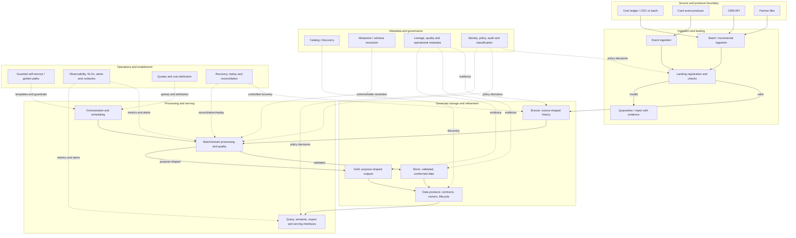

# Project 07 — Enterprise Lakehouse Reference Architecture

**Stage:** Stage 2D — Data Architecture  
**Module:** 07 — Enterprise Data Platform and Lakehouse Architecture  
**Project type:** Integrated enterprise data architecture capstone / reference architecture specification  
**Roadmap source:** `roadmap-Enterprise-Data-Platform-and-Lakehouse-Architecture.md`, Section 10 and Topics 01–08  
**Target repository path:** `Stage 2D — Data Architecture/07-Enterprise-Data-Platform-and-Lakehouse-Architecture/Projects/07-enterprise-lakehouse-reference-architecture.md`  
**Level:** Beginner → Intermediate → Advanced  
**Recommended effort:** 12–16 hours, excluding optional peer review  
**Status:** Learning specification; not a deployed or independently approved architecture  
**Architecture stance:** Vendor-neutral logical/reference architecture, not a product selection or implementation blueprint

## Document control

| Field | Value |
|---|---|
| Document ID | 2D.7-P07 |
| Version | 1.0 — initial complete project specification |
| Date | 2026-10-21 |
| Status | Draft for learner execution and architecture review |
| Audience | Data architects, data engineers, platform engineers, security/governance practitioners, SREs, analytics/ML engineers, reviewers |
| Scenario | Fictional Northbridge Bank; all details, quantities, targets and decisions are illustrative |
| Evidence rule | Label statements as stipulated scenario, assumption, derived result, proposed decision, open question, or validation evidence |
| Companion checker | Appendix B; structural checker only, not architecture certification |
| Approval | No stakeholder, security, legal or architecture-board approval is implied |

### Change log

| Version | Date | Change |
|---|---|---|
| 1.0 | 2026-10-21 | Initial project specification aligned to the eight Module 2D.7 topics and roadmap |

### Reading order

1. Read Sections 1–5 before designing.
2. Execute Section 6 in sequence and produce each deliverable.
3. Use Section 7 as an illustrative reference, not as an approved real-bank design.
4. Complete Section 8 quality gates; a score cannot override a failed mandatory gate.
5. Adapt the templates in Section 9 for a real organisation.
6. Complete risks, hand-off and self-assessment in Sections 10–12.
7. Run Appendix B, then complete manual review. A checker pass is not proof of production readiness.

---

## 1. Project overview

### 1.1 What this project is about

Design a **vendor-neutral enterprise lakehouse reference architecture** that supports multiple business domains, data teams, analytical workloads and governed data products through a shared platform.

A pipeline asks, “How does this dataset move from source A to destination B?” A platform reference architecture asks, “Which reusable capabilities, responsibility boundaries, interfaces, policies and operating services should many pipelines and teams rely on—and who is accountable for each?”

The lakehouse pattern combines flexible storage with managed-table capabilities such as schema control, reliable updates, transactions and performance structures. It is not automatically superior to a warehouse or conventional lake. Suitability must be justified against requirements, alternatives, operating capacity and constraints.

### 1.2 Integration of all eight topics

| Topic | Required project evidence |
|---|---|
| 01 — Platform capabilities and logical reference architecture | Capability inventory, logical components, interfaces, ownership and end-to-end diagram |
| 02 — Ingestion, storage, processing and consumption zones | Zone responsibilities, entry/exit checks, data movement, quarantine, replay and retention |
| 03 — Bronze, silver, gold and data-product boundaries | Refinement criteria, ownership, promotion gates, product contracts and lifecycle |
| 04 — Compute, storage and control-plane separation | Responsibility/dependency matrix, read/write/job paths and failure analysis |
| 05 — Catalogs, metastores and platform metadata | Metadata model, topology, registration, lineage, quality and metadata access controls |
| 06 — Self-service platforms and developer experience | Golden path, templates, provisioning workflow, enforceable guardrails and DX metrics |
| 07 — Multi-team isolation and tenant boundaries | Threat model, identity/data/compute/admin boundaries, quotas and residual risk |
| 08 — Platform service levels and product thinking | Service catalogue, SLIs/SLOs, support, error-budget policy, cost and user outcomes |

### 1.3 Business problem

Northbridge Bank is a fictional mid-sized bank. Teams have overlapping ingestion pipelines, inconsistent data definitions, separate stores, manually maintained access rules and one-off operating practices. The organisation wants shared capabilities without creating a central-team bottleneck or an uncontrolled shared environment.

Do not claim these are verified current-state findings. Treat them as a design scenario. In a real engagement, distinguish discovery evidence from assumptions and list the discovery needed before approval.

### 1.4 Outcomes

The final architecture package must:

- connect business outcomes and measurable requirements to architecture choices;
- define a coherent logical platform and trace representative flows end to end;
- establish zones, refinement states, data-product boundaries and ownership;
- explain compute, storage, control-plane and data-plane responsibilities;
- define metadata/catalog responsibilities and metadata-quality controls;
- enable guarded self-service with explicit exception paths;
- choose tenant isolation from threat and service requirements;
- define measurable platform service levels and distinguish them from product promises;
- record decisions, alternatives, risks, assumptions, open questions and revisit triggers;
- include validation evidence, operational ownership and a transition plan.

### 1.5 What this project is not

This is an architecture specification, not a deployment. It does not require cloud provisioning, paid accounts, vendor-specific configuration, production pipelines or models, legal/security certification, or formal approval. Physical product selection, infrastructure topology, detailed configuration and deployment are downstream activities unless scope is explicitly expanded.

---

## 2. Scenario, boundaries and assumptions

### 2.1 Fictional organisation and domains

Northbridge Bank has a central data-platform team and six domains: Retail, Lending, Cards, Risk, Finance and Collections. Consumers include regulatory reporting, risk analytics, fraud monitoring, data science and a contact-centre view. Sources include a core-ledger database, card-event stream, SaaS CRM API and partner files. Sensitive data requires access controls, lineage, audit, retention and residency review.

All scenario details below are illustrative, not facts about a real organisation, jurisdiction or benchmark.

### 2.2 Initial assumptions

| ID | Illustrative assumption | Design implication | Evidence status |
|---|---|---|---|
| A-01 | About 25 teams across six domains | Shared platform plus domain ownership and tenancy | Scenario assumption |
| A-02 | About 250 TB stored initially; 30% annual growth | Model retention, copies, versions, overhead and uncertainty | Scenario assumption |
| A-03 | Peak event ingestion averages 20 MB/s; daily batches total about 2 TB | Support event and batch paths, bursts and replay | Clarify whether 20 MB/s is payload, average or sustained peak |
| A-04 | About 30% of stored volume is regulated/sensitive | Classification and policy enforcement across assets/columns | Volume is not a proxy for risk |
| A-05 | Curated-table service target: 99.5% monthly during defined business hours | Define SLI denominator, window, exclusions and dependencies | Proposed, not validated |
| A-06 | Fraud freshness target: at most 60 seconds at p95 | Define event population, timestamps, late data and measurement points | Proposed, not validated |
| A-07 | Operational dashboards refresh hourly; regulatory reporting is daily | Define consumer-specific freshness/publication expectations | Proposed, not validated |
| A-08 | Personal data remains in approved jurisdiction(s) | Confirm exact jurisdictions and transfer rules with qualified reviewers | Constraint assumption |
| A-09 | No paid cloud account required for this exercise | Keep design logical and vendor-neutral | Exercise constraint |
| A-10 | Data science needs reproducible historical datasets | Consider versioning, lineage, retention and access | Scenario assumption |

### 2.3 Scope

**In scope:** outcomes, requirements, workload profiles, logical capabilities, interfaces, ownership, zones, refinement layers, products, plane responsibilities, metadata, self-service, tenant isolation, service levels, ADRs, risks, validation and hand-off.

**Out of scope:** product procurement, physical network/account/cluster design, exhaustive physical schemas, vendor configuration, deployment, formal legal opinion, certification, actual DR exercises, measured load tests, model design and application-level AI architecture.

### 2.4 Roles and accountability

| Role | Accountable for | Not automatically accountable for |
|---|---|---|
| Business sponsor | Outcomes, priorities and accepted business trade-offs | Technical control implementation |
| Data architect | Coherent reference architecture, boundaries, decisions and traceability | Every domain's business semantics |
| Platform service owner | Shared capabilities, service catalogue, SLOs and operating outcomes | Domain data correctness |
| Domain/product owner | Business meaning, product contract, quality/freshness promises and lifecycle | Shared platform uptime |
| Data engineering team | Owned flows, tests, lineage declarations and runbooks | Unilateral policy exceptions |
| Security/privacy/governance | Classification, access, privacy, retention, audit and exception review | Business prioritisation alone |
| SRE/operations | Monitoring, incident response, capacity and runbooks | Source correctness |
| Consumer team | Appropriate use, interpretation and feedback | Unilateral upstream definition changes |
| Architecture forum | Design review and delegated exception scrutiny | Replacing legal/security authorities |

### 2.5 Assumptions and open-question register

| ID | Statement/question | Type | Owner | Impact if wrong | Resolution evidence | Status |
|---|---|---|---|---|---|---|
| AQ-01 | Which jurisdiction(s) are approved for each sensitive-data class? | Open question | Privacy/legal | Invalid placement/transfer | Approved policy and qualified review | Open |
| AQ-02 | Is 20 MB/s average, peak or sustained? What are burst characteristics? | Open question | Source/platform owner | Capacity/freshness error | Source telemetry and workload profile | Open |
| AQ-03 | What is authoritative for customer identity and transaction corrections? | Open question | Domain owners | Duplicates/inconsistent joins | Source-of-truth decision | Open |
| AQ-04 | What business hours and exclusions define 99.5%? | Open question | Service owner/consumers | Misleading SLO | Approved SLI/SLO definition | Open |
| AQ-05 | What retention/deletion rules cover raw, derived, cached and backed-up data? | Open question | Governance/privacy | Over-retention/incomplete deletion | Approved schedule | Open |

Add rows as needed. An unresolved item can be a documented dependency, but cannot silently become a fact.

---

## 3. Requirements, quality attributes and constraints

### 3.1 Requirements method

Derive requirements from outcomes and user journeys, not from a preferred tool. Every requirement needs a stable ID, statement, rationale, category, priority, measurable acceptance condition, evidence status, owner and verification method.

Suggested categories: functional (FR), reliability (REL), performance/freshness (PERF), security/privacy (SEC), metadata/lineage (META), developer experience (DX), isolation/cost (ISO/COST), operations/recovery (OPS), and portability/interoperability (PORT).

### 3.2 Initial requirement register

Targets are proposals for this exercise and require feasibility validation.

| ID | Requirement | Acceptance condition | Owner | Verification |
|---|---|---|---|---|
| FR-01 | Support batch, incremental/CDC where available, and event ingestion | Every path has contract, owner, retry/replay and reconciliation design | Platform/source owner | Flow review |
| FR-02 | Support governed products for reporting, risk and analytics | Each product has owner, purpose, grain, contract, classification, freshness and support route | Product owner | Contract review |
| META-01 | Governed assets are discoverable with lineage | Metadata completeness target defined; critical-product lineage traceable | Metadata owner | Metadata test/sample trace |
| SEC-01 | Sensitive data follows approved policy | Classification, purpose, enforcement point, audit and retention are defined | Governance/security | Policy walkthrough |
| ISO-01 | Restricted tenant data is not cross-accessible without authorization | Threat scenarios have preventive controls and negative tests | Security/platform | Threat review/access-test plan |
| PERF-01 | Fraud data reaches consumer within proposed freshness objective | p95 event-to-consumer latency ≤60 seconds under agreed measurement semantics | Fraud product owner | Telemetry/load-test plan |
| PERF-02 | Operational dashboards refresh hourly | Refresh success and end-to-end freshness are measured | Product owner | SLI review |
| REL-01 | Curated-table availability aims at 99.5% monthly during defined hours | SLI denominator, window, exclusions, dependencies and response policy documented | Service owner | SLO review |
| OPS-01 | Critical failures are detected, contained and recoverable | Alerts, owners, runbooks, retry/replay and reconciliation exist | Operations/product team | Failure tabletop |
| COST-01 | Shared cost is attributable and bounded | Cost dimensions, owner tags, showback and enforced limits are defined | Platform/finance | Allocation review |
| DX-01 | Teams can publish via a guarded golden path | Time-to-first-success measured; routine permitted tasks need not be manually executed | Platform product owner | Workflow walkthrough |
| PORT-01 | Avoid unnecessary vendor coupling | Vendor-specific dependencies are deferred and have an exit/portability note | Architect | Review |

### 3.3 Requirements quality checks

For every requirement verify: traceability to an outcome/constraint; observable acceptance condition; feasibility evidence or explicit uncertainty; accountable owner; architecture-level scope; conflicts and dependencies; and planned verification. Separate mandatory eligibility/security/compliance gates from weighted preferences.

### 3.4 Workload profile

| Workload | Pattern | Main design concerns |
|---|---|---|
| Core ledger | Batch and/or CDC, source capability to be confirmed | Completeness, ordering, corrections, audit and point-in-time reproducibility |
| Card events | Streaming/event | p95 freshness, duplicate/out-of-order events, backpressure and replay |
| CRM | API/incremental extraction | Rate limits, schema changes, API availability and sensitive fields |
| Partner files | Scheduled batch | Checksums, malformed records, completeness, late delivery and quarantine |
| Regulatory reporting | Scheduled curated consumption | Reproducibility, versioned definitions, lineage and controlled publication |
| Data science/ML | Batch analytical reads and versioned extracts | Historical snapshots, access control, data lineage and resource isolation |

Add record size, burst profile, concurrency, retention, correction semantics, late-arrival behavior and RPO/RTO needs when evidence is available. Mark unknowns explicitly.

---

## 4. Architecture method and principles

### 4.1 Principles

1. Requirements before products.
2. Vendor-neutral logical architecture first.
3. Clear boundaries among capabilities, components, interfaces, zones, refinement layers, planes and products.
4. Governance by design: classification, identity, authorization, lineage, retention, audit and quality.
5. Least privilege and explicit trust.
6. Domain accountability with shared enablement.
7. Reproducibility and recoverability through versioned transformations, reconciliation and governed replay.
8. Self-service within enforceable guardrails.
9. Isolation proportional to threat and service requirements.
10. Measurable service promises with owners and response policies.
11. Cost transparency, with showback distinguished from enforced quotas.
12. Failure-aware design and explicit blast radius.
13. Open standards where practical, with portability cost acknowledged.
14. Evidence over assertion.

### 4.2 Logical versus physical architecture

The primary diagram is logical: capabilities, responsibilities, interfaces, data/control flows, trust boundaries and ownership. It does not prescribe a cloud, product, cluster topology, network design or vendor configuration. A later physical design must map responsibilities to actual products, validate feature limits, test performance/recovery and estimate current cost.

### 4.3 Decision method

For each material decision: state context; link requirements; define at least two credible options; set criteria/weights before scoring; apply mandatory gates before weighted scoring; document evidence and uncertainty; perform sensitivity analysis where weights/assumptions could change the result; record outcome, rejected options, consequences, risks, owner and revisit triggers. A high weighted score never compensates for a failed mandatory gate.

---

## 5. Required deliverables and completion map

Produce all D1–D18. The count is project-specific; do not omit requirements to reduce length.

| ID | Deliverable | Minimum contents |
|---|---|---|
| D1 | Charter and scope | Purpose, outcomes, boundaries, stakeholders, roles, assumptions, exclusions, acceptance criteria |
| D2 | Requirements and workload pack | Register, workload profile, measurable targets, constraints, open questions |
| D3 | Capability inventory and ownership map | Capability, responsibility, component/interface, owner, consumers, criticality, dependencies |
| D4 | Logical reference architecture | Diagram, interfaces, trust boundaries, ownership and end-to-end flows |
| D5 | Zone model and flow catalogue | Responsibilities, entry/exit criteria, checks, retention, quarantine, replay and traces |
| D6 | Refinement-layer and product model | Layer purpose, promotion gates, exceptions, product contract, owner and lifecycle |
| D7 | Plane responsibility/dependency matrix | Compute/storage/control/data plane, interactions, failures, security and operational consequences |
| D8 | Metadata/catalog architecture | Metadata model, topology, registration workflow, lineage and metadata-quality indicators |
| D9 | Self-service/DX design | Golden path, templates, policy enforcement, exception route and DX metrics |
| D10 | Isolation/threat model | Tenant types, trust boundaries, threats, controls, residual risk and quotas |
| D11 | Service catalogue and SLO pack | Services, SLIs/SLOs, support, dependencies, error-budget policy and product canvas |
| D12 | ADR pack | At least five ADRs with alternatives, rationale, consequences, owners and revisit triggers |
| D13 | Capacity, reliability and cost reasoning | Transparent estimates, growth, bottlenecks, cost allocation, recovery objectives and sensitivity |
| D14 | Governance/security/privacy/lifecycle matrix | Classification, access, audit, lineage, retention/deletion, residency, credentials |
| D15 | Failure/recovery analysis | Dependencies, failure scenarios, detection, containment, recovery, replay and communication |
| D16 | Validation/evidence pack | Traceability, diagram checks, test scenarios, checker output, manual review and findings |
| D17 | Architecture review/transition plan | Decisions, risks, gaps, sequencing, dependencies, review questions and next-stage work |
| D18 | Executive summary | Problem, recommendation, critical decisions, benefits, trade-offs, risks, approvals and next steps |

### 5.1 Required traceability chains

Demonstrate these with stable IDs:

- Business objective → requirement → architecture element/control → verification evidence.
- Requirement/constraint → ADR → chosen option → consequence/risk → revisit trigger.
- Source → ingestion contract → zone/layer transition → lineage → product → consumer/SLO.
- Classification → access policy → enforcement point → audit evidence → retention/deletion.
- Tenant/workload → identity/resource boundary → quota/isolation control → monitoring → response.
- Service promise → SLI → dependency chain → alert/runbook → owner/escalation.

If a chain is incomplete, record the gap and owner; do not invent evidence.

---

## 6. Step-by-step execution plan: initiation to completion

Work in sequence. Each step states purpose, actions, output and completion check. Do not pass a blocking gate with an undocumented assumption.

### Step 1 — Initiate the architecture assignment

**Purpose:** Establish why the architecture is needed and what decision it enables.

**Actions:** Write the business problem; identify sponsor, architecture owner, platform owner, domain representatives, security/privacy, operations and consumers; define decision authority and exception escalation; state scope/exclusions; define review audience and acceptance criteria; start assumption, risk, dependency and open-question registers.

**Output:** D1 charter and scope.  
**Completion check:** Problem, decision, owners, boundaries and acceptance criteria are explicit; no unverified approval is claimed.

### Step 2 — Establish baseline and evidence status

**Purpose:** Prevent scenario assumptions being mistaken for verified facts.

**Actions:** Label each statement as stipulated scenario, assumption, derived estimate, proposed decision, open question or evidence; record source/confidence for non-fictional claims; identify discovery needed for a real engagement; assign owners and resolution evidence to material questions.

**Output:** Updated D1 and assumption register.  
**Completion check:** Material values have evidence status; unknowns have owners and impact.

### Step 3 — Discover users, outcomes and workloads

**Purpose:** Design for jobs-to-be-done.

**Actions:** List jobs such as publishing a product, investigating fraud, producing a report, discovering data, requesting access and recovering a flow; record value and failure consequence; classify batch, CDC, streaming, interactive query, reporting, ML and administrative workloads; capture volume, burst, freshness, concurrency, history, correction, retention and recovery needs; map outcomes to requirements.

**Output:** D2 workload and requirements pack.  
**Completion check:** Critical workloads have patterns and measurable needs; vague adjectives are quantified or flagged.

### Step 4 — Define requirements and acceptance conditions

**Purpose:** Create a testable basis for decisions.

**Actions:** Assign IDs, owners, priority, rationale and verification; define SLI/SLO semantics before calling targets commitments; distinguish platform from product promises; identify mandatory gates; document conflicts and feasibility questions; build requirement-to-evidence traceability.

**Output:** D2 requirements register and traceability map.  
**Completion check:** Critical requirements are measurable or explicitly unresolved.

### Step 5 — Inventory capabilities and ownership

**Purpose:** Define what the platform does before choosing products.

**Actions:** Inventory acquisition, storage, processing, orchestration, metadata, governance, quality, serving, observability, recovery, cost and developer enablement; define purpose, inputs/outputs, interfaces, consumers, owner, dependencies, criticality and failure effect; distinguish capability/component/interface/flow/product; mark shared versus domain-owned responsibilities; identify gaps and single points of failure.

**Output:** D3 capability inventory.  
**Completion check:** Every critical capability has responsibility and owner.

### Step 6 — Draw the logical reference architecture

**Purpose:** Make responsibilities, interfaces and flows reviewable.

**Actions:** Draw sources and producer interfaces; ingestion/landing for batch/CDC/events; storage/refinement; processing/orchestration; quality/reconciliation; catalog/metastore, identity/policy, audit, lineage, secrets/credentials, observability, cost and recovery; consumption interfaces; separate data flows from control/metadata flows; mark ownership/trust boundaries; trace a card-event flow and a batch-file flow.

**Output:** D4 diagram and narrative.  
**Completion check:** No critical flow has an unexplained hop, hidden policy decision or unclear owner.

### Step 7 — Define zones and transitions

**Purpose:** Make lifecycle responsibility explicit.

**Actions:** Define zone purpose and allowed operations; for each transition specify source/destination, trigger, contract, validation, identity, authorization, owner, retention, audit, failure route and exit criteria; define ingress checks, preservation constraints, reject/quarantine, replay and reconciliation; decide logical versus physical zone boundaries with rationale.

**Output:** D5 zone model and flow catalogue.  
**Completion check:** Every boundary has entry/exit rules and failure path; zones are not confused with refinement layers.

### Step 8 — Define refinement layers and products

**Purpose:** Separate transformation state from consumer promises.

**Actions:** Define bronze/silver/gold or justify alternatives; state meaning, non-guarantees, owner, permitted changes, history, quality and retention per layer; define hard-blocking gates, warnings and approved exceptions; handle late data, duplicates, schema evolution, corrections, backfills and partial failure; specify at least two products with consumer, purpose, grain, semantics, contract, classification, owner, lineage, quality, freshness, access, support, versioning, deprecation and retirement; state when a silver asset can be a product.

**Output:** D6 layer and product specifications.  
**Completion check:** Promotion is evidence-based; product contracts and owners exist; layer names do not imply quality or authorization.

### Step 9 — Separate compute, storage, control and data plane

**Purpose:** Expose coupling and failure dependencies.

**Actions:** Assign primary responsibility plane while noting bundled services; trace submission, authorization, metadata resolution, scheduling/provisioning, execution, reads/writes, commit/publication and monitoring; identify durable state (table metadata, catalog, checkpoints, job state, policies, audit); analyse worker, storage, network, catalog, credential, scheduler, commit and observability failures; compare coupled/separated alternatives for elasticity, latency, engine choice, security, cost and operating burden.

**Output:** D7 plane/dependency matrix.  
**Completion check:** Read/write/control flows and important durable metadata are explicit.

### Step 10 — Design metadata and catalog topology

**Purpose:** Make data discoverable, interpretable and governable.

**Actions:** Define technical, business, operational, quality, lineage, classification/security, ownership, usage and cost metadata; define mandatory fields, stable asset IDs, authoritative sources, producers/maintainers, consumers and freshness; distinguish catalog, metastore and broader metadata; choose centralized/federated/hybrid topology; design registration, ownership, classification, schema-change, quality, lineage and retirement workflows; measure completeness, validity, freshness, consistency and lineage coverage; control metadata access; define stale/conflicting metadata response.

**Output:** D8 metadata model and workflows.  
**Completion check:** Critical assets have ownership/classification/contract/lineage requirements; catalog descriptions are not authorization.

### Step 11 — Design guarded self-service and DX

**Purpose:** Reduce routine friction without removing necessary controls.

**Actions:** Define golden path from discovery/onboarding through provisioning, build/test, access, publication, operations, change and retirement; specify logical interfaces/templates; define safe defaults for identity, least privilege, resources, tags, metadata, tests, lineage, alerts and runbooks; map controls to actual enforcement points; distinguish block, warning, human approval, detective alert and time-bound exception; define template versioning/ownership; measure time-to-first-trusted-product, rework, support burden, incidents and relevant adoption.

**Output:** D9 self-service workflow and control matrix.  
**Completion check:** Critical controls are enforced or explicitly marked as manual dependencies; a ticket form alone is not self-service.

### Step 12 — Design tenant isolation

**Purpose:** Limit unauthorized access, interference and blast radius.

**Actions:** Define tenant unit; map isolation across identity, data namespace, storage, compute, network, keys, catalog, control plane, audit, admin roles, quotas and recovery; threat-model accidental access, privilege escalation, metadata leakage, shared credentials, compromised workloads, administrator misuse, noisy neighbours, exhaustion and offboarding; compare logical sharing, dedicated compute, separate storage/security domains and stronger separation; define preventive/detective/corrective controls and evidence; design onboarding, access review, containment, offboarding, retention and deletion; separate showback from enforced quota.

**Output:** D10 isolation model and threat register.  
**Completion check:** Claims name enforcement points and residual risks; names/folders/schemas are not treated as security boundaries.

### Step 13 — Define service catalogue and SLOs

**Purpose:** Make promises measurable and accountable.

**Actions:** Define service scope, exclusions, owner, consumers, support hours, request path, dependencies and escalation; define each SLI numerator/denominator, eligible population, measurement point, window, exclusions and source; set SLOs only where outcomes and response exist; distinguish SLI/SLO/SLA; model serial dependencies and degraded modes; define error-budget actions, incidents, runbooks, communication, change management, cost allocation and quota behavior; keep product freshness separate from platform availability.

**Output:** D11 service catalogue, SLI/SLO pack and product canvas.  
**Completion check:** Each promise has a clear measurement and owner; proposed targets are not described as measured.

### Step 14 — Create ADRs

**Purpose:** Make trade-offs inspectable and revisitable.

Create at least five ADRs. Suggested topics: (1) lakehouse suitability/pattern composition, (2) zone/refinement topology, (3) plane coupling/separation, (4) catalog topology, (5) tenant isolation, (6) self-service autonomy, (7) service tiering. Each ADR must contain ID/status/date, context, requirements, mandatory gates, alternatives, criteria/weights, evidence/uncertainty, decision, rejected options, consequences, risks, owner, verification and revisit triggers. If scoring is used, show formula, weights and sensitivity. A weighted score cannot override a failed mandatory gate.

**Output:** D12 ADR pack.  
**Completion check:** A future reviewer can understand the decision without undocumented oral context.

### Step 15 — Validate capacity, reliability and cost

**Purpose:** Expose scale implications and uncertainty.

**Actions:** Calculate transparent storage growth; distinguish logical volume from replicas, versions, raw/refined copies, temporary data, metadata and backups; identify bottlenecks, skew, concurrency, compaction, metadata load and shared-service saturation; define capacity signals, headroom, scaling triggers, quotas and cost dimensions; define RPO/RTO targets by workload where needed; run sensitivity cases; identify unit-cost measures without inventing prices.

**Output:** D13 capacity/cost/reliability pack.  
**Completion check:** Estimates are recomputable and labelled; no vendor price or performance claim is invented.

### Step 16 — Complete governance, security, privacy and lifecycle controls

**Purpose:** Connect policy to enforcement and evidence.

**Actions:** Map data classes/purposes to roles, enforcement points, masking, audit and retention; trace sensitive data through raw/refined/products/caches/exports/logs/temp/backups; define retention, legal hold, deletion and verification; identify residency questions for qualified review; define credential/key responsibilities; design access review and break-glass expiry; propagate lineage/policy changes; state residual risks.

**Output:** D14 governance/security/privacy/lifecycle matrix.  
**Completion check:** Every sensitive path has a policy owner and enforcement point; deletion includes copies and derivatives.

### Step 17 — Perform failure and recovery analysis

**Purpose:** Show behavior under failure.

At minimum analyse: late/unavailable/malformed source; schema change; streaming backlog; partial batch/reconciliation failure; compute failure during write; storage/network outage or throttling; stale/unavailable catalog; identity/policy/credential outage; scheduler backlog; commit/publication failure; missing lineage; tenant exhaustion/cross-access; sensitive data in unapproved location; missed product freshness SLO; deletion propagation through copies.

For each record trigger, affected requirements/products/tenants, detection, prevention, containment, degraded behavior, recovery, replay/idempotency, reconciliation, communication owner, evidence and residual risk.

**Output:** D15 failure-mode analysis and recovery playbooks.  
**Completion check:** Recovery is verified; retry alone is not treated as a complete strategy.

### Step 18 — Validate integrated architecture

**Purpose:** Test consistency before review.

**Actions:** Trace two flows end to end; confirm each diagram component appears in inventory; link critical requirements to design and verification; check each product contract; check trust boundaries and audit; verify each SLO's SLI/window/owner/dependencies; verify ADR links and alternatives; run Appendix B; conduct manual diagram/threat/failure/traceability review; record severity, owner and evidence; rerun checks after fixes.

**Output:** D16 validation/evidence pack.  
**Completion check:** Mandatory gates pass or package is marked Not Ready with blockers and owners. Checker pass alone is insufficient.

### Step 19 — Review and prepare transition

**Purpose:** Prepare a qualified review without pretending approval occurred.

**Actions:** Summarise recommendation, assumptions, alternatives and trade-offs; list unresolved questions, approvals, residual risks and feasibility gaps; prioritize discovery, classification confirmation, workload measurement, product mapping, physical selection, security review, cost modelling, load/recovery tests and implementation planning; sequence dependencies; record reviewer/date/status only after a real review.

**Output:** D17 review and transition plan.  
**Completion check:** Every blocker has an owner and next action; status is accurate.

### Step 20 — Summarise and close

**Purpose:** Communicate the design and verify completeness.

**Actions:** Write executive summary; link it to D1–D17; complete quality gates; run checker and preserve output/version; complete self-assessment; mark completion only if mandatory gates pass.

**Output:** D18 executive summary and completed project package.  
**Completion check:** Requirements, design, decisions, validation and transition are traceable without undocumented context.

---

## 7. Worked reference example (illustrative)

This is a worked example, not an approved design for a real bank. Final choices must follow the requirements and decision method.

### 7.1 Illustrative logical architecture



**Interpretation and caveats**

- This is logical; each box need not be a separate product or deployment.
- Solid arrows show illustrative data/execution flows; dotted arrows show control, metadata, policy or operational interactions.
- Policy must be enforced at actual access/execution points; catalog tags alone are not authorization.
- A product may combine tables or expose a suitable silver-level asset if its semantics, contract and support are appropriate.
- Exact commit/publication and recovery behavior belongs in the plane/failure matrices; the diagram alone is insufficient.
- Raw data is not assumed to be retained indefinitely; replay is constrained by approved policy.

### 7.2 End-to-end example: card event to fraud monitoring

| Stage | Action | Required evidence/control | Failure path |
|---|---|---|---|
| 1. Source | Producer emits event with stable event/transaction identity and event time | Producer contract, schema version, source identity | Source/backpressure alert and named owner |
| 2. Ingest | Authenticate producer, validate envelope, attach arrival/batch/partition metadata | Identity, schema checks, event ID, ingestion timestamp | Reject/quarantine with reason and audit record |
| 3. Bronze | Persist source-shaped event subject to classification and retention | Provenance, version, access policy, replay eligibility | Safe retry and accepted-vs-expected reconciliation |
| 4. Process | Parse, deduplicate, standardize, handle event-time/watermark and late events | Versioned transform, idempotency key, quality outcomes | Quarantine/dead-letter path, bounded retry and replay policy |
| 5. Silver | Publish validated event/transaction representation | Schema/business-rule gates, uniqueness and reconciliation as defined | Block promotion on hard failure; exception only through approved path |
| 6. Product | Derive fraud-monitoring output with explicit semantics | Owner, grain, freshness, lineage, classification and quality | Do not publish partial results as complete; expose status |
| 7. Serve | Expose to authorized fraud consumer | Runtime authorization, audit, purpose, serving telemetry | Deny unauthorized access; communicate stale/degraded status |
| 8. Operate | Measure event-to-consumer latency and availability | SLI, alerts, runbook, escalation and incident record | Controlled replay, reconciliation and post-incident review |

The proposed p95 freshness target of 60 seconds is meaningful only after confirming event population, timestamp semantics, measurement endpoints, late-event policy and measurement window. A platform cannot guarantee a source delivered on time unless source behavior is included in the end-to-end definition.

### 7.3 Example zone and refinement boundaries

| Boundary | Entry condition | Exit/promotion condition | Owner | Hard failure behavior |
|---|---|---|---|---|
| Source → landing | Producer identity and contract registered | Envelope accepted and arrival evidence captured | Ingestion/source owner | Reject or quarantine with reason |
| Landing → bronze | Safe ingestion conditions met and retention permitted | Durable, traceable source-shaped record committed | Platform/storage owner | Do not report success before durable outcome is confirmed |
| Bronze → silver | Schema version and required checks known | Parsing, standardization, deduplication and business rules pass | Domain data team | Block promotion or isolate invalid records |
| Silver → gold/product | Semantics, grain and consumer purpose defined | Product checks, reconciliation and contract satisfied | Product owner | Hold publication or expose status; exception must be approved/time-bound |
| Product → consumer | Contract and access policy published | Consumer authorized and interface meets promise | Product/platform serving owner | Deny when policy fails; surface freshness status |

Bronze is not automatically trusted; gold is not automatically a product. Refinement, quality evidence, sensitivity and consumer contract are separate dimensions.

### 7.4 Example metadata record

| Field | Example | Purpose |
|---|---|---|
| `asset_id` | `risk.fraud_event_features.v1` | Stable identifier; naming standard must be agreed |
| `business_name` | Fraud Event Features | Discovery |
| `domain` | Risk | Domain accountability |
| `owner_role` | Risk Data Product Owner | Business semantics and contract |
| `technical_maintainer` | Risk Data Engineering | Technical maintenance |
| `grain` | One row per accepted event ID and feature version | Avoid ambiguous joins/aggregation |
| `schema_version` | `1.0` | Compatibility/change tracking |
| `classification` | Restricted (illustrative label only) | Policy input; authority defines actual labels |
| `purpose_of_use` | Fraud monitoring and approved model development | Governed reuse |
| `source_assets` | Source asset IDs | Provenance |
| `lineage_status` | Captured / partial / missing | Visible uncertainty |
| `quality_status` | Pass / warn / fail plus evaluated time | Consumer/operator evidence |
| `freshness_slo` | Proposed p95 ≤60 s; pending validation | Consumer expectation |
| `retention_class` | TBD pending approved policy | Prevent invented retention periods |
| `access_policy_ref` | Policy identifier | Links metadata to enforcement |
| `support_route` | Named team/channel in real implementation | Escalation |
| `lifecycle_status` | Draft / active / deprecated / retired | Product lifecycle |

This is a logical schema example, not a vendor-specific schema.

### 7.5 Recomputable capacity calculation

Given illustrative assumptions of 250 TB current stored data and 30% annual growth:

\[
V_1=V_0(1+g)=250\ \text{TB}\times1.30=325\ \text{TB}
\]

For three years of compounded growth:

\[
V_3=250\ \text{TB}\times(1.30)^3=549.25\ \text{TB}
\]

These are logical stored-volume projections, not physical capacity recommendations. They exclude replicas, snapshots/versions, raw/refined duplication, temporary space, metadata, backups and variability.

A first-order approximation could be:

\[
V_{\text{physical}}\approx V_{\text{logical}}\times
(1+r_{\text{replica}}+r_{\text{version}}+r_{\text{overhead}})
\]

This is only a rough planning approximation. Define ratios so overlapping categories are not double-counted; preferably model primary data, replicas, versions, temporary data, metadata and backups as separate line items.

If 20 MB/s were sustained continuously for a 30-day month, decimal payload volume would be:

\[
20\ \text{MB/s}\times86{,}400\ \text{s/day}\times30
=51{,}840{,}000\ \text{MB}\approx51.84\ \text{TB}
\]

This is an illustrative calculation before compression, retention, replication and overhead. Confirm whether 20 MB/s is sustained, average or peak, and whether the unit is decimal. Daily batch volume is a separate workload; do not assume it is included in the streaming figure.

### 7.6 Example service-level distinction

| Promise | Type | Definition needed | Owner |
|---|---|---|---|
| Catalog responds to eligible discovery requests | Platform SLI/SLO | Successful eligible requests / total eligible requests, window and exclusions | Catalog service owner |
| Curated-table availability during business hours | Platform/service SLO candidate | Eligible products, calendar, partial degradation and dependency handling | Platform + product owners |
| Fraud product p95 freshness ≤60 seconds | Product freshness objective candidate | Event population, timestamps, endpoints, late events and missing source intervals | Fraud product owner with source/platform owners |
| Daily regulatory report ready by deadline | Product outcome/freshness promise | Report version, source cut-off, completion evidence and exceptions | Reporting product owner |

Do not call a target an SLA unless an agreement specifies terms and consequences. A job can succeed while source data arrives late; freshness needs shared attribution and explicit dependencies.

### 7.7 Example ADR excerpt — tenant isolation

- **Status:** Proposed; threat-model/security review required.
- **Context:** Domains share a platform; some datasets are restricted; workloads differ; metadata may itself be sensitive.
- **Drivers:** Prevent unauthorized cross-tenant access, constrain noisy-neighbour effects, preserve audit, enable guarded self-service and keep operations supportable.
- **Options:** (A) shared logical isolation with identity/resource policies, namespaces, quotas and audited administration; (B) dedicated compute for higher-risk/noisy workloads while sharing selected services; (C) separate storage/security domains and admin boundaries for highest-risk cases.
- **Mandatory gates:** Every option must satisfy approved residency, access, audit and retention requirements. Failure is disqualifying regardless of weighted score.
- **Proposed direction:** Risk-tiered isolation: enforce logical boundaries for standard workloads; require dedicated compute or stronger storage/admin separation where threat, interference or policy demands it. This is a hypothesis pending detailed threat review and implementation validation.
- **Trade-offs:** Logical sharing improves reuse and reduces duplicated operations but depends on correct policy configuration and shared-service security. Dedicated resources can reduce interference/blast radius but add cost and operational burden.
- **Residual risks:** Privileged misuse, shared identity/control-plane compromise, policy defects, side channels, copies/caches/logs/backups outside the primary boundary and configuration drift.
- **Verification:** Negative access tests, role review, quota tests, metadata exposure review, offboarding/deletion test and failure tabletop.
- **Revisit triggers:** New obligation, incident, material interference, failed isolation test, new tenant type or material cost/operability change.
- **Approval:** Not approved in this learning example.

---

## 8. Quality gate, validation and acceptance

### 8.1 Gate policy

Use statuses **Not started**, **In progress**, **Needs revision**, **Ready for review** and **Completed**.

- A deliverable is complete only when its content and evidence are present.
- A score cannot override a mandatory security, privacy, traceability or correctness failure.
- “Ready for review” means the author has checked the work; it is not board/security approval.
- “Completed” means the learning package passed its gate, not that a production platform was deployed or certified.
- Exceptions require rationale, approver role, compensating controls, expiry/review date and evidence. If approval has not occurred, mark it pending.

### 8.2 Mandatory gates

All must pass for the project to be marked Completed.

- [ ] D1–D18 are present or explicitly linked; no required deliverable is missing.
- [ ] Critical requirements trace to architecture elements and verification methods.
- [ ] At least two end-to-end flows have no unexplained transitions.
- [ ] Capability, component, interface, zone, refinement layer, plane and product are distinguished correctly.
- [ ] Every critical movement boundary has contract, ownership, checks, access, retention and failure/replay behavior.
- [ ] Each product has owner, purpose, grain/semantics, contract, classification, lineage, quality/freshness, support and lifecycle.
- [ ] Sensitive flows have policy owners, enforcement points, audit evidence, residency/retention questions and deletion considerations.
- [ ] Isolation claims identify mechanisms and residual risks.
- [ ] Each service target has an SLI definition, window, owner, dependencies and response policy—or is marked proposed/unvalidated.
- [ ] At least five ADRs include context, requirements, alternatives, rationale, consequences, risks, owners and revisit triggers.
- [ ] Numeric calculations are recomputable, units/assumptions stated, and estimates not presented as measurements.
- [ ] Critical failure modes include detection, containment, recovery, replay/idempotency, reconciliation and communication.
- [ ] Checker and manual review findings are recorded; critical findings are fixed or the project remains not ready.
- [ ] No invented approval, compliance determination, deployment, benchmark or validation claim appears.

### 8.3 Weighted review rubric (100 points)

| Dimension | Points | Evidence |
|---|---:|---|
| Requirements, scope, assumptions and traceability | 12 | D1–D2 and traceability |
| Capability model and logical architecture | 12 | D3–D4 |
| Zones, refinement, products and movement | 14 | D5–D6 |
| Plane separation, metadata and dependencies | 12 | D7–D8 |
| Self-service, isolation and threat handling | 14 | D9–D10 |
| Service levels, operating model and cost | 12 | D11 and D13 |
| ADR quality and trade-offs | 8 | D12 |
| Governance, privacy, lifecycle and recovery | 8 | D14–D15 |
| Validation, clarity and hand-off | 8 | D16–D18 |
| **Total** | **100** | |

Suggested learning threshold: 85/100 overall and at least 70% in each dimension. These are project recommendations, not universal industry standards. Mandatory gates still govern: a score of 95 cannot compensate for a failed critical security or traceability gate.

### 8.4 Automated and manual validation

Automated checks can detect missing headings, deliverable identifiers, topic markers, unbalanced fences and some path issues. They cannot prove architectural soundness, enforceability of a control in a chosen product, SLO feasibility, legal compliance, valid assumptions, complete threat coverage or correctness of an ADR.

Manual review checklist:

- [ ] Trace each flow from source to consumer and through its failure/recovery path.
- [ ] Confirm every diagram component has responsibility and owner.
- [ ] Confirm critical requirements map to design and verification evidence.
- [ ] Check zone/layer/product distinctions and promotion gates.
- [ ] Challenge metadata freshness, authoritative source and catalog-vs-authorization assumptions.
- [ ] Test tenant threats and hidden copies, caches, logs, backups and admin paths.
- [ ] Review SLI denominator, time window, exclusions, dependency model and product/platform distinction.
- [ ] Recompute arithmetic independently.
- [ ] Confirm unresolved questions and approvals are honestly labelled.
- [ ] Check operator readiness: alerts, owners, runbooks, escalation, replay and recovery.

### 8.5 Review finding log

| Finding ID | Severity | Finding/evidence | Requirement/deliverable | Owner | Correction | Retest evidence | Status |
|---|---|---|---|---|---|---|---|
| Replace this example row | — | Remove or replace during actual review; do not present it as a real finding | D16 | Reviewer | Record actual issue | Link evidence | Open |

---

## 9. Reusable templates for a real organisation

Do not carry illustrative values into a real architecture pack without explicitly accepting them as assumptions.

### 9.1 Requirement template

| Field | Entry |
|---|---|
| Requirement ID | `REQ-...` |
| Statement / business outcome / source | |
| Category / priority / owner | |
| Acceptance measure, formula, units and window | |
| Dependencies and constraints | |
| Verification method / evidence | |
| Status / open question | |

### 9.2 Capability/component template

| Field | Entry |
|---|---|
| Capability ID/name and responsibility | |
| Non-responsibilities | |
| Logical component and interfaces/contracts | |
| Inputs/outputs and consumers | |
| Owner/support route | |
| Dependencies and criticality | |
| Data/control interactions | |
| Security/classification implications | |
| Failure/degraded behavior | |
| Operational signal / decision reference | |

### 9.3 Zone transition template

| Field | Entry |
|---|---|
| Transition ID and source/destination | |
| Trigger and data contract | |
| Entry validation and identity/access policy | |
| Transformation/state change | |
| Exit/promotion criteria | |
| Owner and audit evidence | |
| Retention/deletion rule | |
| Reject/quarantine behavior | |
| Retry/idempotency/replay rules | |
| Reconciliation evidence and downstream dependency | |

### 9.4 Data-product contract template

| Field | Entry |
|---|---|
| Product ID/version/status | |
| Purpose and consumers | |
| Owner/steward/technical maintainer | |
| Grain, semantics and definitions | |
| Schema and compatibility policy | |
| Sources and lineage | |
| Classification and permitted purposes | |
| Quality rules and thresholds | |
| Freshness/availability promise and measurement | |
| Access request/enforcement | |
| Support, alerts and incident route | |
| Retention, correction, replay and deletion | |
| Versioning, deprecation and retirement | |

### 9.5 ADR template

| Field | Entry |
|---|---|
| ID/title/status/date | |
| Context and problem | |
| Linked requirements/constraints | |
| Mandatory eligibility/security gates | |
| Decision drivers and weights | |
| Options considered | |
| Evidence, assumptions and uncertainty | |
| Evaluation formula and sensitivity | |
| Decision and rationale | |
| Rejected alternatives | |
| Consequences and residual risks | |
| Owner and approval status | |
| Verification and revisit triggers | |

### 9.6 Threat/control template

| Field | Entry |
|---|---|
| Threat/scenario ID and asset/tenant | |
| Trust boundary / threat actor / failure source | |
| Preconditions and impact | |
| Preventive control/enforcement point | |
| Detective control/evidence | |
| Corrective response/owner/target | |
| Test case/result | |
| Residual risk and acceptance authority | |

### 9.7 Service/SLO template

| Field | Entry |
|---|---|
| Service/product scope and owner | |
| Consumers and user outcome | |
| SLI, numerator/denominator | |
| Eligible population and measurement point | |
| Window, aggregation and exclusions | |
| SLO target/rationale/status | |
| Dependencies/degraded mode | |
| Alert/runbook/escalation | |
| Error-budget policy | |
| Support hours/communication | |
| Cost allocation/quota behavior | |

### 9.8 Validation test template

| Field | Entry |
|---|---|
| Test ID and requirement | |
| Scenario/preconditions | |
| Expected behavior | |
| Method/environment | |
| Observed evidence | |
| Pass/fail/severity | |
| Finding ID/owner/retest date | |
| Residual limitation | |

---

## 10. Common pitfalls and corrections

| Pitfall | Why it fails | Correction |
|---|---|---|
| Product choice before requirements | Tool-led design hides constraints | Define logical capabilities and measurable needs first |
| Happy-path-only diagram | Hides quarantine, retry, replay, partial commit and outage | Add failure/control paths |
| Zones equated with bronze/silver/gold | Confuses lifecycle responsibility with refinement | Define both and map them explicitly |
| Every gold table called a product | Omits owner, semantics, contract, access and support | Create a product contract |
| Catalog metadata treated as authorization | Metadata may be stale/descriptive | Enforce policy at access/provisioning/runtime |
| Lakehouse assumed to eliminate copies | Caches, exports, snapshots and backups remain | Map lineage, lifecycle, retention and deletion |
| Plane separation claimed without failure analysis | Misses commit, metadata, credential and network dependencies | Trace job/read/write/commit/recovery |
| Warning called a guardrail | Unsafe action can still proceed | Name and test the enforcement point |
| Workspace/schema name treated as isolation | Labels do not prove security boundaries | Threat-model identity, data, compute, metadata, control and admin paths |
| Cost tags treated as quotas | Attribution does not constrain use | Separate showback, alerts, throttles and enforced limits |
| Arbitrary SLOs | Promises lack measurement and feasibility | Define SLI, window, owner, dependencies and validation |
| Source delay treated as platform downtime | Misattributes end-to-end freshness | Define shared responsibility and source signals |
| Retry without idempotency/reconciliation | Duplicates effects or hides loss | Define keys, commit semantics, replay boundaries and reconciliation |
| Score treated as approval | Critical failures are masked | Enforce mandatory gates independently |
| Compliance/production claims overstated | Learning design is not approval or deployment evidence | Label status and required reviews/tests |
| Offboarding/deletion omitted | Copies and credentials may remain | Include derived assets, logs, caches and backups |
| Every logical boundary made a separate product | Adds latency, failure modes and operating burden | Separate responsibilities logically; justify physical separation later |

---

## 11. Hand-off and next-stage dependencies

### 11.1 Hand-off package

- Requirements, assumptions, constraints and open questions.
- Logical diagram, capability/component inventory and ownership.
- Zone, layer, product, interface and flow specifications.
- Plane/dependency/failure analysis.
- Metadata model, catalog topology and workflows.
- Golden path, guardrail enforcement map and exception workflow.
- Tenant isolation/threat model, quotas, cost policy and residual risks.
- Service catalogue, SLI/SLO definitions, support model and runbook outline.
- ADRs, risk register, validation evidence, checker output and manual findings.
- Transition plan with owners, sequence, dependencies and approval requirements.

### 11.2 Deferred to detailed design

- Product/service selection and feature validation.
- Physical network, account/project, region, cluster and environment topology.
- Physical schemas, partitioning/clustering, format settings and workload tuning.
- Exact IAM, key management, network rules and secret configuration.
- Infrastructure-as-code, CI/CD, orchestration configuration and deployment.
- Measured load, performance, availability, recovery, security and cost tests.
- Formal legal/privacy/regulatory review and security approval.

### 11.3 Review questions

**Architecture:** Does the design meet requirements without unnecessary complexity? Are trade-offs explicit?

**Domain/product owners:** Are grain, definitions, corrections, quality, freshness and support correct?

**Security/privacy/governance:** Are identity, purpose, classification, residency, lineage, audit, retention, deletion and exceptions enforceable?

**Platform/SRE:** Are dependencies, failure modes, alerting, runbooks, quotas and recovery operable?

**Finance:** Can cost be attributed and controlled? Are growth assumptions transparent?

**Consumers:** Can users discover the right product, understand meaning/freshness, obtain legitimate access and report issues?

---

## 12. Self-assessment and completion record

Answer using linked evidence, not confidence alone.

1. Why is this a platform reference architecture rather than one pipeline?
2. Can you trace two flows end to end, including control and failure paths?
3. Can you distinguish capability, component, interface, zone, layer, plane and product?
4. Can you show how a critical requirement changes a decision?
5. Can you justify the lakehouse against alternatives and name its risks/costs?
6. What remains available if compute fails, and what may fail if catalog/control services are unavailable?
7. How are schema changes, quality failures, late data and replay handled?
8. How is metadata registered, refreshed, validated and access-controlled?
9. Which guardrails are enforced, where, and how do exceptions expire?
10. What residual risks remain in tenant isolation?
11. How do platform SLOs differ from product freshness/quality promises?
12. Can you recompute capacity estimates and identify unknown overheads?
13. Can an operator identify alerts, owners, runbooks, escalation, recovery and reconciliation?
14. Are unresolved questions and proposed-versus-approved decisions labelled honestly?
15. Have automated and manual reviews both run, with findings fixed or blocking completion?

### Completion record

| Field | Entry |
|---|---|
| Project status | Not started / In progress / Needs revision / Ready for review / Completed |
| Deliverables complete | `__/18` |
| Mandatory gates passed | `__/14` |
| Rubric score | `__/100` |
| Checker version/result | |
| Manual review date/reviewer | |
| Critical findings remaining | |
| Open decisions/approvals | |
| Accepted exceptions and expiry | |
| Next actions and owners | |
| Evidence location/version | |

**Completion rule:** Mark Completed only when mandatory gates pass, the suggested learning threshold is met and limitations are recorded. Any failed critical gate means Needs revision or Not ready for review, regardless of score.

---

## Appendix A — Artifact inventory and diagram conventions

The completed package must contain the charter and assumptions; requirement/workload pack; capability/ownership inventory; logical diagram; zone/flow catalogue; layer/product model; plane matrix; metadata model/workflow; self-service/control matrix; isolation/threat model; service/SLO pack; ADRs; capacity/cost reasoning; governance/lifecycle matrix; failure/recovery analysis; validation evidence; review/transition plan; and completion record.

**Diagram conventions:** solid arrows mean data/execution; dotted arrows mean control, metadata, policy or operations. Label trust boundaries, ownership, interfaces and contract types. Separate external sources/consumers from platform capabilities. Show quarantine and recovery paths. Do not use color as the sole signal. State that the diagram is logical, not physical.

---

## Appendix B — Python standard-library project checker

Save as `check_lakehouse_project.py` and run:

```bash
python check_lakehouse_project.py 07-enterprise-lakehouse-reference-architecture.md
```

It exits `0` if implemented checks pass and `1` if one or more fail. It is structural evidence only.

```python
#!/usr/bin/env python3
"""Structural checker for the Module 2D.7 lakehouse project; not an architecture validator."""
from __future__ import annotations
import re
import sys
from pathlib import Path

REQUIRED_HEADINGS = [
    "## Document control",
    "## 1. Project overview",
    "## 2. Scenario, boundaries and assumptions",
    "## 3. Requirements, quality attributes and constraints",
    "## 4. Architecture method and principles",
    "## 5. Required deliverables and completion map",
    "## 6. Step-by-step execution plan: initiation to completion",
    "## 7. Worked reference example (illustrative)",
    "## 8. Quality gate, validation and acceptance",
    "## 9. Reusable templates for a real organisation",
    "## 10. Common pitfalls and corrections",
    "## 11. Hand-off and next-stage dependencies",
    "## 12. Self-assessment and completion record",
    "## Appendix A — Artifact inventory and diagram conventions",
    "## Appendix B — Python standard-library project checker",
]
REQUIRED_TOPICS = [
    "Platform capabilities and logical reference architecture",
    "Ingestion, storage, processing and consumption zones",
    "Bronze, silver, gold and data-product boundaries",
    "Compute, storage and control-plane separation",
    "Catalogs, metastores and platform metadata",
    "Self-service platforms and developer experience",
    "Multi-team isolation and tenant boundaries",
    "Platform service levels and product thinking",
]

def check(path: Path) -> list[str]:
    errors = []
    if not path.exists():
        return [f"Input file does not exist: {path}"]
    if not path.is_file():
        return [f"Input path is not a file: {path}"]
    text = path.read_text(encoding="utf-8")
    if len(text.strip()) < 10_000:
        errors.append("File is unexpectedly short; verify the complete project is present.")
    for heading in REQUIRED_HEADINGS:
        if heading not in text:
            errors.append(f"Missing required heading: {heading}")
    for topic in REQUIRED_TOPICS:
        if topic.casefold() not in text.casefold():
            errors.append(f"Missing topic coverage: {topic}")
    for n in range(1, 19):
        if not re.search(rf"\bD{n}\b", text):
            errors.append(f"Missing deliverable identifier D{n}")
    for n in range(1, 21):
        if not re.search(rf"### Step {n}\s+—", text):
            errors.append(f"Missing execution step {n}")
    fences = len(re.findall(r"(?m)^```", text))
    if fences % 2:
        errors.append(f"Unbalanced triple-backtick fences: {fences}")
    for marker in ["not a deployed", "illustrative", "mandatory gates",
                   "residual risks", "revisit triggers", "manual review"]:
        if marker.casefold() not in text.casefold():
            errors.append(f"Missing assurance marker: {marker}")
    # Relative links can fail when this file is exported outside its repository.
    for target in re.findall(r"\[[^\]]+\]\(([^)]+)\)", text):
        target = target.strip()
        if not target or target.startswith(("http://", "https://", "mailto:", "#")):
            continue
        local = target.split("#", 1)[0]
        if local and not (path.parent / local).exists():
            errors.append(f"Relative link target not found beside input file: {target}")
    return errors

def main() -> int:
    if len(sys.argv) != 2:
        print("Usage: python check_lakehouse_project.py <project-markdown-path>")
        return 2
    errors = check(Path(sys.argv[1]).expanduser())
    if errors:
        print(f"CHECK FAILED: {len(errors)} issue(s)")
        for i, error in enumerate(errors, 1):
            print(f"{i:02d}. {error}")
        return 1
    print("STRUCTURAL CHECK PASSED")
    print("Only the checks implemented in this script have passed.")
    print("Complete manual architecture, security, traceability and operations reviews.")
    return 0

if __name__ == "__main__":
    raise SystemExit(main())
```

### Appendix B.1 Checker limitations

- It uses strings and simple patterns, not a Markdown abstract syntax tree.
- Relative links may fail outside the repository; verify them at the target path.
- It does not render Mermaid or prove that a control is enforceable, an SLO feasible, a calculation valid or a threat model complete.
- Correct the document or document a legitimate path-context limitation; do not remove checks just to get a pass.
- Rerun it after corrections and repeat the manual review in Section 8.4.

---

## Appendix C — Source alignment and project-specific notes

This specification expands the roadmap's proposed final project into explicit deliverables, sequential steps, quality gates, templates and worked examples. The supplied lessons inform the corresponding sections: Topic 01 capability/reference architecture; Topic 02 zones; Topic 03 refinement/products; Topic 04 planes; Topic 05 metadata; Topic 06 self-service/DX; Topic 07 isolation; Topic 08 service levels/product thinking.

All Northbridge Bank details and numbers are illustrative. Real use requires discovery, qualified security/privacy/legal review, product-specific validation and measured operational tests. This document does not claim those activities have occurred.
