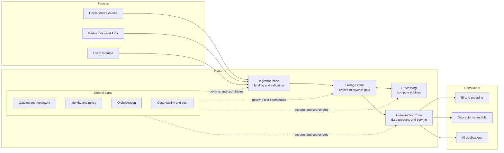

# Roadmap — Module 2D.7: Enterprise Data Platform and Lakehouse Architecture

This is the learning roadmap for the seventh module of Stage 2D, **Data
Architecture**. It tells you **what** to learn, **in what order**, **how** to
learn each topic from beginner to advanced level, **how to prove** you have
learned it before moving on, and **how to complete** the module's final
architecture project.

Modules 2D.1–2D.6 taught the role, the decision method, the patterns, the
models, the stores and the integration mechanisms. This module asks a bigger
question: how do you assemble all of that into one **shared platform** that many
teams can build on safely, without it becoming either a bottleneck or a free-for-
all?

> **Repository note (source-of-truth limits).** The eight topic files,
> `practice-questions.md`, `README.md`, `Projects/README.md` and
> `Projects/07-enterprise-lakehouse-reference-architecture.md` currently exist
> but are **empty**, as are the Stage 2D overview files. This roadmap therefore
> cannot be grounded in their contents. It is the first written statement of the
> module's scope, derived from the file names, the Stage 2D structure and the
> earlier module roadmaps. It does **not** claim that any topic file already
> contains the material below, and every exercise, template, target and scenario
> detail in it is a **recommendation**, not a documented requirement. When the
> topic files and the project file are written, their scope governs and this
> roadmap should be updated to match.
>
> **Directory name.** The prompt that requested this roadmap referred to
> `STAGE 2D - DATA ARCHITECURE/`. The actual directory is
> `Stage 2D — Data Architecture/`, and the actual name is preserved.
>
> **Illustrative content.** Every number, system, team and organisation here is
> an **illustrative assumption** used to teach a method. None is a real
> requirement, benchmark or recommended target. The module is vendor-neutral:
> capabilities and components are named by category, and no product-specific
> configuration is taught.

---

## 1. Module overview

### 1.1 What "enterprise data platform architecture" means

A **data platform** is a shared set of capabilities (ways to bring data in,
store it, process it, find it, protect it, and serve it) that many teams use to
build data products and analytics. **Platform architecture** is the design of
those capabilities: what they are, how they fit together, where the boundaries
are, who owns what, and what service the platform promises.

In plain English: a pipeline moves one dataset from A to B. A platform is the
road network, rules and services that let hundreds of pipelines exist without
each team reinventing roads.

### 1.2 What a lakehouse is, and what problem it addresses

A **lakehouse** (introduced at pattern level in
`../03-Data-Architecture-Patterns-and-Reference-Architectures/02-data-warehouse-data-lake-and-lakehouse-patterns.md`
and at storage level in
`../05-Database-and-Storage-Architecture/04-warehouse-lakehouse-and-table-format-design.md`)
combines low-cost, open storage of all kinds of data with warehouse-like
management: reliable tables, schema control, transactions and performance
structures.

| Problem it addresses | How the lakehouse approach responds |
| --- | --- |
| A warehouse is governed but rigid and costly for raw or unstructured data | Open storage holds raw and varied data cheaply |
| A plain lake is flexible but ungoverned (a "swamp") | A table-management layer and catalog add structure and control |
| Two copies (lake and warehouse) drift apart | One storage foundation serves multiple workloads |
| Analytics, data science and ML use different stores | Multiple engines read the same managed tables |

It is **not** automatically better than a warehouse; it trades some simplicity
for flexibility (see 2D.3 Topic 2 and 2D.5 Topic 4).

### 1.3 Why enterprises need a shared platform

| Without a platform | With a platform |
| --- | --- |
| Each team builds its own ingestion, storage and security | Common capabilities built once |
| Inconsistent controls and definitions | Consistent, enforceable defaults |
| Hidden duplicate cost | Visible, allocatable cost |
| Slow onboarding | Templates and self-service |
| Hard to audit | Central evidence and lineage |

But a platform can also fail: a central team that builds everything becomes a
queue; a platform nobody wants to use becomes shelfware. The module teaches how
to avoid both.

### 1.4 Designing a platform versus implementing a pipeline

| Aspect | Individual pipeline | Platform |
| --- | --- | --- |
| Scope | One flow | Many flows, many teams |
| Question | "How do I move and transform this?" | "What capabilities should every flow get, and who owns what?" |
| Unit of design | Job, table | Capability, boundary, service |
| Success | Data arrive correctly | Teams deliver safely, quickly and cheaply |
| Failure cost | One feed | Many teams |

### 1.5 How the themes relate

```text
Capabilities → define what the platform does
Boundaries (zones, layers, planes) → define where responsibilities sit
Governance and metadata → keep it controlled and discoverable
Developer experience → keeps it usable
Isolation → keeps teams from harming each other
Service levels and product thinking → keep it accountable and improving
```

### 1.6 How this module builds on earlier ones

| Earlier module | Provides |
| --- | --- |
| `../01-Data-Architecture-Foundations-and-Principles/` | Capabilities, domains, ownership; principles and governance |
| `../02-Requirements-Constraints-and-Architecture-Decisions/` | Measurable requirements and targets; constraints; trade-off method; ADRs |
| `../03-Data-Architecture-Patterns-and-Reference-Architectures/` | Lakehouse, mesh, fabric patterns; reference-architecture vocabulary |
| `../04-Conceptual-Logical-and-Physical-Data-Modeling/` | Models, grain, history, schema evolution |
| `../05-Database-and-Storage-Architecture/` | Stores, formats, table formats, layout, lifecycle |
| `../06-Data-Integration-and-Interoperability/` | Ingestion mechanisms, contracts, idempotency, reconciliation, failure handling |

### 1.7 How these concepts support analytics, ML and AI

| Consumer | What the platform provides |
| --- | --- |
| BI and reporting | Governed, performant curated tables; consistent definitions |
| Data science | Access to history, reproducible datasets, isolated workspaces |
| ML pipelines | Versioned data, lineage, repeatable processing, feature-ready tables |
| AI applications | Trustworthy, permissioned data and metadata for retrieval and grounding (later in 2D.14) |

AI quality is bounded by data quality, lineage and access control, all of which
are platform concerns.

### 1.8 Terminology in plain language

| Term | Plain meaning |
| --- | --- |
| Capability | Something the platform can do (for example "ingest files") |
| Logical reference architecture | A vendor-neutral picture of capabilities and how they connect |
| Zone | An area of the platform with a defined job (for example landing, processing) |
| Layer (bronze/silver/gold) | A stage of data refinement within storage |
| Data product | Data packaged for others to use, with an owner and promises |
| Compute / storage / control plane | The engines doing work / the place data rest / the services that manage and coordinate |
| Catalog / metastore | The directory of what data exist / the store of table definitions |
| Tenant | A team or customer sharing the platform, given boundaries |
| SLO | A measurable service promise |

---

## 2. Learning outcomes

After completing the module you will be able to:

1. **Describe** the logical capabilities of an enterprise data platform and
   **map** them into a vendor-neutral reference architecture.
2. **Design** ingestion, storage, processing and consumption zones and
   **trace** data from source to consumer.
3. **Explain** and **apply** bronze, silver and gold layer boundaries and
   **distinguish** layers from consumer-facing data products.
4. **Distinguish** compute, storage and control-plane responsibilities and
   **evaluate** the trade-offs of separating them.
5. **Explain** catalogs, metastores and platform metadata and **compare** them
   without treating them as interchangeable.
6. **Design** self-service workflows and developer experiences that balance
   autonomy with governance.
7. **Evaluate** isolation and tenant-boundary options for multiple teams,
   including the limits of logical isolation.
8. **Define** platform users, service levels and support responsibilities and
   **justify** treating the platform as a product.
9. **Produce, document and defend** an enterprise lakehouse reference
   architecture with traceable decisions, alternatives and limitations.

Each outcome is demonstrated through exercises, deliverables and the gates in
Sections 5, 9 and 10.

---

## 3. Prerequisites and knowledge dependencies

### 3.1 Prerequisite table

| # | What you should already understand | Why it is necessary | Where it comes from | Review if weak |
| --- | --- | --- | --- | --- |
| P1 | Capabilities, domains and data ownership | Platform capabilities and team boundaries follow domain and ownership structure | `../01-Data-Architecture-Foundations-and-Principles/03-business-capabilities-domains-and-data-ownership.md` | Re-draw a capability map for a bank and assign owners |
| P2 | Architecture principles, quality attributes and governance | Platform decisions are judged against principles and attributes | `../01-Data-Architecture-Foundations-and-Principles/04-architecture-principles-and-quality-attributes.md`, `05-data-architecture-lifecycle-and-governance.md` | Write five principles with rationale |
| P3 | Measurable requirements, freshness/availability/throughput targets | Service levels and zone design need numbers | `../02-Requirements-Constraints-and-Architecture-Decisions/04-latency-throughput-freshness-and-availability-targets.md` | Convert three vague statements into SLOs |
| P4 | Constraints, assumptions and risks | The reference architecture must declare what it assumes | `../02-Requirements-Constraints-and-Architecture-Decisions/05-constraints-assumptions-dependencies-and-risks.md` | Classify 15 statements |
| P5 | Trade-offs and ADRs | Alternatives are evaluated and recorded | `../02-Requirements-Constraints-and-Architecture-Decisions/06-architecture-trade-offs-and-decision-criteria.md`, `07-architecture-decision-records-adrs.md` | Write one ADR with three options |
| P6 | Warehouse, lake, lakehouse, mesh, fabric patterns | The platform is a concrete instance of these | `../03-Data-Architecture-Patterns-and-Reference-Architectures/02-data-warehouse-data-lake-and-lakehouse-patterns.md`, `04-data-mesh-principles-and-domain-data-products.md`, `05-data-fabric-and-metadata-driven-architecture.md` | Compare the three analytical patterns in a table |
| P7 | Domain boundaries, schema evolution, historical modeling | Layers and data products need clear models and change rules | `../04-Conceptual-Logical-and-Physical-Data-Modeling/06-event-modeling-and-domain-driven-design.md`, `07-schema-evolution-and-backward-compatibility.md` | Split one entity into two bounded contexts |
| P8 | Object storage, file and table formats, layout, lifecycle | Zones and layers sit on these stores | `../05-Database-and-Storage-Architecture/03-object-storage-and-file-format-selection.md`, `04-warehouse-lakehouse-and-table-format-design.md`, `07-retention-archival-and-data-lifecycle-storage-tiers.md` | Explain storage system vs table format vs platform |
| P9 | Ingestion mechanisms, contracts, idempotency, reconciliation, failure handling | Ingestion zones and quality gates build on these | `../06-Data-Integration-and-Interoperability/` (all eight topics; especially `05-data-contracts-schema-registry-and-compatibility.md`, `07-idempotency-deduplication-and-reconciliation.md`, `08-integration-pattern-selection-and-failure-handling.md`) | Draw failure behaviour for one flow |

### 3.2 Essential vs concurrent

| Essential before starting | Can be learned during this module |
| --- | --- |
| P1, P3, P5, P6, P8, P9 | Detailed cloud service mapping (2D.8) |
| P2, P4, P7 (at least their gates) | Streaming specifics (2D.9) |
| | Governance tooling detail (2D.10) |
| | Lineage and quality tooling (2D.11) |
| | Platform reliability and cost depth (2D.12–2D.13) |

If a prerequisite is weak, do its review exercise before Topic 1; do not begin
the project until all essential items are solid.

---

## 4. Recommended learning sequence

All effort estimates are **recommendations** (about 6–8 hours per week assumed),
not repository requirements.

| Seq | Source file | Topic | Why at this point | Prerequisites | Concepts first | Output before progressing | Effort (rec.) |
| --- | --- | --- | --- | --- | --- | --- | --- |
| 1 | `01-platform-capabilities-and-logical-reference-architecture.md` | Platform capabilities and logical reference architecture | Establishes the map everything else sits on | P1, P5, P6 | Capability vs component vs product | Logical capability map and reference diagram | 6–8 h |
| 2 | `02-ingestion-storage-processing-and-consumption-zones.md` | Zones | Puts the first structure on the map and traces data end to end | Seq 1, P8, P9 | Zone, boundary, movement | Zone model and end-to-end trace | 6–8 h |
| 3 | `03-bronze-silver-gold-and-data-product-boundaries.md` | Layers and data products | Refines the storage and processing zones into quality stages and ownership | Seq 2, P7 | Refinement stages, promotion, product vs layer | Layer definitions and promotion criteria | 6–8 h |
| 4 | `04-compute-storage-and-control-plane-separation.md` | Compute, storage, control plane | Explains how the zones and layers are run and scaled | Seq 1–3 | Plane, coupling, elasticity | Responsibility matrix by plane | 5–7 h |
| 5 | `05-catalogs-metastores-and-platform-metadata.md` | Catalogs and metadata | Makes everything discoverable and governable; needs planes to place the services | Seq 3–4 | Metadata types, catalog vs metastore | Metadata model and ownership model | 5–7 h |
| 6 | `06-self-service-platforms-and-developer-experience.md` | Self-service and DX | Makes the platform usable; needs capabilities, layers and metadata to exist | Seq 1–5 | Paved road, golden path, safe defaults | Self-service workflow design | 5–7 h |
| 7 | `07-multi-team-isolation-and-tenant-boundaries.md` | Isolation and tenancy | Constrains what self-service may do; needs planes and metadata | Seq 4–6 | Logical vs physical isolation, noisy neighbour | Isolation model and shared/isolated table | 6–8 h |
| 8 | `08-platform-service-levels-and-product-thinking.md` | Service levels and product thinking | Closes the loop: promises, support, feedback | Seq 1–7, P3 | Users, outcomes, SLIs/SLOs | Service-level definitions and product canvas | 5–7 h |
| — | `practice-questions.md` | Validation | After each topic, and fully before the project | Seq 1–8 | — | Gap list | 3–4 h |
| — | `Projects/07-enterprise-lakehouse-reference-architecture.md` | Final project | Integrates all eight | All | — | Reference architecture package | 12–16 h |

**Why the order matches the file numbering.** The numeric order is already
dependency-aware: capabilities → zones → layers → planes → metadata →
self-service → isolation → service levels. Two optional variations are
reasonable:

- Study Topic 5 (metadata) immediately after Topic 2 if your background is
  governance-heavy, because metadata cuts across zones. The roadmap keeps it
  after Topic 4 because placing catalog and metastore services needs the plane
  vocabulary.
- Skim Topic 8 early to see where the module is heading, then study it fully
  last, because service levels summarise everything else.

---

## 5. Detailed beginner-to-advanced roadmap for every topic

Each topic uses the same twelve parts. Levels are cumulative. Examples use the
**illustrative** scenario of *Northbridge Bank* (Section 10.2), a fictional
mid-sized bank. Because the source topic files are empty, any specific subtopic
named below is a **recommended** learning focus.

---

### 5.1 Topic 01 — Platform capabilities and logical reference architecture

Source: [`01-platform-capabilities-and-logical-reference-architecture.md`](01-platform-capabilities-and-logical-reference-architecture.md)

#### 5.1.1 Topic overview

A platform is described first by what it **does** (capabilities), not by which
tools it uses. A **logical reference architecture** is a vendor-neutral diagram
of those capabilities, their responsibilities, their interfaces and the main
data flows. It answers: "What must exist, and how do the parts relate?" Tools
are chosen later (2D.8). This prevents designs from being shaped by a product
catalogue.

#### 5.1.2 Learning objectives

1. Define capability, component, interface and data flow.
2. Enumerate the capabilities of an enterprise data platform.
3. Draw a logical reference architecture and state each component's
   responsibility.
4. Distinguish logical from physical (vendor-specific) architecture.
5. Trace an end-to-end flow across capabilities.

#### 5.1.3 Prerequisites

P1, P5, P6 (Section 3). Also `../03-Data-Architecture-Patterns-and-Reference-Architectures/` pattern vocabulary (reference model vs
reference architecture vs blueprint).

#### 5.1.4 Beginner level — build the foundations

- **Terms:** capability, component, interface, data flow, logical vs physical,
  reference architecture.
- **Analogy:** a city plan (water, power, roads, rules) versus the specific
  companies that provide them.
- **Study:** the capability families of a platform — *acquire* (ingest),
  *store*, *process*, *organise and find* (metadata), *govern and secure*,
  *serve*, *operate and observe*, *enable* (developer experience).
- **Create:** a one-page list of capabilities with one sentence each and the
  question each answers.
- **Questions to answer:** What is the difference between "ingestion" (a
  capability) and a specific ingestion tool? Which capabilities does every data
  consumer indirectly depend on?
- **Small exercise (no infrastructure):** list ten capabilities for a bank
  platform and classify each as acquire/store/process/find/govern/serve/operate/
  enable.

#### 5.1.5 Intermediate level — understand the architecture

- **Relationships:** map how capabilities connect: sources → ingest → storage →
  processing → serving, with metadata, security and observability cutting across
  every stage.
- **Responsibilities and interfaces:** for each component state what it owns,
  what it consumes, what it exposes.
- **Patterns and alternatives:** centralised platform, federated platform with
  shared services, hybrid (see `../03-Data-Architecture-Patterns-and-Reference-Architectures/01-centralized-federated-and-domain-oriented-architectures.md`).
- **Cross-cutting concerns:** identity and access, encryption, audit, cost
  tagging, lineage.
- **Failure scenarios:** a missing cross-cutting capability (for example no
  lineage) discovered only at audit time; a capability with no owner.
- **Practical design exercise:** produce a layered diagram with capability boxes,
  arrows for data flow, and a separate band for cross-cutting services.
- **Trade-offs:** breadth of capabilities (more value, more cost and operations)
  vs a minimal platform (faster, narrower).

#### 5.1.6 Advanced level — make architecture decisions

- **Which capabilities to build, buy, or defer:** criteria — differentiation,
  skills, cost, time to value, risk (2D.2 Topic 6).
- **Scalability and reliability:** which capabilities are single points of
  failure (catalog, identity, orchestrator); how failure of one affects others.
- **Security and governance:** where policy is enforced (platform-wide vs
  per-domain).
- **Operational complexity:** each capability adds an operating burden; decide
  which are platform-owned and which are team-owned.
- **Cost:** shared capability amortisation vs duplicated per-team cost.
- **Extensibility:** how new capabilities (for example vector retrieval) attach
  without redesign.
- **Documented reasoning:** write an ADR for the capability scope decision with
  rejected alternatives (for example "minimal platform now, add capabilities in
  waves").
- **Not every capability suits every organisation:** a small firm may combine
  several into one managed service; a regulated group may require separate
  controls.

#### 5.1.7 Industry application and hands-on exercises

| | Exercise A — Capability map | Exercise B — Reference diagram and flow trace |
| --- | --- | --- |
| Scenario | Northbridge has ad hoc pipelines and wants a platform | The architecture board wants a vendor-neutral view |
| Problem | No shared list of capabilities and owners | No picture showing how data move and where controls sit |
| Inputs | Requirements summary (2D.2), capability map (2D.1) | Exercise A output |
| Tasks | List capabilities; group into families; mark must/should/later; assign provisional owner | Draw boxes, interfaces and flows; trace a card-transaction flow from source to a risk dashboard |
| Deliverables | Capability inventory | Logical reference diagram with legend and flow trace |
| Validation | Every capability has an owner or "unknown"; no tool names | Every box has a responsibility; each flow step maps to a capability |
| Demonstrates | You can think in capabilities, not products | You can communicate a logical architecture |

#### 5.1.8 Real-world scenarios and design trade-offs

| Scenario | Context and constraints | Options | Pros / cons | Failure modes | Recommended under assumptions | What would change it |
| --- | --- | --- | --- | --- | --- | --- |
| Capability scope for year one | Small team, regulatory deadline | (a) Minimal core; (b) Broad platform | (a) fast, narrow; (b) complete, slow | (b) over-build; (a) missing lineage | (a) plus lineage and access control | Regulator demands more up front |
| Single vs multiple analytical stores | Mixed BI and ML demand | (a) One lakehouse; (b) warehouse plus lake | (a) fewer copies; (b) specialised performance | Divergent definitions | (a) if table format and engines meet BI targets | BI concurrency targets unmet |

#### 5.1.9 Expected deliverables

- Capability inventory with owners.
- Logical reference architecture diagram.
- End-to-end data flow trace.
- One ADR for capability scope.

#### 5.1.10 Common mistakes and misconceptions

| Mistake | How to recognise | How to avoid |
| --- | --- | --- |
| Drawing tools instead of capabilities | Product logos in a "logical" diagram | Replace each logo with the capability it provides |
| Forgetting cross-cutting services | No identity, audit or lineage boxes | Add a cross-cutting band and test each flow against it |
| Capabilities without owners | Blank owner column | Assign or flag unknown |
| Treating a reference architecture as a mandate | "We must copy it exactly" | State deviations and reasons |

#### 5.1.11 Mastery criteria

- Explain logical vs physical in two minutes.
- Produce a diagram where each component's responsibility is one sentence.
- Given a described platform, identify two missing or unowned capabilities.

#### 5.1.12 Completion gate

- [ ] You can explain capability vs component vs product.
- [ ] Capability inventory and diagram reviewed by one other person.
- [ ] End-to-end trace has no unexplained hop.
- [ ] Weaknesses (for example confusion of logical and physical) addressed by
      redoing the diagram without tool names.

---

### 5.2 Topic 02 — Ingestion, storage, processing and consumption zones

Source: [`02-ingestion-storage-processing-and-consumption-zones.md`](02-ingestion-storage-processing-and-consumption-zones.md)

#### 5.2.1 Topic overview

**Zones** divide the platform by job: where data arrive, where they rest, where
they are transformed, and where they are consumed. Zones give each stage clear
responsibilities, controls and owners, and make movement between stages
deliberate and traceable.

#### 5.2.2 Learning objectives

1. Define the responsibility of each zone.
2. Trace data from source to consumer through the zones.
3. Define zone boundaries and the controls at each boundary.
4. Evaluate movement between zones (promotion, copy, expose).
5. Explain how batch, incremental and streaming workloads affect zone design.

#### 5.2.3 Prerequisites

Seq 1; P8 (object storage, lifecycle); P9 (ingestion mechanisms and
contracts: `../06-Data-Integration-and-Interoperability/01-batch-etl-elt-and-incremental-ingestion.md`, `05-data-contracts-schema-registry-and-compatibility.md`).

#### 5.2.4 Beginner level — build the foundations

- **Terms:** ingestion zone (landing), storage zone, processing zone,
  consumption zone, boundary, promotion.
- **Analogy:** a warehouse with a receiving dock, shelving, a packing area and a
  shop floor.
- **Study:** what each zone does and does not do (for example the landing zone
  keeps data as received and does no business transformation).
- **Create:** a simple left-to-right diagram of four zones with one sentence on
  each.
- **Questions:** Why keep data exactly as received? Who may read the landing
  zone?
- **Small exercise:** place twelve activities (receive a file, validate schema,
  deduplicate, join customer and account, publish a dashboard table…) in the
  correct zone.

#### 5.2.5 Intermediate level — understand the architecture

- **Boundaries:** at each boundary define entry checks (contract validation,
  schema, completeness), who owns the zone, retention, access.
- **Data flow:** source → landing → (validate/standardise) → storage →
  (transform) → curated → consumption; show reject/quarantine paths.
- **Workload types:** batch loads land in files/partitions; incremental
  ingestion lands change sets; streaming lands events with retention and replay
  (2D.6 Topics 1, 2, 4). A zone model must say where streams are buffered and
  how they reach the same storage as batch.
- **Patterns and alternatives:** a single storage zone with logical sections vs
  physically separate zones; a quarantine area vs rejecting at the door.
- **Failure scenarios:** bad file reaching processing; landing zone filled by
  stalled consumer; consumers reading half-published data.
- **Design exercise:** define for each zone: purpose, inputs, outputs, owner,
  access rules, retention, quality expectations.
- **Trade-offs:** more zones = more control and more copies and cost.

#### 5.2.6 Advanced level — make architecture decisions

- **Scalability and performance:** zone sizing from volume and growth estimates
  (2D.2 Topic 3); throughput at the ingestion edge; processing parallelism.
- **Reliability:** idempotent movement between zones, checkpoints, replay from
  landing (2D.6 Topics 7–8).
- **Security and governance:** classification applied on entry; encryption;
  stricter access on early zones (raw may hold unmasked sensitive data).
- **Operational complexity:** promotion jobs, quarantine handling, lifecycle per
  zone.
- **Cost:** retention of raw data vs replay value; duplication across zones.
- **Maintainability:** zone naming and layout conventions that make ownership and
  lifecycle rules simple (2D.5 Topic 3).
- **Alternatives and criteria:** shared landing for all sources vs per-source;
  streaming-first vs batch-first designs; criteria: replay needs, regulatory
  evidence, team autonomy, cost.
- **Document** the zone model and the movement rules in an ADR.

#### 5.2.7 Industry application and hands-on exercises

| | Exercise A — Zone model | Exercise B — Movement rules and quarantine |
| --- | --- | --- |
| Scenario | Four Northbridge sources (ledger changes, card events, CRM API, partner file) | A malformed partner file and a late card event |
| Problem | Define where each data stream lives and how it moves | Define what happens to bad or late data |
| Inputs | Source profiles (2D.6 project style), requirements | Zone model |
| Tasks | Define zones, owners, retention, access; draw flows for all four | Define entry checks, quarantine rules, reprocessing path, notifications |
| Deliverables | Zone definition table; flow diagram | Movement rules table |
| Validation | Each source traced to a consumer; each zone has owner and retention | Every failure has a path, owner and evidence of resolution |
| Demonstrates | You can structure a platform's data lifecycle | You can design controlled movement |

#### 5.2.8 Real-world scenarios and design trade-offs

| Scenario | Context | Options | Pros / cons | Failure modes | Recommended | Would change if |
| --- | --- | --- | --- | --- | --- | --- |
| Raw data retention | Replay valued; privacy limits retention | (a) Keep raw 7 years; (b) 90 days plus curated history | (a) full replay, privacy exposure; (b) cheaper, limited replay | (a) cannot erase; (b) cannot reprocess old errors | (b) with field-level protection, if reprocessing seldom needed beyond 90 days | Regulator requires raw evidence |
| Streaming into the storage zone | Fraud needs seconds; analytics hourly | (a) Separate stream and batch zones; (b) unified landing | (a) clarity, duplication; (b) single store, complexity | Divergent results | (b) with a clear dedup rule | Latency target tighter than unified path allows |

#### 5.2.9 Expected deliverables

- Zone definition table (purpose, inputs, outputs, owner, access, retention).
- End-to-end flow diagrams including quarantine paths.
- Movement and promotion rules.
- ADR on zone granularity.

#### 5.2.10 Common mistakes and misconceptions

| Mistake | Recognise | Avoid |
| --- | --- | --- |
| Transforming in the landing zone | Landing data differ from source | Land as received; transform downstream |
| Everything readable by everyone in early zones | No access distinction | Restrict early zones; classify on entry |
| No path for rejects | Failed data vanish | Define quarantine and reprocessing |
| Treating streaming as a separate platform | Two disconnected stacks | Show how streams reach the same storage and metadata |

#### 5.2.11 Mastery criteria

- Place any activity in the correct zone and justify.
- Define entry checks for each boundary.
- Explain how batch and streaming data coexist.

#### 5.2.12 Completion gate

- [ ] Zone table and flows reviewed; no hop without a boundary rule.
- [ ] Reject and replay paths exist for every source.
- [ ] You can explain why raw data are kept (or not) in your design.
- [ ] Revisit 2D.6 Topic 8 if failure paths are weak.

---

### 5.3 Topic 03 — Bronze, silver, gold and data product boundaries

Source: [`03-bronze-silver-gold-and-data-product-boundaries.md`](03-bronze-silver-gold-and-data-product-boundaries.md)

#### 5.3.1 Topic overview

The bronze/silver/gold naming (as commonly used) describes progressive
refinement of data: raw and faithful, then cleaned and conformed, then shaped
for consumption. A **data product** is something else: a consumer-facing
package with an owner, an interface and service promises (2D.3 Topic 4). Layers
are an *internal organisation of storage and processing*; products are an
*externally facing contract*. A gold table can be (part of) a product, but not
every gold table is one.

> Names are conventions, not laws. Some platforms use other names or a
> different number of stages. Learn the purposes and decide the names.

#### 5.3.2 Learning objectives

1. Explain the purpose, content and quality expectation of each layer.
2. Define promotion criteria between layers.
3. Assign ownership per layer and per product.
4. Distinguish technical layers from consumer-facing data products.
5. Decide when the standard three-stage model should be adapted.

#### 5.3.3 Prerequisites

Seq 2; P7 (models, history, schema evolution); P9 (contracts, reconciliation).

#### 5.3.4 Beginner level — build the foundations

- **Definitions (conventional):**

  | Layer | Purpose | Typical content | Typical quality |
  | --- | --- | --- | --- |
  | Bronze | Faithful record of what arrived | Raw or lightly typed data, with load metadata | Complete, not cleaned |
  | Silver | Cleaned, conformed, integrated | Deduplicated, validated, standardised, joined entities | Validated against rules and contracts |
  | Gold | Business-ready, consumption-shaped | Aggregates, dimensional models, features, product tables | Tested against business definitions |

- **Analogy:** ore → refined metal → finished product.
- **Create:** a table with the purpose, content and quality statement of each
  layer for one dataset (card transactions).
- **Questions:** Why keep bronze if silver exists? Who should query bronze?
- **Small exercise:** assign twelve transformations (deduplicate, convert
  currency, aggregate monthly, mask card number…) to a layer.

#### 5.3.5 Intermediate level — understand the architecture

- **Promotion criteria:** what must be true to move bronze → silver
  (contract validated, keys unique, reconciled counts) and silver → gold
  (business rules tested, definitions agreed, grain stated). See 2D.4 Topic 4
  for grain and 2D.6 Topic 7 for reconciliation.
- **Ownership:** ingestion team or platform owns bronze; domain owns silver for
  its domain; domain or consumer team owns gold/product; cross-domain
  conformance needs an agreed owner.
- **Layers vs products:** a data product has an owner, a documented interface, a
  contract, quality and freshness promises, and support (2D.3 Topic 4). It may
  draw on several gold tables, or a single silver entity may be published as a
  product for other domains.
- **Where history and corrections live:** bronze preserves received states;
  silver applies correction logic; gold reflects the business view (2D.4
  Topic 5).
- **Failure scenarios:** consumers reading bronze directly and building on
  unstable shapes; silver rules changed without versioning; gold tables
  diverging from silver.
- **Design exercise:** define layers and a small set of data products for the
  customer/account domain with owners and interfaces.
- **Trade-offs:** more layers = clearer quality stages, more storage, compute and
  latency.

#### 5.3.6 Advanced level — make architecture decisions

- **Adapting the model:** fewer layers for simple, trusted sources; extra
  layers for regulated integration (for example a vault-style integration stage,
  2D.4 Topic 5); domain-specific gold zones; whether a "platinum"/feature layer
  is justified. Decide from requirements, not from convention.
- **Quality expectations and enforcement:** automated tests at promotion,
  quarantine of failing records, quality metrics as inputs to product SLOs
  (links to 2D.11).
- **Performance and cost:** materialised vs computed gold; refresh frequency
  vs freshness target; storage duplicated across layers.
- **Reliability:** reprocessing from bronze; idempotent promotions; late data.
- **Security and governance:** sensitive attributes masked at silver or gold;
  bronze access restricted; classification propagated through layers.
- **Maintainability:** schema evolution handling per layer; versioned products;
  deprecation policy (2D.6 Topic 5).
- **Product boundaries:** decide the product's grain and scope; avoid giant
  "enterprise" products; define who may depend on which layer (consumers depend
  on products, not on internal layers).
- **Document** layer rules and product boundary decisions in ADRs.

#### 5.3.7 Industry application and hands-on exercises

| | Exercise A — Layer definitions | Exercise B — Product boundary design |
| --- | --- | --- |
| Scenario | Northbridge card transactions | Risk and finance both need "customer exposure" |
| Problem | Define what each layer contains, who owns it, and how data are promoted | Decide product scope, owner, interface and promises |
| Inputs | Card feed contract, quality rules | Domain map, consumer needs |
| Tasks | Write layer table; promotion checks; failure handling | Define one product: owner, grain, interface, freshness/quality promise, versioning, support |
| Deliverables | Layer and promotion specification | Data product specification |
| Validation | Each promotion check testable; each layer has owner | Product has an owner and testable promises; consumers depend on the product only |
| Demonstrates | You can organise data refinement | You can separate layers from products |

#### 5.3.8 Real-world scenarios and design trade-offs

| Scenario | Context | Options | Pros / cons | Failure modes | Recommended | Would change if |
| --- | --- | --- | --- | --- | --- | --- |
| Two consumers need different definitions of "active customer" | Risk vs marketing | (a) One gold definition; (b) two products with distinct names and definitions | (a) simple, contested; (b) clear, duplicated effort | Silent disagreement | (b) with shared silver entity | A single enterprise definition is mandated |
| Small trusted source | One internal table, low risk | (a) Full three layers; (b) bronze + gold | (a) uniform; (b) lean | (b) loses a validation stage | (b) if contract checks sit at ingest | Audit requires intermediate evidence |

#### 5.3.9 Expected deliverables

- Layer purpose/quality/ownership table.
- Promotion criteria with tests.
- Data product specification(s).
- ADR on layer model adaptation.

#### 5.3.10 Common mistakes and misconceptions

| Mistake | Recognise | Avoid |
| --- | --- | --- |
| "Gold = product" | Every gold table published without owner or promise | Require owner, contract, SLO for products |
| Dependence on bronze/silver by consumers | Reports querying internal layers | Publish products; restrict internal layers |
| Rigid universal naming | Forcing three layers onto every dataset | Justify layers by purpose |
| No quality criteria for promotion | "Cleaned" undefined | Write testable promotion rules |

#### 5.3.11 Mastery criteria

- State what each layer is for, who owns it, and what must be true to promote.
- Explain why a gold table is not automatically a data product.
- Decide, with reasons, when to add or remove a layer.

#### 5.3.12 Completion gate

- [ ] Layer table, promotion tests and one product spec reviewed.
- [ ] You can explain layer vs product to a non-specialist.
- [ ] Consumers in your design depend only on products.
- [ ] Revisit 2D.3 Topic 4 and 2D.4 Topic 4 if boundaries or grain are unclear.

---

### 5.4 Topic 04 — Compute, storage and control-plane separation

Source: [`04-compute-storage-and-control-plane-separation.md`](04-compute-storage-and-control-plane-separation.md)

#### 5.4.1 Topic overview

Modern platforms separate three concerns: **storage** (where data rest),
**compute** (engines that run work), and the **control plane** (services that
manage, coordinate and govern: catalog, scheduling, identity, policy, cluster
management, metadata). Separation lets each scale and be paid for independently
and allows multiple engines over one copy of the data, at the cost of network
dependence and coordination complexity.

#### 5.4.2 Learning objectives

1. Define the responsibilities of compute, storage and control plane.
2. Explain how they interact for a read, a write and a job run.
3. Explain the benefits, limitations and operational consequences of separation.
4. Evaluate trade-offs for a given workload mix.
5. Identify failure domains and single points of failure across planes.

#### 5.4.3 Prerequisites

Seq 1–3; P8 (object storage, table formats); `../05-Database-and-Storage-Architecture/06-replication-consistency-and-transaction-boundaries.md` for consistency and failure domains.

#### 5.4.4 Beginner level — build the foundations

- **Definitions:**

  | Plane / part | Does | Examples (category) |
  | --- | --- | --- |
  | Storage | Holds data durably | Object storage; table files |
  | Compute | Runs queries and jobs | SQL engines, batch and stream processors, ML training |
  | Control plane | Manages who/what/when | Catalog, scheduler, identity and policy, cluster manager, metadata services |
  | Data plane (term used for the path data actually flows) | Moves and processes data | Reads, writes, shuffles |

- **Analogy:** a library: shelves (storage), reading rooms and staff doing
  research (compute), the librarian's catalogue and rules (control plane).
- **Create:** a diagram showing a query request travelling from a user through the
  control plane (auth, metadata lookup) to compute, which reads storage.
- **Questions:** What is lost if compute stops? If storage stops? If the control
  plane stops?
- **Small exercise:** for six events (add analysts, delete a table, revoke
  access, run a nightly job, a node fails, a bucket becomes unavailable) say which
  plane is involved.

#### 5.4.5 Intermediate level — understand the architecture

- **Interactions:** metadata lookup determines which files to read; compute
  authenticates through the control plane and reads storage directly; writes
  commit via the table layer and update metadata (2D.5 Topic 4).
- **Benefits:** independent scaling; pay-per-use compute; multiple engines on
  shared data; workload isolation by giving workloads separate compute.
- **Limitations:** network latency and throughput between compute and storage;
  cold caches; dependence on shared control-plane services; need for consistent
  metadata.
- **Patterns:** shared storage with per-workload compute clusters; serverless
  compute; ephemeral clusters; persistent warehouses.
- **Failure scenarios:** control plane unavailable (jobs cannot start but existing
  data are intact); storage throttling affecting all compute; compute cluster
  loss mid-job.
- **Design exercise:** assign each platform component to a plane and show the
  dependencies.
- **Trade-offs:** elasticity vs predictability; central control plane
  consistency vs availability.

#### 5.4.6 Advanced level — make architecture decisions

- **Scalability and performance:** data locality loss and mitigation (caching,
  co-location, layout, 2D.5 Topic 5); concurrency limits at the metadata layer;
  small-file effects.
- **Cost model.** *Illustrative:* a fixed always-on cluster costing 24 hours per
  day versus elastic compute used 6 hours per day:

  ```text
  always_on_cost = hourly_rate × 24 × days
  elastic_cost   = hourly_rate × active_hours × days (+ startup overhead)
  ```

  With the same hourly rate, running 6 of 24 hours is about 25% of the cost
  before overhead; the saving shrinks with utilisation and startup cost. State
  your utilisation assumption.
- **Reliability and resilience:** failure domains per plane; control-plane
  redundancy; what degrades gracefully; recovery order after an outage.
- **Security and governance:** policy decisions in the control plane, enforced in
  compute and at storage; credentials passing between planes; auditing.
- **Operational complexity:** more moving parts; who operates each plane; upgrade
  coordination.
- **Isolation:** separating compute per workload or tenant (links to Topic 7).
- **Alternatives and criteria:** coupled (single engine owns storage) for
  simplicity and performance vs separated for flexibility; criteria: workload
  variability, engine diversity, cost sensitivity, operations skills.
- **Document** the separation choice and what is shared in an ADR.

#### 5.4.7 Industry application and hands-on exercises

| | Exercise A — Plane responsibility matrix | Exercise B — Cost and failure analysis |
| --- | --- | --- |
| Scenario | Northbridge platform with BI, ML and ingestion workloads | Peak-hour BI vs overnight ML |
| Problem | Decide what belongs in each plane and what is shared | Compare coupled and separated designs for cost and failure |
| Inputs | Capability inventory (Topic 1) | Workload profiles, hourly price assumptions |
| Tasks | Build matrix: component, plane, owner, dependency, failure effect | Compute cost under both designs with ranges; list failure effects of each plane |
| Deliverables | Responsibility matrix | Cost and failure analysis |
| Validation | Each component in exactly one plane; dependencies explicit | Arithmetic with units and assumptions; failure effects consistent with matrix |
| Demonstrates | You understand plane responsibilities | You can evaluate separation quantitatively |

#### 5.4.8 Real-world scenarios and design trade-offs

| Scenario | Context | Options | Pros / cons | Failure modes | Recommended | Would change if |
| --- | --- | --- | --- | --- | --- | --- |
| Month-end load spike | BI load four times normal for three days | (a) Always-on large cluster; (b) elastic scaling | (a) predictable, expensive; (b) cheaper, startup lag | (b) quotas hit | (b) with pre-warm and quota headroom | Cold-start latency breaches targets |
| Catalog outage | Central metastore down 30 minutes | (a) Single catalog; (b) replicated catalog with caching | (a) simple; (b) resilient, consistent-caching issues | Jobs fail to start | (b) for critical flows | Cost or complexity outweighs impact |

#### 5.4.9 Expected deliverables

- Plane responsibility matrix.
- Interaction diagram for a read, write and job run.
- Cost and failure analysis.
- ADR on separation.

#### 5.4.10 Common mistakes and misconceptions

| Mistake | Recognise | Avoid |
| --- | --- | --- |
| "Separation always cuts cost" | Ignoring utilisation and data transfer | Model utilisation and overhead |
| Ignoring the control plane as a dependency | No failure analysis of catalog/identity | Include it in failure domains |
| Assuming storage performance is unlimited | Throttling surprises | Estimate request and throughput limits |
| Treating "control plane" as vendor-only | Cannot place own services | Place every service in a plane |

#### 5.4.11 Mastery criteria

- Place any platform service in the right plane.
- Explain a read, a write and a failure across planes.
- Compare coupled and separated designs with numbers.

#### 5.4.12 Completion gate

- [ ] Matrix and cost/failure analysis reviewed.
- [ ] You can state the cost of separation as well as its benefit.
- [ ] Control-plane failure behaviour is documented.
- [ ] Revisit 2D.5 Topics 4–6 if consistency or table-layer behaviour is unclear.

---

### 5.5 Topic 05 — Catalogs, metastores and platform metadata

Source: [`05-catalogs-metastores-and-platform-metadata.md`](05-catalogs-metastores-and-platform-metadata.md)

#### 5.5.1 Topic overview

Data without a directory are unusable at scale. Platform metadata describes the
data: what exists, where, with what structure, who owns it, how sensitive it is,
where it came from and how fresh it is. Related but **different** things:
a **metastore** (stores table/schema definitions that engines need to read data),
a **catalog** (a discoverable, searchable inventory with business context and
governance information), and broader **platform metadata** (technical,
operational, business and security metadata). Some products combine them;
architecturally they are separate responsibilities.

#### 5.5.2 Learning objectives

1. Distinguish catalog, metastore and platform metadata.
2. Classify metadata: technical, business, operational, security.
3. Define ownership and stewardship information needed.
4. Explain discovery and access management through metadata.
5. Reason about metadata consistency across engines and zones.

#### 5.5.3 Prerequisites

Seq 3–4; P6 (fabric and metadata-driven architecture:
`../03-Data-Architecture-Patterns-and-Reference-Architectures/05-data-fabric-and-metadata-driven-architecture.md`); P9 (contracts).

#### 5.5.4 Beginner level — build the foundations

- **Definitions:**

  | Concept | What it holds | Who/what uses it |
  | --- | --- | --- |
  | Metastore | Table names, schemas, locations, partitions | Query engines |
  | Catalog | Searchable inventory with descriptions, owners, tags, classifications, links | People and governance tools |
  | Platform metadata | All descriptive data about data and about the platform's operation | Everyone |

- **Metadata types:**

  | Type | Examples |
  | --- | --- |
  | Technical | Schema, format, location, partitioning, statistics |
  | Business | Definition, glossary term, domain |
  | Operational | Last refresh, row counts, job run, quality results |
  | Security | Classification, access policy, masking rule |
  | Ownership | Owner, steward, support contact |

- **Analogy:** library shelf-index (metastore) vs the librarian's catalogue with
  reviews and categories (catalog).
- **Questions:** Can an engine query without a metastore? Can people find data
  without a catalog?
- **Small exercise:** classify twenty metadata items by type and by which
  component stores them.

#### 5.5.5 Intermediate level — understand the architecture

- **Discovery:** search by name, domain, tag, classification, owner; show
  freshness and quality indicators; request-access workflow.
- **Access management:** policies attached to classifications or tags rather than
  to individual tables; the catalog as a policy decision input; the engine as the
  policy enforcement point (links to 2D.10).
- **Metadata consistency:** several engines reading one metastore; keeping the
  catalog in sync with real tables (harvesting vs registration at creation);
  drift when tables change outside the process.
- **Lineage as metadata:** where it originates (job execution, SQL parsing,
  declared in code); coverage limits for manual flows (2D.11).
- **Schema information and contracts:** registering product contracts
  (2D.6 Topic 5).
- **Failure scenarios:** stale catalog entries for dropped tables; missing owners;
  metastore outage blocking all queries; classification missing on a new column.
- **Design exercise:** define the minimum metadata every table must have before
  it is registered.
- **Trade-offs:** mandatory rich metadata (better governance, slower onboarding)
  vs light touch (faster, weaker).

#### 5.5.6 Advanced level — make architecture decisions

- **Scalability and performance:** metastore load from many concurrent queries;
  partition counts; caching; catalog search at scale.
- **Reliability:** high availability of the metastore; consistent backup and
  restore of metadata together with data; behaviour when metadata and data
  disagree.
- **Security and governance:** classification propagation (column to
  derived tables); least-privilege access to metadata itself (metadata may be
  sensitive); audit of metadata changes.
- **Interoperability:** open metadata interfaces vs proprietary; lock-in risk;
  multi-catalog federation; consistency across engines.
- **Operational complexity:** ownership of metadata quality; automation of
  harvesting; stewardship workflows.
- **Metadata quality:** completeness, accuracy, timeliness as measured
  indicators; targets (for example percentage of tables with an owner and
  classification — *illustrative*).
- **Cost:** catalog tooling and operation vs the cost of unfindable data.
- **Alternatives and criteria:** single enterprise catalog vs domain catalogs
  federated; criteria: scale, domain autonomy, tooling, governance maturity.
- **Document** the metadata model and catalog topology in an ADR.

#### 5.5.7 Industry application and hands-on exercises

| | Exercise A — Metadata model | Exercise B — Catalog and ownership design |
| --- | --- | --- |
| Scenario | Northbridge lacks lineage and owner information | Regulator asks "who owns this customer table and where does it come from?" |
| Problem | Define what metadata is mandatory and where it lives | Design discovery, ownership and access flows |
| Inputs | Capability inventory, product specs | Metadata model |
| Tasks | Define mandatory metadata fields by type; assign source of each | Design catalog topology, registration process, owner assignment, access-request flow, harvesting rule |
| Deliverables | Metadata model table | Catalog and ownership design with workflow diagram |
| Validation | Every field has a source and a maintainer; no field is "someone will fill it" | Question can be answered in two clicks on paper; unregistered table is detectable |
| Demonstrates | You understand platform metadata | You can design discovery and accountability |

#### 5.5.8 Real-world scenarios and design trade-offs

| Scenario | Context | Options | Pros / cons | Failure modes | Recommended | Would change if |
| --- | --- | --- | --- | --- | --- | --- |
| Multiple engines, one lake | BI, ML and ETL engines | (a) Shared metastore; (b) per-engine metadata | (a) consistent, shared dependency; (b) independent, drift | Divergent schemas | (a) with HA | Engines cannot share metadata interfaces |
| Many domains | 12 domains, varied maturity | (a) One central catalog; (b) federated domain catalogs | (a) uniform, bottleneck; (b) autonomy, inconsistency | Orphan entries | (b) with enterprise standards | Governance maturity is low |

#### 5.5.9 Expected deliverables

- Metadata model (types, fields, sources, maintainers).
- Catalog topology and registration/ownership workflow.
- Metadata quality indicators.
- ADR on catalog topology.

#### 5.5.10 Common mistakes and misconceptions

| Mistake | Recognise | Avoid |
| --- | --- | --- |
| Using catalog, metastore and metadata interchangeably | Diagram with one "metadata" box | Separate responsibilities and consumers |
| Metadata as an afterthought | Tables created without owners | Make registration part of creation |
| Assuming harvested metadata are accurate | Stale entries | Measure and monitor metadata quality |
| Unprotected metadata | Anyone can read sensitive descriptions | Apply access control to metadata |

#### 5.5.11 Mastery criteria

- Explain catalog vs metastore vs platform metadata with examples.
- Define mandatory metadata with sources and owners.
- Identify how metadata drift would be detected.

#### 5.5.12 Completion gate

- [ ] Metadata model and workflow reviewed.
- [ ] You can answer "who owns this and where did it come from?" using the
      design.
- [ ] Drift detection exists on paper.
- [ ] Revisit 2D.3 Topic 5 and preview 2D.11 if lineage or quality indicators are
      unclear.

---

### 5.6 Topic 06 — Self-service platforms and developer experience

Source: [`06-self-service-platforms-and-developer-experience.md`](06-self-service-platforms-and-developer-experience.md)

#### 5.6.1 Topic overview

A self-service platform lets teams create and run data assets (ingest, transform,
publish, monitor) without opening a ticket for every step, **within guardrails**.
Developer experience (DX) is how easy, safe and fast that is. The goal is to
make the correct way the easy way (a "paved road"), while governance is built in
as defaults rather than added as gates.

#### 5.6.2 Learning objectives

1. Identify friction points for platform users.
2. Design templates, standard workflows and safe defaults.
3. Design documentation, discoverability and automation for onboarding.
4. Balance autonomy with governance and operational control.
5. Define measures of developer experience.

#### 5.6.3 Prerequisites

Seq 1–5; P2 (governance), P9 (contracts, idempotency as built-in patterns).

#### 5.6.4 Beginner level — build the foundations

- **Terms:** self-service, paved road/golden path, template, guardrail, safe
  default, onboarding, developer experience.
- **Analogy:** a well-signposted motorway with barriers vs an open field.
- **Study:** typical user journeys: *discover data → request access → develop a
  pipeline → test → deploy → monitor → fix → retire*.
- **Create:** a journey map for "a new team publishes a data product" with the
  friction points marked.
- **Questions:** What would a ticket-only platform feel like? Why do "optional"
  controls tend to be skipped?
- **Small exercise:** list ten manual steps in onboarding a dataset and mark
  which could be automated.

#### 5.6.5 Intermediate level — understand the architecture

- **Reusable assets:** pipeline templates with built-in idempotency,
  contract validation, logging and lineage registration; project scaffolds;
  standard libraries.
- **Standard workflows:** request → provision → develop → validate → promote →
  publish, with automated checks at each gate (continuous integration concepts
  applied to data).
- **Environments:** development, test, production; data access in
  non-production (synthetic or masked data).
- **Documentation and discoverability:** a single entry point, searchable
  catalog, runbooks, examples; documentation as part of the template.
- **Automation:** provisioning of storage locations, permissions, catalog entries
  and monitoring from a declarative request (infrastructure-as-code concept).
- **Safe defaults:** least-privilege access, encryption on, classification
  required, cost tags mandatory, resource quotas.
- **Failure scenarios:** teams bypassing the platform because it is slow;
  templates drifting from standards; self-service creating unmanaged cost.
- **Design exercise:** design a "create a new data product" workflow with
  automated checks.
- **Trade-offs:** more options = more flexibility, more support burden; fewer
  options = consistent, may block legitimate needs.

#### 5.6.6 Advanced level — make architecture decisions

- **Autonomy vs governance:** classify controls: *always enforced* (security,
  classification), *defaults that may be overridden with justification*,
  *recommendations*. Decide where each control sits.
- **Platform product scope:** build the paved road for the 80% case; support the
  20% case through an escape hatch with review.
- **Scalability of support:** platform team size vs number of teams; reduce
  tickets through automation and documentation; measure.
- **Reliability and quality:** template versioning and upgrade strategy so
  existing pipelines are not broken; test environments.
- **Security:** credential handling in templates; secrets management; supply
  chain of shared libraries.
- **Cost:** automatic tagging and showback; quotas; cleanup of abandoned assets.
- **Measuring DX (illustrative indicators):** time to first successful pipeline;
  lead time for a change; proportion of assets created through the paved road;
  support-ticket volume; onboarding satisfaction. Targets are assumptions.
- **Alternatives and criteria:** central platform team builds everything vs
  platform provides building blocks and teams assemble vs enabling team model;
  criteria: team maturity, scale, standardisation need.
- **Document** the autonomy/governance split in an ADR.

#### 5.6.7 Industry application and hands-on exercises

| | Exercise A — Self-service workflow | Exercise B — Guardrails and DX measures |
| --- | --- | --- |
| Scenario | Domain teams wait weeks for new pipelines | Leadership fears loss of control |
| Problem | Reduce lead time without losing governance | Show control is preserved and DX is measurable |
| Inputs | Journey map, governance requirements | Workflow design |
| Tasks | Design end-to-end workflow with automated checks and approvals only where needed | Classify controls (enforced/default/recommended); define 5 DX measures with how to collect them |
| Deliverables | Workflow diagram and step table | Control classification and DX measure definitions |
| Validation | Every manual step justified; every control mapped to a requirement | Each measure is observable; each enforced control has an enforcement point |
| Demonstrates | You can design self-service | You can balance autonomy and control |

#### 5.6.8 Real-world scenarios and design trade-offs

| Scenario | Context | Options | Pros / cons | Failure modes | Recommended | Would change if |
| --- | --- | --- | --- | --- | --- | --- |
| Teams bypass the platform | Platform onboarding takes 3 weeks | (a) Mandate use; (b) fix friction | (a) quick, resented; (b) slower, durable | Shadow IT | (b) first, with mandate for regulated data | Regulatory pressure demands immediate compliance |
| Template upgrade | Security fix in shared template | (a) Force upgrade; (b) opt-in with deadline | (a) fast, risk of breakage; (b) safe, slow | Unpatched pipelines | (b) with deadline and automation | Critical vulnerability |

#### 5.6.9 Expected deliverables

- User journey map with friction points.
- Self-service workflow design.
- Control classification (enforced / default / recommended).
- DX measure definitions.
- ADR on autonomy vs governance.

#### 5.6.10 Common mistakes and misconceptions

| Mistake | Recognise | Avoid |
| --- | --- | --- |
| Self-service = no governance | Controls removed to be "fast" | Automate governance as defaults |
| Self-service = ticket queue with a web form | Same human bottleneck | Automate provisioning |
| Building for the platform team, not users | No user research | Interview users; measure journeys |
| No upgrade path for templates | Old pipelines break | Version and migrate deliberately |

#### 5.6.11 Mastery criteria

- Map a user journey and identify automatable friction.
- Classify controls and justify each placement.
- Define measurable DX indicators.

#### 5.6.12 Completion gate

- [ ] Workflow and control classification reviewed by a peer.
- [ ] Every approval step has a stated reason.
- [ ] DX measures are observable.
- [ ] Revisit 2D.1 Topic 5 (governance proportionality) if controls are unjustified.

---

### 5.7 Topic 07 — Multi-team isolation and tenant boundaries

Source: [`07-multi-team-isolation-and-tenant-boundaries.md`](07-multi-team-isolation-and-tenant-boundaries.md)

#### 5.7.1 Topic overview

Many teams share one platform. **Isolation** is keeping one team's data, access,
performance, cost and failures from affecting another's. A **tenant** is a unit
(team, business unit, environment, customer) given a defined boundary. Isolation
can be **logical** (software-enforced separation on shared infrastructure) or
**physical** (separate infrastructure). They give **different** guarantees.

#### 5.7.2 Learning objectives

1. Define tenant boundaries and shared vs isolated responsibilities.
2. Distinguish data, access, compute, network and cost isolation.
3. Compare logical and physical isolation and their guarantees.
4. Identify noisy-neighbour and contention risks and mitigations.
5. Design operational ownership and cost allocation per tenant.

#### 5.7.3 Prerequisites

Seq 4–6; P2 (governance); `../05-Database-and-Storage-Architecture/06-replication-consistency-and-transaction-boundaries.md` (failure domains).

#### 5.7.4 Beginner level — build the foundations

- **Terms:** tenant, boundary, isolation, noisy neighbour, quota, blast radius,
  chargeback/showback, logical vs physical isolation.
- **Analogy:** apartments in a building (shared structure, separate locks) vs
  separate houses (separate structure).
- **Isolation dimensions:**

  | Dimension | Question |
  | --- | --- |
  | Data | Can tenant A read tenant B's data? |
  | Access | Who can administer what? |
  | Compute | Can A's heavy query slow B? |
  | Network | Can traffic cross? |
  | Failure | Can A's outage or error cascade? |
  | Cost | Who pays for what? |

- **Questions:** Is a separate schema a security boundary? Is a separate
  account?
- **Small exercise:** for five scenarios (analyst runs a huge query; a team
  deletes a shared table; a credential leaks; a pipeline floods storage; a team
  asks for cost reports) name the dimension at stake.

#### 5.7.5 Intermediate level — understand the architecture

- **Boundary options and what each does and does not guarantee:**

  | Mechanism | Typical isolation | Typical limit |
  | --- | --- | --- |
  | Separate folders/schemas with permissions | Logical data and access | Shared compute, shared admin plane, misconfiguration risk |
  | Separate workspaces/namespaces | Logical admin and compute scoping | Shared underlying storage and control plane |
  | Separate compute clusters/warehouses per tenant | Compute and performance | Storage and metadata still shared |
  | Separate accounts/subscriptions/projects | Stronger administrative, quota and billing boundaries | More overhead; still same provider plane |
  | Separate physical/dedicated infrastructure | Strongest failure and data separation | Highest cost and effort |

  *(Illustrative categories; actual guarantees depend on implementation.)*
- **Responsibilities:** platform-owned (shared services, baseline security) vs
  tenant-owned (data, pipelines, cost, on-call for their assets).
- **Access model:** roles, groups, least privilege, separation of duties,
  break-glass access, audit.
- **Noisy neighbour and contention:** quotas, rate limits, workload management,
  priority classes, separate compute.
- **Cost allocation:** tagging, per-tenant meters for storage, compute and data
  transfer; showback vs chargeback.
- **Failure scenarios:** shared catalog outage affects everyone; one tenant
  exhausts a shared quota; mis-scoped permission exposes another tenant's data.
- **Design exercise:** build a tenant-boundary table for six teams with differing
  sensitivity.
- **Trade-offs:** stronger isolation raises cost and complexity.

#### 5.7.6 Advanced level — make architecture decisions

- **Logical vs physical isolation are not equivalent.** Logical isolation relies
  on correct software and configuration; a defect, misconfiguration or
  privilege escalation in the shared layer can breach it. Physical isolation
  reduces shared failure and attack surface but does not fix weak access
  control within the tenant. Choose from the threat model and regulation, not
  from habit.
- **Threat and risk assessment per data class:** regulated customer data may
  require stronger boundaries; low-risk telemetry may share.
- **Capacity and fairness.** *Illustrative:* a shared pool of 100 compute units;
  guarantee each of 5 tenants 15 units (75 total) and allow bursting into the
  remaining 25:

  ```text
  guaranteed_total = tenants × guaranteed_each = 5 × 15 = 75
  burst_pool       = pool − guaranteed_total   = 100 − 75 = 25
  ```

  State what happens when two tenants burst at once and how priority is decided.
- **Reliability:** failure domains aligned with tenant boundaries; blast-radius
  limits; per-tenant recovery.
- **Security and governance:** key management per tenant; audit per tenant;
  residency constraints; cross-tenant sharing through governed interfaces
  (data products), not by relaxing boundaries.
- **Operational complexity:** number of environments grows with isolation level;
  automation of tenant provisioning is essential.
- **Cost:** duplication of fixed overheads per tenant vs cost of incidents;
  unit economics.
- **Alternatives and criteria:** single shared environment with strong
  controls; per-domain environments; per-sensitivity environments; criteria:
  risk, scale, team count, cost, regulation.
- **Document** the isolation model and exceptions in an ADR.

#### 5.7.7 Industry application and hands-on exercises

| | Exercise A — Tenant boundary model | Exercise B — Contention and cost allocation |
| --- | --- | --- |
| Scenario | Six Northbridge teams (retail analytics, risk, fraud, finance, marketing, data science) | A data-science job slows risk reporting; finance questions cost fairness |
| Problem | Decide isolation level per team and what is shared | Prevent interference and allocate cost fairly |
| Inputs | Data classification, team needs | Boundary model, usage assumptions |
| Tasks | Table of team, data sensitivity, isolation mechanism, shared services, admin rights, residual risks | Define quotas and priority; define meters and showback; run the capacity arithmetic |
| Deliverables | Tenant boundary and responsibility model | Quota/priority policy and cost-allocation method |
| Validation | Each boundary names what it does **not** protect against | Arithmetic with units; bursting rule defined; allocation reproducible |
| Demonstrates | You can reason about isolation | You can manage contention and cost |

#### 5.7.8 Real-world scenarios and design trade-offs

| Scenario | Context | Options | Pros / cons | Failure modes | Recommended | Would change if |
| --- | --- | --- | --- | --- | --- | --- |
| Regulated customer data and exploratory analytics | Same platform | (a) Shared with strong permissions; (b) separate account/environment for regulated data | (a) cheap, shared-plane risk; (b) stronger boundary, overhead | Misconfiguration exposure | (b) for regulated data, (a) for the rest | Regulator accepts (a) with evidence |
| Heavy ML training | Competes with BI | (a) Shared compute; (b) dedicated pool | (a) cheap, interference; (b) predictable, idle cost | BI latency spikes | (b) with elastic scale | ML usage becomes small |

#### 5.7.9 Expected deliverables

- Tenant boundary and responsibility model.
- Isolation mechanism table with stated residual risks.
- Quota/priority policy.
- Cost-allocation method.
- ADR on isolation approach.

#### 5.7.10 Common mistakes and misconceptions

| Mistake | Recognise | Avoid |
| --- | --- | --- |
| Equating logical with physical isolation | "Separate schema = secure boundary" | State residual risks per mechanism |
| Isolating data but not compute | One team's query slows others | Include compute and quota isolation |
| Forgetting the shared control plane | Catalog/identity absent from risk analysis | Treat shared services as common failure domains |
| No cost visibility | Cost disputes | Tag and meter from day one |
| Relaxing boundaries to share data | Broad permissions across tenants | Share through governed products |

#### 5.7.11 Mastery criteria

- For any mechanism, state what it protects against and what it does not.
- Design quotas and priorities with arithmetic.
- Choose isolation levels per data class with justification.

#### 5.7.12 Completion gate

- [ ] Boundary model lists residual risks for every mechanism.
- [ ] Capacity and allocation arithmetic reproduced by a reviewer.
- [ ] Sharing across tenants goes through a defined interface.
- [ ] Revisit 2D.5 Topic 6 and preview 2D.10 if threat reasoning is weak.

---

### 5.8 Topic 08 — Platform service levels and product thinking

Source: [`08-platform-service-levels-and-product-thinking.md`](08-platform-service-levels-and-product-thinking.md)

#### 5.8.1 Topic overview

A platform that is not run as a product tends to drift: unclear users, no
promises, no feedback, no prioritisation. **Product thinking** means knowing your
users, defining what outcomes they need, offering a clear service, measuring
it, supporting it and improving it. **Service levels** make the promises
measurable: indicators (SLIs), objectives (SLOs), and the agreements that
surround them.

#### 5.8.2 Learning objectives

1. Identify platform users and their outcomes.
2. Define platform services and what is in and out of scope.
3. Define measurable SLIs/SLOs and error budgets.
4. Define support responsibilities, escalation and feedback loops.
5. Distinguish platform outputs from outcomes experienced by users.

#### 5.8.3 Prerequisites

Seq 1–7; P3 (service targets); `../02-Requirements-Constraints-and-Architecture-Decisions/04-latency-throughput-freshness-and-availability-targets.md`.

#### 5.8.4 Beginner level — build the foundations

- **Terms:** platform user (persona), service, SLI (what you measure), SLO (the
  target), SLA (an agreement with consequences), error budget, support tier,
  roadmap.
- **Output vs outcome:** output = "the platform has 40 pipelines"; outcome =
  "a team can deliver a trusted data product in two weeks".
- **Analogy:** a utility company: users care about supply and response, not
  pipe diameter.
- **Create:** a persona list (data engineer, analyst, data scientist, product
  owner, auditor) with each persona's top needs.
- **Questions:** Who are the platform's customers? What would each say about the
  platform today?
- **Small exercise:** convert five vague promises ("reliable", "fast") into SLI/
  SLO form.

#### 5.8.5 Intermediate level — understand the architecture

- **Service catalogue:** list services (ingestion service, managed storage,
  query service, catalog, orchestration, monitoring…) with scope, hours,
  support tier, and what is *not* provided.
- **SLI/SLO design:** choose indicators users feel (freshness of curated tables,
  job success rate, query latency percentile, catalogue availability, time to
  provision, support response time); set targets from requirements (2D.2 Topic
  4); specify measurement window and method.
- **Availability arithmetic (illustrative):**

  ```text
  allowed_downtime = (1 − SLO) × period
  99.5% over a 30-day month: 0.005 × 43,200 min = 216 min
  ```

- **Error budgets:** the allowed unreliability; use it to decide when to prioritise
  reliability over features.
- **Support model:** tiers, ownership boundaries (platform vs tenant), on-call,
  incident process, communication.
- **Feedback loops:** user surveys, office hours, usage analytics, a public
  roadmap, intake and prioritisation.
- **Failure scenarios:** SLOs nobody measures; SLOs the platform cannot meet
  because of upstream dependencies; roadmap driven by the loudest voice.
- **Design exercise:** write SLIs/SLOs for five platform services.
- **Trade-offs:** tighter SLOs cost more; broader scope dilutes quality.

#### 5.8.6 Advanced level — make architecture decisions

- **Composing SLOs across dependencies:** a service's achievable availability is
  bounded by its serial dependencies.

  ```text
  A_service ≤ A_catalog × A_identity × A_storage × A_compute   (serial chain)
  ```

  *Illustrative:* 0.999 × 0.9995 × 0.9999 × 0.999 ≈ 0.9974. A 99.9% SLO for a
  service that depends on this chain is not achievable without redundancy.
- **Tiered service levels:** differentiate by workload criticality (regulatory
  reporting vs exploration), and price or prioritise accordingly.
- **Platform as product:** vision, roadmap, prioritisation framework, intake,
  adoption metrics, deprecation and sunset policy, internal "pricing" through
  showback.
- **Operational model:** SRE-style practices — incident reviews, error-budget
  policies, capacity planning; link to 2D.12 and 2D.13.
- **Governance and security as service levels:** time to grant access,
  percentage of assets with owners and classification, policy violation
  remediation time (illustrative indicators).
- **Cost:** unit cost per tenant/pipeline/TB; efficiency indicators.
- **Outcomes measurement:** time to first data product, reuse rate of products,
  incident impact on business processes, user satisfaction. Targets are
  assumptions.
- **Alternatives and criteria:** platform as a project vs product; central vs
  federated platform teams; criteria: scale, maturity, funding model.
- **Document** the service catalogue, SLOs and support model in an ADR or
  service charter.

#### 5.8.7 Industry application and hands-on exercises

| | Exercise A — Service catalogue and SLOs | Exercise B — Product canvas and feedback |
| --- | --- | --- |
| Scenario | Northbridge platform team is asked "what do we get?" | Adoption is low and complaints are anecdotal |
| Problem | Define services and measurable promises | Define users, outcomes, roadmap and feedback |
| Inputs | Capability inventory, requirements, dependency chain | Personas, usage assumptions |
| Tasks | List services; define SLIs/SLOs with windows; compute achievable availability from the chain; define support tiers | Write personas, outcomes, success measures, intake and prioritisation method, feedback loops |
| Deliverables | Service catalogue with SLO table and support model | Platform product canvas |
| Validation | Each SLO measurable; chain arithmetic done; targets labelled assumptions | Each outcome has a measure; prioritisation criteria stated |
| Demonstrates | You can define service levels | You can run a platform as a product |

#### 5.8.8 Real-world scenarios and design trade-offs

| Scenario | Context | Options | Pros / cons | Failure modes | Recommended | Would change if |
| --- | --- | --- | --- | --- | --- | --- |
| Promise of 99.99% for all | Executive request | (a) Agree; (b) tier by criticality | (a) simple promise, very costly; (b) realistic | Missed SLO erodes trust | (b) with 99.99% only for critical services | Business shows uniform need |
| Low adoption | Teams prefer own tools | (a) Mandate; (b) improve outcomes and measure | (a) fast, resented; (b) durable | Shadow platforms | (b) with measured targets | Security/regulatory risk of shadow tools |

#### 5.8.9 Expected deliverables

- Persona and outcome list.
- Service catalogue with SLI/SLO table and measurement methods.
- Support and escalation model.
- Platform product canvas and feedback plan.

#### 5.8.10 Common mistakes and misconceptions

| Mistake | Recognise | Avoid |
| --- | --- | --- |
| Measuring outputs, not outcomes | Counting pipelines | Add user-outcome measures |
| SLOs without measurement | "We aim for 99.9%" with no data | Define method, window, tool |
| Ignoring dependency chains | SLO higher than the sum of parts | Compute composed availability |
| Treating SLAs as aspirations | No consequence or reporting | Separate SLO (target) from SLA (agreement) |
| Platform without users' voice | Roadmap set internally | Create feedback loops |

#### 5.8.11 Mastery criteria

- Write measurable SLIs/SLOs and check feasibility against dependencies.
- Distinguish output and outcome measures.
- Define support and feedback mechanisms.

#### 5.8.12 Completion gate

- [ ] Service catalogue, SLO table and product canvas reviewed.
- [ ] Chain arithmetic present for at least one SLO.
- [ ] Targets are labelled assumptions.
- [ ] Revisit 2D.2 Topic 4 if SLOs are not measurable.

---

## 6. Topic-specific learning guidance

The following distinctive questions should be answerable after each topic.
They supplement, and do not replace, Section 5.

| Topic | Distinctive learning question | How to check you can answer it |
| --- | --- | --- |
| 01 Capabilities and logical reference architecture | What does this platform *do*, independent of any vendor, and how does that differ from what we *bought*? | Redraw a vendor architecture diagram as capabilities only |
| 02 Zones | Where does each stage of a record's life happen, who owns it, and what stops bad data crossing a boundary? | Trace one record source-to-consumer and name the check at each boundary; explain batch vs streaming placement |
| 03 Bronze/silver/gold and products | What is the *purpose* of each refinement stage, and what turns a table into a *product*? | Defend a case where you use two layers instead of three; list what a product needs that a table lacks |
| 04 Compute/storage/control plane | Which part does the work, which holds the data, and which decides? | Describe the effect of failure in each plane; compute a cost comparison |
| 05 Catalogs, metastores, metadata | What does an engine need, what does a person need, and what does governance need to know? | Show three different artefacts for those three needs |
| 06 Self-service and DX | Where does friction come from, and which controls are non-negotiable? | Classify controls as enforced/default/recommended with reasons |
| 07 Isolation and tenancy | What does each boundary actually protect against, and what does it not? | List residual risks of logical isolation; explain a noisy-neighbour mitigation |
| 08 Service levels and product thinking | What do users experience, what do we promise, and how do we know? | Define an SLI/SLO and show it is feasible; give one outcome measure |

---

## 7. Cross-topic integration

### 7.1 Dependency table

| Topic | Needs first | Feeds into |
| --- | --- | --- |
| 01 Capabilities | Earlier modules (P1–P9) | All |
| 02 Zones | 01 | 03, 04, 05 |
| 03 Layers/products | 02 | 05, 06, 08 |
| 04 Planes | 01–03 | 05, 07, 08 |
| 05 Metadata | 03, 04 | 06, 07, 08 |
| 06 Self-service/DX | 01–05 | 07, 08 |
| 07 Isolation | 04–06 | 08 |
| 08 Service levels | 01–07 | Project |

### 7.2 Component relationship overview



Read the diagram as: data flow left to right; the control plane governs every
stage without data flowing through it; compute reads and writes the storage
zone; consumers depend on products, not internal layers. It is a **logical**
view; it names no vendor.

### 7.3 Responsibility boundaries

| Concern | Platform-wide service | Individual team or data product |
| --- | --- | --- |
| Identity, encryption, audit baseline | Platform | Uses it |
| Ingestion framework, templates, contract validation | Platform | Configures it for its sources |
| Storage zones and table management | Platform | Owns its datasets within them |
| Catalog, metastore, lineage collection | Platform | Registers assets, supplies business metadata and ownership |
| Layer promotion tooling | Platform | Defines rules and tests for its domain |
| Data products (interface, quality, SLO) | Standards and tooling | Owner of each product |
| Compute pools, quotas, cost meters | Platform | Uses within quota; owns usage and cost |
| Service levels of platform services | Platform | Service levels of its own products |
| Incident response for platform | Platform | Incident response for its pipelines and products |

### 7.4 How the themes interact

| Pair | Relationship | Tension to manage |
| --- | --- | --- |
| Self-service ↔ governance | Governance built as defaults enables safe self-service | Too many manual gates push teams around the platform |
| Governance ↔ isolation | Isolation enforces boundaries governance defines | Strong isolation raises overhead |
| Isolation ↔ cost | Stronger isolation duplicates fixed cost | Choose by data risk, not uniformly |
| Reliability ↔ cost | More redundancy, more cost | Tier by criticality |
| Self-service ↔ cost | Easy creation increases waste | Quotas, tagging, cleanup |
| Metadata ↔ everything | Discovery, policy, lineage, cost allocation all depend on it | Metadata quality is a shared responsibility |
| Service levels ↔ dependencies | Achievable SLOs bounded by the chain | Compose and tier SLOs |

### 7.5 Cross-topic architecture decision questions

1. If a domain wants to bypass bronze and land directly into its own silver, what
   do you lose in replay, audit and isolation, and what do you gain? (Topics
   2, 3, 7)
2. A central catalog outage blocks all tenants. Which design changes limit the
   blast radius, and what do they cost? (Topics 4, 5, 7, 8)
3. Self-service pipeline creation doubled cloud cost in a quarter. Which controls
   in templates, quotas and showback would you introduce first, and which
   service levels do they affect? (Topics 6, 7, 8)
4. A gold table is consumed by 40 reports. Should it be declared a data product?
   What must exist before you can? (Topics 3, 5, 8)
5. Separating compute per tenant improves isolation. What new dependencies and
   costs appear in the control plane? (Topics 4, 7)
6. Which service levels would you promise for the catalog, given its serial
   dependencies, and how would that change if the platform is regulated?
   (Topics 4, 5, 8)
7. Raw sensitive data are in bronze. How do zones, isolation and metadata work
   together to control access and retention? (Topics 2, 3, 5, 7)

### 7.6 Integrated design exercise (connects Topics 1, 2, 3, 5, 7 and 8)

**Scenario (illustrative).** Northbridge adds a new *Collections* domain that
will ingest daily customer-payment files and publish a "delinquency" data
product to Risk and Finance. Collections handles sensitive personal data and its
team is new to the platform.

**Tasks.**

1. Using the capability inventory (Topic 1), list which platform capabilities
   Collections will use and which it must own.
2. Define its ingestion, storage, processing and consumption path through the
   zones and where quarantine occurs (Topic 2).
3. Define its bronze, silver and gold content, promotion tests and the
   delinquency product's owner, interface and promises (Topic 3).
4. Define the metadata it must register and the classification applied
   (Topic 5).
5. Define its tenant boundary: what is isolated, what is shared, residual risks,
   quotas (Topic 7).
6. Define two SLIs/SLOs for the product and two for the platform services it
   depends on, checking feasibility against the dependency chain (Topic 8).

**Deliverables.** A two-page design note and one ADR on the isolation choice.

**Validation.** Every control traces to a requirement; each SLO is measurable;
the note states what the isolation mechanism does **not** protect against; a
reviewer can follow one record from source to Risk's dashboard without a gap.

---

## 8. Practice questions and knowledge validation

### 8.1 Source status

[`practice-questions.md`](practice-questions.md) is currently **empty**. This
roadmap does not assume any question numbers, sections or categories exist and
does not modify the file. The method below is a **proposed study method**; it
tells you how to use the file once it is populated and what it should cover.

### 8.2 When to attempt the questions

| When | What | Purpose |
| --- | --- | --- |
| After each topic | Questions relating to that topic, closed-book | Immediate check against the topic gate |
| After Topics 1–4 | Mixed questions on capabilities, zones, layers and planes | Test the structural core |
| After Topics 5–8 | Mixed questions on metadata, DX, isolation, service levels | Test the operating model |
| Before the project | The complete set, timed | Readiness check |
| After the project | Re-attempt questions you missed | Close remaining gaps |

### 8.3 Using incorrect answers

1. Mark each answer correct / partly correct / wrong with a one-sentence reason.
2. Map each wrong answer to its topic (Section 6 table) and re-read the
   corresponding topic file and the roadmap section.
3. Keep a **gap log**: question, topic, misconception, remedial exercise,
   re-attempt date.
4. Re-attempt after several days; two consecutive failures mean redo the topic
   exercise.

### 8.4 Reinforcement map (recommended)

| Question area (expected) | Reinforces |
| --- | --- |
| Capability and reference architecture | Topic 1 |
| Zone responsibilities and flows | Topic 2 |
| Layer purpose, promotion, products | Topic 3 |
| Plane responsibilities and trade-offs | Topic 4 |
| Catalog / metastore / metadata | Topic 5 |
| Self-service and DX | Topic 6 |
| Isolation and tenancy | Topic 7 |
| Service levels and product thinking | Topic 8 |
| Integrated cases | Topics 1–8 and the project |

### 8.5 Readiness for the final project

You are ready when:

- [ ] All eight topic gates are signed off.
- [ ] Answers on the full set average at least 85% correct (*recommended
      threshold*), with no topic below 70%.
- [ ] You have completed the integrated design exercise (Section 7.6).
- [ ] The gap log has no unresolved items older than one week.

### 8.6 Gaps in practical design testing and supplementary exercises

Multiple-choice or short-answer questions rarely test design. Whatever the file
contains, add these **supplementary exercises** (recommendations):

1. Draw a logical reference architecture from a one-page brief, in 30 minutes.
2. Given a flawed platform diagram, list ten defects (missing owners, vendor
   names in a logical view, no quarantine path, no control-plane failure analysis).
3. Write an ADR choosing between a shared and an isolated environment for a
   sensitive domain.
4. Compute achievable availability for a service from its dependency chain.
5. Defend your design to a reviewer who plays a sceptical security lead.

---

## 9. Module completion assessment

### 9.1 Status definitions

| Status | Meaning |
| --- | --- |
| **Not started** | No work done on the item |
| **In progress** | Topic read and exercises started, gate not yet met |
| **Completed** | Gate met, deliverables reviewed by another person, practice questions answered with gaps closed |
| **Needs revision** | Gate attempted but a reviewer found a weakness, or later work exposed a contradiction; redo the specific exercise |

Reading a file is **not** completion.

### 9.2 Per-topic checklist

| Topic | Status | Conceptual understanding | Design skill | Alternatives and justification | Operational / security / governance / cost awareness | Evidence |
| --- | --- | --- | --- | --- | --- | --- |
| 01 Capabilities | ☐ | Explains logical vs physical | Diagram + inventory | ADR on scope | Cross-cutting services included | Reviewed deliverables |
| 02 Zones | ☐ | Zone responsibilities | Zone model + movement rules | ADR on granularity | Access, retention, quarantine | Reviewed deliverables |
| 03 Layers/products | ☐ | Layer vs product | Layer spec + product spec | ADR on adapting layers | Classification, ownership | Reviewed deliverables |
| 04 Planes | ☐ | Plane responsibilities | Matrix + interactions | ADR on separation | Failure domains, cost | Reviewed deliverables |
| 05 Metadata | ☐ | Catalog vs metastore vs metadata | Metadata model + workflow | ADR on topology | Access to metadata, quality | Reviewed deliverables |
| 06 Self-service | ☐ | Paved road and guardrails | Workflow + control classes | ADR on autonomy split | Cost tagging, secure defaults | Reviewed deliverables |
| 07 Isolation | ☐ | Logical vs physical | Boundary model + quota policy | ADR on isolation | Threat model, cost allocation | Reviewed deliverables |
| 08 Service levels | ☐ | Output vs outcome | SLO table + canvas | ADR/charter | Support, error budget | Reviewed deliverables |

Copy the table into your notes and update the status column with the four
statuses above.

### 9.3 Module-level checklist

- [ ] All eight topics are **Completed**.
- [ ] You can integrate at least four topics in one design (Section 7.6).
- [ ] You have compared alternatives and recorded at least five ADRs.
- [ ] You can state operational, security, governance and cost consequences of
      your design without prompting.
- [ ] Practice-question readiness criteria (Section 8.5) are met.
- [ ] The final project is **Completed** and has been reviewed (Section 10.8).
- [ ] No topic is in **Needs revision**.

---

## 10. Final project — Enterprise lakehouse reference architecture

Project file:
[`Projects/07-enterprise-lakehouse-reference-architecture.md`](Projects/07-enterprise-lakehouse-reference-architecture.md)
and its index [`Projects/README.md`](Projects/README.md).

> **Source status.** Both project files are currently **empty**. There is no
> existing specification to preserve. This section therefore proposes a
> project shape consistent with the file name. Everything in it (scenario,
> deliverables, steps, templates) is a **recommendation**. If the project file is
> later written with different requirements, **its content governs** and this
> guide should be adjusted to it. Do not treat this section as replacing the
> project's real instructions.

### 10.1 Project overview

- **Purpose:** produce a vendor-neutral enterprise lakehouse reference
  architecture that a platform team and architecture board could review.
- **Enterprise problem:** many teams, ad hoc pipelines, inconsistent controls
  and unclear ownership.
- **Skills validated:** capability modelling, zone and layer design, plane
  separation, metadata design, self-service design, isolation reasoning,
  service-level definition, and decision justification.
- **Relationship to the topics:** Topic 1 → capability map and reference
  diagram; 2 → zones; 3 → layers and products; 4 → planes; 5 → metadata; 6 →
  self-service; 7 → tenancy; 8 → service levels.
- **Expected outputs (recommended):** a reference architecture document with
  diagrams, component and responsibility tables, decision records and a
  validation review. Not a deployed platform.

### 10.2 Scenario and assumptions

**Scenario (proposed assumption; not from the project file).** *Northbridge
Bank* is a fictional mid-sized bank with a central data team and six domains
(retail, lending, cards, risk, finance, collections). Sources include a core
ledger database, a cards event stream, a SaaS CRM API and partner files.
Consumers include regulatory reporting, risk analytics, fraud analytics, data
science and a contact-centre view. Regulation requires lineage, access evidence
and residency.

| Assumption (all illustrative) | Value |
| --- | --- |
| Teams on the platform | ~25 across 6 domains |
| Data volume today / growth | ~250 TB / +30% per year |
| Peak ingestion | ~20 MB/s sustained events; daily batches ~2 TB |
| Regulated data share | ~30% by volume |
| Availability target (curated tables, business hours) | 99.5% monthly |
| Freshness | Fraud ≤ 60 s p95; operational dashboards hourly; regulatory daily |
| Constraints | Personal data in a stated jurisdiction; no mandatory paid cloud account for the learning exercise |

If you use your own scenario, label observed facts vs assumptions.

### 10.3 Prerequisites

- [ ] All eight topic gates signed off (Section 5).
- [ ] Integrated design exercise (Section 7.6) completed.
- [ ] Practice-question readiness (Section 8.5) met.
- [ ] Essential prerequisites P1–P9 solid (Section 3).

### 10.4 Step-by-step execution plan

A proposed framework; adapt to the real project file when populated. For each
step: **purpose, tasks, output, check**.

| Step | Purpose | Tasks | Output | Check |
| --- | --- | --- | --- | --- |
| 1 — Understand requirements | Know what must be satisfied | Extract objectives, users, workloads, constraints, acceptance criteria; list missing information; record assumptions | Requirements and assumptions register | Every requirement measurable and sourced; unknowns flagged |
| 2 — Identify platform capabilities | Derive what the platform must do | Map requirements to capability families (acquire, store, process, find, govern, serve, operate, enable); mark must/should/later | Capability inventory | Every requirement maps to a capability; every capability traces to a requirement |
| 3 — Design the logical reference architecture | Show structure and interactions | Components, responsibilities, interfaces, flows; cross-cutting services | Logical reference diagram and component table | No vendor names; each box has a one-sentence responsibility |
| 4 — Define zones and lifecycle | Organise the data path | Ingestion/storage/processing/consumption zones; bronze/silver/gold boundaries where appropriate; promotion criteria; quality; ownership; retention | Zone and layer specification | Each boundary has entry checks, owner, retention |
| 5 — Define compute and storage responsibilities | Clarify planes | Assign components to compute, storage, control plane; trade-offs; failure domains | Plane responsibility matrix and cost/failure notes | Each component in one plane; control-plane failure analysed |
| 6 — Design metadata and discovery | Make data findable and governable | Catalog/metastore/metadata model, ownership, classification, lineage, registration process | Metadata model and workflow | Mandatory fields have sources and maintainers |
| 7 — Design self-service and developer workflows | Make it usable | Journey, templates, automated checks, environments, safe defaults; control classes | Self-service workflow and control classification | Every manual step justified |
| 8 — Define team and tenant boundaries | Prevent interference | Ownership, access, isolation mechanism per class, quotas, cost allocation; shared vs team-specific | Tenant boundary model | Residual risks stated for each mechanism |
| 9 — Define platform service levels | Make promises measurable | Users, services, SLIs/SLOs, support, feedback; chain arithmetic | Service catalogue and SLO table (targets labelled assumptions) | Each SLO measurable and feasible against dependencies |
| 10 — Evaluate architectural alternatives | Justify decisions | Compare at least three options for each of three major decisions; criteria fixed first; sensitivity | Comparison matrices and ADRs | Rejected alternatives have specific reasons |
| 11 — Produce the architecture documentation | Assemble the package | Diagrams, component descriptions, ADRs, risk register, summary; consistency check | Reference architecture package | Names, IDs, numbers consistent across artefacts |
| 12 — Validate and review | Verify and learn | Requirements coverage, scenario walk-throughs, security/isolation/reliability/metadata/usability/scalability/cost review, residual risks | Validation report and review notes | Gaps logged; reviewer's objections answered |

### 10.5 Project deliverables (recommended)

| # | Deliverable | Contents | Why needed | How to create | How to validate |
| --- | --- | --- | --- | --- | --- |
| D1 | Requirements and assumptions register | Requirements, constraints, assumptions, unknowns | Basis for traceability | Step 1 | Each item sourced; labelled assumptions |
| D2 | Capability inventory | Capabilities, family, priority, owner | Defines scope | Step 2 | Two-way trace to requirements |
| D3 | Logical reference architecture | Diagram, component table, interfaces, flows | Core artefact | Step 3 | No vendor terms; flows traced |
| D4 | Zone and layer specification | Zones, layers, promotion tests, ownership, retention | Data lifecycle | Step 4 | Boundary checks testable |
| D5 | Plane responsibility matrix | Component → plane, dependencies, failure effects | Operability | Step 5 | One plane per component |
| D6 | Metadata and discovery model | Metadata types, fields, sources, catalog topology, workflow | Governability | Step 6 | Maintainers named |
| D7 | Self-service workflow and control classification | Journey, workflow, templates, controls | Usability with control | Step 7 | Manual steps justified |
| D8 | Tenant boundary model | Boundaries, mechanisms, residual risks, quotas, cost allocation | Safe sharing | Step 8 | Residual risks stated |
| D9 | Service catalogue and SLO table | Services, SLIs/SLOs, support model, feedback | Accountability | Step 9 | Measurable; chain checked |
| D10 | Alternatives and ADRs | Matrices, ADRs | Defensibility | Step 10 | Criteria fixed first |
| D11 | Risk and trade-off register | Risks, trade-offs, mitigations, owners | Honesty | Steps 5–10 | Each risk linked to a finding |
| D12 | Final architecture review summary | One to two pages | Decision readout | Step 12 | Non-specialist can follow in ten minutes |

Deliverables beyond what the project file may require are labelled
recommendations; keep them proportionate and avoid duplicating content.

### 10.6 Suggested templates

**Requirements and assumptions**

| ID | Requirement / assumption | Type | Source | Measure | Confidence | Status |
| --- | --- | --- | --- | --- | --- | --- |

**Platform component inventory**

| Component | Capability family | Responsibility (one sentence) | Plane | Owner | Interfaces | Depends on |
| --- | --- | --- | --- | --- | --- | --- |

**Architecture decision record**

```markdown
# ADR-NNN: <decision>
- Status: Proposed | Accepted | Superseded by ADR-MMM
- Date / deciders:
- Related: requirement, risk, assumption IDs
## Context
## Decision drivers (criteria)
## Options considered
## Decision and rationale
## Consequences and accepted trade-offs
## Rejected alternatives and reasons
## Assumptions and conditions for revisiting
```

**Component responsibility matrix**

| Concern | Platform | Domain team | Data product owner | Governance |
| --- | --- | --- | --- | --- |
| (R = responsible, A = accountable, C = consulted, I = informed) | | | | |

**Data zone definition**

| Zone | Purpose | Inputs | Outputs | Owner | Access | Retention | Entry checks | Quarantine path |
| --- | --- | --- | --- | --- | --- | --- | --- | --- |

**Team and tenant boundary**

| Tenant | Data sensitivity | Isolation mechanism | Shared services used | Admin rights | Quota | Cost allocation | Residual risk (not protected against) |
| --- | --- | --- | --- | --- | --- | --- | --- |

**Platform service-level definition**

| Service | Users | SLI | SLO (assumption) | Window | Measurement method | Support tier | Dependencies | Error budget |
| --- | --- | --- | --- | --- | --- | --- | --- | --- |

**Risks and trade-offs**

| ID | Risk / trade-off | Linked decision | Likelihood / impact (scales stated) | Mitigation | Owner | Trigger to revisit |
| --- | --- | --- | --- | --- | --- | --- |

**Final architecture review**

| Question | Answer | Evidence |
| --- | --- | --- |
| Do requirements trace to decisions? | | |
| What does the design not protect against? | | |
| What are the top three risks? | | |
| What would change the recommendation? | | |

### 10.7 Project validation checklist

Apply the items that match the (eventual) real project requirements.

- [ ] **Requirements traceability:** every requirement maps to a capability and
      to a decision; every decision cites a requirement.
- [ ] **Logical architecture completeness:** all capability families present,
      cross-cutting services included, no vendor-specific terms.
- [ ] **Component responsibilities and interfaces:** each component has one
      responsibility, inputs, outputs, owner.
- [ ] **Data-flow consistency:** a record can be traced from each source to each
      consumer through named zones and layers; reject paths exist.
- [ ] **Storage and processing boundaries:** plane assignment is consistent with
      the zone model; control-plane failure analysed.
- [ ] **Metadata and discoverability:** mandatory metadata defined; ownership and
      classification present; drift detection described.
- [ ] **Self-service workflows:** end-to-end journey with automated checks;
      controls classified.
- [ ] **Security and team isolation:** each mechanism lists residual risks;
      regulated data handled; cross-tenant sharing through governed interfaces.
- [ ] **Service-level expectations:** SLIs/SLOs measurable; achievable given
      dependency chain; targets labelled assumptions.
- [ ] **Trade-off documentation:** ≥ 3 options for major decisions; criteria fixed
      before scoring; rejected alternatives explained.
- [ ] **Quantification:** numeric claims carry units, formulas, assumptions and
      illustrative labels.
- [ ] **Alignment with the original project specification:** compare every
      requirement in the project file (once populated) with the package.

### 10.8 Project completion gate

The project is complete only when **all** hold:

- [ ] D1–D12 exist, are version-dated and use consistent identifiers.
- [ ] You can explain the architecture in ten minutes to a non-specialist and
      defend it to a sceptical reviewer.
- [ ] Three major design decisions can be traced to requirements and to ADRs
      with rejected alternatives; three requirements can be traced forward to
      decisions.
- [ ] The package states its **limitations** and what each isolation or
      separation mechanism does **not** protect against.
- [ ] You have answered at least five review questions (for example from
      Section 7.5) using recorded evidence.
- [ ] Service levels are measurable and feasible against dependencies.
- [ ] A reviewer who did not do the work agrees the evidence supports the
      conclusions and records any remaining findings with owners.
- [ ] No step requires paid infrastructure or deployment.

The existence of diagrams and documents is **not** sufficient.

### 10.9 Connection to later modules

| Later module (actual directory) | How the project's outputs prepare you | What belongs to that module |
| --- | --- | --- |
| `../08-Cloud-Hybrid-and-Multi-Cloud-Data-Architecture/` | The logical architecture, planes and tenant model become the basis for mapping to cloud services and connectivity | Service selection, networking, identity and environment strategy |
| `../09-Streaming-and-Real-Time-Data-Architecture/` | Streaming ingestion placement in the zone model, retention and replay needs | Stream-processing design, state, delivery semantics, serving stores |
| `../10-Data-Governance-Security-Privacy-and-Compliance/` | Classification, access model, isolation and audit design | Governance operating model, controls, evidence design |
| `../11-Metadata-Lineage-Quality-and-Master-Data/` | Metadata model, catalog topology, promotion tests, quality indicators | Lineage tooling, quality services, master data and entity resolution |
| `../12-Reliability-Resilience-and-Disaster-Recovery/` | Failure domains, control-plane analysis, service levels | DR strategies, backup and restore validation, resilience testing |
| `../13-Performance-Scalability-and-Cost-Architecture/` | Cost and capacity arithmetic, quotas, allocation | Capacity validation, FinOps, performance engineering |
| `../14-Data-Access-Serving-Semantic-and-AI-Data-Architecture/` | Data products, consumption zone, service levels | Analytical and AI serving, semantic layers, feature and retrieval architectures |

Do not add requirements to those modules beyond what their own files specify.

---

## 11. Where this module leads

Module 2D.8, **Cloud, Hybrid and Multi-Cloud Data Architecture**, takes the
logical platform designed here and asks how it is realised on real cloud and
hybrid environments: which services provide which capabilities, how networks and
identity connect them, how portable the design is, and how environments are
managed as code.
