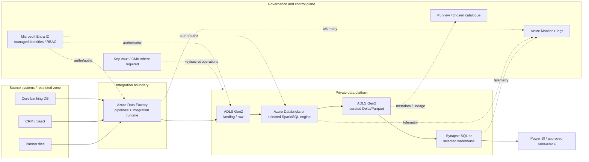
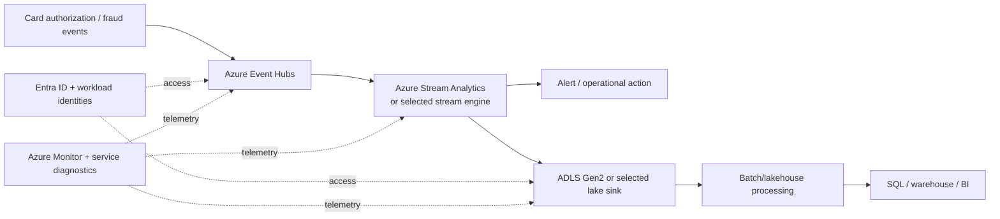

# Azure Data Architecture Reference Patterns
## Stage 2D — Data Architecture | Topic 03

> **Audience:** beginner-to-advanced data engineers and data architects  
> **Purpose:** map logical enterprise data-platform capabilities to Azure services, trace data and identity flows, evaluate alternative reference patterns, and make defensible architecture decisions.  
> **Scenario:** Northbridge Bank is fictional. All volumes, targets, costs, and design choices are illustrative assumptions, not a production recommendation or price quote.

---

## 1. How this lesson fits the roadmap

This lesson follows `02-aws-data-architecture-reference-patterns.md` and precedes `04-gcp-data-architecture-reference-patterns.md`. Use the same logical capability families as the AWS lesson and keep the comparison focused on **responsibilities and behaviour**, not product-name matching.

### Learning objectives

By the end, you should be able to:

1. Map logical platform capabilities to one or more Azure candidates and explain why.
2. Explain the service boundaries and how components integrate.
3. Trace a representative batch and streaming flow, including identity, network path, and trust boundaries.
4. Evaluate access control, governance, reliability, scaling, operational responsibilities, and cost.
5. Compare Azure alternatives and document AWS/Azure differences without asserting exact equivalence.
6. Produce an Azure capability map, traced-flow diagrams, difference notes, an Azure-specific dependency inventory, and an architecture decision record (ADR).

### Prerequisites

The controlling roadmap names these dependencies:

- **Essential:** cloud/data architecture principles; measurable requirements and SLOs; architecture trade-offs and ADRs; object storage, file/table formats, lifecycle and replication; logical data-platform capabilities and zones.
- **Review at least the prerequisite gates:** constraints and assumptions; reference-pattern selection; logical/physical modelling and schema evolution; ingestion/CDC/data contracts/failure handling.
- **Sequence dependency:** complete the AWS reference-pattern lesson first; complete the beginner-level preview of Topic 05 (VNet, subnet, identity, private endpoint) before this lesson.
- Detailed networking, hybrid connectivity, portability, and infrastructure-as-code are separate lessons. This document introduces only what is needed to reason about an Azure data pattern.

### Suggested study sequence

1. Review the logical platform without provider names.
2. Build the capability map in Section 3.
3. Trace the batch path in Sections 4–8.
4. Compare the streaming and unified-platform alternatives in Sections 9–11.
5. Work the Northbridge Bank scenario and exercises.
6. Complete the ADR and checklist; carry unresolved items into the three-provider comparison.

The roadmap's 6–8 hour estimate for this topic is a planning suggestion, not a requirement.

---

## 2. Architecture method: capabilities before products

A reference architecture is a **starting pattern**, not a mandatory bill of materials. Start with the business outcome and required quality attributes, identify logical capabilities, then select services that satisfy the requirements and constraints.

For every proposed component, answer:

- **Purpose:** what capability or control does it provide?
- **Inputs and outputs:** what data or events cross its boundary?
- **Identity:** which principal calls it, and which permissions are required?
- **Network:** how is the endpoint reached, and is public access allowed?
- **Failure:** how are retries, duplicates, partial writes, poison records, and recovery handled?
- **Scale:** which dimension is the bottleneck—throughput, parallelism, concurrency, data size, or query load?
- **Cost:** what is billed—capacity, execution, events, storage, scans, data transfer, licences, or idle time?
- **Portability:** which formats, APIs, runtimes, or platform-specific features create coupling?
- **Verification:** which region, SKU, feature, quota, connector, security mode, or SLA must be checked before implementation?

Do not start by asking “What is Azure's equivalent of service X?” Ask “What responsibility must be fulfilled, and what implementation best meets the constraints?”

### 2.1 The logical data-platform layers

| Logical layer | Main responsibility | Design questions |
|---|---|---|
| Source systems | Operational truth: databases, SaaS, files, applications, devices | Source ownership, extraction limits, change semantics, and data contract? |
| Ingestion and integration | Move or capture data, coordinate connectors, apply source-side extraction | Batch, CDC, events, API, or file drop? How are retries and checkpoints managed? |
| Landing/raw storage | Preserve source-aligned data and evidence for replay | Immutable versus mutable? Retention? Data residency? |
| Processing | Validate, standardize, join, enrich, aggregate, and apply business rules | SQL, Spark, streaming engine, or application code? |
| Curated lake / warehouse / lakehouse | Serve trusted, governed data products | Open file/table formats? Dimensional model? Transactional and concurrency needs? |
| Metadata and governance | Discoverability, classification, ownership, lineage, access policies | What is catalogued, and which system enforces access? |
| Consumption and serving | BI, ad hoc query, operational APIs, feature pipelines, AI/ML | Latency, concurrency, semantic consistency, and purpose limitation? |
| Orchestration and operations | Schedule, coordinate, retry, alert, reconcile, and recover | Who owns run state, dependencies, backfills, and SLOs? |
| Security and control plane | Identity, policy, encryption, network isolation, audit, deployment boundaries | Who can deploy, grant access, read data, or change keys? |

A single service can support multiple layers, and a layer can use multiple services. This does not remove the need to define the boundaries.

---

## 3. Azure capability map

The following map preserves the **same logical capability families** used in the AWS lesson. Azure candidates may cover several families, and one family may require multiple services. These are candidate mappings, not one-to-one equivalences. Availability, feature boundaries, pricing, networking modes, and regional support can change. Confirm details in the linked Microsoft documentation and target region/SKU before deployment.

| Logical capability family | Business/technical responsibility | Azure candidates to investigate | Questions before choosing |
|---|---|---|---|
| Ingestion and integration | Move data from databases, applications, files, APIs, and events into the platform | Azure Data Factory (ADF), Fabric Data Factory, source-specific connectors and SDKs | Batch, incremental load, CDC or event? Connector/authentication support? Integration runtime placement? Retry and replay semantics? |
| Lake storage | Store raw and curated data durably | Azure Blob Storage with Azure Data Lake Storage Gen2 capabilities; Microsoft Fabric OneLake for Fabric-native workloads | Hierarchical namespace, region, redundancy, lifecycle, data-plane authorization, private endpoint/DNS, client compatibility, and account versus OneLake boundary? |
| Transformation and processing | Validate, clean, join, enrich, aggregate, and materialize data products | Azure Databricks, Synapse Spark, Fabric Data Engineering/Spark, selected SQL engines | SQL or Spark? Runtime/library control? Job isolation? Table format and catalogue integration? Compute startup and idle cost? |
| Metadata and discovery | Record schemas, table locations, partitions, ownership metadata, and discoverability | Microsoft Purview, Unity Catalog, Fabric/OneLake catalogue capabilities | Which catalogue is authoritative? What lineage/classification/connectors are supported? What is discovered versus actually enforced? |
| Governance and data-lake permissions | Enforce data-access policy and support governed sharing | Azure RBAC, ADLS Gen2 ACLs, service-specific SQL/table permissions, Unity Catalog, Fabric permissions, Microsoft Purview governance capabilities | Does the selected access path enforce the intended policy? Are direct file, SQL, notebook, and BI access all covered? |
| Interactive lake query | Query data in the lake without maintaining a conventional warehouse for every workload | Synapse serverless SQL pool; Azure Databricks SQL; other supported Fabric query experiences | Data scanned, file layout, query concurrency, latency, caching, data access path, and cost guardrails? |
| Data warehouse and BI analytics | Serve repeated SQL analytics, governed marts, semantic models, and reporting | Synapse dedicated SQL pool; Fabric Data Warehouse; Databricks SQL; Power BI/Fabric semantic models | Workload shape, concurrency, data model, capacity, isolation, refresh/freshness, and current product boundary? |
| Large-scale processing | Run distributed processing with suitable runtime/framework control | Azure Databricks, Synapse Spark, Fabric Data Engineering/Spark | Does the workload need custom libraries or Spark control? Who manages runtime upgrades, compute policies, and job tuning? |
| Workflow orchestration | Coordinate dependencies, retries, branches, schedules, backfills, and error handling | Azure Data Factory pipelines/triggers; Fabric Data Factory; workload-native job orchestration | Who owns run state? What are retry/timeout semantics? How are backfills, dependencies, and alerts managed? |
| Streaming ingestion | Ingest, retain, and distribute events to multiple consumers | Azure Event Hubs; Fabric Real-Time hub/connectors for suitable Fabric-oriented designs | Partition key, throughput/capacity model, retention, consumer groups, replay window, capture/sink options, and regional recovery? |
| Stream processing | Transform events using event time, windows, state, and business rules | Azure Stream Analytics, Azure Databricks Structured Streaming, Fabric Real-Time Intelligence components | Late-event semantics, state/checkpointing, latency, supported inputs/outputs, idempotency, and delivery guarantees? |
| Database migration and replication | Assess and move database workloads, potentially with ongoing change application where supported | Azure Database Migration Service (Azure DMS), source/target-specific migration or replication tooling | Exact source/target/version support, online/offline mode, downtime, source-log prerequisites, cutover, rollback, and current support status? |
| Identity and access | Authenticate principals and authorize actions | Microsoft Entra ID, Azure RBAC, managed identities, service principals, service-specific data permissions | Human vs workload identity? Role scope? Management-plane vs data-plane permission? Which identity does the connector actually use? |
| Encryption and key control | Encrypt data and manage key-use permissions and lifecycle | Azure Key Vault, service-managed encryption, customer-managed keys where supported | Who can use/manage keys? Key rotation and recovery? What happens if a key is disabled? Is CMK supported for this exact service/SKU? |
| Network access | Restrict reachability and define approved private paths | Azure Virtual Network, Private Link/private endpoints, private DNS, service firewalls, integration runtime networking | Is the required service feature private-link capable? What resolves in DNS? Which dependencies and admin paths remain? |
| Monitoring and audit | Detect failures, latency, access events, resource pressure, and spend | Azure Monitor, Log Analytics, service metrics/logs, diagnostic settings, Azure Service Health | Which resource logs are enabled? Where are they routed? Retention and ingestion cost? Who owns alerts and runbooks? |
| Consumption and serving | Deliver trusted data to BI, applications, analytics, and AI/ML pipelines | Power BI, Fabric semantic models, SQL endpoints, approved APIs or purpose-built serving stores | Required latency, concurrency, semantic consistency, access enforcement, freshness, caching, and consumer-specific SLOs? |
| Policy and organization | Set resource hierarchy, guardrails, ownership, and deployment boundaries | Management groups, subscriptions, resource groups, Azure Policy, resource locks and deployment controls | Where should billing, quota, policy inheritance, environment separation, ownership, and blast radius be enforced? |

### 3.1 Product-boundary notes

- **ADLS Gen2 is not a separate storage service/account type.** It is a set of capabilities on Azure Blob Storage enabled by hierarchical namespace. The account, storage endpoint, authorization path, and client compatibility still matter.
- **Azure Data Factory and Fabric Data Factory are distinct product contexts.** Microsoft describes Fabric Data Factory as the next generation, but the products have separate roadmaps and not every ADF activity, connector, network mode, authentication path, or operational procedure transfers unchanged. Check Microsoft's [feature comparison and upgrade guidance](https://learn.microsoft.com/en-us/fabric/data-factory/compare-fabric-data-factory-and-azure-data-factory/) for the exact activity, connector, integration runtime/gateway, security, CI/CD, and pricing assumptions in scope.
- **Azure Synapse Analytics and Microsoft Fabric are not interchangeable labels.** Synapse includes dedicated and serverless SQL capabilities and Spark integration. Fabric is a SaaS analytics platform with OneLake and integrated workloads such as Data Engineering, Data Factory, Data Warehouse, Real-Time Intelligence, and Power BI. Compare the actual workload and lifecycle rather than treating “Synapse = Fabric.”
- **Azure Databricks is a partner-provided platform running on Azure, not an Azure-native service identical to Synapse or Fabric.** It has its own platform capabilities and governance model, while integrating with Azure identity, networking, storage, and security.
- **Microsoft Purview, Unity Catalog, and Fabric catalog capabilities overlap only partially.** Catalogue/discovery, lineage, business glossary, access enforcement, and audit are separate responsibilities. Pick a system of record for each responsibility and test actual coverage.
- **Event Hubs is an event-ingestion platform, not a complete streaming analytics solution.** A consumer or processing engine must interpret events, maintain state if needed, and publish results.
- **Azure DMS is not a universal CDC backbone.** Its supported sources, targets, migration modes, and feature limitations are scenario-specific and must be checked before choosing it for ongoing replication.

---

## 4. Pattern A — Batch lakehouse with separate integration and processing

### 4.1 When this pattern fits

Use a composed pattern when the organization needs control over storage layout and processing, has heterogeneous source systems, and can operate several services. It is appropriate for nightly regulatory extracts, curated analytical data products, historical analysis, and model-training datasets.

### 4.2 End-to-end architecture



> Diagram note: dotted lines are conceptual control/metadata relationships, not a claim that every service uses the same authorization mechanism or that every service has a direct integration. Validate the exact connector, identity, logging, and key-management path.

### 4.3 Trace the flow, hop by hop

| Hop | Action | Identity and permission question | Failure/recovery question |
|---|---|---|---|
| 1. Source → ADF | A scheduled pipeline reads a source table/API or partner file | Which connection credential or identity is used? Can the integration runtime reach the source? | Source throttling, expired credential, schema drift, partial extraction |
| 2. ADF → landing | Copy source data into a dated raw path in ADLS Gen2 | Does the workload identity have only the required write permissions? Is storage reachable via approved network path? | Retry may create duplicates; use run IDs, deterministic paths, manifests, or source watermarks |
| 3. Landing → processing | Validate schema, quarantine bad records, standardize types, deduplicate, apply business rules | Can the compute identity read raw and write only its curated destination? | Reprocessing must be safe; retain input version and transformation version |
| 4. Processing → curated | Publish a complete partition/table version | Are writes atomic at the chosen table-format/engine boundary? What readers see during publication? | Do not expose partially written outputs; use supported transactional table semantics and commit protocols |
| 5. Curated → SQL serving | Query files externally or load/transform into a warehouse according to the selected pattern | Which SQL principal can see which data? Are network and data permissions both satisfied? | Query saturation, schema mismatch, refresh lag, concurrency limits |
| 6. Metadata and operations | Publish metadata/lineage and collect pipeline, compute, and query telemetry | Who can change governance policies or read logs that may contain sensitive fields? | Missing diagnostics can make failures invisible; verify ingestion and alert routing |
| 7. BI consumption | Expose certified measures and approved datasets | Is access governed at the semantic model and underlying data layers? | Reconcile freshness and business totals; avoid competing definitions of a metric |

### 4.4 Data-zone design

A useful logical layout is:

- **Landing/raw:** source-aligned copies, extraction timestamp, source identifier, run ID, schema/version, and ingestion status.
- **Validated/standardized:** typed columns, normalized timestamps/currencies, data-quality results, deduplication, and rejected-record quarantine.
- **Curated/product:** approved business entities and measures with owners, definitions, quality SLOs, and access rules.
- **Serving:** warehouse tables, SQL endpoints, semantic models, or purpose-built stores matched to consumer latency and concurrency.

These are logical zones, not mandatory physical storage accounts or service names. Separate accounts, containers, workspaces, or projects only where the security, operational, regulatory, or blast-radius boundary justifies it.

### 4.5 Format and layout choices

- Prefer documented, broadly supported formats such as Parquet for columnar analytics where suitable; use a transactional table format such as Delta Lake only after verifying engine compatibility, protocol/features, governance, and reader/writer support.
- Partition by fields that materially help pruning and maintenance. Over-partitioning creates many small files and metadata overhead; under-partitioning can produce oversized scans or skew.
- Keep schema evolution explicit. Decide whether new columns are additive, whether breaking changes require a new contract/version, and how historical data is backfilled.
- Separate raw retention from curated retention. Regulatory retention, legal hold, deletion propagation, and backups are not solved merely by placing files in a “raw” folder.

---

## 5. Storage and lake design with ADLS Gen2

### 5.1 What it is

Azure Data Lake Storage Gen2 is Azure Blob Storage with the hierarchical namespace capability enabled. It supports directory-oriented organization and analytics-oriented access through the ABFS driver. It is a storage foundation, not a transformation engine, warehouse, orchestration service, or enterprise catalogue.

### 5.2 Design responsibilities

| Concern | Design approach |
|---|---|
| Account and namespace | Decide storage account boundaries by data sensitivity, region, environment, workload ownership, and operational blast radius—not merely by team naming conventions. |
| Hierarchical namespace | Enable when the intended lake and client ecosystem requires it; assess feature compatibility and migration implications before enabling on an existing account. |
| Authorization | Prefer Microsoft Entra ID and narrowly scoped Azure RBAC data roles where appropriate; ADLS Gen2 also has filesystem/directory/file ACLs. Understand the combined evaluation model: a broad RBAC data-role grant can authorize access at its scope, so ACLs must not be assumed to act as a deny override. Test the actual caller. |
| Network | Private endpoint, firewall/public network access, routing, and private DNS are separate from data permissions. A correct role does not repair an unreachable endpoint. |
| Redundancy | Compare LRS, ZRS, GRS/RA-GRS, and GZRS/RA-GZRS against zone/region failure requirements, residency rules, recovery objectives, and cost. Geo-replication is asynchronous; secondary read access and failover behaviour depend on the chosen option. |
| Lifecycle | Use access tiers and lifecycle policies only after measuring access patterns, retrieval/early-deletion costs, minimum retention windows, and operational restore needs. |
| Layout | Use predictable paths, date/tenant/product partitions when useful, file-size targets validated against the engine, and manifests or table metadata for reliable publication. |
| Encryption | Service-managed encryption is available by default; customer-managed keys and infrastructure encryption are requirement-driven choices whose support and operational obligations must be checked. |
| Observability | Enable appropriate diagnostic settings and metrics; log storage authorization failures, throttling, capacity and access patterns without leaking sensitive payloads. |

### 5.3 Storage redundancy is not backup

Redundancy helps protect against specified infrastructure failures. It does not protect against every accidental deletion, bad overwrite, compromised identity, or logically corrupt transformation. Define independent recovery controls, versioning/soft-delete where appropriate, immutable retention if required, backup/restore tests, and replayable source data.

**Important:** for geo-redundant options, replication to the secondary region is asynchronous. A successful write to the primary does not mean the latest write is already replicated to the secondary. Verify failover semantics and data-loss expectations for the selected storage configuration.

### 5.4 When to consider OneLake instead

OneLake is the logical tenant-wide lake for Microsoft Fabric workloads. It is designed to unify Fabric experiences rather than make the learner configure an ordinary storage account for every workload. Use it when the selected Fabric architecture benefits from integrated workloads, shared logical storage, and OneLake shortcuts. Do not assume it has the same resource-management, networking, region, identity, operational, or portability controls as a directly managed ADLS Gen2 storage account. Verify each requirement against current Fabric documentation.

---

## 6. Integration, ingestion, CDC, and database migration

### 6.1 Azure Data Factory (ADF)

ADF is a managed data-integration and orchestration service for ETL/ELT, data movement, pipelines, triggers, and connectors. It can coordinate movement and transformations using supported activities and external compute such as Azure Databricks or SQL engines.

**Use it when:**
- sources are diverse and connector-based movement is central;
- scheduled, dependency-driven data pipelines are needed;
- an integration runtime is suitable for reaching the source and target;
- the team needs pipeline-level operational visibility.

**Do not assume:**
- every connector supports every authentication, private-network, incremental, or CDC mode;
- a retry guarantees exactly-once writes;
- an integration runtime can reach a private source merely because the Azure resource exists;
- all ADF features transfer to Fabric Data Factory without changes.

**Operational checklist:** define source watermark semantics, idempotent sink strategy, retry/backoff, timeout, concurrency, schema drift policy, data validation, secret handling, diagnostic settings, alert thresholds, and replay/backfill procedure.

### 6.2 Incremental load and CDC

A watermark-based incremental load tracks a source field such as an update timestamp or monotonically increasing key. It is simple but can miss late updates or deletes unless the source contract supports them.

Change data capture (CDC) observes database changes through a source-specific mechanism. It requires source-side support, permissions, retention/log capacity, and a defined handling strategy for initial snapshot, ongoing changes, deletes, schema changes, and restarts. Do not call a periodic query on a timestamp “CDC” unless it actually captures the required change semantics.

For both approaches:
1. establish a consistent starting point;
2. store checkpoint/watermark state durably;
3. make sink writes idempotent or deduplicable;
4. reconcile counts and business totals;
5. define how to reprocess from a checkpoint or source snapshot;
6. test source-log retention and outage recovery.

### 6.3 Azure Database Migration Service

Azure DMS supports defined database migration scenarios, with assessment and migration workflows for supported sources and targets. It is a migration capability, not a blanket promise that every source-target pair supports online migration, continuous replication, or zero downtime.

Before choosing DMS, verify the exact matrix:
- source engine/version and target service/tier;
- online versus offline mode;
- required agents, network paths, permissions, and source log settings;
- compatibility/assessment blockers;
- downtime and write-freeze plan;
- final validation, cutover, rollback, and post-migration monitoring.

For an ongoing event backbone or general CDC platform, evaluate whether a different source-specific replication mechanism is required.

### 6.4 Integration runtime and network boundary

For private/on-premises or restricted sources, the runtime placement and route matter. Determine which component opens the connection, where it executes, which DNS resolver it uses, and whether the target permits that path. Detailed hybrid design belongs in Topic 06; this lesson requires only a correct per-hop reachability explanation.

---

## 7. Processing, lakehouse, SQL analytics, and warehouse choices

### 7.1 Azure Databricks

Azure Databricks is a partner-provided data and AI platform integrated with Azure. It commonly supports Spark-based batch and streaming transformations, lakehouse tables, notebooks, jobs, and SQL analytics.

Choose it when requirements justify its capabilities—such as complex distributed processing, an established Databricks estate, Spark ecosystem needs, or a chosen Unity Catalog governance model. Evaluate workspace/network configuration, compute policies, cluster startup and idle costs, job isolation, runtime upgrades, data access model, and table-format compatibility.

It is not automatically cheaper or better than Fabric or Synapse. Compare the full workload and team-operating model.

### 7.2 Azure Synapse Analytics

Synapse combines enterprise data warehousing and big-data analytics capabilities. Its SQL choices include:
- **Serverless SQL pool:** query data in the lake without provisioning a dedicated SQL warehouse capacity in the same way as a dedicated pool. Cost and performance depend on query/data scanned and workload characteristics; verify current billing and feature limits.
- **Dedicated SQL pool:** provisioned distributed warehouse resources with design decisions around distribution, partitioning, statistics, concurrency, and capacity. It can fit established warehouse workloads that benefit from a provisioned relational analytics environment.

Do not confuse the two models. Their tuning, cost, capacity, and operational behaviours differ.

### 7.3 Microsoft Fabric

Fabric is a SaaS analytics platform with integrated workloads such as Data Factory, Data Engineering, Data Science, Real-Time Intelligence, Data Warehouse, and Power BI, sharing OneLake as a logical lake foundation.

Fabric can reduce the amount of infrastructure and cross-service integration a team must manage, but its workspace, capacity, licensing, tenant, region, feature and governance boundaries are product-specific. Confirm the capacity model, throttling behaviour, workload concurrency, supported connectors, data residency, private connectivity needs, and deployment/CI-CD model.

### 7.4 Decision table: processing and serving

| Requirement | Candidate pattern | Main trade-off |
|---|---|---|
| Diverse sources, scheduled copy, managed orchestration | ADF + ADLS Gen2 + selected compute | Flexible, but more service and network boundaries |
| Spark-heavy engineering and streaming | ADLS Gen2 + Azure Databricks | Strong Spark ecosystem; separate platform governance and compute management |
| Established dedicated SQL warehouse with predictable provisioning | Synapse dedicated SQL pool | Tunable warehouse capacity; provisioned capacity and distribution design |
| Ad hoc SQL on files without loading all data into a warehouse | Synapse serverless SQL or Databricks SQL, depending on workload | Convenient lake query; performance/cost depend on files, scans, concurrency, and feature set |
| Integrated Microsoft analytics experience and shared tenant lake | Microsoft Fabric | Less integration plumbing; stronger coupling to Fabric capacity and product boundaries |
| Low-latency event filtering/aggregation using SQL-like temporal queries | Event Hubs + Azure Stream Analytics | Managed event processing; query/state capabilities and supported connectors must match use case |
| Stateful complex streaming or custom event transformations | Event Hubs + Databricks Structured Streaming or suitable Fabric real-time components | More expressive but greater operational and governance complexity |

**Selection rule:** choose the smallest architecture that meets the verified requirements, then add services only when they provide a needed capability or boundary.

---

## 8. Metadata, catalogues, governance, and access enforcement

### 8.1 Do not collapse governance into a single product

Governance includes business ownership, definitions, classification, lineage, quality expectations, policy, approval, access enforcement, audit, retention, and evidence. A catalogue can improve discovery without enforcing every access decision. An execution platform may enforce table-level permissions but not be the enterprise system of record for glossary and cross-platform lineage.

### 8.2 Candidate governance roles

- **Microsoft Purview:** enterprise data governance/security capabilities including data discovery, data map, unified catalog, classification and selected lineage/integration capabilities. Connector and lineage coverage must be checked for each source, engine, and transformation.
- **Azure Databricks Unity Catalog:** governance of data and AI assets accessed through Databricks, including permissions and supported lineage capabilities. Confirm its scope and interoperability with the wider enterprise catalogue.
- **Fabric / OneLake catalog experiences:** discovery and governance for Fabric items and the Fabric ecosystem. Verify current boundaries and supported integrations if the enterprise spans multiple non-Fabric platforms.

These are not exact substitutes. An organization may use one or several, but should explicitly assign system-of-record responsibilities and avoid contradictory ownership.

### 8.3 Minimum metadata contract for a curated data product

Each product should document:
- business name, description, owner, steward, domain and intended purpose;
- source systems, refresh cadence, event time/ingestion time and lineage;
- schema, primary/business keys, units, timezone, currency, and versioning rules;
- classification, permitted consumers, retention and deletion obligations;
- quality checks, freshness/availability SLOs, known limitations, and support route;
- publication state and compatibility/deprecation policy.

### 8.4 Enforcement is layered

Use a layered model:
1. **Identity:** authenticate users and workloads with Microsoft Entra ID and supported workload identities.
2. **Azure resource control plane:** Azure RBAC determines who can manage Azure resources at management-group, subscription, resource-group, or resource scope.
3. **Data plane:** storage data roles and ADLS ACLs, SQL permissions, table/catalogue permissions, or Fabric item permissions govern actual data access as applicable.
4. **Network:** firewalls, public network settings, private endpoints, routing and DNS control reachability.
5. **Governance/policy:** classification, approved use, retention, audit, and data product ownership define what should be allowed and evidenced.

A user may have permission to configure a storage account without having permission to read every file. Conversely, a data role does not make a private endpoint reachable. Verify the exact effective permissions and access path for the actual principal.

---

## 9. Identity, RBAC, managed identities, encryption, and network boundaries

This section provides architecture-level reasoning only. Topic 05 covers full cross-provider networking and identity; Topic 10 covers deeper governance and privacy controls.

### 9.1 Identity patterns

| Principal | Suitable use | Design notes |
|---|---|---|
| Human user or group | Engineers, analysts, reviewers | Prefer group-based role assignment, least privilege, access reviews, and separation of duties |
| System-assigned managed identity | One Azure resource's workload identity | Lifecycle tied to the resource; use only when the target service supports it |
| User-assigned managed identity | Identity lifecycle independent of a single resource or shared across selected workloads | Sharing can simplify lifecycle but also increases blast radius; scope use narrowly |
| Service principal / app registration | Automation or an integration where managed identity is not applicable | Prefer federated credentials where supported; otherwise protect and rotate credentials |
| Service-specific identity or connection | Managed services accessing other services | Verify identity support and whether the connector uses the intended principal; avoid assuming every activity uses the pipeline's identity |

Managed identities reduce the need to store credentials for supported Azure-to-Azure access, but they do not grant permissions by themselves. Assign a narrowly scoped role or service-specific permission and verify the data-plane path.

### 9.2 Azure hierarchy is not equivalent to AWS account structure

Azure commonly organizes governance and billing through a tenant, management groups, subscriptions, resource groups, and resources. Azure RBAC scopes follow this hierarchy. An Azure subscription can resemble an AWS account for some organizational purposes, but the boundaries and semantics are different; do not treat them as identical isolation units. Decide where policy, billing, quota, environment separation, ownership, and blast radius must be enforced.

### 9.3 Storage access: separate the questions

For every data access, answer both:
- **Authorization:** which identity is authenticated, and which role/ACL/data permission authorizes the operation?
- **Reachability:** can the workload resolve and connect to the intended endpoint through the approved route?

For ADLS Gen2, understand Azure RBAC data roles and filesystem/directory/file ACLs. Azure RBAC is suited to coarse-grained access at supported scopes; ACLs can refine directory/file access when the RBAC grant does not already authorize the operation. Do not assume an ACL denial overrides a broad data-plane RBAC role. Check role scope and inheritance, ACL execute permissions on parent directories, and default-ACL behaviour for newly created children. Test with the same principal and network route used in production. Avoid account keys and broad shared access signatures as default workload authentication. See Microsoft's [ADLS Gen2 access-control guidance](https://learn.microsoft.com/en-us/azure/storage/blobs/data-lake-storage-access-control) and [Azure RBAC role definitions](https://learn.microsoft.com/en-us/azure/role-based-access-control/role-definitions).

### 9.4 Private endpoint reasoning checklist

A private endpoint is a private network interface for reaching a supported service privately. It is not a universal “make everything private” switch.

Verify:
- the service and exact feature support Private Link/private endpoint for the selected configuration;
- private endpoint approval and subnet/network policy prerequisites;
- private DNS zone, records, VNet links, custom DNS forwarding and client resolver behaviour; for Azure Data Factory managed virtual networks specifically, Microsoft documents that custom DNS is not supported, so verify service-specific DNS constraints rather than assuming a general VNet design applies;
- public network access/firewall configuration on the service;
- outbound path from integration runtime, Spark/warehouse, notebooks, BI clients, and administration tooling;
- access to required dependencies (identity/token endpoints, Key Vault, monitoring, package repositories, control plane) where applicable;
- service-to-service connections and managed network options, if provided by the service;
- logs and tests proving traffic used the intended path.

A DNS error can look like an authorization error. Diagnose name resolution and routing before broadening roles.

### 9.5 Encryption and key custody

- Data in Azure services is generally encrypted at rest using service-supported mechanisms; verify the service-specific defaults and supported algorithms/controls.
- Use TLS for data in transit and validate the minimum protocol settings where configurable.
- Customer-managed keys (CMK) are a control-plane and operational commitment, not a checkbox: check feature support, identity used to access Key Vault, key rotation, soft delete/purge protection, backup/recovery, key-disable consequences, and audit.
- Never place passwords, storage keys, SAS tokens, access tokens, or connection strings with secrets in source control, notebook output, logs, or sample code.
- A key vault does not remove the need for least privilege or safe recovery procedures.

### 9.6 Illustrative identity path (not a deployable policy)

```text
ADF pipeline execution
  -> configured supported workload identity / connection
  -> Microsoft Entra token for Azure Storage
  -> ADLS Gen2 endpoint resolved through approved DNS
  -> network/firewall/private-endpoint rules allow the route
  -> Azure RBAC data role is evaluated; where it does not grant the operation, applicable ADLS Gen2 ACLs may authorize the path
  -> storage operation is logged where the relevant diagnostic categories are enabled
```

The actual principal can differ by connector, integration runtime, and activity configuration. Confirm it in the product documentation and by testing the deployed pipeline. Do not infer it from the pipeline owner or the person who created the linked service.

---

## 10. Pattern B — Streaming risk signals with a lake sink

### 10.1 Example architecture



This diagram is conceptual. Actual output connectors, identity support, checkpointing, network configuration, and delivery guarantees depend on the chosen engine and destination.

### 10.2 Event Hub and stream processing are different roles

**Event Hubs** ingests and retains event streams for consumers. Partitioning affects parallelism and ordering: ordering is generally considered within a partition, not globally across all events. Consumer groups isolate consumer views but do not create unlimited independent throughput. Retention bounds replay. Check quotas, capacity and pricing model, availability-zone/region behaviour, and supported authentication/networking for the selected tier. If using the Kafka endpoint, verify tier eligibility and feature compatibility: Microsoft's current guidance limits Kafka protocol support to Standard, Premium, and Dedicated tiers, and some Kafka features differ from native Kafka. See [Event Hubs for Apache Kafka](https://learn.microsoft.com/en-us/azure/event-hubs/event-hubs-for-kafka-ecosystem-overview).

**Azure Stream Analytics** is a managed stream-processing engine with SQL-like queries and temporal features. It is a good candidate for supported event filtering, aggregation, windowing and alerting. For more complex stateful processing, custom code, or a broader Spark-based lakehouse, evaluate Databricks Structured Streaming or suitable Fabric real-time capabilities.

### 10.3 Streaming design decisions

- Define event key, event ID, event time, ingestion time, schema version, and producer contract.
- Choose partitions from throughput and parallelism requirements; avoid hot keys.
- Define expected lateness, duplicate handling, ordering needs, windowing, and correction policy.
- Understand the processing engine's checkpoint and delivery semantics. End-to-end exactly-once behaviour cannot be assumed merely because a component advertises a guarantee.
- Make side effects idempotent or deduplicable. Use stable event IDs and business keys.
- Plan for poison events, malformed schema, downstream outages, replay, retention expiry, and backpressure.
- Define what “real time” means in a measurable latency budget: p95/p99 from event creation to business action, not just broker ingestion latency.
- Monitor consumer lag, throughput, throttling, late/duplicate counts, processing latency, checkpoint health, and failed output writes.

---

## 11. Alternative Azure reference patterns and trade-offs

| Pattern | Typical composition | Strengths | Risks / trade-offs | Choose when |
|---|---|---|---|---|
| A. Composed lakehouse | ADF + ADLS Gen2 + Databricks/Spark + selected SQL/BI | Fine-grained service choice, explicit data zones, flexible compute | More integrations, identity paths, network/DNS setup and operational runbooks | Different sources and workloads need tailored components |
| B. SQL warehouse-centric | ADF + lake landing + Synapse dedicated SQL pool or Fabric Data Warehouse | Strong relational/SQL serving and governed marts | Capacity, data modelling and concurrency tuning; possible data movement | BI/reporting and relational analytical serving dominate |
| C. Serverless lake query | ADLS Gen2 + Synapse serverless SQL or suitable Databricks SQL | Avoids a separate preloaded warehouse for some ad hoc use cases | Scan-driven costs, file/layout sensitivity, concurrency and feature constraints | Queries are intermittent or exploratory and data is already in the lake |
| D. Fabric-integrated analytics | Fabric Data Factory + OneLake + Data Engineering/Real-Time/warehouse + Power BI | Integrated SaaS experience and shared logical lake | Capacity/licensing and product-boundary coupling; verify networking, regions, deployment and workload limits | Integrated Microsoft analytics experience is a key requirement |
| E. Event-first real-time platform | Event Hubs + Stream Analytics/Databricks/Fabric real-time + lake/serving sink | Decouples producers and consumers; supports replay within retention | Partitioning, event contracts, state, replay and duplicate handling add complexity | Business action or monitoring needs low latency |
| F. Database migration | Azure DMS or supported source/target-specific migration path + validation and cutover plan | Guided assessment and migration for supported paths | Compatibility gaps, downtime, source load, log retention, cutover and rollback risk | Moving a defined database estate to a supported Azure target |
| G. Hybrid integration | ADF with correctly placed integration runtime + private network routes + ADLS/target | Can bridge supported restricted/on-premises sources into cloud pipelines | DNS, firewall, route, runtime availability and source capacity become critical | A required source cannot be exposed publicly or remains on-premises |

### 11.1 Integrated platform vs composed services

An integrated platform can reduce service integration, separate billing lines, and the amount of infrastructure a small team operates. It can also couple the design to platform capacity, APIs, governance and release cadence. A composed architecture offers more choice and clearer boundaries, but every boundary adds identity, network, monitoring, failure and cost concerns.

Compare total operating cost, not just the price of the compute engine:
- build and maintenance effort;
- capacity and idle time;
- data movement and egress;
- storage and request charges;
- query scans and concurrency;
- monitoring/log ingestion;
- licensing/capacity commitment;
- incident response and recovery;
- exit/migration effort.

### 11.2 AWS/Azure comparison: compare responsibilities, not names

| Logical responsibility | AWS pattern from the prior lesson | Azure candidates | Behavioural difference to investigate |
|---|---|---|---|
| Object/lake storage | Amazon S3 | Blob Storage / ADLS Gen2; OneLake in Fabric | ADLS Gen2 is Blob Storage with hierarchical namespace; OneLake is Fabric's logical tenant-wide lake. Compare namespace, authorization, endpoint, redundancy, lifecycle and table-format support. |
| Orchestration/integration | AWS Glue workflows / Step Functions / MWAA depending on role | Azure Data Factory; Fabric Data Factory; service-specific orchestration | ADF is a managed integration and pipeline service; Step Functions is a general workflow state machine, Glue is data integration/catalog, MWAA is managed Airflow. Compare retry/state semantics, connectors, runtime/network placement, authoring and cost model. |
| Batch/Spark processing | AWS Glue / EMR | Azure Databricks, Synapse Spark, Fabric Data Engineering | Runtime management, library control, governance, table format, compute startup, networking, and operating model differ. |
| Event ingestion | Kinesis / Amazon MSK depending on event protocol | Azure Event Hubs | Event Hubs supports Kafka compatibility, but do not assume all Kafka protocol/API behaviours, administration, quotas, or semantics are identical. Compare partitioning, retention, throughput/capacity, auth, network, replay and DR. |
| Stream processing | Managed stream processing / Spark or Kafka consumers | Azure Stream Analytics, Databricks Structured Streaming, Fabric real-time components | SQL/event-time semantics and custom processing capabilities differ; verify late-event handling, state, checkpoints, supported sinks and delivery semantics. |
| Warehouse/query | Athena / Redshift depending on workload | Synapse serverless/dedicated SQL; Fabric Warehouse; Databricks SQL | Compare scan-based versus provisioned/capacity-based economics, SQL behaviour, concurrency, data movement, tuning, pause/scale, and ecosystem. |
| Catalogue/governance | Glue Data Catalog / Lake Formation | Microsoft Purview, Unity Catalog, Fabric catalog | Metadata discovery and permission enforcement are not the same responsibility. Compare actual lineage, connector, policy enforcement and runtime integration coverage. |
| Identity | IAM roles/policies | Microsoft Entra ID, Azure RBAC, managed identities, ACLs and service-specific permissions | Azure's tenant/subscription/resource hierarchy and combined RBAC/data-plane controls differ from AWS account/resource policy patterns. Test effective permission and scope inheritance. |
| Keys/secrets | AWS KMS / Secrets Manager | Azure Key Vault and service-managed encryption | Key and secret lifecycle, identity integration, CMK support and disable/recovery consequences differ by service. |
| Observability | CloudWatch and service logs | Azure Monitor, Log Analytics, service diagnostics | Diagnostic settings and log destinations/retention/ingestion cost differ; verify the specific resource logs rather than assuming default collection. |

The table is a starting checklist. Do not record “equivalent” without evidence from the actual workload and selected service tier. The three-provider comparison later in the roadmap should preserve the logical capability column while allowing multiple candidates and “no direct match” notes.

---

## 12. Northbridge Bank — worked enterprise scenario

### 12.1 Business requirements (illustrative)

Northbridge Bank is a fictional mid-sized bank. It wants a governed analytical platform for:
- nightly card transactions, account snapshots and customer reference data;
- partner files received over an approved channel;
- low-latency risk signals for selected card events;
- curated fraud, customer and finance datasets for analysts and model development.

Illustrative starting assumptions:
- batch data must be available by 06:00 local business time;
- risk signals should reach the operations workflow within a small, agreed latency budget;
- raw sensitive data is restricted to approved roles;
- all published products need lineage, ownership, quality checks and audit evidence;
- recovery objectives, region selection, legal residency, and exact data retention are still to be agreed with risk/compliance teams.

These assumptions are design inputs, not regulatory advice or a claim that a particular Azure service satisfies a bank's compliance obligations.

### 12.2 Candidate architecture

**Batch path**
1. ADF runs source-specific incremental extracts and partner-file ingestion.
2. Raw files land in ADLS Gen2 under controlled landing paths with run metadata.
3. Databricks or another selected processing engine validates and standardizes data, quarantines invalid records, and publishes curated tables.
4. Synapse SQL, Databricks SQL, or Fabric Warehouse is selected based on concurrency, modelling, integration and cost requirements.
5. Purview and/or platform-native catalogues provide agreed discovery and lineage; the governance operating model defines the authoritative source for ownership and glossary.
6. Power BI or approved consumers access certified semantic models with least privilege.

**Streaming path**
1. Card events are produced to Event Hubs with stable event IDs, schema versions and an agreed partition key.
2. A selected stream engine applies rules and emits operational signals while writing a replayable event history or derived records to the lake/serving target.
3. A downstream batch reconciliation checks event totals against source-of-record totals and corrects late or duplicate events under an agreed policy.

### 12.3 Security boundaries

- Keep source credentials in an approved secret/identity mechanism; prefer managed identity where the exact connector supports it.
- Separate human deployment permissions from runtime data permissions.
- Restrict raw data to ingestion and approved processing identities; curated data access is granted by product/domain need.
- Use private connectivity where required and prove the route with DNS/network tests. Do not grant broader roles to work around a network failure.
- Make classification and retention visible in the product contract; log data access and administrative changes.
- Decide whether customer-managed keys are necessary, and test recovery and key-disable consequences before production.

### 12.4 Failure scenarios and responses

| Failure | Detection | Containment and recovery | Design lesson |
|---|---|---|---|
| ADF workload loses write permission to raw storage | Authorization errors, failed activity, no expected landing manifest | Verify actual activity identity and role scope; restore intended minimal permission; rerun idempotently | Identity and permission must be explicit per connection/activity |
| Private endpoint DNS resolves public or wrong address | DNS tests, connection timeout, service logs | Correct private DNS records/links/forwarding; validate route and service firewall independently | Reachability and authorization are separate |
| Source changes schema overnight | Contract/schema validation failure, drift alert | Quarantine incompatible records, preserve raw evidence, update contract and transformation after approval | Do not silently coerce critical fields |
| Processing job partially writes curated output | Quality reconciliation or failed job | Publish via supported transactional table semantics or versioned output; make consumers use only committed versions | “Job succeeded” and “data product published” are separate states |
| Event consumer falls behind | Consumer lag, growing event age, throttling | Increase parallelism/capacity if partitioning permits; fix hot keys; scale sink; replay within retention | Capacity, partition design and sink throughput are coupled |
| Region becomes unavailable | Service health alert and failed health checks | Follow documented service-specific recovery; fail over only after runbook criteria; validate data lag and dependencies | Storage replication alone is not complete application DR |
| Logs are missing | No diagnostic events in expected workspace | Enable resource-specific diagnostics, test ingestion, correct workspace access/retention | Monitoring configuration is part of deployment acceptance |
| Query spend unexpectedly rises | Cost alerts, query scan metrics, capacity utilization | Review query patterns, file layout, caching/materialization and budgets; apply workload guardrails | Serverless and capacity models have different cost failure modes |

### 12.5 Reconciliation and publication contract

Before a curated table is declared ready, require:
- expected input partitions/files and row counts;
- duplicate and null checks on critical keys;
- valid schema and approved contract version;
- business control totals (for example, transaction amount by business date/currency);
- no unexplained difference between source and curated totals;
- lineage/run ID and transformation version;
- publication timestamp and quality status.

The exact thresholds must be owned by the data product and business stakeholders.

---

## 13. Batch-versus-streaming decision exercise

Choose one ingestion mode for each scenario and justify it with freshness, correctness, operational complexity and cost.

| Scenario | Initial candidate | Why / what could change the answer |
|---|---|---|
| Monthly historical statement archive | Batch | Freshness is low urgency; optimize reliable bulk transfer and reconciliation |
| Daily customer snapshot for morning reporting | Batch/incremental batch | Clear cutoff and reconciliation may matter more than second-level freshness |
| Card authorization risk signal | Streaming | Operational action may require low latency; define false-positive handling and outage behaviour |
| Source database migration over a cutover weekend | Migration workflow with staged validation | Need source/target compatibility, downtime plan and rollback—not a generic stream pipeline |
| Compliance alert on a newly arrived partner file | Event-triggered batch workflow | Event triggers a batch validation; the data itself may not need streaming transformation |
| Live dashboard with continuously changing telemetry | Streaming or micro-batch, depending on latency SLO | “Live” must be quantified; verify late events, query concurrency, and correction requirements |

### Exercise tasks

1. Write a freshness target and a p95/p99 latency budget for two scenarios.
2. Estimate event rate, average event size, peak-to-average ratio, retention window, and expected replay volume.
3. For batch, specify watermark/checkpoint, idempotency key, retry and reconciliation logic.
4. For streaming, specify event key, partition strategy, late-event policy, duplicate handling and poison-event path.
5. Explain whether the downstream consumer requires every event, a current-state view, or a periodic aggregate.
6. Identify the cost driver and a guardrail for each candidate.

**Deliverable:** a one-page decision record with rejected alternatives and the assumption that would cause the decision to change.

---

## 14. Azure-specific choices: implementation verification table

Verify these items for the exact region, service tier, and architecture before implementation. Do not treat this list as a substitute for a formal design review.

| Choice | Verify before implementation | Why it matters |
|---|---|---|
| Region and residency | Service availability, data residency rules, paired/secondary region, regional feature gaps | A service or feature may not be available in the required region; geo-replication can cross a residency boundary |
| ADLS Gen2 | Hierarchical namespace status, supported features, authorization model, storage redundancy, endpoint/DNS | HNS and client/feature compatibility affect lake layout and operations |
| Storage redundancy | LRS/ZRS/GRS/RA-GRS/GZRS/RA-GZRS availability, async replication, read access and failover semantics | Resilience and recovery expectations differ by option |
| ADF | Connector and authentication support, integration runtime mode, network path, incremental/CDC capabilities, retries and limits | A connector's presence does not prove a required feature or private route is supported |
| Fabric Data Factory | Migration/feature parity from ADF, connector availability, capacity/licensing, network controls and deployment model | ADF and Fabric Data Factory are different product contexts |
| Azure DMS | Exact source/target engine/version, migration mode, prerequisites, downtime, validation and rollback | “Supports migration” does not mean every migration is online or low downtime |
| Event Hubs | Tier/capacity model, partitions, retention, quotas, Kafka compatibility needs, auth, private networking, regional DR | Throughput, replay, ordering and recovery depend on the chosen configuration |
| Stream Analytics | Supported input/output and identity/network configuration, temporal semantics, limits, zone/region reliability | Query semantics and output guarantees affect business correctness |
| Databricks | Runtime, workspace networking, managed identity/access connector, Unity Catalog, table-format protocol, job compute and cost | Platform choices affect governance, performance, security and lock-in |
| Synapse SQL | Serverless vs dedicated model, region/features, concurrency, query semantics, capacity and migration constraints | Different pools have materially different cost/performance behaviours |
| Fabric | Capacity SKU and throttling, licensing, OneLake/region behaviour, workload support, tenant policies, private access and CI/CD | SaaS simplification introduces product-specific operating boundaries |
| Purview | Current catalogue/portal experience, source connector coverage, lineage/classification features, permissions and billing | Governance coverage varies by source and integration path |
| Entra / managed identity | Service support for managed identity, exact principal used, token flow, RBAC scope, data-plane permissions | Not every service or connector uses the identity you expect |
| Private Link | Service/feature support, endpoint approval, private DNS, firewall settings, dependencies and admin access | A private endpoint alone does not make every dependency private |
| Key Vault / CMK | Service-specific CMK support, identity, key permissions, rotation, soft delete/purge protection, recovery | Key loss or disabled keys can interrupt data access |
| Azure Monitor | Required diagnostic categories, workspace, retention, ingestion cost, alert action group and runbook | Metrics and logs are not always enabled or routed automatically |
| Cost controls | Current price calculator, capacity/commitment terms, scan/egress charges, quotas, budgets and alerts | Prices, tiers and billing units change; use region-specific estimates and measured workload tests |

---

## 15. Reliability, scaling, operations, and cost

### 15.1 Define service levels before choosing capacity

Specify measurable targets for:
- data freshness and completeness;
- pipeline success rate and maximum recovery time;
- p95/p99 query latency and concurrent consumers;
- streaming end-to-end latency and maximum consumer lag;
- data loss tolerance, recovery point objective (RPO), and recovery time objective (RTO);
- quality failures, reconciliation tolerance, and time to alert.

An Azure service SLA does not automatically equal the end-to-end platform SLO. Dependencies, quotas, retries, data quality, identity, networking and consumer behaviour can all reduce end-to-end availability.

### 15.2 Reliability practices

- Use bounded retries with backoff and jitter where appropriate; do not retry non-recoverable validation errors indefinitely.
- Make pipeline outputs idempotent and record run state, source checkpoint, output version, and reconciliation status.
- Separate “processing completed” from “data published and validated.”
- Define poison-record handling and reprocessing policy.
- Test the failure modes that matter: expired credentials, revoked roles, DNS errors, source outage, throttling, quota/capacity exhaustion, partial output, regional disruption, and missing telemetry.
- Use service-specific reliability documentation to verify zone support, regional failover, replication lag, and manual versus automatic failover.
- Treat disaster recovery as a tested application procedure: data, metadata, identities, keys, network, orchestration, code, and consumers all need recovery plans.

### 15.3 Scale along the bottleneck

| Bottleneck | Diagnostic | Possible response |
|---|---|---|
| Source extraction | Source CPU, locks, API rate limit, replication log pressure | Reduce extract concurrency, use incremental windows, coordinate source owners |
| Ingestion | Copy throughput, integration runtime saturation, throttling | Increase parallelism where safe, adjust staging/network path, schedule around source constraints |
| Lake layout | Small files, poor pruning, skew, expensive listing | Compact files, revise partition strategy, improve statistics/table layout |
| Spark processing | Executor saturation, shuffle spill, skew, startup delay | Profile first, tune partitions/shuffle, size compute, separate noisy workloads |
| Warehouse/query | Concurrency queue, scans, spill, slow joins | Tune model/distribution/index/partition as supported; materialize repeated logic; isolate workloads |
| Event stream | Consumer lag, hot partition, throttled producer/consumer | Revisit key/partition count, scale supported capacity, optimize sink and processing |
| Monitoring | Log ingestion spike or missing signals | Adjust categories/filters/retention carefully; never suppress required security/audit evidence |

### 15.4 Cost model

A useful first-pass cost model is:

`Total cost = storage + ingestion/integration + processing/compute + query/warehouse + event ingestion/processing + data transfer + governance/security + monitoring + support/licensing`

Model **normal**, **peak**, **backfill**, and **failure-recovery** cases separately. Use the official Azure Pricing Calculator for current regional estimates and validate with a small measured workload.

Cost drivers to inspect:
- GB stored by access tier and redundancy;
- read/write/list transactions and lifecycle retrieval;
- integration runtime hours, pipeline/activity runs, data movement and connector-specific charges;
- Spark/SQL compute capacity, startup and idle time, autoscaling, and job retries;
- bytes scanned, query concurrency, warehouse capacity and reserved/committed capacity;
- Event Hubs throughput/capacity, retention and consumer processing;
- cross-region or cross-cloud data transfer and egress;
- Purview/catalogue, log ingestion/retention, Key Vault operations, and security tooling;
- licensing/capacity and people cost to operate the architecture.

Do not compare a Fabric capacity commitment with a serverless query price without normalizing workload, concurrency, usage hours, included features and operational effort.

### 15.5 Cost guardrails

- Tag resources and assign accountable owners; align resource groups/subscriptions with cost reporting and access boundaries.
- Set budgets/alerts and workload-level thresholds, but remember that alerts are not hard real-time spending caps.
- Keep separate development/test/prod environments and shut down or scale down non-production compute where appropriate.
- Measure query scans, retries, small-file creation, idle compute, and unnecessary copies.
- Use lifecycle/tiering only when access patterns and retrieval/early-deletion terms support the choice.
- Forecast backfills and replay: recovery can be more expensive than the normal path.
- Review cost per delivered data product or business unit, not only cost per terabyte.

---

## 16. Short architecture decision record (ADR)

### ADR-AZ-03: Composed lakehouse vs Fabric-integrated platform

**Status:** Proposed for evaluation, not approved for production.

**Context:** Northbridge Bank needs nightly curated datasets and a small number of streaming risk signals. Its Microsoft identity estate is established, but the team must demonstrate governance, residency, recovery and predictable operating cost. Actual volumes, region, RPO/RTO and licensing constraints still require confirmation.

**Decision drivers:** data residency; freshness; batch throughput; streaming latency; access boundaries; lineage; analyst experience; team skills; total cost; recovery; portability.

**Options**

1. **Composed:** ADF + ADLS Gen2 + Azure Databricks + selected SQL/BI services.
2. **Fabric-integrated:** Fabric Data Factory + OneLake + Fabric Data Engineering/Real-Time/warehouse + Power BI.
3. **Warehouse-centric:** ADF + lake landing + Synapse dedicated SQL pool or Fabric Warehouse, with a separately selected streaming path.

**Provisional recommendation:** run a time-boxed, representative proof of concept comparing Options 1 and 2. Do not select based only on product integration. Use realistic source volume, peak concurrency, access controls, private network constraints, a failure/replay test, and measured cost. Retain Option 3 if the relational warehouse requirement dominates and its operational fit is better.

**Consequences and risks:**
- Option 1 gives more explicit service choice and possible portability, at the cost of more integration and operational boundaries.
- Option 2 may simplify experience and data sharing, at the cost of stronger coupling to Fabric capacity, product boundaries, and licensing.
- Option 3 may suit SQL-centric reporting, but warehouse and streaming capabilities remain separate decisions.
- Any option must define the authoritative catalogue/lineage system, service-level identity paths, and regional recovery plan.

**Evidence required before approval:** region/feature availability; supported source connectors; identity and private-network proof; quality/replay test; query/streaming performance test; current price estimate; recovery exercise; dependency inventory; security/governance sign-off.

---

## 17. Exercises and expected deliverables

### Exercise A — Azure capability map and AWS difference notes

1. Start with the logical capability families from the AWS lesson, not its service names.
2. Fill an Azure candidate or mark “no direct match / not selected.”
3. For each row, explain responsibility, data boundary, identity, network dependency, operational owner, scaling dimension, cost driver and limitation.
4. Add at least one AWS/Azure behavioural difference to investigate for each major family.
5. Cite the Microsoft documentation consulted and record its verification date.

**Deliverable:** capability map plus AWS/Azure difference notes.

### Exercise B — Identity and network path

Scenario: an ADF pipeline must read from a private source and write to private ADLS Gen2 without embedding account keys in code.

Document:
- source connectivity and integration runtime placement;
- the exact identity used by the selected connection/activity;
- the minimum target data permissions and their scope;
- the network route, endpoint, DNS, firewall and private endpoint assumptions;
- Key Vault use only where a secret is truly needed;
- diagnostic logs and a negative test for missing permissions;
- a failure runbook that distinguishes DNS, route, authentication and authorization errors.

**Deliverable:** sequence diagram or trust-boundary diagram and a verification checklist.

### Exercise C — Pattern evaluation

Compare a composed lakehouse with Fabric-integrated analytics for the Northbridge requirements. Use a weighted scorecard with at least:
- residency and security;
- source integration;
- latency and throughput;
- data governance/lineage;
- recovery;
- cost;
- operating skills;
- portability and exit cost.

Explain the evidence and uncertainty behind every score. Do not use unsupported numerical scores as facts.

**Deliverable:** comparison table and ADR.

### Exercise D — Failure injection tabletop

Walk through at least four failures: identity permission revoked, private DNS incorrect, schema breaking change, and event consumer lag. For each, identify detection signal, blast radius, rollback/replay action, owner, and evidence that recovery succeeded.

**Deliverable:** short runbook and post-incident notes.

---

## 18. Practice questions

1. Why is ADLS Gen2 described as a set of Blob Storage capabilities rather than an entirely separate storage service?
2. What is the difference between a storage account, a hierarchical namespace, a file format, and a transactional table format?
3. When is ADF a good integration/orchestration choice, and what should be verified for a connector?
4. Why is a watermark-based incremental load not automatically equivalent to CDC?
5. What must be checked before selecting Azure DMS for a migration?
6. How do Event Hubs and Azure Stream Analytics differ in responsibility?
7. Why does partition-key choice affect stream throughput and ordering?
8. Compare Synapse serverless SQL and dedicated SQL pool at the level of operating model and cost drivers.
9. How does Fabric's OneLake-based SaaS model change the architecture and operating boundaries compared with directly managed ADLS Gen2?
10. Why might Microsoft Purview and Unity Catalog coexist? What should be authoritative for each governance responsibility?
11. Explain the difference between Microsoft Entra authentication, Azure RBAC, storage ACLs, and a private endpoint.
12. Why is an Azure subscription not simply an AWS account under another name?
13. What does a managed identity solve, and what does it not solve?
14. Why is geo-redundant storage not the same as a complete disaster-recovery plan?
15. Which Azure-specific costs could make an apparently cheap architecture expensive at production scale?
16. Give three Azure/AWS service pairs whose behavioural differences must be verified before migration.
17. How would you prevent consumers from reading a partially published curated dataset?
18. What evidence should be required before an architecture decision is approved?

### Answer-quality rubric

A strong answer names the responsibility, explains the boundary, states assumptions, identifies at least one failure mode, and points to a verification task. A weak answer only lists product names or asserts equivalence.

---

## 19. Common mistakes and corrections

| Mistake | Why it fails | Correction |
|---|---|---|
| Memorizing Azure product names | Names and feature boundaries change | Start from capabilities and verify current documentation |
| Treating a subscription as an AWS account equivalent | Scope, isolation, policy and billing semantics differ | Map the actual organizational and control-plane requirements |
| Assuming OneLake is just an ordinary ADLS account | Fabric abstracts and manages the lake experience differently | Compare storage, governance, network, region, lifecycle and operations explicitly |
| Assuming ADF and Fabric Data Factory are interchangeable | Different product contexts and feature boundaries | Check migration guidance, connectors, identity, networking and operational model |
| Treating a catalogue as the enforcement point for all access | Discovery metadata and runtime enforcement may be separate | Map each control to the service that actually enforces it |
| Giving a managed identity a broad Contributor/Owner role for data access | Management permissions are broader than necessary and may not grant intended data-plane access | Assign the minimum supported data role at the narrowest scope and test effective access |
| Confusing private reachability with permission | Private endpoint/DNS and RBAC/ACLs solve different problems | Diagnose DNS, routing, firewall, authentication and authorization separately |
| Assuming retries make a pipeline exactly-once | Retries can duplicate writes or side effects | Use idempotency, durable checkpoints, manifests and reconciliation |
| Assuming a service SLA guarantees the whole platform | End-to-end reliability includes dependencies and data correctness | Define platform SLOs and test failure/recovery paths |
| Choosing storage redundancy without testing restore | Replication does not reverse logical corruption or accidental deletion | Define backup, versioning, retention, replay and restore tests |
| Treating Fabric capacity as an unlimited shared pool | Capacity and concurrency constraints still apply | Test representative concurrency and verify current capacity behaviour |
| Picking a streaming service because the data is “real-time” | The latency need may be met by event-triggered batch or micro-batch | Quantify the latency budget and compare complexity and cost |
| Comparing only service prices | Integration, logging, transfer, support and operating effort are omitted | Compare total cost for normal, peak, backfill and failure cases |
| Using illustrative architecture as a production blueprint | Region, SKU, feature, identity and compliance details remain unverified | Complete the implementation verification table and obtain required reviews |

---

## 20. Mastery criteria and completion gate

You have completed this lesson when you can demonstrate all of the following without relying on memorized service-name equivalence.

### Expected deliverables

- [ ] **Azure capability map** aligned to the same logical capability families as the AWS lesson.
- [ ] **AWS/Azure difference notes** that state behaviour to investigate and cite the evidence consulted.
- [ ] **End-to-end architecture diagram** with data flows, trust boundaries, and control-plane relationships clearly distinguished.
- [ ] **Traced data-flow table** identifying each hop, identity, network path, permissions, failure modes and recovery.
- [ ] **Pattern comparison** covering composed lakehouse, warehouse-centric, serverless lake query, Fabric-integrated, streaming, and migration where relevant.
- [ ] **Azure-specific dependency inventory** listing feature, service, region/SKU, format, identity, networking, governance and operational dependencies.
- [ ] **ADR** with context, alternatives, decision drivers, consequences, risks, and evidence still needed.
- [ ] **Exercise outputs** for batch-vs-streaming, identity/private connectivity, and failure handling.
- [ ] **Open-question log** with owner and verification method for unresolved claims.

### Mastery checklist

- [ ] I can map each logical capability to an Azure candidate and justify the choice.
- [ ] I can explain how the selected services exchange data and where responsibility changes.
- [ ] I can trace an identity from pipeline execution to storage/query access without storing credentials in code.
- [ ] I can explain reachability versus authentication versus authorization.
- [ ] I can explain the practical difference between ADLS Gen2, Synapse, Databricks, Fabric and Purview without claiming they are equivalent.
- [ ] I can compare integrated and composed architectures using measurable requirements.
- [ ] I can identify the major scaling, reliability, observability and cost drivers.
- [ ] I can name at least three AWS/Azure behavioural differences that need verification.
- [ ] Every important service-specific claim has an official documentation link or an explicit open verification item.
- [ ] I can describe a managed-identity access path without embedding storage keys or passwords.
- [ ] I can explain why a subscription is not simply an AWS account equivalent.
- [ ] I can state what evidence would change my ADR.

### Completion gate

Before moving to Topic 04 (GCP), review the map, difference notes, traced flow, and ADR. For every “similar to” statement, add a verification note. If your reasoning is mainly service-name recall, redraw the logical platform first and remap it from capabilities.

---

## 21. Official Microsoft documentation references

The following links are official Microsoft documentation starting points for verification. Selected pages were checked during this audit; this reference list is not a claim that every listed service feature was exhaustively tested. Product documentation evolves, so verify the exact feature, region, tier and date before implementation.

### Storage and lake design
- [Azure Data Lake Storage introduction](https://learn.microsoft.com/en-us/azure/storage/blobs/data-lake-storage-introduction)
- [Azure Storage redundancy options](https://learn.microsoft.com/en-us/azure/storage/common/storage-redundancy)
- [Authorize Blob access with Microsoft Entra ID](https://learn.microsoft.com/en-us/azure/storage/blobs/authorize-access-azure-active-directory)
- [ADLS Gen2 access-control model and ACLs](https://learn.microsoft.com/en-us/azure/storage/blobs/data-lake-storage-access-control)
- [Azure RBAC role definitions and data actions](https://learn.microsoft.com/en-us/azure/role-based-access-control/role-definitions)

### Integration, migration, and streaming
- [What is Azure Data Factory?](https://learn.microsoft.com/en-us/azure/data-factory/introduction)
- [Azure Data Factory and Fabric Data Factory feature comparison](https://learn.microsoft.com/en-us/fabric/data-factory/compare-fabric-data-factory-and-azure-data-factory/)
- [Azure Data Factory managed virtual network and private endpoints](https://learn.microsoft.com/en-us/azure/data-factory/managed-virtual-network-private-endpoint)
- [Azure Database Migration Service documentation](https://learn.microsoft.com/en-us/azure/dms/)
- [Azure Database Migration Service supported migration scenarios](https://learn.microsoft.com/en-us/azure/dms/resource-scenario-status)
- [What is Azure Event Hubs?](https://learn.microsoft.com/en-us/azure/event-hubs/event-hubs-about)
- [Apache Kafka protocol support in Azure Event Hubs](https://learn.microsoft.com/en-us/azure/event-hubs/event-hubs-for-kafka-ecosystem-overview)
- [Introduction to Azure Stream Analytics](https://learn.microsoft.com/en-us/azure/stream-analytics/stream-analytics-introduction)

### Processing, warehouse, and Fabric
- [What is Azure Databricks?](https://learn.microsoft.com/en-us/azure/databricks/introduction/)
- [Azure Synapse Analytics documentation](https://learn.microsoft.com/en-us/azure/synapse-analytics/)
- [What is a dedicated SQL pool in Azure Synapse Analytics?](https://learn.microsoft.com/en-us/azure/synapse-analytics/sql-data-warehouse/sql-data-warehouse-overview-what-is)
- [What is Microsoft Fabric?](https://learn.microsoft.com/en-us/fabric/get-started/microsoft-fabric-overview)

### Governance, identity, security, and operations
- [Learn about Microsoft Purview](https://learn.microsoft.com/en-us/purview/purview)
- [Managed identities for Azure resources](https://learn.microsoft.com/en-us/entra/identity/managed-identities-azure-resources/)
- [Understand Azure role assignments and scope](https://learn.microsoft.com/en-us/azure/role-based-access-control/role-assignments)
- [Azure Key Vault overview](https://learn.microsoft.com/en-us/azure/key-vault/general/overview)
- [Azure Private Link documentation](https://learn.microsoft.com/en-us/azure/private-link/)
- [Azure Monitor overview](https://learn.microsoft.com/en-us/azure/azure-monitor/overview)

### Architecture and pricing verification
- [Azure Architecture Center](https://learn.microsoft.com/en-us/azure/architecture/)
- [Azure Pricing Calculator](https://azure.microsoft.com/en-us/pricing/calculator/)

---

## 22. Final engineering principle

**Choose Azure services by the capability, boundary, operating model, and measurable requirement—not by product-name similarity.** A sound design makes data flow, identity, reachability, enforcement, recovery, cost, and vendor-specific dependencies explicit. The architecture is not ready until the important assumptions have been verified against the selected services and target environment.
