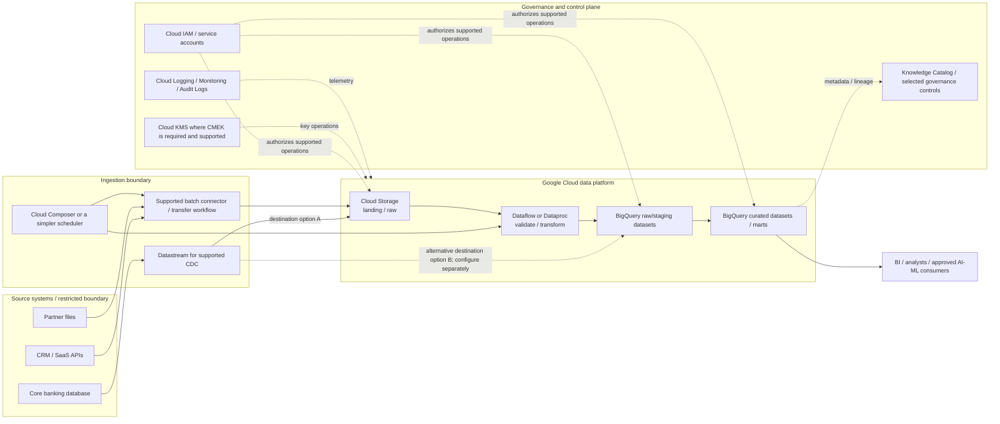
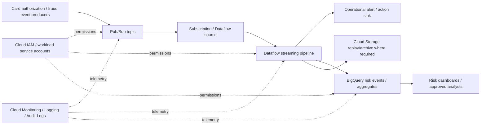

# GCP Data Architecture Reference Patterns
## Stage 2D — Data Architecture | Topic 04

> **Audience:** beginner-to-advanced data engineers and data architects.  
> **Purpose:** map logical enterprise data-platform capabilities to Google Cloud services, trace data and identity flows, compare reference patterns, and make defensible architecture decisions.  
> **Scenario:** Northbridge Bank is fictional. All volumes, targets, prices and design choices are illustrative assumptions, not production recommendations or quotations.

---

## 1. How this lesson fits the roadmap

This is Topic 04 in `08-Cloud-Hybrid-and-Multi-Cloud-Data-Architecture/`. It follows `02-aws-data-architecture-reference-patterns.md` and `03-azure-data-architecture-reference-patterns.md`, then prepares you for Topic 05, Networking, Identity and Private Connectivity.

The module roadmap explicitly notes that the provider lesson files were empty when it was written and that its service names are starting points for investigation. Therefore:

- The **module roadmap controls the learning scope and sequence**.
- The provider services below are researched candidates, not requirements inferred from empty files.
- The architecture diagrams and Northbridge Bank scenario are teaching examples.
- Verify the current product name, feature, region, quota, pricing and integration mode before implementation.

### 1.1 Learning objectives

By the end, you should be able to:

1. Map the logical enterprise data platform to one or more Google Cloud candidates.
2. Explain service responsibilities, data movement, dependencies and trust boundaries.
3. Trace batch, CDC and streaming paths from source to curated/served data.
4. Evaluate storage, processing, governance, security, reliability, scaling, operations and cost.
5. Compare GCP with AWS and Azure by capability and actual behaviour, not by name.
6. Identify GCP-specific decisions and the verification required before deployment.
7. Record a defensible GCP architecture decision and explain its portability consequences.

### 1.2 Prerequisites and sequence

The module roadmap names **Seq 3–4; Topic 05 Beginner level** as the prerequisites for this topic.

Review these earlier concepts if needed:

- reference-architecture selection and architecture trade-offs;
- conceptual/logical/physical models and schema evolution;
- object storage, file formats, table formats, replication and lifecycle;
- batch ingestion, CDC, streaming events, data contracts, retries and failure handling;
- the common logical data-platform capability families established in Topic 02 and reused in Topic 03.

Before deepening private networking or identity design, review the beginner material in Topic 05. This lesson introduces enough IAM and private-access context to reason about the data architecture, but does not replace the dedicated networking, hybrid-connectivity, portability or IaC lessons.

### 1.3 Recommended study sequence

1. Reconstruct the logical platform without provider product names.
2. Fill the capability map in Section 3.
3. Trace the batch and streaming patterns in Sections 4–8.
4. Study GCP identity, governance, locations and operations in Sections 9–12.
5. Complete the Northbridge Bank scenario and exercises.
6. Draft the three-provider comparison, portability assessment and ADR.
7. Use the completion gate before moving to Topic 05.

The roadmap’s estimated study time, if shown in your copy, is a planning aid rather than a guarantee.

---

## 2. Architecture method: capabilities before products

A reference architecture is a **starting pattern**, not a mandatory bill of materials. Begin with business outcomes and measurable quality attributes; identify the logical capabilities; then choose services that satisfy the requirements and constraints.

For every proposed component, answer:

- **Purpose:** which business or technical capability does it provide?
- **Inputs and outputs:** what data, events or metadata cross its boundary?
- **Identity:** which user, service account or federated principal calls it?
- **Network:** how does the workload reach the endpoint? Is the route public or private?
- **Failure:** how are retries, duplicates, late records, partial writes, poison records and recovery handled?
- **Scale:** what is the bottleneck—throughput, partitions, worker parallelism, query slots, concurrency, data volume or source limits?
- **Cost:** what is billed—storage, requests, bytes scanned, compute, slots, streaming, network transfer, logs or orchestration?
- **Portability:** which SQL dialects, APIs, table formats, metadata models or managed features create coupling?
- **Verification:** which region, location, edition, connector, quota, security mode, SLA or product limitation must be checked?

Do not start with “What is GCP’s equivalent of service X?” Ask “What responsibility must be fulfilled, and which design meets the requirements?”

### 2.1 Common logical platform

| Logical capability family | Responsibility | Key design questions |
|---|---|---|
| Source systems | Operational truth: databases, SaaS, APIs, files, applications, devices | Who owns the source? What change semantics and extraction limits apply? |
| Ingestion and integration | Move or capture data and coordinate extraction | Batch, watermark, CDC, event or file drop? How are checkpoints and retries handled? |
| Landing/raw storage | Preserve source-aligned data and replay evidence | Immutable or mutable? Retention? Residency? Data contract/version? |
| Processing and transformation | Validate, standardize, join, enrich, aggregate and materialize | SQL, Beam/Dataflow, Spark/Dataproc, or custom code? |
| Curated lake / warehouse / lakehouse | Publish trusted, governed data products | Open formats? Transactional semantics? Dimensional model? Consumer concurrency? |
| Metadata and governance | Discovery, classification, ownership, lineage, quality and policy | Which catalogue is authoritative? Which control actually enforces access? |
| Consumption and serving | BI, ad hoc SQL, applications, feature pipelines and AI/ML | Freshness, latency, concurrency, semantic consistency and purpose limitation? |
| Orchestration and operations | Schedule, coordinate, retry, alert, reconcile and recover | Who owns state, dependencies, backfills and SLOs? |
| Security and control plane | Identity, policy, encryption, network isolation, audit and deployment boundaries | Who can deploy, grant access, read data or change keys? |

One service may support multiple capabilities; a single capability may require several services. Neither fact removes the need to define responsibilities and boundaries.

---

## 3. GCP capability-to-service map

These are **candidate mappings**, not exact equivalences with AWS or Azure. Product names, feature boundaries, billing models and regional availability evolve. The references in Section 21 are starting points for verification.

| Logical capability family | Google Cloud candidates | Responsibility and key verification questions |
|---|---|---|
| Object storage / lake foundation | **Cloud Storage** | Durable object storage for raw and curated files; verify bucket location, storage class, retention/soft-delete/versioning needs, lifecycle, IAM, uniform bucket-level access, and private-access requirements. |
| Analytical warehouse / SQL analytics | **BigQuery** | Managed analytical warehouse with separated storage and compute; verify dataset location, SQL features, table design, query model, reservations/editions, quotas and data-sharing constraints. |
| Batch and streaming processing | **Dataflow** (Apache Beam-based managed processing) | Managed distributed data processing; verify runner/SDK support, worker configuration, region, streaming mode, source/sink semantics, autoscaling, quotas and cost. |
| Managed Spark/Hadoop processing | **Dataproc** | Managed clusters and serverless Spark options for workloads needing Spark/Hadoop ecosystem control; verify cluster versus serverless mode, runtime, libraries, startup, networking, governance and operations. |
| Event messaging / ingestion | **Pub/Sub** | Asynchronous event distribution and buffering; verify delivery semantics, ordering keys, retention, subscriptions, retry/dead-letter handling, quotas and regional design. |
| Database CDC / replication | **Datastream** | Serverless CDC and replication for supported sources to supported destinations, including BigQuery and Cloud Storage; verify source versions, log prerequisites, destination semantics, filters and current support matrix. |
| Workflow orchestration | **Cloud Composer** (managed Apache Airflow) | DAG-based orchestration for dependencies and workflows; verify environment sizing, Airflow version, private IP/networking, plugins, scheduler capacity and operating cost. Use service-native scheduling when a full Airflow environment is unnecessary. |
| Metadata / catalogue / governance | **Knowledge Catalog** (formerly Dataplex Universal Catalog; verify current product naming and boundaries) and BigQuery governance features | Discovery, metadata, lineage, classification, quality and governance workflows; verify source connectors, lineage coverage, policy enforcement and product boundaries. |
| Open-format lakehouse access | **BigLake** and supported open table formats / engines | Governed access and interoperability across supported storage/engine combinations; verify the exact BigLake capability, engine, table format, metadata/catalogue path and permission enforcement. |
| Identity and access | **Cloud IAM**, service accounts, Workload Identity Federation where supported | Authenticate and authorize humans/workloads; verify principal identity, role scope, inherited permissions, service-agent requirements and data-plane controls. |
| Encryption / key control | Google-managed encryption by default where applicable; **Cloud KMS** for customer-managed keys where supported | Key custody, rotation, permissions, audit, recovery and service-specific CMEK support. |
| Private service access | VPC, Private Google Access, **Private Service Connect** and service-specific private access patterns | Endpoint reachability, DNS, routing, service support, public access restrictions, producer/consumer setup and dependencies. These mechanisms are not interchangeable. |
| Monitoring / logging / audit | **Cloud Monitoring**, **Cloud Logging**, Cloud Audit Logs, service-specific metrics | Enable the required logs, define retention and alert ownership, measure pipeline/query SLOs, and account for log ingestion/storage cost. |
| BI / analytics consumption | Looker, Looker Studio, BigQuery BI integrations and approved application/serving layers | Semantic ownership, access control, freshness, concurrency, caching, governance and consumer support. Verify product/licensing boundaries. |
| Data migration | Datastream for supported CDC paths; Database Migration Service and source/target-specific migration tools where applicable | Do not assume a single migration service supports every engine, version, online mode or cutover requirement. Verify exact source/target compatibility and rollback strategy. |

### 3.1 Current naming and product-boundary caution

- **Knowledge Catalog** is the current name used in current Google Cloud documentation for the product previously called **Dataplex Universal Catalog**. Existing articles, APIs and UI labels may still use Dataplex terminology. Verify the current name and exact feature boundary before writing an implementation plan.
- **BigQuery is not merely a database VM or a conventional fixed-size warehouse.** Its storage and compute layers are separated; query processing can use on-demand or capacity-based pricing models. The exact commercial model and features depend on the selected configuration.
- **Dataflow is a managed execution service for Apache Beam pipelines.** Beam is the programming model/SDK; Dataflow is a runner/service. Do not confuse it with Pub/Sub, which transports messages.
- **Pub/Sub is not a full stream-processing engine.** It transports events; Dataflow, BigQuery SQL/continuous processing features where supported, or application consumers implement downstream logic.
- **Datastream is a CDC/replication service with a defined support matrix**, not a universal replication bus for every source and target.
- **Cloud Composer is managed Apache Airflow**, not a data transformation engine. It orchestrates tasks, while the tasks run in the relevant services.
- **BigLake is not one universal lakehouse product mode that behaves identically across engines.** Verify which BigLake feature and table/catalogue integration is meant.
- **Knowledge Catalog is not automatically the enforcement point for every data access.** IAM, BigQuery permissions, Cloud Storage IAM, policy tags, row/column controls, and perimeter controls have distinct responsibilities.

---

## 4. Reference Pattern A — Batch lake plus BigQuery analytics

### 4.1 When it fits

Use this pattern for nightly reporting, regulatory extracts, customer/finance analytics, historical analysis, and curated datasets for model training. It suits workloads where a lake preserves source-aligned data and BigQuery serves governed analytical tables and SQL.

### 4.2 End-to-end architecture



> Diagram note: this is a conceptual reference, not a deployment template. The Datastream arrows show **alternative destination designs**, not an assertion that one stream writes to both destinations simultaneously. Configure and validate the required destination stream(s) separately. Verify destination-specific write behaviour, permissions, networking, schema handling and recovery. Dotted lines represent conceptual control/metadata relationships; they do not claim that every service has a direct integration or identical authorization path.

### 4.3 Trace the batch flow

| Hop | Action | Identity / access question | Failure and recovery question |
|---|---|---|---|
| 1. Source → ingestion | Read a source snapshot, incremental range or supported CDC log | Which principal authenticates to the source? Which source permissions/log settings are required? | Source throttling, expired credential, log retention gap, schema drift |
| 2. Ingestion → Cloud Storage | Land source-aligned files with source, run, timestamp and schema metadata | Which service account writes the bucket/prefix? Is the bucket location correct? | Retry duplicates, incomplete object sets, object overwrite, retention policy |
| 3. Raw → processing | Validate schema, normalize types, quarantine invalid records, deduplicate | Can the Dataflow/Dataproc runtime access only required inputs and outputs? | Worker failure, bad record, skew, quota exhaustion, partial output |
| 4. Processing → BigQuery staging | Load or stream validated records to a controlled staging dataset | Which principal submits the job and writes the dataset? Which service agent is involved? | Schema mismatch, quota, load job failure, duplicate write or partial workflow |
| 5. Staging → curated | Apply business rules, reconcile totals, publish curated tables | Who can alter schemas or query sensitive columns? Are transformations idempotent? | Partial publication, incorrect totals, failed merge, concurrent writers |
| 6. Metadata and observability | Record ownership, classification, lineage, quality and run telemetry | Which governance system is authoritative? Are logs protected? | Missing diagnostics or lineage, sensitive values in logs |
| 7. Consumption | BI and approved downstream workloads query certified data | Are dataset/table/column controls and consumer identity correct? | Cost spike, query saturation, stale data, inconsistent metrics |

### 4.4 Data zones and publication

Use logical zones, whether implemented as bucket prefixes, separate buckets, BigQuery datasets, projects, or a combination:

- **Landing/raw:** source-aligned data, source ID, extraction timestamp, run ID, schema version and ingestion status.
- **Validated/staging:** type-checked, deduplicated and quality-checked data, with rejected records quarantined.
- **Curated/product:** approved business entities, metrics, owners, quality SLOs and access rules.
- **Serving:** BigQuery tables/views, BI semantic models or purpose-built serving systems matched to consumer latency and concurrency.

Do not assume every zone needs a separate project or bucket. Choose physical boundaries based on data sensitivity, ownership, blast radius, region, billing and operational responsibilities.

Before publication, validate input completeness, row counts, key uniqueness, null constraints, schema compatibility, business control totals, lineage/run ID and transformation version. Publish only when the selected table/workflow semantics make the intended version visible.

### 4.5 Cloud Storage layout and table formats

- Choose bucket location and redundancy early; some data location decisions are difficult to change without copying or migrating data.
- Choose storage class and lifecycle policy from access frequency, retrieval costs, minimum storage durations and recovery needs.
- Use Parquet for columnar analytical files when supported by the intended engine. A file format is not the same thing as a transactional table format.
- If using Iceberg or another open table format, verify reader/writer compatibility, catalogue/metadata integration, transaction semantics, schema evolution and supported features across every engine.
- Avoid excessive small files, unbounded directory/partition proliferation, and uncontrolled schema drift.
- Cloud Storage object versioning, soft delete and retention policies address different risks. Redundancy is not a backup or a complete recovery strategy. For new designs, evaluate uniform bucket-level access to centralize authorization in IAM; enabling it disables object/bucket ACLs and can revoke ACL-only access, so inventory and migrate existing ACL grants before enabling it. Verify the bucket's current configuration and any required exceptions.

---

## 5. Ingestion, CDC, and database migration

### 5.1 Batch ingestion

Batch ingestion is suitable when a business process has a defined freshness window, such as a nightly ledger snapshot or a daily partner file. It can use source-specific connectors, transfer utilities, custom applications, scheduled jobs or managed integration services.

Define:
- extraction window and source consistency;
- stable run ID and checkpoint/watermark;
- file naming and manifest/completion convention;
- schema and data-contract validation;
- retry/backoff and idempotent sink behaviour;
- duplicate and late-arrival policy;
- reconciliation and replay/backfill procedure;
- source throttling and maximum extraction load.

A scheduled query against `updated_at` is not equivalent to CDC if it cannot capture deletes, late updates or all required changes.

### 5.2 Datastream for CDC

Datastream is documented as a serverless CDC/replication service for supported sources and destinations. Current documentation describes destinations including BigQuery, Cloud Storage and Apache Iceberg tables, with source/version-specific support. Do not assume every destination behaves identically or that every source supports every mode.

Before choosing it, verify:
1. source engine/version and source configuration;
2. database log access and retention prerequisites;
3. initial snapshot and ongoing change ordering;
4. schema evolution and unsupported data types;
5. supported destination and write/merge behaviour;
6. network path and credentials;
7. monitoring, lag and restart behaviour;
8. reconciliation, cutover and recovery procedures.

Datastream is not a generic event broker and should not be treated as a universal substitute for Pub/Sub or a custom CDC platform. BigQuery also has a separate native CDC-ingestion path through the Storage Write API; do not assume that native BigQuery CDC and Datastream share the same prerequisites, key rules, latency, supported operations or operational model. Check the specific documentation for the selected path.

### 5.3 Database Migration Service and source-specific tooling

Google Cloud Database Migration Service (DMS) is a separate migration product from Datastream. It supports defined migration paths; the exact source/target engines, versions, modes and limitations must be checked in current documentation. Do not imply that DMS supports every engine or guarantees zero downtime.

Migration planning should cover:
- assessment and compatibility blockers;
- source and target versions, extensions and data types;
- full-load and change-application strategy if supported;
- source impact, log retention and network throughput;
- cutover freeze, final sync and validation;
- rollback window and point of no return;
- performance baseline and post-cutover monitoring.

### 5.4 Pub/Sub as an event ingestion boundary

Pub/Sub decouples event publishers and subscribers. Topics and subscriptions provide asynchronous delivery and independent consumer paths. It is appropriate for application events, telemetry, notifications and integration patterns where producers should not depend synchronously on every consumer.

Important decisions:
- message schema/version and stable business event ID;
- ordering key and whether ordering is needed;
- acknowledgement, retry, dead-letter and retention policy;
- subscriber throughput, concurrency and backpressure;
- separate subscriptions for independent consumer pipelines;
- regional placement, disaster recovery and data residency;
- downstream idempotency and replay window.

Pub/Sub normally provides at-least-once delivery; duplicate delivery can occur. Its exactly-once delivery feature applies to supported pull subscriptions and has regional scope: subscribers connecting in different regions can still see duplicate deliveries. It does not merge separate publishes of the same business event, and it does not make downstream side effects exactly-once. Verify the current subscription-type, client-library and regional requirements before relying on it.

---

## 6. Processing choices: Dataflow vs Dataproc vs BigQuery SQL

### 6.1 Dataflow and Apache Beam

Dataflow is a managed execution service for Apache Beam pipelines and supports batch and streaming processing. It is a strong candidate for unified pipelines that need event-time windows, stateful processing, scalable transforms and managed execution.

Consider:
- Beam SDK and connector support;
- worker/region configuration and service-account permissions;
- event time, processing time, watermarks and late data;
- streaming exactly-once versus at-least-once mode;
- sink-specific write semantics;
- side effects and idempotency;
- autoscaling, worker startup, backlog and quotas;
- cost of workers, streaming engine or other selected features.

**Semantics caution:** Dataflow’s exactly-once processing does not mean custom code executes only once or every external side effect is exactly-once. Output guarantees depend on the source, connector and sink. Late events can affect completeness even when processed records are not duplicated. Test the complete pipeline semantics.

### 6.2 Dataproc and Spark

Dataproc provides managed Spark/Hadoop environments and also offers serverless options for supported workloads. It is a candidate when the team needs the Spark ecosystem, existing Spark code, specific libraries, custom runtime configuration or Hadoop compatibility.

Choose between cluster-based and serverless execution only after checking:
- startup latency and job frequency;
- runtime and library needs;
- cluster lifetime, autoscaling and idle shutdown;
- storage and metadata integration;
- identity, network and dependency access;
- patching/runtime ownership;
- job isolation and noisy-neighbour risks;
- workload cost including retries and idle capacity.

Dataproc is not automatically the right choice for a simple SQL transformation that BigQuery can perform more directly.

### 6.3 BigQuery SQL and ELT

BigQuery can ingest, store, transform and query analytical data. SQL-first transformations may reduce the number of moving parts when data is already in BigQuery and the workload fits its semantics and cost model.

Use explicit staging, quality checks, stable keys and transaction-aware publication. Understand that:
- partitioning can limit data scanned for supported filter patterns;
- clustering can improve block pruning for suitable filters;
- selecting fewer columns and filtering early can reduce bytes processed in on-demand pricing;
- query `LIMIT` does not necessarily reduce bytes scanned;
- reservations/capacity-based pricing can suit predictable or shared workloads, but must be sized and governed;
- a query budget/maximum-bytes-billed guardrail is useful but not a substitute for workload design.

### 6.4 Decision table

| Requirement | Candidate pattern | Trade-off |
|---|---|---|
| Straightforward SQL transformation of data already in BigQuery | BigQuery SQL / scheduled queries or supported orchestration | Fewer services; warehouse SQL and billing behaviour create coupling |
| Complex event-time streaming, state, multiple sinks | Pub/Sub + Dataflow | Powerful streaming semantics; pipeline design and cost/late-event policy require expertise |
| Existing Spark code or specialized Spark libraries | Dataproc cluster/serverless mode | Spark ecosystem compatibility; runtime and compute operations remain |
| Nightly source-to-lake copy | Batch connector/transfer workflow + Cloud Storage | Simple and replayable; source and connector limitations matter |
| Supported database CDC into analytical storage | Datastream + BigQuery or Cloud Storage | Managed CDC; exact source/destination semantics must be verified |
| Low-volume scheduled dependencies | Cloud Scheduler/workflow or service-native scheduling where suitable | Avoids unnecessary Airflow operations |
| Complex cross-service DAGs, dependencies and backfills | Cloud Composer (Airflow) | Flexible DAG orchestration; environment, scheduler, plugins and upgrades have cost/operational overhead |

**Selection rule:** choose the smallest design that satisfies measured requirements. Add a service only when it supplies a required capability or boundary.

---

## 7. BigQuery architecture, warehousing, and serving

### 7.1 Storage and compute model

BigQuery separates its storage and compute layers and manages much of the underlying infrastructure. This reduces the need to manage warehouse servers, but it does not eliminate data modelling, query optimization, cost controls, quota management, governance, location planning or incident response.

Use BigQuery for:
- governed analytical tables and marts;
- ad hoc and scheduled SQL analytics;
- reporting and BI integrations;
- supported data engineering and ML-related workloads;
- query access over supported external data configurations.

Verify the exact capabilities, editions, APIs and region before relying on a specific feature.

### 7.2 Dataset and table design

- **Location:** choose dataset location deliberately. Location compatibility across datasets, jobs, external sources and services matters; some location decisions cannot be changed in place. A BigQuery multi-region is not a promise of cross-region replication or regional failover: data are stored in a single region within the selected multi-region. If regional recovery is required, design and verify an explicit supported replication/DR strategy.
- **Partitioning:** use a suitable date/timestamp or integer range where it matches common filters and maintenance needs. Require partition filters when appropriate to protect spend.
- **Clustering:** choose columns that are commonly filtered or grouped and that fit the table’s query patterns. It is not a substitute for appropriate partitioning.
- **Schema:** define types, nullability, units, timezone and schema evolution policy. Do not silently cast critical monetary or identity fields.
- **Data modelling:** separate staging, curated facts/dimensions and consumer-facing views when that clarifies ownership and quality gates.
- **Access:** use least-privilege dataset/table permissions and fine-grained controls where supported. Validate views, authorized views, policy tags and row/column policies against the exact access path.
- **Performance:** monitor bytes processed, slot/compute use, queueing, query plans, repeated scans, skew and concurrency.
- **Publication:** use supported transactional DML or staging/swap patterns appropriate to the table and workflow; prove that readers cannot observe a partially built data product.

### 7.3 Consumption patterns

| Consumer | Typical serving approach | Questions |
|---|---|---|
| BI/reporting | BigQuery tables/views with Looker, Looker Studio or approved BI client | Semantic definitions, concurrency, cache/freshness, row-level policy and ownership |
| Data science / ML | Curated datasets with governed training and feature pipelines | Reproducibility, location, PII minimization, training-data version and access |
| Application / operational API | Purpose-built serving database/API where analytical query latency or concurrency is unsuitable | Is BigQuery being used outside its intended latency/transaction model? |
| Ad hoc analyst | BigQuery query access with budgets, role scopes and dataset conventions | Bytes scanned, sensitive-field exposure, quota and cost attribution |
| Data sharing | Supported BigQuery sharing/authorized access mechanism | Consumer project/location, identity, policy and audit boundaries |

Do not assume an analytical warehouse is the best operational serving store for every application.

---

## 8. Metadata, governance, lineage, and quality

### 8.1 Governance is more than a catalogue

Governance includes ownership, business definitions, classification, lineage, quality expectations, access enforcement, retention, approval, audit and evidence. A catalogue can improve discovery without being the runtime enforcement point for every query or object read.

Current Google Cloud documentation uses **Knowledge Catalog** for the catalog/governance product previously referred to as Dataplex Universal Catalog. Because names and features are evolving, confirm the product’s current naming and exact scope before implementation.

### 8.2 Candidate governance responsibilities

- **Knowledge Catalog:** investigate discovery, metadata enrichment, business glossary, lineage, data quality, classification and governance workflows available for the target sources and services.
- **BigQuery native controls:** dataset/table permissions and supported row-level, column-level or policy-tag controls for BigQuery data paths.
- **Cloud Storage IAM and bucket controls:** object access, retention and storage-level controls.
- **Cloud IAM / organization policy:** project/resource access, constraints and administrative boundaries.
- **Cloud Audit Logs and Cloud Logging:** evidence of supported administrative and data-access events; ensure required log types are enabled and retained.

Do not assume the catalogue’s lineage covers every external transformation or that a classification label alone blocks access. Map each policy to the system that enforces it.

### 8.3 Minimum data-product metadata contract

For every curated product, document:
- business name, description, owner, steward, domain and intended use;
- source systems and lineage, refresh cadence, event/ingestion timestamps;
- schema, keys, units, timezone, currency, version and compatibility rules;
- classification, permitted consumers, retention and deletion obligations;
- quality rules, freshness/availability SLOs and known limitations;
- publication status, support route and deprecation policy.

### 8.4 Quality checks and lineage

Quality checks may include completeness, uniqueness, valid ranges, referential integrity, freshness and reconciliation against source totals. The rule should have an owner, severity, failure action, evidence and waiver process.

Lineage should answer:
- which sources contributed to the product;
- which job/code/version transformed it;
- which outputs and consumers depend on it;
- when it was last refreshed and validated;
- whether lineage is automatically captured or manually documented.

For each source/engine, verify current lineage integration coverage and the permissions needed to collect metadata.

---

## 9. Identity, IAM, encryption, and private access

This is architecture-level guidance. Topic 05 covers deeper networking and identity concepts; Topic 10 covers deeper governance/security/privacy.

### 9.1 GCP resource hierarchy

Google Cloud commonly uses an **organization → folders → projects → resources** hierarchy. Projects are important resource, quota and billing boundaries; folders and organization-level policies support broader governance. This is not identical to an AWS account or Azure subscription.

Decide how projects separate:
- production from non-production;
- regulated data from general workloads;
- central platform resources from domain-owned workloads;
- billing, quotas, deployment permissions and blast radius.

Avoid using a single project for every team and environment merely to reduce setup work. Also avoid proliferating projects without clear ownership, network and policy standards.

### 9.2 IAM and service accounts

- Use **Cloud IAM** roles at the narrowest practical scope. Prefer predefined roles where they meet the need; custom roles require lifecycle and permission review.
- Separate human administration, deployment automation, data ingestion, transformation and consumption identities.
- Use service accounts for workloads and Google-managed service agents where the service requires them. Identify the principal actually used by the job or managed service; it may not be the person who created it.
- Avoid broad primitive roles such as Owner or Editor for routine data access.
- Prefer short-lived credentials and Workload Identity Federation where supported for external workloads rather than distributing service-account key files.
- Restrict service-account impersonation and key creation; audit role grants and review inherited permissions.
- IAM permission alone does not establish network reachability or override every service-specific data control.

### 9.3 Illustrative identity flow

```text
Scheduled workflow starts a Dataflow job
  -> the configured job/service account is selected
  -> IAM authorizes the required job and data operations
  -> service-specific APIs and data endpoints are reached over the configured path
  -> Cloud Storage / BigQuery checks applicable data permissions and controls
  -> service logs and audit events are emitted where configured
```

This is a conceptual flow, not a deployable IAM policy. Exact principals and required roles vary by service, API, launch path and destination. Verify the Dataflow worker identity, service-agent permissions and caller identity for the actual configuration. Do not copy a broad “works everywhere” role list.

### 9.4 Network reachability is not authorization

For each access path, check these layers separately:

1. **Name resolution:** does the service name resolve as intended?
2. **Network path:** can the workload route to the endpoint?
3. **Authentication:** can it obtain a valid identity/token?
4. **Authorization:** does the identity have the required permission?
5. **Service-side policy:** do firewall, organization policy, perimeter or service-specific rules allow the operation?

Google Cloud uses different mechanisms for different purposes:
- **Private Google Access** supports access to Google APIs/services from eligible resources without external IP addresses under the documented configuration.
- **Private Service Connect (PSC)** provides private connectivity to supported services/endpoints using specific producer/consumer patterns.
- **VPC Service Controls** can define service perimeters to help reduce data exfiltration risk for supported services; it is not a generic network tunnel and does not replace IAM.
- **VPC peering, VPN and Cloud Interconnect** solve other network connectivity problems and belong to the dedicated networking/hybrid lessons.

These mechanisms are not interchangeable. Verify which services, APIs, operations and clients are supported, how DNS is configured, and whether required control-plane dependencies remain reachable.

### 9.5 Encryption and Cloud KMS

- Verify the selected service’s encryption-at-rest defaults and in-transit requirements.
- Use TLS for supported network paths and validate the clients’ endpoint configuration.
- Use Cloud KMS and customer-managed encryption keys only where the requirement and service support justify them.
- For CMEK, verify key location compatibility, service-agent permissions, key rotation, audit, recovery, disable/destroy consequences and service-specific limitations.
- Never commit service-account private keys, OAuth tokens, database passwords, signed URLs or other secrets to source control, notebooks, logs or sample code.

Private connectivity is not a replacement for encryption. Encryption is not a replacement for authorization. Customer-managed keys introduce operational responsibilities and can cause data access to fail if the key is unavailable or permissions are revoked.

---

## 10. Streaming reference pattern: Pub/Sub + Dataflow + BigQuery

### 10.1 Example architecture



This is conceptual. The chosen Pub/Sub subscription, Dataflow connector, BigQuery write method, service-account permissions, and any archive path must be verified. The diagram does not promise end-to-end exactly-once effects.

### 10.2 Delivery semantics: the essential distinction

- Pub/Sub normally delivers at least once; duplicates can occur.
- Dataflow supports exactly-once processing within its pipeline in the documented modes, and supports at-least-once streaming mode for workloads that can tolerate duplicates and benefit from lower latency/cost.
- Exactly-once processing does **not** mean user code runs only once, does not guarantee every external side effect is exactly once, and does not guarantee that all late events arrive before a window closes.
- A source may publish the same business event twice as distinct messages; Pub/Sub message-ID deduplication does not necessarily remove business-level duplicates. Use a stable event/business ID when required.
- Pub/Sub exactly-once delivery is a separate feature from Dataflow's exactly-once processing. The Pub/Sub guarantee is scoped to supported pull subscriptions and regional subscriber connections; neither feature by itself guarantees exactly-once external effects across the whole business workflow.
- Sink semantics matter. Verify the chosen BigQuery or other sink write mode and idempotency strategy.

### 10.3 Streaming design checklist

- Define event ID, event time, ingestion time, schema version and producer contract.
- Choose keys and ordering semantics; avoid a single hot key.
- Define expected event lateness, duplicate policy, windowing, correction and backfill behaviour.
- Choose exactly-once or at-least-once mode based on correctness, latency and cost—not habit.
- Route malformed/poison events to a durable failure path with controlled access and replay procedures.
- Monitor backlog, oldest unprocessed event, processing latency, throughput, failed writes, worker scaling and quota errors.
- Test downstream outages and replay within the retention window.
- Reconcile stream-derived totals against source-of-record data.

---

## 11. Orchestration and dependency management

### 11.1 Cloud Composer

Cloud Composer is managed Apache Airflow. It is appropriate when a platform needs DAG-based dependency management, scheduling, retries, backfills, task state and integrations across multiple systems.

It is not automatically the best scheduler for every pipeline. A lightweight scheduled query, service-native schedule or simpler workflow may be sufficient for a small number of tasks.

Before selecting Composer, evaluate:
- Airflow and provider-package compatibility;
- environment sizing and scheduler/worker capacity;
- private IP/network access and dependency endpoints;
- DAG deployment, plugins, secrets and connection management;
- task retry/idempotency and backfill behaviour;
- upgrade and maintenance windows;
- log retention, metrics and alert ownership;
- baseline environment cost versus task volume.

### 11.2 Workflow reliability

A successful task is not always a successful data product. Separate states for extraction, processing, quality validation, publication and downstream notification.

Use:
- bounded retries and backoff;
- explicit timeouts and concurrency limits;
- durable run IDs and source checkpoints;
- idempotent tasks or deduplicable outputs;
- dead-letter/quarantine paths for bad records;
- data-quality gates and reconciliation;
- backfill procedures that do not overwrite correct data accidentally;
- runbooks for source outage, quota exhaustion, credential failure and partial publication.

Do not use Airflow as a substitute for a streaming runtime. Composer coordinates workflows; Pub/Sub transports events; Dataflow or another processing engine performs streaming computation.

---

## 12. GCP-specific architecture choices and verification needs

| Choice | Verify before implementation | Why it matters |
|---|---|---|
| Organization/folder/project boundaries | IAM inheritance, billing ownership, quotas, policy, networking, environment separation | Project boundaries influence governance and blast radius but are not a complete security design by themselves |
| Cloud Storage bucket location | Region/multi-region/dual-region options, residency, redundancy, replication behaviour, supported features | Location affects residency, latency, recovery and transfer cost |
| BigQuery dataset location | Location compatibility for jobs, sources, destinations, cross-region operations and sharing | Location can be difficult to change and can block otherwise valid data flows |
| BigQuery pricing model | Current on-demand versus capacity/reservation options, editions, included features, quotas and guardrails | Pricing and capacity features evolve; estimate from realistic query workload |
| BigQuery partitioning/clustering | Filter patterns, data distribution, maintenance, query plans and bytes scanned | Poor layout can increase cost or fail to improve performance |
| Dataflow | SDK/connector support, region, streaming mode, sink semantics, worker/service-account permissions, quotas and autoscaling | Processing guarantees and cost depend on the complete pipeline |
| Dataproc | Cluster versus serverless mode, runtime, library compatibility, network, startup, governance and lifecycle | Operational ownership and cost differ materially by mode |
| Pub/Sub | Ordering, delivery, retry/dead-letter, retention, quotas, regional strategy, auth and private access | Messaging guarantees do not equal downstream business correctness |
| Datastream | Exact source/version, log prerequisites, destination support, schema behaviour, filters and latency expectations | CDC support is scenario-specific |
| Database Migration Service | Supported source/target/version and mode, assessment, downtime, cutover and rollback | No universal zero-downtime or universal-engine guarantee |
| Cloud Composer | Airflow version, provider packages, private networking, sizing, plugins, upgrade process and idle cost | Managed Airflow still requires environment and DAG operations |
| Knowledge Catalog | Current name/product boundary, source connector coverage, lineage/quality features, permissions and pricing | Metadata coverage and enforcement vary by integration |
| BigLake / open table formats | Exact feature, engine, table format, metadata/catalogue, permissions and transaction semantics | “Open format” alone does not guarantee interoperable operations |
| Cloud IAM | Exact principal, role scope, inherited grants, service-agent roles, impersonation and key restrictions | Overbroad or missing permissions create security and availability failures |
| Cloud KMS / CMEK | Service support, key location, key permissions, rotation, recovery and disable/destroy effects | Key lifecycle can interrupt data access |
| Private Google Access / PSC / VPC Service Controls | Supported service/API path, endpoint model, DNS, ingress/egress rules, dependencies and troubleshooting | The mechanisms solve different network and exfiltration problems |
| Cloud Logging / Monitoring | Diagnostic/audit log types, retention, workspace/project routing, alerts and ingestion cost | Required logs may need explicit configuration; missing telemetry impairs recovery |
| Region and service availability | Current regional service/feature matrix, quotas, support tiers, SLA and DR design | A product or feature may not be available in the required location |
| Cost | Current pricing calculator, transfer/egress, storage class, query scans, slots, workers, Composer environment, logging and replay | Failure recovery and backfills can cost more than the normal path |

---

## 13. Northbridge Bank — worked enterprise scenario

### 13.1 Business context (illustrative)

Northbridge Bank is a fictional mid-sized bank. It needs:
- nightly card transactions, account snapshots and customer reference data;
- partner files delivered through approved channels;
- low-latency risk signals for selected card events;
- curated fraud, customer and finance datasets for analysts and model development.

Illustrative starting assumptions:
- nightly data must be ready by 06:00 local business time;
- selected risk events need a defined low-latency operational signal;
- raw sensitive data is limited to approved roles;
- published products need ownership, lineage, quality checks and audit evidence;
- region, residency, retention, RPO/RTO, source rates and exact cost remain open requirements.

These are scenario inputs, not a claim that a particular service satisfies a bank’s legal or regulatory obligations.

### 13.2 Candidate architecture

**Batch**
1. Use Datastream for supported database CDC paths; use source-specific batch connectors for other systems and partner files.
2. Land source-aligned data in Cloud Storage where the chosen ingestion path supports it.
3. Use Dataflow, Dataproc or BigQuery SQL based on transformation semantics and operational needs.
4. Publish validated staging and curated datasets in BigQuery.
5. Establish the authoritative catalogue/governance responsibilities and connect lineage where supported.
6. Serve analysts through approved BI/semantic models and governed BigQuery access.

**Streaming**
1. Producers publish card events to Pub/Sub with stable event IDs and schema versions.
2. Dataflow validates, enriches and applies windowed rules; sends approved operational outputs and persists analytical records to the selected sink.
3. Reconcile streaming aggregates with source-of-record totals; correct late/duplicate events under a documented policy.

### 13.3 Trust boundaries

- Separate production and non-production projects and identities.
- Separate deployment permissions from runtime data permissions.
- Restrict raw data to ingestion and approved processing identities; grant curated access by business purpose.
- Use private access mechanisms where required and prove DNS/routing, rather than broadening IAM to work around a network failure.
- Define whether CMEK is required and test key recovery/disable scenarios before production.
- Protect audit logs and metadata that may reveal sensitive asset names or data characteristics.

### 13.4 Failure scenarios and response

| Failure | Signal | Containment/recovery | Lesson |
|---|---|---|---|
| CDC source log retention is exceeded during outage | Replication lag/error, missing changes | Stop claiming completeness; assess re-snapshot/reconciliation; follow source-specific recovery plan | CDC depends on source log and connector semantics |
| Pub/Sub backlog grows | Oldest unprocessed message and backlog metrics rise | Check subscriber health, Dataflow capacity, hot keys, sink latency and quotas; scale/fix bottleneck | More publisher throughput cannot fix a saturated sink |
| Dataflow output is duplicated or business events are duplicated | Duplicate event IDs/control totals | Check streaming mode, sink write semantics and business-level IDs; reconcile and deduplicate | Exactly-once pipeline processing is not universal end-to-end exactly-once |
| BigQuery query cost spikes | Bytes processed/slot use increases | Inspect query plans, scans, partition filters and repeated work; apply cost controls and workload isolation | Serverless does not mean cost-free |
| Service account has excessive roles | IAM review/policy alert | Remove broad roles, scope permissions, test workload identity and audit access | Avoid Owner/Editor as a data-access shortcut |
| Private API access fails | DNS or connection timeout | Check DNS, route, endpoint mechanism, firewall/perimeter and service support separately | Private access mechanisms are not interchangeable |
| Dataset location is incompatible with job/source | Job location error or blocked data flow | Revisit location design; use an approved copy/replication strategy if allowed | Location is an early architectural decision |
| Knowledge Catalog lineage is incomplete | Missing source/transform edges | Verify connector coverage, required APIs/permissions and supported execution path; supplement documented lineage | Catalogue presence does not guarantee complete lineage |
| Region/service disruption | Service health and job failures | Follow service-specific DR plan; validate location-specific replication, data lag, dependencies and failover | Service availability and application recoverability differ |
| Logs are missing | No expected diagnostic/audit events | Enable required logs, validate routing and retention, test alerts | Observability is part of acceptance, not an afterthought |

### 13.5 Publication and reconciliation contract

Before a curated product is marked ready, require:
- expected input files/partitions or source checkpoint;
- schema and contract validation;
- uniqueness and null checks for critical keys;
- row counts and business control totals;
- no unexplained difference from source-of-record totals;
- lineage/run ID and transformation version;
- publication timestamp and quality status.

The business owner must set thresholds and approve exceptions.

---

## 14. Batch, streaming and analytics design exercises

### Exercise A — Choose batch or streaming

| Scenario | Initial candidate | What could change the answer? |
|---|---|---|
| Monthly historical statement archive | Batch | A business process requiring immediate fraud review would change freshness needs |
| Daily account snapshot for morning reports | Incremental batch | Tight near-real-time reconciliation requirement |
| Card authorization risk event | Pub/Sub + Dataflow streaming candidate | If the signal can wait several minutes, simpler micro-batch may suffice |
| Database migration over a planned cutover | Migration workflow and validation | Exact source/target support, downtime and rollback constraints |
| Compliance check triggered by partner-file arrival | Event-triggered batch workflow | If each record requires low-latency action, consider streaming |
| Large exploratory analyst query | BigQuery with query-cost controls | Stable heavy workloads may justify capacity-based pricing |

Tasks:
1. Set freshness and p95/p99 latency targets.
2. Estimate average/peak event rate, message size, retention and replay volume.
3. For batch, specify checkpoint, idempotency, retry and reconciliation.
4. For streaming, specify event ID, ordering, late-event and duplicate policy.
5. State the cost driver and guardrail.
6. Explain what evidence would change the decision.

**Deliverable:** a one-page decision record with rejected alternatives.

### Exercise B — BigQuery cost and performance design

Create a representative table with a known date column and query filters. Compare an unpartitioned design with an appropriate partitioned design, then assess whether clustering helps based on the query workload. Use assumed prices or current pricing references, and clearly label assumptions.

Do not claim measured savings without running the queries and inspecting actual bytes processed/query plans. Explain why `LIMIT` alone may not cap scanned bytes.

**Deliverable:** table-design recommendation, query examples, cost-control checklist and unresolved verification items.

### Exercise C — Governance and access boundary

Scenario: an analyst needs aggregate fraud metrics but must not access raw customer identifiers.

Document:
- the analyst identity and minimum dataset/table permissions;
- whether a curated aggregate or view is preferable to direct raw access;
- row/column-level controls or policy tags if supported and appropriate;
- Cloud Storage access paths that might bypass a BigQuery-only control;
- metadata classification, ownership, lineage and quality responsibilities;
- audit evidence and a negative test proving the analyst cannot read restricted raw fields.

**Deliverable:** trust-boundary diagram, access matrix and test plan.

### Exercise D — Failure tabletop

Simulate these cases on paper: service account loses a required role, private service access DNS is wrong, Dataflow backlog grows, and a BigQuery job is pointed at the wrong location. For each, record detection, first diagnostic step, owner, containment, recovery, and proof of correctness.

**Deliverable:** failure matrix and short runbook.

---

## 15. Three-provider comparison draft

Use the logical capability as the primary row. Provider products are candidate implementations; do not claim equivalence until the behaviour has been checked against the workload.

| Logical capability | AWS candidates | Azure candidates | Google Cloud candidates | Differences to verify |
|---|---|---|---|---|
| Object/lake storage | Amazon S3 | Blob Storage / ADLS Gen2; OneLake in Fabric | Cloud Storage; BigLake-supported access patterns | Namespace/directory semantics, IAM model, object lifecycle, location/redundancy, table format and engine compatibility |
| Batch integration/orchestration | Glue workflows, Step Functions, MWAA depending on role | Azure Data Factory / Fabric Data Factory | Cloud Composer for Airflow DAGs; service-native scheduling and integration options | Connector support, state/retry semantics, runtime placement, DAG model, pricing and operational overhead |
| CDC/migration | AWS DMS and source-specific tooling | Azure DMS and source-specific tooling | Datastream; Database Migration Service and source-specific tooling | Source/target/version support, log prerequisites, initial load, ongoing CDC, cutover and rollback |
| Event messaging | Kinesis / MSK depending on protocol | Event Hubs | Pub/Sub | Delivery/ordering semantics, retention, partitions/keys, consumer model, quotas and private access |
| Stream processing | Managed stream services / Spark | Stream Analytics / Databricks / Fabric real-time | Dataflow / Apache Beam; BigQuery for supported SQL analytics and streaming-ingestion patterns | Event-time, state, late data, processing mode, sink guarantees and operational model |
| Batch/Spark processing | Glue / EMR | Databricks / Synapse Spark / Fabric | Dataflow for Beam; Dataproc for Spark/Hadoop | Programming model, runtime control, startup, scaling, identity, governance and total cost |
| Analytical warehouse | Athena / Redshift | Synapse SQL / Fabric Warehouse / Databricks SQL | BigQuery | SQL dialect, location semantics, compute billing, capacity/reservations, query limits, concurrency and ecosystem |
| Metadata/governance | Glue Data Catalog / Lake Formation | Purview / Unity Catalog / Fabric controls | Knowledge Catalog / BigQuery native controls | Discovery versus enforcement, lineage coverage, catalogue integration, fine-grained policy and audit |
| Identity | AWS IAM roles/policies | Entra ID / Azure RBAC / managed identities | Cloud IAM / service accounts / workload federation | Principal lifecycle, scope inheritance, service agents, impersonation, key management and data-plane permissions |
| Keys | AWS KMS | Azure Key Vault | Cloud KMS | CMEK support per service, key location, key policy/permissions, rotation and recovery consequences |
| Private service access | VPC endpoints/PrivateLink | Private Link/private endpoints | Private Google Access / Private Service Connect / VPC Service Controls depending on goal | These solve different problems; compare supported services, endpoint model, DNS, perimeter enforcement and dependency paths |
| Observability | CloudWatch / CloudTrail | Azure Monitor / Log Analytics | Cloud Monitoring / Logging / Audit Logs | Which logs are enabled, retention/ingestion cost, alert routing, audit scope and service metrics |

### 15.1 Three-provider comparison method

For each logical capability:
1. state the requirement and quality attribute;
2. name the candidate service(s) in each provider;
3. describe the actual responsibility and semantics;
4. list differences to verify, not assumptions;
5. identify provider-specific dependencies and exit costs;
6. record evidence and the verification date.

Examples of genuine differences to investigate:
- BigQuery’s serverless storage/compute architecture and on-demand-versus-capacity pricing should not be equated with one specific Redshift or Synapse model.
- Pub/Sub, Event Hubs and Kinesis differ in delivery, partition/order model, retention, quotas and consumer integration.
- Dataflow’s Apache Beam execution model is not the same as Dataproc’s managed Spark/Hadoop runtime or Azure Databricks.
- Google Cloud organization/folder/project hierarchy differs from AWS accounts and Azure management groups/subscriptions.
- Private Google Access, Private Service Connect and VPC Service Controls serve different roles; do not map them as interchangeable “private endpoints.”

---

## 16. Cost, reliability, scale and operational responsibilities

### 16.1 Define SLOs before choosing capacity

Specify:
- freshness and completeness;
- batch pipeline success rate and maximum recovery time;
- p95/p99 query latency and concurrent consumers;
- streaming end-to-end latency and maximum backlog age;
- RPO/RTO and acceptable data loss;
- quality failure thresholds and alert time.

A managed-service SLA is not an end-to-end data-platform SLO. Source limits, IAM, networking, quota, data quality and consumer behaviour affect the whole workflow.

### 16.2 Scaling and bottlenecks

| Bottleneck | Diagnostic | Possible response |
|---|---|---|
| Source extraction | Source CPU/locks, API rate limits, database log pressure | Reduce concurrency, use incremental extraction, coordinate with source owners |
| Pub/Sub ingestion | Publish errors, throughput, message size, backlog | Review quotas, key distribution, producer retries and subscriber capacity |
| Dataflow | Backlog, worker utilization, hot keys, slow sink, quota errors | Profile pipeline, remove bottleneck, review parallelism/autoscaling and sink throughput |
| Dataproc | Executor utilization, shuffle spill, skew, startup/idle time | Profile Spark, tune partitions, right-size and reduce idle cluster lifetime |
| Cloud Storage layout | Small files, poor pruning, listing overhead | Compact files, revise layout, use appropriate table metadata |
| BigQuery | Bytes scanned, query plan, slot use/queueing, repeated scans | Partition/cluster appropriately, select needed columns, optimize joins, consider reservations/capacity |
| Composer | Scheduler delay, queued tasks, worker capacity, slow external tasks | Simplify DAGs, right-size environment, bound concurrency, use native scheduling where suitable |
| Logging/monitoring | Missing telemetry or high log volume | Enable required diagnostics, route correctly, filter safely, set retention and budgets |

### 16.3 Cost model

A first-pass model is:

`Total cost = storage + ingestion/CDC + processing + warehouse/query + messaging + orchestration + network transfer + governance/security + logging/monitoring + support and people`

Model **normal**, **peak**, **backfill** and **failure-recovery** cases separately.

Cost drivers include:
- Cloud Storage stored bytes by class/location, operations and retrieval;
- BigQuery storage, bytes scanned, reservations/slots/capacity and repeated query work;
- Dataflow worker resources, streaming mode and sink writes;
- Dataproc compute, disks, startup and idle time;
- Pub/Sub messages, delivery, retention and downstream processing;
- Datastream source/destination configuration and throughput-related pricing dimensions;
- Composer environment baseline and task workload;
- cross-region, cross-cloud and internet data transfer;
- log ingestion and retention, KMS operations, governance tooling and licences;
- engineering time and on-call responsibility.

Use the current official pricing pages/calculators and region-specific estimates. Do not use a remembered price as a fact.

### 16.4 BigQuery cost illustration

Assume a hypothetical query scans **8 TiB** under a hypothetical price of **$5 per TiB**:

```text
Illustrative query cost = 8 TiB × $5/TiB = $40
```

This is arithmetic on an assumed rate, not a current Google Cloud price quote. Actual cost depends on billing model, region, edition, free tier, storage, query features and other charges. Validate using the current pricing documentation and query details.

For a break-even exercise, compare:
- expected monthly on-demand bytes scanned × assumed unit price;
- a capacity/reservation estimate for the same workload and concurrency;
- idle/unused capacity, growth, workload isolation and operational costs.

Do not recommend capacity pricing solely because the arithmetic crosses a threshold once; consider workload variability and shared usage.

### 16.5 Reliability and disaster recovery

- Use bounded retries with backoff; do not retry permanent schema/permission errors forever.
- Make writes idempotent or deduplicable and preserve checkpoints/run IDs.
- Separate “processing completed” from “validated product published.”
- Define source log retention and CDC recovery before relying on replication.
- Test quota exhaustion, revoked permissions, DNS failures, source outages, partial writes and consumer lag.
- Verify the exact location, redundancy, replication and failover semantics for each service. In particular, BigQuery's `US` or `EU` multi-region location does not itself provide cross-region replication or regional-outage recovery; consider supported cross-region dataset replication or another tested recovery design when the RPO/RTO requires it.
- Build an application-level DR plan including data, metadata, identities, keys, network, orchestration code and consumers.
- Treat backup, versioning, retention, replication and replay as different controls.

---

## 17. Short architecture decision record (ADR)

### ADR-GCP-04: BigQuery-centric warehouse vs open-format lake plus processing

**Status:** Proposed for evaluation; not approved for production.

**Context:** Northbridge Bank needs nightly governed analytics and selected low-latency risk signals. Data location, source volume, RPO/RTO, peak query concurrency, data contracts and budget still need confirmation.

**Decision drivers:** residency, freshness, query workload, streaming latency, governance/lineage, identity boundaries, recovery, cost, team skills and exit cost.

**Options**

1. **BigQuery-centric:** supported ingestion/CDC into BigQuery, BigQuery SQL transformations, governed datasets and BI.
2. **Lake plus warehouse:** Cloud Storage raw/curated files, Dataflow/Dataproc processing where justified, BigQuery for analytical serving.
3. **Streaming-first for risk events:** Pub/Sub + Dataflow, with a defined sink and batch reconciliation.

**Provisional recommendation:** evaluate Option 2 for historical/raw replay and curated analytical datasets, with Option 1 for workloads that are naturally SQL-centric. Add Option 3 only for event paths whose measured latency requirement justifies streaming complexity. This is a hypothesis to validate, not a universal best practice.

**Consequences and risks**
- BigQuery-centric design reduces infrastructure operations but increases dependence on BigQuery SQL, location and billing semantics.
- Lake-plus-warehouse offers a durable source-aligned layer and flexibility, but creates more movement, formats, metadata and governance responsibilities.
- Streaming adds low-latency processing and replay options but requires explicit duplicate, late-event, backlog and sink semantics.

**Evidence required before approval:** supported source/CDC path; region/location matrix; representative query/stream benchmark; identity and private-access proof; lineage/quality coverage; normal/peak/backfill cost estimate; recovery test; dependency and exit-cost inventory.

**Revisit triggers:** query spend exceeds the approved budget, latency SLO changes, new residency constraints, or workload volume/concurrency materially changes.

---

## 18. Practice questions

1. What is the difference between Cloud Storage, BigQuery and Dataflow in responsibility?
2. Why is Pub/Sub not a complete stream-processing solution?
3. What is the difference between Datastream CDC and a batch query using an update timestamp?
4. What must be verified before selecting Datastream or Database Migration Service?
5. Why can a Dataflow pipeline use exactly-once processing internally and still produce duplicate external side effects?
6. How do Dataflow and Dataproc differ in programming model and operating responsibilities?
7. How do BigQuery on-demand and capacity-based pricing models differ?
8. Why does `LIMIT` not necessarily reduce bytes scanned?
9. What are the trade-offs of Cloud Storage raw data plus BigQuery curated data?
10. What is Knowledge Catalog’s role, and why is a catalogue not the same as an enforcement point?
11. How do Cloud IAM, BigQuery permissions and Cloud Storage IAM differ?
12. Why is a service account key file a risky default for workload authentication?
13. How do Private Google Access, Private Service Connect and VPC Service Controls differ?
14. Why does BigQuery dataset location need to be decided early?
15. What is the difference between storage redundancy, backup, replay and application DR?
16. What costs could make a serverless data architecture unexpectedly expensive?
17. Give three genuine behavioural differences between Google Cloud and AWS/Azure candidate services.
18. What evidence should be required before approving the ADR?

**Answer-quality rubric:** a strong answer states the responsibility, describes a boundary, makes assumptions explicit, identifies a failure mode and names a verification step. A weak answer merely lists product names or asserts equivalence.

---

## 19. Common mistakes and corrections

| Mistake | Why it fails | Correction |
|---|---|---|
| Treating the service map as a required stack | Adds services without need | Map capabilities to requirements first |
| “Serverless means no operations” | Data design, quotas, access, cost and recovery remain | Define SLOs, observability and guardrails |
| Treating Pub/Sub delivery as exactly-once business processing | Duplicate delivery and repeated side effects remain possible | Use stable business IDs, idempotency and reconciliation |
| Treating Dataflow exactly-once as a guarantee for all sinks and side effects | Processing and external effects have different semantics | Verify source, connector, sink and side-effect guarantees |
| Assuming Datastream supports every source and target | Support is version/path-specific | Check current source/destination matrix and prerequisites |
| Confusing Dataflow with Dataproc | Beam and Spark/Hadoop are different programming/operating models | Choose by workload, runtime and team requirements |
| Assuming BigQuery is a general OLTP database | Analytical serving may not meet transactional/latency needs | Use an appropriate operational serving layer where needed |
| Using `LIMIT` as a cost-control strategy | It may not reduce scanned bytes | Partition/filter/select columns and use supported query cost controls |
| Assuming Knowledge Catalog enforces all data access | Discovery and runtime enforcement differ | Map policies to IAM, dataset/table, object and service controls |
| Giving a workload Owner/Editor | Excessive blast radius | Use a dedicated service account and minimum roles |
| Assuming private network access means permission | Reachability and authorization are separate | Troubleshoot DNS/network/authn/authz/service policy independently |
| Ignoring dataset/bucket location | Causes residency, compatibility and transfer issues | Choose locations early and verify every dependency |
| Assuming redundancy is backup | Deletion/corruption may replicate or remain unrecoverable | Define independent recovery, versioning, retention and replay |
| Running Composer for every schedule | Environment overhead can exceed the value | Use service-native or simpler scheduling for small workflows |
| Ignoring log costs and missing diagnostics | Either cost grows or failures become invisible | Configure necessary logs, retention, alerting and budgets |
| Choosing multi-cloud to avoid lock-in without a requirement | Adds identity, network, skills and transfer complexity | Assess portability by layer and estimate exit cost |

---

## 20. Expected deliverables, mastery criteria, and completion gate

### 20.1 Expected deliverables

- [ ] **GCP capability map** using the common logical capability families.
- [ ] **End-to-end architecture diagram** showing source, ingestion, storage, processing, warehouse/serving, governance and control-plane relationships.
- [ ] **Traced data flow** with identity, permissions, network path, failure modes and recovery.
- [ ] **Three-provider comparison table** with candidate services and behaviour differences to verify.
- [ ] **Portability assessment** for at least one GCP-specific choice, including exit effort and mitigation cost.
- [ ] **GCP-specific dependency inventory** covering location, format, identity, networking, governance, operations and service limits.
- [ ] **Batch/streaming decision record** with latency targets and cost drivers.
- [ ] **Governance/access exercise** with a negative test proving restricted data is not accessible.
- [ ] **ADR** with context, alternatives, decision drivers, consequences, risks and evidence still required.
- [ ] **Open-question log** with an owner and verification method for each unresolved issue.

### 20.2 Mastery criteria

- [ ] I can map each logical capability to a GCP candidate and justify the choice.
- [ ] I can trace data from source to serving layer and explain every responsibility change.
- [ ] I can explain the difference between Cloud Storage, BigQuery, Dataflow, Dataproc, Pub/Sub, Datastream and Cloud Composer.
- [ ] I can distinguish a data catalogue from actual access enforcement.
- [ ] I can explain service-account least privilege and why network reachability is separate.
- [ ] I can describe the implications of region/location, quotas, service-specific failure and cost.
- [ ] I can explain at least three real AWS/Azure/GCP behavioural differences without claiming exact equivalence.
- [ ] I can compare per-use and capacity-based BigQuery cost models with explicit assumptions.
- [ ] I can describe how a GCP-specific feature affects portability and estimate exit effort.
- [ ] I can identify which claims are confirmed by official documentation and which remain open verification items.

### 20.3 Completion gate

Before moving to Topic 05:
- [ ] Capability map, diagram, traced flow, three-provider table and ADR are reviewed.
- [ ] All service-specific claims have an official documentation link or explicit verification item.
- [ ] Location, IAM, private-access and data-plane assumptions are written separately.
- [ ] At least four failure scenarios have detection and recovery steps.
- [ ] Pricing calculations use clearly labelled assumptions and do not masquerade as quotes.
- [ ] At least three provider pairs have behavioural differences recorded.
- [ ] The portability assessment describes a real cost of abstraction or exit, not just “open standards are better.”

If the reasoning is mostly product-name recall, redraw the logical platform first and remap it from capabilities.

---

## 21. Official Google Cloud documentation references

These official documentation pages are starting points consulted for the lesson. Google Cloud product names and documentation can evolve; revisit them before implementation and verify the exact region, service tier, feature, API, quota and pricing model.

### Core storage and analytics
- [Cloud Storage documentation](https://cloud.google.com/storage/docs)
- [Uniform bucket-level access and ACL behaviour](https://docs.cloud.google.com/storage/docs/uniform-bucket-level-access)
- [BigQuery overview and architecture](https://cloud.google.com/bigquery/docs/introduction)
- [BigQuery locations and multi-region semantics](https://docs.cloud.google.com/bigquery/docs/locations)
- [BigQuery cross-region dataset replication](https://docs.cloud.google.com/bigquery/docs/data-replication)
- [BigQuery pricing](https://cloud.google.com/bigquery/pricing)
- [BigQuery cost controls and best practices](https://cloud.google.com/bigquery/docs/best-practices-costs)
- [BigQuery change data capture ingestion](https://docs.cloud.google.com/bigquery/docs/change-data-capture)

### Ingestion, processing and orchestration
- [Dataflow documentation](https://cloud.google.com/dataflow/docs)
- [Dataflow exactly-once processing](https://cloud.google.com/dataflow/docs/concepts/exactly-once)
- [Dataflow streaming modes](https://cloud.google.com/dataflow/docs/guides/streaming-modes)
- [Pub/Sub documentation](https://cloud.google.com/pubsub/docs)
- [Pub/Sub exactly-once delivery and regional considerations](https://docs.cloud.google.com/pubsub/docs/exactly-once-delivery)
- [Dataflow and Pub/Sub streaming guidance](https://cloud.google.com/dataflow/docs/concepts/streaming-with-cloud-pubsub)
- [Dataproc documentation](https://cloud.google.com/dataproc/docs)
- [Datastream documentation and supported destinations](https://cloud.google.com/datastream/docs)
- [Datastream sources](https://docs.cloud.google.com/datastream/docs/sources)
- [Datastream destinations](https://docs.cloud.google.com/datastream/docs/destinations)
- [Introduction to BigLake tables](https://cloud.google.com/bigquery/docs/biglake-intro)
- [Database Migration Service documentation](https://cloud.google.com/database-migration/docs)
- [Database Migration Service supported source and destination databases](https://docs.cloud.google.com/database-migration/docs/supported-databases)
- [Cloud Composer documentation](https://cloud.google.com/composer/docs)

### Governance, identity, keys and operations
- [Knowledge Catalog documentation (formerly Dataplex Universal Catalog)](https://docs.cloud.google.com/knowledge-catalog/docs)
- [Knowledge Catalog transition and API/client compatibility notes](https://docs.cloud.google.com/knowledge-catalog/docs/transition-dataplex-universal-catalog)
- [Cloud IAM overview](https://cloud.google.com/iam/docs/overview)
- [Service accounts overview](https://cloud.google.com/iam/docs/service-account-overview)
- [Cloud KMS documentation](https://cloud.google.com/kms/docs)
- [Private Google Access](https://cloud.google.com/vpc/docs/private-google-access)
- [Private Service Connect](https://cloud.google.com/vpc/docs/private-service-connect)
- [Private access options for services](https://cloud.google.com/vpc/docs/private-access-options)
- [VPC Service Controls](https://cloud.google.com/vpc/docs/vpc-sc)
- [Cloud Logging](https://cloud.google.com/logging/docs)
- [Cloud Monitoring](https://cloud.google.com/monitoring/docs)
- [Google Cloud Architecture Framework](https://cloud.google.com/architecture/framework)

---

## 22. Final engineering principle

**Choose GCP services by capability, boundary, operating model and measurable requirement—not by product-name similarity.** A sound design makes data flow, identity, reachability, enforcement, recovery, cost and provider-specific dependencies explicit. The architecture is not ready until critical assumptions have been verified against the selected services and target environment.
