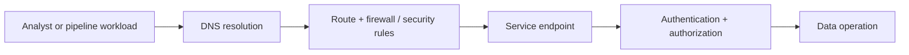
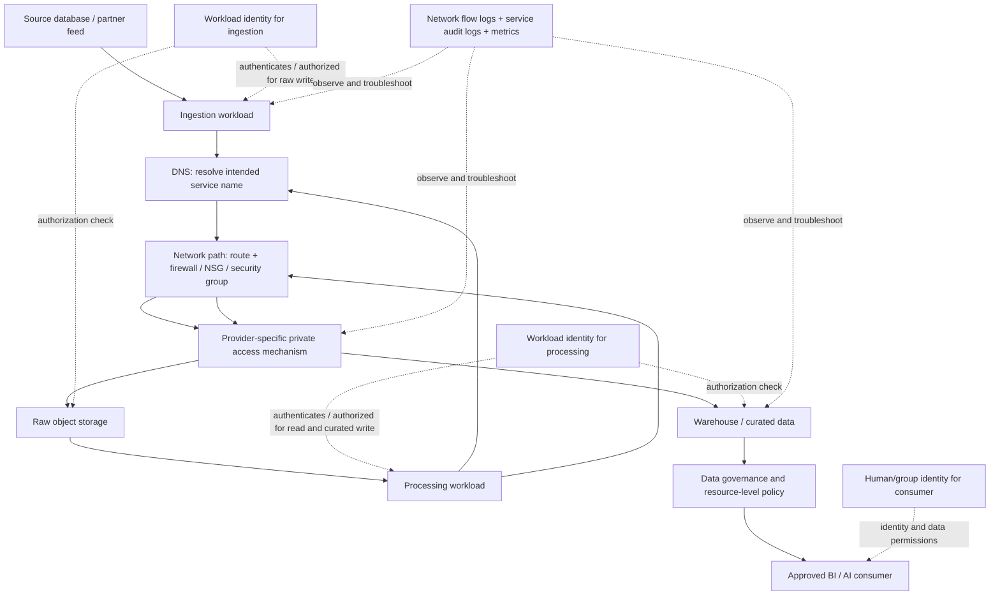

# Networking, Identity and Private Connectivity
## Stage 2D — Data Architecture | Topic 05

> **Audience:** beginners preparing for cloud data-platform architecture through experienced engineers comparing AWS, Microsoft Azure and Google Cloud.  
> **Purpose:** explain how a workload reaches a service, proves its identity, and receives permission to perform a data operation—then compare how the three providers implement those responsibilities.  
> **Scenario:** Northbridge Bank is fictional. Address ranges, resource names, policies and design choices in this lesson are illustrative. No configuration in this document has been deployed or executed.

---

## 1. Read this lesson in two phases

This topic intentionally appears twice in the roadmap's learning sequence.

### Phase A — Beginner preview (before Topics 02–04)

Study Sections **1–6** and the preview exercise in Section 7 before the AWS, Azure and GCP lessons.

The module roadmap specifies this order because the provider lessons continually refer to VPC/VNet, subnets, IAM and endpoints. The beginner preview should remain a vocabulary-and-diagram exercise, not a requirement to master provider-specific routing, DNS forwarding or policy syntax. You do not need to be a network engineer yet. Your preview deliverable is:

- a one-page glossary;
- a simple network and data-access diagram;
- an initial distinction between reachability and permission.

Do not attempt to master every provider-specific detail in this phase. Mark uncertain details as questions for the full lesson.

### Phase B — Full lesson (after Topics 02–04)

After completing the AWS, Azure and GCP reference-pattern lessons, study Sections **8–22**. Use the same logical model to compare provider-specific networking, identity and private-access behavior.

The full lesson prepares you for Topic 06, Hybrid Connectivity and On-Premises Integration. It introduces routing, DNS and private paths conceptually, but does not become a router-configuration or hybrid implementation guide. Infrastructure as code remains Topic 08; deeper governance, encryption and privacy remain in the dedicated governance/security module.

---

## 2. Phase A — Beginner preview: the essential vocabulary

### 2.1 What a network does

A network lets endpoints exchange packets. For a data platform, endpoints may include a pipeline worker, object-storage API, warehouse endpoint, database, internal API, administrator workstation or monitoring service.

A request succeeds only when several independent conditions are satisfied:

1. The client resolves the intended service name.
2. A route exists to the destination.
3. Network controls permit the flow.
4. The service is listening and healthy.
5. The client authenticates successfully.
6. Authorization allows the requested operation.
7. Any additional service policy, perimeter, encryption-key or organization constraint is satisfied.

A failure at any one layer can stop the request. A timeout often points toward DNS, routing, firewall, endpoint or service availability; a clear `403` often points toward authorization, but error codes are clues—not proof. Some services deliberately mask details.

### 2.2 Essential terms

| Term | Plain-language meaning | Data-platform example |
|---|---|---|
| IP address | Numeric address used to identify a network interface or endpoint | A worker reaches a private database IP |
| IPv4 | 32-bit address written as four decimal octets | `10.20.4.15` |
| IPv6 | 128-bit address written in hexadecimal groups | `2001:db8::10` (documentation example only) |
| CIDR prefix | Address range notation such as `/24` | `10.20.4.0/24` |
| Network/subnet | A defined IP range within a network design | Separate worker and database subnets |
| Route | Rule that selects a next hop for a destination prefix | Send a destination range to a firewall or gateway |
| Route table | Collection of routes applied to an interface/subnet/network, depending on provider | Determines the path to a service endpoint |
| Gateway | A network component or next hop used to reach another network or service | Internet gateway, VPN gateway, NAT gateway |
| DNS | Maps a name to records such as IP addresses | `storage.example` resolves to a private endpoint IP |
| Port | Number associated with a transport-layer service | TCP 443 for HTTPS |
| Protocol | Rules used to communicate | TCP, UDP, TLS over TCP |
| Firewall | Enforces rules about permitted traffic | Allow only approved sources to a service port |
| Security group / NSG / firewall rule | Provider-specific traffic-control mechanism | Allow a worker to reach a database |
| Endpoint | Network address or interface through which a service is reached | Private endpoint for a storage API |
| VPC / VNet | Provider-managed virtual network boundary | AWS VPC, Azure VNet, Google Cloud VPC |
| Identity | Human or workload represented to a system | Analyst group or pipeline service account |
| Authentication (AuthN) | Proving who/what is making a request | Workload obtains a token |
| Authorization (AuthZ) | Deciding what that identity may do | Read one dataset but not delete it |
| IAM | Identity and access management | Roles and policies for data access |
| Role | Named set of permissions assigned to an identity at a scope | Read-only data access role |
| Policy | Rules that allow or deny operations under conditions | Permit reads from a specific bucket/prefix |
| Service/workload identity | Identity assigned to software rather than a person | A pipeline’s managed identity or service account |
| Secret | Sensitive value such as a password, token or private key | Database password (avoid embedding in code) |
| Encryption in transit | Protects data while moving over a connection | TLS |
| Encryption at rest | Protects stored data | Service-managed encryption or customer-managed key |
| Private endpoint | A provider-specific private access path to a supported service | A private IP or endpoint for storage |
| Trust boundary | Point where identity, ownership, network or policy assumptions change | Ingestion project to governed analytics project |

### 2.3 A first network diagram



This diagram is simplified. In a real request, authentication and authorization checks may occur at different points, and a service may perform additional policy checks. The important idea is that a valid route and a valid identity are different prerequisites.

### 2.4 The most important distinction

**Network reachability is not authorization.** A worker may have a route to a storage API and still be denied access because its identity lacks permission.

**A valid identity does not guarantee reachability.** A pipeline may have the correct role but fail because DNS resolves incorrectly, a firewall blocks TCP 443, a route is missing, the endpoint is unavailable, or the service’s network rules reject the source.

Use this two-question test for every access path:

- **Can it reach the intended endpoint?** Name resolution, routing, network controls, endpoint state.
- **May this identity perform this operation?** Authentication, IAM/resource permissions, service-specific controls.

### 2.5 Phase A preview task

Without creating a cloud account, draw this flow:

`pipeline worker → private access path → object storage → transformation service → warehouse → analyst`

Label:
- the likely network path;
- the identity used by the worker;
- which identity needs read, write or query permissions;
- one possible DNS failure and one permission failure.

**Expected output:** a one-page glossary and diagram. It is acceptable to write “verify in Topic 05 full lesson” beside provider-specific details.

---

## 3. CIDR and subnet fundamentals

CIDR (`Classless Inter-Domain Routing`) expresses a prefix and its address range. For IPv4, the prefix length indicates how many of the 32 bits identify the network; the remaining bits are available for addresses within that block.

### 3.1 Calculate the range

For an IPv4 prefix `/p`:

- Total addresses in the block = \(2^{32-p}\).
- Prefix `/24` leaves 8 host bits: \(2^8 = 256\) total addresses.
- Prefix `/20` leaves 12 host bits: \(2^{12} = 4,096\) total addresses.
- Prefix `/16` leaves 16 host bits: \(2^{16} = 65,536\) total addresses.

Examples:

| CIDR block | First address | Last address | Total addresses | Notes |
|---|---|---|---:|---|
| `10.20.4.0/24` | `10.20.4.0` | `10.20.4.255` | 256 | Commonly used as a small IPv4 subnet |
| `10.20.0.0/20` | `10.20.0.0` | `10.20.15.255` | 4,096 | Third octet ranges from 0 through 15 |
| `10.20.0.0/16` | `10.20.0.0` | `10.20.255.255` | 65,536 | A larger address block |

**Provider caveat:** usable address counts are not always equal to the total. AWS reserves five IPv4 addresses in each subnet; Azure reserves five IPv4 addresses per subnet; Google Cloud has its own reserved-address rules. IPv6 behaves differently. Always consult the provider documentation for the exact subnet type and address family.

### 3.2 Northbridge example address plan

Illustrative plan only:

| Purpose | CIDR | Address capacity before provider reservations |
|---|---|---:|
| Northbridge cloud workload VPC/VNet | `10.40.0.0/16` | 65,536 |
| Ingestion workers | `10.40.10.0/24` | 256 |
| Processing workers | `10.40.20.0/24` | 256 |
| Internal application tier | `10.40.30.0/24` | 256 |
| Private endpoint subnet/range (provider-specific design) | `10.40.40.0/24` | 256 |

All four `/24` ranges are inside `10.40.0.0/16` and do not overlap each other. The plan is not a claim that every provider requires a dedicated endpoint subnet or uses this exact topology. Some provider services allocate endpoint addresses differently; some service-producer ranges are separate allocations rather than ordinary subnets.

Before reserving ranges, inventory on-premises, partner, peer-VPC/VNet, VPN, endpoint and future expansion ranges. Overlap can prevent peering, routing, private service access or hybrid connectivity.

### 3.3 Routes, longest-prefix match and default routes

A route typically combines a destination prefix and a next hop/target. Route selection is provider-specific: longest-prefix match is important in many routing decisions, but it is not a universal rule that overrides every provider route type or priority. For example, Google Cloud evaluates special routing paths and policy-based routes in a defined order before ordinary routes; AWS and Azure also have provider-specific route-selection and effective-route rules. Always inspect the effective route for the actual source and destination.

- `10.40.20.0/24` is more specific than `10.40.0.0/16`.
- `0.0.0.0/0` is an IPv4 default route matching any IPv4 destination not matched by a more specific route.
- `::/0` is the IPv6 default route.
- A route only selects a path. It does not by itself authorize the application or open a firewall.

Do not assume route-table placement is identical across providers. AWS associates a route table with each subnet; Azure route tables can be associated with subnets; Google Cloud VPC routes are defined at the VPC network level, with route applicability and priority rules that differ from the others.

### 3.4 Ports and protocols

TCP 443 is commonly used for HTTPS, but the port alone does not prove the application is using TLS correctly or that the service is safe. Permit only the protocols and ports required by the workload.

Examples:
- pipeline worker → supported HTTPS API: TCP 443;
- application → PostgreSQL database: often TCP 5432, if that is the configured listener;
- DNS: typically UDP/TCP 53, depending on query size, response, and resolver behaviour.

These are common defaults, not universal truths. Verify the actual endpoint, protocol, proxy, TLS mode and service configuration.

---

## 4. A consistent model for every access path

For a request from source **S** to destination **D**, record five layers:

1. **Name resolution:** which DNS name is requested, and what record/address should it resolve to?
2. **Network path:** which route, next hop, gateway or provider service path carries traffic?
3. **Network controls:** which firewall, security group, NSG, endpoint policy or service network rule permits or denies it?
4. **Authentication:** which human/workload principal is presented, and how are credentials or tokens obtained?
5. **Authorization and service policy:** does the principal have permission for this action on this resource, and do data-specific controls permit it?

TLS and key controls apply across or within these layers. Observability should let the operator correlate DNS, network and service-level failures without logging secrets or sensitive payloads.

### 4.1 Reachability versus permission decision table

| Observation | Likely area | First checks | What not to do |
|---|---|---|---|
| DNS name does not resolve | DNS zone, resolver, forwarding, record | Query from the same workload/network; compare expected private/public answer | Do not broaden IAM |
| DNS resolves to a public address when private access is required | Private DNS zone/record, endpoint integration, resolver path | Inspect authoritative zone and client resolution path | Do not assume a private endpoint automatically changes every DNS view |
| TCP connection times out | Route, firewall/NSG/security group, endpoint health, service network rules | Check route/next hop, flow logs, rule evaluation and service health | Do not assume `403`/IAM is the cause |
| TCP connection is refused | Destination reachable but listener/endpoint may not accept connection | Check port, listener, endpoint target and service state | Do not open all ports |
| TLS certificate/hostname failure | TLS configuration, DNS name, proxy, certificate trust | Verify expected hostname and certificate chain | Do not disable TLS validation as a workaround |
| HTTP `401` / token error | Authentication or expired/invalid credentials | Check workload identity, token audience/scope, clock and credential refresh | Do not put permanent credentials in code |
| HTTP `403` / access denied | Authorization or service-side policy | Identify the actual principal; inspect IAM, resource policy, data policy and perimeter | Do not grant Owner/Administrator reflexively |
| Only one dataset/object is denied | Resource scope or data-level policy | Check exact resource path, inherited roles and row/column policy | Do not grant access to the whole project/account |
| Works from one subnet but not another | Route, firewall, DNS or source-dependent service rule | Compare effective routes, DNS answer and firewall evaluation | Do not assume same VPC/VNet means identical access |
| Works through a public path but not private path | Private DNS, route, endpoint state, private-access support | Verify service support and private endpoint DNS/route design | Do not leave public access enabled without explicit risk acceptance |

These are diagnostic hypotheses, not one-to-one mappings from error code to root cause.

---

## 5. Identity fundamentals

### 5.1 Principal types

- **Human user:** a person authenticated through an identity provider.
- **Group:** a collection of users or principals used to manage access consistently.
- **Role:** a named set of permissions. The word “role” has provider-specific semantics; do not assume an AWS IAM role, Azure RBAC role definition and Google Cloud IAM role are identical.
- **Policy:** a provider-specific expression of access rules and conditions.
- **Service identity:** an identity used by a managed service or application.
- **Workload identity:** a way for running software to prove its identity without embedding a long-lived secret.
- **Service agent:** a provider-managed principal used by a service to perform operations on your behalf; it is distinct from your application’s runtime identity in many designs.

### 5.2 Authentication versus authorization

**Authentication (AuthN)** asks: “Who or what is making this request?” Examples include a signed request, token, certificate or federated identity assertion.

**Authorization (AuthZ)** asks: “May that principal perform this action on this resource under these conditions?” Examples include read an object, query a dataset, create a job or change a key policy.

A successful login does not imply permission to every resource. A private IP address does not authenticate a caller. A valid token does not necessarily have the correct audience, scope or role.

### 5.3 Least privilege

Grant only the actions and resources required for a task, at the narrowest practical scope, for the shortest useful duration.

For each workload, document:
- purpose and owner;
- identity source and credential lifecycle;
- allowed actions and exact resources;
- denied/high-risk actions;
- whether permissions are inherited;
- how access is audited and reviewed;
- how access is removed when the workload is retired.

Separate deployment identities from runtime identities. The identity that creates a pipeline should not automatically be the identity that reads all production data at runtime.

### 5.4 Temporary credentials, secrets and federation

Prefer provider-native workload identity or federation when supported:
- AWS workloads can use IAM roles and temporary credentials through supported compute identity mechanisms.
- Azure workloads can use managed identities for supported Azure-hosted resources; external workloads may use workload identity federation or service-principal patterns appropriate to the platform.
- Google Cloud workloads can use service accounts and Workload Identity Federation where supported.

Do not store long-lived access keys in source control, container images, notebook files, logs or environment files committed to repositories. If a legacy integration requires a secret, retrieve it through an approved secret manager, restrict who can read it, rotate it, and audit access.

Temporary credentials expire, which limits the useful lifetime of a stolen credential; they still need least privilege, protected delivery and incident response.

### 5.5 Encryption and key management

- **TLS/in-transit encryption** protects data on the connection, but does not decide which identity may read the data.
- **Encryption at rest** protects stored data, but does not replace access controls.
- **Provider-managed keys** reduce key-operation burden.
- **Customer-managed keys** can support custody/control requirements but add key policy, rotation, availability, audit and recovery responsibilities.

Before using a customer-managed key, verify that the selected service, region and resource type support it. A disabled key, missing service-agent permission or incompatible key location can make data inaccessible.

---

## 6. Phase A provider preview: the names you need before Topics 02–04

Only learn the basic mapping at this stage. The full comparison follows the provider lessons.

| Logical concept | AWS | Microsoft Azure | Google Cloud |
|---|---|---|---|
| Virtual private network | Amazon VPC | Azure Virtual Network (VNet) | Google Cloud VPC network |
| Subnet | Subnet associated with a VPC | Subnet within a VNet | Regional subnet within a VPC network |
| Traffic-control mechanisms | Security groups, network ACLs, route tables and other controls | Network security groups (NSGs), route tables, Azure Firewall and other controls | VPC firewall rules/policies, routes and other controls |
| Workload identity | IAM role with service-specific attachment/assumption mechanism | Managed identity or other supported workload identity | Service account or Workload Identity Federation |
| Object storage access | S3 access path and bucket/object policies | Storage endpoint, RBAC and storage-specific controls | Cloud Storage API/path and IAM |
| Private service access examples | VPC endpoints / AWS PrivateLink, depending on target | Azure Private Endpoint / Private Link | Private Google Access, Private Service Connect or Private Services Access, depending on target |

The table is an orientation aid, not an equivalence table. In particular, the Google Cloud options listed in the last row solve different problems, and the AWS/Azure mechanisms also differ by service and endpoint type.

### Phase A checkpoint

Before starting the AWS lesson, explain in your own words:
1. what a subnet is;
2. what a route table does;
3. what DNS does;
4. why network access does not grant data permission;
5. why workload identity is safer than a hard-coded long-lived key.

If you cannot yet explain one of these, revisit Sections 2–5 rather than trying to memorize every product name.

---

## 7. Phase A preview exercise: Northbridge’s first private data path

Northbridge wants a batch ingestion worker to write raw files to an object-storage service. The worker must not have public inbound access, and analysts must not be able to read raw customer files by default.

Draw and label:
- worker subnet/network boundary;
- the chosen storage access path (leave the provider-specific mechanism open);
- DNS name and expected resolution;
- worker identity;
- write permission for the raw landing destination;
- analyst identity and the explicit lack of raw-read permission;
- one route/firewall failure and one authorization failure.

**Expected output:** a simple diagram and a table with columns `Source`, `Destination`, `DNS`, `Route`, `Network control`, `Identity`, `Allowed action`, `Failure signal`.

---

## 8. Phase B — Full lesson: network architecture across the three providers

### 8.1 Virtual network responsibilities

A virtual network provides a logically isolated network context and a place to define addressing, routing and traffic controls. It is not, by itself, an application authorization boundary.

Provider-specific models matter:

| Concern | AWS | Azure | Google Cloud |
|---|---|---|---|
| Virtual network | VPC is regional | VNet is associated with a region | VPC network and its routes/firewall rules are global resources; subnets are regional |
| Subnet | Subnet belongs to a VPC and an Availability Zone | Subnet is within a VNet; it is not an independent security boundary by itself | Subnet is regional and belongs to a VPC network |
| Route attachment/model | Each subnet is associated with one route table; main table may apply implicitly | User-defined route tables can be associated with subnets; system and propagated routes also apply | Routes are defined at VPC network level with system-generated and custom routes and provider-specific applicability/priority |
| Stateful traffic control | Security groups are stateful; network ACLs are stateless | NSGs are stateful; UDRs change path selection rather than replacing firewall controls | VPC firewall rules are distributed and applied to VM traffic; exact rule model differs from AWS SGs and Azure NSGs |
| Network hierarchy | VPC, subnet, route table, gateways/endpoints | VNet, subnet, route table, NSG, gateways/endpoints | VPC network, subnet, routes, firewall policies/rules, service access mechanisms |
| Key comparison question | Which subnet route table and SG/NACL rules apply? | What are the effective routes and NSGs, including inherited/propagated paths? | Which VPC routes and firewall policies apply to the VM/endpoint and how are priorities resolved? |

Do not translate a diagram literally from one provider to another. Recreate the required reachability and isolation outcomes using each provider’s own routing, firewall and endpoint semantics.

### 8.2 Public and private subnets are patterns, not universal labels

A “public subnet” commonly means that a workload has a viable route to an internet gateway and that the workload/service has the addressing and firewall configuration needed for inbound or outbound internet traffic. A route alone does not make a workload safely internet-accessible.

A “private subnet” usually means the workload has no direct inbound public path, and outbound access may be restricted or mediated through NAT, proxies, private endpoints or service-specific mechanisms.

The exact meaning differs:
- In AWS, a route to an Internet Gateway is a key part of the public-subnet pattern, but a resource also needs appropriate addressing and security controls for internet communication.
- Azure does not require every subnet to be labeled public/private in the same way; routing, public IPs, NSGs, NAT and service endpoints/private endpoints determine the effective path.
- Google Cloud VPC subnets are not intrinsically “public” or “private” merely because of their names. External IP configuration, routes, firewall rules and service-access options determine the path.

Design for required flows instead of relying on subnet labels.

### 8.3 Network segmentation

Separate network zones where trust, ownership or traffic requirements differ—for example:
- ingestion workers;
- processing workers;
- internal applications;
- data services/private endpoints;
- administration/operations;
- shared services.

Segmentation reduces blast radius and makes traffic policy easier to review. It adds routing, DNS, firewall and operational complexity. Too many small segments can become unmaintainable; a single flat network can make lateral movement easier.

For each boundary, document:
- source and destination;
- protocol/port;
- business purpose;
- direction;
- route/next hop;
- network rule;
- identity/authorization control;
- owner and expiry/review date.

---

## 9. Private service access: do not treat the provider options as equivalent

Private connectivity reduces exposure and can keep traffic on a provider-managed private path, but the precise mechanism depends on the service. It does not automatically turn off every public endpoint, enforce every identity permission or make every operation private.

### 9.1 AWS: VPC endpoints and AWS PrivateLink

Common AWS patterns include:
- **Gateway endpoints** for supported services such as Amazon S3 and DynamoDB. These are route-table-integrated and differ from interface endpoints.
- **Interface VPC endpoints**, implemented using endpoint network interfaces and private IP addresses, for supported services.
- **AWS PrivateLink** for private connectivity to supported services, including endpoint services published by providers/partners.

Verify the exact service, endpoint type, DNS behaviour, route-table association, security group, endpoint policy, resource policy and whether public access is still possible. An S3 gateway endpoint and an interface endpoint do not have the same networking model or billing characteristics.

### 9.2 Azure: Private Endpoint / Private Link

An Azure Private Endpoint uses a private IP address from a VNet to reach a supported Private Link resource. DNS configuration is often central: the service FQDN should resolve through the intended private DNS zone/path for clients that are supposed to use the endpoint.

Important checks:
- correct service and subresource (for example, storage subresources can require separate endpoints);
- private DNS zone and VNet links;
- custom DNS and conditional forwarding where applicable;
- effective route and NSG/UDR policy; on private-endpoint subnets, verify whether private-endpoint network policies are enabled before assuming NSGs or user-defined routes are enforced;
- private endpoint approval/connection state;
- whether public network access remains enabled on the target service.

**Do not assume that creating a private endpoint disables public access.** Confirm the service’s public network access setting and apply the organization’s intended restriction.

### 9.3 Google Cloud: different mechanisms for different jobs

- **Private Google Access** allows eligible resources without external IP addresses to reach supported Google APIs/services using the documented routing and DNS options. It is configured per subnet and has service/API and route requirements. It does not mean every service has a private IP in the VPC.
- **Private Service Connect (PSC)** provides private endpoints or backends for supported published services and Google APIs/services. Endpoint type, region/global access, DNS, producer/consumer setup and firewall requirements depend on the specific use case.
- **Private Services Access** establishes a private connection, using VPC Network Peering, to supported VPC-hosted service-producer networks. Address allocation and non-overlapping ranges matter.
- **VPC Service Controls** establishes service perimeters for supported services to help reduce data-exfiltration risk. It is not a substitute for a route, firewall or IAM policy.

Do not choose among these by the phrase “private endpoint” alone. Start with the exact target service and ask whether the requirement is private API access, a private endpoint to a published service, private IP connectivity to a producer VPC, or an exfiltration-control perimeter.

### 9.4 Cross-provider decision table

| Requirement | AWS candidate | Azure candidate | Google Cloud candidate | Must verify |
|---|---|---|---|---|
| Private access to supported object-storage API | S3 gateway endpoint or supported interface endpoint pattern | Storage Private Endpoint | Private Google Access or a supported PSC/API endpoint pattern | Service/operation support, DNS, routes, policy, public-access posture and cost |
| Private access to a supported managed service published by another party | Interface endpoint / AWS PrivateLink | Private Endpoint / Private Link | PSC endpoint/backend pattern | Provider/consumer acceptance, DNS, regionality, endpoint type and service support |
| Private IP access to a supported provider-hosted database service | Service-specific endpoint or private network pattern | Service-specific Private Link or VNet integration pattern | Private Services Access or PSC, depending on service | Exact service support, IP allocation, routing, DNS and location constraints |
| Reduce data exfiltration to/from managed services | Endpoint policies, resource policies, network and organization controls | Service network restrictions, Azure Policy and other controls | VPC Service Controls for supported services plus IAM/network controls | Scope, supported APIs/services, exception paths, monitoring and test plan |
| Private access from a subnet with no public IP | VPC endpoint or controlled egress pattern | Private Endpoint or controlled egress pattern | Private Google Access/PSC/other service-specific path | No public route assumption, DNS answer, endpoint reachability and required API paths |

---

## 10. End-to-end data-platform access diagram

The diagram below shows a conceptual path from ingestion to a governed warehouse. It deliberately separates network and identity controls.



> Diagram note: the exact placement of authorization checks, managed service agents, service-side controls and logging differs by provider and service. Dotted lines show responsibility relationships, not literal packet paths. The “private access mechanism” must be selected for the exact service and may not be a private IP endpoint in every provider pattern.

### 10.1 Access-path record

For every edge in a production diagram, record:

| Field | Example |
|---|---|
| Source principal and workload | `ingestion-prod` workload identity |
| Source network/subnet | `10.40.10.0/24` (illustrative) |
| Destination service/resource | Raw landing bucket/prefix |
| DNS name and expected answer | Service FQDN → documented private path |
| Protocol and port | HTTPS/TCP 443, if supported/configured |
| Route/next hop | Provider endpoint route / service-specific path |
| Network controls | Firewall, security group, NSG, endpoint/service network policy |
| Authentication method | Managed identity, service account, IAM role, federation |
| Authorization scope | Write only to intended landing resource |
| Encryption | TLS; at-rest key choice if applicable |
| Logs/metrics | Network flow, audit, application and service telemetry |
| Owner and recovery | Network/platform/data owner and runbook |

---

## 11. Least-privilege policy examples

These examples are teaching aids. Use placeholders, review the provider’s current schema, and adapt only after confirming the principal, resource scope and service-specific requirements. They have **not** been deployed or executed here.

### 11.1 AWS IAM policy: restricted S3 prefix

This illustrative identity policy permits listing one bucket only with the specified prefix and object read/write on that prefix. It intentionally omits delete permissions. The list condition uses a trailing slash so a request for `northbridge/landing/source-a/` does not also match sibling keys such as `source-a-archive/`. Bucket names and prefix must be replaced with approved values. Other controls—bucket policy, KMS permissions, endpoint policy and organization policy—may also affect the request.

```json
{
  "Version": "2012-10-17",
  "Statement": [
    {
      "Sid": "ListOnlyApprovedLandingPrefix",
      "Effect": "Allow",
      "Action": "s3:ListBucket",
      "Resource": "arn:aws:s3:::REPLACE_WITH_APPROVED_BUCKET",
      "Condition": {
        "StringLike": {
          "s3:prefix": [
            "northbridge/landing/source-a/",
            "northbridge/landing/source-a/*"
          ]
        }
      }
    },
    {
      "Sid": "ReadWriteOnlyApprovedLandingObjects",
      "Effect": "Allow",
      "Action": [
        "s3:GetObject",
        "s3:PutObject"
      ],
      "Resource": "arn:aws:s3:::REPLACE_WITH_APPROVED_BUCKET/northbridge/landing/source-a/*"
    }
  ]
}
```

Review before use:
- Does the workload actually need both read and write? If not, remove the unused action.
- Is multipart upload required by the client? Add only documented required actions after checking the actual workflow.
- Does the bucket use SSE-KMS? The workload may need specific KMS permissions; do not grant broad key administration.
- Is there a bucket policy or endpoint policy that further restricts access?
- Are object ownership, versioning, retention and deletion requirements understood?

### 11.2 Azure: managed identity plus scoped RBAC

For an Azure-hosted workload, prefer a system-assigned or user-assigned managed identity where the target service supports it. Assign the narrowest suitable data-plane role at the narrowest supported scope, such as a specific storage container when that scope meets the use case. A control-plane role that can manage a storage account is not the same as a data-plane role that can read blob content.

Conceptual checklist (not a ready-to-run command):
1. Identify the exact managed identity principal ID.
2. Select a role whose data actions match the workload (read, write or both).
3. Scope the assignment to the intended container/resource, not the entire subscription.
4. Confirm network path, private endpoint DNS and storage network rules separately.
5. Test both the required action and a forbidden action.
6. Review inherited role assignments and remove unnecessary grants.

Do not use a human user’s credentials or a stored client secret for a long-running Azure workload when a supported managed identity/federation option meets the requirement.

### 11.3 Google Cloud: dedicated service account and narrow roles

For Google Cloud, use a dedicated service account for the workload and grant only the documented roles/permissions needed on the target resource. Prefer resource-level grants where supported and appropriate; avoid broad project-wide roles for simple object reads or writes.

Conceptual example:
- `ingestion-prod` service account: write to the approved Cloud Storage landing destination only;
- `transform-prod` service account: read approved raw inputs and write curated outputs;
- `analyst-readers` group: query approved BigQuery datasets, not raw storage by default.

Exact role names and resource-level grant support depend on the operation. Verify whether the operation is authorized by Cloud Storage IAM, BigQuery IAM, a service-specific control, an organization policy, a VPC Service Controls perimeter or a KMS key permission. Do not assume one role controls all these layers.

### 11.4 Policy review method

For every policy:
1. Identify the actual principal used at runtime.
2. List required API actions and resource names.
3. Scope the policy as narrowly as the service supports.
4. Check inherited roles, resource policies, key policies and organization constraints.
5. Include the private network path separately.
6. Test a permitted action and a forbidden action.
7. Review logs to confirm which principal made the request.
8. Set an owner and periodic review date.

---

## 12. Workload identity patterns across providers

| Workload context | Preferred identity pattern to investigate | Avoid as a default |
|---|---|---|
| AWS compute workload accessing AWS data service | IAM role attached through the service-supported mechanism, using temporary credentials | Static access keys embedded in code or image |
| Azure-hosted workload accessing supported Azure service | Managed identity and narrowly scoped RBAC | Shared client secret or human user credentials |
| Google Cloud workload accessing Google Cloud API | Dedicated service account; use the service-supported runtime identity mechanism | Downloaded service-account key file stored in application configuration |
| External CI/CD workload deploying to cloud | Federation/OIDC or the provider-supported short-lived credential flow | Long-lived administrator keys stored in CI variables |
| Workload in one cloud accessing another cloud | Explicit workload identity federation/role assumption and narrow target permissions where supported | Static cross-cloud keys copied into configuration |

Identity federation is not automatic trust. Configure the trusted issuer, audience/subject conditions, permitted target role/service account, and allowed repository/environment or workload identity. Verify token lifetimes, audience, subject mapping, clock assumptions and audit trails.

---

## 13. DNS: the hidden dependency in private connectivity

DNS often determines whether a client uses the intended private endpoint. The same service name can resolve differently depending on which resolver, private zone, VNet/VPC, forwarding rule or client network is used.

### 13.1 Typical private-DNS failure

Expected:

```text
storage.service.example -> private endpoint address
```

Observed:

```text
storage.service.example -> public service address
```

Possible causes:
- private DNS zone not created or not linked to the client network;
- endpoint-specific DNS record missing;
- custom resolver not forwarding the private zone;
- split-horizon DNS configured differently in dev and production;
- client cache or local hosts entry;
- the service name is wrong for the endpoint type;
- endpoint creation completed but DNS integration/approval did not.

### 13.2 Troubleshooting order

Run checks from the **same host/container/workload and network path** that experiences the failure.

1. Resolve the exact fully qualified domain name and record the answer/TTL.
2. Compare the answer with the provider’s expected private endpoint/target DNS configuration.
3. Check the authoritative private zone, zone links/associations, forwarding and resolver path.
4. Check the effective route to the resolved address.
5. Check firewall/security group/NSG and service-side network policy.
6. Check endpoint connection state and target service health.
7. Test TCP reachability to the documented port.
8. Test TLS using the expected hostname; do not disable certificate verification.
9. Authenticate using the intended workload identity.
10. Test the required resource action and inspect service audit logs.

Example diagnostic commands (common tools; availability depends on OS and image):

```bash
# DNS lookup; use the exact service FQDN
nslookup SERVICE_FQDN

# Alternative DNS lookup tool
dig SERVICE_FQDN

# TCP connectivity check, if netcat is installed
nc -vz SERVICE_FQDN 443

# TLS handshake / certificate hostname check
openssl s_client -connect SERVICE_FQDN:443 -servername SERVICE_FQDN
```

These commands are diagnostic examples, not a complete provider configuration. They do not prove that the identity is authorized. Do not send real secrets or sensitive request payloads when testing.

### 13.3 DNS is not routing

A correct DNS answer can still be unreachable because the route or firewall is wrong. A route to a private address can exist while the client resolves the service name to a public address. Diagnose DNS and routing separately.

---

## 14. Routing and firewall troubleshooting

### 14.1 Check route selection

For the source and destination, identify:
- source interface and subnet;
- destination IP after DNS resolution;
- matching route and next hop;
- more-specific routes and route priorities;
- NAT, gateway or inspection appliance in the path;
- return route (asymmetric routing can break sessions);
- endpoint/service network rules;
- whether the chosen private-access pattern supports this exact route.

Provider tooling differs. AWS has subnet-associated route tables and route-analysis tools; Azure provides effective routes/next-hop diagnostics; Google Cloud provides VPC route views and connectivity diagnostics. Use the provider’s current tool for the actual resource.

### 14.2 Firewall and security rules

Check both source and destination directions as relevant. A rule that allows outbound traffic does not necessarily mean the return flow is permitted in every network model. Stateful security groups/NSGs and stateless network ACLs have different return-traffic behavior; Google Cloud firewall rules have their own distributed enforcement semantics.

Avoid rules such as:
- allow every source (`0.0.0.0/0`) to every port;
- allow all protocols between production and non-production;
- expose database administration ports to the internet;
- allow an entire corporate network where one workload subnet suffices.

If a broad rule is temporarily used for diagnosis, it should not become the permanent fix; document approval, expiry and removal. Prefer a narrow source, destination, protocol and port rule.

### 14.3 Example: DNS works, connection times out

Symptoms:
- DNS returns the expected private IP.
- TCP 443 times out.

Check in order:
1. Is the private endpoint approved/active?
2. Does the source subnet have a route to the endpoint or service path?
3. Are network ACLs/security groups/NSGs/firewall policies allowing the flow?
4. Is the destination service’s network restriction compatible with the source?
5. Are there return-path or asymmetric-routing issues?
6. Is the service healthy, and is the client using the correct port?
7. Inspect flow logs, connectivity tests and service health telemetry.

Do not grant broader data IAM permissions for a pure connectivity timeout.

---

## 15. Data-platform private-access design scenarios

### 15.1 Data lake: ingestion writes raw objects

Requirements:
- ingestion workload can write only its source prefix/container;
- analysts do not receive raw read by default;
- access uses a private path if required by policy;
- encryption, retention and audit are configured.

Design:
1. select the provider-supported object-storage access mechanism;
2. ensure the private DNS/routing path is correct;
3. assign a dedicated workload identity;
4. grant the smallest supported write scope;
5. restrict public access according to service capabilities and requirements;
6. test an allowed write, a forbidden read and an unauthorised delete;
7. monitor rejected connections and access-denied events.

### 15.2 Warehouse: transformation job queries curated data

Requirements:
- transformation reads staging and writes curated tables;
- analyst group queries curated datasets only;
- raw identifiers remain restricted.

Design:
- use separate workload and analyst identities;
- scope query/read/write permissions to required datasets/tables;
- use row/column-level controls or views only where they meet the data policy and supported query path;
- verify service endpoints, dataset location and network requirements;
- inspect job/audit logs for the actual principal;
- test access to restricted raw fields using an analyst identity.

### 15.3 Ingestion API: external partner sends files/events

Requirements:
- partner can submit data but cannot browse other data or invoke internal APIs;
- ingestion endpoint has a defined exposure model;
- traffic is authenticated, rate-limited and monitored.

Design questions:
- Is an internet-facing authenticated endpoint acceptable, or is partner private connectivity required?
- Which identity mechanism does the partner support?
- How are credentials/certificates rotated?
- Where are files/events staged and validated?
- How are malware, schema, size and replay risks handled?
- Does the partner need network-level allowlisting, application authentication, or both?
- What is the incident procedure if a credential is compromised?

A public endpoint can be secured appropriately for some use cases, but it is still exposed to internet-originated traffic and denial-of-service attempts. A private path does not remove the need for authentication and authorization.

### 15.4 Internal BI/AI consumers

Requirements:
- consumers query certified data products;
- no direct access to raw data unless explicitly approved;
- user access is attributable and reviewed.

Design:
- integrate with the enterprise identity provider where appropriate;
- use groups/roles with resource scope;
- use approved serving/warehouse endpoints;
- use private access if required, with tested DNS and route configuration;
- audit query/access activity and avoid logging sensitive query results;
- review whether notebooks, model training jobs, feature pipelines or retrieval indexes copy data outside the governed boundary.

---

## 16. Cross-provider identity and networking comparison

| Capability | AWS | Azure | Google Cloud | Comparison discipline |
|---|---|---|---|---|
| Human identity | IAM identities and/or federation through supported identity services | Microsoft Entra ID identities and federation | Google identities/Cloud Identity and federation | Compare authentication source, group lifecycle, MFA/conditional policy and audit—not names |
| Workload identity | IAM roles and temporary credentials through service-supported mechanisms | Managed identities; service principals/federation where appropriate | Service accounts and Workload Identity Federation | Compare credential delivery, token lifetime, trust conditions and target-resource support |
| Permission model | Identity/resource policies, role trust, service controls, organization controls | Azure RBAC, resource policies, Entra controls and service-specific access models | Cloud IAM, resource/service policies and service-specific controls | Check inheritance, deny/condition features, resource scope and data-plane differences |
| Network segmentation | VPC/subnets, SGs, NACLs, routes | VNet/subnets, NSGs, route tables, firewall | VPC/subnets, routes, firewall rules/policies | Statefulness, scope, priority and route attachment differ |
| Private service access | Gateway/interface endpoints, PrivateLink | Private Endpoint/Private Link and service-specific options | Private Google Access, PSC, Private Services Access | Select by target service and goal; not interchangeable |
| Private DNS | Endpoint DNS/private hosted zones and resolver architecture | Private DNS zones, VNet links, custom DNS/forwarding | Private zones, DNS policies/forwarding and service-specific DNS | Verify name from the actual client path |
| Network observability | VPC Flow Logs, CloudTrail and service logs | Network Watcher/flow logs and Azure Monitor/diagnostics | VPC Flow Logs, firewall logging, Cloud Logging and service audit logs | Logging coverage, retention and costs vary |
| Organization boundary | AWS Organizations/accounts | Entra tenant, management groups, subscriptions, resource groups | Organization, folders, projects | Do not claim account/subscription/project equivalence |
| Encryption keys | AWS KMS and service-specific key controls | Azure Key Vault/Managed HSM and service-specific controls | Cloud KMS and service-specific controls | CMEK support, policy, location, rotation and recovery differ |

### 16.1 Comparison deliverable

For at least three paired capabilities, write:
- logical requirement;
- candidate service/mechanism in each provider;
- actual behavior that is similar;
- at least one meaningful difference;
- official documentation used;
- unresolved questions;
- consequence for portability, operations or cost.

Example differences to investigate:
1. AWS VPC is regional, while Google Cloud VPC networks are global resources and Google Cloud subnets are regional.
2. AWS security groups are stateful and NACLs are stateless; Azure NSGs are stateful; Google Cloud firewall rule semantics and enforcement differ.
3. Google Cloud Private Google Access is not the same as Private Service Connect or Private Services Access.
4. Azure Private Endpoint does not automatically guarantee that public network access to the service is disabled.
5. An IAM role in one provider is not semantically identical to a role in another provider.

---

## 17. Failure scenarios, troubleshooting matrix and response playbook

| Failure | Likely layer | Evidence to collect | Recovery direction |
|---|---|---|---|
| Overlapping address ranges prevent peering | Address plan/routing | CIDR inventory, route conflicts, peering diagnostics | Renumber or use a deliberately designed translation/segmentation approach; do not assume route tweaks solve overlap |
| Missing route to endpoint | Routing | Effective route/next hop, route table, endpoint state | Add the intended specific route or correct association, after review |
| Firewall blocks TCP 443 | Network policy | Flow logs, rule evaluation, source/destination/port | Add a narrowly scoped rule if the flow is required |
| Private DNS zone not linked | DNS | DNS answer, zone association/link, resolver logs | Link/configure the intended private zone and retest from the client |
| DNS resolves to public service IP | DNS/service exposure | Resolver answer, private zone records, service public-access settings | Correct DNS and restrict public access where required |
| IAM role missing read permission | Authorization | Actual principal, denied action/resource, policy inheritance | Grant minimum required read permission at supported scope |
| Service identity is wrong | Authentication/identity | Token principal, attached role/identity, runtime config | Attach/configure the correct workload identity and remove unused credentials |
| Credential expired or token audience wrong | Authentication | Auth error, token expiry/audience, workload identity config | Refresh through approved flow; correct federation trust conditions |
| Public endpoint remains enabled unintentionally | Exposure policy | Service network-access setting, access logs, external scan results | Disable public access where supported/required; retest approved private path |
| Private endpoint created but service access fails | Endpoint/DNS/network/service policy | Endpoint status, DNS, route, firewall, target network policy | Diagnose each layer; verify service support and endpoint-specific rules |
| KMS key disabled or permission removed | Key/service access | KMS audit logs, key state, service identity permissions | Follow approved key recovery and least-privilege permission restoration |
| Logs unavailable during incident | Observability | Log configuration, destination, retention, permissions | Restore required logging, test alert routing and avoid exposing payloads |
| Network path works but query denied | Authorization/data policy | Actual principal, dataset/table/object permissions, perimeter/key controls | Correct resource permission; do not change routes unnecessarily |
| Identity allowed but TCP times out | Network path | DNS, route, firewall, endpoint and service health | Fix reachability; do not broaden IAM |

For every incident, capture:
- timestamp and correlation/request ID where available;
- source workload and actual principal;
- resolved DNS answer and destination;
- route and network policy evidence;
- service error and audit record;
- remediation, owner and post-fix negative test.

Do not paste tokens, access keys, private keys, passwords, sensitive object names or raw customer data into tickets or logs.

---

## 18. Monitoring and operational responsibility

### 18.1 What to observe

- **Network:** flow accepts/denies, route changes, endpoint health, VPN/gateway state, packet drops and connection failures.
- **DNS:** failed lookups, unexpected public/private answers, resolver health and record/zone changes.
- **Identity:** authentication failures, denied actions, role changes, key creation, credential rotation and federation failures.
- **Data service:** access-denied events, query/job failures, throttling, quota exhaustion and service health.
- **Application/pipeline:** retry rate, ingestion lag, failed writes, timeout rate and data-quality outcomes.
- **Control plane:** changes to network rules, route tables, endpoints, IAM and encryption keys.

Enable and configure the relevant logging features; do not assume every flow log, data-access audit event or diagnostic category is enabled by default. Verify retention, access to logs, redaction, alert destinations and ingestion cost.

### 18.2 Operational ownership table

| Area | Primary owner (example) | Supporting owner |
|---|---|---|
| Address plan and route design | Cloud/network platform team | Data platform and on-premises network team |
| DNS zones and forwarding | Network/DNS team | Service owner and application team |
| Workload identity and permissions | IAM/security team | Data platform/service owner |
| Service-side data policy | Data/service owner | Governance/security |
| Private endpoint and service access | Network/platform team | Service owner |
| Encryption key lifecycle | Security/key-management owner | Service owner and platform team |
| Logs, metrics and alerting | Service/platform SRE | Network, IAM and data engineering |
| Incident triage | Incident commander | Named specialists for network, identity, data and service |

Avoid a design in which no one owns the DNS zone, route, service account, key policy or endpoint approval.

---

## 19. Practical exercises with expected outputs

### Exercise A — CIDR and address-plan review

Given `10.50.0.0/16`, allocate four non-overlapping `/24` ranges for ingestion, processing, internal apps and private endpoints. Then identify whether `10.50.3.0/24` overlaps `10.50.0.0/20`.

**Expected result:** four `/24` ranges can fit in the `/16` if selected from distinct blocks. `10.50.3.0/24` is inside `10.50.0.0/20` (which spans `10.50.0.0` through `10.50.15.255`), so it overlaps. Explain that the provider’s reserved-address rules affect usable host counts, not the mathematical block size.

### Exercise B — Access-path matrix

For each scenario, fill in DNS, route, network control, authentication, authorization and service policy:

1. Dataflow/worker writes to a raw storage prefix.
2. Analyst queries curated warehouse data.
3. Pipeline reads a private database endpoint.
4. CI/CD deployer creates a network endpoint but cannot read customer data.
5. Workload identity can read data but connection times out.

**Expected result:** each row identifies reachability and permission separately. Scenario 4 should show that infrastructure deployment rights and data-read rights are different.

### Exercise C — Private endpoint review

Choose one target service in each provider and research the supported private access mechanism. Do not assume the three products are equivalent.

**Expected output table:**

| Item | Answer |
|---|---|
| Exact service and API | |
| Supported private access mechanism | |
| Endpoint type / IP behavior | |
| DNS name and private DNS requirements | |
| Route/firewall prerequisites | |
| Public access disabled/restricted? | |
| IAM/service-side permission | |
| Region and quota limitations | |
| Logs and negative tests | |
| Official documentation link and review date | |

### Exercise D — Least privilege

For an ingestion workload, write a policy plan that permits only writing to one raw landing destination. Specify the identity type, exact actions, resource scope, network path, forbidden actions and negative tests.

**Expected result:** no wildcard administrative role; no long-lived key embedded in code; no permission to delete or read unrelated data unless the documented workflow requires it.

### Exercise E — DNS incident tabletop

The workload resolves a service name to a public address even though the architecture requires a private path.

**Expected sequence:** record the DNS answer from the workload; inspect private-zone record and link/association; check custom resolver forwarding; verify endpoint state; confirm service public-access setting; inspect route/firewall; test TLS and identity only after the intended endpoint resolves.

### Exercise F — Reachability vs permission

Classify each symptom:
- DNS returns NXDOMAIN.
- TCP times out.
- TLS hostname mismatch.
- Token expired.
- Request returns access denied for one object.
- Connection works from one subnet but not another.

**Expected answer:** DNS, network/endpoint, TLS identity of endpoint, authentication, authorization/resource scope, or a subnet-dependent network/DNS/service rule respectively. State where the symptom is ambiguous and what evidence would disambiguate it.

### Exercise G — Northbridge boundary design

Design private access for raw lake storage and curated warehouse consumption. Show:
- network zones and endpoints;
- DNS path;
- worker/analyst identities;
- least-privilege permissions;
- encryption/key assumptions;
- audit logs and alerts;
- failure owners and recovery.

**Expected output:** diagram plus access-path table and a short decision record comparing public endpoint with strict identity versus private service access.

---

## 20. Short ADR: public endpoint or private access path?

**ADR-NB-05: Access to regulated raw data**

**Status:** Proposed for evaluation; not approved for production.

**Context:** Northbridge’s ingestion workload writes sensitive source-aligned files to object storage. The policy requirement, service capabilities, client locations and exact threat model must be confirmed.

**Options**
1. Public service endpoint with strong identity, TLS, resource policy and monitoring.
2. Provider-supported private service access, with identity and service-side controls.
3. Private access plus service-level restrictions that disable or restrict public access where supported.

**Decision drivers:** data classification, regulator/auditor requirements, source locations, supported endpoint type, DNS complexity, availability, egress path, operations, cost and incident response.

**Provisional recommendation:** for regulated raw data where private access is supported and required by policy, evaluate Option 3. Do not treat the private endpoint as the sole security control; retain least-privilege identity, encryption, audit and negative testing. If private access is not supported for a required operation, document the exception and compensating controls instead of implying the design is private.

**Consequences:** private access adds DNS, endpoint, route and monitoring dependencies; public exposure may be reduced, but identity and service-level policy remain necessary. Exact service support and public-access controls are provider-specific.

**Evidence required before approval:** current official service documentation; tested DNS from intended client network; route/firewall evidence; allowed and forbidden identity tests; public-access posture; logs/alerts; region/quota/cost review; recovery runbook.

**Revisit triggers:** service endpoint support changes, data classification changes, new consumer networks, or a material incident.

---

## 21. Common mistakes and corrections

| Mistake | Why it is wrong | Better practice |
|---|---|---|
| “The subnet is private, so the data is protected” | Subnet labels do not define every route, endpoint or service permission | Inspect actual route, public addressing, firewall, service access and IAM |
| “It is in the same VPC/VNet, so it can connect” | Firewalls, DNS, route scope and service policies still apply | Trace the full path and return path |
| “IAM grants access, so networking must work” | Authorization does not create a route or fix DNS | Diagnose reachability separately |
| “A private endpoint disables public access” | Service public access may remain enabled | Explicitly verify and restrict the public path where supported |
| “Private access means no identity policy is needed” | Private networks do not decide which data action is allowed | Apply least privilege and audit |
| “An HTTP 403 is always IAM” | Service perimeter, key policy, resource policy or other service control may deny it | Identify the actual principal and exact denied resource/action |
| “A timeout means IAM is missing” | Timeouts commonly point to route, DNS, firewall, endpoint or health | Check DNS and network path before changing roles |
| “All firewall controls are stateful” | AWS NACLs are stateless; provider mechanisms differ | Check each control’s state and return-flow behaviour |
| “VPC means the same topology in every cloud” | Scope and routing models differ | Use logical outcomes, then map to provider semantics |
| “Private Google Access, PSC and Private Services Access are the same” | They solve different Google Cloud access patterns | Select by exact service and required network behavior |
| “Managed identity/service account means unlimited access” | Identity only identifies a principal; IAM grants permissions | Assign narrow roles and test forbidden actions |
| “Use a permanent key because it is easier” | Keys can leak and require rotation | Prefer supported workload identity/federation and short-lived credentials |
| “A broad admin role is the quickest fix” | It hides the root cause and increases blast radius | Find the exact principal/action/resource and grant minimum permission |
| “DNS is only a naming convenience” | Private endpoint use often depends on DNS returning the intended address | Test resolution from the actual client |
| “Encryption makes the network private” | TLS protects the channel but does not change endpoint exposure or authorization | Combine transport encryption, network controls and identity |
| “Logs are automatically complete” | Some log types and data-access events need configuration | Define required events, retention, access and alerting explicitly |
| “CIDR arithmetic tells me the usable host count everywhere” | Providers reserve addresses differently | Separate block size from provider-specific usable addresses |
| “An endpoint was created, so the design is finished” | DNS, route, approval, service rules, IAM and public-access posture remain | Use a documented validation checklist and negative tests |

---

## 22. Official documentation references

The links below are authoritative starting points for the behaviors discussed. A documentation link is not proof that a particular region, service tier, endpoint type or organization configuration supports a proposed design; verify those details for the target environment.

Provider behavior changes. Before implementation, check the current service page for exact endpoint type, region, DNS, route, security, IAM and logging support. The following official documentation was consulted as the technical basis for this lesson.

### AWS
- [Amazon VPC subnet route tables](https://docs.aws.amazon.com/vpc/latest/userguide/subnet-route-tables.html)
- [Gateway endpoints for Amazon S3 and DynamoDB](https://docs.aws.amazon.com/vpc/latest/privatelink/gateway-endpoints.html)
- [Amazon S3 interface endpoints and AWS PrivateLink](https://docs.aws.amazon.com/AmazonS3/latest/userguide/privatelink-interface-endpoints.html)
- [Amazon S3 IAM policy actions and resource types](https://docs.aws.amazon.com/AmazonS3/latest/userguide/security_iam_service-with-iam.html)
- [Amazon VPC security features: security groups, network ACLs and flow logs](https://docs.aws.amazon.com/vpc/latest/userguide/VPC_Security.html)
- [IAM roles for Amazon EC2](https://docs.aws.amazon.com/AWSEC2/latest/UserGuide/iam-roles-for-amazon-ec2.html)
- [Temporary security credentials in IAM](https://docs.aws.amazon.com/IAM/latest/UserGuide/id_credentials_temp.html)
- [IAM roles](https://docs.aws.amazon.com/IAM/latest/UserGuide/id_roles.html)
- [VPC endpoints](https://docs.aws.amazon.com/vpc/latest/privatelink/vpc-endpoints.html)
- [AWS PrivateLink](https://docs.aws.amazon.com/vpc/latest/privatelink/what-is-privatelink.html)

### Microsoft Azure
- [Azure Virtual Network overview](https://learn.microsoft.com/en-us/azure/virtual-network/virtual-networks-overview)
- [Manage route tables and routes](https://learn.microsoft.com/en-us/azure/virtual-network/manage-route-table)
- [Add, change or delete a subnet](https://learn.microsoft.com/en-us/azure/virtual-network/virtual-network-manage-subnet)
- [What is an Azure Private Endpoint?](https://learn.microsoft.com/en-us/azure/private-link/private-endpoint-overview)
- [Private endpoint DNS configuration](https://learn.microsoft.com/en-us/azure/private-link/private-endpoint-dns)
- [Private endpoint network policies](https://learn.microsoft.com/en-us/azure/private-link/disable-private-endpoint-network-policy)
- [Private access to Azure PaaS services](https://learn.microsoft.com/en-us/azure/networking/design-guide/private-platform-as-a-service)
- [Azure managed identities overview](https://learn.microsoft.com/en-us/entra/identity/managed-identities-azure-resources/overview)
- [Azure role-based access control overview](https://learn.microsoft.com/en-us/azure/role-based-access-control/overview)

### Google Cloud
- [VPC networks](https://docs.cloud.google.com/vpc/docs/vpc)
- [Routes](https://docs.cloud.google.com/vpc/docs/routes)
- [Private services access](https://docs.cloud.google.com/vpc/docs/private-services-access)
- [Private Service Connect security](https://docs.cloud.google.com/vpc/docs/private-service-connect-security)
- [VPC firewall rules](https://docs.cloud.google.com/firewall/docs/firewalls)
- [Configure Private Google Access](https://docs.cloud.google.com/vpc/docs/configure-private-google-access)
- [Private Service Connect security](https://docs.cloud.google.com/vpc/docs/private-service-connect-security)
- [Private services access](https://docs.cloud.google.com/vpc/docs/private-services-access)
- [Accessing published services through Private Service Connect endpoints](https://docs.cloud.google.com/vpc/docs/about-accessing-vpc-hosted-services-endpoints)
- [Cloud IAM overview](https://cloud.google.com/iam/docs/overview)
- [Service accounts overview](https://cloud.google.com/iam/docs/service-account-overview)
- [Workload Identity Federation](https://cloud.google.com/iam/docs/workload-identity-federation)

---

## 23. Mastery criteria and completion checklist

### 23.1 Phase A gate — before AWS, Azure and GCP lessons

- [ ] I can define IP address, CIDR, subnet, route, DNS, port, protocol, firewall, endpoint and IAM.
- [ ] I can calculate the total IPv4 addresses in `/24`, `/20` and `/16`.
- [ ] I can explain why route selection and firewall permission are separate.
- [ ] I can explain authentication versus authorization.
- [ ] I can sketch a workload-to-storage path and label one DNS failure and one authorization failure.
- [ ] I have produced the one-page glossary and beginner diagram.

### 23.2 Phase B gate — after all three provider lessons

- [ ] I have a network and identity boundary diagram with explicit trust boundaries.
- [ ] I have an address plan with no unintended overlaps and provider-reserved address caveats.
- [ ] Every important access path identifies DNS, route, network control, authentication, authorization and service policy.
- [ ] I can explain AWS VPC/subnet/route-table and security-group/NACL behavior at a conceptual level.
- [ ] I can explain Azure VNet/subnet/NSG/route-table and Private Endpoint/DNS behavior at a conceptual level.
- [ ] I can explain the global VPC/regional subnet model in Google Cloud and distinguish Private Google Access, PSC, Private Services Access and VPC Service Controls.
- [ ] I have compared at least three provider pairs with meaningful behavior differences and official documentation.
- [ ] I can describe a workload identity path without a hard-coded long-lived secret.
- [ ] I have completed a least-privilege policy plan and an allowed/forbidden action test plan.
- [ ] I have completed DNS and routing troubleshooting exercises.
- [ ] I have documented public versus private access trade-offs and an ADR.
- [ ] I can explain how this lesson prepares a conceptual hybrid design for Topic 06 without duplicating its implementation scope.

### 23.3 Final engineering principle

**Secure access is the intersection of a correct network path, a valid identity, the minimum required permission, and service-specific controls.** Verify each layer independently, test both allowed and forbidden actions, and record the provider-specific assumptions before calling the architecture complete.
