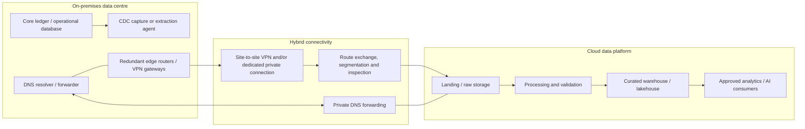
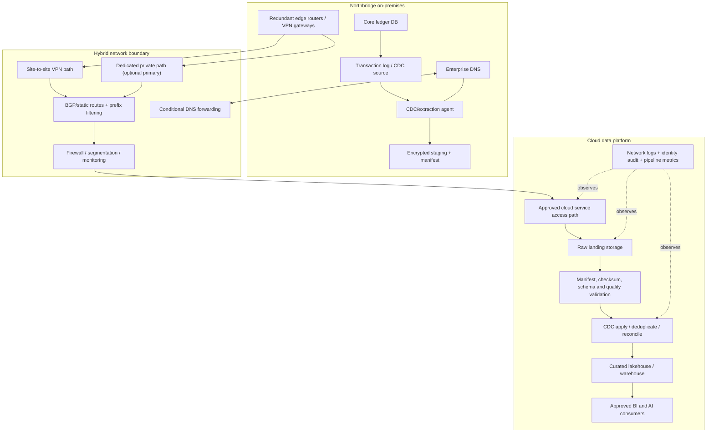

# Hybrid Connectivity and On-Premises Integration
## Stage 2D — Data Architecture | Topic 06

> **Role perspective:** hybrid cloud data architect / network architect.  
> **Purpose:** choose and design secure, reliable, observable, and cost-aware connectivity between on-premises data systems and cloud data platforms.  
> **Scope:** conceptual architecture and operational reasoning—not a device-by-device production deployment guide. All Northbridge Bank details are fictional; numerical values are assumptions unless explicitly described as arithmetic. No configuration in this lesson has been deployed or tested.

---

## 1. How this topic fits the roadmap

Topic 06 follows Topic 05 — Networking, Identity and Private Connectivity — and depends on data integration concepts such as batch ingestion, change data capture (CDC), replication, contracts, retries, idempotency and failure handling.

The module roadmap sets five learning outcomes:

1. Identify hybrid requirements and constraints.
2. Compare VPN and dedicated private connectivity.
3. Explain routing and DNS dependencies in a hybrid design.
4. Design on-premises source integration with data-movement estimates.
5. Define security boundaries, failure handling, ownership and troubleshooting.

The expected deliverables are a connectivity option comparison with transfer-time arithmetic, a conceptual hybrid architecture diagram, a routing and DNS dependency list, a failure/recovery matrix, and a connectivity architecture decision record (ADR).

**Boundary with adjacent topics**
- **Topic 05:** foundational networking, IAM, reachability versus permission and private service access. Reuse those concepts here.
- **Data Integration and Interoperability:** batch/ETL, CDC, schema compatibility, idempotency and failure handling. Apply those patterns to the hybrid path.
- **Topic 07:** detailed portability, lock-in and multi-cloud decision framework. This lesson only notes connectivity dependencies and exit consequences.
- **Topic 08:** infrastructure as code and environment promotion. This lesson states the design and validation requirements; it does not provide the full IaC workflow.

## 2. Beginner level — understand hybrid architecture

### 2.1 What hybrid means

A **hybrid architecture** deliberately operates systems in more than one environment—commonly an on-premises data centre and one or more cloud environments—with controlled connectivity and data movement between them.

Hybrid is not necessarily a permanent end state. It can be a migration stage, a long-lived operating model, or a requirement for specific latency, residency, hardware, operational or business constraints.

### 2.2 Why organisations retain on-premises systems

Typical reasons include:

- **Legacy dependencies:** an application relies on a database, mainframe, proprietary interface or operating system that is expensive to change.
- **Migration sequencing:** systems and teams move at different speeds; coexistence is needed while workloads are migrated in phases.
- **Latency and locality:** manufacturing, branches, trading, point-of-sale or other systems may need local response times or local processing.
- **Regulatory and contractual constraints:** data location, access, retention or operational controls may constrain where systems run. The actual requirement must be established from applicable policy and law; do not assume a regulation categorically requires on-premises hosting.
- **Hardware and sunk costs:** specialist appliances, licences or long depreciation cycles can make immediate migration uneconomic.
- **Operational risk:** a core system may be too critical to migrate in one step.
- **Partner connectivity:** vendors, subsidiaries or external data providers may only expose specific private or controlled interfaces.

These are decision drivers to evaluate—not automatic reasons to keep a system on-premises forever. Record the constraint, owner, evidence, review date and condition under which it could change.

### 2.3 Core terminology

| Term | Meaning | Why it matters |
|---|---|---|
| On-premises (on-prem) | Systems operated in an organisation-controlled site or data centre | Source of ledger, database, files or applications |
| Hybrid connectivity | Network paths between on-premises and cloud environments | Carries application and data traffic |
| Site-to-site VPN | Encrypted network tunnel, commonly IPsec, between network gateways | Often faster to establish; performance depends on endpoints and internet path |
| Dedicated private connectivity | A provisioned private circuit/path through a provider or connectivity partner | Can offer predictable capacity and routing, but still needs redundancy and security design |
| Bandwidth | Nominal link capacity, usually bits per second | Not the same as application throughput |
| Throughput | Actual delivered data rate | Affected by protocol overhead, congestion, packet loss, CPU and application behavior |
| Latency | Time for traffic to travel between endpoints, often measured as round-trip time (RTT) | Affects chatty protocols and interactive applications |
| Jitter | Variation in latency | Can affect real-time and time-sensitive traffic |
| Packet loss | Packets that fail to arrive | Can trigger retransmissions and reduce throughput |
| BGP | Border Gateway Protocol used to exchange routes between networks | Supports dynamic route advertisement and convergence |
| Route convergence | Time for the network to settle on usable paths after a change or failure | Affects outage and recovery duration |
| DNS forwarding | Sending DNS queries to the resolver that knows the relevant namespace | Enables on-prem and cloud systems to resolve each other’s private names |
| Data gateway/agent | Software component that extracts, transfers or brokers data | Can become a security and availability boundary |
| CDC | Captures inserts, updates and deletes from a source system’s change mechanism | Reduces the need to repeatedly transfer full datasets |
| RPO | Recovery point objective: acceptable data loss measured in time | Drives replication and replay design |
| RTO | Recovery time objective: target time to restore service | Drives redundancy, failover and operational readiness |
| Backlog | Data waiting to be transferred or processed | Must be drained without falling behind new arrivals |

### 2.4 Logical hybrid architecture



This is a logical view, not a prescribed physical topology. The cloud landing service may be reached through a service-specific private access mechanism rather than by routing directly to an ordinary subnet IP. VPN and dedicated circuits also have provider-specific gateway, route-exchange and endpoint models.

### 2.5 The key questions

For every source-to-cloud flow, answer:

1. Which source data is moving, at what volume and frequency?
2. Which system initiates the connection?
3. Which network ranges and routes are required in both directions?
4. How do both sides resolve private names?
5. Which identity authenticates the workload?
6. Which permissions allow the exact read/write operation?
7. How is data encrypted in transit?
8. What happens during a link, DNS, source, agent or cloud-service failure?
9. How is completeness, freshness and duplication detected?
10. Who owns each boundary and pays for the transfer?

---

## 3. Hybrid data-flow patterns

### 3.1 Batch extraction and file transfer

A scheduled process extracts a bounded dataset or exports files, transfers them over the hybrid path, and writes them to a cloud landing zone.

**Good fit:** daily or hourly reporting, historical backfills, bulk file exchange, systems without CDC support.

**Design controls:** consistent snapshot or watermark, manifest/checksum, encryption, resumable transfer, retry limits, quarantine for invalid files, and reconciliation of expected versus received records.

A batch can be network-connected but still be incomplete or inconsistent. Network success is not data correctness.

### 3.2 Change data capture (CDC) and replication

CDC captures source inserts, updates and deletes from transaction logs or a supported capture mechanism and transfers change records to a downstream target.

**Good fit:** low-latency analytics, incremental synchronization, large datasets whose full reload would be expensive.

**Design controls:**
- source-log retention exceeds the maximum outage and recovery window;
- change ordering and transaction boundaries are understood;
- delete events and schema changes are preserved;
- checkpoint/offset state is durable;
- duplicate delivery is handled idempotently;
- initial snapshot and ongoing changes are coordinated;
- lag and source-log growth are monitored.

CDC does not automatically mean exactly-once end-to-end delivery. Guarantees depend on source capture, transport, sink transaction semantics, checkpointing and recovery behavior.

### 3.3 API-based ingestion

An on-premises service exposes an API, or a cloud-side connector calls an on-premises API.

**Good fit:** bounded data products, application-owned interfaces, partner integrations.

**Risks:** request/response latency, rate limits, pagination errors, token expiry, schema drift and high round-trip overhead. Use bounded pagination, checkpoints, backoff with jitter, rate-limit handling and contract validation.

### 3.4 Message/event bridging

Events or messages are forwarded from an on-premises broker to a cloud messaging service, or vice versa.

**Good fit:** event-driven integration, asynchronous processing and near-real-time notifications.

**Risks:** duplicate events, ordering changes, queue growth during outages, replay windows, broker incompatibilities and poison messages. Define message IDs, event-time semantics, retention, dead-letter handling and replay policy.

### 3.5 Read-through or remote query

An application or analytics engine queries a remote on-premises database across the link.

**Good fit:** selective queries when data cannot be copied or a temporary migration bridge is required.

**Risks:** every round trip incurs network latency; queries may overload the source; an outage can block cloud workloads; credentials and schema coupling persist. For analytical scans, copying or incrementally replicating data is often more resilient than repeatedly querying a transactional system—but the right choice depends on freshness, data size and source constraints.

### 3.6 Pattern selection

| Pattern | Freshness potential | Source impact | Network sensitivity | Recovery focus |
|---|---|---|---|---|
| Scheduled batch | Minutes to days, depending on schedule | Controlled during extraction window | High during bulk transfer | Resume file, reconcile manifest, rerun idempotently |
| CDC/replication | Seconds to minutes in a well-designed path; actual lag varies | Depends on capture method and log reading | Sustained bandwidth and stable sessions | Retained source logs, checkpoints, replay and reconciliation |
| API pull | Depends on polling and API limits | Can be high if queries are chatty | Latency and connection reliability | Cursor/checkpoint, backoff, token refresh |
| Event bridge | Potentially low latency | Event publish overhead | Sustained throughput and connection availability | Durable queue, offsets, replay, duplicate handling |
| Remote query | Interactive if healthy | Direct workload on source | Very sensitive to latency and packet loss | Failover behavior, query timeout, fallback/stale-data policy |

---

## 4. Connectivity choices: VPN, dedicated private links and alternatives

### 4.1 Site-to-site VPN

A site-to-site VPN typically establishes IPsec tunnels between on-premises VPN devices and cloud VPN gateways over an IP network, commonly the public internet.

**Advantages**
- Often quicker to provision than a dedicated circuit.
- Can be a practical pilot, backup path or solution for moderate data volumes.
- Encrypts traffic at the network layer when correctly configured.
- Can support dynamic routing with BGP or static routes, depending on the service and peer device.

**Limitations**
- Performance depends on gateway capacity, tunnel design, internet path, packet size, encryption overhead and traffic patterns.
- Internet latency, jitter and packet loss are less predictable.
- Tunnel and gateway quotas/throughput limits vary by provider, SKU and configuration.
- Key exchange, tunnel monitoring, route convergence and failover must be operated.
- Encryption in the VPN does not replace TLS or application authentication where those are required.

### 4.2 Dedicated private connectivity

A dedicated private connection is provisioned through a cloud provider and/or connectivity partner, connecting a customer network to the provider’s edge through a private circuit or partner-delivered path.

Examples include AWS Direct Connect, Azure ExpressRoute, Google Cloud Dedicated Interconnect and Partner Interconnect.

**Potential advantages**
- Capacity options that may suit sustained high-volume transfers.
- A path that does not use the public internet for the dedicated portion of the connection.
- Potentially more predictable routing and network performance, subject to the complete end-to-end path and service design.
- Can support controlled route exchange with BGP.

**Limitations**
- Longer provisioning and coordination with facilities, carriers or partners.
- Port, circuit, partner, gateway, cross-connect and data-transfer charges may apply.
- A private circuit is not automatically encrypted end-to-end. Use TLS, IPsec over the link, or another approved encryption layer when required.
- One circuit, one carrier, one colocation facility, one edge router or one cloud peering location can still be a single point of failure.
- The on-premises LAN, cloud gateway, routes, DNS, source system and ingestion service remain possible bottlenecks.

### 4.3 VPN versus dedicated: decision matrix

| Criterion | Site-to-site VPN | Dedicated private connectivity | Decision question |
|---|---|---|---|
| Provisioning | Often faster; depends on network and approvals | Often longer; circuit/partner provisioning may be required | When must the first production data arrive? |
| Encryption | IPsec tunnel commonly encrypts traffic over the underlay | Private path alone does not necessarily encrypt payloads | What does the security policy require, and where must encryption terminate? |
| Capacity | Constrained by gateway/tunnel/device and internet path | Capacity options depend on circuit, port, provider and partner | What sustained throughput and burst capacity are required? |
| Latency/jitter | Internet path can vary | Often more predictable, but not guaranteed end-to-end | Does the application make many small round trips? |
| Availability | Redundant tunnels/devices/ISPs still required | Diverse circuits, ports, sites, carriers and routers may be required | Which failure domains must be independent? |
| Route exchange | Static or BGP, according to product/device | BGP commonly used; product-specific rules apply | Who owns prefix advertisement, filtering and convergence? |
| Security boundary | Internet-facing gateways; encrypted tunnel | Private transport path; still requires segmentation and identity | Is public-underlay exposure acceptable? |
| Cost | May have lower initial fixed cost; gateway and transfer costs remain | Circuit, port, provider, cross-connect and transfer costs | Compare total monthly and annual cost, not bandwidth price alone |
| Operations | Tunnel health, peer keys, routing and internet path | Circuit/provider coordination, BGP, gateways and physical diversity | Who can diagnose each side at 03:00? |
| Typical fit | Pilot, backup, variable/moderate volume, sites without dedicated access | High sustained volume, predictable performance needs, enterprise connectivity | Are requirements measured or assumed? |

**Neither option is universally superior.** A VPN can be the right primary path for a small or early-stage workload. A dedicated link may be justified by sustained volume, predictable performance or connectivity requirements. Many designs use a dedicated path for primary traffic and a VPN as a backup, but failover must be explicitly configured and tested.

### 4.4 Other options

- **Managed transfer appliance/service:** useful when initial bulk data is too large or too slow to move through the available link. It does not remove the need for secure custody, integrity checks, import coordination and incremental changes after the snapshot.
- **Private partner connection:** useful where a partner or managed network provider aggregates multiple sites.
- **Outbound-only agent or connector:** can reduce inbound exposure by having an on-premises agent initiate an authenticated outbound connection, where supported. Validate the vendor architecture, allowed destinations, update channel, credentials and failure modes.
- **Public API with strong controls:** may be acceptable for selected integrations if policy allows it, with TLS, strong authentication, rate limits, filtering, logging and an explicit threat model. “Public” does not automatically mean “insecure,” and “private” does not automatically mean “secure.”
- **Store-and-forward:** durable local queue or staging when continuous connectivity is unavailable. Define retention capacity, encryption, replay and data-loss behavior.

---

## 5. Provider-specific approaches

Provider names below are architectural starting points, not an implementation recipe. Product capabilities, limits, regions, gateway SKUs, routing behavior and pricing change. Verify the exact service and current official documentation before approving a design. For resiliency, validate the complete topology—including customer-premises devices, carrier paths, cloud edge locations, routing policy, and backup capacity—and run a controlled failover/failback test. A second tunnel or a nominally redundant circuit is not proof of end-to-end resilience.

### 5.1 AWS

- **AWS Site-to-Site VPN:** IPsec connectivity between a customer gateway device and AWS VPN endpoints. A connection has two tunnels, but that alone does not remove customer-device, ISP, on-premises power or site failure domains. Configure and monitor both tunnels, and add independent customer-gateway/path redundancy when required. AWS supports static or dynamic/BGP routing depending on the design; route tables must also select the intended VPN path.
- **AWS Direct Connect:** dedicated network connection to AWS through a Direct Connect location/provider. Design redundant connections and locations appropriate to the required resilience; a single connection is not a resilient architecture.
- **Transit Gateway / Direct Connect Gateway:** can support hub-and-spoke or multi-VPC routing designs. Route propagation, associations, route-table segmentation and advertised prefixes need explicit review.
- **Route design:** confirm VPC route-table targets, on-premises routes, BGP advertisements, prefix filtering, return paths and any NAT/inspection devices.
- **Security:** VPN encryption, TLS, security groups, network ACLs, endpoint policies, resource policies and IAM solve different parts of the problem. Direct Connect by itself should not be described as end-to-end encryption.
- **Operational checks:** tunnel state, BGP session, advertised/learned routes, flow logs, gateway metrics, application transfer metrics and data reconciliation.

Official AWS documentation:
- [AWS Site-to-Site VPN routing options](https://docs.aws.amazon.com/vpn/latest/s2svpn/VPNRoutingTypes.html)
- [Static and dynamic routing in Site-to-Site VPN](https://docs.aws.amazon.com/vpn/latest/s2svpn/vpn-static-dynamic.html)
- [AWS Direct Connect resiliency recommendations](https://docs.aws.amazon.com/directconnect/latest/UserGuide/disaster-recovery-resiliency.html)
- [AWS Direct Connect user guide](https://docs.aws.amazon.com/directconnect/latest/UserGuide/Welcome.html)

### 5.2 Microsoft Azure

- **Azure VPN Gateway:** site-to-site VPN connectivity between on-premises networks and Azure VNets. Route-based VPN, BGP, active-active mode and availability-zone behavior depend on gateway SKU, region and topology. In active-active designs, establish tunnels to both Azure gateway instances and ensure the on-premises device supports the configuration.
- **Azure ExpressRoute:** private connectivity between on-premises networks and Microsoft cloud services through a connectivity provider or ExpressRoute Direct. It is not a replacement for identity, service policy or application encryption.
- **Coexistence/failover:** ExpressRoute and site-to-site VPN can be designed together for supported paths, but route preference, private peering, BGP, public/Microsoft peering behavior and asymmetric-routing risks must be checked for the exact topology.
- **Addressing and routes:** confirm non-overlapping address spaces, gateway subnet requirements, learned/advertised prefixes, effective routes, UDRs and NSGs.
- **DNS:** private endpoint DNS zones, on-premises resolver forwarding and Azure DNS Private Resolver or other supported resolver patterns may be needed for private service names.
- **Operational checks:** VPN/ExpressRoute circuit and gateway health, BGP state, effective routes, Network Watcher diagnostics, flow logs and application-level data lag.

Official Microsoft documentation:
- [Azure VPN Gateway overview](https://learn.microsoft.com/en-us/azure/vpn-gateway/vpn-gateway-about-vpngateways)
- [ExpressRoute overview](https://learn.microsoft.com/en-us/azure/expressroute/expressroute-introduction)
- [ExpressRoute and site-to-site VPN coexistence](https://learn.microsoft.com/en-us/azure/expressroute/expressroute-howto-coexist-resource-manager)
- [Secure your ExpressRoute deployment](https://learn.microsoft.com/en-us/azure/expressroute/secure-expressroute)

### 5.3 Google Cloud

- **Cloud VPN / HA VPN:** IPsec connectivity between on-premises networks and a Google Cloud VPC. HA VPN supports dynamic routing (BGP) and its availability SLA depends on the configured topology; do not generalize the SLA to any arrangement of tunnels. Cloud Router exchanges routes through BGP. Verify the supported topology and route behavior for the target design.
- **Cloud Interconnect:** Dedicated Interconnect and Partner Interconnect provide private connectivity options through Google Cloud or a partner. Design redundant attachments, edge availability domains and locations appropriate to requirements.
- **VPN over Interconnect:** HA VPN can be deployed over encrypted VLAN attachments to combine Interconnect capacity with IPsec encryption. This is a distinct architecture with extra components and separate routing responsibilities.
- **Routing:** Cloud Router exchanges routes through BGP; inspect learned/advertised prefixes, route priorities, subnet ranges and firewall rules. VPC routes, regional resources and service access options differ from AWS and Azure models.
- **Operational checks:** tunnel status, BGP session, Cloud Router learned routes, Interconnect/VLAN attachment state, VPC Flow Logs, Cloud Logging metrics and ingestion freshness.

Official Google Cloud documentation:
- [Cloud VPN overview](https://docs.cloud.google.com/network-connectivity/docs/vpn/concepts/overview)
- [Create an HA VPN gateway to a peer VPN gateway](https://docs.cloud.google.com/network-connectivity/docs/vpn/how-to/creating-ha-vpn)
- [Cloud Interconnect overview](https://docs.cloud.google.com/network-connectivity/docs/interconnect/concepts/overview)
- [HA VPN over Cloud Interconnect overview](https://docs.cloud.google.com/network-connectivity/docs/interconnect/concepts/ha-vpn-interconnect)

### 5.4 Provider comparison summary

| Logical need | AWS candidate | Azure candidate | Google Cloud candidate | Verify before design approval |
|---|---|---|---|---|
| Encrypted site-to-site path | Site-to-Site VPN | VPN Gateway | Cloud VPN / HA VPN | Gateway limits, peer compatibility, tunnel redundancy, BGP/static route support |
| Dedicated private connectivity | Direct Connect | ExpressRoute | Dedicated / Partner Interconnect | Locations, providers, capacity, cross-connect, BGP, redundancy and costs |
| Hub-and-spoke routing | Transit Gateway or other supported design | Virtual WAN / hub VNet patterns | Shared VPC and supported routing hub patterns | Route propagation, segmentation, transitivity and quota behavior |
| Dynamic routing | BGP where supported | BGP where supported | Cloud Router/BGP | Prefix limits, timers, route priorities and convergence |
| Private service access after hybrid arrival | Service-specific VPC endpoint/PrivateLink | Private Endpoint/Private Link | Private Google Access, PSC or service-specific option | The exact service FQDN, DNS path, routing and service network policy |
| Network troubleshooting | VPC route/flow diagnostics and service metrics | Network Watcher/effective routes and diagnostics | Connectivity tests, Cloud Router/Flow Logs and service metrics | Tool availability, log configuration, retention and cost |

**Avoid name-based equivalence.** The providers share architectural responsibilities but their resource scopes, routing semantics, endpoint mechanisms, service limits and availability conditions differ. Provider SLAs apply only when the documented topology and eligibility requirements are met; they do not establish end-to-end application or data-pipeline availability.

---

## 6. Routing, CIDR, and DNS across the hybrid boundary

### 6.1 Address planning and overlap

A hybrid design must inventory:
- on-premises data centre and branch CIDRs;
- cloud VPC/VNet ranges and subnets;
- other connected networks and acquired-company networks;
- VPN tunnel/transit ranges where required;
- partner ranges;
- private endpoint and service-producer ranges where applicable;
- future growth and IPv6 requirements.

Overlapping ranges can make route selection ambiguous or prevent peering/connection designs from working as intended. Do not solve an overlap by advertising both ranges and hoping longest-prefix match makes it correct. Renumbering, network isolation or a carefully designed translation layer may be required; translation introduces complexity and can affect protocols, logging and troubleshooting.

**Overlap example:** if on-premises advertises `10.50.0.0/16` and the cloud has `10.50.3.0/24`, the cloud `/24` is mathematically contained within the on-premises `/16`. Both sides therefore claim part of the same address space. A more-specific route might appear to select one path in some contexts, but it does not make the overlapping design generally safe or make every provider connection/peering feature support it. Resolve the address plan or explicitly design and test an appropriate isolation/translation approach.

Illustrative plan:

| Network | CIDR | Purpose |
|---|---|---|
| On-prem ledger zone | `10.10.0.0/16` | Operational databases and capture agents |
| On-prem shared services | `10.11.0.0/16` | DNS, monitoring and directory services |
| Cloud data platform | `10.40.0.0/16` | Data platform workloads |
| Cloud ingestion subnet | `10.40.10.0/24` | Ingestion workers |
| Cloud processing subnet | `10.40.20.0/24` | Transformation workers |

These ranges are non-overlapping examples, not provider-reserved recommendations. Verify existing routes before selecting real ranges.

### 6.2 Routing principles

- Define required flows, not “all on-premises to all cloud.”
- Advertise only intended prefixes; filter unexpected routes.
- Check the forward and return path.
- Understand static routes versus BGP route exchange.
- Set route preference intentionally when a primary and backup path coexist.
- Consider route convergence and stateful firewalls when paths change.
- Avoid accidental transit between environments that should remain segmented.
- Include route changes in change management and monitoring.

BGP can withdraw routes when a session or path fails, but it does not guarantee instant application recovery. Detection timers, route policies, gateway state, convergence, session behavior and application retries all affect the interruption.

### 6.3 DNS design

Hybrid DNS often needs both sides to resolve private names:
- cloud workloads may need to resolve on-premises database/API names;
- on-premises agents may need to resolve private cloud service endpoints;
- a resolver/forwarder must know which namespace to resolve and where to forward unknown names.

Document:
1. authoritative zone and owner;
2. client resolver on each side;
3. forwarding rules and conditional zones;
4. private zone associations/links;
5. expected private answer from each client network;
6. TTL and cache behavior;
7. resolver redundancy and logging;
8. fallback behavior if forwarding is unavailable.

A private endpoint does not automatically configure all on-premises DNS clients. DNS is part of the connectivity architecture, not a finishing detail.

### 6.4 Diagnostic sequence

From the actual source host or agent:

1. Resolve the exact FQDN and record the answer.
2. Compare it with the expected private/public path.
3. Inspect the effective route and next hop.
4. Check firewall/NSG/security-group/ACL rules and return traffic.
5. Check VPN tunnel or dedicated circuit state and BGP routes.
6. Test TCP reachability to the documented service port.
7. Verify TLS using the expected hostname.
8. Authenticate with the intended workload identity.
9. Test the precise resource operation.
10. Reconcile received data with source counts/checkpoints.

Example common diagnostic commands (tools may not exist in every runtime):

```bash
# Query DNS from the same host that runs the ingestion agent
nslookup SOURCE_OR_SERVICE_FQDN
dig SOURCE_OR_SERVICE_FQDN

# Test TCP reachability to an approved destination and port
nc -vz DESTINATION_FQDN 443

# Inspect the TLS handshake and expected hostname
openssl s_client -connect DESTINATION_FQDN:443 -servername DESTINATION_FQDN
```

These commands do not deploy a network, prove authorization, or replace provider route diagnostics. Do not include credentials or customer data in command arguments or support output.

---

## 7. Security and identity controls

### 7.1 Network controls are not identity controls

The hybrid path should allow only the necessary source, destination, protocol and port. The workload must separately authenticate and receive permission for its data operation.

For every flow, record:
- source system and network;
- destination service and exact name;
- direction and protocol/port;
- route/next hop;
- firewall and inspection rules;
- workload identity;
- authentication method;
- authorization scope;
- encryption requirement;
- logs and owner.

### 7.2 Identity patterns

Prefer a dedicated identity for each connector, extraction agent, CDC process and cloud ingestion workload. Use supported workload identity, managed identity, role assumption or federation where available. If a legacy connector needs a stored secret, retrieve it from an approved secret store, limit who can read it, rotate it, audit access and define a migration path.

Do not use an employee’s personal credentials as a long-running integration identity. Separate the identity that provisions infrastructure from the runtime identity that reads or writes data.

### 7.3 Least privilege and data permissions

Examples of permissions to distinguish:
- read ledger change logs;
- connect to a database;
- read a specific schema/table;
- write to one landing prefix/container;
- create a cloud ingestion job;
- query curated warehouse tables;
- manage network infrastructure;
- administer encryption keys.

These are not interchangeable permissions. A network administrator should not automatically be a data reader, and a pipeline writer should not automatically be able to delete the lake or administer its keys.

Test both an allowed action and a forbidden action. Review inherited grants, service-specific policies, key permissions and organization controls.

### 7.4 Encryption in transit

- Use TLS for application protocols where supported and required.
- A VPN typically provides IPsec encryption over the underlay; verify cipher, peer authentication and key lifecycle.
- A dedicated circuit/private path does not by itself prove that payloads are encrypted end-to-end.
- If policy requires encryption over a dedicated link, evaluate TLS, IPsec over the link, or another approved layer. Check MTU/fragmentation, throughput overhead and endpoint compatibility.
- Validate certificate names, trust chains, expiry and renewal. Do not disable certificate validation to make a connection succeed.

### 7.5 Security boundary checklist

- [ ] Source ranges and destinations are allow-listed.
- [ ] On-premises-to-cloud and cloud-to-on-premises flows are justified separately.
- [ ] Administrative access is separate from data-plane access.
- [ ] Runtime identity is dedicated and least-privileged.
- [ ] Secrets are not embedded in code, scripts, images or logs.
- [ ] TLS/IPsec requirements are documented.
- [ ] DNS, route and firewall changes are audited.
- [ ] Logs avoid sensitive payloads and credentials.
- [ ] Public endpoints and emergency bypass paths are explicitly reviewed.
- [ ] Key ownership, rotation and recovery are assigned.

---

## 8. Bandwidth, latency and transfer-time estimation

### 8.1 Units first

Networking capacity is commonly specified in bits per second (bps); file size is commonly expressed in bytes.

- 1 byte = 8 bits.
- For decimal SI estimates, 1 TB = \(10^{12}\) bytes and 1 Gbps = \(10^9\) bits/second.
- Some tools and storage systems use TiB (\(2^{40}\) bytes), GiB (\(2^{30}\) bytes) or other binary units. State which convention is used.
- Nominal link capacity is not the same as usable application throughput.

### 8.2 Transfer-time formula

For decimal data size \(D\) bytes, nominal capacity \(C\) bits/second, and assumed efficiency \(e\) between 0 and 1:

\[
\text{theoretical transfer time (seconds)} = \frac{D \times 8}{C \times e}
\]

The efficiency factor is a planning assumption that represents protocol overhead, shared traffic, packet loss, encryption/CPU limits and other bottlenecks. It is not a provider guarantee or a measured benchmark.

### 8.3 Worked example: 20 TB over 1 Gbps at 70% efficiency

**Assumptions**
- Data volume: 20 decimal TB = \(20 \times 10^{12}\) bytes.
- Nominal link capacity: 1 Gbps = \(1 \times 10^9\) bits/second.
- Effective throughput assumption: 70% of nominal capacity.
- One direction, no competing traffic beyond what is represented by the efficiency factor.
- No time added for extraction, file enumeration, checksum, retries, throttling, ingestion, transformation or validation.

Step 1 — convert bytes to bits:

\[
20 \times 10^{12}\ \text{bytes} \times 8 = 160 \times 10^{12}\ \text{bits}
\]

Step 2 — estimate effective throughput:

\[
1 \times 10^9\ \text{bits/s} \times 0.70 = 0.7 \times 10^9\ \text{bits/s}
\]

Step 3 — calculate seconds:

\[
\frac{160 \times 10^{12}}{0.7 \times 10^9}
= 228{,}571.43\ \text{seconds}
\]

Step 4 — convert to hours and days:

\[
228{,}571.43 \div 3{,}600 \approx 63.49\ \text{hours}
\]

\[
63.49 \div 24 \approx 2.65\ \text{days}
\]

**Illustrative result:** approximately **2 days, 15 hours and 29 minutes** at the assumed sustained effective rate (63.49 hours). This is a transfer-only estimate for decimal TB, not a migration-window commitment.

At 100% of nominal 1 Gbps, the arithmetic lower bound is:

\[
160 \times 10^{12} \div 10^9 = 160{,}000\ \text{s}
\approx 44.44\ \text{hours} \approx 1.85\ \text{days}
\]

Real transfers can take longer. The 70% factor is an assumption, not an expected service-level performance figure.

### 8.4 Roadmap exercise: 20 TB at 1 Gbps and 70%

Recalculate the example independently, show units at every step, and answer:
1. What is the effective throughput in bits/second?
2. How many seconds and hours are estimated?
3. What changes if the observed efficiency is only 50%?
4. What changes if the link is shared with production traffic?
5. How much additional time is needed for source extraction, retries, validation and target processing?
6. How would a resumable transfer and parallel streams change recovery behavior without assuming a higher bandwidth guarantee?

**Expected arithmetic for 50% efficiency:** \(160 \times 10^{12} \div (1 \times 10^9 \times 0.5) = 320{,}000\) seconds, about 88.89 hours or 3.70 days, before other overheads. This assumes a sustained effective rate of 0.5 Gbit/s; it is not a throughput guarantee.

### 8.5 Backlog catch-up

Suppose new data arrives at rate \(A\) and a recovery pipeline can process at sustained rate \(C\), using the same units and time basis.

\[
\text{catch-up time} = \frac{\text{backlog}}{C-A}, \quad \text{only if } C>A
\]

Example: backlog is 600 GB; ingestion can sustain 100 GB/hour; new changes arrive at 25 GB/hour.

\[
600 \div (100-25) = 8\ \text{hours}
\]

This assumes sustained rates and no other bottlenecks. If \(C \le A\), the backlog cannot shrink; increase capacity, reduce incoming work, or change the recovery strategy.

### 8.6 Latency, packet loss and connection limits

Bulk transfers are often throughput-limited; chatty database protocols may be latency-limited. Many sequential round trips can perform poorly across a high-latency link even if bandwidth is ample.

Consider:
- round-trip time and application request pattern;
- TCP congestion control and packet loss;
- maximum transmission unit (MTU) and fragmentation;
- gateway, firewall, NAT and connection-tracking limits;
- number of concurrent sessions;
- source database connection pool and log-reader limits;
- API rate limits and destination ingestion quotas;
- CPU/encryption overhead and disk read/write speeds.

Do not invent a universal throughput figure for a provider product. Measure the actual path under representative load, within an approved test window, and record the environment and method.

---

## 9. Initial load, incremental ingestion and consistency

### 9.1 Initial snapshot plus ongoing changes

A common migration pattern is:
1. Agree a consistent snapshot point or watermark.
2. Start CDC/log capture early enough to retain changes during the initial copy.
3. Export and transfer the snapshot.
4. Load it into the cloud landing/staging zone.
5. Apply CDC changes in the correct order from the agreed point.
6. Reconcile row counts, checksums, key totals or business invariants.
7. Cut consumers over only after lag and correctness criteria are met.

The exact ordering varies by source and replication tool. Follow the source and connector’s documented snapshot/CDC semantics; do not invent a universal sequence.

### 9.2 Initial load choices

| Method | Strengths | Risks / controls |
|---|---|---|
| Online transfer over VPN | Fast to start if existing connectivity is adequate | Can saturate the link; throttle and monitor production impact |
| Online transfer over dedicated link | Suits sustained larger transfers if provisioned and tested | Circuit lead time, fixed cost, route and failure planning |
| Offline/physical transfer service | Can be useful for very large initial snapshots or constrained links | Custody, encryption, import lead time, integrity validation and incremental catch-up still required |
| Application-native export | Can provide a consistent or supported export format | Source load, export window, schema/version compatibility |
| Database replication service | Can automate initial load plus ongoing replication for supported sources | Source/log requirements, target semantics, limits, lag and cost must be checked |

### 9.3 Data correctness and idempotency

A transport retry can deliver the same batch or event more than once. A successful TCP transfer does not prove every logical record arrived once or in the correct order.

Recommended controls:
- stable batch IDs and event IDs;
- durable checkpoints/watermarks;
- file manifests with expected names, sizes and checksums;
- idempotent writes or merge/upsert logic;
- deduplication keys and retention windows;
- source-to-target count and aggregate reconciliation;
- explicit handling for deletes, late events and schema evolution;
- dead-letter/quarantine paths with bounded replay;
- controlled cutover with rollback criteria.

**Exactly-once** should be claimed only when the end-to-end system provides and validates that guarantee across source, transport, processing and sink. Many designs provide at-least-once delivery plus idempotent processing.

### 9.4 Source-system protection

The on-premises ledger is operationally critical. Protect it by:
- running extraction at controlled rates and windows;
- using read replicas or log-based CDC when appropriate and supported;
- setting query timeouts and resource limits;
- monitoring CPU, I/O, lock waits, log growth and connection counts;
- avoiding large unbounded queries against the primary during peak periods;
- agreeing a stop condition with the source owner;
- testing load behavior before increasing parallelism.

---

## 10. Northbridge Bank: worked architecture scenario

### 10.1 Scenario and assumptions

Northbridge Bank retains its core ledger on-premises for three years. Analytics and AI workloads are moving to a cloud data platform. The illustrative requirements are:

- an initial 20 TB snapshot;
- approximately 2 TB/day of changes and files thereafter (planning assumption);
- curated analytics freshness target to be agreed by business owners;
- no uncontrolled inbound access to the ledger;
- traceable identity and audit logs;
- ability to resume transfer and reconcile after a link outage.

The 2 TB/day figure is not a provider benchmark. Confirm actual peak and average rates, data expansion/compression, change bursts, transaction volume and retention with source telemetry.

### 10.2 Detailed data-flow diagram



The VPN and dedicated path are options; this diagram does not imply both are automatically configured or that traffic will fail over without route policy and testing. The cloud service access path depends on the provider and target storage service. Data service permissions remain separate from network reachability.

### 10.3 Recommended logical design

1. **Source capture:** use a source-supported CDC mechanism or bounded extraction process. Protect ledger performance and retain logs long enough for the recovery window.
2. **Initial snapshot:** transfer 20 TB with a measured capacity plan, encryption, resumable chunks/files, manifest and integrity validation.
3. **Hybrid transport:** start with a VPN if it meets throughput, security and recovery requirements. Evaluate dedicated connectivity if sustained transfer, predictable performance or enterprise connectivity needs justify lead time and cost.
4. **Redundancy:** define independent failure domains for edge routers, links, carrier/peering location, cloud gateways and power. A second tunnel on the same device and ISP may not be independent.
5. **Cloud landing:** write to a raw zone using a dedicated workload identity and the minimum required destination permissions.
6. **Processing:** validate schema, deduplicate and apply changes using checkpoints and source-ordering semantics.
7. **Curated serving:** expose only approved curated tables/data products to analysts and AI workloads.
8. **Observability:** track route/tunnel state, DNS failures, bytes/sec, transfer lag, CDC lag, error rates, checksums, row counts and freshness.
9. **Cutover:** define entry criteria, rollback trigger, read-only window if needed, source-of-truth rules and reconciliation sign-off.
10. **Review:** reassess the connectivity choice when volumes, freshness, risk or operating costs change.

### 10.4 Connectivity decision matrix for Northbridge

| Option | When it may fit | Main risks | Required validation |
|---|---|---|---|
| VPN only | Pilot or production workload whose measured sustained throughput and recovery objectives fit VPN capabilities | Internet variability, gateway limits, link saturation | Load test, dual-tunnel/device plan, BGP/static route tests, DNS and recovery drill |
| Dedicated private path only | Sustained transfer or enterprise connectivity need justifies provisioning and fixed costs | Circuit/port/location dependency; not necessarily encrypted | Physical/provider diversity, route policy, encryption requirements, capacity and failover test |
| Dedicated primary + VPN backup | Business requires higher primary capacity and a separately tested fallback | Route asymmetry, different path capacity, VPN backup may not carry full peak load | Failover routing, backup load test, recovery time, application retry and data reconciliation |
| VPN primary + dedicated later | Pilot must start before circuit provisioning completes | Migration of route policy and possible downtime when changing paths | Staged cutover plan, consistent route advertisements, rollback and cost transition |
| Offline bulk transfer + network CDC | Initial snapshot dominates volume or online transfer is impractical | Custody, import lead time, stale snapshot, dual-path complexity | Encryption, chain of custody, checksums, snapshot/CDC boundary and catch-up plan |
| Outbound-only connector/agent | Vendor-supported integration can initiate connections from on-premises | Agent becomes critical dependency; vendor trust/update/credential risk | Supported endpoints, egress policy, agent HA, updates, identity, logs and recovery |
| Public API with controls | Requirements allow internet-reachable endpoint and a private path is not necessary/supported | Exposure, DDoS, authentication, rate limits | Threat model, TLS, strong auth, WAF/rate limits as appropriate, allow-listing and audit |

### 10.5 Transfer capacity and backlog

The 20 TB initial load at 1 Gbps and 70% assumed efficiency takes approximately 2.65 days (63.49 hours) by arithmetic alone. The result assumes a sustained effective rate of 0.7 Gbit/s, decimal TB and no downtime or competing traffic beyond the efficiency factor. A real migration plan must add source extraction time, validation, target load, retries and change catch-up; verify capacity with a representative load test.

For ongoing ingestion, compare:
- peak and average incoming rate;
- measured sustained transfer capacity;
- CDC burst behavior and log retention;
- processing capacity and target write limits;
- recovery backlog size and catch-up time.

If the system normally receives 2 decimal TB/day, average arrival rate is approximately 83.33 decimal GB/hour (2,000 GB ÷ 24 h). This is an average only; peak rates may be much higher. If recovery capacity cannot exceed incoming rate, backlog will not drain. Use consistent units and time intervals for all backlog calculations.

---

## 11. Reliability, redundancy and failure domains

### 11.1 Redundancy is more than two tunnels

Map each path dependency:
- on-premises router/firewall;
- power and local circuit;
- ISP/carrier or connectivity partner;
- physical route and meet-me/peering location;
- VPN gateway or cloud edge;
- cloud gateway, region and route control plane;
- DNS resolver/forwarder;
- ingestion agent/host;
- source database/log retention;
- cloud storage and processing service.

Two logical tunnels can share the same physical device, ISP, cable route or cloud edge. Redundancy must be evaluated against the failures the business requires the design to tolerate.

### 11.2 Active/active and active/standby

- **Active/active:** multiple paths carry traffic. May increase usable capacity or spread flows, but requires careful route design and can complicate asymmetric paths and stateful inspection.
- **Active/standby:** a preferred path carries traffic while another waits. Easier to reason about in some environments, but failover detection and capacity of the backup must be tested.
- **Primary dedicated + VPN backup:** common design pattern, but route preference, prefix advertisement and encryption requirements must be explicit. A VPN backup may have lower capacity than the primary.

Do not assume route convergence means an in-progress database session or file transfer resumes automatically. Applications need timeout, retry and checkpoint behavior.

### 11.3 Recovery objectives

Define:
- **Connectivity RTO:** how quickly an alternate path should become usable.
- **Data freshness RTO:** how quickly ingestion should return to target lag.
- **RPO/data-loss tolerance:** what source changes may be lost, if any, and how they can be replayed.
- **Maximum backlog:** amount of data that can accumulate before source-log retention or storage limits are threatened.
- **Degraded mode:** whether analytics serves stale data, pauses consumers or fails closed.

These are separate objectives. A link may fail over quickly while the ingestion pipeline still takes hours to drain its backlog. The service-provider SLA, where applicable, covers only the scope defined in its contract and topology; it does not guarantee end-to-end source capture, DNS, routing, identity, target writes or data freshness.

---

## 12. Failure-mode and recovery matrix

| Failure | Detection signals | First checks | Recovery/fallback | Owner |
|---|---|---|---|---|
| VPN tunnel or dedicated link failure | Tunnel/circuit alarm, BGP session down, route withdrawal, packet loss | Physical path, gateway, BGP, route table and peer status | Fail over to tested alternate path; confirm route and data transfer resume | Network team + carrier/provider |
| Route error or route flapping | Reachability changes, unexpected next hop, repeated BGP events | Advertised/learned prefixes, route priority, filtering, return route | Restore approved route policy; dampen/contain unstable route only under change control | Network routing owner |
| DNS resolver/forwarder failure | NXDOMAIN, timeout, wrong private/public answer | Resolver health, conditional forwarding, private zone records and links | Switch to redundant resolver/forwarder; retest from workload | DNS team |
| Overlapping CIDRs | Routes cannot distinguish destinations; peering/connection limitation | Inventory ranges on both sides and partner networks | Renumber, isolate, or design controlled translation; document limitations | Network architect |
| Bandwidth saturation | Throughput plateau, queue drops, rising lag, packet retransmits | Link utilization, competing flows, source/target bottlenecks | Shape/throttle noncritical flows, schedule bulk load, add capacity if justified | Network + data platform |
| Packet loss / high latency | Retransmissions, slow queries, unstable sessions | Underlay/ISP metrics, MTU, firewall/NAT, path health | Correct path/MTU or capacity issue; reduce chatty queries or batch | Network + application owner |
| Authentication failure | Expired token, invalid certificate, rejected connection | Runtime principal, certificate/token expiry, clock and trust config | Renew through approved mechanism; rotate/revoke compromised credential | IAM/security + integration owner |
| Authorization denied | Access-denied log for action/resource | Actual principal, exact action, resource scope, key/service policy | Grant minimum required permission or correct resource; negative-test denied actions | Data/service owner + IAM |
| CDC agent or extraction process crashes | Heartbeat stops, lag rises, checkpoint stops | Agent health, source access, disk space, logs, checkpoint | Restart safely; resume from durable checkpoint; reconcile duplicates and gaps | Data integration owner |
| Source log retention exhausted | CDC cannot resume from checkpoint; missing log segment | Source log retention, outage duration, capture state | Re-snapshot/reinitialize if required; reconcile against source; escalate data-gap risk | DBA + data integration owner |
| Cloud landing write fails | Failed object writes, retries, access denied or quota error | Identity, endpoint/DNS, route, service status, quota and KMS | Buffer/retry within bounds; use approved alternate destination only if consistency permits | Cloud data platform |
| Duplicate or out-of-order events | Reconciliation mismatch, duplicate IDs, state regression | Event IDs, checkpoint, partition/order assumptions and sink semantics | Idempotent merge/deduplication; replay from known checkpoint; reconcile | Data engineering |
| Cloud processing backlog | Queue/lag grows while network is healthy | Processing capacity, schema errors, sink throttling | Scale within quota, quarantine poison records, preserve source data and checkpoints | Data platform/SRE |
| Secret or identity compromise | Security alert, unusual API calls, key use | Principal audit, token/secret access and affected scope | Revoke/rotate, contain identity, inspect access, restore least privilege | Security/IAM |
| Primary and backup paths both fail | Both route/tunnel alarms; no cloud reachability | Shared failure domain, provider/region/ISP status | Store-and-forward on-premises, pause unsafe writes, notify business; restore and replay | Incident commander + network/data teams |

### 12.1 Recovery runbook skeleton

1. **Declare:** record start time, impact, affected sources and freshness/RPO/RTO status.
2. **Classify:** identify whether failure is physical link, tunnel/BGP, route, DNS, authentication, authorization, source, agent, target or processing.
3. **Contain:** prevent duplicate or unsafe writes; preserve source logs and local spool capacity.
4. **Restore path:** fail over according to tested routing policy; confirm expected routes, DNS and TLS.
5. **Restore identity:** verify the intended principal and permissions without granting broad emergency access.
6. **Resume safely:** restart from durable checkpoint; use idempotent writes and bounded retries.
7. **Reconcile:** compare source watermark/sequence, manifests, checksums, row counts and business totals.
8. **Drain backlog:** calculate `backlog / (recovery capacity − incoming rate)` and confirm capacity exceeds incoming rate.
9. **Validate service:** check freshness, completeness, duplicates, schema and consumer-visible results.
10. **Close and learn:** capture timeline, root cause, changes, owners, evidence and corrective actions.

Emergency failover should not silently bypass encryption, identity checks or data governance controls. If the alternate path does not meet required controls, invoke the approved degraded mode rather than creating an unreviewed exposure.

---

## 13. Observability and operational ownership

### 13.1 Minimum observability set

**Network and connectivity**
- tunnel/circuit state and alarms;
- BGP neighbor state and route count;
- bytes in/out and utilization;
- packet loss, retransmission and latency where available;
- firewall/flow accept-deny records;
- gateway CPU/session/connection limits where exposed.

**DNS and identity**
- lookup failures and unexpected answers;
- resolver health and forwarding errors;
- authentication failures, token/certificate expiry;
- permission-denied events and principal identity;
- route, firewall, role and key-policy changes.

**Data movement**
- source extraction rate;
- bytes and files transferred;
- last successful checkpoint/watermark;
- CDC lag and source-log growth;
- retry count and failure age;
- checksum/manifest results;
- source-target record counts and reconciliation outcomes;
- target ingestion and processing lag;
- oldest unprocessed record and backlog size.

Do not rely on a green network tunnel alone as the service-level health signal. The business outcome is correct, timely and governed data delivery.

### 13.2 Ownership model

| Responsibility | Primary owner | Partner/backup owner |
|---|---|---|
| On-premises router/firewall and LAN | Enterprise network team | Network service provider |
| Cloud VPN/circuit/gateway | Cloud network platform team | Cloud provider/connectivity partner |
| BGP prefixes and route policy | Network architecture/routing owner | On-prem and cloud network operators |
| DNS zones, forwarding and resolver HA | Enterprise DNS team | Cloud platform team |
| Source database health and CDC retention | DBA/source application owner | Data integration team |
| Extraction agent and checkpoints | Data integration team | Source owner and platform SRE |
| Workload identity and credentials | IAM/security team | Integration owner |
| Cloud landing, processing and reconciliation | Data platform team | Data engineering/SRE |
| Logging, alerting and incident coordination | Platform SRE/incident commander | Network, IAM, DBA and provider support |
| Cost allocation and review | Platform FinOps/service owner | Network and data teams |

### 13.3 Change management

Review changes to:
- route advertisements and route priorities;
- CIDRs, subnets and peering;
- firewall rules and inspection;
- DNS zones/forwarders;
- certificates, secrets and workload identity;
- gateway/circuit SKU, provider or location;
- CDC checkpoints, source log retention and data schemas.

For each change, specify a maintenance window, pre-checks, success criteria, rollback, communication plan and evidence to retain.

---

## 14. Cost and operational trade-offs

### 14.1 Cost components

Estimate the full path, not just the circuit:
- VPN gateway or cloud gateway hours/units;
- dedicated port/circuit and connectivity-provider charges;
- cross-connect/colocation costs where applicable;
- data transfer and egress charges, which may depend on direction, service, region and destination;
- cloud storage for staging and backlog;
- source database/replica and CDC licensing or compute;
- ingestion and transformation compute;
- logging, monitoring and retention;
- redundancy capacity that sits idle or runs active;
- engineering, support, change windows and incident response;
- physical transfer service fees where used.

No prices are provided here because price depends on provider, region, SKU, direction, usage and contract. Use current official pricing calculators and actual commercial quotes. Model steady-state and failure-mode cost, including the possibility of temporarily running both paths during migration.

### 14.2 Cost-versus-risk table

| Design choice | Potential benefit | Cost or risk to include |
|---|---|---|
| VPN only | Lower provisioning burden; fast start | Variable throughput, gateway cost, internet path and backup requirements |
| Dedicated link | Higher provisioned capacity options and controlled private path | Fixed circuit/port/provider costs, lead time and redundancy cost |
| Dedicated + VPN backup | Alternative path and potential resilience | More route policy, testing, operations and backup capacity constraints |
| Larger initial bulk transfer | Shorter migration window if capacity exists | Link/source impact and transfer charges; does not remove CDC catch-up |
| CDC instead of repeated full loads | Less repeated data movement and potentially lower source load | Log retention, connector licensing/compute, operational complexity |
| More monitoring | Faster detection and diagnosis | Log ingestion, retention, alert noise and sensitive-data handling |
| Store-and-forward buffer | Can tolerate temporary link outages | Local storage capacity, encryption, retention, replay and corruption risks |

### 14.3 Decision method

1. Fix measurable requirements first: data volume, peak rate, freshness, availability, RTO/RPO, security and timeline.
2. Estimate the initial transfer and steady-state load.
3. Test whether the current path meets requirements with realistic headroom.
4. Compare VPN, dedicated connectivity, combination, and transfer/agent alternatives.
5. Include redundant failure domains, operations and data reconciliation.
6. Record assumptions and uncertainties as ranges where possible.
7. Select the simplest option that meets the requirements and can be operated reliably.
8. Set revisit triggers—for example, data volume doubles, freshness target tightens, or outage impact changes.

Do not choose dedicated connectivity solely because it sounds more secure or choose VPN solely because its initial cost appears lower.

---

## 15. Architecture decision record template

### ADR — Hybrid connectivity for [source] to [cloud destination]

- **Status:** Proposed / Accepted / Superseded
- **Context:** business purpose, source system, data classification, current constraints.
- **Data movement:** initial volume, daily changes, peak rate, schedule, growth assumption.
- **Freshness and recovery:** target lag, RTO, RPO, maximum backlog and replay horizon.
- **Network requirements:** source/destination CIDRs, direction, protocol/port, routing, DNS and segmentation.
- **Identity/security:** workload identity, source credentials, TLS/IPsec, key custody, audit requirements.
- **Options:** VPN; dedicated private link; combined primary/backup; managed transfer or outbound agent; other justified option.
- **Decision criteria:** lead time, capacity, availability, performance, security, cost, operational ownership.
- **Decision and rationale:** selected option and why alternatives were rejected.
- **Failure plan:** route failover, DNS recovery, store-and-forward, checkpoint/replay and reconciliation.
- **Validation:** load test, route/DNS checks, identity negative tests, failover drill and data reconciliation.
- **Consequences:** operational burden, costs, residual risks and provider dependencies.
- **Revisit triggers:** data growth, new sites, SLA changes, cost threshold, new service support or incident.

---

## 16. Practical exercises

### Exercise A — list hybrid candidates

List six systems from a fictional enterprise: core ledger, mainframe, file server, branch database, partner API and local manufacturing historian. For each, decide whether to use VPN, dedicated connectivity, outbound agent, API, batch file transfer or no direct network path.

**Expected output:** one table containing data volume, freshness, source impact, security constraints, option, failure mode and evidence needed. A valid answer may choose different options when assumptions differ.

### Exercise B — select connectivity for Northbridge

Compare VPN-only, dedicated-only, dedicated-primary/VPN-backup, and offline initial load plus CDC. Use the stated requirements, identify missing inputs, and make a provisional recommendation.

**Expected output:** option matrix, rationale, risk list, assumptions and revisit triggers. The answer must not assert that dedicated connectivity is always faster or that a VPN is always cheaper.

### Exercise C — transfer-time calculation

Reproduce the 20 TB, 1 Gbps, 70% efficiency calculation in Section 8. Explain decimal TB versus binary TiB and list excluded work.

**Expected output:** unit-labelled arithmetic, time in seconds/hours/days, lower-efficiency scenario and a measurement plan.

### Exercise D — route and DNS tabletop

A CDC agent can reach the cloud endpoint by IP but the service name fails. A second test shows DNS resolves correctly, but TCP connections time out.

**Expected output:** two separate diagnostic paths:
- DNS failure: resolver, conditional forwarding, zone and client configuration.
- Timeout: route, firewall, return path, tunnel/circuit, endpoint health and service network policy.
Do not solve a network problem by broadening IAM permissions.

### Exercise E — initial snapshot plus CDC

Design the sequence for a 20 TB snapshot while the ledger remains active. Specify snapshot/CDC boundary, source log retention, checkpoint, target apply, idempotency and reconciliation.

**Expected output:** sequence diagram or numbered flow, source protection controls, lag alert, replay procedure and cutover criteria.

### Exercise F — failure and recovery plan

For link failure, DNS failure, route flapping, saturation, expired credentials and agent crash, specify detection, first checks, fallback, owner and validation.

**Expected output:** a failure matrix based on Section 12 with at least one explicit negative test and data reconciliation check for each applicable case.

### Exercise G — cost estimate

Build a monthly cost model using current quotes or pricing calculators for gateway/circuit, data transfer, source/CDC tooling, cloud storage/processing, logs and on-call operations. Include primary and backup path costs.

**Expected output:** low/base/high scenario with assumptions. Do not invent prices or treat list price as a quote.

---

## 17. Practice questions

1. Why is a VPN tunnel not equivalent to a dedicated private circuit?
2. Why is a dedicated private circuit not necessarily an end-to-end encryption guarantee?
3. Which failure domains must be independent for two links to provide meaningful redundancy?
4. What can cause a BGP session to be healthy while the application still cannot reach its destination?
5. Why must routing be checked in both directions?
6. How can overlapping CIDRs disrupt a hybrid connection?
7. Why is DNS forwarding a first-class dependency?
8. When might batch transfer be better than repeated remote queries?
9. What is the difference between initial snapshot and CDC catch-up?
10. Why does retrying a transfer not guarantee exactly-once data delivery?
11. How should source log retention relate to outage and recovery duration?
12. What does the 70% efficiency assumption represent, and what does it not represent?
13. Under what condition can a backlog shrink?
14. What evidence is required before switching consumers from the on-premises source to cloud analytics?
15. Which owners must coordinate during a link outage?
16. What cost items are omitted if the estimate includes only the dedicated circuit?
17. How do RTO and RPO differ from a data-freshness objective?
18. When could a VPN be the right production choice?
19. When would a store-and-forward pattern help?
20. Why should a failover test include reconciliation and a forbidden-action security test?

### Answer key — concise reasoning

1. VPN encrypts a tunnel over an underlay; a dedicated circuit is a provisioned path. Their performance, capacity, lead time and failure domains differ.
2. Private routing does not itself encrypt the payload; use TLS/IPsec or an approved layer if required.
3. Consider devices, power, carriers, physical paths, peering locations, gateways and DNS/route control.
4. Wrong route, firewall, DNS, endpoint, return path, service-side policy or application issue.
5. Return traffic may take a different or blocked path; stateful devices and routing can fail asymmetrically.
6. Both networks may use the same destination range, making the intended next hop ambiguous or connection unsupported.
7. Clients must resolve the intended private names through the right resolver/zone.
8. Remote queries can be latency-sensitive, chatty, source-impacting and unavailable during a link outage.
9. Snapshot copies a baseline; CDC applies changes after a defined point/watermark.
10. Retries can repeat writes; use IDs, checkpoints, idempotency and reconciliation.
11. Retention must cover the outage plus detection, repair, replay and safety margin.
12. It is a planning assumption for usable throughput, not a measured provider guarantee.
13. Recovery capacity must exceed incoming data rate.
14. Freshness, counts/checksums/business totals, schema, permissions, consumer tests and rollback criteria.
15. Network, DNS, source/DBA, integration, cloud data platform, IAM/security and incident command.
16. Gateways, ports, transfer/egress, source/CDC, cloud storage/compute, logging, redundancy and people.
17. RTO is time to restore; RPO is acceptable loss window; freshness is how current the data should be.
18. If measured throughput, security, recovery and availability requirements are met.
19. When the network is intermittent and the source can safely buffer data.
20. Connectivity restoration alone does not prove correctness, and the design must preserve access boundaries.

---

## 18. Common mistakes

| Mistake | Consequence | Correction |
|---|---|---|
| Assuming dedicated equals encrypted | Sensitive traffic may lack required payload encryption | Document encryption layer and termination points |
| Treating a VPN as automatically low-performance | A well-sized VPN may meet requirements | Measure representative workload and verify limits |
| Treating a dedicated circuit as automatically resilient | One circuit/provider/location can fail | Map physical and logical failure domains |
| Using bandwidth as throughput | Transfer window is underestimated | Apply measured/assumed efficiency and include bottlenecks |
| Ignoring the return path | One-way reachability or asymmetric failure | Trace both directions and stateful inspection |
| Overlapping address spaces | Routes/peering become ambiguous or unsupported | Inventory CIDRs before designing connectivity |
| Forgetting DNS | Private service names resolve incorrectly or fail | Test DNS from each actual client network |
| Using a long-lived shared credential | Larger blast radius and poor attribution | Dedicated workload identity, short-lived credentials and rotation |
| Assuming a green tunnel means data is current | Source/agent/target can still be stalled | Monitor CDC lag, checkpoints, counts and freshness |
| Replaying without idempotency | Duplicate or inconsistent target data | Stable IDs, checkpoints, deduplication and reconciliation |
| Not retaining source logs long enough | CDC may be unable to resume after outage | Size retention for outage and catch-up scenarios |
| Allowing unlimited retries | Retry storms can worsen saturation | Exponential backoff with jitter, bounds and circuit breaking |
| Treating BGP failover as instant | Application sessions and data jobs can still fail | Test convergence and application recovery end-to-end |
| No owner for DNS or route policy | Cross-team incident stalls | Assign named owners and escalation path |
| No tested backup path | “Redundancy” fails during the first incident | Conduct scheduled failover and failback drills |
| Choosing a link before requirements | Over/under-spend and missed freshness goals | Measure volume, peaks, latency, RTO/RPO and costs first |
| Treating 20 TB transfer time as the whole migration | Snapshot, validation and catch-up are omitted | Model full pipeline critical path |
| Claiming exactly-once from CDC alone | Duplicates/gaps may remain | Verify end-to-end semantics and reconciliation |
| Copying production configuration without a change plan | Unplanned outage or exposure | Validate in a controlled window with rollback |

---

## 19. Mastery criteria and completion checklist

### Beginner gate
- [ ] Explain hybrid architecture and at least four reasons systems may remain on-premises.
- [ ] Define VPN, dedicated connectivity, bandwidth, throughput, latency, BGP, DNS, CDC, RTO and RPO.
- [ ] Draw on-prem source → connectivity → cloud landing storage.
- [ ] Explain why an encrypted VPN and a dedicated private circuit are not the same thing.

### Intermediate gate
- [ ] Compare VPN and dedicated connectivity on lead time, capacity, security, resilience, cost and operations.
- [ ] Map CIDRs, routes, DNS forwarding and return paths.
- [ ] Identify provider-specific AWS, Azure and Google Cloud connectivity options from official docs.
- [ ] Calculate the 20 TB transfer estimate with units and an efficiency assumption.
- [ ] Design initial snapshot plus CDC catch-up and reconciliation.
- [ ] Explain identity, least privilege and encryption boundaries.

### Advanced gate
- [ ] Produce a Northbridge hybrid diagram and access/data-flow table.
- [ ] Design redundant paths across independent failure domains and explain routing convergence.
- [ ] Calculate backlog catch-up and explain why capacity must exceed incoming rate.
- [ ] Create a failure/recovery matrix with owners and validation.
- [ ] Include observability for network health and data correctness.
- [ ] Build a cost model with actual quote/calculator inputs and documented assumptions.
- [ ] Complete a connectivity ADR with decision criteria, alternatives, residual risks and revisit triggers.
- [ ] Keep Topic 07 portability and Topic 08 IaC scope separate.

### Final completion checklist
- [ ] Connectivity option comparison completed.
- [ ] Transfer arithmetic independently checked.
- [ ] Conceptual hybrid architecture diagram reviewed.
- [ ] Routing and DNS dependency list reviewed by the responsible owners.
- [ ] Security boundaries, workload identity and encryption recorded.
- [ ] Initial-load/CDC recovery and reconciliation plan reviewed.
- [ ] Link, DNS, route, bandwidth, authentication and ingestion failure cases covered.
- [ ] Primary and backup paths tested in a controlled exercise where feasible.
- [ ] RTO, RPO, freshness and backlog limits agreed with business/source owners.
- [ ] Monitoring, logs, retention, alerts and incident ownership documented.
- [ ] Cost model includes fixed, variable, redundant and operational costs.
- [ ] ADR records assumptions and triggers for revisiting the decision.

## 20. Final engineering principle

A hybrid architecture is complete only when it describes **how traffic travels, how names resolve, how identities are authorized, how data remains correct during retries and outages, how service is restored, and who operates each boundary**. Select VPN, dedicated connectivity or a combination based on measured requirements and tested recovery—not product labels or assumptions alone.
