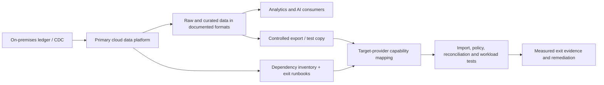

# Portability, Vendor Lock-In and Multi-Cloud Trade-Offs
## Stage 2D — Data Architecture | Topic 07

> **Purpose:** evaluate portability, provider dependencies, exit cost, hybrid architectures and multi-cloud strategies against explicit business and technical requirements.
>
> **Architecture stance:** portability is a set of layer-by-layer decisions, not an absolute target. Multi-cloud is justified only when a documented requirement cannot be met adequately by a simpler design.
>
> **Scope:** architecture, decision analysis and exit planning. This is not a full deployment guide; detailed hybrid networking belongs to Topic 06 and infrastructure-as-code implementation belongs to Topic 08. All Northbridge Bank values and cost examples below are illustrative assumptions, not provider quotes or performance guarantees. The scenario's “within two years” wording is ambiguous: unless the board defines a maximum exit-completion time, treat two years as the planning horizon for exit readiness—not as a demonstrated two-year migration SLA.

---

## 1. Roadmap alignment and learning outcomes

Topic 07 follows the AWS, Azure and Google Cloud reference-pattern lessons, Topic 05 (networking, identity and private connectivity), and Topic 06 (hybrid connectivity and on-premises integration). It prepares the learner to make provider and deployment decisions without treating service names as interchangeable.

The roadmap's central question is:

> **At which architectural layers do we accept coupling, and what would leaving cost?**

By the end, you should be able to:

1. Identify lock-in and portability across data, storage/table formats, code, services, identity/policy and operations.
2. Distinguish single-cloud, hybrid, multi-cloud-by-workload and distributed multi-cloud.
3. Quantify data transfer time, transfer charges and exit costs using explicit assumptions and ranges.
4. Evaluate operational complexity, security, concentration risk, data gravity and team readiness.
5. Design a dependency inventory and credible exit-plan outline.
6. Decide where open formats or abstractions are worth their cost and where provider-specific managed capabilities are beneficial.
7. Defend a single-cloud recommendation when it satisfies requirements better than multi-cloud.
8. Produce a portability assessment, exit-cost range estimate, dependency inventory and multi-cloud decision record.

### Prerequisites and dependencies

- **Topics 02–04:** AWS, Azure and GCP capability maps and provider-specific patterns.
- **Topic 05:** networking, IAM, private connectivity, DNS and identity boundaries.
- **Topic 06:** hybrid links, routing, data movement, recovery and ownership.
- **Data Integration:** batch/CDC, contracts, idempotency, deduplication and reconciliation.
- **Database and Storage Architecture:** object/file formats, warehouse/lakehouse design, replication and consistency.
- **Topic 08:** environment strategy and IaC concepts. This lesson references them but does not implement an IaC workflow.

### Expected deliverables

- Portability assessment by architectural layer.
- Provider-specific dependency inventory with mitigation and residual limitations.
- Exit-cost range estimate and exit-plan outline.
- Multi-cloud decision record / ADR.
- A defensible recommendation for Northbridge Bank.
- Contribution to `Projects/08-cloud-platform-architecture-comparison.md`, the module's final architecture comparison project.

---

## 2. Beginner level — core vocabulary

### 2.1 Definitions

| Term | Meaning | Example |
|---|---|---|
| **Portability** | Ability to move a workload, data or operational capability to another environment with acceptable cost, time, risk and loss of functionality | Export tables and rebuild analytics elsewhere |
| **Interoperability** | Ability of different systems to exchange data or work together through agreed interfaces | A producer publishes events that a consumer can parse |
| **Vendor lock-in** | Dependency that makes changing provider/service materially costly, slow, risky or functionally limiting | Warehouse-specific SQL, proprietary orchestration and IAM policy semantics |
| **Exit cost** | One-time and transition cost of leaving a provider or service | Data transfer, rewriting pipelines, parallel run, validation and retraining |
| **Switching cost** | Broader cost of changing products or vendors, including contract, people and process impacts | Support contract termination and team retraining |
| **Open standard** | Publicly specified format or protocol with defined conformance rules | Parquet files or a documented API protocol |
| **Open source** | Software whose source is available under a licence; this does not automatically make its managed service portable | An open-source engine hosted in a provider-specific managed product |
| **Abstraction layer** | Interface intended to hide implementation details | A common orchestration API across engines |
| **Data gravity** | Tendency for compute and services to move toward large or frequently used datasets because moving data is expensive or slow | Processing stays near a multi-petabyte lake |
| **Egress** | Data leaving a service, region or provider boundary; billing depends on the specific path and product | Exporting warehouse data to another provider |
| **Hybrid cloud** | Coordinated operation across on-premises and cloud environments | Ledger remains on premises while analytics runs in cloud |
| **Multi-cloud** | Use of services/workloads from more than one cloud provider | A business uses one cloud warehouse and a different cloud's ML service |
| **Distributed multi-cloud** | One logical application or data platform spans multiple cloud providers at runtime | A pipeline requires services in two clouds to complete each transaction |
| **Concentration risk** | Excessive dependency on one provider, region, service or supplier such that a failure or commercial change has outsized impact | A critical service has no practical recovery path outside one provider |

### 2.2 The moving-house analogy

Data in a well-documented open file format resembles labelled boxes: it may be relatively straightforward to move. A provider-managed warehouse, proprietary policy model, operational runbooks, monitoring dashboards, service integrations and team skills resemble built-in appliances and wiring: moving the data alone does not recreate the working environment.

The analogy has limits. Open files may still depend on proprietary metadata, encryption keys, schema semantics or query behavior. A format is only one layer of portability.

### 2.3 Portability is not binary

A platform can be:
- highly portable at the file layer;
- partly portable at the table/catalogue layer;
- less portable at SQL and processing semantics;
- strongly provider-specific in identity, policy, networking and managed services;
- operationally difficult to move even when its code compiles elsewhere.

Rate each layer separately, state the evidence, and identify what is not known. Do not label an entire platform “portable” because it uses containers, Spark, SQL or open formats.

---

## 3. Deployment patterns and when they fit

### 3.1 Single-cloud

Most or all cloud workloads run on one provider, potentially with on-premises integration.

**Strengths**
- One primary IAM model, billing model, support relationship and operational toolchain.
- Easier service-to-service integration and lower routine cross-cloud data movement.
- Greater opportunity to use provider-managed capabilities deeply.
- Fewer duplicated platform teams and fewer cross-provider failure modes.

**Risks**
- Provider, region and service concentration.
- Provider-specific features can raise exit cost.
- A regional design is not automatically resilient to provider-wide or control-plane failure.
- Exit plans can become stale if never rehearsed.

**Good fit:** requirements are met by one provider; team capacity is constrained; workload benefits from managed services; exit requirements can be met by data export, dependency inventory and a tested migration path.

### 3.2 Hybrid cloud

Some systems remain on premises while cloud workloads run elsewhere.

**Reasons:** legacy dependencies, local latency, phased migration, source-system constraints, data location requirements, specialist hardware or risk-managed coexistence.

**Additional costs/risks:** connectivity, routing/DNS, identity boundaries, source impact, latency, data replication, cross-boundary incident ownership and dual operations.

Hybrid is not automatically multi-cloud: on-premises plus one cloud is hybrid but not necessarily multi-cloud.

### 3.3 Multi-cloud by workload

Different workloads use different providers, but each workload has a clear primary home. Data is moved or copied across providers only where a requirement justifies it.

**Potential fit:** acquisition integration, a required service unavailable in the primary provider, customer/contract constraints, explicit concentration risk mitigation, or a bounded best-of-breed workload.

**Costs:** duplicated expertise, separate IAM and governance, cross-cloud data movement, more support relationships and more complex incident coordination.

### 3.4 Distributed multi-cloud

A single runtime workflow depends on resources across providers. A request may traverse providers, or a data product may require ongoing cross-cloud replication.

**Costs and risks:** cross-cloud network failure, latency, egress, incompatible identity models, distributed consistency, two sets of service quotas and a larger operational failure surface. A provider outage can leave a workflow partially completed.

Use this pattern only when a strong, evidenced requirement outweighs its complexity. “Avoid lock-in” or “improve resilience” by itself is not sufficient evidence.

### 3.5 Comparison table

| Dimension | Single-cloud | Hybrid | Multi-cloud by workload | Distributed multi-cloud |
|---|---|---|---|---|
| Main purpose | Simplify and use one provider deeply | Preserve on-premises systems or phase migration | Place separate workloads where requirements justify it | One workflow spans providers |
| Operational complexity | Usually lowest of these options | Medium to high | High | Usually highest |
| Data movement | Primarily within provider, plus imports/exports | On-prem/cloud transfer | Cross-provider transfer where needed | Often continuous cross-provider transfer |
| Identity | One cloud IAM plus enterprise identity integration | Enterprise + cloud boundary | Multiple IAM domains | Multiple IAM domains in a runtime path |
| Resilience | Must design across failure domains | Link and environment failure modes | Workload-level recovery options | Cross-cloud dependencies can add new failure modes |
| Portability | Depends on layer choices; not inherently low | Migration may be staged | Depends on workload boundary | Code/data/identity and operations may all be coupled |
| Team requirement | One principal platform skill set | Network, source and cloud skills | Multiple provider skill sets | Cross-provider architecture and operations expertise |
| Cost drivers | Managed services, usage and exit provision | Link, dual run, transfer and operations | Duplicate platform plus transfer/support | Continuous transfer, duplicated services and incident cost |
| Typical evidence | Requirement fit, cost model, exit plan | Source constraints and hybrid flow design | Specific workload requirement | Requirement cannot be met by workload separation |
| Default posture | Strong default when sufficient | Use where on-prem constraints justify it | Use with explicit evidence | Exceptional; require strong justification |

---

## 4. Portability assessment by architectural layer

### 4.1 Rating scale

Use a consistent scale; the ratings below are illustrative, not universal:

- **H — relatively high:** a well-defined open interface exists and a move appears feasible, subject to validation.
- **M — medium:** some components can move, but semantics, metadata, integration or operations require adaptation.
- **L — low:** substantial provider-specific behavior, tooling or reimplementation is likely.
- **U — unknown:** insufficient evidence; create a verification task.

A rating is not proof. Add confidence, evidence and estimated effort. A high rating should be supported by a successful export/import or substitute implementation test, not only by a marketing statement.

### 4.2 Portability matrix

| Layer | Illustrative portability | Typical lock-in mechanisms | Mitigations | Evidence to collect |
|---|---|---|---|---|
| Raw data files | H–M | Proprietary encoding, encryption/key dependency, export limits, undocumented layout | Open file formats, schema/manifest, checksums, key recovery plan | Export/import test, integrity checks, measured transfer time |
| File formats | H when standard-conforming | Nonstandard extensions, unsupported types, hidden metadata | Parquet/Avro/CSV where suitable; documented schemas; conformance tests | Reader compatibility, null/time/decimal semantics |
| Table format and metadata | M | Proprietary catalogue, transaction metadata, partition semantics, deletion files or unsupported table features | Separate data from catalogue where practical; test table-format interoperability | Cross-engine read/write and recovery tests |
| Database/warehouse schema | M–L | SQL dialect, data types, stored procedures, UDFs, constraints, proprietary query features | Portable core SQL; isolate vendor-specific code; contract tests | Query inventory, rewrite estimate, result equivalence |
| Processing code | M | Engine-specific APIs, runtime assumptions, proprietary ML/SQL functions | Modular transformations, open libraries, clear interfaces | Unit/contract tests on alternate runtime |
| Streaming and messaging | M–L | Managed broker semantics, ordering, retention, schema registry, delivery guarantees | Stable event contracts, durable IDs, explicit delivery assumptions | Replay, ordering, schema evolution and sink tests |
| Orchestration | M–L | Managed DAG syntax, triggers, connectors, retries, secrets integration | Separate business logic from orchestration; export DAG/config and dependencies | Recreate schedule, retries, alerting and backfill elsewhere |
| Catalogue and lineage | M–L | Proprietary metadata model, lineage coverage, tags and API behavior | Export metadata; maintain authoritative schemas and data contracts | Metadata export/import, lineage completeness test |
| Governance and policy | L–M | Provider-specific IAM, row/column filters, masking and policy inheritance | Policy intent documented independently; map controls per target | Access scenario matrix and negative tests |
| Identity and secrets | L–M | IAM policy language, workload identity, key management and federation differences | Enterprise identity federation; avoid hard-coded provider identities; least-privilege mapping | Principal mapping, credential rotation and denial tests |
| Networking and private access | L–M | VPC/VNet design, endpoint types, route policy, DNS and firewall models | Document logical flows and address plan; keep endpoint specifics in provider modules | Reachability/DNS/route test and alternate design |
| Storage lifecycle and replication | M–L | Tiering, retention, replication semantics, object lock, restore workflow | Define retention and recovery requirements separately from provider configuration | Restore test, lifecycle behavior and cost model |
| Monitoring and incident response | M–L | Provider-native metrics, logs, alerts and tracing | Common service-level indicators, portable runbooks, exportable event format where feasible | Recreate alerts and demonstrate incident diagnosis |
| Security operations and audit | M–L | Different log schemas, retention controls, key custody and alert integrations | Central control objectives and evidence mapping; provider-specific implementation | Audit event coverage and evidence retrieval exercise |
| IaC and deployment | M–L | Provider-specific resources, state, modules and policy engines | Reuse workflow where possible; expect provider resource definitions to differ | Rebuild in sandbox; drift and rollback test |
| Application interfaces | M–H | Managed SDKs, auth assumptions, proprietary API behavior | Stable internal contracts and adapters; version APIs | Contract tests and alternate implementation |
| ML/AI services | L–M | Model APIs, feature stores, vector stores, proprietary evaluation and serving | Versioned model/data contracts; export model artifacts when permitted; abstract only stable seams | Rebuild, quality and latency comparison on target |
| Skills and operating model | M–L | Undocumented operational knowledge, provider-specific certifications and runbooks | Cross-training, runbooks, paired incident drills and ownership maps | Another team performs recovery using documentation |
| Commercial/legal terms | U | Contract exit clauses, data retrieval terms, licence restrictions, support termination | Legal/procurement review, renewal calendar and exit clauses | Contract review and confirmed data-return/deletion process |

### 4.3 How to score responsibly

For each row, record:

- **Portability rating:** H/M/L/U.
- **Confidence:** high/medium/low.
- **Evidence:** actual test, documentation, inventory or assumption.
- **Exit effort:** person-days or a range.
- **Business criticality:** low/medium/high.
- **Mitigation:** open format, adapter, export, alternate implementation or accepted coupling.
- **Residual limitation:** what remains hard even after mitigation.
- **Owner and review date.**

Do not average these ratings into a single “portability score” without weighting critical layers. A low-portability identity or governance layer may be more important than a highly portable file layer.

---

## 5. Open standards, interfaces and managed services

### 5.1 What standards help with

Open, well-specified formats and protocols can reduce some dependencies:
- data files such as Parquet or Avro;
- documented schemas and API contracts;
- SQL subsets where they genuinely cover the workload;
- common event formats and stable message identifiers;
- widely supported processing libraries;
- standard network protocols;
- exportable metadata and documented operational procedures.

A standard reduces a particular kind of coupling. It does not guarantee equivalent performance, semantics, security, tooling or cost across implementations.

### 5.2 What open formats do not solve

Even if files are portable, the destination still needs to reproduce:
- table snapshots and transaction semantics;
- catalogue references and schema evolution;
- partitioning, clustering and deletion semantics;
- encryption key access and identity;
- retention and legal hold behavior;
- row/column-level security and masking;
- transformation logic and UDFs;
- data quality, lineage and orchestration;
- downstream query behavior and performance.

Exporting raw files may be easier than exporting a functioning data platform.

### 5.3 Managed-service value versus dependency

Managed services may provide integrated security, scaling, patching, observability, backups, governance, lower operational burden or capabilities that would be expensive to reproduce. Accepting a dependency can be a rational architecture decision.

Evaluate the trade as:

**Value received**
- reduced undifferentiated operational work;
- faster delivery;
- built-in integration and governance;
- performance or reliability capabilities supported by evidence;
- access to provider-specific features.

**Cost accepted**
- service-specific APIs and semantics;
- export or migration work;
- skills and runbooks tied to the provider;
- changes in pricing or service availability;
- less direct control over implementation details.

Do not reject a managed service solely because it creates lock-in. Compare the cost of coupling with the cost of operating a more portable alternative.

### 5.4 Avoid over-abstraction

A provider-neutral layer can become another form of lock-in if it is poorly maintained, proprietary, hard to debug or unable to expose important provider features.

Use abstraction when:
- a stable business interface exists;
- multiple implementations are genuinely needed;
- the interface can be tested;
- the team can maintain the adapter and compatibility contract;
- the benefits exceed the extra engineering and operational burden.

Avoid abstraction when it only hides a provider name but leaks semantics, blocks useful capabilities or requires an internal platform team to reproduce each provider’s features.

---

## 6. Data gravity, transfer time and consistency

### 6.1 Data gravity

Large datasets attract compute, analytics and operational dependencies. If data stays in one cloud while a second cloud continuously processes it, the architecture may incur:
- repeated egress or inter-region transfer charges;
- extra network latency;
- replication lag and consistency questions;
- additional security boundaries and credentials;
- duplicate storage and processing;
- more complex incident response.

A bounded copy for a specific workload may be more economical than constant remote reads. Conversely, copying sensitive data into another environment may be unjustified even if technically possible.

### 6.2 Transfer-time formula

For the **actual payload bytes that must cross the path** \(D\), link rate \(C\) bits/second, and assumed effective efficiency \(e\) from 0 to 1:

\[
t_{\text{seconds}} = \frac{D \times 8}{C \times e}
\]

Use consistent units. Decimal units: 1 TB = \(10^{12}\) bytes; 1 GB = \(10^9\) bytes; 1 Gbps = \(10^9\) bits/second. Binary TiB/GiB are larger and must not be silently substituted. If compression or deduplication changes the amount sent, use the post-transformation byte count or state the assumed reduction separately. This is a transfer-only lower-bound style estimate under the assumed sustained rate; it excludes extraction/setup, queueing, throttling, retries, validation, target writes and competing traffic.

### 6.3 Worked transfer-time example

Assume an export of **50 decimal TB**, a sustained **1 Gbps** path and **70% effective efficiency**. These are illustrative assumptions, not a benchmark.

1. Convert bytes to bits:

\[
50 \times 10^{12}\ \text{bytes} \times 8 = 400 \times 10^{12}\ \text{bits}
\]

2. Effective rate:

\[
1 \times 10^9\ \text{bits/s} \times 0.70 = 0.7 \times 10^9\ \text{bits/s}
\]

3. Transfer seconds:

\[
400 \times 10^{12} \div (0.7 \times 10^9)
= 571{,}428.57\ \text{seconds}
\]

4. Convert to hours and days:

\[
571{,}428.57 \div 3{,}600 \approx 158.73\ \text{hours}
\]

\[
158.73 \div 24 \approx 6.61\ \text{days}
\]

**Arithmetic estimate:** about 6.6 days, before extraction, retries, validation, target loading, service quotas and competing traffic. If efficiency is 50%, the estimate becomes \(400 \times 10^{12} / (0.5 \times 10^9) = 800{,}000\) seconds, or about 9.26 days.

### 6.4 Transfer cost example — assumed price only

For an illustrative one-off export of 50 decimal TB, if a hypothetical charge were **$0.09 per decimal GB**:

\[
50\ \text{TB} \times 1{,}000\ \text{GB/TB} = 50{,}000\ \text{GB}
\]

\[
50{,}000\ \text{GB} \times \$0.09/\text{GB} = \$4{,}500
\]

This is arithmetic using an assumed rate, **not a current price or quote**. Actual pricing depends on provider, service, source/destination, region, route, volume tiers, billing unit (for example GB versus GiB), contract and applicable exceptions. Do not multiply a price quoted per GiB by a decimal-GB quantity without conversion. Check the exact route and product in the current official pricing page/calculator and contract; egress is not a universal flat fee for every transfer.

If 5 decimal TB/month moved at the same assumed rate:

\[
5 \times 1{,}000 \times \$0.09 \times 12 = \$5{,}400/\text{year}
\]

That excludes duplicate storage, processing, network service, engineering, support and tax.

### 6.5 Consistency and replication

When data is copied or replicated across providers, define:
- authoritative source and conflict-resolution rules;
- snapshot boundary and CDC checkpoint;
- ordering and event-time semantics;
- freshness/lag objective;
- duplicate and late-arrival handling;
- delete propagation and retention;
- reconciliation method;
- behavior during link outage and replay;
- which consumers may read stale data.

A replicated dataset is not automatically consistent with the source. A backup is not automatically a usable recovery system. A cross-cloud copy is not automatically an independent disaster-recovery environment.

---

## 7. Security, residency, sovereignty and operational boundaries

### 7.1 Security is more than data location

For each target environment, assess:
- data classification and permitted processing;
- residency/location requirements and whether metadata, backups and logs are in scope;
- identity federation and service identities;
- least-privilege access, role mapping and emergency access;
- encryption in transit and at rest;
- key ownership, rotation, revocation and recovery;
- audit-log coverage and retention;
- private endpoint/DNS/network boundaries;
- subprocessors, support access and contract terms;
- retention, deletion and legal hold behavior.

Do not make a legal conclusion from a cloud region name. Requirements vary by jurisdiction, data type, contract, regulator and operational arrangement; obtain qualified legal/compliance review for real decisions.

### 7.2 Cross-provider identity

AWS IAM, Azure identity and Google Cloud IAM have distinct policy models and resource scopes. A common enterprise identity provider or federation mechanism may unify authentication, but it does not make authorization policies interchangeable.

For each provider, map:
- human access;
- workload identity;
- role assumption/federation;
- resource and data permissions;
- key-management permissions;
- audit events;
- break-glass controls;
- joiner/mover/leaver processes.

Test both permitted and forbidden actions. A portability layer that preserves application code but fails to preserve access boundaries is not a safe migration.

### 7.3 Governance portability

A policy statement such as “only the fraud analytics group can read tokenized account data” is a portable **intent**. The actual enforcement may involve provider-specific IAM, warehouse row/column filters, masking, catalog policies, encryption keys and audit controls.

Maintain a control mapping:
1. policy intent and business owner;
2. required enforcement point(s);
3. implementation for each target;
4. positive access test;
5. negative access test;
6. evidence location and retention;
7. residual differences accepted by risk owner.

### 7.4 Regulatory and concentration risk

A second provider may reduce a particular concentration dependency, but it may introduce:
- shared dependencies (identity provider, DNS, connectivity carrier, software supply chain);
- common software vulnerabilities;
- duplicated control gaps;
- greater chance of configuration drift;
- difficult failover and data consistency;
- concentration in one managed SaaS or one key supplier despite multiple clouds.

Regulatory expectations must be researched for the actual sector and jurisdiction. A documented, periodically tested exit plan can address some concerns without active multi-cloud. If a requirement explicitly mandates active dual running, record that evidence and design accordingly.

---

## 8. Reliability, disaster recovery and multi-cloud resilience

### 8.1 Multi-cloud is not automatically resilient

Resilience depends on independent failure domains, recoverable data, tested procedures and operational capability—not the number of provider logos.

A second cloud may fail to help if:
- data replication is stale or broken;
- the alternate environment cannot meet capacity needs;
- identity federation or DNS is shared and unavailable;
- the same deployment pipeline or operator error affects both;
- encryption keys or licences are unavailable;
- data formats or service semantics differ;
- recovery procedures have never been exercised;
- traffic cannot be rerouted or consumers cannot switch safely.

### 8.2 Compare recovery options

| Option | Potential benefit | Main cost/limitation | Evidence needed |
|---|---|---|---|
| Single region, same provider | Simple and low duplication | Limited against region-level failures | Regional failure assumptions and backups |
| Multi-region, same provider | Can reduce regional concentration | Cross-region replication, service dependencies, provider-wide risk remains | Failover, restore and consistency tests |
| Single-cloud with tested exit plan | Limits operational complexity while preserving a path to leave | Exit takes time; not instant failover | Successful export/rebuild test and measured RTO |
| Second-cloud cold/warm standby | Potential alternative recovery environment | Data lag, duplicate cost, rebuild and access mapping | Regular recovery exercise with target capacity |
| Active multi-cloud | Potentially lower recovery time for some workloads | High complexity, consistency and cross-cloud failure modes | End-to-end failover, split-brain prevention and reconciliation |
| Workload-split multi-cloud | Keeps each workload mostly self-contained | Cross-provider analytics/data sharing still costs and needs governance | Workload boundary, data movement and operational ownership |

### 8.3 RTO and RPO

- **RTO (Recovery Time Objective):** acceptable time to restore a service.
- **RPO (Recovery Point Objective):** acceptable loss window measured in time.
- **Freshness objective:** how current analytics data must be during normal operations.
- **Exit timeline:** time available to move away from a provider after a commercial, risk or strategic trigger.

These are different. An exit plan that can complete in 90 days does not satisfy a 15-minute disaster-recovery RTO. Conversely, a low RTO does not necessarily require multi-cloud if same-provider regional recovery meets the requirement.

---

## 9. Team, governance and operating cost

### 9.1 Costs that are easy to miss

- duplicate cloud platform and security teams;
- training, hiring, certifications and on-call rotations;
- separate IAM policy design and access reviews;
- duplicated logging, alerting, SIEM integration and incident runbooks;
- provider support plans and contract management;
- cross-cloud network engineering and DNS;
- continuous replication and data reconciliation;
- duplicate data storage and compute;
- duplicated environments for test/staging/DR;
- provider-specific application rewrites and performance tuning;
- compliance evidence mapping and audits;
- tool licences, data catalogues, secrets management and observability;
- incident coordination between multiple support organizations;
- exit-plan rehearsal and maintaining an alternate implementation.

### 9.2 Cost model

Use a consistent time horizon (for example 3 years) and compare total cost of ownership (TCO), not only cloud bill line items.

\[
\text{TCO over horizon} =
\text{recurring operating cost} + \text{one-time implementation/migration cost}
+ \text{expected risk loss} + \text{exit/transition provision, if in scope}
\]

Break recurring operating cost into compute, storage, network/egress, platform tooling, staffing, support, security, governance and observability. Define each cost line once: **do not double-count** migration/exit effort, a contingency reserve and an expected risk loss when they represent the same event. State the time horizon, discounting treatment (if used), currency, tax/contract assumptions and whether costs are nominal or present value.

For alternatives, include:
- initial migration and data export;
- ongoing egress and replication;
- duplicate infrastructure and minimum standby capacity;
- engineering to rewrite, test and maintain portability;
- staffing and training;
- provider support contracts;
- logging, security and compliance operations;
- parallel running and validation;
- contract termination or data return costs;
- uncertainty ranges and sensitivity to growth.

Do not use a speculative probability as if it were known. If using expected-value analysis, show the assumptions and sensitivity.

### 9.3 Illustrative three-year cost worksheet

The table below is a template; fill values from quotes, internal labor rates and measured workloads.

| Cost category | Option A: one provider + exit plan | Option B: workload-split multi-cloud | Evidence/source |
|---|---:|---:|---|
| Primary compute and storage | Input A | Input B | Provider calculator / bill |
| Data transfer and egress | Input A | Input B | Route-specific price and volume |
| Duplicate data and replication | Input A | Input B | Storage profile and lag requirement |
| Additional platform engineering | Input A | Input B | Effort range × internal rate |
| Staffing/on-call/training | Input A | Input B | Team capacity and coverage |
| Support and vendor contracts | Input A | Input B | Commercial quotes |
| Security, logging and audit | Input A | Input B | Tooling and retention requirements |
| Initial migration / implementation | Input A | Input B | Work breakdown and estimate |
| Parallel run and validation | Input A | Input B | Duration × operating cost |
| Exit rehearsal and remediation | Input A | Input B | Test plan and effort |
| Risk/contingency allowance | Input A | Input B | Explicit risk register |
| **3-year total** | **Sum** | **Sum** | Include assumptions and confidence |

---

## 10. Exit cost and value of portability

### 10.1 Exit-cost components

1. Data extraction and transfer.
2. Data transformation, format conversion and validation.
3. Schema, SQL, UDF, procedure and application rewrites.
4. Rebuild of orchestration, streaming, catalogue, governance and monitoring.
5. Identity, network, key and secrets remapping.
6. Re-creation of retention, lineage, audit and access evidence.
7. Target environment and capacity setup.
8. Parallel running, reconciliation and cutover.
9. Team training, support contract transition and procurement/legal work.
10. Downtime, degraded service and risk of migration defects.
11. Deletion confirmation and closure of the old environment.

### 10.2 Low/base/high estimates

Use ranges rather than false precision:

| Component | Low case | Base case | High case | Main uncertainty |
|---|---|---|---|---|
| Data transfer | Existing path, modest volume | Planned bulk transfer | Congestion/retries or repeated exports | Actual throughput and data volume |
| Code migration | Few provider-specific features | Moderate SQL/API rewrites | Deep proprietary service dependencies | Code inventory and test coverage |
| Governance/identity | Clear policies and mapping | Multiple control mappings | Key/identity redesign and audit gaps | Access model complexity |
| Parallel run | Short and well-controlled | Several reconciliation cycles | Long dual-run due to mismatches | Data consistency and business sign-off |
| People/support | Existing skills | Targeted training and specialist help | New team capability and support overlap | Staffing availability |
| Risk contingency | Few critical unknowns | Some unresolved dependencies | Critical service or data loss risk | Evidence quality |

Estimate person-days and calendar time separately. Work can run in parallel only when dependencies allow it. A migration plan must include data validation and business acceptance, not only infrastructure creation.

For a reproducible low/base/high estimate, fill in actual values for each scenario and calculate at least:

- **Transfer-only duration:** \(D_{\text{bytes}} \times 8 / (C_{\text{bits/s}} \times e)\), then convert seconds to hours/days.
- **Transfer charge:** billable volume in the provider's stated unit × the current route/product-specific rate, plus any applicable transfer appliance, interconnect or processing charges.
- **Labor:** person-days by role × loaded cost per person-day; keep elapsed calendar time separate from summed effort.
- **Parallel run:** incremental duplicated monthly operating cost × number of months, plus reconciliation and support effort.
- **Risk/contingency:** list discrete risks and their treatment; do not add a generic percentage without explaining its basis.

| Estimate input | Low | Base | High | Evidence needed |
|---|---:|---:|---:|---|
| Data to move (decimal TB or TiB) | Input | Input | Input | Inventory and export measurement |
| Sustained rate and efficiency | Input | Input | Input | Representative transfer test or defensible assumption |
| Billable transfer volume and rate | Input | Input | Input | Current pricing page, calculator and contract |
| Rewrite/rebuild effort (person-days) | Input | Input | Input | Dependency inventory and engineering review |
| Parallel-run duration (months) | Input | Input | Input | Cutover plan and reconciliation criteria |
| Incremental monthly run cost | Input | Input | Input | Bills, quotes or workload model |
| **Total exit estimate** | **Calculated** | **Calculated** | **Calculated** | Assumptions, exclusions and confidence documented |

Do not populate these fields with invented provider prices or pretend estimates are measured results. If source volumes, rates or labor costs are unknown, retain them as explicit inputs and mark the estimate provisional.

### 10.3 Expected value of portability

A rough decision aid from the roadmap is:

\[
\text{Expected net value of portability}
\approx P(\text{exit needed}) \times \Delta C_{\text{exit}} - C_{\text{portability controls}}
\]

Here \(\Delta C_{\text{exit}}\) is the **incremental exit-cost reduction attributable to the portability controls** (baseline exit cost minus exit cost with those controls), not the gross exit cost. Use the same decision horizon and cost basis for all terms; include timing/discounting if material. This is not a precise financial law. The probability of exit and cost reduction are uncertain, and portability may have strategic, regulatory or resilience value not captured by a single number.

Example using purely illustrative assumptions:
- probability of needing exit within the decision horizon: 20%;
- estimated incremental exit-cost reduction attributable to the portability controls: $1,000,000;
- cost of maintaining those controls over the horizon: $120,000.

\[
0.20 \times \$1{,}000{,}000 - \$120{,}000 = \$80{,}000
\]

Under these assumptions, the rough expected value is positive by $80,000. If the exit probability were 10%, the estimate would be \(0.10 \times \$1,000,000 - \$120,000 = -\$20,000\). These numbers do not establish the true probability or business value; use sensitivity ranges and include non-financial requirements.

### 10.4 Dependency inventory template

| Field | Example / instruction |
|---|---|
| Component ID and owner | Unique identifier and accountable team |
| Business capability | Ingestion, warehouse, catalogue, identity, analytics |
| Provider/service/region | Exact service and deployed scope |
| Criticality | Critical/high/medium/low |
| Data and interfaces | Formats, APIs, schemas, event contracts, export mechanism |
| Provider-specific behavior | SQL extensions, IAM policy, orchestration triggers, proprietary metadata |
| Data volume and growth | TB now, daily change rate, peak rate |
| Transfer constraints | Source/destination, direction, time window, route, egress assumption |
| Security dependency | Identity, key, private endpoint, audit, retention |
| Alternative implementation | Candidate, evidence and missing capabilities |
| Exit effort range | Person-days, calendar time, parallel-run duration |
| Recovery dependency | Backup, RTO/RPO, source of truth, checkpoint |
| Mitigation | Export, abstraction, open format, documented policy or accepted coupling |
| Residual risk | What is still not portable or not tested |
| Test evidence | Test date, scope, result and limitations |
| Owner / review date | Named role and scheduled review |

---

## 11. Northbridge Bank scenario

### 11.1 Context and constraints

Northbridge Bank is a fictional enterprise with a core ledger that remains on premises for three years. It is building cloud analytics and AI workloads. The board asks: **“Could we leave our selected cloud provider within two years if business, risk or commercial conditions changed?”**

Illustrative requirements:
- sensitive ledger-derived data is governed and access is auditable;
- analytics data should be recoverable and reconciled;
- the bank needs a credible exit plan, but no stated requirement mandates active-active operation across two cloud providers;
- a cloud data platform is already being designed using AWS/Azure/GCP lessons;
- actual regulatory and contractual requirements must be confirmed by the bank’s legal/compliance owners;
- data volumes, target RTO/RPO, egress prices and migration effort are not yet fully measured;
- the board’s “within two years” question has not yet been translated into a precise requirement: it could mean a two-year planning horizon or a maximum time to complete exit after a trigger. The ADR must not claim either interpretation is met until the board sets the acceptance target and a representative rehearsal measures it.

### 11.2 Candidate architectures

**Option A — One primary cloud, open data layer, documented and tested exit plan**
- Keep ingestion, storage, processing, governance and serving mainly in one provider.
- Store raw/curated datasets in suitable well-supported formats and maintain schemas/data contracts.
- Inventory provider-specific warehouse, orchestration, identity, catalogue, key and monitoring dependencies.
- Maintain export procedures, target capability mapping and an exit rehearsal plan.
- Accept provider-specific managed services where their benefits justify the dependency.

**Option B — Workload-split multi-cloud**
- Keep the primary data platform in one provider.
- Place a bounded ML or data product workload in a second provider only if a documented requirement justifies it.
- Move only the required data subset, with purpose, retention, access and egress controls.
- Keep each workload self-contained rather than making all core pipeline stages depend on both clouds.

**Option C — Distributed multi-cloud active platform**
- A single logical platform runs critical stages across providers and continuously moves data between them.
- Requires cross-cloud identity, networking, replication, monitoring, incident response, consistency and failover.
- Consider only if a requirement demands runtime cross-provider operation and alternatives do not meet it.

### 11.3 Recommendation under stated assumptions

**Provisional recommendation: Option A — one primary cloud with a layered portability strategy and an evidence-based exit plan.**

Rationale:
- The stated requirement is a credible exit path, not instant cross-provider failover.
- The architecture can preserve portable data and contracts while accepting provider-specific managed capabilities where valuable.
- It avoids duplicating the full security, governance and operational model without evidence that live multi-cloud is required.
- The exit plan must be validated with export/import, workload rebuild, access-policy tests, reconciliation and measured timing before it is called proven.

Revisit if the bank discovers a binding requirement for active dual running, a specific service cannot meet an essential requirement, concentration risk cannot be mitigated adequately, or measured exit tests fail the required timeline.

### 11.4 Logical flow

The diagram represents an exit capability exercise, not automatic live replication or proven failover. A real exit test must verify data, policies, application behavior, recovery timing and operational ownership.

---

## 12. Weighted decision framework

### 12.1 Score the requirement fit, not provider popularity

1. Define mandatory constraints first (security, residency, freshness, availability, recovery, required service capability).
2. Eliminate options that fail a mandatory constraint.
3. Score remaining options using explicit criteria and weights.
4. Record evidence and confidence for each score.
5. Test sensitivity: do modest changes in weights or assumptions reverse the decision?
6. Include a “not enough evidence” state and define how to obtain evidence.

Illustrative scale:
- 1 = materially poor fit;
- 2 = weak fit;
- 3 = acceptable with trade-offs;
- 4 = strong fit;
- 5 = very strong fit.

Weighted total = \(\sum (\text{weight} \times \text{score})\). If weights sum to 100, divide the total by 100 to obtain a weighted score on a 1–5 scale.

### 12.2 Example matrix for Northbridge

These weights and scores are illustrative judgments based on the assumptions above, not empirical provider benchmarks. The scores should be revised after requirements workshops, quotes and tests.

| Criterion | Weight | A: single cloud + exit plan | B: workload-split multi-cloud | C: distributed multi-cloud |
|---|---:|---:|---:|---:|
| Meets current functional needs | 15 | 5 | 4 | 4 |
| Security/governance manageability | 15 | 4 | 3 | 2 |
| Recovery and concentration risk | 15 | 3 | 4 | 4 |
| Exit capability | 15 | 4 | 4 | 3 |
| Cost/TCO under current assumptions | 15 | 5 | 3 | 1 |
| Team and operating readiness | 10 | 5 | 3 | 1 |
| Data movement and latency simplicity | 10 | 5 | 3 | 1 |
| Delivery speed | 5 | 5 | 3 | 1 |
| **Weighted total (out of 500)** | **100** | **440** | **345** | **235** |
| **Weighted score (out of 5)** | **100** | **4.40** | **3.45** | **2.35** |

Example calculation for Option A:

\[
(15 \times 5)+(15 \times 4)+(15 \times 3)+(15 \times 4)
+(15 \times 5)+(10 \times 5)+(10 \times 5)+(5 \times 5)=440
\]

\[
440 \div 100 = 4.40
\]

**Interpretation:** Option A leads under the current assumptions. This is not a universal conclusion: Option C may become necessary if a validated mandatory requirement demands distributed multi-cloud operation. A weighted score cannot override a failed legal, security or business hard constraint.

### 12.3 Sensitivity analysis

Re-run the matrix when:
- a regulator/customer requirement changes;
- target RTO becomes much shorter;
- the exit timeline becomes mandatory and bounded;
- data volume grows materially;
- a second-provider workload becomes business-critical;
- current cost quotes or team capacity contradict assumptions;
- exit testing reveals much higher rewrite effort than expected.

If the recommendation changes with a small score adjustment, treat the decision as sensitive and prioritize evidence rather than pretending the ranking is precise.

---

## 13. Architecture decision record (ADR)

### ADR-07 — Portability and deployment strategy for Northbridge analytics

**Status:** Proposed, pending requirements confirmation and validation.

**Context**
- Core ledger remains on premises for three years.
- Cloud analytics and AI workloads are planned.
- The board asks whether the bank could leave within two years if required, but has not yet defined whether this means a two-year planning horizon or a maximum completion time measured from an exit trigger.
- No evidence currently says active-active multi-cloud is mandatory.
- Regulatory interpretation, workload volumes, actual pricing, the post-trigger exit deadline and acceptance criteria need confirmation.

**Decision criteria**
- Security and governance controls;
- acceptable freshness, RTO/RPO and a board-approved, measurable post-trigger exit timeline;
- total cost including staffing and support;
- ability to export and validate data;
- provider-specific code and identity dependencies;
- operational readiness and failure recovery.

**Option A — single primary cloud + exit plan**
- Pros: simplest operations; deeper managed-service integration; lower routine cross-cloud movement.
- Cons: provider-specific services remain; exit is not instantaneous; exit rehearsal costs time.
- Risks: stale inventory or untested rebuild.
- Mitigation: per-layer portability assessment, versioned contracts, periodic export/rebuild test.

**Option B — workload-split multi-cloud**
- Pros: a bounded workload can use a second provider when justified; limits dependence for that workload.
- Cons: duplicated security/monitoring skills and data movement; needs a clear workload boundary.
- Risks: data copy expands beyond original scope; ownership becomes unclear.
- Mitigation: bounded data subset, explicit purpose, transfer budget, policy parity and owner.

**Option C — distributed multi-cloud**
- Pros: supports requirements that genuinely need a cross-provider runtime.
- Cons: highest complexity, consistency and failure coordination burden; no automatic resilience.
- Risks: partial failures, shared dependencies, data drift, untested failover.
- Mitigation: require a mandatory use case, tested end-to-end recovery and dedicated operating ownership.

**Decision**
- Select Option A provisionally.
- Do not call the exit plan proven until the export/import and workload reconstruction tests pass against the board-approved completion-time target.
- Until that target is defined, treat the two-year phrase as unresolved—not as a validated exit SLA.
- Allow Option B only for a specific approved workload and evidence-backed requirement.
- Reject Option C unless a hard requirement cannot be met by a simpler option.

**Validation plan**
1. Inventory services, formats, APIs, SQL, identity, governance, keys, networking, monitoring and contracts.
2. Export a representative dataset with metadata and checksums.
3. Import into a controlled alternate environment.
4. Rebuild a representative pipeline and compare outputs against agreed invariants.
5. Test positive and negative access cases, encryption, audit events and retention.
6. Measure transfer time, person-days, elapsed time, target costs and data reconciliation.
7. Record gaps, remediation owners and retest date.

**Consequences**
- We accept some provider-specific services to gain operational value.
- We invest in open data contracts, exportability and a dependency inventory.
- We incur periodic exit-test costs.
- Residual limitations and actual exit timing remain unknown until tested.

**Revisit triggers**
- requirement changes to active dual-provider operation;
- exit target or regulatory interpretation changes, including confirmation of whether two years is a planning horizon or a maximum post-trigger completion time;
- service dependency becomes unsupported or commercially unacceptable;
- data volume/egress cost exceeds threshold;
- exit rehearsal fails or exceeds the target timeline.

---

## 14. Dependency inventory and exit plan

### 14.1 Exit plan is a capability, not a document alone

A written checklist is useful but does not prove that the organisation can leave. A credible exit plan names owners, prerequisites, decision points, data sources, target capabilities, validation criteria, fallback, timing and cost. It is only demonstrated to the extent that tests have actually been performed.

### 14.2 Exit-plan sequence

1. **Trigger and authority:** define who can initiate exit, evidence threshold and decision authority.
2. **Freeze scope:** list workloads, data products, users, regions, integrations and service dependencies.
3. **Inventory dependencies:** use the matrix in Section 10.4; include contracts and third-party services.
4. **Define target requirements:** required capability and acceptance criteria, not just similar product names.
5. **Prepare data export:** formats, schemas, metadata, manifests, checksums, key custody and legal retention.
6. **Estimate transfer:** volume, sustained throughput, time windows, cost and catch-up capacity.
7. **Rebuild services:** processing, orchestration, catalogue, identity, governance, monitoring, secrets and alerting.
8. **Validate behavior:** contract tests, row/column policy tests, reconciliation, performance and recovery.
9. **Parallel run:** define one authoritative writer/source of truth, compare results, manage dual-write risks and obtain business sign-off. Do not assume two independently writable copies can be reconciled safely after a partition.
10. **Cutover:** record a consistent snapshot/CDC watermark, quiesce or fence writes as designed, switch consumers, monitor and preserve rollback. Define whether post-cutover writes can be reverse-replicated; otherwise rollback may require a controlled write freeze and reconciliation rather than simply switching traffic back.
11. **Rollback criteria:** explicit threshold for data mismatch, latency, policy gap or outage, plus the last safe rollback point and the owner authorized to invoke it.
12. **Close old environment:** retain required records, revoke identities, rotate keys/secrets, confirm deletion and contractual obligations.
13. **Capture evidence:** timings, costs, defects, limitations, owners and retest schedule.

### 14.3 Exit acceptance checklist

- [ ] Scope and decision authority agreed.
- [ ] Provider-specific dependency inventory complete enough for critical workloads.
- [ ] Data and metadata export mechanisms identified.
- [ ] Keys, identity and governance mappings approved.
- [ ] Transfer time and costs estimated with explicit units and assumptions.
- [ ] Representative export/import completed in a controlled environment, if claiming tested capability.
- [ ] Checksums, row counts, business invariants and schema compatibility validated.
- [ ] Representative processing and orchestration rebuilt.
- [ ] Positive and negative authorization tests passed.
- [ ] Logging, alerting, lineage and operational ownership reproduced.
- [ ] Recovery, cutover and rollback steps rehearsed.
- [ ] Actual elapsed time, person-days and cost recorded.
- [ ] Residual gaps accepted by accountable risk/business owners.
- [ ] Data deletion/retention and contract closure reviewed.
- [ ] Next test date and trigger conditions recorded.

### 14.4 Exit versus disaster recovery

Exit and DR solve different problems:
- **DR** restores service after a disruption, within defined RTO/RPO.
- **Exit** moves away from a provider/service, potentially due to strategic, commercial, risk or regulatory triggers.
- A DR replica may depend on the same provider, IAM, keys or control plane.
- An exit plan may take weeks or months and is not a substitute for a short recovery objective.

---

## 15. Failure scenarios: when multi-cloud increases risk

| Scenario | Why multi-cloud may worsen the situation | Better control or alternative |
|---|---|---|
| Cross-cloud link fails during pipeline run | Workflow becomes partially complete; retries can duplicate or miss data | Reduce runtime coupling; durable queues/checkpoints; idempotent writes and reconciliation |
| Identity federation unavailable | Workload in the second cloud cannot authenticate despite its own services being healthy | Test independent recovery credentials and emergency access; avoid one undocumented shared dependency |
| One provider's schema/SQL semantics differ | “Portable” pipeline produces different results or fails | Contract tests, result equivalence tests and explicit provider-specific adapters |
| Data replication lag exceeds freshness objective | Consumers see stale or inconsistent views | Define lag SLO, alert on watermark, degrade explicitly or keep workload close to source |
| Two teams own different cloud halves | Incidents bounce between teams and vendors | Single service owner, shared runbook, clear escalation and joint game days |
| Cost model omits egress and duplicate logs | Second cloud appears cheap but TCO grows | Model network direction, replicated data, logs, support and staffing |
| Policy parity is assumed | One cloud allows a path or data access that another denies | Map control intent to each provider; test both allowed and forbidden operations |
| “Backup” cannot meet capacity | Recovery target is technically online but cannot serve production load | Capacity test, restore/failover drill and recovery tier definition |
| Shared identity, DNS or CI/CD is a common failure point | Two clouds fail together due to one shared service | Identify shared dependencies and design realistic independent recovery |
| Abstracted platform hides provider features | Teams lose useful managed capabilities but still need provider-specific workarounds | Abstract only stable interfaces with demonstrated value |
| Exit inventory is stale | Critical service, key, contract or metadata dependency is discovered late | Assign owners, automate inventory where possible and review on change |
| Both clouds accept writes during a partition | Split-brain and conflicting data | Define one writer/leader or explicit conflict resolution; test partition recovery |

---

## 16. Practical exercises

### Exercise A — assess twenty components

Classify at least twenty components from a hypothetical data platform by layer: raw storage, table format, warehouse SQL, processing, orchestration, CDC, event broker, catalogue, lineage, IAM, keys, private networking, DNS, monitoring, CI/CD, secrets, ML serving, dashboards, audit and support contract.

**Deliverable:** portability matrix with rating, confidence, evidence, exit effort, mitigation, residual risk and owner.

**Validation:** do not mark a layer high portability without evidence. If unknown, write “unknown” and define a test.

### Exercise B — Northbridge asks “Can we leave in two years?”

Estimate exit cost ranges and create an exit-plan outline. Include the on-premises ledger, initial snapshot, ongoing CDC, cloud lake/warehouse, identity, policies, monitoring, consumer cutover and deletion/retention.

**Deliverable:** low/base/high exit-cost model and dependency inventory.

**Validation:** costs include data transfer, rewrite, governance/identity, parallel run, staff/support and risk contingency.

### Exercise C — justify a second cloud for ML

A business unit requests a second provider for a managed ML capability. Compare:
1. keep ML in the primary cloud;
2. move the entire data platform;
3. send a bounded, approved data subset to a second cloud;
4. make the main pipeline distributed across both clouds.

**Deliverable:** weighted decision matrix, data-flow diagram and ADR.

**Validation:** document the business requirement, data volume, residency, latency, egress, access controls, team skills and exit path. “Best of breed” alone is not enough.

### Exercise D — transfer time and cost

Calculate the transfer time and hypothetical cost for 50 TB using Section 6. Then repeat at 50% efficiency and a different hypothetical $/GB rate.

**Deliverable:** arithmetic with decimal/binary unit choice, throughput assumption, one-off cost and recurring scenario.

**Validation:** clearly label assumed prices and do not present them as current provider pricing.

### Exercise E — test portability rather than claim it

Design a controlled proof of exit for a representative dataset and pipeline.

**Deliverable:** test plan with source snapshot/watermark, data export, metadata, target implementation, access-policy tests, reconciliation, timing, cost and defects.

**Validation:** define acceptance criteria before the test. Do not mark the exit plan “proven” until the test is executed and evidence recorded.

### Exercise F — failure tabletop

Choose three failures from Section 15 and simulate detection, containment, recovery, validation and communication. Include a cross-cloud link failure and a policy mismatch.

**Deliverable:** incident runbook and ownership/escalation matrix.

**Validation:** restore data correctness and security, not only service reachability.

### Exercise G — module capstone contribution

Contribute to `Projects/08-cloud-platform-architecture-comparison.md`:
- logical capabilities before provider names;
- AWS/Azure/GCP mappings based on Topics 02–04;
- hybrid constraints from Topic 06;
- per-layer portability assessment;
- cost and operations assumptions;
- an explicit single-cloud/hybrid/multi-cloud recommendation;
- ADR, unresolved research items and revisit triggers.

**Validation:** apply the same scenarios and criteria to all provider mappings. Do not invent equivalence where service semantics differ.

---

## 17. Practice questions

1. What is the difference between portability and interoperability?
2. Why can open file formats coexist with strong provider lock-in?
3. Which architecture layers typically carry the highest exit effort?
4. When can provider-specific managed services be a rational choice?
5. Why is “we use containers” insufficient evidence of portability?
6. What does data gravity mean, and how does it influence cost and latency?
7. How should data transfer time be calculated with units?
8. Why is a hypothetical egress price not a provider quote?
9. What additional costs appear when two cloud environments are operated?
10. Why is workload-split multi-cloud often easier than distributed multi-cloud?
11. How can multi-cloud increase failure modes rather than reduce them?
12. What is the difference between exit planning and DR?
13. Why must identity and governance be mapped separately for each provider?
14. What evidence would make an exit plan credible?
15. Why should a decision matrix not override mandatory security or legal constraints?
16. How would you measure the cost of maintaining portability?
17. What does a dependency inventory need beyond service names?
18. How can an abstraction layer become a new source of lock-in?
19. What conditions would justify active multi-cloud for Northbridge?
20. Which assumptions in your decision should trigger a review?

### Answer key — concise reasoning

1. Portability is moving/recreating a capability; interoperability is exchanging data or working across interfaces.
2. Metadata, catalogues, query semantics, IAM, keys, operations and service APIs may remain provider-specific.
3. Often identity/policy, managed services, orchestration, governance and operational tooling; actual impact depends on implementation.
4. When managed value and reduced operational burden outweigh the accepted exit cost.
5. Runtime, identity, storage, networking, observability and data semantics may still be provider-specific.
6. Moving large or frequently accessed data costs time and money, so compute tends to stay near it.
7. Convert bytes to bits, divide by effective bits/second, then convert seconds to hours/days.
8. Actual pricing depends on product, route, region, volume, tiers, contract and exceptions.
9. Egress, duplicate storage/compute, support, staff, security, monitoring, testing and incident coordination.
10. Each workload has a clearer boundary and can avoid a runtime dependency on the other provider.
11. More networks, identities, consistency boundaries, failure points and team handoffs are introduced.
12. DR restores service within RTO/RPO; exit changes provider/service and may take much longer.
13. Provider IAM models and resource scopes differ; common authentication does not equal identical authorization.
14. A representative export/import/rebuild test with measured timing/cost, policy tests and data reconciliation.
15. Hard constraints must be met regardless of weighted preference.
16. Estimate engineering, tests, abstraction maintenance, duplicated interfaces and opportunity cost.
17. Interfaces, data volumes, policy/key dependencies, owner, criticality, alternatives, exit effort and test evidence.
18. It can hide semantics, lag behind providers or become proprietary and difficult to replace.
19. Only a documented mandatory requirement that simpler alternatives cannot adequately meet, with tested recovery.
20. Volume, exit deadline, regulatory interpretation, RTO/RPO, provider service change, cost or staffing.

---

## 18. Common mistakes

| Mistake | Why it fails | Better approach |
|---|---|---|
| Treating portability as all-or-nothing | Hides which layers actually matter | Assess each layer and evidence |
| Assuming open source means portable | Managed integrations and operations can still be proprietary | Inventory runtime and service dependencies |
| Using open files as proof of an exit-ready platform | Metadata, policy, keys and pipelines may not move | Test a complete representative workflow |
| Choosing multi-cloud “for resilience” | Adds failure modes without proven recovery | Define RTO/RPO and test failover first |
| Ignoring egress and data gravity | Underestimates ongoing cost | Model data movement by direction and frequency |
| Comparing service names as if equivalent | Semantics, quotas, guarantees and pricing differ | Compare capability behavior against the same workload |
| Over-abstracting every service | Loses managed-service benefits and adds internal complexity | Abstract only stable, valuable interfaces |
| Assuming common identity means common authorization | Policy models and resource scopes differ | Map and test each provider's permissions |
| Treating a written exit plan as proven | No evidence that data, code and policies can be rebuilt | Record test results, gaps and measured time |
| Ignoring people and support | Multi-cloud operations may exceed team capacity | Include staffing, training, support and on-call costs |
| Failing to define the source of truth | Replicas can diverge or accept conflicting writes | Define ownership, ordering and conflict policy |
| Using a weighted score to hide a hard constraint | A high average cannot compensate for a failed mandatory control | Apply mandatory gates before scoring |
| Treating DR as exit | A same-provider DR plan may not support a provider exit | Design and test each objective separately |
| Leaving the dependency inventory stale | Hidden service or contract dependencies surface late | Assign owners and review triggers |
| Claiming regulatory requirements without checking | Legal duties vary by sector and jurisdiction | Obtain current legal/compliance interpretation |

---

## 19. Mastery criteria

You have mastered Topic 07 when you can:

- classify a data platform across the portability matrix and justify every high/medium/low/unknown rating;
- explain where provider-specific services deliver value and what dependency is accepted;
- distinguish single-cloud, hybrid, workload-split multi-cloud and distributed multi-cloud;
- estimate transfer time and egress using consistent units and explicit assumptions;
- build a total-cost model including duplicate infrastructure, staffing, support, engineering and operations;
- explain why multi-cloud is not automatically more resilient;
- inventory service, data, identity, governance, network, operations and contractual dependencies;
- define an exit sequence, acceptance tests, rollback criteria and evidence requirements;
- defend a single-cloud option when it meets requirements better than multi-cloud;
- make a conditional recommendation with residual risks, unknowns and revisit triggers;
- contribute a fair, capability-first provider comparison to the module capstone.

## 20. Completion checklist

- [ ] Portability assessment completed across major architectural layers.
- [ ] Every rating includes evidence or a research task.
- [ ] Provider-specific dependency inventory includes owner, mitigation and residual risk.
- [ ] Data transfer time and hypothetical egress calculations checked independently.
- [ ] Cost model includes transfer, duplicate infrastructure, staffing, support, engineering and operational costs.
- [ ] Single-cloud, hybrid, workload-split multi-cloud and distributed multi-cloud compared.
- [ ] Northbridge recommendation tied to explicit requirements and assumptions.
- [ ] Weighted matrix uses justified weights and passes a sensitivity review.
- [ ] ADR compares at least two viable options and records rejected alternatives.
- [ ] Exit plan defines ownership, validation, rollback, cutover and closure.
- [ ] No claim of proven exit capability is made without recorded test evidence.
- [ ] Security, identity, residency and governance controls are mapped.
- [ ] RTO/RPO and exit timeline are not conflated.
- [ ] Topic 06 connectivity and Topic 08 IaC boundaries are respected.
- [ ] Capstone contribution is capability-first and distinguishes known facts from research items.
- [ ] Revisit triggers and next review date recorded.

---

## 21. Official documentation and verification references

These references are starting points for checking export, transfer, service semantics and pricing. Provider documentation confirms that transfer prices are route/product-specific, and that migration/export tools have scoped capabilities; it does **not** establish a universal price or equivalent cross-cloud behavior. Verify the exact current product, region, route, billing unit, contract and feature before using them in a real decision. The example calculations in this lesson deliberately use a hypothetical rate and are not a comparison of current AWS, Azure and Google Cloud prices.

### AWS
- [AWS Data Transfer pricing](https://aws.amazon.com/ec2/pricing/on-demand/#Data_Transfer) — verify the exact service, direction, region and billing category.
- [AWS DataSync User Guide](https://docs.aws.amazon.com/datasync/latest/userguide/what-is-datasync.html) — transfer mechanics and constraints; not a guarantee of end-to-end migration time.
- [Amazon S3 User Guide](https://docs.aws.amazon.com/AmazonS3/latest/userguide/Welcome.html) — storage and export behavior is service-specific.
- [AWS Prescriptive Guidance](https://docs.aws.amazon.com/prescriptive-guidance/latest/overview/overview.html)

### Microsoft Azure
- [Azure bandwidth pricing](https://azure.microsoft.com/en-in/pricing/details/bandwidth/) — route and transfer category affect price; displayed estimates are not contractual quotes.
- [Azure Data Factory documentation](https://learn.microsoft.com/en-us/azure/data-factory/)
- [Microsoft guidance: migrate data from Amazon S3 to Azure Storage with Data Factory](https://learn.microsoft.com/en-us/azure/data-factory/data-migration-guidance-s3-azure-storage) — an example pattern, not proof that all workloads or semantics migrate unchanged.
- [Azure Storage documentation](https://learn.microsoft.com/en-us/azure/storage/)
- [Azure Architecture Center](https://learn.microsoft.com/en-us/azure/architecture/)

### Google Cloud
- [Google Cloud network pricing](https://cloud.google.com/vpc/network-pricing) — pricing varies by source/destination, tier, product and billing unit.
- [BigQuery export data](https://cloud.google.com/bigquery/docs/exporting-data) — check supported export formats, destinations and limits for the actual workload.
- [Cloud Storage documentation](https://cloud.google.com/storage/docs)
- [Google Cloud Architecture Framework](https://cloud.google.com/architecture/framework)

### Cross-provider and format references
- [Apache Parquet documentation](https://parquet.apache.org/docs/)
- [Apache Avro documentation](https://avro.apache.org/docs/)
- [Apache Iceberg specification](https://iceberg.apache.org/spec/) — check the table specification version and feature support of each reader, writer and catalogue.
- [Delta Lake protocol/version compatibility](https://docs.delta.io/versioning/) — table features can require specific reader/writer protocol support.

Use these as documentation, not as a guarantee of equivalence. For example, a shared file format or table-format name does not prove that all catalogue operations, transaction semantics, protocol features, SQL behavior or governance controls are supported by every engine. Service support, exportability, semantics, pricing and availability must be checked for the exact architecture and tested on representative data.

---

## 22. Final engineering principle

**Optimize for required outcomes, not for portability as an ideology.** Preserve open interfaces and exportable data where they reduce material risk. Accept provider-specific managed services where their value exceeds the cost of coupling. Choose multi-cloud only when a documented requirement justifies its additional data movement, identity, governance, staffing and failure complexity. And distinguish a plausible exit design from an exit capability that has actually been tested.
