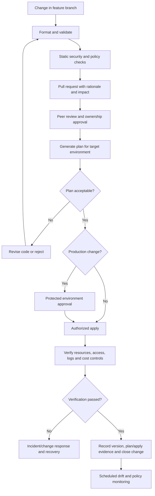

# 08 — Infrastructure as Code and Environment Strategy

> **Stage:** Applied AI Engineering Roadmap → Stage 2D — Data Architecture → `08-Cloud-Hybrid-and-Multi-Cloud-Data-Architecture/`  
> **Level:** Beginner → Intermediate → Advanced  
> **Role lens:** Cloud platform architect / infrastructure engineer  
> **Status:** Learning lesson with illustrative examples. No cloud deployment or live provider validation is claimed.

## 1. Purpose and relationship to the roadmap

Topics 01–07 established cloud architecture principles, AWS/Azure/GCP reference patterns, networking and identity, hybrid connectivity, and portability/lock-in trade-offs. Topic 08 turns those decisions into a repeatable change strategy: **how infrastructure is described, reviewed, promoted, secured, reconciled, and recovered**.

This topic is deliberately last in the recommended sequence because it codifies earlier decisions rather than replacing them. It contributes to the integrated project `Projects/08-cloud-platform-architecture-comparison.md` through an environment strategy, promotion workflow, IaC plan, state layout, policy list, drift policy, pseudocode or code sample, rollback/recovery notes, and an ADR.

### 1.1 Learning objectives

By the end of this lesson, you should be able to:

1. Explain infrastructure as code (IaC), declarative versus imperative automation, and their limits.
2. Design isolated development, test, staging, and production environments.
3. Explain desired state, actual state, state files, drift, idempotency, and reconciliation.
4. Define sensible module boundaries, configuration interfaces, variables, outputs, and dependencies.
5. Design a reviewed promotion workflow with policy checks, approvals, traceability, and emergency-change follow-up.
6. Protect state and secrets, control concurrent changes, and plan recovery from failed or destructive operations.
7. Explain drift detection and distinguish intentional configuration changes from unmanaged drift.
8. Map the same logical platform capabilities to provider-specific IaC without claiming identical resource semantics.
9. Distinguish an architecture design, IaC source code, and a deployed/operated system, and identify the evidence each requires.

### 1.2 Prerequisites

- Topics 01–07 in this module, especially environment/tenant isolation from Topic 07, private access and identity from Topic 05, and provider-specific architecture patterns from Topics 02–04.
- Stage 0 Git/version-control basics, including branches, commits, pull requests, and SSH or federated authentication.
- The logical data-platform capabilities and trust boundaries from Stage 2D.7.

If any provider capability is not yet confirmed in the relevant provider lesson or current official documentation, mark it as a **verification item** rather than asserting equivalence.

### 1.3 Three different kinds of evidence

| Activity | What it proves | What it does not prove |
|---|---|---|
| Architecture design | Components, boundaries, assumptions, decisions, and failure responses have been reasoned about | That code is valid or resources exist |
| IaC authoring and static validation | Definitions have a particular syntax and can pass specified local checks | That permissions, quotas, provider APIs, or real deployment will succeed |
| Deployment and operation | A specific version was applied to a specific environment and its observed behavior was checked | That every future change or failure is safe |

This lesson requires the first, teaches examples of the second, and does **not** require or claim the third. A syntactically plausible code example is not evidence of live deployment.

## 2. Infrastructure as code fundamentals

### 2.1 What IaC is

Infrastructure as code describes infrastructure and configuration in version-controlled, machine-readable definitions that can be reviewed, validated, planned, applied, and audited. It can manage cloud resources, networking, identity bindings, data services, policies, monitoring, and supporting platform components.

IaC is not merely a script that creates a bucket once. A production approach also defines how a change is reviewed, how the tool knows what it manages, how concurrent changes are prevented, how drift is detected, how secrets are protected, and how a failed change is recovered.

### 2.2 Declarative versus imperative approaches

| Dimension | Declarative | Imperative |
|---|---|---|
| Intent | Describe the desired end state | Describe ordered actions |
| Typical example | Terraform/OpenTofu resource definitions; many provider-native templates | Shell/Python/CLI script issuing create/update/delete commands |
| Reconciliation | Tool compares desired configuration with tracked/observed resources and proposes changes | Script author must decide what to inspect, what to change, and how to handle repeated execution |
| Idempotency | Often supported by the tool/resource model, but provider APIs and provisioners can still cause non-idempotent behavior | Must be designed explicitly; repeated commands may duplicate or overwrite resources |
| Review | Plan/preview can show intended changes before execution | Review depends on code paths and runtime conditions; dry-run may need to be built separately |
| Strength | Clear end-state model and reusable resource graph | Fine-grained procedural control for tasks that are inherently sequential |
| Risk | State errors, provider behavior, and surprising replacement plans | Hidden order dependencies, partial execution, duplicated actions, and poor rollback |

Declarative does not mean “no logic” or “automatically safe.” Imperative does not mean “always wrong.” Use declarative IaC for resource lifecycle where supported, and reserve scripts for tasks that need procedural orchestration, with explicit error handling and idempotency.

### 2.3 Desired state, actual state, state, and drift

- **Desired state:** what the configuration declares should exist and how it should be configured.
- **Actual state:** what exists in the provider at the moment.
- **IaC state:** the tool’s record of managed resource identities and attributes, used to relate configuration to remote objects. It is not the cloud itself and is not a complete substitute for provider inspection.
- **Drift:** a difference between the declared/recorded configuration and actual infrastructure, often caused by console changes, external automation, provider-side defaults, or configuration changes not applied through the normal pipeline.
- **Reconciliation:** investigate a difference and intentionally bring code and infrastructure back into agreement. This may mean applying the declared configuration or changing the code to represent a legitimate new decision.
- **Idempotency:** repeated execution with the same inputs should converge on the same intended state rather than creating additional unintended effects.

A useful mental model:

```text
Versioned configuration ──┐
                          ├──> Plan / diff ──> Reviewed apply ──> Actual cloud resources
IaC state + provider read ┘          │                                   │
                                     └──── evidence / audit ─────────────┘
                                                         │
                                                Drift detection
                                                         │
                                           investigate → code or reconcile
```

A plan is a proposal, not a guarantee. A resource may change between plan and apply, permissions may differ, and APIs can fail part-way through. Review the plan close to application time and use an approved workflow that minimizes plan/apply races.

### 2.4 Why click-built infrastructure is insufficient as the default

Console changes can be useful for discovery and emergency mitigation, but they often leave no reviewable source of truth, create environment divergence, and make rebuilding or audit difficult. If a console change is unavoidable, record the incident/change, identify the affected resource, and follow up by updating code or reconciling the resource. A team should not silently allow the console and repository to become competing sources of truth.

## 3. Tooling model and version assumptions

### 3.1 Terraform and OpenTofu

Terraform and OpenTofu use declarative configuration, providers, resource graphs, modules, plans, and state. Their ecosystems and behavior overlap substantially, but they are separate tools with their own release and compatibility considerations. Choose one for a repository and pin/document the tool version; do not casually alternate tools against the same state without an explicit compatibility and recovery plan.

This lesson’s main HCL examples assume:

- Terraform CLI **1.10.x or later within the 1.x line** for the illustrative workflow.
- AWS provider **5.x or 6.x** compatible with the selected Terraform version; the example constraint `>= 5.80, < 7.0` is intentionally bounded, but a real repository should select and lock a tested exact provider release.
- A supported AWS region and an AWS account where the operator has explicitly authorized the required S3 and IAM actions.
- Local syntax/format/validation checks are expected before any plan. These examples have not been executed in a Terraform runtime or deployed to AWS in this lesson.

Use a committed `.terraform.lock.hcl` for provider selections. Pin the CLI version through the team’s version manager or CI image, and update tool/provider versions through reviewed changes. The sample's provider constraint is deliberately broad for teaching; the lock file captures a selected provider build for a platform, but a real release process must also review provider upgrade notes and test the exact CLI/provider combination in CI. Do not interpret a broad constraint as a substitute for a lock file or a tested version policy.

### 3.2 Where provider-native tools fit

CloudFormation/CDK, Azure Bicep/ARM, and Google Cloud deployment tooling can be appropriate when native integration, resource coverage, policy model, or team expertise favors them. They are not included as a broad tool survey here. The key architecture rule is to standardize the **workflow and control objectives** while accepting that resource definitions, state models, and provider semantics differ.

### 3.3 Repository layout example

```text
infra/
├── modules/
│   └── secure-data-bucket/
│       ├── main.tf
│       ├── variables.tf
│       ├── outputs.tf
│       └── README.md
├── environments/
│   ├── dev/
│   │   ├── main.tf
│   │   ├── variables.tf
│   │   └── terraform.tfvars.example
│   ├── test/
│   ├── staging/
│   └── prod/
├── policies/
├── docs/
│   ├── environment-strategy.md
│   └── state-recovery.md
└── README.md
```

This is one possible layout, not a mandatory standard. For larger estates, keep separate root modules and state per environment/domain/lifecycle boundary; modules are reusable source, while each root module represents a specific deployable stack. Never put production secrets in committed `.tfvars` files.

## 4. A safe IaC workflow from commit to verification



The workflow should be implemented by a protected CI/CD platform, but the conceptual controls are independent of any one vendor. The person approving a production change should have the information needed to understand replacement/destruction, permission expansion, network exposure, data location, cost, and recovery implications. Before planning and again before applying, the pipeline should verify the authenticated account/subscription/project, target environment, backend/state key, and effective execution identity; a variable named `environment = "prod"` is not proof that the credentials or backend target production correctly.

### 4.1 Minimum pull-request evidence

A useful PR includes:

- Requirement or issue ID and reason for the change.
- Resources created, modified, replaced, or destroyed, from a fresh plan.
- Data classification and region/location implications.
- Identity and permission changes, including any new trust relationship.
- Network reachability and service exposure changes.
- State migration or module/provider version changes.
- Backup, retention, rollback, and recovery approach for stateful resources.
- Expected cost impact and resource cleanup behavior.
- Validation evidence and known limitations.

### 4.2 Plan, apply, and verification

1. **Format:** normalize HCL with `terraform fmt -check -recursive` (or format and then inspect the diff).
2. **Initialize:** `terraform init` with the intended backend and provider lock file. Do not run this against a production root until backend identity and credentials are confirmed.
3. **Validate:** `terraform validate` checks internal configuration consistency, not all remote permissions or API behavior.
4. **Static checks:** run the team’s HCL linting, security scanners, and policy-as-code checks. Define policies for public exposure, encryption, required tags, region allowlists, and destructive changes.
5. **Plan:** `terraform plan -out=tfplan` in the authorized environment. Protect plan files; they can reveal sensitive configuration and should not be published to untrusted logs or artifacts.
6. **Review:** inspect the actual plan. Treat any unexplained destroy/replace, permission expansion, or location change as a stop condition.
7. **Apply:** apply the reviewed saved plan in a controlled workflow where the saved plan remains appropriate and current. A saved plan is tied to its configuration/state context and can contain sensitive values; protect it as a secret-bearing deployment artifact. If the plan is stale or the target identity/backend differs from the approved context, stop, regenerate and re-review rather than forcing it.
8. **Verify:** inspect provider resource IDs and configuration, access from intended workload identity, denial of unauthorized access, encryption/versioning, network behavior, logs, alerts, and cost/budget signals.
9. **Record:** retain the commit, tool/provider versions, plan/apply identity, approval, timestamps, result, and verification evidence under the organization’s audit policy.

### 4.3 Rollback is not always reversal

For a stateless security rule, restoring a prior configuration may be straightforward. For storage, databases, replication, keys, or data lifecycle policies, applying a previous commit may not restore deleted data or undo external side effects. Before a destructive change, consider backups, point-in-time recovery, versioning, snapshots, migration compatibility, and the order of operations. For many data services, recovery means **restore or forward-fix**, not simply “run the old code.”

## 5. State management, locking, and recovery

### 5.1 Why state matters

IaC state maps configuration addresses to real resource identities and stores attributes needed to calculate future changes. State can contain sensitive values even when a value is marked `sensitive` in configuration; that label generally affects display, not necessarily persistence. Treat state and saved plan files as sensitive operational data.

### 5.2 State design principles

- Use a remote backend with encryption, strict access, versioning or equivalent recoverable history, audit logging, and a documented recovery process.
- Enable backend locking/concurrency control where the chosen backend supports it. Do not assume every backend or tool supports the same mechanism.
- Use separate state boundaries by environment and meaningful lifecycle/domain boundaries. Avoid one enormous state that allows a small change to affect unrelated domains.
- Keep state access narrower than general cloud administration. Plan/apply identities need only the permissions required for their root module and backend. Resource permissions and backend permissions are separate: a job may have permission to read a data bucket but not to alter the state backend, or vice versa. Where the platform supports it, use a lower-privilege plan identity and a separately authorized apply identity; account for the fact that a plan can still require read permissions and that saved plans must be protected.
- Do not edit state JSON by hand. Use documented state commands and a reviewed recovery procedure.
- Back up state before state surgery, provider migrations, backend migration, or high-risk resource-address changes.
- Protect remote state versions and backups; a backup that every developer can download is not a safe backup.

### 5.3 Example backend configuration — design only

Backend initialization needs to be bootstrapped separately because the backend bucket cannot reliably be created by a configuration that must already use that same backend. The following is an **illustrative** Terraform S3 backend block; substitute a pre-created bucket and unique key, and verify current backend options for the pinned CLI version before use.

```hcl
terraform {
  required_version = ">= 1.10.0, < 2.0.0"

  backend "s3" {
    bucket       = "REPLACE_WITH_PRECREATED_STATE_BUCKET"
    key          = "data-platform/dev/terraform.tfstate"
    region       = "REPLACE_WITH_APPROVED_REGION"
    encrypt      = true
    use_lockfile = true
  }
}
```

The bucket name is a placeholder, not a real bucket. Do not commit account credentials. Backend settings generally cannot be parameterized like ordinary resource variables, so use a carefully managed backend configuration per root/environment or a documented initialization pipeline. Configure bucket versioning, access controls, encryption, and logging as a separately governed bootstrap resource. Validate backend lock support and behavior for the chosen Terraform/OpenTofu version before relying on it.

**Backend permission design (illustrative; scope to the exact bucket and key prefix):** the CI identity normally needs to list the relevant state prefix and read/write the specific state object. With S3 native lock files enabled, it also needs the required get/put/delete operations on the matching `.tflock` object. The state object itself should not be broadly deletable by ordinary deployment jobs. If a customer-managed KMS key protects the backend, the identity also needs the appropriate key-use permissions and the key policy must permit the access. Exact actions and resource ARNs depend on the backend settings and provider version; derive them from current backend documentation, test them in a sandbox, and do not grant account-wide storage or KMS administration merely to make initialization succeed. Separate bootstrap permissions from routine plan/apply permissions where practical.

### 5.4 Concurrent-change scenario

Two engineers run plans against the same state. Engineer A applies a change; engineer B then applies an older plan or tries to modify the same resources. Outcomes can include stale plans, state conflicts, or conflicting infrastructure changes.

**Controls:** backend locking where supported; CI concurrency groups keyed by environment/state; short-lived, controlled applies; regenerate stale plans; avoid manual concurrent applies; alert on lock contention; document how to identify and clear a genuinely abandoned lock. Never remove a lock merely because it is inconvenient—first confirm no active operation exists and follow the backend/tool procedure.

### 5.5 Recovery when state is damaged or missing

1. Stop all applies for the affected state and prevent concurrent jobs.
2. Preserve the current state object and relevant logs; do not overwrite the only copy.
3. Identify the last known-good state version and the last successful apply.
4. Compare state with provider reality using read-only inspection where possible.
5. Restore state only through the documented backend/tool process, and ensure the restored state version is the correct one for the actual resources.
6. If resources exist but state no longer tracks them, import/adopt resources using supported commands and review the resulting plan before any apply.
7. If state references resources that no longer exist, reconcile carefully; do not blindly delete state entries or recreate production resources.
8. Run a fresh plan, review every proposed action, and apply only after peer approval and recovery owner sign-off.
9. Record root cause, backup quality, access path, and preventive actions.

## 6. Environment strategy: dev, test, staging, production

### 6.1 Separation is a risk decision

Environment separation reduces accidental impact and allows controlled promotion. The boundary may be a separate AWS account, Azure subscription, Google Cloud project, or another provider-supported boundary. The correct design depends on isolation requirements, billing/ownership, quotas, networking, policy inheritance, and operational skills. Do not assume that a folder or workspace alone is a security boundary.

| Environment | Purpose | Data | Access and change control | Cost posture |
|---|---|---|---|---|
| Development | Fast iteration by developers | Synthetic or appropriately masked data by default | Narrow developer access; no production trust by default | Small, ephemeral where practical |
| Test/CI | Repeatable tests of modules, policies, and integration | Synthetic fixtures | Automated short-lived identity; isolated state and network | Create only what tests require; automatic cleanup |
| Staging/pre-production | Validate release behavior with production-like topology | Masked/synthetic data unless explicitly approved | Restricted; promotion candidate and change approval | Production-like enough to test critical properties, not necessarily same scale |
| Production | Business workloads and regulated data | Approved real data | Protected pipeline, separation of duties, audited access, emergency process | Budget/alerts, retention and availability designed to requirements |

### 6.2 Isolation dimensions checklist

Environment separation is more than different names or variable files. Check each dimension:

- **Account/project/subscription:** independent administrative and billing boundary where feasible.
- **Identity:** separate workload roles/service principals/service accounts; no broad dev-to-prod trust; short-lived federation over long-lived keys.
- **Network:** separate address ranges, routes, endpoints, firewalls, and service access rules as needed; avoid overlapping CIDRs with on-premises networks.
- **Data:** synthetic or masked lower-environment data; explicit approval and controls for any real data; separate storage locations and encryption/key boundaries as required.
- **Secrets:** separate secret stores/paths and access policies; no copied production credentials.
- **State:** distinct backend key and preferably clear isolation for each environment/root; tightly controlled state access.
- **Policy:** mandatory tags, region/residency rules, encryption, public exposure controls, and destructive-change approvals.
- **Observability:** environment labels, independent alert routing, logs, budgets, and owner metadata.
- **Operations:** clear owners, on-call escalation, backup/restore expectations, and deletion authority.

### 6.3 Configuration, variables, and secrets

Configuration includes region, resource names, tags, feature flags, size/tier, retention periods, and approved network IDs. Keep environment-specific values explicit and reviewed. Avoid building large, opaque conditional expressions that make the resulting configuration hard to reason about.

Secrets include API tokens, passwords, private keys, and sensitive credentials. Use a cloud secret manager or a managed workload identity/federation pattern whenever possible. Never commit secrets in `.tf`, `.tfvars`, examples, test fixtures, screenshots, PR comments, or CI logs. Do not rely on `sensitive = true` as a storage encryption or secret-management control. If a secret is exposed, revoke/rotate it and investigate access; deleting the line from Git does not remove it from history or prior artifacts.

### 6.4 Workspace versus account/project isolation

Terraform workspaces can help manage multiple state instances for similar configurations, but workspaces do not automatically create separate accounts, identities, network boundaries, or policy scopes. For production-sensitive systems, use explicit environment roots and provider credentials/roles scoped to the target boundary. If workspaces are chosen, document the limitations and ensure the pipeline cannot accidentally select production with development credentials.

## 7. Modules, reusable components, and dependency management

### 7.1 What belongs in a module

A module should encapsulate a coherent capability with a stable interface and clear ownership. For a data platform, reusable modules might include:

- Secure object-storage foundation: encryption, versioning, public-access prevention, required tags, lifecycle configuration, and scoped access.
- Ingestion foundation: workload identity, source connectivity, queue/topic, retry/dead-letter policy, and operational metrics.
- Processing foundation: compute identity, private network access, logs, and quota/cost controls.
- Governance foundation: catalog/metadata integration, policy boundaries, audit events, and data classification tags.
- Networking foundation: approved subnets/endpoints/routes and security rules.
- Monitoring foundation: logs, metrics, alerts, dashboards, and notification routing.

Do not create a “universal cloud module” with dozens of provider switches if the result hides important provider-specific semantics. Prefer small, explicit interfaces and provider-specific implementations behind a documented capability contract.

### 7.2 Inputs, outputs, and dependencies

- **Inputs/variables** expose configuration that callers are allowed to choose, with types, descriptions, validations, and safe defaults where appropriate.
- **Outputs** expose only values downstream modules need. Avoid outputting secrets or broad internal resource details without reason.
- **Dependencies** should usually be expressed through references to resources or module outputs so Terraform can infer ordering. Use explicit `depends_on` only where a dependency is real but cannot be inferred.
- **Versioning** makes module changes reviewable. Pin production callers to a reviewed module version or immutable Git reference; avoid silently consuming a moving branch.
- **Contract tests** should check expected inputs, outputs, required tags, encryption, policy boundaries, and backward compatibility.

### 7.3 Example: reusable secure S3 data bucket module

The following HCL is an **illustrative AWS implementation**, not a claim of successful execution. It deliberately uses a pre-existing workload IAM role to avoid creating a trust policy without knowing the organization’s identity provider and trust boundary. It grants that role read-only access to the bucket and its objects. Review current AWS provider documentation and organizational policy before use.

**`modules/secure-data-bucket/versions.tf`**

```hcl
terraform {
  required_version = ">= 1.10.0, < 2.0.0"

  required_providers {
    aws = {
      source  = "hashicorp/aws"
      version = ">= 5.80, < 7.0"
    }
  }
}
```

**`modules/secure-data-bucket/variables.tf`**

```hcl
variable "bucket_name" {
  description = "Globally unique S3 bucket name for this environment."
  type        = string

  validation {
    condition = (
      length(var.bucket_name) >= 3 &&
      length(var.bucket_name) <= 63 &&
      can(regex("^[a-z0-9][a-z0-9-]*[a-z0-9]$", var.bucket_name))
    )
    error_message = "bucket_name must be 3-63 characters, lowercase letters/digits/hyphens only, and start and end with a letter or digit. This module intentionally excludes dots."
  }
}

variable "tags" {
  description = "Required ownership, environment, classification, and cost-allocation tags."
  type        = map(string)

  validation {
    condition = alltrue([
      for key in ["Owner", "Environment", "DataClassification", "CostCenter"] :
      contains(keys(var.tags), key) && trimspace(lookup(var.tags, key, "")) != ""
    ])
    error_message = "tags must include non-empty Owner, Environment, DataClassification, and CostCenter values."
  }
}

variable "reader_role_name" {
  description = "Name of an existing IAM role that needs read-only access."
  type        = string
}
```

**`modules/secure-data-bucket/main.tf`**

```hcl
resource "aws_s3_bucket" "this" {
  bucket        = var.bucket_name
  force_destroy = false
  tags          = var.tags
}

resource "aws_s3_bucket_public_access_block" "this" {
  bucket                  = aws_s3_bucket.this.id
  block_public_acls       = true
  block_public_policy     = true
  ignore_public_acls      = true
  restrict_public_buckets = true
}

resource "aws_s3_bucket_versioning" "this" {
  bucket = aws_s3_bucket.this.id

  versioning_configuration {
    status = "Enabled"
  }
}

resource "aws_s3_bucket_server_side_encryption_configuration" "this" {
  bucket = aws_s3_bucket.this.id

  rule {
    apply_server_side_encryption_by_default {
      sse_algorithm = "AES256"
    }
  }
}

resource "aws_s3_bucket_policy" "require_tls" {
  bucket = aws_s3_bucket.this.id
  policy = jsonencode({
    Version = "2012-10-17"
    Statement = [{
      Sid       = "DenyInsecureTransport"
      Effect    = "Deny"
      Principal = "*"
      Action    = "s3:*"
      Resource = [
        aws_s3_bucket.this.arn,
        "${aws_s3_bucket.this.arn}/*"
      ]
      Condition = {
        Bool = { "aws:SecureTransport" = "false" }
      }
    }]
  })
}

resource "aws_iam_policy" "reader" {
  name        = "${var.bucket_name}-read-only"
  description = "Read-only access to the specified data bucket."
  policy = jsonencode({
    Version = "2012-10-17"
    Statement = [
      {
        Sid      = "ListThisBucket"
        Effect   = "Allow"
        Action   = ["s3:ListBucket"]
        Resource = aws_s3_bucket.this.arn
      },
      {
        Sid    = "ReadObjectsInThisBucket"
        Effect = "Allow"
        Action = ["s3:GetObject"]
        Resource = "${aws_s3_bucket.this.arn}/*"
      }
    ]
  })
  tags = var.tags
}

resource "aws_iam_role_policy_attachment" "reader" {
  role       = var.reader_role_name
  policy_arn = aws_iam_policy.reader.arn
}
```

**`modules/secure-data-bucket/outputs.tf`**

```hcl
output "bucket_name" {
  description = "Name of the created bucket."
  value       = aws_s3_bucket.this.bucket
}

output "bucket_arn" {
  description = "ARN of the created bucket."
  value       = aws_s3_bucket.this.arn
}
```

**Important review notes:**

- The role must already exist, and the caller must be authorized to attach an IAM policy to it. The role trust policy and workload identity federation are intentionally outside this small module and must be reviewed separately.
- This example uses S3-managed encryption (SSE-S3). If customer-managed keys are required, use a KMS-backed design with explicit key policy, grant, rotation, recovery, and service integration review; do not simply change the algorithm without designing the key boundary.
- The module denies insecure transport and blocks public access, but it does not by itself prove complete compliance or private network access. Add service/network policies and monitoring according to the threat model.
- Versioning can increase storage costs because older object versions remain. Lifecycle and retention rules require deliberate data-retention review; do not automatically expire regulated data.
- `force_destroy = false` is a safety default, not a guarantee that the bucket cannot be deleted. For critical production data stores, consider a production-specific `lifecycle { prevent_destroy = true }` guardrail alongside IAM/organization policy, approval gates, and recoverable backups. `prevent_destroy` is not a backup and is not a universal deletion barrier: it can block intended Terraform destruction while present, does not stop out-of-band deletion, and can be removed by changing the configuration. Do not apply it indiscriminately to disposable dev/test resources; document the controlled removal process for approved decommissioning.
- This module attaches a policy that grants list and object-read access to this entire bucket; it does not grant write, delete, ACL changes, or bucket administration. This does **not** make the role globally read-only: permissions from other attached, inline, group, resource, or organization policies still apply. Audit the role's complete effective permissions. If the pipeline needs only a prefix, constrain `s3:ListBucket` with an `s3:prefix` condition and limit object ARNs to that prefix rather than granting access to every key.
- Unique bucket naming is global within the applicable S3 namespace. Use a naming convention that avoids sensitive information and collisions.
- This code has not been run through `terraform fmt`, `validate`, a plan, or an AWS account in this lesson. Treat syntax and provider behavior as requiring local validation against the pinned tool/provider versions.

### 7.4 Example root module configuration

**`environments/dev/main.tf`**

```hcl
terraform {
  required_version = ">= 1.10.0, < 2.0.0"

  required_providers {
    aws = {
      source  = "hashicorp/aws"
      version = ">= 5.80, < 7.0"
    }
  }
}

provider "aws" {
  region = var.aws_region
  # Credentials should come from an approved short-lived role or identity
  # federation mechanism, not hard-coded access keys in this file.
  default_tags {
    tags = {
      Application = "northbridge-data-platform"
      Environment = var.environment
      ManagedBy   = "terraform"
    }
  }
}

module "raw_data_bucket" {
  source = "../../modules/secure-data-bucket"

  bucket_name      = var.raw_bucket_name
  reader_role_name = var.pipeline_reader_role_name

  tags = {
    DataClassification = "internal"
    Owner               = "data-platform"
    Environment         = var.environment
    CostCenter          = "analytics"
  }
}
```

**`environments/dev/variables.tf`**

```hcl
variable "aws_region" {
  description = "Approved AWS region for this environment."
  type        = string
}

variable "environment" {
  description = "Environment identifier."
  type        = string
  validation {
    condition     = contains(["dev", "test", "staging", "prod"], var.environment)
    error_message = "environment must be dev, test, staging, or prod."
  }
}

variable "raw_bucket_name" {
  description = "Unique bucket name for this environment."
  type        = string
}

variable "pipeline_reader_role_name" {
  description = "Name of the existing pipeline role permitted to read raw data."
  type        = string
}
```

**`environments/dev/terraform.tfvars.example`**

```hcl
aws_region                = "REPLACE_WITH_APPROVED_REGION"
environment               = "dev"
raw_bucket_name           = "replace-with-globally-unique-dev-bucket-name"
pipeline_reader_role_name = "replace-with-existing-dev-pipeline-role"
```

Copy the example to a local, untracked `terraform.tfvars` only if the workflow calls for it. These values are not secrets, but environment files can still reveal infrastructure details. Never add access keys or passwords. Add and review ignore rules such as the following, adapting them to the repository's artifact policy:

```gitignore
.terraform/
*.tfstate
*.tfstate.*
tfplan
*.tfplan
*.plan
crash.log
crash.*.log
terraform.tfvars
*.auto.tfvars
```

Keep `*.tfvars.example` files when they contain placeholders only. **Do not ignore `.terraform.lock.hcl`** for a root configuration that commits provider selections. Ignore rules are not a substitute for checking already-tracked files or scanning Git history. Ensure CI stores plan artifacts only in access-controlled, short-retention storage and does not print secrets or full sensitive plan data to untrusted logs.

### 7.5 Introductory conceptual example

Before HCL, translate a requirement into desired state:

```text
Capability: restricted raw-data storage
- Location: approved region
- Encryption: enabled
- Public access: blocked
- Version recovery: enabled where appropriate
- Pipeline access: read-only, scoped to this data location
- Audit: access and configuration changes logged
- Owner/cost tags: mandatory
- Secrets: no static credentials in source
```

This is design pseudocode, not executable configuration. It separates the requirement from a particular provider and makes it easier to compare AWS, Azure, and GCP implementations later.

### 7.6 A valid local-only Terraform example

For a first exercise, use Terraform's built-in `terraform_data` resource. It creates no cloud resource and should incur no cloud service charge; it still creates local Terraform state. This is a small executable configuration example, but it has **not** been run as part of this lesson.

**`main.tf`**

```hcl
terraform {
  required_version = ">= 1.10.0, < 2.0.0"
}

variable "environment" {
  description = "Name of the environment used for this local exercise."
  type        = string
  default     = "dev"

  validation {
    condition     = contains(["dev", "test", "staging", "prod"], var.environment)
    error_message = "environment must be dev, test, staging, or prod."
  }
}

resource "terraform_data" "example" {
  input = {
    environment = var.environment
    managed_by  = "terraform"
  }
}

output "exercise_record" {
  description = "Data recorded by the local-only exercise resource."
  value       = terraform_data.example.output
}
```

From a directory containing this file and a compatible Terraform CLI, the learner can run `terraform fmt -check`, `terraform init`, `terraform validate`, `terraform plan`, and `terraform apply` after reviewing the plan. The apply only records local Terraform-managed data; it does not deploy AWS/Azure/GCP infrastructure. Do not reuse this toy configuration as a production resource pattern. To clean up the local exercise, review `terraform plan -destroy` and only then run `terraform destroy` in this isolated exercise directory. Do not run cleanup commands from a cloud environment root by mistake.

## 8. Environment promotion and change traceability

### 8.1 Promote a release, not a hand-recreated environment

A robust promotion process uses the same reviewed source revision and module/provider versions across environments while supplying environment-specific configuration and identities. Do not copy-and-edit a development configuration into production by hand. Differences should be intentional, visible, and governed.

```text
Commit + locked dependencies
        ↓
Format / validate / policy / security checks
        ↓
Review PR and inspect dev plan
        ↓
Apply to dev → verify
        ↓
Promote same revision to test → verify contracts and access
        ↓
Promote same revision to staging → production-like checks
        ↓
Production plan → independent approval → apply
        ↓
Post-change verification and audit record
        ↓
Scheduled drift detection + ownership review
```

“Same revision” does not necessarily mean using a saved plan generated for dev in prod. Plans are environment- and state-specific. Generate and review a plan for each target environment, with the same source revision and dependency lock file, and require environment-specific approvals. A saved plan should not be promoted blindly across state boundaries.

### 8.2 Immutable artifacts and versioning

- Record a Git commit SHA, module version/reference, provider lock file, CLI version, policy bundle version, and CI workflow version.
- For production, avoid floating module references or unreviewed provider upgrades.
- Publish release tags or immutable source artifacts for reviewed module versions.
- Retain plan/apply metadata and the final change record according to audit policy; restrict access to plan files and logs.
- Treat policy changes and pipeline changes as production-impacting code.

### 8.3 Emergency or break-glass changes

A practical policy permits emergency action only when the incident requires it and the access is authorized. The process should include:

1. An incident/change ID, named approver or incident commander, reason, scope, and expiry for elevated access.
2. The minimum required permission and shortest practical session.
3. A record of the actual console/CLI changes and before/after evidence.
4. Immediate follow-up: inspect drift, encode the accepted state in IaC or intentionally revert the manual change, generate a plan, and review it.
5. A post-incident review that identifies why normal automation was insufficient and whether access should be tightened.

Do not use emergency access as a permanent alternate deployment path. If regulation or policy prohibits manual changes, follow the formal exception/incident process rather than inventing a bypass.

### 8.4 Sample change record

| Field | Example (illustrative) |
|---|---|
| Change ID | CHG-2026-0142 |
| Requirement | Prevent public access to raw-data storage |
| Commit/release | `abc1234` / `data-platform-v1.4.0` (placeholder) |
| Target | `dev` then `test`, `staging`, `prod` |
| Planned impact | Add public-access block and TLS-deny policy; no expected resource replacement |
| Security impact | Reduces accidental public exposure; verify intended pipeline access still works |
| Data/residency impact | No location change; approved region remains unchanged |
| Cost impact | Small policy/configuration overhead; confirm no material service charge assumed |
| Validation | Format, validate, policy checks, reviewed plan, positive and negative access tests |
| Approval | Module owner + environment approver; production approval independent of author |
| Recovery | Revert policy through reviewed IaC if safe; incident path if access failure affects production |
| Evidence | PR, plan summary, apply job, access tests, audit event IDs |

Replace the illustrative values with real identifiers only in the organization’s controlled system. Do not place credentials or customer data in a change record.

### 8.5 Sample PR review checklist

- [ ] The change maps to a requirement, incident, or approved architecture decision.
- [ ] `terraform fmt`, `validate`, and the required static/security/policy checks passed in the actual pipeline.
- [ ] Provider and module versions are pinned/locked and compatible with the documented tool version.
- [ ] The plan is fresh for the target state and contains no unexplained replacement/destruction.
- [ ] Resource locations, data residency, backup/retention, encryption, and network exposure are understood.
- [ ] IAM changes follow least privilege and use the correct workload identity boundary.
- [ ] No secrets are committed or emitted to logs/outputs; state and plans are protected.
- [ ] Environment-specific configuration is explicit; production cannot accidentally use development credentials or state.
- [ ] Dependencies are expressed clearly; no unnecessary `depends_on` or hidden procedural coupling.
- [ ] Rollback/restore and verification steps are realistic for stateful resources.
- [ ] Costs, tags, budgets, and cleanup are addressed.
- [ ] Required owner, security, data-governance, and production approvals are present.
- [ ] Post-apply verification and audit evidence are defined.

## 9. Drift detection, policy, and operational ownership

### 9.1 Detect and respond to drift

Drift detection can be periodic plans, provider configuration monitoring, cloud policy/compliance signals, and audit-event analysis. A no-change plan is useful evidence for a specific run, not proof that every control is continuously compliant. Some fields are computed, normalized, or changed by provider services; investigate whether the difference is meaningful before treating it as drift.

Recommended response loop:

1. Detect and classify the difference: expected provider default, out-of-band manual change, external automation, or actual security/configuration violation.
2. Determine the owner and blast radius. Prioritize public exposure, permission expansion, data location, retention, and encryption changes.
3. Preserve evidence and inspect audit events before changing anything.
4. Decide whether code is outdated or infrastructure is wrong. If the change is legitimate, update code and obtain normal review. If unauthorized, restore the approved state through the controlled pipeline where safe.
5. Re-run plan and policy checks, apply only after approval, and verify actual behavior.
6. Record cause, detection delay, corrective action, and preventive control.

### 9.2 Policy as code

Example policy goals for this module include:

- No public data storage unless an explicitly approved exception exists.
- Encryption and approved key configuration for classified data.
- Approved region/location allowlist for regulated datasets.
- Required owner, environment, data classification, and cost tags.
- No wildcard administrator grants to application identities.
- Production destructive changes require explicit approval and recovery evidence.
- State backends must use approved storage, encryption, access control, and recovery settings.
- Required logging and alerts must be enabled for critical resources.

A policy check is only as strong as its scope, implementation, and enforcement point. Document policy exceptions with a business reason, owner, compensating controls, and expiry date. Avoid permanent undocumented exceptions.

### 9.3 Ownership model

| Responsibility | Typical owner | Required evidence |
|---|---|---|
| Module interface and releases | Platform/module owner | Versioning policy, tests, changelog |
| Environment root and state | Environment/domain owner | Backend configuration, access list, recovery runbook |
| Provider credentials and federation | Cloud security/IAM owner | Trust policy, scoped roles, audit logs |
| Data policy, classification, retention | Data owner/governance | Classification and retention decisions |
| CI/CD controls | Platform engineering | Protected branches, required checks, approval settings |
| Drift monitoring and incident response | Operations/SRE + resource owner | Alerts, runbooks, incidents and corrective actions |
| Cost controls | FinOps/resource owner | Tags, budgets, alerts, cleanup records |

A module owner cannot alone approve every production impact if the organization requires separation of duties. Ownership should be explicit enough that failed deployments, drift alerts, and state-recovery actions have a named responder.

## 10. Provider trade-offs: AWS, Azure, and GCP

### 10.1 What is portable and what is not

Terraform/OpenTofu can orchestrate resources from multiple providers, but this does not make provider resource definitions portable. An S3 bucket, Azure Storage account/container, and Google Cloud Storage bucket have different identity models, policy surfaces, naming rules, networking controls, lifecycle behaviors, and service integration semantics.

| Layer | What may be reusable | What remains provider-specific or requires validation |
|---|---|---|
| Workflow | PR, review, plan, approval, audit, promotion concepts | CI identity federation and protected-environment implementation |
| Logical capability | “encrypted object storage with private access and scoped reader” | Concrete resource types, policy language, network endpoint behavior |
| Module interface | Inputs/outputs describing capability intent | Provider implementation and edge-case semantics |
| Identity | Least privilege, short-lived workload identity, separation of duties | IAM role/resource scope, federation, policy evaluation and inheritance |
| Networking | Segmentation, private reachability, DNS, trust boundaries | VPC/VNet/network/project organization, routes and private-service constructs |
| State/backend | State isolation, encryption, access, locking, backup principles | Backend implementation, locking support, migration and recovery details |
| Data services | Ingestion/storage/processing/governance capability map | Provider APIs, schemas, quotas, regions, service limits, billing and failure behavior |
| Policy | Control objectives and exceptions | Native policy engines, IaC policy integration, coverage gaps |

### 10.2 Capability-first design

Start with the architecture requirement, then implement it per provider and document differences. For example, “private access to regulated object storage” should specify network path, DNS behavior, identity, authorization, service-side network controls, logging, and data-location constraints. Do not assume that enabling a private endpoint alone supplies all these controls.

### 10.3 A multi-provider module strategy

A practical pattern is a common capability contract with separate implementations, such as:

```text
secure-object-storage (logical capability)
├── aws implementation: S3 + AWS IAM/network controls
├── azure implementation: Storage + Azure identity/network controls
└── gcp implementation: Cloud Storage + Google Cloud IAM/network controls
```

The interface can standardize concepts like environment, data classification, owner, approved location, and intended access. It cannot erase provider-specific differences. Where a capability has no equivalent, document the gap, compensating design, operating cost, and residual lock-in. Keep the provider-specific code visible rather than hiding every difference behind conditional flags.

### 10.4 Official documentation to consult

Verify current syntax, version compatibility, service behavior, and security guidance before implementing. Provider documentation changes; the links below are starting points, not evidence that an example has been deployed. A Terraform plan, AWS CloudFormation change set, Azure Resource Manager/Bicep `what-if`, or Google Cloud Infrastructure Manager preview is a pre-deployment aid, not a guarantee that an apply will succeed or that every change will be visible. For example, CloudFormation change sets can still fail during execution; Bicep `what-if` has documented analysis limitations; and Google Cloud Infrastructure Manager imposes its own configuration constraints, including that its Terraform configuration must not define a backend block. Check each tool's current limitations and execution model rather than treating previews as interchangeable.

- Terraform language and configuration: https://developer.hashicorp.com/terraform/language
- Terraform CLI commands: https://developer.hashicorp.com/terraform/cli/commands
- Terraform state: https://developer.hashicorp.com/terraform/language/state
- Terraform modules: https://developer.hashicorp.com/terraform/language/modules
- Terraform S3 backend and native lock-file behavior: https://developer.hashicorp.com/terraform/language/backend/s3
- Terraform state locking: https://developer.hashicorp.com/terraform/language/state/locking
- Terraform sensitive data and state/plan exposure: https://developer.hashicorp.com/terraform/language/manage-sensitive-data
- Terraform validation: https://developer.hashicorp.com/terraform/cli/commands/validate
- OpenTofu documentation: https://opentofu.org/docs/
- AWS provider documentation: https://registry.terraform.io/providers/hashicorp/aws/latest/docs
- AWS S3 security best practices: https://docs.aws.amazon.com/AmazonS3/latest/userguide/security-best-practices.html
- AWS IAM best practices: https://docs.aws.amazon.com/IAM/latest/UserGuide/best-practices.html
- AWS CloudFormation change sets and their limitations: https://docs.aws.amazon.com/AWSCloudFormation/latest/UserGuide/using-cfn-updating-stacks-changesets.html
- AWS CloudFormation drift detection coverage/limitations: https://docs.aws.amazon.com/AWSCloudFormation/latest/UserGuide/using-cfn-stack-drift.html
- Azure Bicep documentation: https://learn.microsoft.com/azure/azure-resource-manager/bicep/overview
- Azure Bicep `what-if` behavior and limitations: https://learn.microsoft.com/en-us/azure/azure-resource-manager/bicep/deploy-what-if
- Azure landing zones: https://learn.microsoft.com/azure/cloud-adoption-framework/ready/landing-zone/
- Google Cloud Infrastructure Manager overview: https://docs.cloud.google.com/infrastructure-manager/docs/overview
- Google Cloud Infrastructure Manager Terraform constraints: https://docs.cloud.google.com/infrastructure-manager/docs/infra-manager-terraform
- Google Cloud IAM overview: https://cloud.google.com/iam/docs/overview

## 11. Cost, cleanup, and resource lifecycle

IaC makes costs more visible and repeatable, but it does not make infrastructure free. Costs may arise from storage capacity and old versions, requests, compute, managed database/warehouse capacity, streaming throughput, logs/metrics retention, private endpoints, NAT/gateways, inter-zone/region traffic, data egress, key operations, backups, and duplicate non-production environments. Some charges continue after the application is idle.

### 11.1 Cost controls in code and operations

- Require owner, environment, data-classification, and cost-center tags/labels where supported.
- Set budgets/alerts and quota guardrails outside or alongside resource definitions.
- Prefer smaller/ephemeral test resources and automatic cleanup for resources with a clear owner and expiry.
- Define retention/lifecycle rules only after checking legal, business, recovery, and data-governance requirements.
- Include state, logging, monitoring, and network services in cost estimates; do not price only the main storage resource.
- Review orphan resources and stale snapshots, but never delete production resources solely because a tag is missing or an automated detector labels them orphaned.

### 11.2 Safe cleanup procedure

1. Identify the exact environment/account/project and owner.
2. Review the plan and confirm every resource to be destroyed is in scope.
3. Check data retention, legal hold, backup/restore, dependencies, and downstream consumers.
4. Confirm that state and required data backups are recoverable.
5. Obtain the required approval and execute through the controlled pipeline.
6. Verify removal, retained data/backup expectations, and any dependent resources.
7. Confirm billing/usage has stopped where applicable and record evidence.

The examples use `force_destroy = false` and do not include a cleanup command that automatically destroys a real environment. Never run `terraform destroy` against a shared or production root without explicit authorization, scope confirmation, recovery review, and the organization’s change process.

## 12. Failure-handling matrix

| Failure | Likely causes | Immediate response | Recovery / prevention |
|---|---|---|---|
| Apply fails part-way through | API error, quota, dependency race, timeout | Stop repeated blind applies; preserve logs and state; inspect provider reality | Fresh plan, repair prerequisite or permissions, then reviewed retry; test failure behavior |
| Permission denied | Wrong principal, missing action, wrong scope, policy boundary or organization policy | Confirm the exact execution identity and denied action; do not switch to admin as a shortcut | Grant the minimum required permission through the IAM owner; document policy interactions and verify again |
| State lock cannot be acquired | Another active run, stale lock, concurrent manual execution | Check CI jobs and active operators before taking action | Wait or use documented stale-lock recovery only after proving no operation is active; enforce per-state CI concurrency |
| State missing/corrupt | Backend deletion, failed migration, accidental overwrite | Freeze applies and preserve current backend objects/logs | Restore a known-good version or import/adopt resources carefully; review a fresh plan and root-cause the incident |
| Stale plan or conflicting changes | State changed after plan, parallel applies | Do not force old plan through | Generate a fresh plan and review it against current state; serialize applies per state |
| Unexpected resource replacement | Immutable attribute changed, provider behavior changed, resource address changed | Stop before apply if possible; assess data and availability impact | Keep immutable identifiers stable, use `moved` blocks/state migration as appropriate, backups and staged migration |
| Accidental destructive change | Misread plan, broad state, unprotected deletion | Halt further changes; activate incident/restore procedure | Restore data from version/backup/PITR where possible; narrow state boundaries, require destructive-change approvals |
| Manual console change causes drift | Break-glass fix, unauthorized edit, external automation | Preserve audit evidence; assess security and business impact | Encode legitimate change or restore approved state through code; close follow-up and remove unneeded access |
| Secret exposed in Git or logs | Secret committed, output or plan leaked | Revoke/rotate immediately; contain access and preserve incident evidence | Scan history/artifacts, update secret handling, narrow CI log access; deletion alone is insufficient |
| Provider/module upgrade breaks behavior | Unlocked version, changed defaults, breaking schema | Stop promotion; pin the last approved version if safe | Test upgrade in isolated environment, review migration notes and plans, promote via staged release |
| Wrong environment targeted | Bad variables, workspace confusion, credentials/state mismatch | Stop before apply; if already applied, assess impact and incident path | Explicit root/backend/identity per environment, protected prod approval, pre-apply identity and account checks |
| Budget spike or runaway resource | Wrong size, unbounded logs/compute, ephemeral cleanup failed | Stop/scale down only after assessing production impact | Budgets, quotas, tags, TTL/cleanup, alerts, and plan cost review; investigate recurring cause |

## 13. Short ADR — environment strategy

### ADR-08: Isolate environments and promote reviewed IaC changes

**Status:** Proposed teaching example  
**Context:** A multi-team data platform needs reproducible changes, clear audit evidence, and protection against development changes affecting regulated production workloads.

**Decision:** Use separate provider account/subscription/project boundaries for production and non-production where practical and required by risk; keep separate environment roots and state; use shared versioned modules; promote the same reviewed source revision through dev, test, staging, and production with environment-specific configuration and identities. Production applies require a fresh plan, independent approval, protected CI/CD identity, and post-apply verification. Emergency changes use time-bound break-glass access and mandatory IaC reconciliation.

**Alternatives considered:**

1. One shared account/project and one state for every environment — simpler initially, but larger blast radius and weaker separation.
2. Separate environments created manually in the console — fast for a prototype, but poor repeatability and change traceability.
3. Full separate infrastructure and separate codebases for each environment — strong separation but high duplication and configuration divergence risk.

**Rationale:** The selected approach balances isolation and reuse: modules reduce duplication, environment roots/state reduce blast radius, and a promotion workflow gives traceability. It does not guarantee compliance or eliminate drift.

**Trade-offs and risks:** More accounts/projects and state backends to operate; provider quotas and networking may differ by environment; module upgrades need coordinated promotion; staging may not match production scale; separate state introduces cross-state dependency coordination.

**Controls:** CI concurrency per state, locked provider dependencies, least-privilege workload identities, policy checks, protected production approvals, state backup/locking, budgets/tags, drift detection, and documented recovery.

**Revisit when:** A regulator requires stronger isolation, the team size changes materially, deployment frequency makes staging a bottleneck, a provider boundary is not supported, or incident evidence shows the blast radius is still too large.

## 14. Hands-on exercises

These exercises can be completed without creating billable cloud resources. Any cloud test must use an approved sandbox and follow the organization’s access and cost policy.

### Exercise A — declarative versus imperative

**Task:** Describe a secure raw-data storage capability in both a declarative specification and imperative pseudocode. List the failure cases that the imperative version must handle.

**Deliverable:** One-page comparison table with repeat-execution behavior, failure handling, audit, and rollback considerations.

**Check:** Do not equate “declarative” with “secure by default” or “imperative” with “unsafe by definition.”

### Exercise B — environment and promotion workflow

**Scenario:** A platform team supports 25 teams across six data domains. Production contains regulated data; development teams need fast iteration.

**Task:** Design dev/test/staging/prod boundaries for account/project, identity, networking, data, secrets, state, policy, monitoring, ownership, and cost. Draw a commit-to-production workflow and define approval gates.

**Deliverables:** Environment matrix, workflow diagram, and environment strategy ADR.

**Validation:** Each production change has traceable source, review, approval, apply identity, and verification evidence. Lower environments do not inherit production secrets or unrestricted production trust.

### Exercise C — IaC plan and module boundaries

**Task:** Propose modules for storage, ingestion, processing, governance, networking, and monitoring. For each, list inputs, outputs, provider dependencies, owners, and state boundary. Write pseudocode or adapt the S3 module example.

**Deliverables:** Module map, interface table, sample configuration, and policy list.

**Validation:** Module boundaries align with capability/lifecycle; provider-specific behavior is documented; no secrets are hardcoded; IAM scope is least privilege.

### Exercise D — drift detection and recovery

**Scenario:** An operator temporarily changed a storage policy through the console during an incident. A scheduled plan now shows a difference.

**Task:** Define how to preserve audit evidence, decide whether code or infrastructure is wrong, check access impact, reconcile through reviewed IaC, and prevent recurrence.

**Deliverable:** Drift runbook with severity, owner, investigation order, approval, recovery, and follow-up.

**Validation:** The procedure does not blindly reapply code before understanding the incident; emergency changes have an explicit reconciliation deadline and owner.

### Exercise E — state security and concurrent change

**Scenario:** Two engineers start applies to the same production state while a state backend is undergoing maintenance. A state version is accidentally overwritten.

**Task:** Define the controls to prevent concurrency, protect backend access, recover the correct state version, and verify provider reality before applying again.

**Deliverables:** State architecture diagram, access matrix, backup/recovery procedure, and incident checklist.

**Validation:** The runbook freezes applies, preserves evidence, confirms no active lock owner, restores or reconstructs state through supported tooling, and reviews a fresh plan before approval.

### Exercise F — three-provider implementation differences

**Task:** For the logical capability “encrypted object storage with private access and a scoped pipeline reader,” map AWS, Azure, and GCP implementation candidates. Compare identity, network/DNS, encryption/key management, policy, logs, state, and costs.

**Deliverable:** Three-way capability map and a list of differences to verify in official documentation.

**Validation:** Do not claim the same module behaves identically across providers. Identify provider-specific resource types and at least three residual portability limits.

### Exercise G — failure response tabletop

**Task:** Select four failures from Section 12. Assign incident owner, first safe action, evidence to collect, recovery path, and prevention. Include one destructive change and one secret exposure.

**Deliverable:** Tabletop notes and updated risk register.

**Validation:** No blind reapply, no casual lock deletion, no assumption that reverting code restores deleted data, and no assumption that deleting a leaked secret from the latest commit is sufficient.

## 15. Practice questions

Answer in your own words and include a diagram or example where requested.

1. Define IaC. What is the difference between a declarative desired-state model and an imperative script?
2. Explain desired state, actual state, state file, drift, reconciliation, and idempotency.
3. Why can a tool report a resource as `sensitive` while state still needs strong access controls?
4. What does a plan prove, and what does it not prove?
5. Why should production state and development state be separated?
6. What is the difference between a Terraform module and an environment root module?
7. Which resource dependencies should be inferred from references, and when is explicit `depends_on` justified?
8. Explain why a provider-neutral workflow does not create provider-neutral resource definitions.
9. How would you promote a change through dev, test, staging, and production without manually recreating resources?
10. What evidence should a production PR include when the plan replaces a data resource?
11. Describe a safe response to a state-lock error. Why is deleting a lock without investigation dangerous?
12. How would you recover if the state backend is missing but the cloud resources still exist?
13. What is the difference between restoring a previous IaC revision and recovering deleted data?
14. Describe a break-glass process that is fast enough for an incident but still auditable.
15. Name at least six policy-as-code controls appropriate for a regulated data platform.
16. How do network reachability and IAM authorization differ in a private storage access path?
17. Which costs may remain after a test environment is idle or deleted?
18. For the S3 example, what does the reader policy allow and deliberately not allow? Which access path is outside the module’s scope?
19. What evidence distinguishes architecture design, validated IaC code, and successful deployment?
20. Give one case where a single-cloud design with an exit plan is preferable to active multi-cloud, and explain how IaC supports but does not prove the exit capability.

## 16. Expected deliverables for Topic 08

Produce the following artifacts for the integrated project. The roadmap’s topic-specific deliverables are the source of scope; adapt names to the repository conventions.

1. **Environment strategy:** environment matrix covering isolation, data policy, identity, networking, secrets, state, approvals, monitoring, cost, and owners.
2. **Promotion workflow diagram:** commit → review → plan → approval → apply → verification → drift monitoring.
3. **IaC plan:** resource scope, module boundaries, inputs/outputs, provider dependencies, state layout, policy checks, and operational owners.
4. **Pseudocode or code example:** one reusable component, such as secure object storage, with safe defaults and documented provider assumptions.
5. **State and secrets plan:** backend protection, locking/concurrency, backups, recovery, access, and rotation.
6. **Drift policy/runbook:** detection frequency, severity, response owner, reconciliation, emergency-change follow-up, and evidence.
7. **Rollback/recovery notes:** separate configuration rollback from data restore and forward migration.
8. **ADR-08:** environment strategy with alternatives, rationale, risks, trade-offs, controls, and revisit triggers.
9. **Provider portability assessment:** workflow-level reuse versus provider-specific resource and identity/network behavior.
10. **Change record and PR checklist:** traceability and approval evidence.

## 17. Common mistakes and misconceptions

| Mistake | Why it fails | Better practice |
|---|---|---|
| Treating IaC as a one-time provisioning script | Configuration and reality diverge after the first run | Maintain source, state, review, drift checks, and ownership |
| Assuming the plan is a guarantee | Remote state, permissions, quotas, or APIs can change | Use fresh reviewed plans and verify after apply |
| Storing secrets in code or assuming `sensitive` protects state | Source history, plans, and state can leak | Use secret managers/workload identity and restrict state/plan access |
| Using one state for every domain/environment | Contention and blast radius grow | Split state by environment and lifecycle boundary |
| Deleting a lock immediately | May conflict with an active apply and corrupt state | Prove no operation is active and use documented recovery |
| Using the same credentials everywhere | Dev compromise can affect production | Separate environment identities and short-lived federation |
| Treating workspace names as security boundaries | State selection does not itself isolate accounts, networks, or IAM | Use explicit environment boundaries and scoped credentials |
| Copying dev files into prod manually | Configuration divergence and traceability loss | Promote the same reviewed revision with explicit environment inputs |
| Assuming rollback restores data | Deletion and schema/data migrations may be irreversible | Plan backups, restore tests, compatibility, and forward-fix options |
| Hiding all provider differences behind a universal module | Semantics become implicit and portability claims misleading | Share capability intent, keep implementations explicit, document exceptions |
| Allowing emergency changes to remain manual | Drift becomes permanent and audit is incomplete | Time-bound break-glass access and mandatory reconciliation |
| Deleting all test resources without a plan | Data, shared resources, or dependencies may be lost | Review scope, backup, approval, cleanup, and verification |
| Treating tags or policy checks as complete compliance | Controls may be incomplete, bypassed, or misconfigured | Map controls to requirements and collect operational evidence |
| Saying code is validated because it looks correct | Syntax and provider APIs were not actually checked | Run pinned local/CI validation and report exactly which checks ran |

## 18. Mastery criteria and completion checklist

You have mastered Topic 08 when you can:

- Explain declarative versus imperative IaC and the roles of state, drift, reconciliation, and idempotency.
- Design a practical environment strategy with boundaries for identity, networking, data, secrets, state, policy, cost, and ownership.
- Draw a promotion workflow with reviewed plans, production approval, verification, audit evidence, and drift monitoring.
- Propose module boundaries and interfaces that align to logical platform capabilities and lifecycle.
- Explain why state, saved plans, and secrets require different but related protections.
- Describe safe handling of concurrency, failed applies, state loss, accidental deletion, and emergency changes.
- Compare AWS/Azure/GCP implementations without implying resource or module equivalence.
- Separate architecture evidence, code-validation evidence, and deployment/operational evidence.
- Explain cost implications and safe cleanup for non-production infrastructure.

### Completion checklist

- [ ] Declarative/imperative comparison completed.
- [ ] Environment matrix and isolation boundaries documented.
- [ ] Promotion workflow diagram completed.
- [ ] IaC plan and module/state layout documented.
- [ ] Pseudocode or illustrative provider-specific code reviewed for safe defaults and assumptions.
- [ ] State backend, locking, backups, recovery, and access controls documented.
- [ ] Secret-management and workload-identity approach documented; no secrets in source.
- [ ] PR checklist, policy checks, and change record completed.
- [ ] Drift detection and break-glass reconciliation policy documented.
- [ ] Rollback versus data recovery explicitly distinguished.
- [ ] Failure-handling matrix reviewed.
- [ ] Provider-specific dependencies and portability limits documented.
- [ ] Cost, tags, budgets, cleanup, and resource ownership addressed.
- [ ] ADR-08 reviewed.
- [ ] Topic practice questions answered and gaps logged.
- [ ] Design, code, and deployment evidence clearly distinguished; no unperformed validation claimed.
- [ ] Topic 08 outputs incorporated into `Projects/08-cloud-platform-architecture-comparison.md` when that project is assembled.

## 19. Final engineering principle

IaC is a **change-control and repeatability mechanism**, not an automatic guarantee of secure or reliable infrastructure. Good outcomes require architecture decisions, well-bounded modules and state, least-privilege identities, reviewed plans, protected environments, policy enforcement, operational ownership, drift response, cost controls, and data-aware recovery. For the final cloud-platform comparison project, document the desired design, show how code would express it, and state exactly what remains unverified until an authorized deployment and operational test occur.
