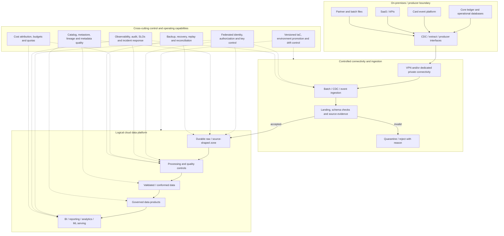
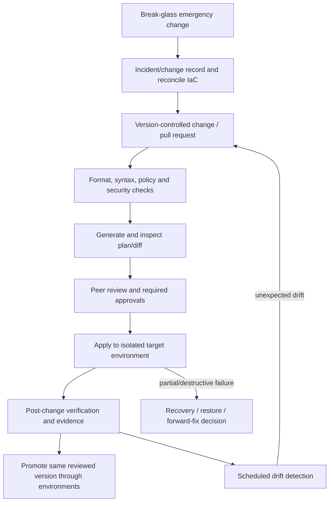

# Project 08 — Cloud Platform Architecture Comparison

**Stage:** Stage 2D — Data Architecture  
**Module:** 08 — Cloud, Hybrid and Multi-Cloud Data Architecture  
**Project type:** Integrated cloud-platform architecture comparison and decision package  
**Roadmap source:** `roadmap-Cloud-Hybrid-and-Multi-Cloud-Data-Architecture.md`, Section 10 and Topics 5.1–5.8  
**Target repository path:** `Stage 2D — Data Architecture/08-Cloud-Hybrid-and-Multi-Cloud-Data-Architecture/Projects/08-cloud-platform-architecture-comparison.md`  
**Recommended effort:** 14–18 hours for the integrated project; additional time may be required for peer review  
**Status:** Learning specification and worked reference; not a deployed or independently approved architecture  
**Architecture stance:** Capability-first, vendor-aware, evidence-led, and explicit about uncertainty  
**Deployment requirement:** No paid cloud deployment is required or implied

---

## Document control

| Field | Value |
|---|---|
| Document ID | `2D.8-P08` |
| Version | 1.0 — initial complete project specification |
| Date | 2026-10-21 |
| Status | Draft for learner execution and architecture review |
| Audience | Data/cloud architects, data engineers, platform engineers, network/security engineers, SREs, FinOps practitioners, architecture reviewers |
| Scenario | Northbridge Bank, a fictional mid-sized bank |
| Evidence rule | Separate scenario facts, assumptions, derived estimates, verified provider facts, proposed decisions, and unresolved verification items |
| Companion checker | Appendix B contains a standard-library Python structural checker; it does not validate architectural correctness |
| Approval status | No stakeholder, security, privacy, legal, or architecture-board approval is implied |

### Change log

| Version | Date | Change |
|---|---|---|
| 1.0 | 2026-10-21 | Initial integrated project specification aligned to all eight module topics and the roadmap's 14-step workflow |

### Reading order

1. Read Sections 1–5 to understand the decision, scenario, constraints, and comparison method.
2. Complete Section 6 in order. Do not score providers before fixing the criteria and weights.
3. Use Section 7 as an illustrative reference, not as a pre-decided winner.
4. Apply the mandatory gates and validation process in Section 8.
5. Use the reusable templates in Section 9 for each evidence pack.
6. Review pitfalls, hand-off, self-assessment, and the checker in Sections 10–12 and Appendix B.
7. Mark the project complete only when the completion gate is satisfied. A high score cannot override a failed mandatory security, residency, or traceability gate.

---

## 1. Project overview

### 1.1 What is this project?

This project compares how the same **logical enterprise data platform** could be realised on Amazon Web Services (AWS), Microsoft Azure, or Google Cloud (GCP), while accounting for an on-premises source estate and future portability.

The goal is not to produce three unrelated lists of cloud products. The goal is to create three candidate architectures that satisfy the same requirements, then compare them using the same workload assumptions, mandatory constraints, criteria, evidence standard, and decision process.

A **logical architecture** defines the capabilities, responsibilities, interfaces, flows, trust boundaries, ownership, and operating expectations required by the business. A **provider-specific reference architecture** maps those responsibilities to candidate cloud services and integration patterns. A **physical implementation** later confirms exact products, regions, SKUs, networking, policies, quotas, configuration, cost, and tested behavior.

This project delivers the first two. It does not claim to have implemented or tested the third.

### 1.2 Business problem

Northbridge Bank wants a cloud data platform for analytics, regulatory reporting, machine learning, and near-real-time fraud use cases. Its core ledger and card systems will remain on premises for at least three years. The organisation needs to choose a hosting strategy without being led by familiarity, marketing claims, or superficially similar service names.

The decision must balance:

- business and workload fit;
- data residency, security, identity and private connectivity;
- reliability, availability, recovery and operational ownership;
- cost, skills, time to delivery and managed-service benefits;
- hybrid data transfer and network dependencies;
- portability, provider-specific dependencies and credible exit planning;
- repeatable infrastructure changes and environment isolation;
- the complexity and value of hybrid or multi-cloud designs.

All Northbridge Bank details are fictional. They are learning assumptions, not evidence about a real bank.

### 1.3 Project objectives

By completion, you will be able to:

1. Derive cloud requirements from business outcomes and measurable workload needs.
2. Define a vendor-neutral capability map and logical baseline.
3. Map the same capability inventory to AWS, Azure and GCP.
4. Explain behavioral differences and verification items instead of assuming product equivalence.
5. Compare architecture patterns consistently and justify the criteria and weights.
6. Design network, identity, private-access and hybrid-connectivity boundaries.
7. Calculate transfer times with explicit units and efficiency assumptions.
8. Assess portability and provider lock-in by architectural layer, including exit-cost ranges.
9. Define environment isolation, infrastructure-as-code scope, state protection, promotion, drift, and recovery.
10. Produce traceable architecture decision records (ADRs), risk registers, and a defensible recommendation.
11. Distinguish design evidence, static code evidence, and deployed operational evidence.

### 1.4 Success criteria

The project succeeds when:

- all three providers are compared against the same logical capabilities and requirements;
- every important provider-specific assertion is verified against current official documentation or clearly marked as a verification item;
- no unsupported equivalence is used as evidence;
- network reachability, authentication, authorization, and service-side restrictions are assessed separately;
- data residency covers primary data, replicas, backups, logs, metadata, exports and recovery copies as relevant;
- hybrid transfer arithmetic is reproducible and includes realistic efficiency/saturation caveats;
- portability and exit-cost conclusions are expressed by layer and as ranges where uncertainty is material;
- the recommendation follows mandatory gates and the evidence, including the possibility of “no clear winner”;
- the project is reviewable by a person who did not create it;
- no cloud deployment, approval, benchmark, or compliance validation is falsely claimed.

### 1.5 Scope boundaries

**In scope**

- Cloud architecture principles and shared responsibility.
- Vendor-neutral capability map and logical architecture.
- AWS, Azure and GCP capability mappings and pattern diagrams.
- Consistent cross-provider comparison matrix.
- Networking, identity, private connectivity, access paths and trust boundaries.
- Hybrid on-premises integration and transfer calculations.
- Portability, lock-in, egress, exit-cost ranges and multi-cloud trade-offs.
- Infrastructure-as-code and environment strategy.
- ADRs, assumptions, risks, verification backlog, validation and recommendation.

**Out of scope**

- Procurement or a final vendor contract.
- Claiming exact current service features, regional availability, pricing, quotas or performance without verification.
- Deploying infrastructure or creating paid cloud accounts.
- Production-ready provider-specific network, IAM, Terraform/OpenTofu, Bicep, ARM, CloudFormation, or Google Cloud configuration.
- Formal legal advice, regulatory certification, penetration testing or security sign-off.
- Full implementation of pipelines, dashboards, machine-learning models, or data products.
- Treating a sample diagram, static code check, or scoring table as proof of production readiness.

---

## 2. Scenario, assumptions and constraints

### 2.1 Northbridge Bank scenario

Northbridge Bank is a fictional mid-sized bank planning an enterprise analytics and ML platform. Its core ledger and cards platform remain on premises for at least three years. It wants BI and regulatory reporting, ML training, and near-real-time fraud features. It has an existing corporate identity provider and a small platform team.

The architecture must evaluate AWS, Azure and GCP fairly, using the same scenario and acceptance conditions. It must not assume a particular provider wins.

### 2.2 Initial illustrative assumptions

| ID | Assumption | Initial value | Implication / caveat |
|---|---|---:|---|
| A-01 | Current logical data volume | 250 TB | Clarify what “stored” includes and the unit convention |
| A-02 | Annual data growth | 30% | Sensitivity-test; do not assume growth is stable |
| A-03 | Daily on-premises change volume to cloud | 2 TB/day | Clarify compression, change rate, duplicate transfers and transfer window |
| A-04 | Initial historical load | 20 TB | May overlap with A-01/A-03; count separately only if defined as a separate transfer |
| A-05 | Fraud feature freshness target | ≤60 seconds at p95 | Proposed target; define event population, start/end timestamps, and late-data policy |
| A-06 | Curated-table availability candidate | 99.5% monthly during defined business hours | Proposed target, not validated; define denominator, hours and exclusions |
| A-07 | Regulated/sensitive data share | Approximately 30% by volume | Volume is not a proxy for risk or control priority |
| A-08 | Teams and domains | 25 teams across 6 domains | Illustrative tenant and ownership context |
| A-09 | Residency | Personal data stays within a stated approved jurisdiction | Actual jurisdiction and applicable rules must be confirmed by qualified stakeholders |
| A-10 | Credentials | No stored long-lived workload keys | Use suitable federation/workload identity patterns where supported; verify each provider and integration |
| A-11 | Network access | Private access for regulated data | Define the required service paths and what “private” means for each provider/service |
| A-12 | Corporate identity | Existing corporate identity provider | Federation and lifecycle integration must be verified for chosen services |
| A-13 | Platform operations | Small central platform team plus domain teams | Managed services may reduce operational burden but can increase provider dependency |
| A-14 | Learning constraint | No paid cloud deployment required | Design, research and local/static validation are sufficient for this project |

All values are assumptions until evidence says otherwise. If an assumption changes, update the same input across all three provider models and recalculate the comparison.

### 2.3 Requirements and constraints register

Create one row per requirement. A requirement must be linked to a business outcome or explicit constraint and have a measurable acceptance condition or a clearly stated verification gap.

| ID | Requirement | Priority / gate | Acceptance condition | Verification method |
|---|---|---|---|---|
| R-01 | Personal and regulated data remain in approved jurisdiction(s), including relevant replicas and backups | Mandatory | Every proposed data location and transfer path has a verified residency disposition | Provider-region/service documentation plus qualified policy review |
| R-02 | Workloads use short-lived/federated identity where supported; no hard-coded long-lived workload keys | Mandatory | Identity path, trust policy, token lifecycle, and service permissions are documented | Identity-path review; implementation tests deferred |
| R-03 | Regulated-data access uses approved private paths and enforceable service/data permissions | Mandatory | Each access path documents name resolution, route, network control, authentication, authorization and service-side restrictions | Access-path matrix and security review |
| R-04 | Support batch/historical load and daily incremental movement from on-premises | Must | Transfer plan has throughput arithmetic, backlog recovery and reconciliation | Calculation and failure review |
| R-05 | Support fraud workload freshness target candidate | Must / feasibility gate | End-to-end p95 target has defined timestamps, source behavior, processing and serving path | Workload and product-specific feasibility plan |
| R-06 | Support governed reporting and analytical/ML consumption | Must | Every pattern has serving options, ownership, lineage and access-control design | Capability and flow review |
| R-07 | Platform is operable by a small central team with domain ownership | Must | Service ownership, support, monitoring, change and recovery responsibilities are assigned | Operating-model review |
| R-08 | Cost is understandable and controllable | Must | Major cost drivers, data movement, idle capacity, requests, replication and operations are represented | Cost model with explicit assumptions |
| R-09 | Provider exit is planned | Must | Dependencies are inventoried by layer; exit scope, ranges, sequence and validation are stated | Portability/exit review |
| R-10 | Environments and infrastructure changes are repeatable and reviewable | Must | IaC scope, state protection, promotion, approvals, drift and recovery are specified | Workflow and state design review |
| R-11 | Recommendation is defensible | Must | Same criteria and evidence standard are applied to all three providers; uncertainty is visible | Independent review |

### 2.4 Evidence labels

Use these labels throughout the project:

- **Scenario assumption:** stipulated for this exercise, not independently verified.
- **Observed evidence:** gathered from an identified real source or actual test.
- **Provider-documented:** supported by current official documentation, with URL, access/review date, service, region, tier and applicable limits where relevant.
- **Derived:** calculated from explicit inputs and formula.
- **Proposed:** a candidate design or decision not yet approved.
- **Verification item:** a provider-specific or operational claim that must be checked.
- **Unknown / open:** information not yet available; include owner and resolution method.

Do not use “verified” to mean “sounds familiar.” Keep source links and review dates in the evidence register.

### 2.5 Assumptions and open-question register

| ID | Question | Owner role | Impact if unresolved | Resolution evidence | Status |
|---|---|---|---|---|---|
| OQ-01 | What exact jurisdiction and transfer rules apply to each data class? | Privacy/legal owner | Could invalidate region or cross-cloud choices | Approved policy and qualified legal review | Open |
| OQ-02 | Does the 2 TB/day represent compressed payload, logical change volume, or wire volume? | Source/platform owner | Transfer capacity and cost may be materially wrong | Source telemetry and transfer definition | Open |
| OQ-03 | What are peak/burst rates and the available transfer window? | Source/network owner | Average throughput may not satisfy peak or catch-up needs | Measured workload profile | Open |
| OQ-04 | Which source systems support CDC, snapshots, or consistent extracts? | Source owners | Affects initial load and incremental pattern | Source capability assessment | Open |
| OQ-05 | Which services and features are available in the approved region and chosen tier? | Cloud architect | Could disqualify an otherwise attractive pattern | Current provider documentation / trial validation | Open |
| OQ-06 | What RTO/RPO applies to each workload? | Business/service owner | Drives redundancy, backup and recovery design | Approved workload recovery requirements | Open |
| OQ-07 | What pricing model, contracts, discounts and egress terms apply? | FinOps/procurement | Cost comparison could be misleading | Dated pricing/contract evidence | Open |
| OQ-08 | Which identity federation and private access patterns are supported by every selected service? | IAM/network owner | Access design may be infeasible as drawn | Service-specific documentation and test plan | Open |
| OQ-09 | Is active multi-cloud required, or is an exit plan sufficient? | Sponsor/risk owner | Determines whether complexity is justified | Explicit business/risk requirement | Open |

---

## 3. Architecture principles and decision method

### 3.1 Principles

1. **Capabilities before products:** define what the platform must do before mapping services.
2. **Same baseline, same tests:** all three provider architectures start from the same logical platform, requirements, workload assumptions and mandatory gates.
3. **Evidence over familiarity:** use current official documentation and test evidence, not remembered service names.
4. **No name-based equivalence:** similarly named services may differ in semantics, limits, integration, operations and regional support.
5. **Shared responsibility is workload-specific:** managed services reduce some operational duties, not customer responsibility for identity, configuration, data, network exposure, key use, governance and recovery.
6. **Region and zone are not interchangeable:** zonal redundancy does not automatically provide regional disaster recovery.
7. **Reachability is not permission:** DNS, routing, network controls, service health, authentication, authorization and service-side policies are distinct conditions.
8. **Private connectivity is path-specific:** validate how each selected service is reached; a private endpoint does not automatically make every traffic path private.
9. **Portability is layered:** open file formats do not guarantee portability of metadata, SQL semantics, IAM, orchestration, network topology, operations or skills.
10. **Multi-cloud needs a business case:** it may increase egress, failure modes, duplicated controls, support load and staffing needs.
11. **IaC is a lifecycle:** versioning, plan review, state, secrets, promotion, drift, emergency changes and recovery are part of the architecture.
12. **Mandatory gates before scoring:** mandatory residency/security/identity constraints disqualify an option if unmet; a high weighted score cannot compensate.
13. **Unknown is not average:** keep unverified behavior as an explicit research item; do not silently give it a middle score.
14. **Design evidence is not deployment evidence:** this exercise does not prove a provider service works in a real account or that a target is achievable.

### 3.2 Define criteria and weights before provider scoring

Freeze the criteria and weights after requirements discovery and before completing the provider scorecards. Record the version/date of the criteria sheet. Do not change weights after seeing a preferred provider without a documented review and rescoring all candidates.

Suggested criteria are a starting point, not a required outcome:

| Criterion | Suggested weight | Evaluation question |
|---|---:|---|
| Mandatory requirement fit | Gate, not scored | Does the candidate pass every mandatory constraint? |
| Functional/workload fit | 18% | Does it support the workload and data lifecycle with acceptable semantics? |
| Security, identity and governance | 18% | Can the required controls be enforced and audited? |
| Reliability and recovery | 14% | Can failure domains, backup, RTO/RPO and recovery be addressed? |
| Operational fit and skills | 12% | Can the organisation operate the pattern sustainably? |
| Cost and cost predictability | 12% | What are the major costs and what controls are available? |
| Hybrid connectivity and data movement | 10% | Can required transfer and private paths be met? |
| Portability and exit readiness | 10% | What would it cost to change direction, and what is the residual lock-in? |
| Developer/product experience | 6% | Can teams deliver safely with a manageable support burden? |
| **Total of scored criteria** | **100%** | |

The above weights sum to 100% across scored criteria. Mandatory gates are separate. Adjust weights only with a rationale tied to the sponsor's priorities and before provider scoring.

### 3.3 Scoring protocol

If scoring is used:

1. Use a common scale, for example 1–5, with written anchors.
2. Score only after a candidate passes mandatory gates.
3. Link each score to evidence or a named verification item.
4. Label evidence confidence (high/medium/low) separately from the score.
5. Do not equate “not researched” with score 3. Mark it **Unknown** and record the decision impact.
6. Calculate weighted score as \(\sum_i w_i s_i / 5\), where weights are percentages summing to 100 and \(s_i\) is a 1–5 score; this yields a percentage-like result out of 100.
7. Run a sensitivity analysis by changing plausible weights and uncertain scores.
8. If the result changes under reasonable assumptions, recommend a conditional decision or additional research rather than false precision.
9. A score supports a decision; it does not replace professional judgment or approval.

---

## 4. Logical capability map and baseline architecture

### 4.1 Capability inventory

Create a common capability inventory that is provider-neutral. Every provider diagram must map to the same inventory.

| Capability ID | Logical capability | Required responsibility | Key interfaces / evidence |
|---|---|---|---|
| CAP-01 | Source integration | Batch, snapshots, CDC and event ingestion as source capabilities permit | Source contracts, schedule, retry/replay, reconciliation |
| CAP-02 | Landing and durable storage | Durable, policy-controlled receipt of source data | Storage path, encryption, retention, identity, access path |
| CAP-03 | Processing and transformation | Validate, standardize, join, aggregate and materialize outputs | Runtime, orchestration, schema and quality gates |
| CAP-04 | Managed table/analytical storage | Governed tables and analytical data lifecycle | Table/catalog semantics, transactions, schema evolution |
| CAP-05 | Metadata and discovery | Register assets, schemas, owners, classification and lineage | Catalog/metastore interfaces and update workflow |
| CAP-06 | Governance and security | Identity, policy, audit, key control, retention and approved sharing | Enforcement points, audit records and control owners |
| CAP-07 | Analytics and BI consumption | Serve curated data to reporting and analytics | Query/serving interface, concurrency, freshness and cost controls |
| CAP-08 | ML/AI consumption | Supply governed and reproducible analytical data | Versioning, lineage, identity and workload isolation |
| CAP-09 | Streaming/freshness path | Support time-sensitive ingestion and serving where feasible | Event-time semantics, lag, backlog, replay and late-data handling |
| CAP-10 | Orchestration and scheduling | Coordinate dependencies, retries, backfills and publication | State, retry semantics, run history and alerting |
| CAP-11 | Observability and audit | Measure user impact, detect failures and retain protected evidence | Logs, metrics, traces, audit and response ownership |
| CAP-12 | Cost and quota management | Attribute spend and bound resource consumption | Tags/labels, budgets, quotas, alerts and showback |
| CAP-13 | Hybrid connectivity | Connect on-premises sources through defined private or controlled paths | Routes, DNS, throughput, redundancy and ownership |
| CAP-14 | Infrastructure lifecycle | Repeatable environments, reviewed changes and drift management | IaC modules, state, CI checks, promotion and recovery |
| CAP-15 | Recovery and portability | Restore service/data and preserve a credible exit path | Backup/replication, exports, dependency inventory and tests |

### 4.2 Vendor-neutral logical diagram



**Diagram conventions:** solid arrows represent illustrative data movement; dotted arrows represent cross-cutting control/metadata/operational relationships. This is a logical baseline, not a physical network design. Each provider-specific diagram must identify its own actual trust boundaries and service-specific dependencies.

### 4.3 Baseline data flows to trace

Trace at least two flows consistently across the logical model and all three provider mappings:

- **Flow F-01 — Historical ledger load:** on-premises extract/snapshot → transfer path → landing checks → durable storage → transformation/reconciliation → governed reporting product → approved consumer.
- **Flow F-02 — Card events to fraud features:** event producer → ingestion/broker → event validation and deduplication → processing → approved feature/product interface → fraud consumer.
- **Optional Flow F-03 — Partner file:** file delivery → checksum/format validation → quarantine or accepted landing → refinement → product publication.

For every hop, record data contract, identity, network path, authorization, region/location, encryption/key responsibility, failure behavior, owner, and verification status.

---

## 5. Provider-specific reference patterns

### 5.1 Rules for all provider mappings

The service candidates below are **research starting points**, not final selections or claims that features are interchangeable. The provider lessons and module roadmap explicitly require current verification for the exact service, feature, region, tier, API, integration mode, quota, price and operational behavior.

For every proposed service, record:

- logical capability and business purpose;
- candidate service and specific feature being considered;
- input/output interfaces and supported data/processing semantics;
- identity and permission model;
- network/private access path and DNS behavior;
- data location, replication, backup and retention implications;
- availability/recovery model and service dependencies;
- scaling, quota, latency and concurrency limits to verify;
- cost drivers and measurement source;
- provider-specific dependency and exit consequence;
- official documentation URL and verification date, or an explicit open item.

Do not write “Azure equivalent of X” or “GCP equivalent of Y” as the justification. State the behavior that matters and compare evidence.

### 5.2 AWS mapping

Investigate candidate services and patterns from the AWS lesson, including (where appropriate to the requirements) Amazon S3, AWS Glue, AWS Glue Data Catalog, AWS Lake Formation, Amazon Athena, Amazon Redshift, Amazon EMR, AWS Database Migration Service (DMS), Amazon Kinesis, Amazon MSK, AWS Step Functions or Amazon MWAA, IAM, KMS, VPC/private endpoints, CloudWatch, CloudTrail and cost-management capabilities.

This is not a required stack. Some workloads may use a subset; some logical capabilities may require multiple services. Verify current product names and behavior in the chosen region and configuration.

| Capability | Candidate / pattern | Evidence needed | Decision note |
|---|---|---|---|
| Durable lake storage | Investigate Amazon S3 and relevant storage/table options | Region, access path, lifecycle, replication, encryption, object/table semantics | Pending verification |
| Batch/CDC/events | Investigate DMS, Kinesis/MSK, Glue or other suitable paths | Source support, ordering, replay, throughput, service limits | Pending verification |
| Processing | Investigate Glue, EMR and SQL processing options | Runtime, dependency control, scaling, failure semantics, cost | Pending verification |
| Catalog/governance | Investigate Glue Data Catalog, Lake Formation, IAM and service policies | Enforcement coverage for every access path; cross-account behavior | Pending verification |
| Analytics/serving | Investigate Athena, Redshift and workload-specific serving | Query semantics, concurrency, cost model, private path, data freshness | Pending verification |
| Identity/network/operations | Investigate IAM, KMS, VPC/endpoints, CloudWatch, CloudTrail | Federation, least privilege, private DNS, logs, audit and recovery | Pending verification |

### 5.3 Azure mapping

Investigate the Azure lesson's candidate patterns, which may include Azure Data Lake Storage Gen2, Azure Data Factory, Azure Event Hubs, Azure Databricks, Azure Synapse Analytics, Microsoft Fabric, Microsoft Purview, Azure Entra ID, managed identities, Key Vault, virtual networks/private endpoints, Azure Monitor and relevant policy/cost capabilities.

Do not assume these services are interchangeable or that all are needed. The project must state whether a candidate is a platform, a storage layer, a processing engine, a governance capability, or a serving option, and what responsibilities remain with the customer.

| Capability | Candidate / pattern | Evidence needed | Decision note |
|---|---|---|---|
| Durable lake storage | Investigate ADLS Gen2 and relevant table/storage options | Hierarchical namespace implications, lifecycle, access model, location and replication | Pending verification |
| Batch/CDC/events | Investigate Data Factory, Event Hubs and suitable source integration | Connector/source support, CDC semantics, retries, private path, throughput | Pending verification |
| Processing | Investigate Databricks, Synapse, Fabric or other appropriate engines | Runtime, governance integration, compute controls, workload fit and cost | Pending verification |
| Catalog/governance | Investigate Purview and service-specific authorization/policy capabilities | Actual enforcement points, lineage coverage, metadata freshness and scope | Pending verification |
| Analytics/serving | Investigate Synapse, Fabric and/or other serving patterns | SQL behavior, concurrency, semantic integration, availability and private access | Pending verification |
| Identity/network/operations | Investigate Entra ID, managed identities, Key Vault, VNet/private endpoints, Monitor | Identity scope, DNS, service support, logs, policy and recovery | Pending verification |

### 5.4 Google Cloud mapping

Investigate the GCP lesson's candidate patterns, which may include Cloud Storage, BigQuery, Dataflow, Dataproc, Pub/Sub, Datastream, Dataplex, Data Catalog-related capabilities where applicable, IAM, Cloud KMS, VPC/Private Service Connect or other private-access patterns, Cloud Logging/Monitoring and relevant cost controls. Verify current product naming and lifecycle; products and catalog capabilities can evolve.

| Capability | Candidate / pattern | Evidence needed | Decision note |
|---|---|---|---|
| Durable lake storage | Investigate Cloud Storage and table/storage options | Region/location, lifecycle, access control, replication, format and table semantics | Pending verification |
| Batch/CDC/events | Investigate Datastream, Pub/Sub, Dataflow or other source paths | Source support, ordering, replay, quotas, private connectivity and throughput | Pending verification |
| Processing | Investigate Dataflow, Dataproc, BigQuery processing or other engines | Execution model, runtime control, data movement, cost and failure behavior | Pending verification |
| Catalog/governance | Investigate Dataplex and current metadata/governance capabilities | Metadata scope, lineage, policy enforcement and integration coverage | Pending verification |
| Analytics/serving | Investigate BigQuery and appropriate consumer interfaces | Query semantics, concurrency, location constraints, cost and access path | Pending verification |
| Identity/network/operations | Investigate IAM, Cloud KMS, VPC/private access, Cloud Logging/Monitoring | Federation, permissions, private DNS/path, audit, quota and recovery | Pending verification |

### 5.5 Provider comparison matrix

Complete this table with evidence, not service-name similarity.

| Capability / decision | AWS | Azure | GCP | Comparison question / evidence status |
|---|---|---|---|---|
| Object/lake storage | Candidate and verified behavior | Candidate and verified behavior | Candidate and verified behavior | Location, lifecycle, access, table semantics, replication |
| Batch and historical ingestion | Candidate and verified behavior | Candidate and verified behavior | Candidate and verified behavior | Source support, initial load, retry/reconciliation |
| CDC and incremental data | Candidate and verified behavior | Candidate and verified behavior | Candidate and verified behavior | Source engine support, delete/correction semantics, lag |
| Streaming and freshness | Candidate and verified behavior | Candidate and verified behavior | Candidate and verified behavior | End-to-end latency, ordering, replay, late events |
| Transformation/compute | Candidate and verified behavior | Candidate and verified behavior | Candidate and verified behavior | Runtime control, scaling, failure semantics, portability |
| Catalog and governance | Candidate and verified behavior | Candidate and verified behavior | Candidate and verified behavior | Catalog vs enforcement; metadata freshness; lineage coverage |
| Analytics/BI | Candidate and verified behavior | Candidate and verified behavior | Candidate and verified behavior | Query behavior, concurrency, cost model, consumer integration |
| ML/AI data access | Candidate and verified behavior | Candidate and verified behavior | Candidate and verified behavior | Data access, reproducibility, identity, egress/data gravity |
| Identity federation | Candidate and verified behavior | Candidate and verified behavior | Candidate and verified behavior | Short-lived identity, scope, service-to-service trust |
| Private service access | Candidate and verified behavior | Candidate and verified behavior | Candidate and verified behavior | Supported private path, DNS, routing, service restrictions |
| Hybrid connectivity | Candidate and verified behavior | Candidate and verified behavior | Candidate and verified behavior | VPN/dedicated link options, routing, redundancy, throughput |
| Environment/IaC support | Candidate and verified behavior | Candidate and verified behavior | Candidate and verified behavior | State, policy, plan/apply, drift and module differences |
| Cost and egress | Dated cost model | Dated cost model | Dated cost model | Same workload and pricing assumptions; avoid false precision |
| Exit/portability | Layered assessment | Layered assessment | Layered assessment | Data, metadata, code, identity, operations, skills |

For each cell, use one of: **Verified**, **Assumed**, **Partial**, **Unknown**, or **Not applicable**, with a link to evidence or an open item. Never use a blank cell to imply equivalence.

---

## 6. Step-by-step project execution: initiation to completion

The following workflow expands the roadmap's recommended 14 steps into actionable work. Each step must produce an artifact or update a register and must pass its completion check before the project proceeds. Do not skip a step because a preferred cloud appears obvious.

### Step 1 — Understand the problem and requirements

**Purpose:** Define the decision and the evidence needed.

**Actions**
1. Identify the sponsor, architecture owner, platform owner, domain representatives, source owners, network/IAM/security, privacy/legal, SRE/operations, FinOps and consumer representatives.
2. State the business decision: hosting pattern and provider strategy for a defined logical platform.
3. List business outcomes, workloads, functional requirements, quality attributes, constraints, dependencies, assumptions and risks.
4. Separate mandatory gates from weighted preferences.
5. Assign stable IDs to requirements and open questions.
6. Freeze the initial comparison criteria and weights before provider scoring; record version/date.

**Output:** D1 requirements, constraints and assumptions register; criteria sheet.

**Completion check:** Requirements are testable or have a named verification gap; mandatory constraints are explicit; criteria were fixed before scoring.

### Step 2 — Identify logical capabilities

**Purpose:** Avoid provider-led design.

**Actions**
1. Inventory ingestion, storage, processing, metadata/catalog, governance, analytics/BI, ML/AI, streaming, orchestration, observability, cost control, hybrid connectivity, recovery and IaC capabilities.
2. For each capability, state its responsibility, inputs/outputs, owner, dependencies, criticality and acceptance evidence.
3. Classify each capability as mandatory, optional or conditional.
4. Map requirements to capability IDs and identify capability gaps.

**Output:** D2 capability map and requirements traceability.

**Completion check:** Every critical requirement maps to one or more capabilities; the inventory has no provider-specific product names.

### Step 3 — Baseline the logical architecture

**Purpose:** Define one platform all providers must realise.

**Actions**
1. Draw source systems, ingestion interfaces, landing/storage, processing, governed products, consumers and cross-cutting control/operational capabilities.
2. Mark data flows separately from metadata/control flows.
3. Mark ownership and trust boundaries.
4. Trace F-01 historical ledger and F-02 card-event flows.
5. Record source contract, quality, retention, access, replay, reconciliation and failure requirements.
6. Review the logical architecture with a peer before mapping products.

**Output:** D3 logical diagram, narrative and traced flows.

**Completion check:** Diagram is provider-neutral; critical flows have no unexplained hop or ownerless component.

### Step 4 — Map the baseline to AWS

**Purpose:** Create one provider realisation from the same baseline.

**Actions**
1. Map every capability to an AWS candidate service/pattern, or mark it as a gap/open verification item.
2. State why each candidate fits and which alternatives exist.
3. Trace the two flows and document identity, network, storage, processing and serving paths.
4. Record service-specific regional, tier, feature, integration and limit verification items.
5. Capture shared-responsibility assignments and provider-specific dependencies.
6. Avoid treating a reference pattern as a deployed architecture.

**Output:** D4 AWS capability map, diagram, flow tables and dependency inventory.

**Completion check:** Every mandatory capability is mapped or explicitly marked as a gap; important service claims have official references or open verification items.

### Step 5 — Map the baseline to Azure

**Purpose:** Create a comparable second realisation.

**Actions**
1. Use the exact capability IDs and workload assumptions from the baseline.
2. Map each capability to Azure candidates or a documented gap.
3. Trace the same two flows, identities, network paths, data locations, governance and recovery.
4. Record actual behavior to compare with AWS; avoid “equivalent to” statements without evidence.
5. Record service-specific dependencies, limits and verification items.

**Output:** D5 Azure capability map, diagram, flow tables and dependency inventory.

**Completion check:** Same capability inventory and acceptance conditions are used as for AWS; differences are evidence-based or explicitly open.

### Step 6 — Map the baseline to GCP

**Purpose:** Complete the three-provider comparison set.

**Actions**
1. Reuse the same capability IDs, flows and assumptions.
2. Map every capability to GCP candidates or a documented gap.
3. Trace identity, networking, data movement, governance, operations and recovery.
4. Record behavior and dependencies, not just product names.
5. Capture current-doc verification items for regions, features, limits, costs and service lifecycle.

**Output:** D6 GCP capability map, diagram, flow tables and dependency inventory.

**Completion check:** Same capabilities and requirements are used; no unverified service equivalence is presented as fact.

### Step 7 — Compare consistently

**Purpose:** Evaluate the candidates fairly.

**Actions**
1. Apply the same requirements, scenarios, criteria, weights and evidence standard to all three.
2. Evaluate functional fit, security, reliability, operational burden, cost, hybrid integration, portability and developer experience.
3. Apply mandatory gates before scoring.
4. Mark unknown cells as verification items rather than average scores.
5. Show evidence confidence separately from score.
6. Run sensitivity analysis for uncertain assumptions and weights.
7. Identify where one provider has a meaningful advantage, where differences are immaterial, and where more research is needed.

**Output:** D7 cross-cloud comparison matrix, scored evaluation if justified, and sensitivity analysis.

**Completion check:** Criteria are consistent and pre-dated; all scored claims have evidence; gate failures disqualify candidates regardless of score.

### Step 8 — Design networking and identity boundaries

**Purpose:** Show how access is possible and authorized.

**Actions**
1. Identify users, administrators, service workloads, source systems, consumers, provider control planes and data endpoints.
2. For each access path, record DNS/name resolution, route, network controls, endpoint/private path, service health, authentication, authorization, service-side policies and key requirements.
3. Separate human identities, workload identities, service roles, administrative roles and emergency access.
4. Define least privilege, federation, token/credential lifecycle, audit, role separation and revocation.
5. Identify public exposure and justify any permitted public path; do not assume “private” without service-specific evidence.
6. Design the required private path for regulated data and record DNS/routing dependencies.
7. Define network address assumptions and check for overlap with on-premises ranges.

**Output:** D8 network and identity diagrams, access-path table and security verification backlog.

**Completion check:** Every critical path separates reachability from permission and identifies the owner/enforcement point; no workload relies on hard-coded long-lived keys.

### Step 9 — Design hybrid integration and calculate transfer needs

**Purpose:** Test whether the on-premises-to-cloud path can satisfy the workload.

**Actions**
1. Document source capabilities, initial load, daily changes, peak/burst rates, available window, consistency requirements and retry/replay behavior.
2. Compare VPN, dedicated private connectivity, and staged approaches where relevant.
3. Record routing, DNS, redundant endpoints/gateways, route convergence, monitoring, service ownership and failure recovery.
4. Calculate transfer time using explicit units and efficiency.
5. Calculate backlog catch-up when new data continues to arrive during recovery.
6. Include checksum/completeness reconciliation, idempotency and safe restart.
7. Document how link failure, DNS failure, source throttling, agent failure and destination unavailability affect freshness.

**Output:** D9 hybrid integration design, option comparison, transfer calculations and failure/recovery matrix.

**Completion check:** Arithmetic is reproducible; units and efficiency assumptions are explicit; recovery accounts for ongoing arrivals, not just the existing backlog.

### Step 10 — Assess portability, lock-in and multi-cloud

**Purpose:** Decide which dependencies are acceptable and what an exit would require.

**Actions**
1. Assess portability separately for data formats, table metadata, SQL, transformations, orchestration, identity/policy, networking, monitoring, IaC, operating procedures and skills.
2. Inventory provider-specific services/features, dependency owner, business benefit, exit consequence, mitigation and residual limitation.
3. Estimate data movement and exit costs as ranges using dated price assumptions or “price unknown.”
4. Compare single-cloud, hybrid, multi-cloud by workload, and distributed multi-cloud.
5. Distinguish provider concentration risk from a requirement for active multi-cloud.
6. Define exit scope, sequence, dual-run, reconciliation, validation, cutover, rollback and decommissioning at outline level.
7. State what evidence would change the recommendation.

**Output:** D10 portability/lock-in assessment, dependency inventory, exit-cost range model and multi-cloud ADR input.

**Completion check:** Portability is assessed by layer; egress/exit estimates include assumptions and uncertainty; multi-cloud is justified by a documented requirement, not as a default.

### Step 11 — Define infrastructure and environment strategy

**Purpose:** Make changes repeatable and recoverable without claiming deployment.

**Actions**
1. Define development, test, staging and production boundaries and how identity, data and network access differ.
2. Define what should be managed by IaC and what requires controlled external workflow.
3. Propose module boundaries, inputs/outputs, configuration separation, dependency order and versioning.
4. Define state layout, encryption, access, locking/concurrency, backup and recovery.
5. Define secret handling and workload identity; never commit credentials or state secrets to source control.
6. Define pull-request review, static checks, policy checks, plan review, approval, apply, post-apply validation and promotion.
7. Define drift detection, intentional change reconciliation, break-glass change handling and mandatory follow-up into code.
8. Define rollback limits: some resource changes/data migrations cannot be rolled back simply; include recovery/forward-fix options.
9. Distinguish architecture design, IaC source validation, and real deployment/operation evidence.

**Output:** D11 environment/IaC strategy, promotion workflow, state/secret/drift policy and illustrative pseudocode.

**Completion check:** Workflow includes state protection, concurrent-change control, review/approval, drift and emergency changes; no deployment is claimed.

### Step 12 — Document decisions and trade-offs

**Purpose:** Make the architecture defensible and revisitable.

Create at least six ADRs, using the actual evidence. Suggested topics:

- ADR-01: Provider strategy and target hosting model.
- ADR-02: Integrated versus composed data platform pattern.
- ADR-03: Network/private connectivity and hybrid transfer approach.
- ADR-04: Identity federation and privilege boundary.
- ADR-05: Portability/open-format strategy and acceptable provider dependencies.
- ADR-06: Multi-cloud versus single-cloud/hybrid decision.
- ADR-07: Environment and IaC state/promotion boundaries.
- ADR-08: Recovery/location strategy for the critical workloads.

Each ADR must include context, linked requirements, mandatory gates, options, criteria, evidence, uncertainty, decision status, rationale, rejected alternatives, consequences, risks, owner, verification plan and revisit triggers. Mark unapproved decisions as **Proposed**.

**Output:** D12 ADR pack and risk register.

**Completion check:** Major choices link to requirements; rejected options have specific reasons; unresolved decisions and approvals remain visible.

### Step 13 — Consolidate the comparison and recommendation

**Purpose:** Create a decision-ready package.

**Actions**
1. Assemble the logical baseline, three provider maps, diagrams, flow traces, comparison matrix, network/identity, hybrid, portability and IaC artifacts.
2. Check that names, IDs, assumptions, units, criteria, weights and conclusions agree across artifacts.
3. Summarize the strongest evidence, weakest evidence, mandatory gates, trade-offs and unresolved questions.
4. Recommend a provider/hosting pattern only if the evidence supports it.
5. If no option clearly wins, state a conditional recommendation and the specific evidence needed to decide.
6. Identify implementation verification and stakeholder approvals required before deployment.

**Output:** D13 final recommendation and limitations summary.

**Completion check:** Recommendation follows the criteria and evidence; it does not introduce new unsupported claims.

### Step 14 — Validate, peer-review, correct, and close

**Purpose:** Verify the integrated package and record its limitations.

**Actions**
1. Trace at least two data flows end to end for all three provider mappings.
2. Check requirement-to-capability-to-provider mapping traceability.
3. Recompute transfer, growth, cost and score arithmetic independently.
4. Verify provider-specific claims against current official documentation or mark them open.
5. Check that all access paths distinguish name resolution, route, network control, authentication, authorization and service-side constraints.
6. Review region/zone/residency assumptions, replication, backups, logs and exports.
7. Check exit-cost and portability assumptions and identify residual dependencies.
8. Review IaC state, secret, promotion, drift and recovery design.
9. Run Appendix B's checker against this Markdown file; record its version/result and limitations.
10. Conduct a manual architecture/security/operations review using Section 8.
11. Record findings with severity, owner, correction, and retest evidence.
12. Fix findings in the project artifact and repeat checks.
13. Complete the quality gate and self-assessment.
14. Mark **Completed** only when mandatory gates pass. A reviewer may still require additional production design, implementation and testing.

**Output:** D14 validation report, review notes, corrected project and completion record.

**Completion check:** Critical findings are closed or the project is explicitly marked **Needs revision / Not ready for review**. The checker is not treated as proof of architecture correctness.

---

## 7. Worked reference examples

These examples demonstrate expected reasoning. They do not select a cloud provider or constitute production recommendations.

### 7.1 Transfer-time arithmetic

**Illustrative assumption:** 2 TB/day must be transferred. Use decimal units for this example: 1 TB = 1,000,000 MB and 1 byte = 8 bits. The actual data-transfer unit convention must be confirmed in the project.

Daily volume in bits:

\[
2\ \text{TB/day}\times 8 = 16\ \text{terabits/day}
\]

Average payload rate required over a full 24-hour day:

\[
\frac{16\times10^{12}\ \text{bits}}{86{,}400\ \text{s}}
\approx 185.2\ \text{Mbit/s}
\]

If the transfer is only allowed during an 8-hour window:

\[
\frac{16\times10^{12}\ \text{bits}}{28{,}800\ \text{s}}
\approx 555.6\ \text{Mbit/s}
\]

At 70% effective payload utilization, a rough nominal link capacity estimate for the 8-hour window is:

\[
\frac{555.6}{0.70}\approx 793.7\ \text{Mbit/s}
\]

This is a first-order estimate, not a link recommendation. It excludes protocol overhead variation, congestion, encryption/CPU limits, retransmissions, source extraction speed, destination throttling, bursts, other traffic and safety margin. The final model must use measured throughput or a conservative range.

#### Historical load example

For an illustrative 20 TB initial load, if the effective payload throughput is 500 Mbit/s:

\[
t = \frac{20\times 10^{12}\ \text{bytes}\times 8}
{500\times 10^6\ \text{bits/s}}
= 320{,}000\ \text{s}\approx 88.9\ \text{hours}
\]

This assumes decimal TB, a constant 500 Mbit/s of payload throughput, no contention and no restart/reconciliation overhead. The effective transfer rate must be verified.

#### Backlog catch-up

If new data arrives at rate \(R_a\) and recovery transfer capacity is \(R_t\), backlog drains only when \(R_t > R_a\). Approximate catch-up time for backlog \(B\):

\[
T_{\text{catch-up}} = \frac{B}{R_t-R_a}
\]

Use consistent units. If transfer capacity merely equals the ongoing arrival rate, the backlog never drains. Include this calculation in D9.

### 7.2 Growth arithmetic

With 250 TB initial logical volume and 30% annual compounding growth:

\[
V_1=250(1.30)=325\ \text{TB}
\]

\[
V_3=250(1.30)^3=549.25\ \text{TB}
\]

These are logical-volume projections only. They do not include raw/curated duplication, replicas, versions, backups, temporary data, metadata, compression changes or retention. Do not use them as a physical storage order without a separate storage-footprint model.

### 7.3 Illustrative access-path matrix

| Path | DNS/name resolution | Network path/control | Authentication | Authorization | Service-side restriction | Validation status |
|---|---|---|---|---|---|---|
| On-premises extractor → cloud landing | Private DNS/public service DNS behavior must be verified | VPN or dedicated path; routing/firewall/endpoint behavior must be verified | Workload identity or supported credential mechanism | Write only to designated landing resource | Storage/service policy, encryption/key permissions | Open |
| Processing workload → governed table | Provider/service-specific endpoint and DNS | Private path where required | Short-lived workload identity where supported | Read/write limited to approved assets | Catalog/table/storage policy | Open |
| Analyst → query/serving service | Endpoint and private access model | Corporate network/VPN/private endpoint as required | Federated human identity | Role and row/column policy where required | Service-level network policy and audit | Open |
| IaC pipeline → provider control plane | Control-plane endpoint behavior | Approved egress and administrative network path | Federated pipeline identity | Narrowly scoped deployment role | Organization policy and approval workflow | Open |
| Backup/recovery process → replica or export | Destination location and endpoint | Approved recovery path | Recovery workload identity | Recovery role separated from ordinary data access | Location, key and retention controls | Open |

For each actual provider/service choice, replace the open descriptions with verified details or maintain the item as an explicit blocker. “Private endpoint” is not a universal implementation name across providers and does not by itself prove that every service call uses a private route.

### 7.4 Portability assessment example

| Layer | Portability question | Typical dependency to inspect | Possible mitigation | Residual limitation |
|---|---|---|---|---|
| Data files | Can the data be exported and read elsewhere? | File format, compression, partitioning, encryption | Documented open formats and export tests | Data volume and transfer time remain |
| Table/metadata | Can table state, schema evolution and transaction semantics move? | Provider catalog, table format and transaction metadata | Portable table formats where suitable; export metadata | Semantics and feature parity may differ |
| SQL/transformations | Do queries run with the same semantics? | Proprietary SQL extensions and functions | Limit extensions; tests; isolate provider-specific code | Rewrite and validation still required |
| Orchestration | Can dependencies and retry behavior be reproduced? | Managed workflow syntax, service integrations | Version-controlled definitions and portable interfaces where practical | Operational behavior may differ |
| Identity/policy | Can access controls be recreated? | IAM policy language, federation and resource-policy semantics | Policy inventory and least-privilege role mapping | Policies must be redesigned and tested |
| Networking | Can private access and hybrid routes be recreated? | Endpoint model, DNS, routing and service perimeter | Documented logical access requirements and address plan | Physical network configuration is provider-specific |
| Operations | Can alerts, SLOs, audit and recovery be recreated? | Provider monitoring and audit services | Vendor-neutral SLI definitions, runbooks and exportable evidence | Tool-specific dashboards and integrations need rebuilding |
| IaC | Can resources be rebuilt elsewhere? | Provider resources/modules/state | Modular code, separate provider modules, documented inputs | IaC code is not semantically identical across providers |
| Skills/process | Can the organisation operate the target? | Staff expertise, on-call and support model | Training, runbooks, rehearsal and ownership | Transition time and operational risk remain |

Do not assign a single “portable/not portable” label to the platform. State the layer, evidence, migration work, exit risks and remaining limitations.

### 7.5 Illustrative decision logic

A defensible recommendation follows this sequence:

1. Eliminate any candidate that fails a mandatory residency, security, identity, or critical workload gate.
2. Compare remaining candidates against the pre-agreed criteria using the same evidence standard.
3. Investigate unknowns that could change the result.
4. Recalculate if verified service limits, pricing or network facts differ from assumptions.
5. Perform sensitivity analysis.
6. Choose the least complex architecture that satisfies requirements at acceptable cost and risk.
7. If evidence is insufficient to distinguish options, document “no clear winner yet” and specify the next tests or research.

A single-cloud design with an exit plan may be more appropriate than active multi-cloud when one provider satisfies requirements and multi-cloud would add substantial operational and data-movement cost. The opposite may be justified when an explicit business requirement, concentration-risk mandate, acquisition, or workload constraint cannot be met with a simpler design. The project must show the evidence either way.

### 7.6 Illustrative IaC promotion workflow



The diagram is a conceptual workflow. A real implementation must validate tool semantics, state backend, locking, provider APIs, approvals, secrets, plan/apply timing and rollback behavior. A successful static check does not prove a deployment will succeed.

---

## 8. Quality gate, validation and acceptance

### 8.1 Mandatory gates

All mandatory gates must pass before marking the learning project **Completed**.

- [ ] D1–D14 exist, are version-dated and use consistent identifiers.
- [ ] Logical baseline is provider-neutral and covers every required capability.
- [ ] AWS, Azure and GCP use the same requirement set, workload assumptions and capability inventory.
- [ ] Provider-specific claims are linked to current official documentation or explicitly marked as verification items.
- [ ] No service equivalence is asserted solely from similar product names.
- [ ] Mandatory residency, identity, private-access and critical workload constraints are applied as gates before weighted scoring.
- [ ] All critical data flows are traced with identity, network path, location, permission, owner and failure behavior.
- [ ] Hybrid transfer arithmetic is recomputable, uses consistent units, and includes efficiency and backlog catch-up.
- [ ] Cost and exit estimates are labelled with assumptions, dates, ranges and unknowns; no invented prices are presented as facts.
- [ ] Portability is assessed by layer and includes residual dependencies.
- [ ] IaC strategy addresses state, secrets, concurrency, review, promotion, drift, emergency change and recovery.
- [ ] ADRs include alternatives, reasons for rejection, risks, owners, status and revisit triggers.
- [ ] The recommendation is supported by evidence and may legitimately be conditional or “no clear winner.”
- [ ] Automated checks and manual reviews are recorded; critical findings are fixed or the project remains not ready.
- [ ] No deployment, stakeholder approval, legal determination, or production validation is claimed without evidence.

### 8.2 Weighted review rubric (100 points)

This rubric is a learning aid, not a universal industry standard. Mandatory gates still control acceptance.

| Dimension | Points | Evidence |
|---|---:|---|
| Requirements, assumptions, constraints and traceability | 12 | D1 |
| Logical capability map and baseline | 10 | D2–D3 |
| Provider mappings and behavioral verification | 18 | D4–D6 |
| Consistency and quality of comparison | 12 | D7 |
| Networking, identity and private access | 12 | D8 |
| Hybrid connectivity and transfer reasoning | 8 | D9 |
| Portability, lock-in and exit plan | 8 | D10 |
| IaC and environment strategy | 8 | D11 |
| ADRs, risk and recommendation | 6 | D12–D13 |
| Validation, clarity and hand-off | 6 | D14 |
| **Total** | **100** | |

Suggested learning threshold: 85/100 overall and at least 70% of points in each dimension. A failed mandatory gate means **Not ready**, even if the numeric score is higher.

### 8.3 Manual validation checklist

**Requirements and fairness**
- [ ] The criteria/weights were fixed before provider scoring.
- [ ] Same scenarios, requirements, volumes, freshness, security and recovery needs are applied to all providers.
- [ ] Every score has evidence or a named verification item.
- [ ] Unknowns are not silently scored as average.

**Provider architecture**
- [ ] All required capabilities are mapped or marked as a gap.
- [ ] Diagrams distinguish data flows from control/metadata flows.
- [ ] Service names, features, regions, tiers, quotas and limits have a verification source/date or are open.
- [ ] Each candidate has shared-responsibility and operational ownership notes.

**Networking and identity**
- [ ] Every critical path covers DNS, route, network controls, service health, authentication, authorization and service-side restrictions.
- [ ] Address overlap and private DNS are considered.
- [ ] Workload identities and least privilege are defined; secrets are not embedded in code.
- [ ] Primary data, replicas, backups, logs, metadata and exports are considered for residency.

**Hybrid and quantitative reasoning**
- [ ] Transfer calculations use consistent bit/byte and decimal/binary units.
- [ ] Throughput efficiency, competing traffic and source/destination bottlenecks are explicit.
- [ ] Catch-up rate exceeds ongoing arrival rate.
- [ ] Growth, cost and exit estimates are recomputable and include assumptions.

**Portability and IaC**
- [ ] Data, metadata, SQL, orchestration, identity, network, operations, IaC and skills are assessed separately.
- [ ] Exit sequence includes validation, reconciliation, cutover, rollback and decommissioning.
- [ ] State, locking, encryption, access, backup, secrets, plan review, drift and emergency changes are covered.
- [ ] Design, static code validation and deployment evidence are not conflated.

**Decision and operations**
- [ ] Mandatory gates are not overridden by weighted scores.
- [ ] ADRs explain rejected alternatives and revisit triggers.
- [ ] Recommendation states what evidence would change it.
- [ ] Remaining risks have owners and next actions.

### 8.4 Finding log

| Finding ID | Severity | Finding and evidence | Requirement/deliverable | Owner | Correction | Retest evidence | Status |
|---|---|---|---|---|---|---|---|
| F-001 | Example only | Replace with a real review finding; do not treat this placeholder as an actual defect | D14 | Reviewer | Record correction | Link evidence | Open |

Remove or replace the example row when executing the project. A report with no findings should explicitly state the review scope and limitations rather than imply every possible issue was checked.

---

## 9. Reusable templates

### 9.1 Provider capability mapping

| Field | Entry |
|---|---|
| Capability ID / requirement IDs | |
| Logical responsibility | |
| Provider / candidate service / feature | |
| Why this candidate fits | |
| Inputs / outputs / semantics | |
| Identity and authorization | |
| Network/private access and DNS | |
| Location, replication and lifecycle | |
| Reliability, scaling and limits | |
| Cost drivers and evidence date | |
| Provider-specific dependency / exit effect | |
| Official source URL and review date | |
| Open verification item / owner | |
| Status: verified, assumed, partial, unknown | |

### 9.2 Cross-cloud comparison

| Requirement / criterion | Weight or gate | AWS evidence/status | Azure evidence/status | GCP evidence/status | Result / uncertainty / follow-up |
|---|---|---|---|---|---|

### 9.3 Access-path template

| Path ID | Source / destination | DNS | Route | Network control | Authentication | Authorization | Service-side restriction | Owner | Test/evidence |
|---|---|---|---|---|---|---|---|---|---|

### 9.4 Hybrid transfer template

| Field | Entry |
|---|---|
| Dataset and direction | |
| Initial load and unit convention | |
| Daily change volume | |
| Peak/burst profile | |
| Transfer window | |
| Nominal link capacity | |
| Assumed effective utilization | |
| Estimated payload throughput | |
| Calculated transfer time | |
| Ongoing arrival rate during catch-up | |
| Catch-up throughput / time | |
| Source/destination limits | |
| Retry, replay, checksum and reconciliation | |
| Failure behavior and owner | |
| Evidence / open items | |

### 9.5 Portability and exit template

| Layer/component | Provider dependency | Business benefit | Exit work/cost range | Mitigation | Residual limitation | Owner |
|---|---|---|---|---|---|---|

### 9.6 ADR template

| Field | Entry |
|---|---|
| ADR ID / title / status / date | |
| Context and problem | |
| Linked requirements and mandatory gates | |
| Options considered | |
| Criteria and weights | |
| Evidence, assumptions and unknowns | |
| Evaluation / sensitivity | |
| Decision and rationale | |
| Rejected alternatives and reasons | |
| Consequences, risks and mitigations | |
| Owner and approval status | |
| Verification plan | |
| Revisit triggers / review date | |

### 9.7 IaC/environment strategy template

| Area | Required design decision |
|---|---|
| Environments | Purpose, isolation, data sensitivity and promotion path |
| Source of truth | Repository, versioning and change ownership |
| Module boundaries | Resource responsibility, inputs/outputs, dependencies |
| State | Backend, encryption, access, locking, backup, recovery and separation |
| Secrets/identity | Federated identity, secret lifecycle, no committed credentials |
| Validation | Format, syntax, policy, security, plan review and approval |
| Promotion | Artifact/version consistency, approvals and environment-specific config |
| Drift | Detection frequency, ownership, reconciliation and exception path |
| Emergency change | Break-glass conditions, audit, expiry and code follow-up |
| Failure recovery | Partial apply, destructive change, state corruption, forward-fix/restore |
| Evidence | What static checks prove versus what deployment tests would prove |

### 9.8 Validation test template

| Field | Entry |
|---|---|
| Test ID / requirement | |
| Scenario and preconditions | |
| Expected behavior | |
| Verification source/method | |
| Observed evidence | |
| Pass/fail/unknown | |
| Finding ID and severity | |
| Owner and retest | |
| Limitations | |

---

## 10. Common pitfalls and corrective actions

| Pitfall | Why it fails | Correction |
|---|---|---|
| Comparing service names | Similar names do not guarantee identical semantics | Compare behavior, interfaces, limits, operations and evidence |
| Selecting provider before criteria | Produces confirmation bias | Freeze criteria and weights before scoring |
| Using different workload assumptions for each cloud | Makes scores incomparable | Use one baseline and shared scenario |
| Treating unknown as a score of 3 | Hides research gaps | Mark unknown and analyse whether it can change the decision |
| Ignoring shared responsibility | Managed service does not remove customer security duties | Assign responsibility for identity, data, configuration, network, keys, audit and recovery |
| Assuming zone redundancy equals disaster recovery | Regional/control-plane/data-loss risks may remain | Define failure domains, RTO/RPO and testable recovery plan |
| Treating private endpoint as proof of private traffic everywhere | Other endpoints, DNS or egress paths may still be public | Trace every actual access path |
| Confusing reachability with permission | Network access alone does not authorize data operations | Review route, network policy, authentication, authorization and service-side controls separately |
| Optimistic transfer arithmetic | Nominal bandwidth is not payload throughput | Include window, utilization, bursts, overhead, competing traffic and catch-up |
| Ignoring DNS/routing failure | Private paths often fail despite correct identity | Document DNS, routes, endpoint state and troubleshooting ownership |
| Calling open formats “full portability” | Metadata, SQL, IAM, operations and skills remain coupled | Assess portability layer by layer |
| Choosing active multi-cloud for its own sake | Adds duplicated controls, egress and operational complexity | Require a specific business/risk driver and compare simpler alternatives |
| Assuming IaC automatically prevents unsafe changes | State, provider APIs, drift and partial failures remain | Add plan review, state protection, policy checks, recovery and drift reconciliation |
| Treating static checks as deployment proof | No provider resources or live permissions were tested | Label evidence accurately and list implementation tests required |
| Claiming regulatory compliance from a region choice | Compliance depends on more than location | Obtain qualified review and map full data lifecycle |
| Treating cost estimates as quotes | Prices and contracts change by service, region and usage | Record dated sources, assumptions, ranges and exclusions |
| Treating a score as approval | A high score can hide a mandatory gate failure | Apply gates independently and record authority/approval status |

---

## 11. Hand-off and next-stage dependencies

### 11.1 Hand-off package

The final package should contain:

1. Requirements, constraints, assumptions and open questions.
2. Capability inventory and vendor-neutral logical architecture.
3. AWS, Azure and GCP capability maps and diagrams.
4. Two or more end-to-end flow traces.
5. Consistent comparison matrix, criteria sheet, evidence register and sensitivity analysis.
6. Network/identity diagrams and access-path table.
7. Hybrid connectivity options, transfer-time calculations, backlog catch-up and recovery matrix.
8. Portability assessment, dependency inventory and exit-cost range estimate.
9. Environment/IaC plan, state/secrets/drift/promotion/recovery workflow.
10. ADRs, risk register, final recommendation and limitations.
11. Validation report, checker output, manual review findings and completion record.

### 11.2 Work required before production implementation

- Verify current provider service behavior, regions, tiers, feature support, quotas, pricing and contractual terms.
- Confirm residency, privacy, retention, transfer and regulatory requirements with qualified stakeholders.
- Conduct a real source and network discovery; measure transfer volume, peak rates and available windows.
- Validate private endpoints, DNS, identity federation, IAM/policy behavior and service-side restrictions.
- Perform detailed physical architecture and cost modeling.
- Author provider-specific IaC and run syntax, security, policy and plan checks.
- Deploy only through authorized change control and test real permissions, performance, availability, recovery, data reconciliation and operational response.
- Conduct formal security, privacy/legal, SRE and architecture reviews.

### 11.3 Review questions

**Architecture:** Does each provider satisfy the same logical baseline? Is complexity justified?

**Security/network:** Does each critical path meet identity, reachability, authorization, residency and private-access requirements?

**Data engineering:** Are batch, CDC, event, replay, schema change, quality and reconciliation behaviors clear?

**Operations/SRE:** Are failure domains, RTO/RPO, monitoring, recovery, support and on-call ownership realistic?

**FinOps:** Are transfer, egress, requests, replication, idle capacity, licensing, staffing and exit costs included?

**Risk/sponsor:** Is active multi-cloud required, or does a single-cloud/hybrid design plus exit plan satisfy the actual risk requirement?

---

## 12. Self-assessment and completion record

Answer with links to artifacts and evidence, not only “yes.”

1. Can you explain the business decision and the difference between logical and provider-specific architecture?
2. Can you trace the same historical-load and card-event flows across all three providers?
3. Can you identify a service behavior that is similar by name but different in a way that matters?
4. Were the criteria and weights fixed before scoring?
5. Can you show how mandatory gates affect the shortlist independently of the score?
6. Can you explain the path from on-premises source through DNS, route, network control, identity and authorization?
7. Can you recompute the transfer-time and backlog catch-up calculations?
8. Can you explain which layers are portable and what still has to be rebuilt?
9. Can you justify single-cloud, hybrid or multi-cloud from requirements rather than ideology?
10. Can you explain how IaC state, secrets, plan/apply, drift and emergency changes are controlled?
11. Can a future operator identify the owner, signal, runbook and recovery path for a critical failure?
12. Have unknowns, assumptions, approvals and provider verification items been honestly labelled?
13. Did the checker and manual review both run, and were critical findings fixed or kept blocking?
14. Does the recommendation state what new evidence would change it?

### Completion record

| Field | Entry |
|---|---|
| Project status | Not started / In progress / Needs revision / Ready for review / Completed |
| Deliverables complete | `__/14` |
| Mandatory gates passed | `__/15` |
| Rubric score | `__/100` |
| Criteria/weights version and date | |
| Provider evidence review date | |
| Checker version/result | |
| Manual reviewer/date | |
| Critical findings remaining | |
| Open questions / approvals | |
| Recommendation | AWS / Azure / GCP / hybrid / workload-specific multi-cloud / no clear winner yet |
| Conditions that would change the recommendation | |
| Next actions and owners | |

**Completion rule:** Mark **Completed** only when all mandatory gates pass, the suggested learning threshold is met, and limitations are recorded. If any mandatory gate fails, the status remains **Needs revision** or **Not ready for review** regardless of score.

---

## Appendix A — Evidence and artifact conventions

### A.1 Evidence register

For each important provider claim, record:

| Field | Entry |
|---|---|
| Evidence ID | |
| Claim / requirement | |
| Provider / service / feature | |
| Official source URL | |
| Date checked | |
| Region / tier / API / version scope | |
| What the source actually establishes | |
| What remains unknown | |
| Owner / follow-up | |
| Status | Verified / Partial / Unknown / Superseded |

Prefer official provider documentation for service behavior, region availability, limits, security, pricing and lifecycle. Third-party explanations can support understanding but should not be the sole source for an implementation-critical claim.

### A.2 Diagram conventions

- Use a consistent legend across all diagrams.
- Show external/on-premises boundaries separately from provider-managed and customer-managed responsibilities.
- Use different line styles for data movement and control/metadata interactions.
- Label trust boundaries, identity types, important interfaces and data locations.
- Do not use color alone to represent security state.
- Include failure/recovery paths for critical flows.
- Mark provider-specific diagrams as conceptual until exact service and deployment details are verified.

---

## Appendix B — Python standard-library project checker

Save this code as `check_cloud_comparison_project.py` in the same folder as the Markdown file and run:

```bash
python check_cloud_comparison_project.py 08-cloud-platform-architecture-comparison.md
```

The checker validates selected structural markers only. It cannot validate provider features, security, diagrams, costs, transfer assumptions, legal compliance or architecture correctness.

```python
#!/usr/bin/env python3
"""Lightweight structural checker for Project 08.

Standard library only. A pass is not an architecture or deployment certification.
"""
from __future__ import annotations

import re
import sys
from pathlib import Path

REQUIRED_HEADINGS = [
    "## Document control",
    "## 1. Project overview",
    "## 2. Scenario, assumptions and constraints",
    "## 3. Architecture principles and decision method",
    "## 4. Logical capability map and baseline architecture",
    "## 5. Provider-specific reference patterns",
    "## 6. Step-by-step project execution: initiation to completion",
    "## 7. Worked reference examples",
    "## 8. Quality gate, validation and acceptance",
    "## 9. Reusable templates",
    "## 10. Common pitfalls and corrective actions",
    "## 11. Hand-off and next-stage dependencies",
    "## 12. Self-assessment and completion record",
    "## Appendix A — Evidence and artifact conventions",
    "## Appendix B — Python standard-library project checker",
]

def run_checks(path: Path) -> list[str]:
    issues: list[str] = []
    if not path.exists():
        return [f"Input file not found: {path}"]
    if not path.is_file():
        return [f"Input path is not a file: {path}"]

    content = path.read_text(encoding="utf-8")
    if len(content.strip()) < 15_000:
        issues.append("File is unexpectedly short; confirm the complete specification is present.")

    for heading in REQUIRED_HEADINGS:
        if heading not in content:
            issues.append(f"Missing required heading: {heading}")

    # Project-specific deliverables D1–D14.
    for number in range(1, 15):
        if not re.search(rf"\bD{number}\b", content):
            issues.append(f"Missing deliverable identifier D{number}")

    # The workflow has fourteen sequential steps.
    for number in range(1, 15):
        if not re.search(rf"### Step {number}\s+—", content):
            issues.append(f"Missing execution step {number}")

    for topic in [
        "AWS mapping",
        "Azure mapping",
        "GCP mapping",
        "Networking and identity boundaries",
        "hybrid integration",
        "Portability, lock-in and multi-cloud",
        "Infrastructure and environment strategy",
        "mandatory gates",
        "verification item",
        "backlog catch-up",
    ]:
        if topic.casefold() not in content.casefold():
            issues.append(f"Missing expected topic marker: {topic}")

    fence_count = len(re.findall(r"(?m)^```", content))
    if fence_count % 2:
        issues.append(f"Unbalanced triple-backtick fences: found {fence_count}")

    if not re.search(r"(?m)^```mermaid\s*$", content):
        issues.append("No Mermaid diagram block found.")
    if "not a deployed" not in content.casefold():
        issues.append("Missing explicit statement that the artifact is not deployed.")

    return issues

def main() -> int:
    if len(sys.argv) != 2:
        print("Usage: python check_cloud_comparison_project.py <markdown-path>")
        return 2

    issues = run_checks(Path(sys.argv[1]).expanduser())
    if issues:
        print(f"STRUCTURAL CHECK FAILED: {len(issues)} issue(s)")
        for i, issue in enumerate(issues, 1):
            print(f"{i:02d}. {issue}")
        return 1

    print("STRUCTURAL CHECK PASSED")
    print("This result covers only the checks implemented in this script.")
    print("Perform provider, network, identity, cost, security and architecture reviews separately.")
    return 0

if __name__ == "__main__":
    raise SystemExit(main())
```

### Appendix B.1 Checker limitations

- It checks text markers and simple patterns, not Markdown semantics or architecture quality.
- It does not execute or render Mermaid diagrams.
- It does not verify external links, provider documentation, prices, quotas or service availability.
- It does not calculate transfer times, validate the scoring model or inspect cloud resources.
- A structural pass is not proof that any provider can meet the requirements.
- Run the checker from the actual repository path to ensure the intended file was checked; then complete the manual validation in Section 8.

---

## Appendix C — Alignment to Module 2D.8

This project integrates the module's eight topics:

| Topic | Required contribution to this project |
|---|---|
| 01 — Cloud data architecture principles | Requirements, shared responsibility, regions/zones, resilience, residency, cost drivers and decision criteria |
| 02 — AWS data architecture reference patterns | AWS capability map, provider-specific flows, dependencies and ADR evidence |
| 03 — Azure data architecture reference patterns | Azure capability map, behavioral difference notes and dependency inventory |
| 04 — GCP data architecture reference patterns | GCP capability map, three-way comparison and verification items |
| 05 — Networking, identity and private connectivity | Network/identity boundaries, private paths, access-path table, DNS and authorization |
| 06 — Hybrid connectivity and on-premises integration | VPN/dedicated-link comparison, transfer arithmetic, routing/DNS dependencies and recovery |
| 07 — Portability, lock-in and multi-cloud trade-offs | Layered portability, exit-cost ranges, dependency inventory and deployment-strategy decision |
| 08 — Infrastructure as code and environment strategy | Environment isolation, IaC scope, state, secrets, promotion, drift, emergency change and recovery |

The roadmap's final-project workflow is represented in Section 6: requirements and criteria, capabilities, logical baseline, AWS, Azure, GCP, consistent comparison, network/identity, hybrid, portability, IaC, ADRs, consolidation and validation.

**Source-status discipline:** the module roadmap explains that the project file and some module files were originally planned/empty when the roadmap was written. This specification therefore uses the roadmap as the scope source and the supplied topic lessons as the learning reference. All Northbridge Bank values are illustrative. Current provider behavior, regional availability, service limits, prices, contractual terms and legal requirements must be verified before implementation.
