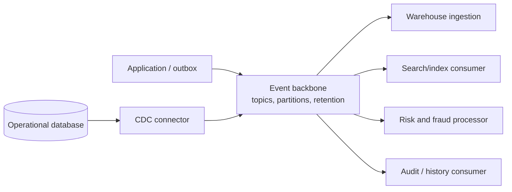
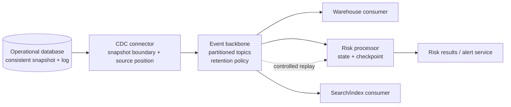

# 05 — CDC, Event Backbones, and Replay

## 1. Title and purpose

This lesson explains how operational database changes become durable events, how an event backbone distributes those events to independent consumers, and how replay can recover or rebuild downstream results.

**Change data capture (CDC)** identifies changes made to a source database and makes those changes available to another system. An **event backbone** is a shared event-distribution path that separates event producers from consumers. **Replay** means reading retained events again from a chosen position to recover, recompute, validate, or rebuild a downstream result.

These are related but distinct capabilities:

- CDC answers: **How do database changes leave the source?**
- The event backbone answers: **How are those changes distributed and retained for consumers?**
- Replay answers: **How can a consumer revisit changes safely and produce a correct result again?**

The objective is not to select a vendor or memorize configuration flags. It is to design a change-data path whose snapshot, ordering, retention, correctness, security, and recovery assumptions are explicit.

> **Scope note.** The module roadmap says the topic files were empty when the roadmap was authored. The detailed examples, exercises, numbers, and decision criteria in this lesson are learning recommendations and illustrative assumptions—not pre-existing repository requirements. Product capabilities and semantics vary; verify them against the exact database, CDC connector, broker, and processor versions selected for a real implementation.

## 2. Module position and prerequisites

### 2.1 Position in Stage 2D

This is Topic 5 in `Stage 2D — Data Architecture/09-Streaming-and-Real-Time-Data-Architecture/`. It follows:

1. `01-real-time-use-cases-and-latency-budgets.md` — defines business freshness and latency requirements.
2. `02-event-brokers-topics-partitions-and-retention.md` — introduces topics, partition keys, offsets, ordering boundaries, and retention.
3. `03-event-time-processing-ordering-and-watermarks.md` — explains event time, out-of-order arrival, windows, and watermarks.
4. `04-stream-processing-state-and-delivery-semantics.md` — explains state, checkpoints, delivery guarantees, idempotency, and recovery.

CDC introduces changes from operational databases into the stream. Replay depends on the previous topics' retention and partitioning model, ordering boundaries, and state/delivery semantics.

### 2.2 Prerequisites to review

Before continuing, be able to explain:

- A topic, partition, key, offset or equivalent position, and retention period.
- Why ordering is normally guaranteed only within a defined boundary, not globally across all partitions.
- The difference between event time and processing time.
- Why a stream processor may keep keyed state and checkpoints.
- At-least-once delivery, duplicate processing, idempotent writes, and the boundary of an exactly-once claim.
- The purpose of reconciliation: independently comparing source and destination state or totals to discover gaps and incorrect results.

Earlier data-integration foundations are also relevant: batch ingestion, database replication, streaming event contracts, schema compatibility, idempotency, deduplication, and reconciliation.

### 2.3 What this lesson does not replace

- Topic 2 owns detailed broker, partition, and retention design.
- Topic 4 owns detailed processor state and delivery semantics.
- Topic 6 owns detailed serving-store and materialized-view design.
- Topic 7 owns detailed backpressure, failure modes, and operational recovery procedures.

This lesson connects those concepts without attempting to teach each neighboring topic again.

## 3. Learning objectives

By the end, you should be able to:

1. Explain CDC and contrast it with periodic full-table extraction.
2. Describe log-based CDC conceptually and identify trade-offs in other capture approaches.
3. Explain why a consistent initial snapshot must be coordinated with the ongoing change stream.
4. Read a conceptual change event and identify its key, operation, source metadata, transaction context, and schema version.
5. Explain transaction/log positions, ordering limits, deletes, tombstones, and schema evolution without assuming all products behave identically.
6. Draw an event backbone with multiple independently managed consumers.
7. Distinguish replaying events, reconstructing current state, rebuilding a derived view, and reloading from the source.
8. Design a replay plan with a reason, starting position, retention window, duplicate policy, destination behavior, capacity controls, and reconciliation.
9. Explain how offsets/checkpoints and destination writes can become inconsistent, and how idempotency reduces risk.
10. Identify security, privacy, ownership, contract, and operational trade-offs in a CDC architecture.

## 4. Readiness check

Answer these before studying the main lesson. If any answer is unclear, revisit the relevant prerequisite.

| Question | Readiness criterion |
|---|---|
| Why might a partitioned broker not provide a total order across every event? | Ordering is bounded by the product's ordering guarantee and typically a partition or key. |
| Why is retention part of recovery architecture? | A consumer can replay only data still available in the configured or archived history. |
| Why can a retry create duplicate effects? | The destination write may succeed while its acknowledgement or checkpoint fails. |
| What does idempotent mean? | Applying the same logical operation more than once has the same intended final effect as applying it once. |
| Why is a snapshot alone insufficient for a continuously changing source? | It becomes stale as soon as new source changes occur. |
| Why is a change stream alone insufficient for a new consumer? | Without a starting baseline, the consumer may not know the current state of rows that have not changed during its observation period. |

**Readiness gate:** You can describe the risk of missing a change between a snapshot and stream start, and you can explain why replaying a retained event does not automatically make its side effects safe.

## 5. Beginner foundations: CDC and event backbones

### 5.1 Periodic extraction versus CDC

A periodic full-table extraction reads a table at intervals and transfers the observed contents. If a table is extracted at 10:00 and again at 11:00, the destination may see only the row's 11:00 state. Intermediate changes can be invisible, and deleted rows may be difficult to detect unless the extraction includes a reliable deletion strategy.

CDC instead captures changes as they occur or become available to the capture process. A change stream may include inserts, updates, and deletes, plus source metadata. CDC can reduce repeated full-table scanning and improve freshness, but it adds operational and semantic complexity.

| Dimension | Periodic full-table extraction | CDC / incremental capture |
|---|---|---|
| Unit transferred | Current table contents at extraction time | Individual changes or change records, depending on method |
| Freshness | Limited by schedule and extraction duration | Potentially lower latency; bounded by source, connector, broker, and consumer lag |
| Intermediate updates | Often collapsed into the state observed at extraction time | May be represented as separate changes if the capture method exposes them |
| Deletes | Need comparison, tombstones, soft-delete fields, or another deletion mechanism | Can be emitted as delete changes when supported and configured |
| Source load | Repeated scans can be expensive for large tables | Log-based capture often avoids repeatedly scanning every row, but still consumes resources |
| Complexity | Often simpler to reason about | Requires log-position management, snapshot handoff, schema handling, retention, and recovery |
| Best fit | Small datasets, low freshness requirements, periodic reconciliation | Frequent changes, lower latency, multiple consumers, or incremental replication |

CDC is not automatically better. If the business accepts daily freshness and the table is small, scheduled extraction may be simpler and cheaper. Choose the least complex method that meets correctness, freshness, recovery, and cost requirements.

### 5.2 CDC capture approaches

**Log-based CDC** reads a database's transaction/change log or a supported log-derived interface. The log records committed database operations or enough information for a connector to derive changes. A connector translates these records into events.

Conceptual flow:

```text
Application transaction
        |
        v
Operational database
  - data pages / tables
  - transaction log or change stream
        |
        v
CDC connector
  - reads supported log records
  - tracks source position
  - maps source changes to event records
        |
        v
Event backbone (topics / streams)
        |
        +------> Consumer A
        +------> Consumer B
        +------> Consumer C
```

Common approaches and trade-offs:

- **Log-based capture:** can capture committed changes efficiently and preserve source log metadata. It depends on supported database versions, log access, privileges, retention of source logs, and connector-specific behavior.
- **Query/polling-based incremental capture:** periodically queries rows using timestamps, monotonically increasing IDs, or another change marker. It can be easier to deploy but may miss updates if markers are unreliable, clocks differ, transactions overlap polling boundaries, or hard deletes leave no queryable row.
- **Trigger/table-based capture:** database triggers or change tables record modifications. This can provide useful metadata but adds write-path overhead, schema/operational coupling, and maintenance burden.
- **Application-emitted domain events:** an application publishes business events such as `OrderPlaced`. These can communicate intent better than row-level changes, but they are not the same as capturing every supported database mutation. Dual writes to a database and broker need a consistency pattern, such as a transactional outbox.

Do not claim that one method captures every database feature. Support for DDL, large objects, transaction boundaries, before-images, deletes, generated columns, partition changes, or specific data types varies by database and connector.

### 5.3 What is an event backbone?

An event backbone is a shared distribution layer—often implemented with durable broker topics or streams—through which producers publish events and consumers read them independently.



The backbone separates the timing and deployment of producers from those of consumers:

- A producer need not know every downstream consumer.
- Consumers can process at different rates and maintain independent positions.
- New consumers may be able to start from retained history, subject to retention and permissions.
- One consumer's outage need not stop all other consumers, if the platform and capacity are designed for that isolation.
- Contracts and ownership must still be managed; a shared backbone is not a license for ungoverned data sharing.

### 5.4 Ownership and contracts

Define ownership explicitly:

| Responsibility | Typical owner (illustrative) | Questions to answer |
|---|---|---|
| Source table semantics | Source application / database owner | What does each field mean? Which changes are valid? |
| Capture configuration | Data platform / integration owner with source DBA | Which tables, operations, and metadata are captured? |
| Event contract | Domain owner with platform governance | What are the key, schema, compatibility rules, and delete semantics? |
| Topic/stream operations | Streaming platform team | Who controls retention, partitions, ACLs, quotas, and availability? |
| Consumer correctness | Each consumer team | How are duplicates, ordering, schema changes, and replays handled? |
| Privacy and access approval | Data owner / security / privacy functions | Which fields may be distributed to which consumers and for how long? |

A useful event contract defines the event name and purpose, primary key, operation type, payload schema, source identity, source position, transaction metadata where available, event timestamp semantics, schema version, delete representation, compatibility policy, and ownership/contact path.

### 5.5 Row-change events versus domain events

A row-change event describes a persisted data mutation, for example: “row `customer_id=42` changed; field `email` is now X.” A domain event describes a business fact, for example: “CustomerEmailChanged” or “OrderApproved.”

Neither is universally superior:

- Row-change events are useful for replication and keeping derived copies aligned with database state.
- Domain events can express business meaning and avoid exposing internal table layouts.
- A domain event may omit internal field changes that a data replication consumer needs.
- A raw row-change stream may expose implementation details and sensitive fields that should not be broadly distributed.

Do not treat every row update as a stable business event. Choose the event model according to consumer needs, data ownership, and the semantics the producer can guarantee.

## 6. Intermediate snapshot-plus-stream and change-event design

### 6.1 Why snapshot and stream must be combined

A new downstream consumer often needs both:

1. **A baseline:** the rows that already exist.
2. **Ongoing changes:** the inserts, updates, and deletes that occur after the baseline's logical point in time.

A snapshot provides a bounded view of existing data. The stream keeps the view current. The difficult part is not copying rows; it is coordinating the snapshot with a precise source position so no committed change is omitted or incorrectly applied twice without safe handling.

### 6.2 The handoff invariant

A correct design establishes a relationship between:

- the logical point represented by the snapshot, and
- the source log position from which ongoing changes are applied.

The exact mechanism is product-specific. A connector may establish a log position, use a consistent database snapshot, record a low/high watermark, buffer changes during snapshotting, or use another documented coordination protocol. Do not invent or assume a mechanism: verify the selected connector's guarantee and limitations.

**Required invariant:** every source change that should be represented in the target must be accounted for either in the baseline snapshot or in the ongoing change stream, with overlaps handled deterministically. There must be no unaccounted gap between the two.

### 6.3 Snapshot-to-stream timeline — worked example

Assume a fictional `customer` table and a CDC connector that documents a consistent snapshot plus log-position handoff. The position labels below are illustrative; they are not a vendor's literal offset format.

Initial row at the snapshot's logical boundary:

```text
customer_id = 42
status      = "ACTIVE"
credit_band = "B"
```

Timeline:

| Time | Source / capture event | Position or boundary | What the target should do |
|---|---|---|---|
| 09:59:59 | CDC establishes a consistent snapshot boundary and records a compatible change-stream start position | `L100` (illustrative) | Record the handoff metadata; do not assume the snapshot is already complete |
| 10:00:00 | Snapshot reads customer 42 as `ACTIVE`, band `B` | Snapshot boundary associated with `L100` | Load the baseline row with source identity and snapshot metadata |
| 10:00:02 | A committed transaction changes customer 42 to `REVIEW` | `L101` | Ensure this change is captured by the coordinated stream; apply it after/beside the snapshot according to the connector's documented handoff protocol |
| 10:00:03 | Another transaction changes the band to `C` | `L102` | Apply the next change in the correct source-defined order for this key/transaction boundary |
| 10:00:05 | Snapshot scan reaches the end of the table | Snapshot complete | Mark the snapshot phase complete only when the connector says the snapshot and buffered/stream changes are reconciled |
| 10:00:06 | Consumer catches up through `L102` | Consumer position `L102` | Current target state should be `REVIEW`, band `C` |

Conceptual sequence:

```text
Source database log:   ... L100 | L101: status=REVIEW | L102: band=C | ...
                             \         |                   |
Snapshot:             rows as of boundary L100             |
                             \                             /
CDC handoff:          snapshot baseline + changes from the coordinated boundary
                                           |
                                           v
Target state:         ACTIVE/B -> REVIEW/B -> REVIEW/C
```

The exact inclusion rule at the boundary matters. Some implementations may expose overlapping records or coordinate the boundary in another way. The connector's documented protocol determines whether the consumer starts strictly after a position, includes a boundary record, or relies on deduplication. The architecture must not guess.

**Failure if the handoff is wrong:** if the snapshot reads the old value but the stream starts after the update, the target stays stale. If the stream includes the update but the target applies an older snapshot row afterward, the target can regress to stale state. A correct handoff protocol plus deterministic merge/order rules prevents both cases.

### 6.4 Transaction and log positions

A source position may be called an LSN, binlog position, SCN, change sequence, transaction ID plus sequence, connector offset, or another product-specific identifier. These terms are not interchangeable across systems.

Capture metadata may include:

- Source database / cluster identifier.
- Schema and table identifier.
- Log position or connector source offset.
- Transaction ID and event sequence within the transaction, where available.
- Operation type: insert, update, delete, snapshot read, or another connector-defined operation.
- Source commit timestamp and/or connector processing timestamp.
- Primary key and before/after image, depending on configuration.
- Schema version or schema identifier.
- Connector/task metadata and snapshot marker, if provided.

Use positions as **source progress markers**, not as universal timestamps. A log position can be ordered within its defined source/log context but is not necessarily comparable to a position from another database, another log incarnation, or another partition. A transaction ID alone may not uniquely order every row-level event.

### 6.5 Ordering boundaries

Be precise about what “ordered” means:

1. **Within a source transaction:** some connectors preserve transaction grouping or metadata; others may not expose a complete atomic transaction to every consumer.
2. **Within one source log:** log order may be available, subject to connector and database semantics.
3. **Within a topic partition:** a broker may preserve append/read order for a partition; events for the same key are commonly routed to the same partition when the partitioning strategy is stable.
4. **Across partitions:** there may be no total order.
5. **Across independent sources:** there is generally no single global order unless a system explicitly establishes one.
6. **At a destination:** parallel workers, retries, and out-of-order asynchronous writes can alter the order in which effects become visible unless the destination write strategy guards against stale updates.

A CDC design must decide whether it needs per-key ordering, transaction-consistent replication, or only eventual convergence to the latest state. These are different requirements. A “latest row wins” rule is unsafe unless the ordering/version comparison is well-defined and trustworthy.

### 6.6 Inserts, updates, deletes, and tombstones

Conceptual examples:

```json
{
  "key": {"customer_id": 42},
  "operation": "UPDATE",
  "before": {"status": "ACTIVE"},
  "after": {"status": "REVIEW"},
  "source": {
    "database": "customer-db",
    "table": "customer",
    "position": "L101",
    "transaction_id": "TX-900"
  },
  "schema_version": 3
}
```

This is illustrative event shape, not a product-specific wire format.

A delete may be represented as a delete operation with a key and optional before-image. Some log-compacted broker designs use a **tombstone**—a record with a key and null value—to signal deletion to compaction or downstream consumers. A tombstone is not necessarily identical to a rich CDC delete event. It may have different retention and compaction semantics and may not preserve the old row values.

Questions to specify:

- Does the connector emit hard deletes?
- Is a before-image available, and under what configuration?
- Is the key preserved for deletes?
- How long are delete events/tombstones retained?
- Does the consumer interpret null as a deletion, a missing payload, or invalid data?
- Can a later replay still observe the delete after compaction/retention?
- How are soft deletes represented?
- Is a delete of an already-absent row treated as harmless, an error, or an auditable discrepancy?

Never infer delete behavior from a generic statement that the system supports CDC. Verify the source, connector, serialization format, broker cleanup policy, and consumer contract together.

### 6.7 Schema evolution

Database schema changes and event-schema changes must be governed as a contract.

Examples include adding a nullable column, changing a data type, renaming or dropping a field, changing a primary key, changing decimal precision, or altering enum values. A schema registry can help validate compatibility, but registry approval does not guarantee that every consumer's business logic remains correct.

A safe change process should:

1. Identify affected source tables and event contracts.
2. Classify the change as compatible, conditionally compatible, or breaking for each consumer population.
3. Confirm connector support and how DDL is represented or handled.
4. Decide whether consumers ignore unknown fields, require fields, or need coordinated deployment.
5. Test historical replay with the new schema and old schema versions.
6. Define a migration and rollback path.
7. Keep schema version and event provenance available for diagnosis.

A rename is often effectively a drop plus add for consumers unless an explicit compatibility mapping exists. Do not assume that a database DDL change is automatically translated into a safe event-contract change.

## 7. Replay, offsets/log positions, retention, and idempotency

### 7.1 What replay is—and is not

Replay means reading retained records again from a chosen position. Common reasons include:

- Recovering a consumer after an outage.
- Rebuilding a derived table, search index, aggregate, or analytical view.
- Correcting a bug in consumer logic and recomputing outputs.
- Validating a new consumer against historical events.
- Reconciling downstream results after a suspected gap.
- Reprocessing after a schema mapping or enrichment rule changes.

Distinguish four operations:

- **Resume:** continue a consumer from its last safe committed position.
- **Replay a range:** intentionally re-read a selected interval or position range.
- **Rebuild a derived view:** reset or isolate a destination, then process enough history to recreate its current result.
- **Reload from source:** take a new source snapshot or extract and reconcile it with ongoing changes. This may be needed if broker history is insufficient.

Replay does not itself guarantee correctness. A consumer may have side effects, stale state, non-idempotent updates, missing historical records, or a changed transformation. Replaying the same bytes through a different code version may intentionally produce different results.

### 7.2 Offsets and checkpoints

A broker consumer offset usually identifies progress within a topic partition; a CDC connector also maintains source progress, and a stream processor may maintain a checkpoint of input positions plus processing state. These positions are related but are not the same thing.

Conceptual flow:

```text
Source log position
       |
       v
CDC connector checkpoint
       |
       v
Broker topic/partition/offset
       |
       v
Processor checkpoint (input positions + processor state)
       |
       v
Destination write / commit
```

The exact commit protocol varies. Consider a failure window:

1. Consumer reads offset `P-100`.
2. Destination write succeeds.
3. Process crashes before recording the offset/checkpoint.
4. After restart, the same record is read again.

This is normal at-least-once behavior in many designs. If the destination operation is not idempotent, the replay may duplicate an effect. The opposite failure ordering can also be dangerous: if the input position is advanced before the destination effect is durable, a crash may skip a required effect.

Design for atomicity where the chosen system supports it, and otherwise use idempotent destination operations, transactional boundaries where appropriate, and reconciliation. Do not claim end-to-end exactly-once merely because one component offers an exactly-once mode.

### 7.3 Retention defines the replay window

Broker retention is a correctness and recovery decision, not merely a storage-cost setting. The replayable window is bounded by the oldest required event still available in the relevant retained log or archive.

For a simple time-retention topic:

\[
\text{available replay window} \approx \text{configured retention duration}
\]

That approximation assumes the needed records have not been removed by compaction, deletion policies, manual truncation, or other product-specific behavior. Size-based retention, partition skew, replication, and archive policies can change the effective window.

Example (illustrative):
- Required recovery history: 72 hours.
- Expected consumer outage detection and repair: up to 18 hours.
- Rebuild and validation may require 24 hours of historical processing.
- Operational margin: 12 hours.

Required time window = 18 + 24 + 12 = **54 hours**. A 72-hour time-retention target gives 18 hours of margin under these assumptions. It does not prove that all records remain available: size limits, compaction, partition behavior, and actual throughput must also be checked.

For a baseline estimate, treat the input size as the average **serialized event-record size** (not merely the business payload) and calculate logical uncompressed record bytes as:

\[
\text{logical record bytes} \approx \text{average serialized bytes/event} \times \text{events/second} \times \text{seconds retained}
\]

This is not a disk-capacity forecast by itself. Account separately for keys and headers not included in the stated size, broker/protocol and index overhead, replication, compression behavior, partition skew, size-based cleanup, and growth. Do not mix decimal GB and GiB silently; state units and assumptions in a real sizing exercise.

If a consumer's last safe position has fallen outside retained history, it cannot simply resume from that position. Options may include a new consistent snapshot, restore from a separate archive, rebuild from an upstream source, or accept and document a gap if the business owner explicitly approves it.

### 7.4 Replay safety and idempotency

**Idempotency** means repeating the same logical operation does not produce an additional unintended effect. It is especially important when replay, retry, or checkpoint recovery can re-deliver records.

Common patterns:

- **Upsert by stable primary key:** set the destination row to the event's intended current state. Safe only if stale events cannot overwrite newer state and delete semantics are handled.
- **Version-guarded upsert:** update only if the incoming source version/position is newer according to a valid comparison within that source's ordering domain.
- **Event-ID deduplication:** record processed event IDs and ignore repeats. The deduplication record itself must be durable and retained long enough for the replay/retry horizon.
- **Idempotency key for external side effects:** pass a stable key to a service that supports deduplicating the operation, such as a payment or notification API.
- **Transactional write plus offset commit:** use only where the selected source, processor, and destination actually support the required atomic boundary.
- **Reconciliation:** compare independent source/destination counts, keys, checksums, aggregates, or business invariants after replay.

An event ID should be stable across retries. A generated ID created anew each time the same logical source change is emitted does not deduplicate reliably. A source log position plus source identity and event sequence can help form a stable identity, but only when the connector guarantees those fields' meaning and uniqueness.

### 7.5 Current-state replication versus event-history processing

A CDC consumer that maintains a current-state table often wants the latest row per primary key. Replaying old events into that table requires guarding against stale writes and respecting delete semantics.

A consumer that computes business history or aggregates may need to process every change, including intermediate transitions. Replacing its destination with only the latest row can lose history. Replaying events into a non-idempotent aggregate can double-count unless state and checkpoints are reset or the event IDs are deduplicated.

Before replay, decide which of these applies:

- **State convergence:** target should match source current state.
- **History reconstruction:** target should reflect every required event or transaction.
- **Derived metric recomputation:** aggregates and state must be recomputed with a defined start boundary.
- **Side-effect replay:** external actions may be irreversible; replay must be suppressed, simulated, or protected by idempotency keys.

### 7.6 Checkpoint coordination: practical decision rules

For every consumer, document:

1. What position is checkpointed: source log, broker offset, processor checkpoint, or multiple positions?
2. What state is included in the checkpoint?
3. When is the destination write durable relative to checkpoint advancement?
4. What happens if the process crashes between write and checkpoint?
5. What happens if the checkpoint is restored but destination data is not?
6. Can the destination be reset and rebuilt independently?
7. How are replay start and stop positions chosen and recorded?
8. What is the idempotency key and how long is it retained?
9. What reconciliation proves the consumer has caught up?

These questions are more important than the label of a delivery mode.

## 8. Worked CDC and replay plan

This section combines the snapshot handoff, backbone, and replay decisions into one illustrative plan. It is not a production benchmark or vendor configuration.

### 8.1 Scenario and assumptions

A fictional financial-services company maintains a `customer_account` table in an operational database. The organization wants three consumers:

- A warehouse ingestion pipeline for analytics.
- A risk-monitoring processor for current account state and recent changes.
- A search/index consumer for operational lookup.

Assumptions for the exercise:

- The source database and CDC connector support a documented consistent snapshot-plus-log-stream protocol.
- The source has a stable primary key `account_id`.
- Change events expose a stable source identity and position; transaction metadata is available for the selected operations.
- The backbone retains 72 hours of the required change history for this exercise.
- Consumers must be able to recover from an 18-hour outage and still have time for replay and validation.
- Illustrative average incoming rate is 2,000 events/second, with a replay target initially capped at 4,000 events/second.
- The risk consumer must not emit duplicate external alerts merely because a change is replayed.

Verify each assumption in an actual implementation; these values are pedagogical only.

### 8.2 Architecture and handoff



Snapshot-and-stream procedure:

1. Confirm the CDC connector's documented snapshot/log handoff semantics and required source-log retention.
2. Record source identity, snapshot boundary, connector version/configuration, and the chosen schema version.
3. Load snapshot rows into an isolated baseline destination or staging area.
4. Capture and buffer/apply ongoing changes according to the connector's handoff protocol. Do not independently start a guessed log position.
5. Resolve overlaps using the connector's guarantees plus deterministic key/version handling.
6. Validate snapshot completeness and source-to-target key counts/checksums where feasible.
7. Mark the initial load complete only after the connector reports snapshot completion and the consumer has applied changes through a recorded position.
8. Publish consumer readiness and current lag/position; retain the handoff metadata for audit and later rebuilds.

### 8.3 Replay plan template, filled example

| Plan field | Illustrative decision |
|---|---|
| Reason | Risk processor code defect caused an incorrect derived score for a bounded period; rebuild the derived state using corrected logic. |
| Scope | Rebuild the risk processor's derived state for the selected accounts; do not replay irreversible alerts as new external actions. |
| Starting position | Use a recorded safe position from before the affected interval, or the earliest retained position required by the processor's state model. Record topic, partition, offset and transformation version. |
| Stop condition | Process through a recorded target offset per partition, then continue until the live consumer catches up within the approved lag threshold. |
| Retention window | Required history is 54 hours under the sample outage/rebuild/margin calculation; verify that 72-hour configured retention and any compaction/size policies preserve the needed records. |
| Duplicate handling | Use stable event IDs/source positions for deduplication; apply version-guarded upserts for current-state rows; keep external alert emission disabled or idempotency-key protected during rebuild. |
| Destination behavior | Build into an isolated versioned destination or resettable state namespace. Validate it before atomic/controlled cutover. Do not merge replayed historical events blindly into the live result. |
| Capacity controls | Begin at 2× illustrative live rate (4,000 events/s), measure consumer lag and destination saturation, and reduce or pause replay if live freshness, error rates, CPU, storage, or downstream quotas breach thresholds. Reserve capacity for live traffic. |
| Checkpoint policy | Record replay start and target positions, code/schema versions, checkpoint snapshots, and destination generation. Ensure checkpoint and state reset/restore are consistent. |
| Validation | Compare counts by partition/range, distinct primary keys, source-position coverage, null/error rates, aggregate totals, delete counts where available, and selected record-level samples. |
| Reconciliation | Compare rebuilt state with an independent source snapshot or trusted reference; investigate missing/extra keys, stale versions, duplicate effects, and business-invariant violations. |
| Rollback | Keep the previous serving generation available until validation and cutover pass; document the route back if the rebuilt destination is wrong. |
| Approval | Consumer owner, source/data owner, platform operator, and risk/business owner approve the replay scope and side-effect policy. |

### 8.4 Capacity arithmetic

Assume the live consumer receives 2,000 events/s and the replay path can process 4,000 events/s. If the replay competes for the same single processing capacity, it may consume all available capacity and make live traffic lag. A safer design may reserve separate capacity or allocate only a fraction of the processing budget to replay.

Illustrative backlog for the stated 18-hour outage:

- Live arrival rate: 2,000 events/s.
- Assumed outage duration: 18 hours, with a steady rate and no additional burst.
- Backlog: 2,000 events/s × 18 hours × 3,600 seconds/hour = **129,600,000 events**.
- Replay processing capacity: 4,000 events/s total, including live arrivals.
- Net backlog drain: 4,000 − 2,000 = 2,000 events/s.
- Approximate drain time: 129,600,000 / 2,000 = 64,800 seconds = **18 hours**.

This is a simplified capacity estimate: it assumes the stated rate is sustainable for the full interval, the destination keeps up, and there is no additional burst or skew.

If 4,000 events/s is dedicated replay capacity *in addition to* live capacity, the drain-time estimate changes. Capacity assumptions must say whether rates are total or incremental, and must account for event-size variance, destination write latency, partition skew, and downstream limits. A replay rate that is safe for the broker may still overwhelm the destination database or alert API.

### 8.5 Validation checklist before declaring success

- [ ] Replay start and stop positions are recorded for every partition or source stream.
- [ ] No required source position is outside available retained/archive history.
- [ ] Consumer schema and transformation versions are recorded.
- [ ] Duplicate handling and external side-effect policy are enabled and tested.
- [ ] The destination is isolated or protected from stale replay writes.
- [ ] Live traffic remains within agreed latency/freshness thresholds.
- [ ] Replay reaches the target position and then catches up to live traffic.
- [ ] Source/destination counts and business invariants reconcile within defined tolerances.
- [ ] Deletes and tombstones are handled according to the contract.
- [ ] Cutover, rollback, and approval evidence are recorded.

## 9. Advanced architecture choices, governance, and operational trade-offs

### 9.1 Choosing where to place the backbone

A shared enterprise backbone can reduce duplicated source integrations and make multiple consumers easier to onboard. It can also become a high-blast-radius dependency if ownership, tenancy, quotas, and security are weak.

Options include:

- **Central shared backbone:** standardized operations and governance; requires strong tenant isolation, access control, quota policy, and clear ownership.
- **Domain-owned streams on a common platform:** clearer domain responsibility; requires consistent platform standards and discoverability.
- **Separate streams for sensitive or high-criticality domains:** stronger isolation; increases operational overhead and may duplicate infrastructure.
- **Direct source-to-consumer replication:** simpler for a narrow use case but can multiply source load and couple producer and consumer operations.

Select based on business criticality, consumer count, security classification, operational ownership, latency, and cost—not a blanket rule that all data belongs in one shared topic.

### 9.2 Retention, compaction, and archival are different controls

- **Time/size retention** limits how long or how much data remains available.
- **Log compaction** can retain the latest value per key while removing superseded records, depending on product policy. It may not preserve every intermediate change.
- **Tombstone retention** affects how long deletion markers remain available for compaction and consumers.
- **Archive/object storage** can preserve longer history at different cost and access latency, but replaying from it may require a separate restoration path.
- **Source database log retention** is distinct from broker retention. A CDC connector outage can cause source-log loss before events reach the backbone if source retention is insufficient.

A replay plan should identify the actual storage layer that holds each needed segment of history and how the consumer accesses it. Do not assume broker retention solves a source-capture gap or that compaction preserves event history.

### 9.3 Source consistency versus eventual convergence

Three broad requirements must not be conflated:

1. **Eventual current-state convergence:** downstream rows eventually match source current state.
2. **Transaction-consistent replication:** consumers must observe a transaction as a consistent unit, including relevant cross-row effects.
3. **Complete change history:** every relevant change must remain represented for audit, analytics, or temporal reconstruction.

A connector and consumer design that is adequate for eventual current-state convergence may be insufficient for transactionally consistent replication or full audit history. Define the requirement first, then verify source log semantics, connector metadata, partition strategy, and consumer processing model.

### 9.4 Data contracts and schema governance

For each CDC stream, maintain a discoverable contract that answers:

- Who owns the source and event?
- What is the primary key and event identity?
- Which operations are emitted, including deletes?
- What are the ordering and transaction guarantees—and explicit non-guarantees?
- What does each timestamp mean?
- What schema compatibility policy applies?
- Which fields are sensitive, restricted, or prohibited from broad distribution?
- What is the retention and replay promise?
- Which consumers depend on the contract?
- How are breaking changes announced, tested, migrated, and rolled back?

Schema evolution and data quality are operational responsibilities, not one-time setup. Unknown enum values, nullability changes, invalid timestamps, decimal precision, and unexpected key changes should have explicit behavior and observability.

### 9.5 Security, privacy, and access control

CDC can distribute a broad copy of operational data to many systems, multiplying the impact of an overly permissive topic or an accidental field addition.

At minimum, design for:

- **Least privilege:** connector identities should read only approved databases, schemas, tables, logs, and metadata; consumers should read only authorized streams.
- **Authentication and authorization:** use managed identities or scoped service identities where supported; define topic/stream-level and administrative permissions.
- **Transport and storage protection:** encrypt supported network links and stored data; manage keys and secret rotation under platform policy.
- **Field minimization:** capture and publish only fields required by approved use cases; consider masking, tokenization, or field-level protection for sensitive values.
- **Environment separation:** restrict production CDC data in development/test; use synthetic or appropriately transformed data where feasible.
- **Auditability:** record changes to connector configuration, grants, schemas, retention, and replay operations.
- **Retention and deletion policy:** coordinate broker retention, archives, backups, derived copies, and legal/privacy requirements. Deleting the source row does not automatically erase all downstream copies or historical events.
- **Replay authorization:** replay can re-expose historical data or re-trigger downstream actions. Restrict who can replay, what range can be replayed, and whether side effects are enabled.
- **Data residency and lineage:** track where records travel, which consumers receive them, and what transformations or copies exist.

A tombstone or source-row deletion is not by itself a complete privacy-erasure mechanism. Establish a governed deletion workflow across derived stores and archives, consistent with applicable law and policy.

### 9.6 Observability and service objectives

Measure the CDC path end to end. Useful indicators include:

- Source log position and capture lag.
- Connector status, restart count, snapshot progress, and source-log retention headroom.
- Events produced/consumed per second and bytes per second.
- Per-partition consumer lag and skew.
- Oldest available retained position and replay-window headroom.
- Schema errors, conversion failures, malformed events, and rejected records.
- Duplicate detection rate and reconciliation discrepancies.
- Destination write latency and saturation during replay.
- Snapshot completion time and time to catch up after snapshot.
- Data freshness at the consuming application.

Set thresholds based on the use case's latency budget from Topic 1. “Connector is running” does not prove that all expected source changes are captured or that downstream results are fresh.

### 9.7 Operational and cost trade-offs

- Longer retention improves recovery options but increases storage and replication costs.
- More partitions may increase parallelism but complicate ordering, per-key skew, and operational management.
- Larger snapshots can stress source databases and destination writes; snapshot throttling and source impact must be assessed.
- More metadata improves traceability but increases payload size and contract complexity.
- Strict transaction preservation may limit parallelism or require specialized connector/consumer behavior.
- Rebuilding from a compacted topic may be efficient for current state but unsuitable for reconstructing intermediate history.
- A new replay version can fix logic while changing output; side-by-side validation reduces cutover risk.
- An independent archive extends history but adds restore, access, and cost considerations.

No single choice is optimal for every stream. Record the business requirement, constraints, alternatives, assumptions, and consequences in an architecture decision record.

## 10. Industry use cases and failure scenarios

### 10.1 Common use cases

| Use case | Why CDC/backbone/replay helps | Key design concern |
|---|---|---|
| Customer or account replication | Keeps operational data available for downstream applications and analytics | Snapshot handoff, deletes, sensitive fields, stale-write protection |
| Fraud and risk monitoring | Provides timely changes to a risk processor | Freshness, source ordering, duplicate alerts, recovery capacity |
| Search index synchronization | Updates searchable documents as source rows change | Delete propagation, version-guarded updates, index rebuild |
| Lakehouse ingestion | Preserves incremental operational changes for history and analytics | Schema evolution, source metadata, long-term archive and reconciliation |
| Customer 360 / master data | Distributes updates across multiple domains | Ownership, identity resolution, contract compatibility |
| Audit and regulatory history | Captures change records and provenance | Completeness, immutability requirements, access controls, retention policy |
| Operational cache/materialized view | Keeps query-optimized state current | Upserts, tombstones, replay and cutover behavior |

These are common architecture patterns, not claims that a particular connector satisfies regulatory or product-specific requirements by default.

### 10.2 Failure scenarios and first questions

| Scenario | Likely symptom | First architectural questions |
|---|---|---|
| Snapshot/stream gap | A row remains stale although the connector is healthy | Was the snapshot boundary coordinated with the stream position? Can the gap be proven or reconciled? |
| Source log expires before capture resumes | Connector cannot continue from its previous position | Is a fresh snapshot required? Is an independent archive available? |
| Consumer restarts after destination write but before checkpoint | Duplicate write or repeated side effect | Is the destination operation idempotent? Are writes and offsets coordinated? |
| Old replay overwrites newer state | Destination regresses | Is there a reliable source-version guard? Is ordering only per key/partition? |
| Delete event is lost or misinterpreted | Deleted row remains downstream | Is delete/tombstone handling defined across connector, broker, and consumer? |
| Schema change breaks one consumer | Deserialization or semantic errors | Was compatibility checked for all consumers? Is there a quarantine and migration plan? |
| Replay saturates destination | Live freshness and latency deteriorate | Is replay throttled? Is capacity reserved for live traffic? |
| One hot key or partition dominates | Lag concentrated on a subset of partitions | Is the key distribution skewed? Can the partition strategy change safely? |
| Consumer uses an incorrect replay start | Missing history or duplicated aggregates | Is the start position tied to state/checkpoint version and replay scope? |
| Sensitive field added unexpectedly | Unauthorized data reaches consumers | Are field minimization, schema review, and consumer ACLs enforced? |

Detailed backpressure and failure-runbook design belongs in Topic 7; this table establishes the CDC/replay questions that should feed that analysis.

## 11. Hands-on exercises with deliverables and validation criteria

The exercises below are recommended learning activities. They do not imply that any product environment is already configured.

### Exercise 1 — Batch versus CDC

**Task:** A customer row changes from `ACTIVE` to `REVIEW` and then to `CLOSED` between two hourly full-table extracts. Compare what a batch consumer may observe with what a CDC consumer may receive.

**Deliverable:** A timeline showing the source states, extract times, and possible event sequence.

**Validation criteria:**
- Explains that full-table extraction may see only the state at each extraction point.
- Does not claim that all CDC methods capture every intermediate state.
- Identifies how a hard delete would be detected by each method.

### Exercise 2 — Snapshot/stream handoff

**Task:** Draw a timeline for a new consumer where the snapshot begins while updates continue. Mark the consistent snapshot boundary, source position, two updates, snapshot completion, and consumer catch-up.

**Deliverable:** Diagram plus a short handoff invariant.

**Validation criteria:**
- Every change is accounted for by snapshot or stream, with overlap handled.
- Identifies both failure modes: missing a change and applying stale snapshot data after a newer change.
- States that the actual boundary protocol must be verified for the selected connector.

### Exercise 3 — Event contract

**Task:** Design an illustrative event contract for `account_id`, operation type, source position, transaction metadata, timestamps, schema version, and before/after payloads.

**Deliverable:** One sample insert, update, and delete event; a field dictionary; and a compatibility policy.

**Validation criteria:**
- Defines key and event identity.
- Distinguishes source commit time from connector processing time.
- States which metadata and before-images are optional or product-dependent.
- Defines delete/tombstone behavior explicitly.

### Exercise 4 — Retention sizing

**Task:** A consumer may be unavailable for 12 hours, replay and validation take 20 hours, and the operator wants 10 hours of margin. Compute a required time window. If average volume is 1,500 events/s and the average serialized event-record size is 900 bytes/event, estimate logical uncompressed record bytes for that window, before broker/protocol overhead, compression, and replication.

**Deliverable:** Calculation with units and stated assumptions.

**Validation criteria:**
- Time window = 12 + 20 + 10 = **42 hours**.
- Seconds = 42 × 3,600 = **151,200 seconds**.
- Events = 1,500 × 151,200 = **226,800,000 events**.
- Logical serialized-record estimate = 226,800,000 × 900 = **204,120,000,000 bytes** (about 204.12 decimal GB before overhead).
- Notes that replication, metadata, compression, indexes, partition skew, and size/compaction policy affect actual capacity and replay availability.

### Exercise 5 — Duplicate-safe replay

**Task:** A replayed update says `account_id=42`, `status=REVIEW`, source version `L101`. The destination already applied it once, and the consumer retries it.

**Deliverable:** Pseudocode or a written design for an idempotent update.

**Validation criteria:**
- Repeated application has the same intended final state.
- A stale version cannot overwrite a newer version.
- Explains where the deduplication/version state is stored and how long it remains valid.
- Does not assume that arbitrary log positions can be compared across unrelated sources.

### Exercise 6 — Replay plan and live-traffic protection

**Task:** Use the filled plan in Section 8 as a template for a 24-hour consumer outage. State the replay start/stop positions, retention assumptions, duplicate policy, destination isolation, capacity controls, and reconciliation method.

**Deliverable:** A replay plan and a brief approval/rollback checklist.

**Validation criteria:**
- The required replay range is still retained or a source snapshot/archive path is specified.
- Live capacity and replay capacity are distinguished.
- External side effects are disabled or protected against duplication.
- Completion is based on positions and validation, not merely “the job finished.”

### Exercise 7 — Architecture decision record

**Task:** Choose between direct source-to-consumer replication, a shared backbone, or domain-owned streams on a common platform for three consumers with different latency and access requirements.

**Deliverable:** An ADR with context, requirements, alternatives, decision, consequences, security boundary, retention choice, and replay policy.

**Validation criteria:**
- Includes consumer independence and ownership.
- Discusses access control, data minimization, and blast radius.
- States ordering and transaction guarantees that are needed.
- Explains how a new consumer is bootstrapped and how it recovers after retention expires.

## 12. Common mistakes and misconceptions

| Misconception | Correction |
|---|---|
| “CDC is always faster and cheaper than batch.” | It can improve freshness and avoid full scans, but adds connector, log, broker, schema, and recovery complexity. |
| “Starting the stream after the snapshot finishes is always safe.” | Changes may occur during the snapshot; a documented consistent handoff is required. |
| “The log position is a timestamp.” | It is a source-specific progress/order marker and may not be comparable across systems. |
| “Every CDC product emits full before/after images.” | Capture content depends on database capabilities, connector settings, and source logging configuration. |
| “All CDC events are globally ordered.” | Ordering boundaries vary; cross-partition and cross-source total order is not guaranteed by default. |
| “A tombstone is the same as a complete delete event.” | A tombstone may be a key with null value for compaction/deletion semantics; it may lack before-image or business context. |
| “If the broker retains 7 days, all replay is safe for 7 days.” | Compaction, size limits, source-log gaps, archives, consumer state, and side effects can constrain replay. |
| “Exactly-once in one component means exactly-once business outcomes.” | Guarantees are boundary-specific; external side effects and destination writes need their own correctness design. |
| “Replaying an aggregate is just reading the events again.” | State may need to be reset/rebuilt; otherwise events may be counted twice. |
| “The newest event always wins.” | “Newest” requires a trustworthy comparison domain and stale-write protection. |
| “A schema registry prevents all schema problems.” | It cannot guarantee consumer business logic remains valid or that source DDL is safely represented. |
| “Deleting a source row deletes all copies.” | Broker history, archives, derived stores, caches, and backups need governed deletion handling. |
| “A successful replay job proves correctness.” | Validate positions, counts, keys, aggregates, deletes, freshness, and business invariants. |
| “The replay rate should be as high as possible.” | Uncontrolled replay can starve live processing or overload destinations. |
| “One central backbone automatically improves governance.” | Without ownership, ACLs, quotas, and data minimization, it can amplify access and blast-radius risks. |

## 13. Knowledge-check questions with answers or explanations

1. **What problem does CDC solve that periodic full-table extraction may not?**  
   It can expose incremental changes with lower freshness delay and can represent deletes or intermediate updates, depending on the capture method. Full extraction may only observe table state at scheduled points.

2. **Why does snapshot-plus-stream require an explicit handoff?**  
   Changes occur while the snapshot is read. Without a coordinated boundary, some changes may be missed or older snapshot values may overwrite newer stream changes.

3. **Does a log position always provide a globally comparable order?**  
   No. It is meaningful within a source/log context and its documented semantics. Cross-source or cross-partition ordering requires additional design.

4. **What is the difference between a CDC delete event and a tombstone?**  
   A CDC delete event may carry an operation, key, source metadata, and possibly a before-image. A tombstone is often a key with null value used by a broker's compaction/deletion semantics. Product behavior differs.

5. **Why is broker retention a correctness decision?**  
   It determines how much event history can be replayed from the broker. If the required starting position has expired or been compacted away, a rebuild may require a new snapshot or archive.

6. **Why can a consumer duplicate a destination write after a crash?**  
   The write may succeed while its offset/checkpoint does not commit. On restart, the event is processed again. Idempotent writes or coordinated transactions mitigate the risk.

7. **Is event-ID deduplication enough for every replay?**  
   No. The ID must be stable and unique for the logical event, the deduplication store must be durable for the replay horizon, and destination state/order semantics must still be correct.

8. **How do you prevent stale replay data from overwriting newer current state?**  
   Use a trustworthy source version/position comparison or another deterministic conflict policy; ensure the comparison is valid within the source's ordering domain.

9. **What is the difference between rebuilding a derived view and replaying external side effects?**  
   A derived view can often be rebuilt in isolation and validated before cutover. External side effects such as charges, emails, or alerts may be irreversible and need suppression or idempotency keys.

10. **What should a replay plan contain?**  
    Reason and scope, start/stop positions, retention/archival assumptions, code/schema version, duplicate handling, destination behavior, capacity controls, checkpoint policy, validation/reconciliation, rollback, and approvals.

11. **Why can replay hurt live latency even if the broker can serve the extra traffic?**  
    The processor, destination store, network, or external APIs may be saturated. Replay needs throttling, separate capacity, quotas, and live-freshness guardrails.

12. **Does a compatible schema change guarantee semantic compatibility?**  
    No. Consumers may make assumptions about field meaning, nulls, enum values, keys, or transaction behavior. Compatibility checks need consumer testing and governance.

13. **What should happen if the consumer's last safe position is older than available retention?**  
    Do not silently skip the gap. Restore from an archive, re-bootstrap from a consistent snapshot and resume changes, or obtain explicit business approval for a documented gap.

14. **How can CDC create a privacy risk?**  
    It can replicate sensitive operational fields to many downstream consumers and preserve historical values. Apply least privilege, field minimization, encryption, retention limits, auditability, and governed deletion workflows.

15. **Why are Topic 2 and Topic 4 prerequisites for this lesson?**  
    Topic 2 explains where records are ordered and how long they remain available. Topic 4 explains processor state, checkpoints, duplicate delivery, and recovery behavior—all central to safe replay.

## 14. Summary and mastery criteria

CDC captures source database changes and exposes them as change records. An event backbone distributes those records to multiple independent consumers. Replay uses retained history to recover, recompute, validate, or rebuild downstream results.

The key engineering principles are:

- Choose CDC versus batch based on freshness, completeness, source impact, and operational complexity.
- Coordinate snapshot and ongoing changes through a documented source-position handoff.
- Treat log positions, transaction boundaries, ordering, deletes, tombstones, and schema changes according to the selected product's actual semantics.
- Make consumer ownership and event contracts explicit.
- Treat retention and archive strategy as part of the recovery objective.
- Design replay for duplicates, stale writes, state reset, checkpoint coordination, and side-effect safety.
- Protect live traffic with capacity controls and verify correctness with reconciliation.
- Govern sensitive fields, access, lineage, retention, and deletion across the entire event path.

### Mastery criteria

You are ready to proceed when you can:

- [ ] Draw and explain database → CDC → backbone → independent consumers.
- [ ] State the snapshot/stream handoff invariant and explain the failure if it is violated.
- [ ] Identify the source, transaction, event, schema, and ordering metadata required by a proposed contract.
- [ ] Explain the difference between source log position, broker offset, and processor checkpoint.
- [ ] Calculate a replay retention requirement and state what could invalidate the calculation.
- [ ] Design an idempotent replay into a current-state destination without allowing stale events to overwrite newer state.
- [ ] Explain how a rebuild differs from replaying external side effects.
- [ ] Produce a replay plan with a safe start/stop position, capacity limits, reconciliation, and rollback.
- [ ] State what must be verified against the selected database, connector, broker, and processor versions.
- [ ] Identify data security and governance controls for a shared CDC stream.

**Recommended completion gate:** submit the snapshot-to-stream diagram, one event contract, the retention calculation, a replay plan, and an architecture decision record. Review any failed validation criterion and revise the artifacts before continuing to Topic 6.

## 15. Exact repository-relative cross-references supported by the supplied roadmap

Paths below are relative to:

`Stage 2D — Data Architecture/09-Streaming-and-Real-Time-Data-Architecture/`

### Within this module

- `01-real-time-use-cases-and-latency-budgets.md` — business freshness, latency budget, and end-to-end requirements.
- `02-event-brokers-topics-partitions-and-retention.md` — topics, partitions, ordering boundaries, offsets, and replay retention.
- `03-event-time-processing-ordering-and-watermarks.md` — event time, out-of-order arrival, and temporal processing.
- `04-stream-processing-state-and-delivery-semantics.md` — keyed state, checkpointing, delivery guarantees, idempotency, and recovery.
- `06-real-time-serving-stores-and-materialized-views.md` — downstream serving patterns and materialized views; detailed store design is intentionally deferred.
- `07-late-events-backpressure-and-stream-failure-modes.md` — detailed lag, backpressure, failure, and recovery behavior; detailed failure handling is intentionally deferred.
- `practice-questions.md` — module validation questions.
- `Projects/09-real-time-risk-monitoring-architecture.md` — final architecture project integrating all seven topics.
- `roadmap-Streaming-and-Real-Time-Data-Architecture.md` — module learning sequence and source-of-truth notes.

### Earlier Stage 2D foundations

- `../06-Data-Integration-and-Interoperability/02-change-data-capture-and-database-replication.md` — CDC and database replication foundations.
- `../06-Data-Integration-and-Interoperability/04-streaming-events-and-message-contracts.md` — streaming events and message contracts.
- `../06-Data-Integration-and-Interoperability/05-data-contracts-schema-registry-and-compatibility.md` — contracts, schema registry, and compatibility.
- `../06-Data-Integration-and-Interoperability/07-idempotency-deduplication-and-reconciliation.md` — idempotency, deduplication, and reconciliation.
- `../03-Data-Architecture-Patterns-and-Reference-Architectures/06-event-driven-and-data-sharing-patterns.md` — event-driven architecture and data sharing patterns.
- `../04-Conceptual-Logical-and-Physical-Data-Modeling/06-event-modeling-and-domain-driven-design.md` — event modeling and domain-driven design.
- `../04-Conceptual-Logical-and-Physical-Data-Modeling/07-schema-evolution-and-backward-compatibility.md` — schema evolution and backward compatibility.
- `../05-Database-and-Storage-Architecture/05-partitioning-indexing-clustering-and-data-layout.md` — partitioning and data layout.
- `../05-Database-and-Storage-Architecture/06-replication-consistency-and-transaction-boundaries.md` — replication, consistency, and transaction boundaries.
- `../05-Database-and-Storage-Architecture/07-retention-archival-and-data-lifecycle-storage-tiers.md` — retention, archival, and lifecycle tiers.
- `../08-Cloud-Hybrid-and-Multi-Cloud-Data-Architecture/05-networking-identity-and-private-connectivity.md` — secure networking and identity.
- `../08-Cloud-Hybrid-and-Multi-Cloud-Data-Architecture/06-hybrid-connectivity-and-on-premises-integration.md` — on-premises sources and hybrid integration.
- `../10-Data-Governance-Security-Privacy-and-Compliance/` — governance, security, privacy, and compliance context.
- `../11-Metadata-Lineage-Quality-and-Master-Data/` — lineage, metadata, and quality context.
- `../12-Reliability-Resilience-and-Disaster-Recovery/` — resilience and disaster-recovery context.
- `../13-Performance-Scalability-and-Cost-Architecture/` — performance, scalability, and cost context.

**Repository alignment note:** These references follow the supplied module roadmap and Stage 2D tree. The module roadmap explicitly says the topic files were empty at the time it was written; the cross-references identify intended learning dependencies and locations, not claims that each referenced file has already been populated or independently validated.
