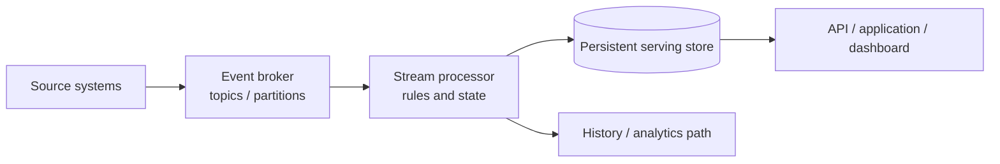
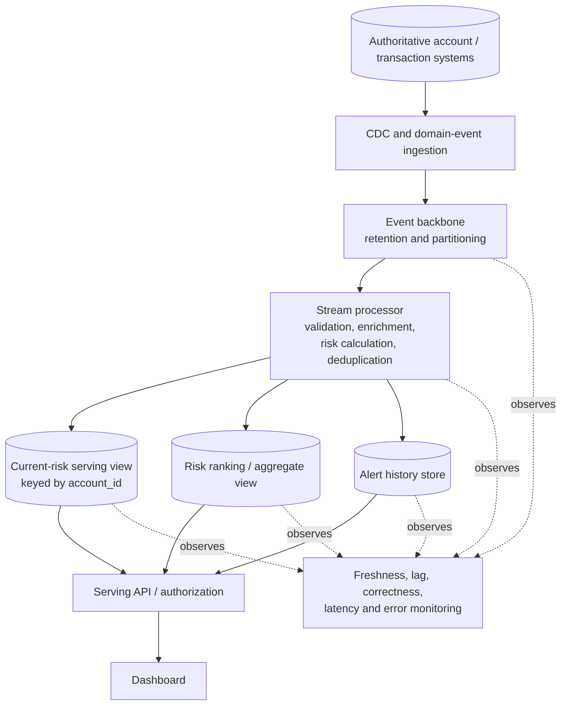

# 06 — Real-Time Serving Stores and Materialized Views

## 1. Title and purpose

This lesson explains how streaming systems make computed results available to applications, dashboards, APIs, and downstream services. It teaches how to choose a serving-store category from actual query patterns, maintain a materialized view as events arrive, and prove that the result is both fast enough and correct enough for its intended use.

The core distinction is:

- **Event transport** carries events durably between producers and consumers.
- **Stream computation** transforms events and may maintain processing state.
- **Persistent serving** stores results in a form suited to queries.
- **Consumer-facing queries** read those results under a defined latency, freshness, consistency, and availability expectation.

A fast database query is not sufficient if the stored result is stale, incomplete, duplicated, or semantically wrong. Serving architecture must measure both query performance and data correctness.

> **Roadmap source-of-truth note.** The module roadmap states that the topic files were empty when the roadmap was authored. The scenarios, numerical examples, exercises, and decision criteria in this lesson are recommended learning guidance, not pre-existing repository requirements. The design is vendor-neutral. Store behavior, consistency guarantees, query limits, and update semantics must be verified against the exact product and version selected for implementation.

## 2. Module position and prerequisites

### 2.1 Position in Stage 2D

This is Topic 6 in `Stage 2D — Data Architecture/09-Streaming-and-Real-Time-Data-Architecture/`.

The module sequence is:

1. `01-real-time-use-cases-and-latency-budgets.md`
2. `02-event-brokers-topics-partitions-and-retention.md`
3. `03-event-time-processing-ordering-and-watermarks.md`
4. `04-stream-processing-state-and-delivery-semantics.md`
5. `05-cdc-event-backbones-and-replay.md`
6. `06-real-time-serving-stores-and-materialized-views.md`
7. `07-late-events-backpressure-and-stream-failure-modes.md`

Topic 6 follows the processing and CDC/replay topics because the serving layer receives their outputs and must honor their ordering, state, delivery, and recovery behavior. Topic 7 will examine detailed failure modes and backpressure; this lesson establishes the serving-side decisions that failure analysis needs.

### 2.2 Prerequisites

Before beginning, you should be able to:

- Define an end-to-end latency budget and distinguish event-to-queryable freshness from query execution latency.
- Explain topics, partitions, keys, offsets, and retention.
- Describe event time, late events, and corrections to earlier results.
- Explain keyed processor state, checkpoints, duplicate delivery, idempotency, and the limits of exactly-once claims.
- Describe CDC, snapshot-plus-stream handoff, replay positions, and reconciliation.
- Compare relational, key-value, analytical, search, and specialized database categories at a conceptual level.

The module roadmap explicitly identifies Topic 1, Topic 4, and prerequisite P7 as the primary prerequisites for this topic.

### 2.3 Scope boundaries

This lesson covers serving requirements, store categories, view maintenance, freshness, consistency, correctness, and design trade-offs.

- Detailed broker/partition/retention design belongs to Topic 2.
- Detailed stream-processing state and delivery semantics belong to Topic 4.
- Detailed CDC and replay planning belongs to Topic 5.
- Detailed backpressure, lag, and failure runbooks belong to Topic 7.
- Full product-specific database internals are out of scope unless a selected technology makes a particular behavior necessary to explain.

## 3. Learning objectives

By the end of this lesson, you should be able to:

1. Draw the path from source event through broker and processor to a persistent serving store and query consumer.
2. Define a serving store and materialized view, and distinguish both from the source-of-truth system.
3. Map point lookups, range queries, relational joins, analytical aggregates, text search, and time-series patterns to plausible store categories.
4. Compare read latency, write throughput, freshness, query flexibility, consistency, availability, retention, operational complexity, and cost.
5. Explain insert, update, upsert, delete, and idempotent-write behavior in a stream-to-store pipeline.
6. Design version-aware updates so a stale event does not overwrite newer state.
7. Define and measure serving freshness separately from query latency.
8. Identify partial-update, duplicate-effect, cache-staleness, schema-change, and view-drift risks.
9. Explain how replay or backfill can rebuild a view safely and how reconciliation provides evidence of correctness.
10. Produce a vendor-neutral serving design with explicit assumptions, validation methods, and completion criteria.

## 4. Readiness check

Use this table to identify prerequisite gaps.

| Prompt | A ready answer should include |
|---|---|
| Why can a broker topic be a poor direct query interface for an application? | A topic is a transport/log abstraction; arbitrary low-latency queries, joins, and request/response semantics may not be its purpose. |
| Why can a precomputed aggregate reduce query latency? | It avoids recomputing the aggregate over a large set for every request, at the cost of update work and possible staleness. |
| What is the difference between query latency and freshness? | Query latency is request-to-response time; freshness is the age/delay of the data represented by the response. |
| Why are duplicate events relevant to a serving store? | Retried writes can duplicate counters or side effects unless operations are idempotent or deduplicated. |
| Why can a later-arriving event be older in source order? | Arrival time is not necessarily source order or event time; ordering/version metadata and late-event policy matter. |
| Why is a materialized view not automatically a source of truth? | It is derived and can lag, drift, or be rebuilt from upstream records; ownership and recovery guarantees may differ. |

**Readiness gate:** you can state what query the consumer needs, how fresh the result must be, and which correctness invariant the serving layer must preserve.

## 5. Beginner foundations: serving path and materialized views

### 5.1 The serving path in plain language

Imagine an account-risk application that asks, “What is the current exposure for account 42?” The event broker carries changes, and a processor computes or updates the exposure. The application needs a place where it can retrieve the latest computed value quickly. That place is the serving layer.



The broker and processor are not automatically the best query-serving components. The broker retains and distributes events; the processor applies business logic; the serving store organizes results for the queries that consumers actually execute.

### 5.2 Serving store

A **serving store** is a persistent or managed data system optimized for a defined class of read/write workload. It might support a single-key lookup, a range scan, relational joins, aggregations, text search, or another access pattern.

“Serving store” describes a role, not one database technology. A relational database may be a serving store for a transactional API. An analytical store may serve dashboards. A search index may serve text and faceted search. A key-value store may serve high-volume point reads. A single product can support multiple patterns, but its suitability depends on the workload and its real guarantees.

### 5.3 Materialized view

A **materialized view** is a stored result derived from other data or events. Instead of calculating the result from raw records every time a user asks, the system maintains the result as inputs change.

Example: raw account events may be numerous, while the application repeatedly asks for the latest exposure by account. A materialized view stores a precomputed record:

```text
account_id -> {
    current_exposure,
    risk_band,
    source_version,
    computed_at
}
```

The fields are illustrative. A real contract must define their meaning and update rules.

Materialized views can be maintained in several ways:

- **Processor-maintained:** a stream processor computes and writes the view.
- **Store-maintained:** the database or analytical engine maintains a view from its underlying tables, subject to its capabilities and refresh semantics.
- **Periodically rebuilt:** a scheduled process recomputes the view from source data or retained history.
- **Hybrid:** incremental updates are applied continuously and periodic rebuilds/reconciliation correct drift.

A materialized view is not necessarily a SQL `MATERIALIZED VIEW` object. The term describes the precomputed stored result; implementation differs.

### 5.4 Source of truth versus derived view

A **source-of-truth system** is the authoritative system for a particular business fact or transaction. A **derived serving view** is a representation built for consumption. The source of truth may be an operational database, ledger, domain service, or another explicitly governed authority.

| Question | Source-of-truth system | Derived serving view |
|---|---|---|
| Primary role | Authoritative business record or transaction | Fast, purpose-specific query representation |
| Can it lag? | It may have internal replication delays, but its authority is defined by the domain | Yes; stream and refresh delays can make it stale |
| Can it be rebuilt? | Usually not simply from its own downstream projection; it has authoritative responsibilities | Often yes, if upstream history/source and transformation logic are sufficient |
| Query shape | Governed by transactional and domain needs | Tuned to a consumer's access patterns |
| Correctness risk | Transaction/business invariants | Projection drift, stale writes, missing updates, incorrect transformation |
| Recovery | Domain-specific backup and recovery | Replay, rebootstrap, backfill, reconciliation, or restore from a known-good generation |

Do not make a derived view the authority for irreversible business actions unless its authority, freshness, and consistency contract explicitly support that responsibility. A risk dashboard might be allowed to show a slightly stale projection, while a payment authorization may require a stronger authoritative check.

### 5.5 Why precompute?

Suppose an application asks for a count and total exposure over millions of events. Recomputing the result on every request can be slower and more expensive than maintaining a smaller aggregate as changes arrive.

Precomputation trades:

- **Read efficiency:** smaller or simpler query work.
- **Write/compute overhead:** every relevant change may trigger view maintenance.
- **Freshness delay:** the view becomes current only after events are processed and stored.
- **Flexibility:** a precomputed result supports the queries it was designed for; new filters or dimensions may require another view or a more flexible store.
- **Operational complexity:** replay, schema evolution, versioning, and reconciliation must be designed.

Precompute only where repeated query patterns and latency needs justify the maintenance cost.

## 6. Intermediate access patterns and store-category selection

### 6.1 Start with the query, not the vendor

For every consumer, document:

1. Query shape: key lookup, range scan, join, aggregate, text search, vector similarity, time-series scan, or mixed pattern.
2. Data volume and growth.
3. Read/write ratio and peak concurrency.
4. Freshness requirement and expected update rate.
5. Read latency objective (including percentile and measurement boundary).
6. Consistency requirement: eventual, read-your-writes, monotonic reads, transactionally consistent, or another defined contract.
7. Availability and recovery requirements.
8. Retention, deletion, and historical-query needs.
9. Security classification and tenant isolation.
10. Operational skills, failure recovery, and total cost.

A vague requirement such as “must be real-time” is not enough to select a store. State the query and freshness target.

### 6.2 Store-category comparison

The table gives categories to investigate, not universal prescriptions. Actual suitability depends on data shape, query engine, data size, indexing, consistency, concurrency, and product implementation.

| Access pattern / workload | Store category to evaluate | Why it may fit | Important caveats |
|---|---|---|---|
| Lookup one record by stable key at high request volume | Key-value / low-latency serving store | Direct key access can avoid broad scans | Ad hoc filters and joins may be limited; check consistency, hot keys, value size, and write semantics |
| Lookup by key plus several relational predicates, constraints, or joins | Relational database | SQL, constraints, transactions, and flexible relational queries | Capacity and latency depend on indexes, schema, concurrency, and workload; distributed scaling may change transaction semantics |
| Small-to-medium filtered ranges with transactional updates | Relational or suitable document store | Indexes can support range access and flexible records | Range selectivity, sort patterns, index write amplification, and pagination matter |
| Group-by, ranking, top-N, and aggregations across large fresh datasets | Real-time OLAP / analytical serving store | Columnar or analytical execution may suit broad scans and aggregates | Ingestion/update behavior, merge costs, query concurrency, and freshness must be tested |
| Large historical analysis and exploratory queries | Warehouse/lakehouse analytical tables | Suitable for history, joins, and broad analysis | May not meet interactive serving latency or high-concurrency operational API needs |
| Full-text search, relevance ranking, faceted filters | Search/index store | Text analyzers and inverted indexes support search behavior | Often a derived index, not an authoritative system of record; updates and deletes may be eventually consistent |
| Repeated hot reads for data already served by another store | Cache in front of an authoritative/serving store | Can reduce repeated read load and response time | Invalidation, TTL, cache stampedes, stale values, and cold starts require design |
| Time-bounded measurements or telemetry | Time-series or analytical store | Time partitioning and time-oriented aggregation may fit | High-cardinality tags, retention, late points, and rollup behavior need validation |
| Graph traversals and relationship queries | Graph-oriented store or relational graph pattern | May fit multi-hop relationship access | Query depth, graph size, update rate, and alternative relational approaches must be compared |
| Similarity search over embeddings | Vector-capable search/serving store | Supports nearest-neighbor retrieval patterns | Recall/latency trade-offs, filtering, index freshness, and vector lifecycle need testing |

A store category is a starting hypothesis. Confirm it with a representative workload test, including correctness and recovery—not just a best-case point-read benchmark.

### 6.3 Multiple views may be better than one universal store

A risk application may need:

- `account-risk-by-id` for point lookups.
- `top-risk-accounts-by-region` for ranking and filtered aggregation.
- `alert-history-by-account` for a time-ordered range query.
- `risk-search` for text or faceted search.

Trying to force every access pattern into one store can produce poor latency, complex queries, or expensive indexes. Separate views may be appropriate, but they introduce duplicated data, more contracts, additional operational cost, and the need to reconcile each projection.

### 6.4 A serving requirements worksheet

Use a worksheet like this before selecting a technology:

| Field | Example value (illustrative only) |
|---|---|
| Consumer | Risk dashboard API |
| Query | Get current risk summary by `account_id` |
| Data returned | Exposure, risk band, version, updated time |
| Read load | Peak requests/s to be measured |
| Update load | Peak account updates/s to be measured |
| Read latency SLO | Define p95/p99 and client/server measurement boundaries |
| Freshness SLO | Event commit to queryable view, with percentile |
| Consistency | Eventual within a stated freshness target; stronger read-after-write where required |
| Availability | Define required service window and error budget |
| Retention | Current view plus separate history policy |
| Security | Account-level authorization; minimize sensitive fields |
| Recovery | Replay/rebuild from retained events or authoritative source |
| Validation | Freshness distribution, version lag, count/key reconciliation, query latency |

The example deliberately does not invent a benchmark target. Fill the actual figures from business requirements and measurement.

A simple capacity estimate can expose assumptions before a benchmark. For example, if a hypothetical API receives **2,000 reads/s** and a cache hit ratio of **90%** is measured under the representative workload, then the estimated read rate reaching the backend is:

```text
backend_read_rate = total_reads × (1 − cache_hit_ratio)
                  = 2,000 reads/s × (1 − 0.90)
                  = 200 reads/s
```

This estimates backend reads only; it does not estimate writes, cache misses during cold starts, retries, skew, query cost, or tail latency. The 90% hit ratio is an assumption until measured, and the store still needs to be tested at the expected write rate and concurrency. Do not treat the arithmetic as a capacity guarantee.

## 7. Update semantics, freshness, and consistency

### 7.1 Insert, update, upsert, and delete

A stream processor typically turns input events into a desired state change or derived result.

- **Insert:** create a record when the key is new.
- **Update:** change some or all fields of an existing record.
- **Upsert:** insert if absent; otherwise update according to the defined operation.
- **Delete:** remove or mark a record as deleted.
- **Incremental aggregate update:** add, subtract, or otherwise adjust an aggregate based on an input change.
- **Retraction/correction:** reverse or amend a previously applied contribution when late data or corrected source information changes the result.

An upsert is not automatically idempotent. “Set `risk_band = HIGH` for account 42” is usually naturally repeatable if it represents the intended state and stale writes are guarded. “Add 500 to total exposure” is not safe to apply repeatedly unless the event is deduplicated or the aggregate update is otherwise idempotent.

### 7.2 Prefer state-setting operations when they match the contract

Conceptual examples:

**State-setting update**

```text
write account_id=42
     current_exposure=1200
     source_version=V105
only if incoming version is newer than stored version
```

**Non-idempotent increment**

```text
total_exposure = total_exposure + 500
```

If the second operation is retried after a crash, the total can increase twice. Safer designs may use event-ID deduplication, a transactionally maintained ledger of applied events, or recomputation from authoritative inputs. A version comparison is valid only if the source version has a defined ordering within the relevant source/key domain.

### 7.3 Partial updates and field ownership

A partial update may carry only the fields that changed. If the consumer replaces the whole destination record with that partial payload, fields not present may be erased or reset incorrectly. If the consumer merges fields without a clear contract, deleted/null fields may be confused with absent fields.

Define whether each event is:

- A **full after-image** of the row or view record.
- A **patch** containing only changed fields.
- A **business command/event** that requires domain logic to derive the new state.

For a patch, define the meaning of absent field, explicit null, and deletion. Specify whether the processor or store performs the merge, and test concurrent or out-of-order updates.

### 7.4 Deletes and tombstones in serving views

A delete may be represented as a deletion operation, a tombstone, a soft-delete flag, or a business status transition. The serving contract must define what queries return after deletion and how historical views behave.

Questions to answer:

- Should the row disappear immediately, or remain with a deleted status?
- Must audit/history still show the prior record?
- Can a replayed older update recreate a deleted row?
- Does the destination preserve a source version or deletion marker to reject stale updates?
- Are caches and search indexes updated consistently with the primary serving view?

A delete from one view does not automatically delete all derived copies. Deletion propagation, cache invalidation, search-index updates, archives, and privacy erasure may need coordinated workflows.

### 7.5 Freshness is not query latency

These are different metrics:

- **Query latency:** time from a request reaching a defined measurement point until its response completes.
- **Event-to-queryable freshness:** time from a defined source/event timestamp or commit point until the corresponding change is visible to the serving query.
- **Consumer lag:** distance or delay between the stream's available position and the consumer's applied position; its interpretation depends on the source and partitioning model.
- **View age:** age of the last successful refresh or update, which may be useful but does not prove every record is current.

Define the freshness clock carefully. Source commit timestamps, event timestamps, processor timestamps, and serving-store write timestamps are not interchangeable. Clock skew can distort cross-system measurements; where possible use consistent time sources and also track source positions/versions.

A practical event-to-queryable measurement is:

```text
source commit / defined event time
        -> event available to consumer
        -> processing complete
        -> serving write durable/visible
        -> verification query sees the expected version
```

Measure the end-to-end distribution and its components. A store can return a response in 5 ms while serving a view that is 90 seconds behind; that is fast but stale.

### 7.6 Freshness and latency SLOs

For each important consumer, define:

- A freshness objective such as a percentile bound on event-to-queryable delay.
- A query latency objective such as p95/p99 request duration, with clear measurement points.
- An availability/error-rate objective.
- A correctness objective: what must match, what can be temporarily stale, and how corrections are surfaced.
- A measurement method, sampling strategy, and alert threshold.
- A behavior when the SLO is breached, such as displaying “data delayed,” falling back to an authoritative query, or disabling a high-risk action.

The numbers should come from the use case and observed system behavior. Do not choose a target merely because a database advertises a low-latency benchmark.

### 7.7 Consistency expectations

Common consistency expectations include:

- **Eventual consistency:** the view converges if processing continues and no unreconciled gap remains.
- **Read-your-writes:** a caller that makes a change can observe it on subsequent reads under the defined conditions.
- **Monotonic reads:** a caller should not observe an older version after a newer version.
- **Transactionally consistent reads:** related updates are observed as a consistent transaction boundary.
- **Bounded staleness:** data may lag, but within a defined bound measured by an agreed method.

Not every store or stream-to-store path can provide every guarantee. A broker transaction, processor checkpoint, and destination write may not share one atomic transaction. State the guarantee end to end, not just the guarantee of one component.

For high-consequence actions, use the authoritative source or an explicitly designed consistency mechanism when the materialized view's staleness could change the decision.

### 7.8 Incremental view maintenance

For a simple running total, a new event may add a contribution. But an update that changes an existing source row may require subtracting the old contribution and adding the new one. A delete may require removing a contribution. A late event may require correcting an earlier time window.

Conceptually:

```text
on event:
    identify stable entity/event key
    validate schema and source version
    determine whether this event is new, duplicate, stale, or a correction
    derive the intended view change
    apply an idempotent/version-aware update
    record durable processing progress under the chosen commit model
    publish freshness and correctness metrics
```

This is conceptual pseudocode, not executable code or a product-specific API. A production implementation must define transaction boundaries, state persistence, retries, and how checkpoint progress relates to destination visibility.

## 8. Worked end-to-end serving architecture

### 8.1 Use case: real-time account-risk dashboard

A fictional financial-services organization wants a dashboard and API to retrieve:

1. Current risk summary for a single account.
2. Top accounts by risk within a region.
3. Recent alert history for one account.

This requires multiple access patterns. A single materialized view may not be ideal for all three.

Illustrative design assumptions—not performance targets:

- Account changes arrive through an approved CDC/event path.
- The processor computes a current risk summary.
- Freshness and query latency objectives are defined by the business and measured in the deployed environment.
- The current risk summary is a derived view, not the authoritative ledger or account record.
- Alert history is retained separately from current state.

### 8.2 Logical architecture



The categories are deliberate hypotheses:

- **Current-risk view:** a key-oriented serving store or a relational store with an appropriate primary-key access path.
- **Risk ranking/aggregates:** an analytical store or a relational/other store if the data volume and query requirements justify it.
- **Alert history:** a store that supports account-keyed time-range queries and the required retention.
- **API:** enforces caller authorization, response shape, and freshness disclosure.

The exact store choice must be validated against workload, consistency, availability, update rate, operational skills, and cost. The diagram does not imply that each view requires a separate physical product; some workloads may share one store if measured requirements and isolation needs permit it.

### 8.3 Define view contracts

**View A — current risk by account**

| Field | Contract meaning |
|---|---|
| `account_id` | Stable key from the authoritative domain |
| `current_exposure` | Current computed exposure under a documented calculation |
| `risk_band` | Output of a versioned risk rule/model |
| `source_version` | Source-defined version or position used to guard stale updates |
| `computed_at` | Time the processor computed this view version |
| `last_source_commit_at` | Source commit time if available and trustworthy |
| `rule_version` | Version of the calculation or model |

**View B — risk ranking**

- Key/dimensions: region, ranking interval or defined snapshot period.
- Measures: count of accounts per risk band, exposure totals, top-N accounts.
- Update semantics: specify whether results are continuously incrementally maintained or periodically refreshed.
- Corrections: define how account changes, deletes, late events, and rule-version changes affect previous aggregates.

**View C — alert history**

- Query key: account ID.
- Range: event/alert time interval.
- Ordering: define whether order is by source time, event time, or processing time.
- Retention: specify how long alert history is available.
- Side effects: replaying history must not emit duplicate live alerts unless the alerting contract explicitly requires it.

### 8.4 End-to-end update lifecycle

1. An account source transaction commits.
2. The capture/producer path emits a record with the agreed key, operation, source metadata, and schema.
3. The broker carries and retains the event according to its contract.
4. The processor validates schema and authorization assumptions, handles duplicate/stale records, enriches as required, and computes the intended risk update.
5. The current-risk view is updated with a version guard or other defined conflict rule.
6. The aggregate view is updated using idempotent incremental logic or a supported recomputation strategy.
7. Alert history is appended with a stable alert/event identity if the business rules produce an alert.
8. The serving API queries the appropriate view, applies access control, and returns data plus freshness/version metadata where appropriate.
9. Monitoring measures event-to-queryable delay, query latency, errors, lag, duplicate/stale-write counts, and reconciliation results.

The system should not declare a view current merely because a processor has read the event. The write must be durable and visible according to the serving contract.

### 8.5 Illustrative freshness budget and measurement

Assume for learning only that the business later selects a 3-second p95 event-to-queryable freshness objective. This is not a recommendation or a product benchmark. An illustrative budget might allocate:

| Stage | Illustrative p95 allocation |
|---|---:|
| Source commit to capture availability | 0.5 s |
| Broker delivery/consumer wait | 0.4 s |
| Processing/enrichment | 0.7 s |
| Serving-store write and visibility | 0.6 s |
| Measurement/operational margin | 0.8 s |
| **Total** | **3.0 s** |

The allocations are planning assumptions and must be measured under representative load. Percentiles of component latencies do not necessarily add to the end-to-end percentile, especially when delays are correlated; the authoritative SLO is measured end to end. The component budget is for diagnosis and engineering allocation, not a substitute for end-to-end measurement.

Measurement plan:

- Generate or identify a test change with a stable entity key and source version.
- Record the source commit timestamp or a trusted reference time.
- Query the serving view until the expected version becomes visible, or use a supported change/visibility signal. If polling is used, record the polling interval because it bounds measurement resolution and can overstate the observed visibility time.
- Record query completion time and calculate event-to-queryable delay.
- Separately record request duration for each query pattern.
- Repeat under realistic concurrency, event rate, skew, and failure conditions.
- Report p50/p95/p99, sample count, time synchronization assumptions, missing observations, and the proportion of events that never became queryable.
- Validate that the returned value matches the expected version—not only that a row exists.

A test harness must avoid confusing clock skew with actual processing delay. When possible, correlate source positions/versions as well as timestamps.

### 8.6 Correctness validation

For the current-risk view:

- Compare a sample of account keys and source versions with an authoritative snapshot.
- Verify no stale source version overwrote a newer view version.
- Check missing and extra keys, deletes, null fields, and duplicate effects.
- Recompute selected risk values independently from trusted inputs.
- Record discrepancies and the resolution path.

For aggregate views:

- Compare totals and counts against an independently computed reference over the same source range and rule version.
- Ensure update/delete corrections subtract old contributions where required.
- Validate top-N ranking around ties and threshold boundaries.
- Reconcile after backfill, replay, or rule changes.

For alert history:

- Check stable alert IDs and duplicate rates.
- Verify time-range boundaries and ordering contract.
- Confirm replay does not re-trigger external side effects unintentionally.

Correctness checks must use the same declared scope, time boundary, filters, and transformation version. A count mismatch between two different time windows is not meaningful evidence of drift.

## 9. Advanced operational, correctness, and cost trade-offs

### 9.1 View maintenance strategies

| Strategy | Strength | Main trade-off |
|---|---|---|
| Incremental processor-maintained view | Low-latency updates and explicit domain logic | Requires correct handling of duplicates, updates, deletes, late events, and state recovery |
| Store-maintained materialized view | Uses database/analytical engine's supported maintenance mechanisms | Refresh semantics, supported query forms, and freshness guarantees vary by product |
| Periodic full rebuild | Simpler correctness model for some derived outputs | Can be expensive and stale between rebuilds; requires capacity and cutover planning |
| Incremental maintenance plus periodic reconciliation/rebuild | Combines low-latency updates with a correction path | More operational components, version management, and validation work |
| Cache in front of a serving store | Can reduce repeated read cost | Invalidation and staleness become additional correctness concerns |

Choose the simplest maintenance strategy that satisfies freshness, correctness, recovery, and cost requirements.

### 9.2 Duplicate writes and exactly-once boundaries

A processor may read an event, write the destination, and crash before its input offset/checkpoint commits. On restart, it can process the event again. The store may receive the same write twice.

Possible mitigations include:

- Idempotent state-setting writes.
- Stable event IDs and durable deduplication.
- Source-version guards.
- Transactions that include destination state and progress, if the selected system supports the required boundary.
- Reconciliation to detect residual errors.

A product's exactly-once feature may cover a specific broker/processor/state boundary, not arbitrary external stores or side effects. Verify the actual integration. Do not assume that the word “exactly-once” makes an entire end-to-end application correct.

### 9.3 Stale reads and read-after-write

A view may lag because the processor is behind, the destination is overloaded, replication is delayed, or a cache serves an old value. Define what the API does when a caller needs a just-written value:

- Read from the authoritative source for the critical path.
- Wait until a required source version is visible, with a bounded timeout.
- Return the current view with explicit version/freshness metadata.
- Use a product-supported consistency mechanism.
- Reject or defer a high-consequence action if freshness is insufficient.

Each option has latency, availability, and coupling trade-offs. A fallback to the source may protect correctness but overload it during an incident; capacity and circuit-breaker behavior must be designed.

### 9.4 Partial visibility and atomic updates

If a logical result spans multiple records or stores, a reader may observe a mixed generation. For example, the current-risk row may be updated before the aggregate ranking reflects the same event. Whether this is acceptable depends on the consumer contract.

Mitigation options include:

- Publish a view version or generation identifier.
- Use a supported atomic transaction for related writes.
- Write a new generation in isolation and switch a pointer/alias after validation.
- Make the API explicitly tolerate cross-view lag and return freshness metadata.
- Use a single store when the consistency requirement justifies it.

Do not claim atomic multi-store updates unless the selected technology actually provides the necessary transaction boundary.

### 9.5 Replay, rebuild, and backfill

A materialized view may need to be rebuilt after a logic bug, schema change, data gap, or model/rule version change.

A safe conceptual pattern:

1. Define the reason, scope, start/stop positions, and target view version.
2. Confirm the required event history remains retained or can be restored from archive/source.
3. Rebuild in an isolated destination or namespace.
4. Apply idempotency and source-version rules; suppress or protect external side effects.
5. Throttle replay to preserve live-service capacity.
6. Validate counts, keys, versions, aggregates, deletes, and business invariants.
7. Establish a cutover watermark/position that can be interpreted consistently by the rebuild and live path. Apply all required changes through that boundary, then process changes after it without a gap or double application; coordinate snapshot/replay and live consumption using the selected source's documented position semantics.
8. Cut over only after the rebuilt generation has caught up to the agreed boundary, acceptance criteria pass, and readers can switch without observing a partial generation; keep rollback available.
9. Record transformation version, the cutover position, and reconciliation evidence.

Replay versus reload is an explicit choice. Replay re-reads retained events; rebuild recomputes the derived view; reload takes a new source snapshot/extract and coordinates ongoing changes. The correct option depends on history availability and whether the desired result requires every intermediate event.

Detailed replay mechanics belong to Topic 5. Detailed lag/backpressure/failure runbooks belong to Topic 7.

### 9.6 View drift and reconciliation

**View drift** means the derived view no longer matches the expected result under its declared contract. Causes include missed events, incorrect transformations, duplicate effects, stale writes, schema mapping errors, deletes not propagated, and interrupted rebuilds.

Reconciliation methods include:

- Count comparisons over matching scopes.
- Key-set comparison for missing and extra entities.
- Source-version comparison.
- Hashes/checksums over deterministic canonical representations.
- Aggregate comparisons such as counts, sums, and totals.
- Sampling and record-level recomputation.
- Business invariants, such as total allocation or state-transition constraints.

Reconciliation should be independent enough to catch the failure mode under test. Comparing a view against a second copy produced by the same faulty transformation may not detect a common-mode error.

Define tolerances only where the business semantics justify them. For a financial total, unexplained differences may require zero tolerance; for an approximate telemetry aggregate, a bounded tolerance may be appropriate.

### 9.7 Schema and model/rule evolution

Serving contracts can break even if the source event schema is syntactically compatible. Examples include changed units, changed meaning of a field, enum expansion, changed key semantics, or a risk model version that changes score distribution.

Plan for:

- Versioned transformation logic and view schema.
- Explicit handling of missing, null, unknown, and deprecated fields.
- Backfill/rebuild when old records must be reinterpreted.
- Side-by-side validation of old and new view generations.
- Controlled cutover and rollback.
- Audit of which consumers read which view version.

A view should expose enough provenance to explain how its result was produced, especially when the result informs a high-impact decision.

### 9.8 Availability and cost

A low-latency serving system can become expensive through duplicated views, indexing, replicas, hot keys, frequent updates, and high-cardinality queries. Evaluate total cost, not just storage price:

- Ingestion and write amplification.
- Index and materialized-view maintenance.
- Replication and high availability.
- Query compute and concurrency.
- Cache infrastructure and invalidation.
- Retention, backup, and recovery.
- Replay/backfill capacity.
- Monitoring, on-call ownership, and operational complexity.

Availability requirements may justify replicas or multiple zones, but replication can introduce lag and consistency choices. Measure failure behavior as well as healthy-path latency.

### 9.9 Decision record template

Record each significant serving choice:

- **Context:** consumer and business decision supported.
- **Query/access patterns:** exact predicates, joins, ordering, aggregations, and response shape.
- **SLOs:** query latency, freshness, availability, and correctness.
- **Data volume and traffic:** measured or explicitly assumed values.
- **Consistency:** accepted stale-read window and read-after-write needs.
- **Candidate categories:** why each is plausible or unsuitable.
- **Chosen design:** store category, view schema, keys, indexes, update strategy.
- **Replay/recovery:** start point, history availability, rebuild/cutover approach.
- **Security:** data classification, permissions, minimization, audit.
- **Validation:** representative workload and correctness tests.
- **Consequences:** cost, complexity, lock-in, failure modes, and deferred work.

## 10. Industry scenarios and failure modes

### 10.1 Industry scenarios

| Scenario | Likely serving design | Key considerations |
|---|---|---|
| Fraud/risk dashboard | Keyed current-risk view plus analytical ranking view | Freshness, stale-version guards, duplicate alerts, aggregate corrections |
| Customer 360 | Profile view plus search/filter or relational query path | Identity resolution, field ownership, privacy, conflict resolution |
| Inventory availability | Keyed stock view and possibly regional aggregate | Update ordering, oversell risk, authoritative reservation check |
| Logistics tracking | Latest location by asset plus time-range history | Event-time semantics, late location updates, retention |
| Search synchronization | Search index maintained from source/CDC changes | Delete propagation, index lag, rebuild and cutover |
| Operational monitoring | Time-series/analytical aggregate and alert state | High-cardinality dimensions, rollups, delayed telemetry |
| Personalized product/API response | Keyed precomputed profile/features | Cache freshness, model/version provenance, feature consistency |
| Executive analytics | Analytical materialized aggregates plus historical warehouse/lakehouse | Query concurrency, refresh policy, reconciliation with source data |

These are patterns to evaluate, not prescriptions for a particular vendor or guaranteed latency.

### 10.2 Failure scenarios

| Failure | Symptom | Architectural response |
|---|---|---|
| Processor lag | Queries are fast but show old data | Alert on event-to-queryable freshness and lag; communicate stale state or use a safe fallback |
| Duplicate event | Counters or history records are duplicated | Stable event identity, idempotent write, deduplication, reconciliation |
| Out-of-order update | Old value overwrites current value | Source-version guard or explicit conflict policy |
| Partial payload interpreted as full row | Unchanged fields disappear | Define patch versus after-image semantics and test null/absent behavior |
| Delete not propagated | Deleted record remains in one view or cache | End-to-end delete contract and reconciliation |
| Destination overload | Write latency grows; view freshness degrades | Backpressure/capacity controls, quotas, batching, and live-traffic protection (detailed in Topic 7) |
| Cache invalidation failure | API serves a stale cached result | TTL/version-based invalidation, freshness metadata, safe fallback |
| Schema change | Consumer rejects events or silently misinterprets data | Contract compatibility, consumer testing, versioned view, quarantine/recovery path |
| Replay applied to live view without isolation | Old data regresses current values or duplicates effects | Isolated rebuild, version guards, side-effect suppression, controlled cutover |
| Aggregate drift | Dashboard totals differ from reference | Independent recomputation and reconciliation over identical scope/version |
| Multi-view inconsistency | Current account row updates before ranking view | Define cross-view consistency; use version/generation metadata or accept/document bounded lag |
| Unauthorized query | Sensitive fields exposed to a consumer | Least privilege, row/field access policy where supported, API authorization, audit |

Detailed failure-handling runbooks and backpressure analysis are developed in Topic 7.

## 11. Hands-on exercises with deliverables and validation criteria

These are recommended exercises. Numerical values, if introduced in your own work, must be labeled as assumptions or measured observations.

### Exercise 1 — Define five serving access patterns

**Task:** Choose five consumers from a plausible business system. Include at least one key lookup, range query, analytical aggregate, relational query, and search query.

**Deliverable:** A table with query shape, data volume, freshness need, query latency objective, write rate, consistency requirement, and candidate store category.

**Validation criteria:**
- Every store category is justified by the access pattern.
- No technology is chosen solely because it is popular.
- Read latency and data freshness are specified separately.
- At least one plausible alternative and its trade-off are recorded.

### Exercise 2 — Source of truth versus derived view

**Task:** For an account-risk dashboard, identify the authoritative account/transaction systems and two derived views.

**Deliverable:** A data-flow diagram and a responsibility matrix.

**Validation criteria:**
- The authoritative system is named for each business fact.
- The view's owner, schema, freshness, recovery, and query contract are explicit.
- The design states what happens when a view is stale or unavailable.

### Exercise 3 — Idempotent update design

**Task:** A consumer receives an update for `account_id=42` with source version `V105`. It may receive the same event again, or later receive `V104`.

**Deliverable:** Conceptual pseudocode or a written merge policy.

**Validation criteria:**
- Duplicate `V105` does not create a second effect.
- `V104` cannot overwrite `V105` if the version ordering is valid for that key/source.
- The design defines behavior for delete, missing version, and conflicting versions.
- The response explicitly avoids comparing unrelated source positions without a defined comparison domain.

### Exercise 4 — Freshness measurement

**Task:** Design a test for event-to-queryable freshness and query latency.

**Deliverable:** Measurement points, timestamp/version strategy, sampling plan, report fields, and an example dashboard layout.

**Validation criteria:**
- Separates event-to-queryable delay from request duration.
- Defines p50/p95/p99 or another justified distribution summary.
- Explains clock-skew and missing-event limitations.
- Verifies the expected record version rather than merely checking that a row exists.
- States how load and failure conditions are represented.

### Exercise 5 — Reconcile a materialized view

**Task:** Define checks for a current-state view and an aggregate view.

**Deliverable:** Reconciliation plan including source/target scope, keys, counts, totals, version checks, tolerances, and escalation.

**Validation criteria:**
- Source and target are compared over identical boundaries and transformations.
- The reference is independent enough to detect common-mode errors.
- Deletes, duplicates, and missing keys are addressed.
- Tolerance is justified by business semantics, not convenience.

### Exercise 6 — Rebuild after a logic bug

**Task:** A risk calculation bug affected the past 12 hours. Design a rebuild and cutover process.

**Deliverable:** Replay/backfill plan with reason, scope, start/stop positions, retention, destination isolation, side-effect policy, capacity controls, validation, and rollback.

**Validation criteria:**
- The plan verifies that required history is available or specifies a new snapshot/reload path.
- The rebuilt view has a clear transformation/rule version.
- Live traffic remains protected.
- The cutover depends on reconciliation and catch-up, not only job completion.
- External actions are not duplicated by historical replay.

### Exercise 7 — Serving architecture decision record

**Task:** Choose a serving design for a dashboard needing per-account lookups, top-N ranking, and alert history.

**Deliverable:** An ADR using the template in Section 9.9.

**Validation criteria:**
- Evaluates one-store and multi-view alternatives.
- Addresses freshness, query latency, write load, consistency, availability, security, retention, and cost.
- Documents assumptions and what must be benchmarked or verified in the selected product.
- Connects recovery to Topic 5 and failure handling to Topic 7.

## 12. Common mistakes and misconceptions

| Mistake | Why it is wrong | Better approach |
|---|---|---|
| “The fastest store is the best store.” | Speed for one query may sacrifice required joins, consistency, freshness, or maintainability. | Start from access patterns and service objectives. |
| “A materialized view is the source of truth.” | A derived view may lag, drift, or be rebuilt. | Document authority and recovery ownership. |
| “Low query latency means real-time data.” | A stale view can answer quickly. | Measure freshness and query latency independently. |
| “Upsert makes every write idempotent.” | An increment or append may still duplicate effects. | Use state-setting semantics, event IDs, version guards, or transactional logic. |
| “The newest arrival is the newest source state.” | Network, retries, and partitions can reorder arrivals. | Use a valid source version/order policy. |
| “A partial update can replace the full record.” | Fields absent from a patch may be lost. | Define full after-image versus patch and null/absent semantics. |
| “Deleting a source row deletes all copies.” | Caches, search indexes, history, and archives may retain it. | Define and reconcile deletion propagation. |
| “A cache is always safe if it has a TTL.” | TTL sets a maximum cache age only under its behavior; it may still violate freshness or consistency needs. | Validate TTL, invalidation, versioning, and fallback semantics. |
| “Exactly-once processing guarantees correct external state.” | The guarantee may not include the destination write or external side effect. | Document the atomic boundary and use idempotency/reconciliation. |
| “A successful backfill proves the view is correct.” | The job may have skipped keys, applied stale data, or used the wrong rule version. | Validate source-position coverage, keys, aggregates, and business invariants. |
| “One store should serve every query.” | Workload shapes may conflict. | Consider separate views while accounting for operational and consistency costs. |
| “A compatible schema change cannot break a consumer.” | Semantics, nulls, units, and business assumptions can change without syntactic incompatibility. | Test consumer behavior and version derived-view contracts. |
| “Component p95 values always sum to end-to-end p95.” | Percentiles and correlated delays do not generally compose that way. | Measure the end-to-end distribution; use component budgets diagnostically. |
| “The store should accept replay as fast as possible.” | Replay can overload the store and degrade live freshness. | Throttle, reserve capacity, and apply live-service guardrails. |

## 13. Knowledge-check questions with answers or explanations

1. **What is a serving store?**  
   A persistent data system selected to answer a defined class of consumer queries with required latency, freshness, consistency, and availability.

2. **What is a materialized view?**  
   A stored, precomputed result derived from underlying data or events and maintained incrementally, periodically, or through a combination of methods.

3. **Why might a key-value store be appropriate for current state but unsuitable for broad ad hoc analytics?**  
   Direct key access can be efficient, while flexible filters, joins, and large aggregations may not be its primary capability. Actual product behavior must be verified.

4. **When might an analytical store be preferable to a key-value store?**  
   When consumers need aggregations, scans, grouping, ranking, and filters over many records, subject to ingestion freshness, update behavior, and concurrency constraints.

5. **How does a materialized view differ from the source of truth?**  
   The source of truth is authoritative for its domain fact; a view is a derived representation designed for access patterns and may lag or require rebuilding.

6. **Why is `total = total + event.amount` not automatically idempotent?**  
   Applying the same event twice adds the amount twice. Deduplication, a transactionally tracked ledger, or recomputation is needed.

7. **How can a serving store reject stale updates?**  
   Store a trustworthy source version and apply an update only if the incoming version is newer under a defined comparison rule.

8. **What is the difference between query latency and freshness?**  
   Query latency measures response time; freshness measures how long it takes for a relevant source change to become visible in the query result.

9. **Why might timestamps alone be insufficient for freshness measurement?**  
   Clock skew, missing timestamps, and different timestamp semantics can distort comparisons. Use clearly defined time sources and correlate versions/positions where possible.

10. **What should be done when a schema change alters the meaning of a field?**  
    Treat it as a semantic contract change: assess consumers, version logic/view schemas, test compatibility, and backfill/rebuild if historical records need reinterpretation.

11. **Why rebuild a view in isolation?**  
    It avoids exposing partially rebuilt state or allowing old replayed events to overwrite live state; validation can occur before cutover.

12. **What proves a view is correct after replay?**  
    Evidence such as source-position coverage, key/count reconciliation, totals, version checks, delete handling, selected record-level recomputation, and business invariants over the same scope.

13. **Why can two individually correct views disagree temporarily?**  
    They may update at different times or use different processing paths. The architecture must define cross-view consistency expectations and expose version/freshness where useful.

14. **Why should a high-consequence decision sometimes consult the authoritative source?**  
    A derived view may be stale or unavailable, and its consistency contract may not support the decision. A direct authoritative check can improve correctness, though it adds latency and load.

15. **What is the relationship between Topic 5 and this topic?**  
    Topic 5 covers CDC, retention, replay, and replay safety; those capabilities support rebuilding and reconciling derived serving views.

16. **What is the relationship between Topic 7 and this topic?**  
    Topic 7 develops detailed failure and backpressure handling. Serving-store lag, saturation, and replay impact are inputs to that analysis.

## 14. Summary, mastery criteria, and completion checklist

The serving layer turns stream-processing results into queryable data. A serving store should be selected from consumer access patterns and explicit requirements—not by brand preference or a generic “real-time” label. A materialized view precomputes a result to improve reads, but it introduces maintenance, freshness, consistency, and reconciliation responsibilities.

Core principles:

- Separate transport, computation, persistent serving, and query responsibilities.
- Distinguish authoritative source data from derived views.
- Match store category to actual query patterns and workload constraints.
- Define upsert, patch, delete, duplicate, version, and correction semantics.
- Measure event-to-queryable freshness separately from request latency.
- Guard against stale writes and partial visibility.
- Design replay/rebuild, validation, and rollback before a view is needed in an incident.
- Validate correctness independently; query speed alone is not success.
- Verify real guarantees against the selected product and version.

### Mastery criteria

You can demonstrate mastery when you can:

- [ ] Draw the end-to-end flow from source through broker and processor to serving query.
- [ ] Name the source of truth and each derived view's owner and purpose.
- [ ] Map at least five access patterns to candidate store categories with caveats.
- [ ] Define query latency, freshness, consistency, availability, retention, and correctness objectives.
- [ ] Explain the update contract for inserts, updates, upserts, deletes, patches, and duplicates.
- [ ] Show how version guards or deduplication prevent duplicate/stale effects.
- [ ] Propose an end-to-end freshness measurement and correctness reconciliation plan.
- [ ] Explain how a materialized view is rebuilt and validated after a bug or data gap.
- [ ] Identify replay-capacity, cache, schema, and cross-view consistency risks.
- [ ] Produce a decision record with assumptions, alternatives, trade-offs, and validation criteria.

**Recommended completion gate:** submit the serving requirements worksheet, store-category comparison, end-to-end architecture diagram, view contracts, freshness measurement plan, reconciliation plan, and serving ADR. Resolve the validation gaps before moving to Topic 7.

## 15. Exact repository-relative cross-references supported by the roadmap

Paths below are relative to:

`Stage 2D — Data Architecture/09-Streaming-and-Real-Time-Data-Architecture/`

### Within this module

- `01-real-time-use-cases-and-latency-budgets.md` — use cases, end-to-end latency budgets, and service objectives.
- `02-event-brokers-topics-partitions-and-retention.md` — broker, partition, ordering, offsets, and retention constraints.
- `03-event-time-processing-ordering-and-watermarks.md` — event time, late events, windows, and corrections.
- `04-stream-processing-state-and-delivery-semantics.md` — state, checkpoints, delivery guarantees, idempotency, and recovery.
- `05-cdc-event-backbones-and-replay.md` — CDC, event backbones, replay, retention, and reconciliation.
- `07-late-events-backpressure-and-stream-failure-modes.md` — lag, backpressure, retries, and failure handling.
- `practice-questions.md` — module practice and validation.
- `Projects/09-real-time-risk-monitoring-architecture.md` — final architecture project integrating all seven topics.
- `roadmap-Streaming-and-Real-Time-Data-Architecture.md` — module sequence, prerequisites, and source-of-truth note.

### Earlier Stage 2D foundations

- `../05-Database-and-Storage-Architecture/02-relational-nosql-and-specialized-database-selection.md` — database-category selection and workload fit.
- `../05-Database-and-Storage-Architecture/05-partitioning-indexing-clustering-and-data-layout.md` — partitioning, indexes, clustering, and layout.
- `../05-Database-and-Storage-Architecture/06-replication-consistency-and-transaction-boundaries.md` — replication, consistency, and transaction boundaries.
- `../05-Database-and-Storage-Architecture/07-retention-archival-and-data-lifecycle-storage-tiers.md` — retention, archives, and lifecycle.
- `../06-Data-Integration-and-Interoperability/02-change-data-capture-and-database-replication.md` — CDC and database replication.
- `../06-Data-Integration-and-Interoperability/04-streaming-events-and-message-contracts.md` — streaming event contracts.
- `../06-Data-Integration-and-Interoperability/05-data-contracts-schema-registry-and-compatibility.md` — schema and contract compatibility.
- `../06-Data-Integration-and-Interoperability/07-idempotency-deduplication-and-reconciliation.md` — duplicate safety and reconciliation.
- `../07-Enterprise-Data-Platform-and-Lakehouse-Architecture/02-ingestion-storage-processing-and-consumption-zones.md` — platform zones and consumption boundaries.
- `../07-Enterprise-Data-Platform-and-Lakehouse-Architecture/04-compute-storage-and-control-plane-separation.md` — compute/storage/control-plane separation.
- `../07-Enterprise-Data-Platform-and-Lakehouse-Architecture/08-platform-service-levels-and-product-thinking.md` — service levels and platform product thinking.
- `../10-Data-Governance-Security-Privacy-and-Compliance/` — data governance, security, privacy, and compliance context.
- `../11-Metadata-Lineage-Quality-and-Master-Data/` — metadata, lineage, data quality, and master data.
- `../12-Reliability-Resilience-and-Disaster-Recovery/` — reliability and recovery context.
- `../13-Performance-Scalability-and-Cost-Architecture/` — performance, scale, and cost context.

**Repository alignment note:** These paths reflect the supplied module roadmap and Stage 2D tree. The roadmap explicitly says topic files were empty at the time it was written; these references indicate intended dependencies and locations, not claims that each referenced file has already been populated or independently validated.
