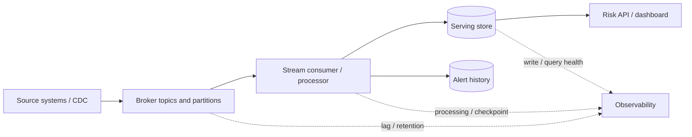
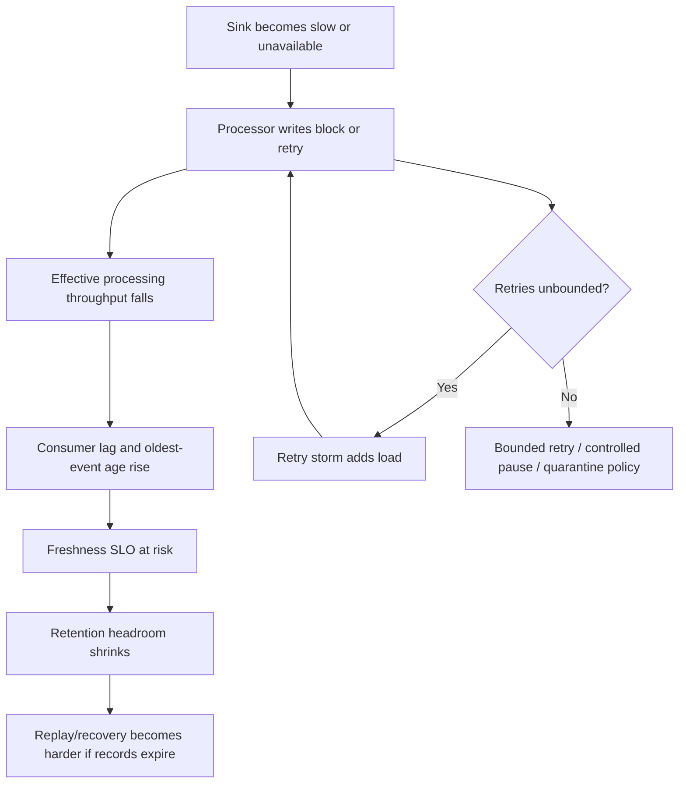

# 07 — Late Events, Backpressure, and Stream Failure Modes

## 1. Title and purpose

This lesson teaches how to diagnose and manage the ways a continuous data pipeline behaves when events arrive late or out of order, components fall behind, downstream systems slow down, or a component fails. It progresses from beginner concepts to incident diagnosis, recovery design, and capacity/resilience trade-offs.

The objective is not to eliminate every delay or failure. It is to make the system observable, limit fault propagation, preserve the required correctness guarantees, recover within an acceptable time, and avoid mitigations that turn a small incident into a larger one.

> **Roadmap source-of-truth note.** The module roadmap states that the topic files were empty when it was authored. The fictional scenario, calculations, exercises, examples, and thresholds in this lesson are proposed learning guidance—not existing repository requirements, production benchmarks, or universal targets. This lesson is vendor-neutral. Verify retry, checkpoint, transaction, retention, availability, and replay guarantees against the exact technology and version selected.

## 2. Module position and prerequisites

### 2.1 Position in Stage 2D

This is Topic 7, the final topic in `Stage 2D — Data Architecture/09-Streaming-and-Real-Time-Data-Architecture/`.

The recommended sequence is:

1. `01-real-time-use-cases-and-latency-budgets.md`
2. `02-event-brokers-topics-partitions-and-retention.md`
3. `03-event-time-processing-ordering-and-watermarks.md`
4. `04-stream-processing-state-and-delivery-semantics.md`
5. `05-cdc-event-backbones-and-replay.md`
6. `06-real-time-serving-stores-and-materialized-views.md`
7. `07-late-events-backpressure-and-stream-failure-modes.md`

Topic 7 applies the preceding topics to imperfect operation: latency budgets, broker behavior, event-time semantics, processor state and delivery, CDC/replay, and serving-store behavior. It does not replace those lessons or prescribe one universal retry or architecture pattern.

### 2.2 Prerequisites

You should be able to:

- Define end-to-end latency and freshness objectives, including measurement boundaries and percentiles.
- Explain broker topics, partitions, offsets, retention, and the consequences of key distribution.
- Distinguish event time, ingestion time, and processing time; explain out-of-order and late events, windows, and watermarks.
- Explain stateful processing, checkpoint/recovery, at-least-once delivery, duplicate effects, and idempotency.
- Describe CDC, snapshot-plus-stream handoff, replay positions, retention limits, and reconciliation.
- Explain serving-store access patterns, view freshness, stale writes, and the difference between a derived view and a source of truth.

### 2.3 Scope boundaries

This lesson focuses on diagnosis and resilience decisions. Topic 3 owns the deeper treatment of event-time and watermarks; Topic 4 owns detailed state and delivery semantics; Topic 5 owns replay planning; Topic 6 owns serving-store selection and view maintenance. This lesson connects those concepts and shows how they interact during failures.

## 3. Learning objectives

By the end of this lesson, you should be able to:

1. Distinguish late events, out-of-order events, duplicate events, consumer lag, backlog, backpressure, and saturation.
2. Explain how a bottleneck at one component can propagate through the pipeline.
3. Calculate backlog growth and approximate drain time using explicitly stated arrival and processing rates.
4. Distinguish a temporary burst from a sustained capacity deficit using rates, backlog slope, oldest-event age, and recovery behavior.
5. Diagnose producer, broker, partition, consumer, checkpoint, schema, sink, network, external-call, retention, and replay failures.
6. Design bounded retries with backoff and jitter, quarantine/dead-letter handling, alerting, and controlled replay.
7. Preserve correctness through duplicates, out-of-order updates, state recovery, sink retries, and reconciliation.
8. Trace an event across timestamps, IDs, source positions, offsets, checkpoints, and sink visibility.
9. Evaluate trade-offs among availability, latency, correctness, throughput, and cost.
10. Produce a failure-mode analysis with immediate mitigation, durable remediation, and explicit correctness risks.

## 4. Readiness check

| Question | A ready answer should mention |
|---|---|
| What is the difference between event lateness and consumer lag? | Lateness compares event time with a defined processing/watermark context; lag describes unprocessed stream work or delay. |
| Why can a downstream store cause backlog upstream? | Slow writes reduce effective consumer throughput; queues grow and flow control may slow upstream components. |
| Does rising offset lag always mean the processor is under-provisioned? | No. A sink outage, hot partition, rebalance, external call, retry loop, or broker/network issue may be responsible. |
| Why can retrying a failed event be dangerous? | The failure may be persistent; retries can amplify load, delay healthy events, and duplicate effects if writes are not idempotent. |
| What does a dead-letter queue solve—and not solve? | It isolates selected failures for inspection/reprocessing; it does not itself repair data or guarantee safe recovery. |
| What must be checked before replay? | Required history and source positions, transformation/state semantics, sink idempotency, replay capacity, side effects, and reconciliation. |
| Why is low query latency not enough? | A serving view may be stale or incomplete even when reads are fast. |

If these are unclear, review Topics 1–6 before proceeding.

## 5. Beginner foundations: lateness, lag, and backpressure

### 5.1 One fictional example (illustrative)

Throughout this lesson, use **Northbridge Bank**, a fictional organization. Account and transaction changes flow through an event backbone to a stream processor. The processor updates a current-risk serving view and an alert-history store. A dashboard queries those views.

This scenario is illustrative only. It is not a real bank, benchmark, production target, or requirement from the repository.



Lag can build at several boundaries: source capture, producer-to-broker delivery, broker-to-consumer processing, processor state/checkpointing, writes to a serving store, and downstream consumers. Measure the stages separately rather than relying on one overall “pipeline healthy” signal.

### 5.2 Late, out-of-order, duplicate, and malformed events

These terms describe different conditions:

- **Late event:** an event arrives after the time expected by a processing policy or after a window/watermark has advanced. “Late” must be defined relative to the event-time and lateness policy.
- **Out-of-order event:** an event is observed in an order different from the relevant source, event-time, or business order. A later arrival may represent an older source version.
- **Duplicate event:** the same logical event is delivered or applied more than once. A retry may be legitimate transport behavior, not necessarily a broker defect.
- **Malformed/poison event:** an event cannot be processed successfully under the current consumer logic, schema, or validation rules. It may fail every retry until the event or code is corrected.
- **Clock/timestamp issue:** source clocks can be skewed, timestamps may have different meanings, time zones may be mishandled, or a timestamp may be missing/incorrect. These issues can make a healthy event look late or can misorder data.

Topic 3 explains event-time semantics, windows, and watermarks in depth. Here, the operational point is to avoid treating every old timestamp as a broker-lag problem. Trace the event's source time, ingestion time, processing time, source version/position, and serving visibility.

### 5.3 Lag and backlog

**Consumer lag** is the amount of stream work a consumer has not yet processed or committed. Depending on the system, it may be measured as offset/position distance, records, bytes, or elapsed time. These measures are not interchangeable.

- **Offset/position lag:** distance between the latest available position and the consumer's committed/applied position. Exact interpretation depends on the broker and whether positions count records, bytes, or other units.
- **Record backlog:** number of records waiting to be processed.
- **Byte backlog:** volume of queued data; useful when event sizes vary.
- **Time lag / oldest-event age:** age of the oldest unprocessed event, measured using a defined timestamp and clock policy.
- **Processing delay:** time an event spends in a specific stage.
- **End-to-end freshness delay:** time from a defined source/event boundary until the expected change is queryable by the consumer.

A record count alone may be misleading. A million tiny events and a million large payloads impose different storage and processing costs. Likewise, offset lag can look small while a single old event blocks progress or a hot partition remains behind.

### 5.4 Throughput mismatch and queue growth

Let:

- \(\lambda\) = incoming arrival rate, in events per second.
- \(\mu\) = sustainable processing rate, in events per second.
- \(B(t)\) = backlog, in events, at time \(t\).

When arrival and processing rates are reasonably stable over a time interval, and processing capacity is the limiting factor:

\[
\Delta B \approx \max(0, \lambda - \mu) \times \Delta t
\]

If \(\lambda > \mu\), backlog grows. If \(\mu > \lambda\), the system can drain existing backlog, assuming no other bottleneck and that capacity is available to that work. If the rates are equal, backlog does not drain; any existing backlog remains unless arrival temporarily falls below capacity.

This simple model is a planning approximation. Real pipelines have bursts, variable record sizes, partition skew, retries, batching, pauses, and multiple bottlenecks.

### 5.5 Worked backlog example (illustrative assumptions)

Assume for learning purposes:

- Incoming rate: **12,000 events/s**.
- Effective processing rate during an incident: **9,000 events/s**.
- Incident duration: **10 minutes = 600 seconds**.
- No backlog existed at the start.
- The rates are average sustained rates for the interval, and no other bottleneck changes the arithmetic.

The deficit is:

\[
12{,}000 - 9{,}000 = 3{,}000 \text{ events/s}
\]

Backlog added over 600 seconds:

\[
3{,}000 \text{ events/s} \times 600 \text{ s}
= 1{,}800{,}000 \text{ events}
\]

The approximate backlog at the end is **1.8 million events**.

Now assume processing capacity recovers to **15,000 events/s** while arrivals return to **12,000 events/s**. The net drain rate is:

\[
15{,}000 - 12{,}000 = 3{,}000 \text{ events/s}
\]

Approximate time to drain the backlog:

\[
\frac{1{,}800{,}000 \text{ events}}{3{,}000 \text{ events/s}}
= 600 \text{ s} = 10 \text{ minutes}
\]

This drain-time estimate assumes sustained rates, no new interruption, no growing record size, no partition bottleneck, and no additional work caused by retries or state restoration. Real drain time must be measured and can be longer. These values are illustrative arithmetic, not a universal capacity target.

### 5.6 Backpressure and saturation

**Backpressure** is a flow-control response that slows upstream work when a downstream component cannot accept or process work at the incoming rate. Depending on the architecture, it may propagate through bounded queues, blocked writes, reduced demand, or explicit rate limiting.

**Saturation** occurs when a constrained resource is at or near its useful capacity—such as CPU, disk I/O, network bandwidth, connection pools, broker partitions, sink write capacity, or an external service quota.

A common chain:

1. A serving store's write latency rises.
2. The processor spends more time waiting on sink writes.
3. Effective processing throughput falls.
4. Consumer lag and event age increase.
5. Broker retention time is consumed while records wait.
6. Freshness objectives are breached; replay headroom shrinks.
7. If retries are unbounded, more work is generated and the system may fail more broadly.

Backpressure can protect correctness and prevent memory exhaustion, but it does not create capacity. It makes a bottleneck visible and slows upstream flow. If queues are unbounded, a temporary slowdown may instead lead to memory/disk exhaustion.

### 5.7 Temporary burst versus sustained shortage

A **temporary burst** is a short period in which arrivals exceed processing, followed by a return to a rate that lets the system drain backlog before freshness or retention constraints are breached.

A **sustained capacity shortage** occurs when the long-run arrival rate equals or exceeds sustainable processing capacity, so backlog does not trend down under normal conditions.

Use several signals together:

| Signal | Temporary burst often looks like | Sustained shortage often looks like |
|---|---|---|
| Arrival rate | Short spike, then returns to baseline | Persistently elevated or normal rate exceeds capacity |
| Processing rate | Remains healthy or recovers | Plateaus below arrivals |
| Backlog slope | Rises, then trends down | Keeps rising or never drains |
| Oldest-event age | Peaks, then declines | Continues increasing |
| CPU / I/O / sink latency | May spike briefly | Remains saturated or degraded |
| Recovery headroom | Capacity exceeds arrivals long enough to drain | No spare capacity remains to drain |
| Retention risk | Backlog stays within available history | Oldest required records approach expiry |

Do not scale blindly. If a single partition is hot, adding processor instances may not help. If the sink is saturated, more consumers can overload it further. First identify the limiting stage.

## 6. Intermediate diagnosis and failure propagation

### 6.1 Trace the pipeline boundary by boundary

For a representative event, record or correlate:

- Stable event ID or source primary key.
- Source transaction/commit time and source log position/version, when available.
- Event timestamp and timestamp semantics.
- Producer send attempt and broker acknowledgement.
- Broker topic/partition/offset or equivalent position.
- Consumer receive time and processing start/end.
- Retry count and error category.
- Processor state/checkpoint identifier or committed progress.
- Sink write attempt, result, and destination version/visibility.
- First time a verification query can read the expected version.

Not every technology exposes all fields. Define the available correlation contract before an incident. Use trace IDs or event IDs where possible; do not log sensitive payloads merely to improve debugging.

### 6.2 Interpret timestamps carefully

A timestamp only helps when its meaning is explicit. For example:

- `event_time`: when the business event is said to have happened.
- `source_commit_time`: when the source committed it.
- `broker_publish_time`: when the broker accepted it, if available.
- `consumer_receive_time`: when the consumer observed it.
- `processing_start/end`: when computation began/ended.
- `sink_write_time`: when the destination accepted the write.
- `queryable_time`: when a verification query observed the expected state.

Differences between these timestamps can reveal where delay accumulates, but clocks may not be synchronized. Prefer monotonic elapsed-time measurement within a component where appropriate, and correlate timestamps with source positions/versions. Do not subtract timestamps from unsynchronized clocks and present the result as exact truth.

### 6.3 Causal fault propagation



This is one possible chain, not the only one. A sink failure may be isolated by buffering or circuit breakers, but the backlog still has to live somewhere and remain within retention and capacity limits.

### 6.4 Common root-cause families

**Producer/source path**
- Source outage or CDC capture stopped.
- Network, credentials, quota, or serialization problem prevents publication.
- Producer retries delay publication or create duplicate sends if idempotence is not guaranteed.

**Broker/partition path**
- Broker/partition unavailable or under-replicated according to the chosen system's behavior.
- Partition skew creates one hot partition.
- Retention removes records before a lagging consumer can read them.
- Network problems cause timeouts and ambiguous acknowledgements.

**Consumer/processor path**
- Consumer crash, rebalance, repeated restart, or deployment regression.
- CPU/memory pressure, garbage collection, inefficient serialization, or expensive enrichment.
- Slow external call or connection-pool exhaustion.
- Checkpoint/state restore failure or repeated checkpoint timeout.
- Poison message or schema incompatibility blocks progress.
- Retry policy repeatedly attempts a permanent error.

**Sink/serving path**
- Database outage, rate limit, connection saturation, write amplification, or lock contention.
- Store accepts writes but visibility/replication is delayed.
- Partial update, stale upsert, or duplicate increment corrupts a derived view.
- Cache/index path is behind the primary serving view.

**Operations/recovery path**
- Alerting does not distinguish lag from freshness.
- Replay starts without verifying retention, idempotency, side effects, or capacity.
- Replay competes with live traffic and causes a second outage.
- Recovery is declared complete without reconciliation.

### 6.5 Useful signals and their limitations

| Signal | What it can reveal | What it cannot prove alone |
|---|---|---|
| Consumer lag / offset distance | Consumer is behind a position frontier | Exact user-visible freshness or root cause |
| Oldest unprocessed event age | How old queued work has become, if timestamp semantics are sound | Whether every missing event is represented |
| Input/output records per second | Throughput and imbalance | Correctness or whether records are being duplicated |
| Queue depth / buffer size | Work waiting at a boundary | Whether the queue is safely bounded or records will be retained long enough |
| Processor CPU/memory | Resource pressure | That CPU is the bottleneck; work may be blocked on I/O |
| Sink latency/error rate | Downstream degradation | Whether the processor's state and committed offsets remain consistent |
| Retry count / retry age | Repeated failures and delay | Whether retries are safe or the error is transient |
| Checkpoint duration/failure | State/progress persistence problems | Whether external side effects were rolled back |
| DLQ/quarantine rate | Events rejected or deferred | That quarantined events are harmless or will eventually be repaired |
| Freshness distribution | End-to-end user-visible delay | Exact cause without stage-level timing |
| Reconciliation discrepancy | Potential missing/duplicate/wrong data | Which component caused it without further tracing |

### 6.6 Diagnosis sequence

1. **Establish impact:** which consumer, topic/partition, key range, view, and business action are affected?
2. **Confirm symptom type:** late data, rising lag, no progress, errors, wrong output, or unavailable service?
3. **Check rates and slopes:** input rate, successful output rate, backlog slope, oldest-event age, and retry rate.
4. **Locate first degraded boundary:** source/capture, broker, consumer, external dependency, checkpoint, or sink.
5. **Inspect a sample event end to end:** compare IDs, positions, timestamps, schema, retry history, and destination visibility.
6. **Check correctness hazards:** duplicate writes, stale updates, partial commits, skipped offsets, lost history, and side effects.
7. **Choose a bounded mitigation:** reduce harmful load, isolate bad events, scale the actual bottleneck, or pause safely.
8. **Validate recovery:** progress resumes, freshness improves, the sink remains healthy, and reconciliation passes.
9. **Record durable remediation:** capacity, partitioning, contract, timeout, retry, observability, or recovery changes.

## 7. Failure-mode table / FMEA

The table is a lightweight failure-mode and effects analysis. Severity and priority depend on business impact; the table does not assign universal numeric risk scores.

| Failure mode | Symptom | Likely cause | Detection signal | Immediate mitigation | Durable fix | Correctness risk |
|---|---|---|---|---|---|---|
| Producer/source outage | No new events; lag may appear flat while freshness worsens | Source unavailable, CDC stopped, auth or network issue | Source heartbeat, capture position, publish rate | Confirm scope; restore source/capture path; communicate freshness status | Source health checks, tested reconnect, ownership and alerting | Missing source interval; false “healthy” if only consumer lag is watched |
| Broker or partition availability issue | Publish/consume errors or stalled partition progress | Broker/node/replica/network issue | Broker health, partition availability, producer/consumer errors | Follow platform failover procedure; avoid aggressive retry amplification | Resilience testing, replication/placement review, capacity and runbooks | Possible duplicate sends after ambiguous acknowledgements; retention risk |
| Skewed/hot partition | One partition lags while others are current | Uneven keys, hot entity, partition count/key choice | Per-partition lag and throughput distribution | Reduce hot-key pressure if safe; protect sink; avoid blind fleet scaling | Review key design, partition strategy, load distribution, hot-key handling | Per-key ordering changes if repartitioned carelessly |
| Consumer crash/rebalance loop | Repeated restarts, progress stalls, lag rises | Crash, deployment bug, resource pressure, unstable membership | Restart count, rebalance rate, logs, checkpoint status | Roll back known-bad release; stabilize membership/resources | Load tests, safe deployment, resource sizing, failure injection | Reprocessing and duplicate effects |
| Poison message | Same event repeatedly fails; partition progress may stop | Invalid payload, unexpected enum, code bug, schema mismatch | Repeated same event ID/offset and same error | Bounded retries; quarantine with metadata if policy permits; preserve ordering implications | Contract validation, compatible rollout, repair tooling and replay procedure | Skipping it can lose a business event; blocking it can stall a partition |
| Schema incompatibility | Deserialization or validation errors after rollout | Producer/consumer contract drift | Error class by schema/version, failed-event samples | Roll back or route safely to quarantine; stop incompatible rollout | Compatibility policy, consumer-driven tests, versioned contracts | Silent field/default changes can corrupt semantics |
| Checkpoint/state recovery failure | Restart loop or repeated replay from an older point | State corruption, incompatible state schema, checkpoint storage issue | Checkpoint duration/failure, restore errors, repeated offsets | Stabilize job; preserve recovery artifacts; follow known-good restore plan | Tested state migration/restore, checkpoint monitoring, runbooks | Lost or duplicated state effects; checkpoint may not cover external sink writes |
| Slow external call | Throughput collapses, threads/connections wait | Dependency latency, quota, connection pool exhaustion | Call latency, timeout rate, pool wait, per-stage duration | Apply timeout, bounded concurrency, circuit breaker where appropriate | Cache or batch if semantically valid; dependency SLO and capacity contract | Timeouts may occur after remote side effect succeeded |
| Network impairment | Timeouts, retries, intermittent acknowledgements | Packet loss, DNS, routing, TLS/auth path | Network telemetry, timeout patterns across components | Reduce retry pressure; restore network path; avoid assuming request did not succeed | Redundant paths where justified, network tests, timeout/idempotency design | Ambiguous completion can cause duplicate publication/writes |
| Sink outage or saturation | Sink errors/latency rise; processor blocks; lag grows | Store outage, overload, locks, connection exhaustion | Sink availability, write latency, error rate, queue depth | Shed noncritical work, buffer within safe limits, pause/slow consumption, use approved fallback | Capacity planning, bulkheads, tested failover, write-path tuning | Lost updates if offsets advance before durable writes; duplicates on retry |
| Retry storm | Load and errors increase together | Immediate/unbounded retries, synchronized clients | Retry rate, request rate, dependency saturation | Bound concurrency and attempts; add backoff/jitter; stop unsafe retry loop | Retry budgets, circuit breakers, idempotency, fault-injection tests | Duplicate effects and cascading outage |
| Duplicate effects | Counts/alerts/aggregates too high | At-least-once delivery, retry after ambiguous outcome, replay | Duplicate event IDs, repeated state transitions, reconciliation | Stop unsafe replay; deduplicate or recompute affected view | Idempotent sink contract, event identity, version checks, reconciliation | Business totals or external actions may be wrong |
| Late/out-of-order events | Values regress or windows change after initial output | Delayed source, partitioning, clock skew, retries | Event-time/processing-time gaps, source-version regressions | Apply documented late-event policy; reject stale state update where valid | Correct watermarks, version/order contract, correction/retraction support | Wrong aggregates or stale entity state |
| Retention expiry | Consumer requests unavailable history or cannot catch up | Lag exceeded broker/source-log retention | Oldest available position, retention alarms, source log position | Stop pretending replay is complete; recover from archive/snapshot if possible | Retention based on outage + recovery + margin; tested restore source | Irrecoverable gap if no authoritative reload/archive exists |
| Replay overload | Live freshness degrades during backfill | Replay exceeds spare sink/processor capacity | Replay rate, live lag, sink latency, freshness SLO | Throttle/pause replay; reserve live capacity | Separate rebuild target, quotas, capacity model, cutover plan | Stale overwrites, duplicates, or side effects |
| Cache/index drift | API results differ from primary serving view | Invalidation lag/failure, async index updates | Version mismatch, cache age, sampled comparison | Invalidate/rebuild affected cache/index; disclose staleness | Versioned cache keys, bounded TTL, reconciliation and delete propagation | Stale or deleted data remains visible |
| Clock/timestamp defect | Events appear future-dated or extremely late | Clock skew, unit/time-zone bug, wrong timestamp field | Timestamp distribution, clock monitoring, source-position comparison | Avoid automated destructive action based only on suspect time | Timestamp contract, clock synchronization, validation and anomaly alerts | Incorrect window assignment or false incident diagnosis |

### 7.1 Prioritizing mitigations

Choose the mitigation based on the failure's actual location and business risk. For example:

- Adding consumers helps only when the workload can be parallelized and downstream capacity exists.
- Increasing retries helps only when errors are transient and the retry rate is bounded.
- Skipping a poison event may restore throughput but can violate completeness or per-key ordering.
- Increasing retention can protect replayability but does not repair already expired history.
- Switching to a fallback store may preserve availability but can change consistency or freshness.
- Pausing a consumer may protect a sink but consumes retention headroom.

Record the accepted correctness trade-off whenever a mitigation intentionally delays, rejects, drops, or substitutes data.

## 8. Recovery, retry, quarantine, replay, and reconciliation strategies

### 8.1 Retry the failure class, not the hope

Retries are appropriate for failures likely to be transient, such as brief network interruptions or a dependency recovering from a short overload. They are not a universal fix for invalid data, schema incompatibility, permission errors, or a permanently failing business rule.

A retry policy should define:

- Which error classes are retryable.
- Maximum attempts and/or maximum elapsed retry time.
- Exponential backoff policy and a maximum delay.
- Random jitter to avoid synchronized retry waves.
- Concurrency limits and a retry budget.
- Timeout behavior and whether the operation may have succeeded remotely.
- The terminal action after the budget is exhausted.
- Metrics and alert ownership.

A common conceptual backoff form is:

\[
d_n = \min(d_{\max}, d_0 \times 2^n)
\]

where \(d_0\) is an initial delay, \(d_{\max}\) is a cap, and \(n\) is the retry index. Add jitter according to the chosen policy so many clients do not retry at the same instant. This equation is a pattern, not a required implementation; use the product's documented policy where appropriate.

**Bounded retries** prevent one operation from consuming unlimited resources. A retry limit must not silently mean data loss: after the limit, the system needs a documented quarantine, pause, operator repair, or other safe terminal path.

### 8.2 Distinguish retryable and non-retryable failures

| Failure class | Typical policy to evaluate | Important caution |
|---|---|---|
| Short transient network error | Bounded retry with backoff/jitter | Request may have succeeded despite timeout; require idempotency or outcome lookup |
| Temporary rate limit/overload | Respect server guidance; bounded retry and concurrency control | More retries can worsen overload |
| Destination temporarily unavailable | Retry within budget, then pause/buffer/quarantine according to architecture | Ensure buffered work remains within capacity and retention |
| Invalid schema or malformed payload | Do not retry unchanged payload indefinitely; quarantine for diagnosis | Preserve the event and schema/error metadata |
| Authorization/permission error | Alert and repair credentials/policy; retry only after state changes | Repeated attempts can hide the real configuration issue |
| Business validation rejection | Route to an explicitly defined rejection workflow | Do not relabel a valid business rejection as infrastructure failure |
| Unknown/ambiguous completion | Use idempotency key, source version, or outcome lookup before repeating | Duplicate external side effect is possible |

### 8.3 Quarantine and dead-letter paths

A **dead-letter queue (DLQ)** or **quarantine path** isolates events that cannot be processed under the current policy. It is a diagnostic and recovery mechanism, not a place where data can be forgotten.

A quarantine record should preserve, where policy allows:

- Original event bytes or a safely recoverable reference.
- Event ID, source key, source position, topic/partition/offset or equivalent.
- Schema/version and content type.
- Failure category, error code, first/last failure time, attempt count.
- Consumer/transform version and trace/correlation ID.
- Data classification and access controls.
- Replay eligibility, repair status, and disposition.

Avoid logging unrestricted sensitive payloads into a less-secure DLQ. If storing raw data is not allowed, store a governed reference plus enough metadata for authorized recovery.

**Ordering caveat:** moving a failed event aside and continuing may let later events for the same key pass it. That is acceptable only if the business contract allows it or if the consumer can safely reconcile/reorder later. For strict per-key ordering, pause the affected key/partition or use a repair mechanism that preserves the ordering invariant.

### 8.4 Consumer progress, sink writes, and duplicate safety

A dangerous sequence is:

1. Consumer reads event E.
2. Sink write fails or times out ambiguously.
3. Consumer commits progress past E.
4. E is not actually durable in the sink.

This can lose the event from the consumer's recovery path. Another dangerous sequence is:

1. Consumer writes E successfully.
2. Process crashes before progress/checkpoint commits.
3. Consumer restarts and processes E again.
4. Sink applies a duplicate effect.

The correct sequence depends on the system's transaction boundary and connector semantics. Do not assume a checkpoint atomically includes an arbitrary external sink.

Mitigations to evaluate:

- Idempotent state-setting writes.
- Stable event IDs and destination deduplication.
- Source-version guards to reject stale updates.
- A transactional outbox/inbox or equivalent pattern where justified.
- Supported transactions spanning the relevant boundary.
- Durable write acknowledgement before committing consumer progress, where compatible with the framework.
- Reconciliation to detect gaps that remain possible.

The architecture must document exactly what is atomic and what is at-least-once.

### 8.5 Recovery after consumer or checkpoint failure

A safe high-level recovery sequence:

1. **Stabilize:** stop crash loops and avoid multiple competing consumers writing the same state outside the intended ownership model.
2. **Capture evidence:** preserve error logs, checkpoint metadata, source positions, schema versions, and sink status.
3. **Determine the recovery point:** identify the last valid checkpoint/progress marker and what it actually covers.
4. **Inspect side effects:** establish whether writes after that point may already have reached the sink.
5. **Choose a recovery mode:** restore state, restart from a valid checkpoint, replay a bounded range, rebuild a derived view, or reload from authoritative source.
6. **Protect idempotency:** enable event-ID deduplication, version guards, or another safe write policy before reprocessing.
7. **Protect capacity:** throttle recovery and reserve capacity for live traffic.
8. **Validate:** compare source positions, record counts, key sets, versions, totals, and business invariants.
9. **Resume normal service:** only after lag trends down and correctness checks pass.
10. **Document residual uncertainty:** if source history expired or external side effects cannot be proven, explicitly state the gap and business disposition.

### 8.6 Retention and replay feasibility

Replay is possible only if the required input history or an equivalent authoritative reconstruction source still exists. Broker retention may be shorter than the time needed to detect, diagnose, repair, and rebuild. CDC source-log retention can expire independently of broker retention.

Plan retention against a scenario such as:

```text
maximum detection delay
+ diagnosis and approval time
+ repair / restore time
+ replay or rebuild time
+ safety margin
```

These terms are planning categories, not an equation that guarantees feasibility by itself. Validate the largest expected outage, data volume, throughput, and source-log constraints. A consumer that has fallen behind must be monitored before the oldest required position expires.

If history has expired, do not claim a complete replay. Evaluate an authoritative snapshot/reload, archived events, or domain-specific recovery. Snapshot-plus-stream handoff must be coordinated so changes during the snapshot are not lost or applied twice; Topic 5 covers that design.

### 8.7 Replay without a second incident

Before replay:

- State the reason, scope, source positions/time interval, and desired view version.
- Confirm input history availability and schema/transform compatibility.
- Decide whether the target is a live view, isolated rebuild, or separate generation.
- Define event identity, deduplication, version handling, deletes, and correction behavior.
- Suppress or protect external side effects such as alerts, payments, or notifications.
- Set a replay rate and concurrency cap based on measured spare capacity.
- Monitor live and replay lag separately where possible.
- Define pause conditions if live freshness, sink latency, error rate, or resource pressure degrades.
- Reconcile the rebuilt output before cutover.
- Keep a rollback path and record the final source position.

Replay can be correct but operationally unsafe if it starves live traffic. It can also be fast but incorrect if it replays non-idempotent effects.

### 8.8 Reconciliation after recovery

Reconciliation should test the business meaning of the data, not only whether the job is running.

Useful checks include:

- Input source-position coverage and known gaps.
- Counts by source interval, partition, entity type, or status.
- Key-set comparison for missing/extra entities.
- Source-version comparison for current-state records.
- Aggregate totals over identical filters and time boundaries.
- Duplicate event IDs and repeated side effects.
- Delete/tombstone propagation.
- Independent record-level recomputation on a sample.
- Business invariants and explicit tolerance rules.

A count match is necessary in some cases but not sufficient: two missing records and two extra records can produce the same count. Aggregate totals can also conceal offsetting errors. Use complementary checks.

## 9. Advanced capacity, resilience, and correctness trade-offs

### 9.1 Capacity planning beyond one average rate

A production capacity model should consider:

- Normal, peak, and burst arrival rates.
- Sustainable processing rate under representative event sizes and transformation complexity.
- Partition count, key skew, and maximum useful parallelism.
- Sink write capacity and query load.
- External dependency limits and tail latency.
- Checkpoint/restore overhead.
- Retry amplification.
- Replay/backfill traffic competing with live traffic.
- Retention headroom and maximum tolerable outage.
- CPU, memory, network, storage, and operational cost.

Average throughput is not enough if one partition or one dependency limits progress. Measure per-partition and per-stage rates. Capacity tests should include realistic key distributions, event-size distributions, failure injection, and recovery.

### 9.2 Backlog drain and headroom

A pipeline must have spare effective capacity to drain backlog after a burst or outage. If normal arrivals are 12,000 events/s and post-recovery capacity is 12,000 events/s, the system can keep up but cannot drain any backlog. To recover freshness, effective capacity must exceed current arrivals for long enough to drain accumulated work.

When estimating drain time:

\[
t_{\text{drain}} \approx \frac{B_0}{\mu - \lambda}
\quad \text{only when } \mu > \lambda
\]

where \(B_0\) is the existing backlog, \(\mu\) is sustainable processing capacity, and \(\lambda\) is the continuing arrival rate. If \(\mu \le \lambda\), this model gives no finite drain time under those rates. Use measured rates and state the assumptions.

### 9.3 Partition skew and ordering

Adding consumers cannot necessarily speed up a single hot partition if the system assigns a partition to one active consumer at a time or otherwise limits parallelism. Changing keys or partitioning may improve distribution, but it can change ordering guarantees and state locality.

Evaluate:

- Whether ordering is required globally, per partition, per key, or not at all.
- Whether a hot key can be split without breaking business semantics.
- Whether key salting requires a later merge/reconciliation stage.
- Whether repartitioning preserves or changes the interpretation of offsets and state.
- Whether state migration and replay can recover the same logical result.

Do not fix skew by changing the key without documenting the ordering and state consequences.

### 9.4 Availability, latency, correctness, throughput, and cost

These objectives can conflict:

- **Availability:** continue serving some output during a component failure.
- **Latency/freshness:** keep responses quick and data current.
- **Correctness:** avoid loss, duplication, stale overwrites, and invalid ordering.
- **Throughput:** process incoming and recovery traffic.
- **Cost:** avoid excessive compute, storage, replication, and on-call complexity.

Examples of explicit trade-offs:

- Pause consumption to protect a sink: safer for the sink, but lag and freshness worsen.
- Quarantine a poison event and continue: improves progress, but may violate per-key completeness or ordering.
- Serve a stale cached view during outage: preserves availability, but only if stale reads are acceptable and disclosed.
- Increase parallelism: may raise throughput, but can overload the sink or change ordering assumptions.
- Replay at maximum rate: shortens the theoretical rebuild, but can starve live traffic.
- Reject late data: bounds state and latency, but may reduce completeness unless corrections are handled elsewhere.

Record the business decision and fallback behavior rather than describing one dimension as universally dominant.

### 9.5 Retry budgets and circuit breakers

A retry budget caps the amount of additional work generated by failures. A circuit breaker can stop calls to a dependency that is failing, allowing it time to recover and preventing each incoming event from creating another slow request. Neither mechanism repairs the dependency or guarantees that an ambiguous request had no side effect.

Define:
- Failure classes and error-rate/time window that trigger protective behavior.
- Maximum concurrent requests and outstanding work.
- Open/half-open/closed behavior if a circuit breaker is used.
- What happens to events while calls are paused: bounded buffer, retry schedule, quarantine, or controlled consumer pause.
- How the system resumes without releasing a synchronized burst.
- Which alerts indicate that human intervention is required.

### 9.6 Graceful degradation and load shedding

If the pipeline cannot satisfy every workload during an incident, classify work by business priority:

- Critical events required for correctness or safety.
- Important updates with a bounded delay tolerance.
- Optional enrichments or analytics that can be delayed.
- Nonessential notifications or expensive secondary projections.

Potential strategies include pausing optional projections, serving a clearly labeled stale view, reducing nonessential enrichment, or routing critical decisions to an authoritative path. Do not drop events or weaken validation without a documented loss policy and audit trail.

### 9.7 Observability and alert design

Alert on symptoms tied to user or business outcomes, then use component metrics for diagnosis. A useful dashboard may include:

- End-to-end freshness p50/p95/p99 and missing/unqueryable event rate.
- Consumer lag by topic/partition/consumer and oldest-event age.
- Input/output rates and backlog slope.
- Processor time per stage, CPU/memory, restarts, and checkpoint health.
- Sink write latency/errors, connection-pool wait, and store capacity.
- External-call latency, timeouts, rate limits, and retry rate.
- Schema-validation failures, poison-message counts, and quarantine age.
- Retention headroom and source-log position.
- Replay rate, live-vs-replay resource use, and cutover progress.
- Duplicate/stale-write counters and reconciliation discrepancy.

Avoid universal thresholds. Establish baselines, derive alert thresholds from the business SLO and retention window, and test alert behavior under controlled faults. A high lag number may be harmless for a batch consumer but urgent for a risk-decision path.

### 9.8 Incident roles and evidence

For a high-impact incident, separate roles where practical:

- Incident lead: coordinates impact, decisions, and communications.
- Pipeline operator: restores service and monitors lag/capacity.
- Data correctness owner: determines replay, deduplication, and reconciliation acceptance.
- Business/domain owner: approves risk trade-offs such as stale output or delayed alerts.

Preserve evidence before cleanup: source positions, checkpoint metadata, representative event IDs, schema versions, error samples, and sink state. Avoid making irreversible changes before understanding whether the sink accepted the event.

## 10. Worked incident scenario and response walkthrough

### 10.1 Scenario and assumptions

The following is an **illustrative** Northbridge Bank incident, not a production benchmark or repository requirement.

The risk processor normally consumes account and transaction events and updates a current-risk view. A serving-store deployment introduces slower writes. After several minutes, event freshness worsens. A retry policy in one component is too aggressive, and one partition is also hotter than average.

Assume the following observed symptoms:
- Input rate is near its normal level.
- Processor output rate falls below input rate.
- Sink write latency and timeout rate rise.
- Consumer lag and oldest-event age rise.
- One partition's lag grows faster than others.
- Retry rate increases as sink timeouts occur.
- The current-risk view is responsive to queries but not fully fresh.

These signals suggest a downstream bottleneck with a skewed partition and retry amplification. They do not by themselves prove the exact root cause; the incident team must correlate timing and errors.

### 10.2 Propagation

```mermaid
sequenceDiagram
    participant SRC as Source / CDC
    participant BR as Broker
    participant PR as Processor
    participant ST as Serving store
    participant API as Risk API
    SRC->>BR: Account/transaction event
    BR->>PR: Deliver event
    PR->>ST: Version-aware view update
    ST-->>PR: Slow response / timeout
    PR->>PR: Retry or wait; effective throughput drops
    BR-->>PR: More events accumulate behind progress
    API->>ST: Read current-risk view
    ST-->>API: Fast query, but older version
```

A timeout is ambiguous: the store may have applied the write but the response may not have reached the processor. Repeating a non-idempotent update could double-apply it. The incident team must therefore consider sink outcome and idempotency before increasing retries or replaying events.

### 10.3 Response walkthrough

**Step 1 — Confirm user impact and establish a timeline**

- Identify which accounts, consumers, partitions, and serving views are affected.
- Compare end-to-end freshness with the Topic 1 objective.
- Check query latency separately; do not infer freshness from a fast API response.
- Capture source position, broker position, processor progress/checkpoint, and sink version for a few representative event IDs.

**Step 2 — Locate the first degraded boundary**

- Compare input/output rates by stage.
- Inspect sink latency, errors, and connection pool metrics.
- Compare lag by partition to identify skew.
- Inspect retry counts and whether timeouts began before or after sink latency rose.
- Verify that source capture and broker publication are still advancing.

**Step 3 — Stabilize without hiding data loss**

- Stop the retry storm by applying the defined retry budget/backoff or temporarily disabling unsafe retries.
- Reduce replay or optional enrichment work if it competes with live traffic.
- If the sink is unsafe to write to, pause or slow consumption according to the recovery policy while monitoring retention headroom.
- Do not commit consumer progress past writes that are not known to be durable under the selected connector's semantics.
- Communicate that the view is stale if that is the actual user-visible state.

**Step 4 — Repair the bottleneck**

- Roll back the serving-store deployment or restore sink capacity if evidence points to the change.
- Investigate the hot partition's key distribution; do not change keys during the incident without assessing per-key ordering and state implications.
- Restore normal sink write behavior and verify successful writes on a controlled sample.
- Resume consumers gradually to avoid a sudden surge that overloads the recovered sink.

**Step 5 — Recover backlog**

Use the measured backlog and net drain rate. If the backlog is 1.8 million events, arrivals are 12,000 events/s, and sustainable post-repair processing is 15,000 events/s, the idealized net drain rate is 3,000 events/s and the arithmetic estimate is 600 seconds (10 minutes). These are illustrative assumptions only; observed drain time may be longer due to skew, variable event sizes, checkpointing, retries, or sink limits.

Monitor live freshness, sink latency, retry rate, and per-partition lag throughout catch-up. Pause recovery if the sink degrades again.

**Step 6 — Validate state and correctness**

- Check whether timed-out writes may have succeeded before retry.
- Verify source-version guards and duplicate handling for current-risk updates.
- Check alert history for duplicate alert IDs or unintended side effects.
- Reconcile source keys, versions, counts, and selected exposure calculations over a defined source position/time boundary.
- Verify delete and correction handling.
- Confirm no required source or broker history expired during the incident.

**Step 7 — Close the incident only with evidence**

- Confirm lag and oldest-event age are decreasing or back within the defined operational range.
- Confirm end-to-end freshness meets the agreed recovery criterion.
- Confirm the sink is stable under normal load.
- Record any unrecoverable gap explicitly; do not claim complete replay if source history is missing.
- Capture root cause, contributing factors, detection gap, correctness impact, and preventive actions.

### 10.4 Example incident decision log

| Decision | Evidence required | Risk to document |
|---|---|---|
| Pause consumer or continue with bounded retry | Sink health, retention headroom, event criticality | Pause increases lag; continuing may overload sink or duplicate effects |
| Quarantine failed events | Stable event ID, error class, ordering contract | Later events may pass a quarantined event |
| Scale processor | CPU/processing saturation, partition parallelism, sink headroom | More consumers may worsen sink saturation |
| Replay failed interval | History availability, idempotency, source positions, side-effect policy | Duplicate effects, live traffic starvation |
| Serve stale view temporarily | Business approval and measured staleness | Decisions may use outdated risk state |
| Declare recovery complete | Lag/freshness, source coverage, reconciliation | Silent data gap if only job health is checked |

## 11. Hands-on exercises with inputs, tasks, deliverables, and validation criteria

All exercise data is illustrative. Replace it with measured workload data when performing a real design.

### Exercise 1 — Diagnose burst or capacity shortage

**Inputs**
- Incoming rate over five intervals: 8k, 14k, 14k, 9k, 8k events/s.
- Processing rate over the same intervals: 10k, 10k, 10k, 10k, 10k events/s.
- Backlog at start: 0 events.
- Assume each interval lasts 60 seconds and rates are average rates over that interval.
- Backlog cannot fall below zero: if processing capacity exceeds arrivals when no backlog remains, unused capacity does not create negative backlog.

**Tasks**
1. Calculate backlog change for each interval.
2. State when backlog rises and when it drains.
3. Decide whether the system has a temporary burst or sustained shortage under these assumptions.
4. Explain what extra metrics would be needed before making an operational decision.

**Deliverable**
A small table with arrival, processing, net rate, backlog at interval end, and diagnosis.

**Validation criteria**
- Uses events/s and seconds consistently.
- Recognizes that the 14k/s intervals add 240,000 events of backlog per minute when processing is 10k/s.
- Recognizes that the 9k/s interval drains backlog by 60,000 events, and each 8k/s interval can drain at most 120,000 events, subject to available backlog.
- Produces interval-end backlogs of 0, 240,000, 480,000, 420,000, and 300,000 events, respectively.
- Does not treat the arithmetic model as a substitute for partition/sink diagnosis.

### Exercise 2 — Trace one event end to end

**Inputs**
A fictional event has `event_id=E-1042`, source version `V1042`, source commit time, broker position, processor timestamps, a sink timeout, and a later query that returns version `V1041`.

**Tasks**
1. List the timestamps and positions needed to diagnose the delay.
2. Identify which observations suggest stale serving state.
3. Explain why the sink timeout does not prove the write failed.
4. Define the next safe check before retrying.

**Deliverable**
A timeline, suspected bottleneck, and safe next-action statement.

**Validation criteria**
- Separates event time from source commit and processing time.
- Uses source version/position as well as timestamps.
- Checks destination state or idempotency before repeating an ambiguous write.
- Does not claim a root cause unsupported by the evidence.

### Exercise 3 — Design a retry policy

**Inputs**
A dependency returns intermittent timeouts, occasional rate-limit errors, and deterministic validation errors for malformed records.

**Tasks**
1. Classify errors as retryable, conditionally retryable, or non-retryable.
2. Define maximum attempts/time, backoff, jitter, concurrency, and terminal action.
3. Explain how you avoid a synchronized retry storm.
4. Define what happens if a timeout occurs after a remote side effect may have succeeded.

**Deliverable**
A retry-policy table and short pseudocode or decision flow.

**Validation criteria**
- Retries are bounded.
- Validation errors are not retried indefinitely unchanged.
- Rate limits reduce pressure rather than multiply it.
- Ambiguous outcomes are protected by idempotency or outcome lookup.
- Exhausted retries lead to quarantine, safe pause, or an explicitly governed disposition—not silent loss.

### Exercise 4 — Poison message and ordering

**Inputs**
A partition contains events `A1`, `A2`, and `A3` for the same account in source order. `A2` fails schema validation; `A3` changes the same account's state.

**Tasks**
1. Compare pausing the partition, quarantining `A2` and continuing, and repairing the consumer/schema.
2. State which ordering invariants each option preserves or violates.
3. Design the repair/replay path for `A2`.

**Deliverable**
A decision record with correctness risks and recovery steps.

**Validation criteria**
- Does not assume DLQ routing is harmless.
- Explains whether `A3` can safely be applied without `A2`.
- Preserves original event identity and source position for replay.
- Includes reconciliation after repair.

### Exercise 5 — Retention and recovery feasibility

**Inputs**
Assume a hypothetical incident could take 2 hours to detect, 3 hours to diagnose/repair, 4 hours to replay, and 2 hours of safety margin. These are illustrative planning inputs.

**Tasks**
1. Calculate the minimum planning window suggested by these inputs.
2. List other retention constraints that must be checked.
3. Explain what to do if broker history is available but the CDC source log has already expired.

**Deliverable**
A retention/recovery worksheet.

**Validation criteria**
- Sums the stated components to 11 hours.
- Treats this as a planning estimate, not a guarantee.
- Checks source-log retention, archive availability, replay throughput, event volume, and catch-up requirements.
- Proposes an authoritative snapshot/reload or documented gap process when replay is impossible.

### Exercise 6 — Backlog and replay capacity

**Inputs**
- Live-stream backlog: 900,000 events (the queued live events whose drain time is being estimated).
- Live arrival: 5,000 events/s.
- Sustainable total processing capacity available to the live stream when no separate replay job is running: 7,000 events/s.
- For Task 3 only, assume a separate historical replay/backfill job competes for the same processing capacity and consumes 2,500 events/s that would otherwise be available to live work.
- Assume rates remain stable and no other bottleneck exists.

**Tasks**
1. Calculate net drain rate.
2. Estimate drain time.
3. Explain how the estimate changes if a replay job consumes 2,500 events/s of the 7,000 events/s total capacity and that capacity is shared with live work.

**Deliverable**
Arithmetic, assumptions, and a replay admission-control recommendation.

**Validation criteria**
- With no separate backfill job, net live-backlog drain is 7,000 − 5,000 = 2,000 events/s, giving 900,000 / 2,000 = 450 seconds (7.5 minutes).
- With a separate backfill job consuming 2,500 events/s of shared capacity, only 4,500 events/s remain for live work. Since live arrivals are 5,000 events/s, the live backlog grows by 500 events/s rather than draining.
- Recognizes that capacity allocation must protect live SLOs and the calculation depends on what “total processing capacity” includes.

### Exercise 7 — Build a lightweight FMEA

**Tasks**
Select at least six failure modes, including sink outage, poison message, consumer crash, retention expiry, retry storm, and replay overload. Fill in symptom, likely cause, detection, immediate mitigation, durable fix, and correctness risk.

**Deliverable**
A prioritized FMEA and monitoring plan.

**Validation criteria**
- Detection signals are specific enough to distinguish root-cause candidates.
- Mitigations are bounded and do not silently discard required data.
- Correctness risks include duplicates, gaps, stale state, or ordering where applicable.
- Priorities are justified by business impact rather than invented universal scores.

### Exercise 8 — Recovery acceptance checklist

**Tasks**
Write a checklist for declaring a replay/rebuild incident recovered.

**Deliverable**
An operator checklist and sample status report.

**Validation criteria**
- Covers source-history availability and position coverage.
- Covers sink durability/visibility and state consistency.
- Covers idempotency and external side effects.
- Covers freshness, lag, per-partition progress, and sink health.
- Covers reconciliation and documented residual gaps.

## 12. Common mistakes and misconceptions

| Mistake | Why it is wrong | Better approach |
|---|---|---|
| Treating all lag as a processor-capacity problem | Sink latency, one hot partition, external calls, and rebalances can all reduce progress | Locate the first degraded boundary and compare per-stage/per-partition metrics |
| Equating offset lag with seconds of freshness | Event sizes and processing rates vary; timestamps and offsets have different meanings | Track position lag and oldest-event age/freshness separately |
| Calling every old event “late” | Lateness depends on event-time semantics and watermark policy | Use Topic 3 definitions and inspect source version/time metadata |
| Retrying every error forever | Persistent errors create retry storms and can block progress | Classify errors, bound retries, add backoff/jitter, and define terminal handling |
| Sending poison messages to a DLQ and forgetting them | The business event may still be required; later events may depend on it | Govern quarantine, ordering, repair, replay, and reconciliation |
| Scaling consumers before checking the sink | More concurrency can overload the downstream store | Scale the actual bottleneck and verify downstream headroom |
| Assuming a timeout means the write failed | The remote system may have committed before the response was lost | Use idempotency, version guards, or an outcome lookup |
| Assuming checkpointing includes all sink effects | The transaction boundary may not include the external destination | Document atomic boundaries and reconcile possible duplicates/gaps |
| Increasing retention after data has expired | A policy change cannot restore missing records | Use archive/authoritative reload or document the unrecoverable interval |
| Replaying at maximum speed | Replay can starve live traffic and overload the sink | Rate-limit replay and protect live-service capacity |
| Declaring success when lag reaches zero | A consumer can be current but have written incorrect output | Reconcile versions, keys, totals, deletes, and business invariants |
| Treating matching counts as proof of correctness | Missing and extra records can offset each other | Combine counts with key-set, version, aggregate, and sample checks |
| Fixing a hot key by changing partition keys without review | May change ordering/state semantics | Document key invariants, migration, and state/replay consequences |
| Measuring freshness with unsynchronized clocks | Clock skew can create false delay or future timestamps | Define timestamp semantics, monitor clock health, and correlate positions |
| Using one threshold for every consumer | Different consumers have different business SLOs and retention needs | Derive alert thresholds from use case, freshness objective, and recovery margin |

## 13. Knowledge-check questions with answers or explanations

1. **What is consumer lag?**  
   The amount of available stream work a consumer has not yet processed or committed, measured in the units and semantics of the chosen system.

2. **How is backlog different from backpressure?**  
   Backlog is accumulated unprocessed work. Backpressure is a flow-control response that slows upstream work when downstream capacity is constrained.

3. **What does it mean if arrival rate exceeds processing rate?**  
   Under stable-rate assumptions, backlog grows at approximately the rate difference. The pipeline needs more effective capacity, lower arrivals, or a changed processing contract.

4. **How can you distinguish a temporary burst from a sustained shortage?**  
   Examine input/output rates, backlog slope, oldest-event age, resource/sink saturation, and whether spare capacity later drains backlog.

5. **Why may adding consumers not solve lag?**  
   The bottleneck may be a hot partition, sink, external dependency, network, or non-parallelizable work; more consumers can worsen downstream saturation.

6. **What is a poison message?**  
   An event that repeatedly fails processing under the current code/schema/policy, often requiring repair, quarantine, or a controlled pause rather than endless retries.

7. **Why is bounded retry important?**  
   It limits resource consumption and retry amplification, while a defined terminal path prevents exhaustion from becoming silent data loss.

8. **Why add jitter to exponential backoff?**  
   It spreads retries over time so many clients do not retry simultaneously and recreate the overload.

9. **What is the main correctness risk of moving a poison event to quarantine and continuing?**  
   Later events may pass a missing state transition, violating ordering or completeness unless the domain allows it or later repair/reconciliation restores correctness.

10. **Why can a sink timeout create duplicates?**  
    The sink may have committed the write even though the acknowledgement was lost; retrying a non-idempotent operation may apply the effect twice.

11. **What should be checked before replay?**  
    History availability, source positions, transformation/schema versions, sink idempotency, state recovery, side effects, capacity, and reconciliation criteria.

12. **Why can replay overload live processing?**  
    Replay consumes processor, network, and sink capacity. If shared capacity falls below live arrival rate, live backlog grows.

13. **What does zero lag prove?**  
    Only that the consumer has caught up according to the measured position definition. It does not prove that output is correct or that no events were skipped upstream.

14. **What is needed when source/broker retention has expired?**  
    Determine whether an authoritative snapshot, archive, or other reconstruction source can restore the missing interval. If not, document the gap and obtain a business disposition; do not claim full replay.

15. **How should event freshness be measured?**  
    Define a source/event boundary and measure until the expected version becomes queryable, while separately measuring query response latency and accounting for timestamp semantics/clock skew.

16. **What is the relationship between Topics 3 and 7?**  
    Topic 3 teaches event-time, watermarks, and late-data semantics; Topic 7 uses those concepts to diagnose incidents and define operational responses.

17. **What is the relationship between Topics 4 and 7?**  
    Topic 4 explains state, checkpointing, and delivery guarantees; Topic 7 applies them to crashes, retries, duplicate effects, and recovery.

18. **What is the relationship between Topics 5 and 7?**  
    Topic 5 defines CDC/replay feasibility and safety; Topic 7 adds incident timing, replay capacity controls, and post-recovery validation.

19. **Why is reconciliation necessary after recovery?**  
    A healthy job and declining lag do not prove completeness or correct values. Reconciliation tests source coverage and business-level output correctness.

20. **Which metric should trigger an incident: lag or freshness?**  
    It depends on the consumer. Monitor both: freshness ties to user impact, while lag and stage metrics help diagnose the cause.

## 14. Summary, mastery criteria, and completion checklist

A streaming pipeline is a chain of dependent components. A fault in a sink, external call, partition, processor, or source can reduce throughput and propagate as lag, stale views, retention pressure, and harder recovery. Effective incident response combines stage-level observability with explicit delivery, state, and business-correctness guarantees.

Key principles:

- Distinguish lateness, ordering, duplication, lag, backlog, and backpressure.
- Track rates and backlog slopes; spare capacity is needed to drain work after an incident.
- Diagnose the first degraded boundary before scaling or retrying.
- Bound retries, use backoff/jitter, and define a safe terminal path for non-retryable events.
- Treat quarantine as a managed repair workflow, not a deletion mechanism.
- Consider ambiguous sink outcomes and checkpoint boundaries before replay.
- Check retention and source-log availability before promising recovery.
- Protect live traffic during replay and verify the rebuilt result.
- Measure freshness and correctness separately from query speed and job health.
- Document residual data gaps instead of declaring unsupported recovery success.

### Mastery criteria

You can demonstrate mastery when you can:

- [ ] Explain late events, out-of-order events, duplicates, and timestamp/clock issues.
- [ ] Distinguish position lag, record/byte backlog, oldest-event age, and end-to-end freshness.
- [ ] Calculate backlog growth and drain time with units and assumptions.
- [ ] Distinguish a burst from sustained capacity shortage using observed rates and trends.
- [ ] Trace one event across source, broker, processor/checkpoint, sink, and query visibility.
- [ ] Diagnose a sink bottleneck, hot partition, external-call delay, retry storm, or consumer crash.
- [ ] Design bounded retry, backoff/jitter, quarantine, and operator alerting.
- [ ] Explain the ordering and correctness trade-offs of skipping/quarantining a poison event.
- [ ] Plan recovery with source history, state, sink idempotency, replay capacity, and side effects in view.
- [ ] Define reconciliation checks and recovery acceptance criteria.
- [ ] Produce a lightweight FMEA with evidence-based mitigations and explicit correctness risks.
- [ ] Link each mitigation to the relevant Topics 1–6 and the actual end-to-end SLO.

**Recommended completion gate:** submit the pipeline/lag diagram, backlog worksheet, event trace, retry/quarantine policy, FMEA, incident walkthrough, and recovery acceptance checklist. Record unresolved assumptions as gaps; do not turn illustrative values into production targets without measurement and approval.

## 15. Exact repository-relative cross-references supported by the roadmap

Paths below are relative to:

`Stage 2D — Data Architecture/09-Streaming-and-Real-Time-Data-Architecture/`

### Within this module

- `01-real-time-use-cases-and-latency-budgets.md` — business requirements, end-to-end latency budgets, freshness, and SLOs.
- `02-event-brokers-topics-partitions-and-retention.md` — topics, partitions, offsets, ordering boundaries, and retention.
- `03-event-time-processing-ordering-and-watermarks.md` — event time, out-of-order/late events, windows, and watermarks.
- `04-stream-processing-state-and-delivery-semantics.md` — processor state, checkpointing, delivery semantics, duplicate effects, and idempotency.
- `05-cdc-event-backbones-and-replay.md` — CDC, source positions, retention, replay, and reconciliation.
- `06-real-time-serving-stores-and-materialized-views.md` — sink/serving-store behavior, freshness, upserts, and derived views.
- `practice-questions.md` — module practice and validation.
- `Projects/09-real-time-risk-monitoring-architecture.md` — final project integrating all seven topics.
- `roadmap-Streaming-and-Real-Time-Data-Architecture.md` — sequence, prerequisites, and repository source-of-truth note.

### Earlier Stage 2D foundations referenced by the module roadmap

- `../02-Requirements-Constraints-and-Architecture-Decisions/04-latency-throughput-freshness-and-availability-targets.md` — latency, throughput, freshness, and availability targets.
- `../03-Data-Architecture-Patterns-and-Reference-Architectures/06-event-driven-and-data-sharing-patterns.md` — event-driven and data-sharing patterns.
- `../05-Database-and-Storage-Architecture/02-relational-nosql-and-specialized-database-selection.md` — database category and workload selection.
- `../05-Database-and-Storage-Architecture/06-replication-consistency-and-transaction-boundaries.md` — replication, consistency, and transaction boundaries.
- `../05-Database-and-Storage-Architecture/07-retention-archival-and-data-lifecycle-storage-tiers.md` — retention, archive, and lifecycle.
- `../06-Data-Integration-and-Interoperability/02-change-data-capture-and-database-replication.md` — CDC and source-log considerations.
- `../06-Data-Integration-and-Interoperability/04-streaming-events-and-message-contracts.md` — event contracts and streaming integration.
- `../06-Data-Integration-and-Interoperability/05-data-contracts-schema-registry-and-compatibility.md` — schema compatibility.
- `../06-Data-Integration-and-Interoperability/07-idempotency-deduplication-and-reconciliation.md` — duplicate safety and reconciliation.
- `../07-Enterprise-Data-Platform-and-Lakehouse-Architecture/02-ingestion-storage-processing-and-consumption-zones.md` — platform zones and consumption boundaries.
- `../07-Enterprise-Data-Platform-and-Lakehouse-Architecture/08-platform-service-levels-and-product-thinking.md` — platform service levels.
- `../10-Data-Governance-Security-Privacy-and-Compliance/` — governance, security, privacy, and compliance context.
- `../11-Metadata-Lineage-Quality-and-Master-Data/` — metadata, lineage, quality, and master-data context.
- `../12-Reliability-Resilience-and-Disaster-Recovery/` — reliability, resilience, and recovery context.
- `../13-Performance-Scalability-and-Cost-Architecture/` — performance, scalability, and cost context.

**Repository alignment note:** These references follow the supplied module roadmap and Stage 2D tree. The roadmap states that the topic files were empty when it was authored; references identify intended locations and dependencies, not proof that the referenced files are already populated or independently validated.
