# Project 09 — Real-Time Risk Monitoring Architecture

## Document control

| Field | Value |
|---|---|
| Project ID | STAGE2D-09-P09 |
| Stage / module | Stage 2D — Data Architecture / 09-Streaming-and-Real-Time-Data-Architecture |
| Target filename | `09-real-time-risk-monitoring-architecture.md` |
| Version | 1.0 — reviewed reference design |
| Status | Reference design / implementation planning; not production-approved |
| Audience | Data architects, data/stream engineers, platform/SRE, risk product owners, database/CDC engineers, security/privacy/governance, reviewers |
| Intended effort | 14–18 hours, consistent with the module roadmap's proposed project estimate |
| Scope | One end-to-end, vendor-neutral risk-monitoring architecture using all seven module topics |
| Technology posture | Categories and semantics first; product/version selection requires evidence |
| Scenario posture | Fictional Northbridge Bank; all figures and thresholds are illustrative, not requirements |
| Change rule | Update this file only for this task; other module/repository files are outside scope |

### Document status and evidence discipline

This project is a proposed learning/reference design, not evidence of a deployed system or an approved financial-risk control. It intentionally does not choose a vendor, invent benchmark results, claim legal compliance, or treat example thresholds as business decisions.

Use these labels throughout project work:

- **FACT** — supported by observed evidence or an identified authoritative source.
- **REQUIREMENT** — approved by the accountable business/platform/security owner.
- **ASSUMPTION** — temporary premise with an owner and validation date.
- **PROPOSAL** — recommended design awaiting decision.
- **DERIVED** — reproducible result calculated from visible inputs.
- **VERIFIED** — validated for the exact product/version/configuration in scope.
- **UNKNOWN** — evidence is missing; do not silently fill the gap.

## 1. Project overview

### 1.1 What this project is about

Design an end-to-end streaming data architecture that detects specified risk conditions from event streams and makes risk signals queryable to authorised users or systems within a measurable latency and freshness objective. The design must preserve event identity and lineage, explain how state and delivery semantics work, handle out-of-order/late events, ingest database changes where justified, make results safely queryable, and recover from failure without silently losing or duplicating business effects.

The deliverable is an **architecture package**, not a production implementation. It must be detailed enough that engineering teams can estimate, select technologies, write implementation plans, build test cases, and review risk trade-offs without guessing at the intended semantics.

### 1.2 Business problem

**Illustrative hypothesis:** batch-oriented monitoring may surface risky customer exposure after the period in which an analyst or downstream control could usefully act. Streaming may reduce detection delay, but only if it meets the business objective and its correctness, operational complexity, and cost are justified against micro-batch or batch alternatives.

The project must not assume streaming is automatically the right answer. Step 2 explicitly compares processing models and documents the decision.

### 1.3 Outcomes

The architecture should explain how to:

1. Convert business questions into owned, testable risk rules.
2. Define end-to-end latency, freshness, availability, and correctness requirements.
3. Contract and transport events through topics with justified keys, ordering boundaries, partitions, and retention.
4. Assign event time, process windows, and deal with watermarks and late data.
5. Maintain keyed state and recover it consistently with input progress and output effects.
6. Capture database changes through a safe snapshot/change-stream handoff where CDC is required.
7. Replay or rebuild safely, including side-effect control and reconciliation.
8. Publish current risk views and alert history with explicit freshness, consistency, and update semantics.
9. Detect and contain failure, backpressure, poison events, source silence, and replay overload.
10. Record decisions, test the design, and hand off operational responsibilities.

### 1.4 Scope

**In scope**
- Transaction/credit-exposure monitoring as a fictional example.
- Event and CDC source contracts.
- Broker/topic/partition/retention design.
- Event-time and window semantics.
- Stateful stream computation, checkpoints, delivery guarantees, deduplication and idempotency.
- Serving-store categories, materialized views, query contracts and rebuild.
- Failure modes, backpressure, observability, replay, reconciliation, security/privacy, ADRs and quality gates.

**Out of scope**
- A production fraud model or approved credit policy.
- Real customer/financial data.
- A vendor-specific deployment, Terraform modules, production credentials, cloud resources or live infrastructure.
- A legal/regulatory certification or an assertion that any control meets a particular jurisdiction's obligations.
- Direct authorisation/decline of a transaction unless separately approved as a distinct, higher-consequence decisioning system.
- A claim that a processor's “exactly-once” feature automatically covers external databases, alert APIs, email, case-management tools or human actions.

### 1.5 Success criteria

The design is complete only when:
- Requirements and assumptions are distinguishable and owned.
- Each risk use case has exact semantics, acceptance criteria and a responsible owner.
- The end-to-end latency boundary and measurement method are unambiguous.
- The chosen processing model has a documented alternative comparison.
- Topic keys and partition strategy follow an explicit ordering/state requirement.
- Event time, watermark, allowed-lateness and correction policies are explicit.
- State, checkpoint/recovery, idempotency and delivery guarantees have stated boundaries.
- CDC handoff and replay feasibility are proven or clearly marked as blockers.
- Serving views have query, freshness, correctness and rebuild contracts.
- Failure modes have detection, mitigation, remediation, owner and validation.
- ADRs, traceability, test plan, quality gates and handoff responsibilities are present.
- Open questions are not hidden by a numerical score or an apparently complete diagram.

## 2. Scenario, assumptions and constraints

### 2.1 Fictional scenario

Northbridge Bank is a fictional mid-sized institution used only to make the architecture concrete. It has an authorisation application, operational ledger and customer-profile data, plus risk analysts who need current risk signals and evidence.

The scenario is a teaching assumption. Replace it if an approved project brief specifies another domain.

### 2.2 Illustrative workload and service assumptions

| Item | Illustrative starting point | Status / validation needed |
|---|---:|---|
| Authorisation event peak | 30,000 events/s | ASSUMPTION; measure real peak, burst duration and distribution |
| Average encoded event payload | 0.5 decimal KB/event | ASSUMPTION; measure full envelope, headers and compression |
| Ledger-change peak | 2,000 events/s | ASSUMPTION; verify database/CDC capability and actual change rate |
| Rolling spend rule | Five-minute event-time window per approved customer/currency domain | PROPOSAL; risk owner must define spend, reversals and currency semantics |
| Exposure rule | Current exposure compared with approved limit | PROPOSAL; source-of-truth and limit effective-time semantics required |
| Pattern rule | Merchant-category behaviour compared with approved baseline | PROPOSAL; model/rule and baseline versioning required |
| Alert visibility target | 5 seconds p95 from the agreed triggering-event boundary | Illustrative only; risk owner/SRE must approve and benchmark |
| Late data | Most online sources within about two minutes; some events may arrive later | ASSUMPTION; derive distribution from source telemetry |
| Availability | 99.9% monthly for the analyst alerting path | Illustrative only; define business-hours treatment and exclusions |
| Reconciliation | Daily minimum, with faster controls for critical streams | PROPOSAL; risk data owner defines tolerances and cadence |
| Personal data | May exist in profile or event payloads | Requires classification, minimisation, retention and access review |
| Deployment | Not selected | UNKNOWN until platform constraints and ADRs are reviewed |

These values must never be copied into a production SLO, capacity request, contract or risk policy without approval and evidence.

### 2.3 Stakeholders and decisions

| Stakeholder | Accountable for |
|---|---|
| Risk product owner | Risk use cases, thresholds, false-positive/negative cost, alert usefulness and correction policy |
| Risk engineering / analyst SMEs | Rule implementation semantics, evidence fields, suppression and case lifecycle requirements |
| Source application owners | Event meaning, source timestamps, stable identity, retries and producer telemetry |
| Database owner / CDC engineer | CDC feasibility, source impact, snapshot consistency, log retention and recovery |
| Data platform owner | Broker, processor platform, quotas, capacity, retention, access and platform SLOs |
| Stream engineering owner | Event-time logic, state, checkpointing, idempotency, replay and deterministic tests |
| Serving/API owner | Query patterns, view contracts, version guards, access, rebuild and consumer compatibility |
| SRE / operations | SLO monitoring, alerting, incident response, recovery drills and on-call |
| Security/privacy/governance | Classification, minimisation, access, encryption, audit, residency, retention/deletion and legal holds |
| Architecture reviewer | ADR quality, requirements traceability, cross-system consistency and unresolved risks |

### 2.4 Constraints and design principles

1. **Vendor-neutral until selection.** Do not assume a broker, processor, CDC connector or serving store has a guarantee until the exact product/version/configuration is verified.
2. **Event transport is not a system of record by default.** The authoritative source for balances, transactions, customer identity and approved limits must be named.
3. **Per-partition order is not global order.** Cross-source/global ordering requires an explicit business rule and evidence; timestamps alone do not create a total order.
4. **No silent loss.** Invalid, late, duplicate, quarantined and replayed records must be measurable and dispositioned.
5. **No blanket exactly-once claim.** Describe the source-to-processor-to-sink boundary, failure model, idempotency and excluded side effects.
6. **Replay is a production operation.** It needs retained history, source positions, isolation/rate limits, side-effect controls and reconciliation.
7. **Latency and completeness can conflict.** A low-latency provisional signal may need a later correction when late events arrive.
8. **Security applies to every copy.** Broker topics, state stores, checkpoints, logs, dead-letter queues, archives, dashboards and exports all need controls.
9. **Unknown stays unknown.** Use an issue register and owner rather than fabricating a partition count, retention period or capacity number.

## 3. Architecture principles and decision method

### 3.1 Processing-model comparison

| Model | Strengths | Risks / limitations | Evidence needed |
|---|---|---|---|
| Scheduled batch | Simple operations; efficient for broad periodic analysis; easier historical reconciliation | Detection may arrive too late for time-sensitive action | Delay cost and maximum acceptable detection delay |
| Micro-batch | Often simpler than continuous processing; can reduce operational overhead | Adds scheduling/batch-boundary latency; burst and backlog behavior still matter | Measured batch interval plus queueing, processing and serving latency |
| Continuous stream | Low processing delay; event-by-event/windowed updates; continuous state | More complex event-time, state, recovery, scaling and operational behavior | End-to-end benchmark, late-event tests, state recovery and on-call readiness |
| Hybrid stream + batch/reconciliation | Fast operational signal plus independent completeness/reconciliation path | Two paths can disagree temporarily; requires lineage and discrepancy handling | Explicit consistency expectations, reconciliation and correction contract |

**Decision rule:** choose the simplest model that meets the approved business latency and correctness objective at acceptable cost and operational risk. Streaming is a proposal pending measurement, not a default requirement.

### 3.2 Logical architecture

```mermaid
flowchart LR
    A[Authorisation service] -->|Versioned domain events| V[Contract validation]
    B[Ledger database] -->|Snapshot + CDC changes| C[CDC capture]
    D[Customer and limit sources] -->|CDC or domain events| V
    C --> V
    V -->|Valid, versioned events| E[Durable event backbone]
    V -->|Invalid records with reason| Q[Restricted quarantine]
    E --> F[Risk stream processor]
    F -->|State/checkpoints| S[Managed processor state]
    F -->|Versioned alert result/correction| O[Result event stream]
    O --> G[Serving projection writer]
    G --> H[Current risk view]
    G --> I[Alert history and corrections]
    G --> J[Case queue projection]
    H --> K[Authorised risk API / analyst UI]
    I --> K
    J --> K
    E --> L[Independent history/archive consumer]
    L --> M[Replay and reconciliation evidence]
    M --> N[Reconciliation workflow]
    Q --> R[Controlled remediation/replay]
    R --> E
```



This is a logical diagram, not a deployment diagram. It does not imply a particular cloud, broker, processor, database, network topology or cross-system transaction. Product-specific transaction, ordering, retention and recovery semantics must be confirmed.

### 3.3 Normal-event and correction flows

**Normal event**
1. Source creates a stable event ID and records the source-defined event time.
2. Contract validation checks schema, identity, units, timestamp quality and classification.
3. Valid event is published with the chosen key and source metadata.
4. Processor deduplicates, assigns event time, updates keyed state and evaluates the approved rule version.
5. Processor emits a deterministic result with stable alert identity, computation/rule version and evidence.
6. Serving writer applies a retry-safe, version-aware update.
7. End-to-end telemetry records the time the triggering event entered the defined boundary and the time the result became queryable.
8. Independent reconciliation validates the result against an approved reference.

**Late event / correction**
1. Event arrives outside the normal arrival order but retains its stable identity and event time.
2. Processor applies the documented allowed-lateness policy.
3. If the prior result changes, a new alert-result version or correction is emitted; do not silently overwrite history.
4. Serving current-state projection advances only if the incoming version is valid and newer under the defined comparison rule.
5. Alert history retains the previous result, correction reason, event/source lineage and rule version.
6. Reconciliation confirms that correction semantics were applied and downstream consumers can distinguish provisional, corrected, retracted and final results.

## 4. Requirements, use cases and acceptance criteria

### 4.1 Functional requirements

| ID | Requirement | Acceptance evidence |
|---|---|---|
| FR-01 | Validate event schema, identity, timestamps, units and required fields | Contract tests for valid, invalid, duplicate and incompatible-schema records |
| FR-02 | Compute rolling spend using approved event-time and currency semantics | Deterministic timeline test with exact expected aggregate |
| FR-03 | Maintain current exposure from authoritative transaction/ledger and limit changes | Source-version tests, stale-update rejection and reconciliation |
| FR-04 | Evaluate approved merchant-category risk signals with rule/baseline version | Reproducible test fixture and rule-version trace |
| FR-05 | Produce stable, explainable alerts with identity, evidence, rule version and status | Output contract and duplicate/retry tests |
| FR-06 | Make current risk and alert history queryable to authorised consumers | Query/freshness tests and access-control tests |
| FR-07 | Handle out-of-order and late events according to an approved policy | Late-event tests and correction lineage |
| FR-08 | Support replay/rebuild for recovery and controlled recomputation | Replay plan, isolated rebuild and reconciliation report |
| FR-09 | Quarantine invalid/poison events without silently discarding them | Quarantine reason, access audit, retention and remediation tests |
| FR-10 | Detect source silence, lag, backlog growth and stale serving views | Alerting tests with simulated no-data and dependency failure |
| FR-11 | Reconcile critical results against authoritative sources or independent totals | Defined reconciliation scope, tolerances, discrepancy ownership and closure |
| FR-12 | Preserve auditability of result versions and operational changes | Traceability from source event to rule version, result version and disposition |

### 4.2 Non-functional requirements

| ID | Requirement | Measurement / evidence |
|---|---|---|
| NFR-01 | End-to-end alert visibility latency | p50/p95/p99 from agreed source/event boundary to queryable result; direct measurement |
| NFR-02 | Data freshness | Age of latest expected/received/processed/applied event by source and view |
| NFR-03 | Throughput and burst tolerance | Sustained/peak events/s and bytes/s under representative event sizes and key skew |
| NFR-04 | Correctness | Duplicate, missing, stale, late and corrected-result tests plus reconciliation |
| NFR-05 | Availability | Defined SLI/SLO, measurement window, exclusions and no-data behavior |
| NFR-06 | Recovery | Measured restore/replay time, retained history, RTO/RPO where approved, reconciliation before closure |
| NFR-07 | Security/privacy | Approved classification, access, encryption, retention/deletion, residency and audit |
| NFR-08 | Operability | Dashboards, runbooks, alert owners, incident escalation and recovery drills |
| NFR-09 | Cost | Measured workload and complete cost model including replication, state, serving, archive, network and operations |
| NFR-10 | Change safety | Schema/rule compatibility, migration, rollback and replay-version policy |

### 4.3 Use-case contracts

| Use case | Entity/state key | Trigger semantics | Result and important edge cases |
|---|---|---|---|
| UC-01 Rolling spend | Customer + approved currency/aggregation domain | Approved spend measure in event-time rolling five-minute window exceeds threshold | Define authorisation vs settled spend, reversal/refund, duplicate, currency conversion, boundary inclusion and correction |
| UC-02 Exposure limit | Customer/account + source-version policy | Authoritative exposure compared with currently effective approved limit | Define ledger authority, pending transactions, effective-time limit changes, stale CDC and reconciliation |
| UC-03 Merchant-category pattern | Customer + category + baseline/rule version | Approved pattern/count/amount rule is met | Define baseline training/effective time, explainability, rule rollout and recomputation |
| UC-04 Late-result correction | Stable logical alert/entity/window identity | Late event materially changes a published result | Emit versioned correction/retraction; preserve prior result and audit lineage |

No threshold, false-positive tolerance or transaction decision is approved by this reference document. The risk owner must sign off on the rule contract before implementation.

### 4.4 Latency budget example

Illustrative p95 planning budget for a five-second objective:

| Stage | Allocation | Start/end boundary | Validation |
|---|---:|---|---|
| Source event creation/publish | 0.50 s | Source creates qualifying event → publish accepted | Producer timestamp/metrics and fault test |
| Broker availability/queueing | 0.50 s | Publish accepted → consumer can read | Broker latency and lag under peak |
| Processing/state/rule evaluation | 1.25 s | Event available → result emitted | Processor end-to-end tracing and state load |
| Serving write/visibility | 0.75 s | Result emitted → queryable view reflects it | Sink apply latency and read-after-write test |
| API/query delivery | 0.50 s | Queryable view → result delivered to authorised UI/API | API p95/p99 and UI timing |
| Allocated stages | 3.50 s | Planning allocation only | Not proof of end-to-end p95 |
| Headroom | 1.50 s | Queueing bursts, tail behavior, uncertainty | Review after representative load tests |
| Illustrative objective | 5.00 s p95 | Agreed triggering-event boundary → alert queryable | Measure the actual end-to-end distribution |

The sum is a planning allocation. Component p95 values do **not** mathematically add to end-to-end p95. End-to-end latency must be measured directly, with missing outputs counted as failures rather than excluded from the latency distribution.

### 4.5 Acceptance criteria

The architecture may proceed to implementation planning only when:
- Each use case has an accountable owner and approved semantics.
- SLI/SLO boundaries, percentiles, population, measurement window and exclusions are defined.
- Peak and sustained throughput, encoded event size, key skew, retention and replay inputs are measured or explicitly unresolved.
- All source event contracts and schema-change policies have owners.
- Late-event and correction semantics are approved.
- Delivery guarantees are stated at each boundary, including exclusions.
- CDC is either justified and validated or explicitly not used.
- Replay/rebuild is feasible for the required history and safe for downstream side effects.
- Serving contracts define freshness, query behavior, version guard, deletion, correction and rebuild.
- Security/privacy review and operations handoff are complete.
- All critical issues are closed or accepted by an authorised owner with documented rationale.

## 5. Logical design specifications

### 5.1 Event envelope and contract

A conceptual event envelope should include fields equivalent to:

| Field | Purpose / rule |
|---|---|
| `event_id` | Stable logical event identity; producer retries must not generate a new identity for the same logical event |
| `event_type` | Domain event/change kind |
| `schema_version` | Contract version and compatibility handling |
| `entity_key` | Business entity used for routing/state when appropriate |
| `event_time` | Source-defined business event time, including timezone/clock assumptions |
| `ingested_at` | Time the receiving platform accepted the record |
| `source_id` | Source system identity |
| `source_position` | Source sequence/log position/version where available; scope and comparability must be documented |
| `transaction_id` | Source transaction context if available and useful |
| `correlation_id` / `trace_id` | Cross-system troubleshooting |
| `payload` | Minimal fields required by the use case, with units, currency and null semantics |
| `classification` | Data classification/access policy metadata or an unambiguous reference to it |
| `producer_version` | Helps diagnose rollout and compatibility problems |

This is a logical contract, not a literal required schema. Define nullable/optional fields, ordering and update semantics for each stream. Do not include unnecessary personal data in event envelopes, logs or quarantine records.

### 5.2 Source catalogue

| Source | Capture candidate | Key/order considerations | Main risks and validation |
|---|---|---|---|
| Authorisation application | Domain event emitted transactionally or via an approved outbox pattern where suitable | Stable event ID; customer key for risk aggregation; source sequence if available | Duplicate publish, missing event, timestamp quality, hot customer key |
| Ledger database | Log-based CDC if supported and justified | Account/customer key where useful; preserve source position/transaction context | Snapshot seam, deletes, schema changes, log retention, source impact |
| Customer profile | CDC or versioned domain event | Customer key and source version | Excess PII, stale enrichment, update ordering |
| Risk limits/reference data | Versioned domain event or controlled reference feed | Customer/account + limit version/effective time | Future/stale limit, authority/approval, temporal join semantics |
| Merchant category/baseline | Versioned reference data/model output | Category/model/rule version | Historical reproducibility and baseline drift |

### 5.3 Topic design

These logical names are examples only. Topic boundaries must be based on ownership, contract, retention, privacy, access and consumer needs.

| Logical topic | Key / ordering intent | Consumer groups | Retention intent | Controls |
|---|---|---|---|---|
| `risk.authorisation.v1` | Customer key for keyed risk state; stable event ID for dedupe | Risk processor, history/reconciliation | Approved operational recovery/replay horizon | Schema validation, ACL, skew and lag monitoring |
| `risk.ledger-change.v1` | Account/customer where supported; retain source position | Risk processor, reconciliation | Snapshot/replay and outage recovery horizon | CDC handoff, delete/tombstone and source-position checks |
| `risk.customer-change.v1` | Customer key + source version | Enrichment/state, history | Reference rebuild/recovery horizon | PII minimisation, conditional version update |
| `risk.limit-change.v1` | Customer/account + limit version/effective time | Risk processor, audit | Enough to reconstruct approved rule inputs | Authorised producer, temporal semantics |
| `risk.alert-result.v1` | Stable logical alert ID/entity/window plus result version | Serving writer, alert history, audit | Correction and recovery policy | Idempotent/versioned output |
| `risk.quarantine.v1` | Event/failure ID | Restricted remediation consumer | Short approved remediation window | Redaction, restricted ACL, audited replay |

A topic design must state event rate, encoded bytes/event, peak burst, partition count rationale, ordering requirement, replication/durability requirement, retention, consumer fan-out, owner, schema policy and cost. No fixed partition count is asserted without benchmark evidence.

### 5.4 Partition sizing and retention calculations

First-order partition estimate:

\[
P_{\text{initial}} = \left\lceil \frac{R_{\text{peak}}\times H}{C_{\text{tested}}} \right\rceil
\]

Where:
- \(R_{\text{peak}}\) = measured peak events/s or bytes/s for the topic;
- \(H\) = explicit headroom factor;
- \(C_{\text{tested}}\) = sustainable per-partition capacity measured under representative event size, durability, consumer behavior and key distribution.

This is a starting estimate, not a final sizing result. Check consumer parallelism, partition reassignment/rebalance, key skew, ordering requirements, platform limits, replication and sink capacity. A hot key may dominate even when average partition utilization looks acceptable.

Raw retention estimate:

\[
S_{\text{raw}} = R_{\text{bytes/s}}\times T_{\text{seconds}}
\]

A rough replicated estimate is \(S_{\text{replicated}}=S_{\text{raw}}\times F_r\times F_o\), where \(F_r\) is replication factor and \(F_o\) is an explicit overhead factor. Compression should only be applied using a measured ratio. Include growth, indexes/metadata, derived topics, archive, checkpoints, state, replication and replay traffic in the full capacity/cost model.

### 5.5 Event time, windows, watermarks and late data

For each event contract, document:
- The meaning and source of event time.
- Timezone, clock-quality and future-timestamp policy.
- Event-time versus ingestion/processing time.
- Window type, size, slide, boundary inclusion and aggregation key.
- Watermark strategy and assumptions about source/partition progress.
- Allowed lateness and what happens when it is exceeded.
- Provisional/final status and whether a late event emits a correction.
- Duplicate, reversal, refund, missing-time and clock-skew behavior.

A watermark is an engine-defined estimate of event-time progress, not proof that no earlier event will arrive. A five-second alert objective and a two-minute completeness horizon cannot both mean “wait until final and complete before showing any result.” The risk owner must choose among provisional output plus correction, an intentionally incomplete fast-path result, or a revised objective.

| Event condition | Required design behavior |
|---|---|
| In-order event | Apply to correct event-time window and evaluate the rule |
| Duplicate event ID | Deduplicate before it can alter aggregate/business effects |
| Late event within allowed horizon | Update affected state; issue correction if an output already exists |
| Event beyond allowed lateness | Controlled late-data/reconciliation path; never silently drop |
| Missing or invalid timestamp | Approved semantically valid fallback or quarantine/reduced-confidence path |
| Implausible future timestamp / clock skew | Detect, quarantine or follow approved clock-quality policy |
| Reversal/refund/void | Apply explicit domain semantics; do not assume a negative amount always reverses the original effect |
| Idle or stalled input partition | Observe watermark progress; apply only an engine-supported, tested idle-input policy |

### 5.6 Processor state and delivery semantics

State inventory:

| State | Key | Contents | Lifecycle/recovery |
|---|---|---|---|
| Rolling spend | Customer + approved currency domain | Events or sufficient aggregates for five-minute calculation | Window expiry plus late-correction horizon |
| Current exposure | Account/customer | Exposure, source version/position, effective time | Persistent and reconciled to authority |
| Merchant-category features | Customer + category + horizon | Counts, amounts, approved baseline features | Rule/window retention policy |
| Deduplication | Stable event ID | Seen identity and applied outcome | At least the supported retry/replay duplicate horizon, subject to capacity/privacy |
| Alert lifecycle | Stable alert identity | Status/version, rule version, evidence and correction lineage | Approved business/audit retention |
| Input progress | Source partition/position | Last consistent processed position | Must align with state/checkpoint and output guarantee |

Design the operator chain explicitly: validate → deduplicate → enrich → assign event time → update keyed state/window → evaluate rule → emit versioned result → write serving projection. Specify checkpoint contents, storage, interval, recovery time, compatibility and state migration.

Use this guarantee statement per source/processor/sink path:

> For the selected product/version and configuration, the design guarantees ______ within boundary ______ under failure model ______. Duplicate processing is handled by ______. This guarantee does not cover ______, including external side effects outside the verified transaction boundary. Evidence: official documentation/test record ______; fault test ______.

Do not use “exactly once end-to-end” without evidence that covers the actual source, processor, state, sink and external effects. Prefer stable IDs and idempotent/version-aware upserts. Processor checkpointing does not automatically make a separate API, case tool, email or database write atomic with the processor state.

### 5.7 CDC, event backbone and replay

For each CDC source, decide whether CDC is necessary versus a simpler domain event or periodic extraction. Where CDC is used, specify:
- Database/connector support, privileges, source impact and transaction/log position.
- Snapshot consistency method and the invariant that connects snapshot completion to change-stream start.
- Inserts, updates, deletes/tombstones, schema changes, before-image needs and transaction context.
- Source-log retention and alerting before the connector loses its recovery position.
- Key/ordering scope; do not imply global order across unrelated sources.
- Replay purpose, starting position, source history, destination, state reset/rebuild method, side-effect suppression, rate limit and completion marker.
- Reconciliation evidence: source-position coverage, counts/totals, key-level checks, deletes, selected recomputation and business invariants.

Replay catch-up while live traffic continues requires replay throughput \(R_p\) to exceed live arrival rate \(R_l\):

\[
T_{\text{catch-up}}=\frac{B}{R_p-R_l}, \quad R_p>R_l
\]

where \(B\) is the backlog. If \(R_p\le R_l\), the backlog will not drain while arrivals continue. If no new arrivals occur, the first-order estimate is \(B/R_p\). These formulas exclude skew, sink limits, retries, state restore, event-size variation and rate limits.

Replay may be impossible if the needed history has expired and no archive/source reload exists, the source position is unavailable, schema/rule history cannot reproduce the computation, stable identity is missing, or replay side effects cannot be safely isolated. Document those conditions rather than promising unlimited replay.

### 5.8 Serving stores and materialized views

Choose a **store category** from access patterns; do not assume the broker is a query API or that one store must serve all consumers.

| View | Grain/key | Access pattern | Update semantics | Contract |
|---|---|---|---|---|
| `current_customer_risk` | Customer + approved aggregation domain | Point lookup and authorised bounded filters | Version-aware upsert | Expose computed time, source/computation version, provisional/corrected status |
| `risk_alert_history` | Logical alert ID + version/history event | Search by time/status/severity/entity; alert detail | Append-only history plus current status projection | Preserve correction lineage and prior versions |
| `risk_case_queue` | Workflow/case key | Queue by status/severity/assignment | Human workflow updates separate from computed risk | Replay must not reset analyst-owned status |
| `risk_reconciliation_summary` | Run ID + source/time scope | Audit/discrepancy lookup | Append-only run/discrepancy record | Reproducible scope and assigned disposition |

Store category selection guide:

| Category | Candidate fit | Validate |
|---|---|---|
| Key-value | Very fast point lookup by known key | Key design, conditional writes, consistency, hot keys |
| Relational | Case/workflow state, transactional constraints, flexible indexed queries | Write rate, indexes, isolation, scaling and availability |
| Analytical/OLAP | Broad historical aggregates and investigation | Freshness, ingestion lag, concurrency and cost |
| Search index | Text/search and multi-field filtering | Eventual consistency, reindexing and retention |
| Cache | Frequently read derived response | TTL, invalidation, stale-read risk and failure behavior |

For a current-state projection, a conceptual guard is:

```text
if incoming.version is newer under the defined version ordering:
    apply the current-state update
elif incoming.version equals stored.version and payload is equivalent:
    treat as an idempotent retry
else:
    reject or route the stale/conflicting update for diagnosis
```

A real version may be a structured tuple (source position, rule version, computation generation, correction version). Do not compare unrelated source positions as if globally ordered. Measure query latency separately from event-to-view freshness. Rebuild into an isolated projection where possible, reconcile, then switch consumers only after validation.

### 5.9 Failure modes and backpressure

| ID | Failure | Detection | Immediate mitigation | Durable remediation and validation | Owner |
|---|---|---|---|---|---|
| F-01 | Producer publish failure | Publish errors, source-to-broker delay | Bounded retry; preserve event ID | Reconcile source versus broker after recovery | Source owner |
| F-02 | CDC connector stops / source log retention at risk | Heartbeat and source-position lag | Avoid unsafe restart; protect log retention | Supported restart/resnapshot and reconciliation | CDC + DB owner |
| F-03 | Consumer lag exceeds objective | Lag, oldest-event age, throughput | Find bottleneck before scaling | Load test, tune bottleneck, replay/reconcile | Stream owner/SRE |
| F-04 | Hot partition/key skew | Per-partition lag and key distribution | Isolate only if semantics permit | Revisit key design and test skew | Platform + stream |
| F-05 | Late/out-of-order events | Lateness distribution and correction rate | Apply approved late policy | Repair source/clock/transport; replay affected windows | Source + risk |
| F-06 | Duplicate delivery or sink ack lost | Duplicate IDs, aggregate mismatch | Idempotent/version-aware write | Fault-inject retry around sink acknowledgement | Stream + serving |
| F-07 | Processor/checkpoint failure | Restart/checkpoint metrics | Restore last consistent checkpoint | Verify state/input/output and replay | Stream owner |
| F-08 | Serving store unavailable/slow | Sink errors, freshness and write latency | Bounded retry/circuit breaker; durable result path | Drain safely and reconcile view | Serving + SRE |
| F-09 | Poison/schema-invalid event | Validation/quarantine rate | Quarantine with reason; avoid infinite retry | Fix contract/producer and controlled reprocess | Contract owner |
| F-10 | Required history expires | Retention headroom and oldest required position | Stop assuming broker replay remains possible | Validate archive/source reload and recovery horizon | Platform + data owner |
| F-11 | Stale CDC/profile/limit update | Version regression and mismatch | Reject stale write | Fix source/version logic and replay affected keys | CDC + serving |
| F-12 | Watermark stalls on idle input | Watermark progress and partition activity | Use only supported idle-input policy | Test multi-input semantics and stalled partition | Stream owner |
| F-13 | Retry storm amplifies outage | Retry rate, sink saturation, backlog slope | Backoff/jitter, bounded concurrency, circuit breaker | Load-test outage and recovery | SRE |
| F-14 | Replay starves live traffic or repeats side effects | Live SLO, replay/live rate, duplicate effects | Throttle/isolate replay; disable external effects | Prove replay safety and capacity | Stream + SRE |
| F-15 | Unexpected absence of events | Heartbeat/expected-rate monitor | Declare data availability degraded | Restore source and reconcile the gap | Source + SRE |
| F-16 | Rule/configuration error changes alert volume | Rule version, alert-rate/threshold anomaly | Approved rollback/disable and preserve evidence | Regression replay and compare versions | Risk engineering |
| F-17 | Clock skew/future timestamps | Future-time count, clock offset, lateness | Quarantine or approved reduced-confidence path | Repair clocks and reprocess affected windows | Source owner |
| F-18 | Sensitive data leaks into logs/DLQ | Audit/DLP finding or access anomaly | Restrict access and follow incident process | Redaction tests, access recertification and retention review | Security/governance |

Backlog growth during overload:

\[
B_{\text{new}}=B_{\text{old}}+(R_a-R_s)t \quad \text{when } R_a>R_s
\]

Approximate backlog drain after conditions stabilise:

\[
T_{\text{drain}}=\frac{B}{R_s-R_a}, \quad R_s>R_a
\]

Use successful sink-application throughput, not merely fetched records. If service rate is no greater than arrival rate, backlog does not drain while arrivals continue. A quiet input is not automatically healthy; use heartbeats or expected-event/absence-of-data controls.

## 6. Step-by-step project execution

Follow the steps in order. If evidence contradicts an assumption, reopen the affected earlier step. Each step defines purpose, tasks, output and a completion gate. These 12 steps operationalise the roadmap's recommended project workflow.

### Step 1 — Establish business outcomes and risk semantics

**Purpose:** Define the decisions this stream supports and the consequences of late, missing, duplicated or incorrect results.

**Tasks**
1. Interview risk owner, source owners, analyst users, database/CDC, platform/SRE and security/governance.
2. List use cases separately; assign owner and requirement IDs.
3. Define entity, metric, threshold owner, time basis, currency/units, suppression, evidence and downstream action.
4. Separate monitoring/alerting from transaction authorisation or automated adverse action.
5. Record false-positive/false-negative cost, duplicate alert impact, late detection impact and missing-data response.
6. Mark each statement FACT, REQUIREMENT, ASSUMPTION, PROPOSAL, DERIVED, VERIFIED or UNKNOWN.
7. Define acceptance tests and open decisions.

**Output D1:** Business problem statement, use-case/rule catalogue, stakeholders and assumptions register.

**Completion gate:** Every rule has owner, entity, semantics, threshold decision owner, expected output, edge cases and testable acceptance criteria. Unknown semantics are blockers, not guessed.

### Step 2 — Set measurable latency, freshness, availability and throughput objectives

**Purpose:** Convert “real time” into an observable service objective.

**Tasks**
1. Define the start boundary and end boundary for each use case.
2. Define population, percentile, measurement window, clock source, missing-output treatment and exclusions.
3. Distinguish event-to-alert latency, event-to-view freshness, query latency, consumer lag, watermark lag and end-to-end availability.
4. Estimate sustained/peak event rate, payload size, burst duration, key skew, fan-out, growth and retention.
5. Compare batch, micro-batch, continuous streaming and hybrid options.
6. Create a stage budget with headroom but require direct end-to-end validation.
7. Define source silence and no-data alerts.
8. Assign owners to unknown values and dates for evidence collection.

**Output D2:** Latency/freshness SLI/SLO worksheet, model comparison, capacity assumptions and measurement plan.

**Completion gate:** The objective is testable; stage allocations are not misrepresented as end-to-end percentile proof; the selected processing model is justified against simpler alternatives.

### Step 3 — Catalogue sources and define event contracts

**Purpose:** Ensure events are identifiable, interpretable, versioned and safe to process.

**Tasks**
1. Catalogue producer, owner, criticality, rate, size, timestamp quality, deletes, availability and source-of-truth role.
2. Choose domain events, CDC, extraction or a combination per source.
3. Define stable event identity, business key, event-time meaning, source version/position, schema version, units/currency, trace and privacy classification.
4. Define logical duplicate semantics and how producer retries preserve identity.
5. Define schema compatibility, producer/consumer rollout, invalid-event handling and ownership.
6. Define fields required for risk and fields to exclude/tokenise.
7. Define reference-data version/effective-time policy.

**Output D3:** Source catalogue, event contracts and schema evolution/validation policy.

**Completion gate:** Every stream has an owner, contract version, identity, key, time semantics, privacy classification, compatibility policy and failure path.

### Step 4 — Design event backbone, topics, keys, partitions and retention

**Purpose:** Support required ordering, throughput, independent consumer progress and recovery.

**Tasks**
1. Set topic boundaries by event meaning, owner, contract, access, retention and operational isolation.
2. Choose keys from the entity whose ordering/state must be preserved; assess hot-key skew.
3. Estimate partitions using measured per-partition sustainable capacity, peak rate, bytes/s, consumer parallelism and headroom.
4. Define independent consumer groups where consumers need independent progress.
5. Set retention from outage duration, replay horizon, recovery throughput and investigation needs.
6. Estimate storage using encoded size, event rate, duration, replication, overhead and growth.
7. Define durability/replication and verify product-specific semantics.
8. Plan partition/key migration; repartitioning may change ordering.
9. Separate broker retention, compaction, archive, privacy deletion and legal hold.

**Output D4:** Topic/key/partition/consumer-group/retention design and sizing worksheet.

**Completion gate:** Each key maps to a stated ordering need; all estimates have visible units and assumptions; retention covers the approved recovery window or a validated alternative exists.

### Step 5 — Define event time, windows, watermarks and late-event behavior

**Purpose:** Specify which business time drives computation and how results change when late events arrive.

**Tasks**
1. Define event, ingestion and processing time for each source.
2. Define UTC/timezone, clock quality, missing-time and future-time policy.
3. Define rolling-window boundaries, update cadence, aggregation domain and reversals/currency semantics.
4. State watermark basis and assumptions; treat it as a progress estimate, not proof of completeness.
5. Decide whether outputs are provisional and when they become final/stable under policy.
6. Set allowed lateness per stream/use case from measured distributions and business needs.
7. Define update/correction/quarantine/reconciliation action for late data.
8. Define correction identity, version, reason, event time, rule version and lineage.
9. Test out-of-order, duplicate, future-dated, missing-time and very-late events.

**Output D5:** Event-time/window/watermark/allowed-lateness policy and correction contract.

**Completion gate:** Every stream/rule has time semantics, window, watermark assumptions, lateness policy and correction behavior; trade-offs are approved.

### Step 6 — Design processing operators, state, checkpoint and delivery semantics

**Purpose:** Make computation deterministic and safe under duplicates, retries and failure.

**Tasks**
1. Draw operator sequence: validation → dedupe → enrichment → event-time assignment → state/window update → rule evaluation → result output → serving write.
2. Separate stateless and stateful operators; document key, contents, expiry, size and migration for every state.
3. Define rolling spend, exposure, features, dedupe and alert lifecycle state.
4. Define checkpoint contents, interval, storage, restore, input progress and upgrade compatibility.
5. State at-most-once/at-least-once/exactly-once semantics at each boundary and verify exact product/version behavior.
6. Use stable IDs and bounded dedupe state; define horizon and late duplicate behavior.
7. Use idempotent sink operations and version-aware writes where semantically correct.
8. Prove how state, input progress and output effects remain consistent across crashes.
9. Define rule versioning and state migration/rebuild.
10. Test crashes before/after output, lost acknowledgements, checkpoint failure and restore.

**Output D6:** Processing/state diagram, guarantee statement, checkpoint/recovery plan and semantics ADR.

**Completion gate:** State ownership/lifecycle, checkpoint/restore, duplicate handling and guarantee boundaries are explicit; no blanket exactly-once claim remains.

### Step 7 — Design CDC, snapshot handoff, replay and recovery

**Purpose:** Integrate database changes without gaps and prove historical recomputation is safe and feasible.

**Tasks**
1. Decide source by source whether CDC is necessary.
2. Verify source log support, privileges, retention, connector recovery, deletes, schema changes, positions and database impact.
3. Define a connector-supported consistent snapshot/change-stream handoff.
4. Preserve source log position/transaction context where available; do not invent global ordering across sources.
5. Define insert/update/delete/tombstone and before-image handling.
6. Define replay use cases, start position, history source, destination, state reset, side-effect policy, rate limits and completion marker.
7. Prove history coverage and replay capacity; test replay while live traffic continues.
8. Document impossibility conditions: expired history, unavailable position, missing identity, incompatible rule/schema history or unsafe side effects.
9. Reconcile source coverage, counts/totals, deletes, selected records and business invariants.

**Output D7:** CDC decision, snapshot/handoff invariant, retention/replay plan and reconciliation procedure.

**Completion gate:** CDC is justified or excluded; handoff and source positions are documented; replay is history-feasible, capacity-feasible and side-effect-safe.

### Step 8 — Design serving stores, views and consumer contracts

**Purpose:** Make risk results queryable with explicit freshness, consistency and update behavior.

**Tasks**
1. List query patterns: current risk, alert search/detail, case queue, history, reconciliation and broad analytics.
2. Select store categories from access patterns; broker is not automatically a query API.
3. Define each view's grain, key, owner, fields, source, update semantics, freshness SLO, retention and access.
4. Use version-aware conditional upserts so stale events cannot overwrite current state.
5. Separate current-state projection from append-only alert/correction history and human workflow.
6. Define delete, tombstone, correction, retraction, resolution and cache invalidation behavior.
7. Define read-after-write and cross-view consistency expectations.
8. Design rebuild/backfill into an isolated projection where possible; validate before cutover.
9. Reconcile counts/totals and sample entities against an authoritative source.

**Output D8:** Store-category comparison, serving-view contracts, freshness measurement, rebuild and serving ADR.

**Completion gate:** Query patterns justify the store categories; current/history/workflow semantics are separate; duplicate/stale writes and rebuild are tested.

### Step 9 — Analyse failure modes, backpressure and operational recovery

**Purpose:** Prevent overload or failure from silently corrupting risk state or making results falsely appear healthy.

**Tasks**
1. Map failures from source/CDC to broker, processor/state, serving/API and analyst workflow.
2. Distinguish lateness, source lag, broker lag, backlog, saturation and view freshness.
3. Monitor input, processed, output, sink-applied, quarantine, duplicate, correction and reconciliation rates.
4. Use bounded retry/backoff/jitter for transient faults; do not retry deterministic errors forever.
5. Quarantine poison events with reason and correlation ID while minimising sensitive payload.
6. Define circuit breakers, rate limits, replay isolation and graceful degradation.
7. Define incident roles, escalation, rollback/forward-fix and recovery verification.
8. Calculate backlog growth and catch-up using measured rates.
9. Reconcile after recovery before declaring correctness restored.
10. Run fault injection in a controlled environment.

**Output D9:** Failure-mode matrix, monitoring specification, incident runbooks and recovery test plan.

**Completion gate:** Each critical failure has detection, mitigation, durable remediation, owner and validation. “Scale it” is not accepted without bottleneck evidence.

### Step 10 — Consolidate end-to-end architecture and trust boundaries

**Purpose:** Ensure all contracts, flows, state and recovery mechanisms form one coherent design.

**Tasks**
1. Produce logical architecture diagram with owners, event contracts, topics, keys, processor state, outputs and consumers.
2. Add trust boundaries, classification, identities, network paths, encryption and privileged operations.
3. Draw failure/replay paths separately from normal flow where needed.
4. Trace a normal event, late correction and one recovery through source ID/time/position, checkpoint and serving version.
5. Give each component an owner, operational signal and failure path.
6. Keep product-specific names out of logical diagrams until selection is approved.
7. Ensure no diagram implies global order, atomic cross-system transactions or instantaneous freshness without evidence.

**Output D10:** Consolidated logical architecture, sequence/failure flows and trust-boundary annotations.

**Completion gate:** Diagrams agree with D1–D9 and expose critical assumptions and failure boundaries.

### Step 11 — Create architecture decision records (ADRs)

**Purpose:** Make choices, alternatives, trade-offs and evidence reviewable.

Minimum proposed ADR set:
- ADR-09-001: Batch vs micro-batch vs continuous streaming/hybrid.
- ADR-09-002: Event identity, keys, ordering scope and hot-key trade-offs.
- ADR-09-003: Event time, watermark, allowed lateness and correction policy.
- ADR-09-004: State/checkpoint/delivery semantics and guarantee boundaries.
- ADR-09-005: CDC necessity and snapshot/change-stream handoff.
- ADR-09-006: Retention, replay/rebuild and side-effect controls.
- ADR-09-007: Serving-store categories, view consistency and versioned writes.
- ADR-09-008: Security, privacy, retention, residency and audit.
- ADR-09-009: Availability, failure recovery, SLOs and RTO/RPO where approved.

Each ADR must include status/date/owner, requirements, context/evidence, decision, at least two credible alternatives, rationale, trade-offs, risks/mitigations, security/privacy implications, validation plan, dependencies, revisit triggers and approvers.

**Output D11:** ADR package and open-decision register.

**Completion gate:** Major decisions trace to requirements and evidence; rejected options, risks and revisit triggers are explicit; unverified product semantics remain open.

### Step 12 — Validate, peer-review, correct and close

**Purpose:** Demonstrate coherent design, reproducible arithmetic and safe behavior under failure.

**Tasks**
1. Trace every requirement to components, contracts, tests, owners and evidence.
2. Recompute numerical claims and verify units, assumptions and boundaries.
3. Run Appendix B checker and retain its output.
4. Test in-order, out-of-order, duplicate, late, missing-time and clock-skew events.
5. Test duplicate-safe output around sink timeout and processor restart.
6. Validate CDC handoff, deletes and replay from a recorded position where applicable.
7. Prove replay feasibility from retained history and measured replay/live rates.
8. Test stale-write protection, correction lineage, view rebuild and reconciliation.
9. Review failure matrix, alerts, runbooks, security/privacy, retention and ownership.
10. Obtain independent review and answer at least five reviewer challenges with evidence.
11. Record gaps with severity, owner, due date and release gate; critical gaps cannot be silently accepted.
12. Decide: approve for implementation planning, revise, or reject.

**Output D12:** Test/evidence register, issue dispositions, peer-review record and sign-off decision.

**Completion gate:** Mandatory gates pass, open risks have owners/dispositions, calculations are reproducible, and independent review supports the design. A checker pass or high score cannot substitute for correctness/security/recovery evidence.

## 7. Quality gates and validation

### 7.1 Mandatory gates

| Gate | Pass condition | Failure disposition |
|---|---|---|
| G1 Business semantics | Risk rules, thresholds, metrics and response owners approved | Block rule implementation |
| G2 Measurable SLO | Boundaries, percentiles, windows, population and tests defined | Block SLO commitment |
| G3 Capacity feasibility | Peak/bytes/s/skew/fan-out/retention/replay measured or unresolved with owner | Block sizing approval |
| G4 Event contracts | Identity, key, timestamps, units, versioning, invalid-event and privacy policy approved | Block integration |
| G5 Time semantics | Window, watermark, lateness, provisional/final and correction behavior approved | Block rule release |
| G6 State/delivery | State/checkpoint recovery, idempotency and guarantee boundary validated | Block production output |
| G7 CDC/replay | Handoff, source positions, history, side-effect policy and reconciliation tested where applicable | Block CDC/recovery approval |
| G8 Serving correctness | Query/freshness contracts, stale-write protection, rebuild and audit history tested | Block analyst-facing release |
| G9 Operations | Failure matrix, monitoring, runbooks, escalation and recovery tests accepted | Block operational handoff |
| G10 Security/privacy | Classification, access, encryption, retention/deletion, residency and audit approved | Block sensitive-data production |
| G11 Traceability | ADRs and requirements matrix complete | Block architecture sign-off |
| G12 Independent review | Critical issues closed or accepted by authorised owner | Block final approval |

### 7.2 Requirement traceability matrix

| Requirement | Architecture element | Test/evidence | Owner | Status |
|---|---|---|---|---|
| FR-01 contract validation | Producer + validation stage | Valid/invalid/schema evolution tests | Source/contract owner | Proposed |
| FR-02 rolling spend | Keyed event-time window | Deterministic timeline fixture | Risk + stream owner | Proposed |
| FR-03 exposure limit | CDC/enrichment + versioned state | Stale/out-of-order source version test | Ledger/risk owner | Proposed |
| FR-04 stable alert | Rule output + alert history | Retry/duplicate/correction test | Risk engineering | Proposed |
| FR-05 authorised query | Serving/API | Query, freshness and access tests | Serving/security | Proposed |
| FR-06 CDC integration | Connector + backbone | Snapshot/stream gap test | CDC + DB owner | Conditional |
| FR-07 late correction | Event-time processor + alert versioning | Late event/replay test | Stream + risk owner | Proposed |
| FR-08 replay/rebuild | Retained history + isolated destination | Rebuild/reconciliation test | Platform/SRE | Proposed |
| FR-09 quarantine | Validation + restricted quarantine | Poison event/access test | Contract/security | Proposed |
| FR-10 reconciliation | Independent reference and run records | Inject discrepancy and verify closure | Risk data owner | Proposed |

### 7.3 Correctness test matrix

| Test | Scenario | Expected result |
|---|---|---|
| T-01 | In-order events within a window | Exact expected aggregate and threshold decision |
| T-02 | Same event ID delivered twice | Business aggregate changes once; duplicate metric increments |
| T-03 | Out-of-order event within allowed lateness | Correct event-time assignment and correction if required |
| T-04 | Event after allowed lateness | Controlled late-data path; no silent loss |
| T-05 | Missing/future timestamp | Approved fallback or quarantine and visible health signal |
| T-06 | Sink write succeeds but acknowledgement is lost | Retry produces no duplicate active alert/double count |
| T-07 | Processor fails around checkpoint | Restore state/input progress consistently under chosen guarantee |
| T-08 | Snapshot overlaps CDC changes | No missing or incorrectly applied changes |
| T-09 | Older CDC version arrives after newer version | Stale update rejected or approved correction policy applied |
| T-10 | Serving store unavailable | Bounded retry/backpressure; degradation visible; no silent loss |
| T-11 | Replay runs alongside live traffic | Live SLO protected; catch-up only if measured replay rate exceeds live rate |
| T-12 | Rule version changes | Results distinguishable and recomputation policy followed |
| T-13 | Sensitive data reaches quarantine/log | Payload minimised/redacted; access audited |
| T-14 | Source unexpectedly emits no events | Absence-of-data alarm fires |
| T-15 | Rebuild totals differ from source/reference | Cutover blocked until discrepancy is dispositioned |

### 7.4 Quantitative review checklist

- [ ] Rates, event sizes and bursts are measured or explicitly labelled assumptions.
- [ ] Decimal/binary units are consistent.
- [ ] Estimates include fan-out, replication, retention, overhead, growth and recovery traffic.
- [ ] Partition sizing uses tested sustainable capacity and accounts for skew.
- [ ] Retention covers approved recovery horizon or archive/source reload is validated.
- [ ] Catch-up formulas use consistent units and correct rate conditions.
- [ ] End-to-end latency is measured directly; component percentiles are not added as proof.
- [ ] Missing outputs and no-data intervals are included in SLI definitions.
- [ ] Cost includes broker, processing, state/checkpoints, serving, archive, network, observability and operations.
- [ ] Unknown inputs have owners and due dates.

### 7.5 Sign-off record

| Role | Decision | Evidence reviewed | Exceptions | Name/date |
|---|---|---|---|---|
| Risk product owner | Pending | Rule semantics and correction policy | To be completed | |
| Data architecture lead | Pending | D1–D12, ADRs and traceability | To be completed | |
| Stream engineering lead | Pending | Event time, state, delivery and replay tests | To be completed | |
| Platform/SRE lead | Pending | SLO, capacity, failure/recovery runbooks | To be completed | |
| Security/privacy/governance | Pending | Classification, access, retention, residency, audit | To be completed | |
| Independent reviewer | Pending | Validation report and issue dispositions | To be completed | |

**Current sign-off status: Pending.** This reference design has not been approved by these roles.

## 8. Reusable templates

### 8.1 Requirements and assumptions register

| ID | Type (fact/requirement/assumption/proposal/unknown) | Statement | Evidence/source | Owner | Acceptance test | Status |
|---|---|---|---|---|---|---|
| | | | | | | |

### 8.2 Risk-rule template

| Field | Entry |
|---|---|
| Use-case ID/name | |
| Business decision supported | |
| Risk owner/approver | |
| Entity/state key | |
| Metric and exact semantics | |
| Event-time basis/window | |
| Trigger/threshold/effective time | |
| Currency/units/reversal treatment | |
| False-positive/false-negative treatment | |
| Provisional/final/correction policy | |
| Alert identity/suppression key | |
| Required evidence/explanation | |
| Latency/freshness objective | |
| Acceptance test | |
| Open blockers | |

### 8.3 Latency budget template

| Stage | Target | Measurement start/end | p50/p95/p99 evidence | Assumptions/dependencies | Owner |
|---|---:|---|---|---|---|
| Source creation/publish | | | | | |
| Broker accept/availability | | | | | |
| Queueing/processing | | | | | |
| Serving write/visibility | | | | | |
| API/query/consumer | | | | | |
| End-to-end | | | | | |
| Headroom | | | | | |

### 8.4 Event contract template

| Field | Entry |
|---|---|
| Event/stream name and owner | |
| Domain meaning | |
| Producer/capture method | |
| Consumer groups | |
| Schema ID/version | |
| Stable event identity | |
| Business key/ordering requirement | |
| Event-time definition/timezone | |
| Ingestion/processing timestamps | |
| Source position/version | |
| Payload fields/units/nullability | |
| Sensitive data classification | |
| Compatibility/rollout policy | |
| Duplicate/retry semantics | |
| Delete/tombstone semantics | |
| Invalid-event/quarantine policy | |
| Retention/deletion policy | |
| Contract tests/evidence | |

### 8.5 Topic, partition and retention template

| Topic | Owner | Producers | Key/order | Peak events/s | Bytes/event | Partition sizing evidence | Retention evidence | Replication/durability | Consumers/ACL |
|---|---|---|---|---:|---:|---|---|---|---|
| | | | | | | | | | |

### 8.6 Event-time and late-event template

| Stream/rule | Event-time source | Window | Watermark basis | Allowed lateness | Late action | Correction? | Invalid/future time action | Owner |
|---|---|---|---|---|---|---|---|---|
| | | | | | | | | |

### 8.7 State/delivery template

| Operator/state | Key | Contents | Lifecycle/TTL | Checkpoint/recovery | Guarantee boundary | Sink idempotency | Exclusions |
|---|---|---|---|---|---|---|---|
| | | | | | | | |

### 8.8 CDC/replay template

| Field | Entry |
|---|---|
| Source database/table | |
| CDC necessary? Why? | |
| Capture method/connector | |
| Snapshot consistency method | |
| Stream start/source position | |
| Snapshot/stream handoff invariant | |
| Inserts/updates/deletes/tombstones | |
| Schema evolution | |
| Retention/archive window | |
| Replay reason/start position | |
| Target (isolated/live) | |
| Replay rate/live rate/catch-up | |
| Side-effect suppression/idempotency | |
| State reset/rebuild | |
| Reconciliation/completion marker | |
| Impossibility conditions | |
| Owner/evidence | |

### 8.9 Serving-view template

| Field | Entry |
|---|---|
| View name/owner | |
| Grain and primary key | |
| Consumer/query patterns | |
| Store category and rationale | |
| Source streams/transformations | |
| Version/stale-write rule | |
| Upsert/delete/correction semantics | |
| Freshness SLO | |
| Query latency SLO | |
| Consistency/read-after-write expectation | |
| Provisional/corrected result behavior | |
| Access/privacy/retention | |
| Rebuild/replay procedure | |
| Reconciliation test | |

### 8.10 Failure-mode template

| ID | Failure/trigger | Business impact | Detection signal | Mitigation | Durable fix | Replay/reconciliation? | Owner | Validation |
|---|---|---|---|---|---|---|---|---|
| | | | | | | | | |

### 8.11 ADR template

```text
ADR ID/title:
Status/date/owner:
Requirement IDs:
Context and evidence:
Decision:
Alternatives considered:
Rationale:
Trade-offs:
Risks and mitigations:
Security/privacy implications:
Validation required:
Dependencies:
Revisit triggers:
Approvers:
```

### 8.12 Test/evidence register

| Test ID | Requirement/invariant | Preconditions/test data | Action/fault | Expected result | Actual result | Evidence location | Pass/fail | Reviewer |
|---|---|---|---|---|---|---|---|---|
| | | | | | | | | |

### 8.13 Issue and decision register

| ID | Question/issue | Why it matters | Severity/gate | Owner | Due date | Evidence needed | Disposition |
|---|---|---|---|---|---|---|---|
| | | | | | | | |

## 9. Common failure patterns and design pitfalls

1. **Treating “real time” as a specification.** Define start/end boundary, percentile, population, window and test.
2. **Confusing refresh cadence with freshness.** Measure the age of the data represented, not only refresh frequency.
3. **Adding stage p95 values to claim end-to-end p95.** Measure the end-to-end distribution directly.
4. **Choosing a key without an ordering invariant.** State the order needed and assess hot-key risk.
5. **Assuming a watermark proves completeness.** Late events may still arrive; define correction behavior.
6. **Promising a final answer before all late data while retaining a long completeness horizon.** Decide provisional output/correction, accept incomplete fast-path output, or revise the objective.
7. **Claiming end-to-end exactly-once from a processor feature.** Verify source, state, sink and external-effect boundaries.
8. **Using non-idempotent increments across retry boundaries.** Use stable IDs and guarded writes where correct.
9. **Starting CDC after snapshot without consistent handoff.** Concurrent changes can be omitted or applied incorrectly.
10. **Confusing broker retention with archive/audit retention.** They are different lifecycle and control policies.
11. **Replaying into production without isolation.** Replay can repeat alerts, reset workflow state or starve live traffic.
12. **Treating quarantine as remediation.** Poison records need diagnosis, correction and controlled reprocessing.
13. **Scaling before identifying the bottleneck.** Sink failure, skew, checkpoint storms and retry loops need different mitigations.
14. **Ignoring source silence.** Quiet input may indicate a broken producer/connector.
15. **Allowing stale updates to overwrite current state.** Preserve comparable versions and enforce conditional writes.
16. **Logging full payloads by default.** Minimise/redact personal or sensitive data in logs, state, traces and quarantine.
17. **Treating theoretical capacity as a guarantee.** Benchmark the actual workload, skew, durability and sink behavior.
18. **Changing rule semantics without versioning.** Preserve lineage and define whether/how historical results are recomputed.
19. **Using fallback timestamp/currency semantics without approval.** Fallbacks can change business meaning.
20. **Treating the project checker as production approval.** Require implementation evidence, security review, operational ownership and controlled tests.

## 10. Handoff, ownership and operational readiness

### 10.1 Responsibility matrix

| Work area | Accountable | Responsible | Consulted | Evidence |
|---|---|---|---|---|
| Risk rules/thresholds | Risk product owner | Risk engineering/analyst SMEs | Compliance, transaction platform | Approved rules/tests |
| Event producers/contracts | Source product owner | Application/data engineers | Stream team, governance | Contract tests/source metrics |
| CDC/database | Database owner | CDC/DB engineers | Platform/security | Handoff test and source impact |
| Broker/platform | Data platform owner | Platform engineers | SRE/security/stream team | Capacity, retention and access evidence |
| Stream state/computation | Stream engineering owner | Stream engineers | Risk engineering/SRE | Deterministic and recovery tests |
| Serving views/API | Serving product owner | Serving engineers | Risk analysts/security | Query/freshness/idempotency tests |
| Incidents/SLOs | SRE owner | SRE + component owners | Risk operations | Dashboards/runbooks/drills |
| Security/privacy | Security/privacy owner | Security/governance | Legal/compliance/data owners | Approved control review |
| Reconciliation/quality | Risk data owner | Data engineering/operations | Risk/source owners | Reconciliation and discrepancy closure |
| Architecture decisions | Architecture review board/delegate | Data architect | All owners | Approved ADRs and issue register |

### 10.2 Minimum operational dashboard

Monitor by source, topic/partition, consumer group, rule, view and environment as appropriate:
- Input event/byte rate, event size, producer errors and source-to-broker delay.
- Broker availability, partition health, retention headroom and publish/consume latency.
- Consumer position lag, oldest-event age and per-partition skew.
- Event-time lateness distribution, watermark progress and stalled inputs.
- Processor throughput, CPU/memory, state size, checkpoint duration/failure, restart and restore time.
- Invalid schema/quarantine rate, duplicate count, stale-version rejection and correction rate.
- Sink write success/latency, serving freshness, query latency, API errors and cache age.
- End-to-end p50/p95/p99 alert visibility and missing measurement coverage.
- Heartbeat/expected-event and absence-of-data indicators.
- Replay mode, replay/live rate, backlog growth/drain estimate and reconciliation discrepancy.
- Access denials, privilege changes, audit gaps and payload-redaction failures.

Each alert needs severity, threshold rationale, owner, runbook, escalation and validation. Avoid metrics without an action path.

### 10.3 Runbook outline

1. Incident ID, start time, severity, incident commander and affected use cases.
2. Business impact: events/rules/consumers delayed, stale, missing or potentially wrong.
3. Last healthy timestamp and affected source/partition/consumer/sink boundaries.
4. Evidence: event IDs, source positions, offsets/checkpoints, timestamps, error class and versions.
5. Containment: bounded retry, stop unsafe replay, isolate poison input, protect live traffic, declare degraded data availability.
6. Recovery action and rationale; do not advance input progress or discard state merely to clear lag.
7. Replay/rebuild position, destination, rate limits, side-effect controls and completion criteria.
8. Reconciliation procedure, discrepancy threshold, owner and closure criteria.
9. Analyst/business communications and whether prior alerts need correction.
10. Root cause, corrective actions, owners/due dates and regression tests.

### 10.4 Production-readiness prerequisites

Before a real deployment, require:
- Product/version-specific evidence for broker durability/order/transactions/retention, processor state/checkpointing, CDC and serving consistency.
- Approved threat model, access, encryption/key management, classification, residency, retention/deletion, legal hold and audit.
- Capacity, cost, disaster-recovery and environment designs for the chosen platform.
- Deployment/rollback, configuration/secrets management, environment promotion and change control.
- Load, soak, fault-injection, recovery, security and data-quality test evidence.
- SRE ownership, on-call coverage, dashboards, runbooks, incident severity and escalation.
- Risk-owner approval of provisional/corrected alert semantics and downstream actions.
- Reconciliation/audit evidence retained under approved policy.
- Formal architecture/security/governance approval and residual-risk acceptance.

## 11. Self-assessment and reviewer challenge

### 11.1 Diagnostic rubric

Score each item 0–3: 0 = absent/incorrect; 1 = mentioned but not defensible; 2 = coherent with partial evidence; 3 = traceable and validated. This is diagnostic only; failed mandatory gates cannot be offset by points elsewhere.

| Area | A score of 3 requires | Score |
|---|---|---:|
| Business problem | Clear use cases, owners, thresholds and false-positive/negative treatment | |
| Latency/SLOs | Boundaries, percentile, window, headroom and end-to-end measurement | |
| Event contracts | Stable identity, key, event time, version and privacy controls | |
| Broker/partition | Key/order rationale, sizing/retention math and skew validation | |
| Event time | Window/watermark/lateness/correction policy tested | |
| State/delivery | Lifecycle, checkpoints, idempotency and guarantee exclusions tested | |
| CDC/replay | Handoff, retained history, safe replay and reconciliation proven | |
| Serving | Query patterns, freshness, versioned writes, rebuild and access tested | |
| Failure operations | Detection, mitigation, owner, replay and validation | |
| Security/governance | Classification, access, retention/deletion, residency and audit reviewed | |
| ADRs/traceability | Alternatives, evidence, risks and revisit triggers linked | |
| Independent validation | Reviewer evidence, issue dispositions and reproducible checks | |

### 11.2 Reviewer challenge questions

Answer with evidence, not general statements.

1. What exact event starts the alert-latency timer, and why?
2. What evidence supports continuous streaming over micro-batch? What result would reverse the choice?
3. Which key defines ordering for each rule, and what happens for a hot customer?
4. How are duplicates, reversals, late events and currency mismatches handled in rolling spend?
5. What does the selected engine's watermark mean, and what happens after allowed lateness?
6. Which path is covered by the delivery guarantee, and which external effects are excluded?
7. How do state and input progress recover after a crash immediately after a sink write?
8. What source version/position prevents an older CDC update overwriting newer exposure?
9. How does the connector prove concurrent changes are not missed during snapshot?
10. What replay horizon is required, what is retained, and what if the needed position expires?
11. Can replay catch up while live traffic continues without violating the live SLO?
12. How does replay avoid resending alerts or overwriting analyst workflow state?
13. What proves a serving view is fresh and correct rather than merely fast to query?
14. How are source silence and genuine low risk distinguished?
15. What sensitive data exists in broker, state, logs, quarantine, archive and dashboard, and how is it controlled?
16. Which assumptions block production, and who can accept each residual risk?

### 11.3 Completion checklist

- [ ] D1–D12 exist in this document or link to approved artefacts.
- [ ] Every number is sourced, labelled as an assumption or reproducibly calculated.
- [ ] Every rule has exact semantics and an owner.
- [ ] Event identity, keys, source positions, timestamps and schema compatibility are defined.
- [ ] Broker partitioning/retention are justified and testable.
- [ ] Event-time and correction policies are approved.
- [ ] State/recovery and delivery-guarantee boundaries are explicit.
- [ ] CDC handoff/replay feasibility demonstrated where required.
- [ ] Serving contracts include version-aware updates, freshness and rebuild.
- [ ] Failure matrix includes detection, mitigation, remediation, owner and validation.
- [ ] Security/privacy/governance gates reviewed.
- [ ] ADRs and traceability matrix complete.
- [ ] Appendix B checker run and result recorded.
- [ ] At least five reviewer challenges answered with evidence.
- [ ] Independent reviewer approves or rejects the design.
- [ ] Open issues have owners, dates and release gates.
- [ ] No production deployment is implied by completing this learning project.

**Reference-design status:** Completion boxes are not pre-marked. Implementation evidence and approvals remain pending.

## Appendix A — Evidence and calculation conventions

- Show units, formula, inputs, rounding and omitted overhead.
- Distinguish theoretical capacity from tested sustainable capacity.
- Use decimal or binary units consistently.
- Mark all scenario numbers as illustrative until measured and approved.
- Do not derive end-to-end p95 by adding component p95 values.
- Treat replay feasibility as both a retention and processing-capacity question.
- Prefer current official product documentation and executable tests for critical product-specific claims.

## Appendix B — Standard-library structural and arithmetic checker

This embedded checker verifies selected section/step presence and three illustrative calculations. It is **not** a Markdown renderer, product-semantics verifier, security audit or proof of production correctness.

Save as `check_realtime_risk_project.py` beside the Markdown file:

```python
#!/usr/bin/env python3
"""Structural and arithmetic checks for Project 09; Python standard library only."""
from __future__ import annotations
import math
import re
import sys
from pathlib import Path

REQUIRED_HEADINGS = [
    "## Document control",
    "## 1. Project overview",
    "## 2. Scenario, assumptions and constraints",
    "## 3. Architecture principles and decision method",
    "## 4. Requirements, use cases and acceptance criteria",
    "## 5. Logical design specifications",
    "## 6. Step-by-step project execution",
    "## 7. Quality gates and validation",
    "## 8. Reusable templates",
    "## 9. Common failure patterns and design pitfalls",
    "## 10. Handoff, ownership and operational readiness",
    "## 11. Self-assessment and reviewer challenge",
    "## Appendix A — Evidence and calculation conventions",
    "## Appendix B — Standard-library structural and arithmetic checker",
    "## Appendix C — Glossary and cross-references",
]

def check(name: str, passed: bool, detail: str = "") -> bool:
    print(("PASS" if passed else "FAIL") + ": " + name + (f" — {detail}" if detail else ""))
    return passed

def main() -> int:
    if len(sys.argv) != 2:
        print("Usage: python check_realtime_risk_project.py <project.md>", file=sys.stderr)
        return 2
    path = Path(sys.argv[1])
    if not path.is_file():
        print(f"ERROR: file not found: {path}", file=sys.stderr)
        return 2
    text = path.read_text(encoding="utf-8")
    results = []
    results.append(check("file is non-empty", bool(text.strip()), f"{len(text)} characters"))
    missing = [heading for heading in REQUIRED_HEADINGS if heading not in text]
    results.append(check("required headings exist", not missing, ", ".join(missing) if missing else "all present"))
    missing_steps = [f"### Step {i} —" for i in range(1, 13) if f"### Step {i} —" not in text]
    results.append(check("all 12 steps exist", not missing_steps, ", ".join(missing_steps) if missing_steps else "Steps 1–12 found"))
    results.append(check("logical architecture diagram exists", "flowchart LR" in text and "Event backbone" in text))
    results.append(check("topic and partition design exists", "risk.authorisation.v1" in text and "Partition sizing" in text))
    results.append(check("event-time and correction policy exists", "watermark" in text.lower() and "correction" in text.lower()))
    results.append(check("delivery guarantee boundaries exist", "guarantee statement" in text.lower() and "exactly-once" in text.lower()))
    results.append(check("CDC and replay are covered", "snapshot" in text.lower() and "catch-up" in text.lower()))
    results.append(check("serving/stale-write policy exists", "current_customer_risk" in text and "stale" in text.lower()))
    failure_rows = len(re.findall(r"^\| F-\d{2} \|", text, flags=re.MULTILINE))
    results.append(check("at least 10 failure modes exist", failure_rows >= 10, f"{failure_rows} rows"))
    results.append(check("quality gates and test cases exist", "G12 Independent review" in text or "G12 Independent review" in text.replace("—", ""), "gates and T-15 checked"))
    results.append(check("templates and ADRs exist", "### 8.11 ADR template" in text and "### 8.12 Test/evidence register" in text))
    results.append(check("security/privacy and ownership exist", "Security/privacy" in text and "Responsibility matrix" in text))
    results.append(check("checker limitation is explicit", "not a Markdown renderer" in text and "not" in text.lower()))

    events_per_second, decimal_kb_per_event, seconds_per_day = 30_000, 0.5, 86_400
    mb_per_second = events_per_second * decimal_kb_per_event / 1_000
    tb_per_day = mb_per_second * seconds_per_day / 1_000_000
    results.append(check("payload arithmetic", math.isclose(mb_per_second, 15.0) and math.isclose(tb_per_day, 1.296),
                         f"{mb_per_second:.2f} MB/s; {tb_per_day:.3f} TB/day decimal before overhead"))

    stages = sum([0.50, 0.50, 1.25, 0.75, 0.50])
    headroom, objective = 1.50, 5.00
    results.append(check("latency arithmetic", math.isclose(stages, 3.50) and math.isclose(stages + headroom, objective),
                         f"{stages:.2f}s + {headroom:.2f}s = {objective:.2f}s"))

    backlog, replay_rate, live_rate = 1_000_000, 5_000, 3_000
    catchup = backlog / (replay_rate - live_rate) if replay_rate > live_rate else None
    results.append(check("catch-up arithmetic and rate condition",
                         catchup is not None and math.isclose(catchup, 500.0),
                         "1,000,000 / (5,000 - 3,000 events/s) = 500 s"))
    failed = sum(not item for item in results)
    print(f"\nResult: {len(results) - failed}/{len(results)} checks passed.")
    print("Limit: selected structural and arithmetic checks only; no product or production behavior is tested.")
    return 1 if failed else 0

if __name__ == "__main__":
    raise SystemExit(main())
```

## Appendix C — Glossary and cross-references

| Term | Meaning in this project |
|---|---|
| Allowed lateness | Policy interval in which late events may still update a result; not proof that no later event arrives |
| Backpressure | Flow-control effect when downstream cannot accept work as quickly as upstream produces it |
| Broker | Event transport/storage service with product-specific ordering, retention and replication semantics |
| CDC | Change data capture: exposing operational database changes as a stream/incremental feed |
| Checkpoint | Recoverable record of processor state and input progress, subject to engine guarantees |
| Consumer lag | Unprocessed stream position/work or time behind available input |
| Correction | New version/result changing a prior result while preserving lineage |
| Event time | Timestamp representing when the business event happened under its contract |
| Freshness | Age/delay of data represented by a queryable result, distinct from query latency |
| Idempotency | Retrying the same logical operation does not create an unintended additional effect |
| Materialized view | Persisted derived result maintained from source records/events for query patterns |
| Partition key | Value routing events to a partition; influences per-key order and load distribution |
| Replay | Reading retained history again to recover, validate, reprocess or rebuild derived results |
| Watermark | Engine-defined estimate of event-time progress, not proof of absolute completeness |

### Within Module 09
- `../01-real-time-use-cases-and-latency-budgets.md`
- `../02-event-brokers-topics-partitions-and-retention.md`
- `../03-event-time-processing-ordering-and-watermarks.md`
- `../04-stream-processing-state-and-delivery-semantics.md`
- `../05-cdc-event-backbones-and-replay.md`
- `../06-real-time-serving-stores-and-materialized-views.md`
- `../07-late-events-backpressure-and-stream-failure-modes.md`
- `../practice-questions.md`
- `../README.md`
- `../roadmap-Streaming-and-Real-Time-Data-Architecture.md`
- `README.md` in this `Projects/` directory

### Earlier Stage 2D foundations referenced by the module roadmap
- `../../02-Requirements-Constraints-and-Architecture-Decisions/03-data-volume-velocity-variety-and-growth-estimation.md`
- `../../02-Requirements-Constraints-and-Architecture-Decisions/04-latency-throughput-freshness-and-availability-targets.md`
- `../../02-Requirements-Constraints-and-Architecture-Decisions/06-architecture-trade-offs-and-decision-criteria.md`
- `../../02-Requirements-Constraints-and-Architecture-Decisions/07-architecture-decision-records-adrs.md`
- `../../03-Data-Architecture-Patterns-and-Reference-Architectures/03-lambda-and-kappa-architectures.md`
- `../../03-Data-Architecture-Patterns-and-Reference-Architectures/06-event-driven-and-data-sharing-patterns.md`
- `../../04-Conceptual-Logical-and-Physical-Data-Modeling/06-event-modeling-and-domain-driven-design.md`
- `../../04-Conceptual-Logical-and-Physical-Data-Modeling/07-schema-evolution-and-backward-compatibility.md`
- `../../06-Data-Integration-and-Interoperability/04-streaming-events-and-message-contracts.md`
- `../../06-Data-Integration-and-Interoperability/05-data-contracts-schema-registry-and-compatibility.md`
- `../../06-Data-Integration-and-Interoperability/07-idempotency-deduplication-and-reconciliation.md`

Verify the existence and current content of cross-referenced files before implementation. These references do not imply they were modified for this deliverable.

