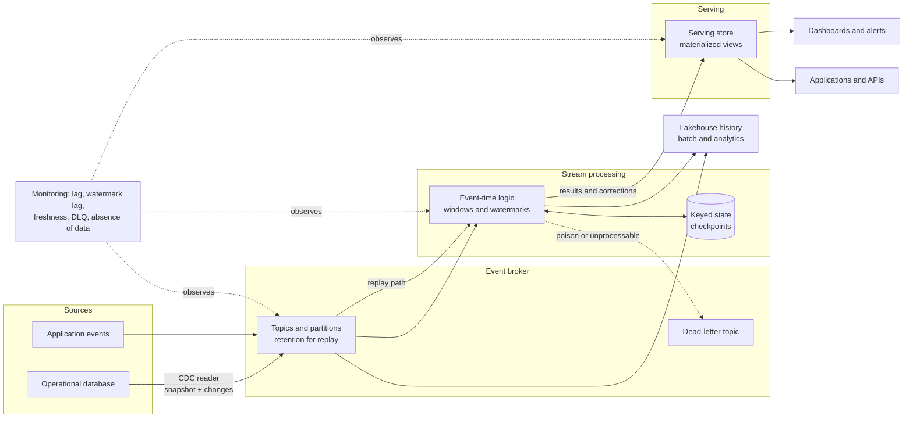

# Roadmap — Module 2D.9: Streaming and Real-Time Data Architecture

This is the learning roadmap for the ninth module of Stage 2D, **Data
Architecture**. It tells you **what** to learn, **in what order**, **how** to
learn each topic from beginner to advanced level, **how to prove** you have
learned it, and **how to complete** the module's final real-time risk monitoring
architecture project.

Earlier modules introduced event-driven patterns (`../03-Data-Architecture-Patterns-and-Reference-Architectures/06-event-driven-and-data-sharing-patterns.md`),
streaming integration (`../06-Data-Integration-and-Interoperability/04-streaming-events-and-message-contracts.md`),
the enterprise platform (`../07-Enterprise-Data-Platform-and-Lakehouse-Architecture/`)
and cloud realisation (`../08-Cloud-Hybrid-and-Multi-Cloud-Data-Architecture/`).
This module goes deep on the **real-time path**: how business latency needs become
a budget, how events are carried, ordered and timed, how state is kept, how
changes from databases join the stream, how results are served, and how all of it
behaves when the real world is late, slow or broken.

> **Repository note (source-of-truth limits).** The seven topic files,
> `practice-questions.md`, `README.md`, `Projects/README.md` and
> `Projects/09-real-time-risk-monitoring-architecture.md` currently exist but are
> **empty**, as are the Stage 2D overview files. This roadmap therefore cannot be
> grounded in their contents. It is the first written statement of the module's
> scope, derived from the file names, the Stage 2D structure and the earlier
> module roadmaps. It does **not** claim that any topic file already contains the
> material below. Every exercise, template, scenario and target in it is a
> **recommendation**, not a documented requirement. When the topic files and the
> project file are written, their scope governs and this roadmap should be
> updated to match.
>
> **Directory name.** The prompt that requested this roadmap referred to
> `STAGE 2D - DATA ARCHITECURE/`. The actual directory is
> `Stage 2D — Data Architecture/`, and the actual name is preserved.
>
> **Illustrative content.** Every number, system, event and organisation in this
> roadmap is an **illustrative assumption** used to teach a method. None is a real
> requirement, benchmark or recommended target. The module is vendor-neutral:
> broker, processor and store *categories* are taught; semantics differ between
> products and must be verified against the technology actually chosen.

---

## 1. Module overview

### 1.1 What streaming data architecture means

**Streaming data architecture** is the design of systems that handle data as an
ongoing flow of events, rather than as finite files or tables processed on a
schedule. It covers how events are produced, carried, ordered, processed
(often with remembered state), stored for replay, and served to people and
applications, within a stated latency and correctness requirement.

### 1.2 Batch, micro-batch and continuous stream processing

| Style | How it works | Typical latency | Strength | Limitation |
| --- | --- | --- | --- | --- |
| **Batch** | Process a bounded set of data on a schedule | Minutes to hours or more | Simple, efficient, complete | Stale between runs |
| **Micro-batch** | Process small bounded sets every few seconds | Seconds | Reuses batch logic; high throughput | Latency floored by batch interval |
| **Continuous stream processing** | Process each event (or tiny groups) as it arrives | Milliseconds to seconds | Lowest latency; event-by-event logic | Harder state, ordering and recovery |

The data are often the same; the **processing model** differs. Many "streaming"
requirements are met by frequent batch or micro-batch at lower cost (see
`../06-Data-Integration-and-Interoperability/08-integration-pattern-selection-and-failure-handling.md`).

### 1.3 Real-time, near-real-time and low-latency

These labels are **not standards**. People use them loosely.

| Label | Common loose meaning | What to do instead |
| --- | --- | --- |
| Real-time | "Very fast", sometimes "instant" | State the measurable objective (for example "p95 ≤ 5 s from event to alert") |
| Near-real-time | "Seconds to minutes" | Same |
| Low-latency | Small delay for a single operation | Say which operation, which percentile |

The module insists on **measurable latency objectives** (Topic 1), not labels.

### 1.4 Why enterprises build event-driven data platforms

- Detect and respond to business events while they still matter (fraud, risk
  limits, outages).
- Decouple producers from many consumers.
- Keep operational and analytical views fresh without heavy batch windows.
- Retain an ordered history for replay, audit and new consumers.

### 1.5 How the main components interact

```text
Producers → Event broker (topics, partitions, retention) → Stream processor
(state, event-time logic) → Serving store / materialized views → Consumers
              ↑                                  │
   CDC from databases                    Replay / reprocessing
```

The broker carries and retains; the processor computes; the serving store makes
results queryable; monitoring and recovery wrap them all.

### 1.6 Streaming versus scheduled ETL

| Aspect | Scheduled ETL | Streaming |
| --- | --- | --- |
| Input | Bounded batch | Unbounded flow |
| Time concept | Run time | Event time vs processing time |
| State | Re-computed per run | Kept between events |
| Failure | Re-run the job | Resume from checkpoint; handle duplicates and lateness |
| Completeness | "All data for the period" | "As complete as the watermark allows" |
| Operation | Runs then stops | Runs continuously; needs 24×7 operation |

### 1.7 Why event time, ordering, state, delivery semantics, replay and failure handling matter

Events arrive late, out of order, and more than once; processors crash and
restart; consumers fall behind. Each of these changes the *answer*, not only the
speed. A fast system that produces the wrong risk figure is worse than a slower
correct one. These six concerns are what separate a reliable streaming design
from a demonstration.

### 1.8 How this module builds on earlier ones

| Earlier module | Provides |
| --- | --- |
| `../02-Requirements-Constraints-and-Architecture-Decisions/` | Measurable latency, freshness and availability targets; trade-off method; ADRs |
| `../03-Data-Architecture-Patterns-and-Reference-Architectures/` | Lambda/Kappa, event-driven and data-sharing patterns |
| `../04-Conceptual-Logical-and-Physical-Data-Modeling/` | Event modeling and schema evolution |
| `../05-Database-and-Storage-Architecture/` | Replication, consistency, transaction boundaries; serving-store categories |
| `../06-Data-Integration-and-Interoperability/` | CDC, streaming contracts, idempotency, reconciliation, failure handling |
| `../07-Enterprise-Data-Platform-and-Lakehouse-Architecture/` | Zones, layers, planes, service levels |
| `../08-Cloud-Hybrid-and-Multi-Cloud-Data-Architecture/` | Networking, identity, private connectivity, hybrid links |

### 1.9 Relevance to operational analytics, fraud, risk, observability and AI

| Use | Why streaming |
| --- | --- |
| Operational analytics | Dashboards that reflect the last minute |
| Fraud detection and risk monitoring | Act before the next transaction or limit breach |
| Observability | Logs, metrics and traces are event streams |
| AI-enabled applications | Fresh features and context for models and retrieval; event-triggered inference (serving detail in `../14-Data-Access-Serving-Semantic-and-AI-Data-Architecture/`) |

### 1.10 Terminology in plain language

| Term | Plain meaning |
| --- | --- |
| Event | A record that something happened, with a time and an identity |
| Broker | The system that receives, stores and delivers events |
| Topic | A named stream of events |
| Partition | A slice of a topic that preserves order within itself and allows parallelism |
| Consumer group | Several consumers sharing the work of reading a topic |
| Offset | A consumer's position in a partition |
| Event time | When the event actually happened |
| Processing time | When the system handled it |
| Watermark | The processor's estimate of how far event time has progressed |
| State | Information remembered between events (for example a running total) |
| Checkpoint | A saved snapshot of progress and state for recovery |
| Backpressure | A signal or effect that a downstream component cannot keep up |
| Replay | Re-reading retained events to rebuild results |
| Materialized view | A precomputed, stored result kept up to date |

---

## 2. Learning outcomes

After completing the module you will be able to:

1. **Distinguish** batch, micro-batch and continuous streaming architectures and
   **state** when each is adequate.
2. **Translate** business requirements into measurable **latency budgets**.
3. **Design** logical event broker, topic, partition and retention strategies.
4. **Explain** event time, processing time, ordering and watermarks.
5. **Design** stateful stream processing workflows and **explain** recovery.
6. **Evaluate** event delivery and processing guarantees and their limits.
7. **Explain** CDC pipelines, event backbones and replay strategies.
8. **Select** appropriate real-time serving stores and materialized views.
9. **Diagnose** late events, backpressure and common streaming failure modes.
10. **Design** a coherent end-to-end real-time architecture.
11. **Document** architectural decisions and **justify** operational trade-offs.

Each outcome is demonstrated through exercises, deliverables and the gates in
Sections 5, 10 and 11.

---

## 3. Prerequisites and knowledge dependencies

### 3.1 Prerequisite table

| # | Knowledge required | Why it matters for streaming | Provided by | Review if weak |
| --- | --- | --- | --- | --- |
| P1 | Measurable freshness, latency, throughput and availability targets; percentiles | Latency budgets and SLOs are the starting point | `../02-Requirements-Constraints-and-Architecture-Decisions/04-latency-throughput-freshness-and-availability-targets.md` | Convert three vague statements into SLOs |
| P2 | Volume, rate and growth estimation | Partition sizing, retention and capacity | `../02-Requirements-Constraints-and-Architecture-Decisions/03-data-volume-velocity-variety-and-growth-estimation.md` | Redo the rate and retention formulas |
| P3 | Trade-offs and ADRs | Streaming decisions are trade-offs that must be recorded | `../02-Requirements-Constraints-and-Architecture-Decisions/06-architecture-trade-offs-and-decision-criteria.md`, `07-architecture-decision-records-adrs.md` | Write one ADR with three options |
| P4 | Batch/stream processing patterns; Lambda and Kappa; event-driven patterns | The architectural options this module deepens | `../03-Data-Architecture-Patterns-and-Reference-Architectures/03-lambda-and-kappa-architectures.md`, `06-event-driven-and-data-sharing-patterns.md` | Compare Lambda, Kappa and micro-batch |
| P5 | Events vs state; domain events; schema evolution | Event design and contracts | `../04-Conceptual-Logical-and-Physical-Data-Modeling/06-event-modeling-and-domain-driven-design.md`, `07-schema-evolution-and-backward-compatibility.md` | Write an event catalogue for one process |
| P6 | Partitioning and layout; replication and consistency; retention | Partition keys, skew, durability and replay windows | `../05-Database-and-Storage-Architecture/05-partitioning-indexing-clustering-and-data-layout.md`, `06-replication-consistency-and-transaction-boundaries.md`, `07-retention-archival-and-data-lifecycle-storage-tiers.md` | Compute skew for a sample key |
| P7 | Specialised stores and key-value/relational/analytical choices | Serving-store selection | `../05-Database-and-Storage-Architecture/02-relational-nosql-and-specialized-database-selection.md` | Map five access patterns to categories |
| P8 | CDC, streaming contracts, idempotency, deduplication, reconciliation, failure handling | Direct foundations of Topics 2–7 | `../06-Data-Integration-and-Interoperability/02-change-data-capture-and-database-replication.md`, `04-streaming-events-and-message-contracts.md`, `05-data-contracts-schema-registry-and-compatibility.md`, `07-idempotency-deduplication-and-reconciliation.md` | Design an idempotent merge and a reconciliation |
| P9 | Platform zones, planes, tenancy, service levels | Where streaming sits in the platform | `../07-Enterprise-Data-Platform-and-Lakehouse-Architecture/02-ingestion-storage-processing-and-consumption-zones.md`, `04-compute-storage-and-control-plane-separation.md`, `08-platform-service-levels-and-product-thinking.md` | Place broker, processor and serving store in planes |
| P10 | Cloud networking, identity, private connectivity, hybrid links | Brokers and processors need secure paths; on-premises CDC sources | `../08-Cloud-Hybrid-and-Multi-Cloud-Data-Architecture/05-networking-identity-and-private-connectivity.md`, `06-hybrid-connectivity-and-on-premises-integration.md` | Draw an access path with the five layers |

### 3.2 Essential vs concurrent

| Essential before starting | Can be learned during this module |
| --- | --- |
| P1, P2, P4, P5, P6, P8 | Product-specific configuration |
| P3, P7, P9, P10 (at least their gates) | Governance depth (`../10-Data-Governance-Security-Privacy-and-Compliance/`) |
| | Lineage and quality tooling (`../11-Metadata-Lineage-Quality-and-Master-Data/`) |
| | DR and resilience depth (`../12-Reliability-Resilience-and-Disaster-Recovery/`) |
| | Cost depth (`../13-Performance-Scalability-and-Cost-Architecture/`) |

Do the review exercise for a weak prerequisite before Topic 1. Do not begin the
project until all essential prerequisites are solid.

---

## 4. Recommended learning sequence

All effort estimates are **recommendations** (about 6–8 hours per week assumed),
not repository requirements.

| Seq | Source file | Topic | Why at this point | Prerequisites | Concepts first | Deliverable before progressing | Effort (rec.) |
| --- | --- | --- | --- | --- | --- | --- | --- |
| 1 | `01-real-time-use-cases-and-latency-budgets.md` | Use cases and latency budgets | Every later decision is judged against the latency and correctness requirement | P1–P4 | Percentile, budget, end-to-end vs component latency | Latency budget for one use case | 5–7 h |
| 2 | `02-event-brokers-topics-partitions-and-retention.md` | Brokers, topics, partitions, retention | The carrying layer; ordering and parallelism boundaries come from partitions | Seq 1, P5, P6 | Topic, partition, key, offset | Topic/partition design with sizing | 6–8 h |
| 3 | `03-event-time-processing-ordering-and-watermarks.md` | Event time, ordering, watermarks | Defines *when* results are right; needs partition ordering knowledge | Seq 2 | Event vs processing time, window, watermark | Timeline and window/watermark design | 6–8 h |
| 4 | `04-stream-processing-state-and-delivery-semantics.md` | State and delivery semantics | Computation over events and time; builds on event-time and ordering | Seq 2–3, P8 | Keyed state, checkpoint, delivery guarantee | State and semantics decision record | 7–9 h |
| 5 | `05-cdc-event-backbones-and-replay.md` | CDC, backbones, replay | Brings database changes into the stream; replay needs retention and state knowledge | Seq 2–4, P8 | Snapshot+stream, log position, replay | CDC and replay plan | 6–8 h |
| 6 | `06-real-time-serving-stores-and-materialized-views.md` | Serving stores and views | Makes results usable; needs processor outputs and update semantics | Seq 1, 4, P7 | Access pattern, upsert, freshness | Serving design | 6–8 h |
| 7 | `07-late-events-backpressure-and-stream-failure-modes.md` | Late events, backpressure, failures | Applies everything to imperfect reality | Seq 1–6 | Lag, backlog, retry, poison message | Failure-mode analysis | 7–9 h |
| — | `practice-questions.md` | Validation | After each topic and fully before the project | Seq 1–7 | — | Gap log | 3–4 h |
| — | `Projects/09-real-time-risk-monitoring-architecture.md` | Final project | Integrates all seven | All | — | Architecture package | 14–18 h |

**Order notes.**

- The recommended order **matches the numeric filename order**. It follows the
  conceptual chain *requirement → carrier → time → computation → inputs from
  databases → outputs → failure*.
- Two optional previews are useful: read the **Beginner level of Topic 7** after
  Topic 2 to see why partition and retention choices matter for failure, and
  skim **Topic 6 Beginner** after Topic 1 to see where the latency budget ends.
  Full study stays in the numeric order.
- Topic 5 follows Topic 4 because replay and recovery depend on understanding
  state and delivery semantics.

---

## 5. Detailed beginner-to-advanced roadmap for every topic

Each topic uses the same twelve parts. Levels are cumulative. Examples use the
**illustrative** scenario of *Northbridge Bank* (Section 10.2), a fictional
mid-sized bank, as an illustrative option, not as a source requirement. Because
the source topic files are empty, any specific subtopic named below is a
**recommended** learning focus.

---

### 5.1 Topic 01 — Real-time use cases and latency budgets

Source: [`01-real-time-use-cases-and-latency-budgets.md`](01-real-time-use-cases-and-latency-budgets.md)

#### 5.1.1 Topic overview

Before choosing technology, decide **whether and how fast** the business needs
an answer. This topic turns a business statement ("we must catch limit breaches
quickly") into a measurable **latency objective**, then splits it into a
**latency budget** across the stages of the pipeline.

#### 5.1.2 Learning objectives

1. Classify a use case as batch, near-real-time or real-time **by measurable
   requirement**, not by label.
2. Define an end-to-end latency objective with percentile, scope and
   measurement points.
3. Build a latency budget across ingestion, processing and serving.
4. Relate latency to throughput, freshness, availability, correctness and cost.
5. Explain tail latency and variability.

#### 5.1.3 Prerequisites

P1–P4. `../02-Requirements-Constraints-and-Architecture-Decisions/04-latency-throughput-freshness-and-availability-targets.md` is the key review.

#### 5.1.4 Beginner level — build the foundations

- **Terms:** latency, end-to-end latency, throughput, freshness, percentile
  (p50/p95/p99), tail latency, budget, SLO.
- **Distinction to learn first:** a **business response-time requirement** ("an
  analyst must be alerted before the customer's next attempt") versus a
  **component processing latency** ("the processor handles an event in 40 ms").
  The first is an outcome; the second is a part of it.
- **Analogy:** a relay race: total time is the sum of each runner's leg plus the
  handovers.
- **Create:** a table with five use cases and the decision each supports, the
  cost of delay, and a first measurable objective.
- **Questions to answer:** What decision does the data support? What happens if it
  arrives 1 second, 1 minute, 1 hour late?
- **Small exercise:** rewrite "the dashboard must be real-time" as a measurable
  statement (metric, percentile, scope, window, measurement point).

#### 5.1.5 Intermediate level — understand the architecture

- **Stages of the path** to budget: event production → publish → broker →
  consume → process → write → serve → render/act. Include handovers (network,
  queueing) and any batching delay.
- **Latency budget (illustrative):** end-to-end p95 ≤ 5 s:

  | Stage | Budget (p95, assumption) |
  | --- | --- |
  | Source commit → publish | 0.3 s |
  | Broker ingest and replication | 0.2 s |
  | Consume and process | 1.5 s |
  | Write to serving store | 0.5 s |
  | Query and render | 0.5 s |
  | **Sum** | **3.0 s** |
  | **Headroom** | **2.0 s** |

  Percentiles do not add exactly: a sum of stage p95s is a **conservative
  planning figure**, not a measured p95 of the whole. Validate end to end.
- **Throughput and freshness:** relate event rate to processing capacity;
  freshness = age of the newest data visible to a consumer.
- **Trade-offs:** lower latency raises cost and complexity and may reduce
  correctness (less waiting for late events, Topic 3).
- **Batch vs micro-batch vs continuous:** choose the simplest model that meets the
  objective (Section 1.2).
- **Failure scenarios:** a stage exceeds budget under load; a hidden batch delay
  (for example a five-second flush interval) consumes the budget.
- **Design exercise:** build the latency budget for one Northbridge use case with
  a measurement point at each boundary.

#### 5.1.6 Advanced level — make architecture decisions

- **Tail latency and variability:** p99 and worst case matter for alerts; causes:
  garbage collection, queueing near capacity, retries, rebalances, cold caches.
  Queueing intuition: delay rises sharply as utilisation approaches 100%, so set
  capacity headroom (for example target ≤ 60–70% utilisation, an assumption to
  validate).
- **Latency vs correctness:** the shorter the wait for late events, the more
  results are provisional (Topic 3). Decide what the business accepts:
  early approximate results with later corrections, or delayed exact results.
- **Latency vs cost:** always-on capacity, replication factor, smaller batches,
  in-memory stores; quantify with ranges.
- **Availability:** a 99.9% stream with a 5-second target differs from one with a
  5-minute target: restarts and failovers consume budget; define whether
  recovery time counts against the objective.
- **Architecture options:** continuous processing, micro-batch, frequent
  incremental batch, database triggers with polling, or "no stream" (document
  why).
- **Measurement and SLOs:** instrument event timestamps at each hop; define
  indicators (event-to-serve latency percentile; freshness lag; alert
  delivery time); decide how clock skew is handled.
- **Document** the latency objective, budget and options in an ADR.
- **Not every use case needs streaming.** Present at least one case where the
  business value does not justify it.

#### 5.1.7 Industry application and hands-on exercises

| | Exercise A — Latency objective and budget | Exercise B — Streaming or not? |
| --- | --- | --- |
| Scenario | Northbridge risk team wants "real-time" exposure monitoring | Five proposed use cases claim to need streaming |
| Problem | Define a measurable objective and budget | Decide which truly need streaming |
| Inputs | Decision supported, cost of delay, event rates (assumed) | Use-case descriptions |
| Tasks | Define objective; build stage budget with measurement points; compute headroom; note risks | For each: decision, cost of delay, required latency, simplest adequate model, recommendation |
| Deliverables | Latency objective and budget table | Decision table with at least one "batch is enough" |
| Validation | Objective has percentile, scope, window, method; budget sums with headroom | Each recommendation cites cost of delay |
| Demonstrates | You can turn a label into a budget | You can avoid unneeded streaming |

#### 5.1.8 Real-world scenarios and trade-offs

| Scenario | Context and requirements | Constraints | Alternatives | Pros / cons | Failure modes | Recommended (assumptions) | Would change if |
| --- | --- | --- | --- | --- | --- | --- | --- |
| Limit-breach alerting | Alert before next trade settles | Settlement cycle minutes | (a) Continuous; (b) 30 s micro-batch; (c) 5-minute batch | (a) lowest latency, complexity; (b) simple, 30 s floor; (c) cheap, too slow | Alert after the breach | (b) if p95 ≤ 60 s is enough | Objective tightens to seconds |
| Executive dashboard | Wants "live" numbers | Humans read once a minute | (a) Streaming; (b) 1-minute refresh | (a) costly; (b) adequate | Over-engineering | (b) | Operational decisions need seconds |

#### 5.1.9 Expected deliverables

- Latency objective statement(s).
- Latency budget table with measurement points.
- Streaming-or-not decision table.
- ADR on processing model.

#### 5.1.10 Common mistakes and misconceptions

| Mistake | Why problematic | How to avoid |
| --- | --- | --- |
| Using "real-time" as a requirement | Unmeasurable; cost explodes | Define percentile, scope, window |
| Confusing component latency with business response time | Optimising the wrong thing | Budget end to end |
| Adding percentiles as if exact | Misleading totals | Treat sums as planning figures; measure end to end |
| Ignoring tail latency | Alerts miss at p99 | Specify p95/p99 |
| Hidden batching delays | Silent budget loss | List every buffer and flush interval |

#### 5.1.11 Mastery criteria

- Convert a vague label into a measurable objective.
- Build and defend a budget with measurement points.
- Argue for or against streaming using cost of delay.

#### 5.1.12 Completion gate

- [ ] Objective, budget and decision table reviewed by a peer.
- [ ] You can explain business response time vs component latency.
- [ ] Budget includes headroom and a validation approach.
- [ ] Weakness (label-based thinking) addressed by redoing one objective with
      percentile and scope.

---

### 5.2 Topic 02 — Event brokers, topics, partitions and retention

Source: [`02-event-brokers-topics-partitions-and-retention.md`](02-event-brokers-topics-partitions-and-retention.md)

#### 5.2.1 Topic overview

The **event broker** is the durable, ordered carrier between producers and
consumers. Its logical building blocks are **topics** (named streams),
**partitions** (ordered slices that provide parallelism), **keys** (which decide
the partition), **consumer groups** (which share the work) and **retention**
(how long events stay available). Almost every later property (ordering,
throughput, replay, recovery) is set here.

> Broker products differ in semantics (guarantees, ordering scope, limits,
> retention models). Learn the concepts, then verify the product.

#### 5.2.2 Learning objectives

1. Define producer, broker, topic, partition, consumer group, offset.
2. Choose event keys and explain the ordering boundary they create.
3. Size partitions for throughput and consumer parallelism.
4. Set retention from replay and recovery needs and estimate storage.
5. Explain replication and availability at the concept level.
6. State the trade-offs among ordering, parallelism, throughput, retention and
   consumer independence.

#### 5.2.3 Prerequisites

Seq 1; P5, P6, P8 (`../06-Data-Integration-and-Interoperability/04-streaming-events-and-message-contracts.md`).

#### 5.2.4 Beginner level — build the foundations

- **Terms and flow:** producers publish to a topic; the topic is split into
  partitions; each event goes to one partition (chosen by key or round-robin);
  each partition is an append-only log; consumers read from their offset.
- **Analogy:** a motorway (topic) with lanes (partitions): cars in one lane stay
  in order; more lanes carry more traffic; there is no ordering between lanes.
- **Consumer groups:** within a group each partition is read by one consumer; a
  second group reads independently. Parallelism ≤ number of partitions.
- **Create:** a diagram of one topic with four partitions, two producers, and two
  consumer groups.
- **Questions to answer:** Why can events with the same key be ordered but
  events with different keys not? What limits consumer parallelism?
- **Small exercise:** assign twelve events (account ids as keys) to three
  partitions using `hash(key) mod 3` and list each partition's contents in
  order.

#### 5.2.5 Intermediate level — understand the architecture

- **Key design:** the key defines the ordering unit (for example `account_id` so
  all events for an account are ordered). Choose the **smallest unit that must be
  ordered**; too coarse a key creates hot partitions, too fine loses ordering you
  need.
- **Partition sizing (illustrative):** 30,000 events/s × 0.5 KB = 15 MB/s. If a
  partition sustains an assumed 5 MB/s:

  ```text
  by throughput:  15 / 5 = 3 partitions
  with 2× headroom: 6 partitions
  by consumer parallelism target of 12 workers: at least 12 partitions
  choose max(6, 12) = 12 (and check key skew)
  ```

  Adding partitions later may change key-to-partition mapping and therefore
  per-key ordering (verify the product's behaviour).
- **Retention.** *Illustrative:* 15 MB/s sustained:

  ```text
  per day = 15 MB/s × 86,400 s = 1,296,000 MB ≈ 1.3 TB
  3-day retention ≈ 3.9 TB
  with replication factor 3 ≈ 11.7 TB
  ```

  State whether retention is time-based, size-based or both, and how compaction
  (keeping the latest event per key) differs from deletion by age (verify
  product options).
- **Replication and availability (concept):** each partition has replicas on
  different brokers/zones; a leader serves reads and writes; acknowledgement
  settings trade durability for latency (2D.5 Topic 6).
- **Consumer independence:** each group has its own offsets, so slow consumers do
  not slow others but do require retention long enough for them.
- **Failure scenarios:** broker loss; leader election pause; consumer rebalance
  causing temporary stall; a hot partition.
- **Design exercise:** design the topics for card authorisations, account changes
  and alerts: names, keys, partitions, retention, who produces and consumes.
- **Trade-offs:** more partitions = more parallelism and metadata/overhead and
  weaker global ordering.

#### 5.2.6 Advanced level — make architecture decisions

- **Ordering vs parallelism:** per-key order is the usual guarantee; if a use case
  needs *global* order, throughput is limited to one partition's capacity;
  question whether global order is truly needed.
- **Skew analysis:** `skew_ratio = max_partition_rate / mean_partition_rate`;
  mitigations: composite or salted keys (at the cost of per-key order across
  salts), sub-topics for heavy keys.
- **Topic granularity:** one topic per event type vs per domain vs per entity;
  effect on schema management, consumer filtering, access control and
  throughput.
- **Retention strategy:** replay needs (Topic 5), regulatory evidence, privacy
  deletion obligations in logs (`../10-Data-Governance-Security-Privacy-and-Compliance/`), tiered storage if available
  (verify), cost.
- **Delivery and durability configuration:** acknowledgements, minimum in-sync
  replicas, producer idempotence (concepts; semantics in Topic 4).
- **Capacity and operations:** broker count, disk, network, partition
  rebalancing, quotas per tenant (2D.7 Topic 7), monitoring (under-replicated
  partitions, request latency, lag).
- **Security:** authentication of producers/consumers, per-topic authorisation,
  encryption in transit and at rest, private connectivity
  (`../08-Cloud-Hybrid-and-Multi-Cloud-Data-Architecture/05-networking-identity-and-private-connectivity.md`).
- **Multi-region:** replication across regions adds lag and cost; consumers must
  tolerate duplicates; residency constraints.
- **Document** key, partition count, retention and replication decisions in an
  ADR with alternatives.
- **Do not assume all brokers behave identically** in ordering scope, rebalance
  behaviour or retention features.

#### 5.2.7 Industry application and hands-on exercises

| | Exercise A — Topic and partition design | Exercise B — Capacity and skew analysis |
| --- | --- | --- |
| Scenario | Northbridge card authorisations feed fraud, risk and finance | A few merchants produce 20% of traffic |
| Problem | Design topics, keys, partitions, retention | Check skew and storage |
| Inputs | Event rates, sizes, consumer needs (assumed) | Key distribution sample |
| Tasks | Choose keys and justify ordering unit; compute partitions by throughput and parallelism; set retention; define consumer groups | Compute skew ratio; propose mitigation; recompute storage |
| Deliverables | Topic design document | Capacity and skew worksheet |
| Validation | Arithmetic with units; each key tied to an ordering need | Skew ratio computed; mitigation states its ordering cost |
| Demonstrates | You can design broker structures | You can detect hot partitions |

#### 5.2.8 Real-world scenarios and trade-offs

| Scenario | Context | Constraints | Alternatives | Pros / cons | Failure modes | Recommended (assumptions) | Would change if |
| --- | --- | --- | --- | --- | --- | --- | --- |
| Key choice for authorisations | Fraud needs per-card order | Card traffic skewed | (a) key=card_id; (b) key=merchant_id; (c) key=customer_id | (a) precise order; (b) hot merchants; (c) broader order | Hot partition; lost order | (a) | Cross-card patterns need customer-level order |
| Retention for a new consumer | A consumer needs 30 days of history | Storage cost | (a) 30-day topic retention; (b) 3 days plus replay from lake | (a) simple, costly; (b) cheaper, two sources | Gap between sources | (b) with reconciliation | Replay from lake impractical |

#### 5.2.9 Expected deliverables

- Topic, key, partition and retention design.
- Capacity and skew worksheet.
- Consumer group design.
- ADR on keys and retention.

#### 5.2.10 Common mistakes and misconceptions

| Mistake | Why problematic | How to avoid |
| --- | --- | --- |
| Expecting global ordering | Only per-partition order | Define the ordering unit |
| Choosing a low-cardinality key | Hot partitions | Check cardinality and skew |
| More partitions = always better | Overhead; rebalances | Size from need |
| Retention set by default | Cannot replay or wastes storage | Derive from replay and cost |
| Treating all brokers as identical | Wrong assumptions | Verify product semantics |

#### 5.2.11 Mastery criteria

- Choose a key and explain the ordering it provides.
- Size partitions and retention with arithmetic.
- Identify skew and propose a mitigation with its cost.

#### 5.2.12 Completion gate

- [ ] Design and worksheet reviewed; arithmetic reproduced by a reviewer.
- [ ] Each key traces to an ordering requirement.
- [ ] You can state what a repartitioning would change.
- [ ] Weakness (global ordering assumption) addressed by redesigning with
      per-key order only.

---

### 5.3 Topic 03 — Event-time processing, ordering and watermarks

Source: [`03-event-time-processing-ordering-and-watermarks.md`](03-event-time-processing-ordering-and-watermarks.md)

#### 5.3.1 Topic overview

A stream's arrival order is not the order in which things happened. **Event
time** is when the event occurred; **processing time** is when the system sees
it. To compute correct windowed results (for example "total exposure per
5-minute window") the system needs a notion of event-time progress: the
**watermark**. This topic teaches the behaviours and trade-offs.

#### 5.3.2 Learning objectives

1. Distinguish event time, ingestion time and processing time.
2. Explain why events arrive out of order.
3. Define tumbling, sliding and session windows.
4. Explain watermarks, lateness and what each strategy trades.
5. Predict results for a sample stream under different watermark/lateness
   settings.

#### 5.3.3 Prerequisites

Seq 2 (partition ordering); P5 (event models).

#### 5.3.4 Beginner level — build the foundations

- **Terms:** event time, ingestion time (when the broker received it),
  processing time, out-of-order, window, watermark, lateness.
- **Why order breaks:** network delays, retries, multiple producers, mobile
  devices that reconnect, different partitions, clock differences.
- **Analogy:** letters posted on different days arriving together; the postmark
  (event time) differs from the day you read them (processing time).
- **Create:** a timeline with six events showing event time on one axis and
  arrival order on the other.
- **Questions to answer:** Which timestamp should a daily total use? What is a
  window for?
- **Small exercise:** given six events with event times and arrival times, list
  them in arrival order and in event order, and say which differ.

#### 5.3.5 Intermediate level — understand the architecture

- **Window types:** tumbling (fixed, non-overlapping), sliding (fixed length,
  overlapping, advancing by a slide), session (grouped by inactivity gap).
- **Watermark idea:** the processor's estimate that "no events with event time
  earlier than W are expected". A common heuristic: `watermark = max_event_time_seen − allowed_delay`.
- **Worked example (illustrative).** Tumbling 5-minute window `[10:00, 10:05)`,
  allowed delay 2 minutes:

  | Arrival order | Event time | Max event time seen | Watermark (max − 2 min) | Window `[10:00,10:05)` closed? |
  | --- | --- | --- | --- | --- |
  | 1 | 10:04:30 | 10:04:30 | 10:02:30 | No |
  | 2 | 10:03:50 | 10:04:30 | 10:02:30 | No (event is late relative to order but included) |
  | 3 | 10:06:00 | 10:06:00 | 10:04:00 | No (watermark < 10:05) |
  | 4 | 10:07:30 | 10:07:30 | 10:05:30 | **Yes** (watermark ≥ 10:05) |
  | 5 | 10:01:00 | 10:07:30 | 10:05:30 | Window already closed → event 5 is **late** |

  Event 5 arrives after the window closed. What happens next depends on the
  lateness policy (below).
- **Late-event policies:** drop; send to a side output/quarantine; allow
  lateness and **update** the earlier result (retraction/correction); route to a
  batch correction job.
- **Ordering guarantees and limits:** per-partition arrival order is preserved,
  event-time order is not; ordering across partitions is not guaranteed.
- **Correctness vs latency:** a long allowed delay = more complete, later
  results; a short one = earlier, more late events.
- **Failure scenarios:** a stalled partition holds back the watermark for the
  whole job; clock skew at a source makes events appear in the future; one idle
  partition freezes progress.
- **Design exercise:** choose window type and allowed delay for three metrics and
  justify.
- **Trade-offs:** provisional early results with later corrections vs final
  results emitted once.

#### 5.3.6 Advanced level — make architecture decisions

- **Watermark strategy:** fixed delay; percentile-based from observed lateness;
  per-partition vs global; handling idle partitions (timeouts); sources with
  unreliable clocks.
- **Choosing allowed lateness from data.** Measure the distribution of
  `processing_time − event_time`; choose a delay covering a stated share (for
  example p99, an assumption) and decide what happens to the remainder.
- **Result semantics:** emit once at window close; emit early/on-time/late
  results with updates; downstream consumers must handle updates (upsert/
  retraction semantics, Topic 6).
- **Business meaning:** a late event may be a late fraud signal, a correction
  or a trade amendment; the policy must reflect business consequences.
- **State cost:** longer allowed delay holds window state longer (Topic 4):

  ```text
  open_window_state ≈ keys × windows_open × bytes_per_window
  windows_open ≈ ceil((window_length + allowed_delay) / window_length)
  ```

  *Illustrative:* 5-minute windows with 2-minute delay: 2 windows open per key.
- **Ordering across sources:** merging streams with different delays; joins in
  event time need bounded skew.
- **Replay and event time:** reprocessing uses event time, so results are
  reproducible; processing-time logic is not reproducible (Topic 5).
- **Observability:** watermark lag, late-event rate, dropped count, per-source
  delay.
- **Document** the time semantics and lateness policy in an ADR.
- **No universal setting.** The right delay depends on measured lateness,
  business tolerance and state cost.

#### 5.3.7 Industry application and hands-on exercises

| | Exercise A — Out-of-order simulation | Exercise B — Watermark and lateness policy |
| --- | --- | --- |
| Scenario | Card events from branches and mobile devices arrive late | Risk wants 5-minute exposure totals |
| Problem | Predict window results for a sample stream | Choose allowed delay and late-event handling |
| Inputs | 20 sample events (JSON or table) with event and arrival times | Lateness distribution (assumed) |
| Tasks | By hand or a short script, compute window totals under delays of 0, 1 and 3 minutes; list which events are late | Pick delay by percentile; define late policy (side output + correction); state state cost and business effect |
| Deliverables | Table of results per setting | Time-semantics decision record |
| Validation | Totals reproduced by a reviewer; late events identified | Policy states what happens to each late event and who is told |
| Demonstrates | You understand event-time effects | You can set watermark strategy |

#### 5.3.8 Real-world scenarios and trade-offs

| Scenario | Context | Constraints | Alternatives | Pros / cons | Failure modes | Recommended (assumptions) | Would change if |
| --- | --- | --- | --- | --- | --- | --- | --- |
| Mobile offline events | Devices reconnect hours later | Alerts need fast answers | (a) Short delay, drop late; (b) short delay + correction path; (c) long delay | (a) fast, loses data; (b) fast and corrected; (c) complete, slow | Silent data loss | (b) | Late events are rare and unimportant |
| Idle partition | One partition has no traffic overnight | Watermark advances only with data | (a) Do nothing; (b) idle timeout | (a) stalls windows; (b) progress, risk of premature close | Windows never close | (b) with conservative timeout | All partitions always active |

#### 5.3.9 Expected deliverables

- Event-time timeline and window diagram.
- Worked simulation table.
- Watermark and lateness policy record.
- State cost estimate.

#### 5.3.10 Common mistakes and misconceptions

| Mistake | Why problematic | How to avoid |
| --- | --- | --- |
| Using processing time for business windows | Results depend on delays and are not reproducible | Use event time |
| Assuming arrival order = event order | Wrong sequences | Test with out-of-order data |
| Zero allowed delay | Many valid events dropped | Measure lateness |
| Ignoring idle partitions | Windows never close | Idle handling |
| Treating a window result as final | Late events change it | State provisional vs final |

#### 5.3.11 Mastery criteria

- Compute window results for out-of-order events under stated settings.
- Explain how the watermark advances and what makes an event late.
- Justify an allowed delay from measured lateness and business tolerance.

#### 5.3.12 Completion gate

- [ ] Simulation and policy record reviewed; results reproduced.
- [ ] You can explain event vs processing time to a non-specialist.
- [ ] Late-event handling is defined end to end.
- [ ] Weakness (processing-time thinking) addressed by redoing the simulation
      with event time.

---

### 5.4 Topic 04 — Stream processing, state and delivery semantics

Source: [`04-stream-processing-state-and-delivery-semantics.md`](04-stream-processing-state-and-delivery-semantics.md)

#### 5.4.1 Topic overview

Stream processors transform events, and often **remember** things between
events (counts, totals, last-seen values, join buffers). That memory is
**state**, which must survive failures. This topic covers stateless vs stateful
processing, state stores, checkpoints and recovery, and the **delivery and
processing guarantees** (at-most-once, at-least-once, exactly-once) with their
real limits.

#### 5.4.2 Learning objectives

1. Distinguish stateless from stateful processing and give examples.
2. Explain keyed state, state stores and checkpointing.
3. Explain the three processing guarantees and their costs.
4. Distinguish a **processing guarantee** from **end-to-end business
   correctness**.
5. Design idempotent output and deduplication.
6. Explain state recovery and its dependence on replay.

#### 5.4.3 Prerequisites

Seq 2–3; P8 (`../06-Data-Integration-and-Interoperability/07-idempotency-deduplication-and-reconciliation.md`).

#### 5.4.4 Beginner level — build the foundations

- **Terms:** stateless, stateful, keyed state, state store, checkpoint, offset
  commit, at-most-once, at-least-once, exactly-once, idempotent.
- **Stateless:** each event handled alone (filter, map, enrich from a static
  table). **Stateful:** needs memory (running total per account, sessions,
  joins, deduplication of recent ids).
- **Analogy:** a cashier who processes each customer independently (stateless)
  vs one who keeps a running tally for the till (stateful) and must not lose it
  when the till crashes.
- **Guarantees in plain language:**

  | Guarantee | Meaning | Failure behaviour |
  | --- | --- | --- |
  | At-most-once | Each event processed zero or one times | May lose events |
  | At-least-once | Each event processed one or more times | May duplicate |
  | Exactly-once (processing) | Effects of processing appear once **within the system's boundary** | Requires coordination; boundary-limited |

- **Create:** a diagram of a processor reading a partition, updating a running
  total per key, and committing its position.
- **Questions to answer:** What happens if the processor crashes after updating
  state but before committing the offset? Which guarantee results?
- **Small exercise:** trace six events through a running-total processor with a
  crash after event 4; show the final totals under at-least-once without
  protection.

#### 5.4.5 Intermediate level — understand the architecture

- **Keyed state and partitioning:** state is partitioned by the same key as the
  data, so one task owns a key's state; scaling and rebalancing move state.
- **Checkpointing and recovery:** periodically snapshot state and input
  positions together; after a failure, restore the last snapshot and reprocess
  events after it. Events between the snapshot and the crash are processed
  again.

  ```text
  worst-case reprocessing ≈ event_rate × checkpoint_interval
  e.g. 12,000 events/s × 60 s = 720,000 events
  ```

- **State size.** *Illustrative:* 5 million keys × 2 KB state per key
  = 10 GB total (5×10⁶ × 2×10³ B = 10¹⁰ B). Estimate memory/disk, checkpoint
  duration and recovery time.
- **State store options (concept):** in-memory with disk spill; embedded
  key-value store with changelog; external store. Trade-offs: speed, size,
  recovery, operations.
- **Windowed computations:** state per key per window (Topic 3); expiry (TTL)
  to bound state.
- **Making results correct under at-least-once:** make operations idempotent
  (upsert by key with version), or deduplicate by event id within a retention
  window, or use transactional writes (below).
- **Failure scenarios:** crash between output write and checkpoint (duplicate
  output); state store corruption; checkpoint too slow, growing lag.
- **Design exercise:** design the state for a rolling exposure per customer with
  TTL, key, size estimate and recovery plan.
- **Trade-offs:** longer checkpoint interval = less overhead, more reprocessing.

#### 5.4.6 Advanced level — make architecture decisions

- **What "exactly-once" usually means.** Typically: the processor's internal
  state and the writes to a *cooperating* store/log are made atomic with the
  input position (transactions or two-phase commit), so that after recovery the
  effect is as if each event was processed once. This is bounded by:
  - the **boundary** (the broker+processor+sink combination that supports it),
  - the **sink** (it must support transactions or idempotent writes),
  - **side effects outside the boundary** (sending an email, calling an external
    API, charging a card), which the system cannot roll back.
- **Processing guarantee ≠ business correctness.** A pipeline may be "exactly-
  once" while still producing wrong business results: wrong event-time handling,
  late events dropped, a bad rule, duplicate *source* events with different ids,
  or non-idempotent external calls. Business correctness needs idempotency keys,
  reconciliation (2D.6 Topic 7), and monitoring.
- **Idempotent design patterns:** deterministic idempotency key (source event id);
  upsert with version; outbox/inbox patterns; deduplication store with bounded
  retention (state the window and the risk beyond it).
- **State recovery and replay:** state is rebuilt from a checkpoint plus
  replayed events; if retention is shorter than the checkpoint interval plus
  outage, recovery fails (Topic 5).
- **Scaling stateful jobs:** rescaling requires redistributing state; hot keys
  create hot tasks; stateful operators limit elasticity.
- **Fault tolerance and availability:** checkpoint storage durability; standby
  tasks; recovery time as part of the latency/availability budget.
- **Cost and complexity:** exactly-once coordination overhead; state storage
  cost; operations burden. Choose the **weakest guarantee that meets the
  correctness need** (for example at-least-once with idempotent sink).
- **Monitoring:** checkpoint duration and failure rate, state size growth,
  lag, duplicates detected.
- **Document** the guarantee choice, boundary and compensating controls in an
  ADR. Use the semantics of the technology actually selected; **verify its
  documented guarantees** before relying on them.

#### 5.4.7 Industry application and hands-on exercises

| | Exercise A — Crash simulation | Exercise B — Semantics decision record |
| --- | --- | --- |
| Scenario | A processor maintains per-customer exposure and writes alerts | Alerts also trigger an external case-management API |
| Problem | Show how crash timing affects totals and alerts | Choose guarantees and controls |
| Inputs | 10-event sample with a crash after event 6 | Pipeline description, sink capabilities (assumed) |
| Tasks | Compute outputs under at-most-once, at-least-once, and at-least-once + idempotent upsert | State boundary of any exactly-once claim; design idempotency key for the API call; define deduplication window and reconciliation |
| Deliverables | Table of outcomes per setting | Semantics decision record |
| Validation | Outcomes reproduced by a reviewer | Record names what is *not* covered by the guarantee |
| Demonstrates | You understand guarantees concretely | You can separate processing from business correctness |

#### 5.4.8 Real-world scenarios and trade-offs

| Scenario | Context | Constraints | Alternatives | Pros / cons | Failure modes | Recommended (assumptions) | Would change if |
| --- | --- | --- | --- | --- | --- | --- | --- |
| Duplicate alerts | Alerts must not duplicate | Case system is external | (a) Exactly-once processing; (b) at-least-once + idempotency key | (a) complex, boundary-limited; (b) simple, needs key support | Duplicate cases | (b) | Case system cannot accept keys |
| Large state | 10 GB+ per job | Fast recovery wanted | (a) Large keyed state; (b) external store; (c) shorter TTL | (a) fast reads, slow recovery; (b) slower access, durable; (c) smaller | Long recovery | (c) plus incremental checkpoints | Business needs long history in state |

#### 5.4.9 Expected deliverables

- State design (keys, size, TTL, store, checkpoint interval).
- Crash and recovery simulation table.
- Delivery-semantics decision record (guarantee, boundary, controls, exclusions).
- Idempotency and deduplication design.

#### 5.4.10 Common mistakes and misconceptions

| Mistake | Why problematic | How to avoid |
| --- | --- | --- |
| "Exactly-once means no duplicates anywhere" | Boundary-limited | State the boundary |
| Equating processing guarantee with business correctness | Wrong outcomes remain possible | Add idempotency and reconciliation |
| Unbounded state | Memory growth, slow recovery | TTL and size monitoring |
| Checkpoint interval chosen arbitrarily | Long reprocessing or high overhead | Compute reprocessing cost |
| Relying on side effects being repeatable | Duplicate emails/charges | Idempotency keys |

#### 5.4.11 Mastery criteria

- Predict outputs after a crash under each guarantee.
- Explain the boundary of an exactly-once claim.
- Design idempotent output and a bounded deduplication window.

#### 5.4.12 Completion gate

- [ ] Simulation and decision record reviewed; outcomes reproduced.
- [ ] You can state what an exactly-once claim does **not** cover.
- [ ] State size and recovery arithmetic have units and assumptions.
- [ ] Weakness (guarantee = correctness) addressed by redoing the decision
      record with exclusions.

---

### 5.5 Topic 05 — CDC, event backbones and replay

Source: [`05-cdc-event-backbones-and-replay.md`](05-cdc-event-backbones-and-replay.md)

#### 5.5.1 Topic overview

**Change data capture (CDC)** turns database changes into events. An **event
backbone** is a shared, durable stream that many consumers use as their common
source of change. **Replay** is re-reading retained events to rebuild or correct
results. This topic ties them together and clarifies the difference between
replaying events, reconstructing state, and reloading from the source.

#### 5.5.2 Learning objectives

1. Explain CDC and how change events are produced from a transaction log.
2. Describe snapshot-plus-stream coordination.
3. Explain an event backbone with multiple independent consumers.
4. Explain offsets/checkpoints and replay.
5. Distinguish replaying events, reconstructing state and reloading from source.
6. Document replay conditions and constraints.

#### 5.5.3 Prerequisites

Seq 2–4; P8 (`../06-Data-Integration-and-Interoperability/02-change-data-capture-and-database-replication.md`), P6.

#### 5.5.4 Beginner level — build the foundations

- **Terms:** CDC, change event (insert/update/delete with before/after), log
  position, snapshot, backbone, offset, replay, reprocessing.
- **Analogy:** CDC is a security camera on the database door recording who came
  and went; a snapshot is a photograph of the room at one moment.
- **Why CDC:** low source load, captures deletes and intermediate states, fresher
  than polling.
- **Create:** a diagram: database → CDC reader → topic → three consumers
  (warehouse sync, search index, risk processor).
- **Questions to answer:** Why take a snapshot and also stream changes? What is
  the log position for?
- **Small exercise:** for a customer row updated three times between two batch
  runs, list what batch sees vs what CDC emits.

#### 5.5.5 Intermediate level — understand the architecture

- **Snapshot-plus-stream:** record the log position, take a consistent snapshot,
  then stream from that position, so there is no gap and no double-application
  (2D.6 Topic 2).
- **Change event contract:** operation, key, before/after (as available),
  position, commit time, transaction id (if provided); schema evolution and
  compatibility (2D.6 Topic 5).
- **Event backbone:** CDC and application events publish to topics; consumers
  subscribe independently; new consumers can start from retained history or a
  snapshot; avoid each consumer polling the source.
- **Replay types — distinguish clearly:**

  | Action | Source of data | Typical use | Limits |
  | --- | --- | --- | --- |
  | **Replay retained events** | Events still in the broker/log | Fix a bug; backfill a new consumer; recover a consumer | Only as far back as retention; events as originally emitted |
  | **Reconstruct state** | Checkpoint/snapshot plus events after it | Rebuild processor state | Needs a usable snapshot and contiguous events |
  | **Reload from source** | Re-read the source tables | Retention too short; events lost; first load | Source load; state of source *now*, not history |

- **Consumer offsets/checkpoints:** each consumer stores its own position; reset
  an offset to replay; take care of downstream side effects.
- **Duplicate handling:** replay produces repeats; sinks must be idempotent.
- **Recovery after failures:** consumer down for hours; CDC reader down (risk of
  log truncation at the source); source failover changing positions.
- **Failure scenarios:** the source's log retention is shorter than the outage;
  schema change breaks the reader; replay re-triggers external actions.
- **Design exercise:** design the backbone for account changes feeding three
  consumers, with replay procedures for each.
- **Trade-offs:** long retention (replay power, storage and privacy exposure) vs
  short (cheap, fragile).

#### 5.5.6 Advanced level — make architecture decisions

- **Replay feasibility analysis.** Required window = max(outage duration,
  bug-detection delay, new-consumer backfill period). Compare with retention
  (Topic 2). Replay time:

  ```text
  replay_time ≈ retained_volume / sustained_replay_throughput
  e.g. 3.9 TB at 200 MB/s = 3,900,000 MB / 200 = 19,500 s ≈ 5.4 h
  ```

  Replay must run alongside live traffic; throttle to protect downstream
  stores and keep headroom.
- **Replay safety:** replay-safe vs replay-unsafe consumers (those with external
  side effects); idempotency keys; a "replay mode" that suppresses side effects;
  verifying correctness with reconciliation after replay.
- **Log compaction and history:** compacted topics hold the latest per key (good
  for rebuilding current state) but lose history (not suitable for time-based
  replay of every change).
- **Ordering and transactions in CDC:** per-key order from the log; cross-table
  consistency requires transaction metadata; multi-table consumers see
  intermediate states unless grouped.
- **Schema evolution in long retention:** old events in old shapes; consumers
  must read all retained versions (2D.4 Topic 7).
- **Privacy and deletion:** personal data in retained events conflicts with
  erasure; options: short retention, tokenisation, crypto-shredding
  (`../10-Data-Governance-Security-Privacy-and-Compliance/`).
- **Source impact and operations:** replication slot or log-hold risks at the
  source if the reader stalls; monitoring of reader lag and source log size.
- **Backbone governance:** topic ownership, contracts, access, quotas, who may
  replay.
- **Cost:** retention storage, replay compute, duplicate processing.
- **Document** retention, replay procedures and constraints in an ADR; include
  the **conditions under which replay is impossible** (retention exceeded,
  events lost, incompatible schemas, side effects not reversible).

#### 5.5.7 Industry application and hands-on exercises

| | Exercise A — Backbone and replay plan | Exercise B — Replay feasibility |
| --- | --- | --- |
| Scenario | Northbridge ledger changes feed risk, search and warehouse consumers | A processing bug corrupted three days of results |
| Problem | Design the backbone and per-consumer replay | Decide whether replay can fix it |
| Inputs | Change rate, retention, consumer types (assumed) | Retention, bug window, replay throughput |
| Tasks | Define topics, keys, retention, contracts; per-consumer replay steps, idempotency, side-effect handling | Compute required window and replay time; compare with retention; choose replay, state reconstruction or source reload |
| Deliverables | Backbone design and replay procedures | Feasibility analysis and decision |
| Validation | Each consumer has a replay-safety statement | Arithmetic with units; conditions for impossibility listed |
| Demonstrates | You can design a shared event backbone | You can decide recovery paths |

#### 5.5.8 Real-world scenarios and trade-offs

| Scenario | Context | Constraints | Alternatives | Pros / cons | Failure modes | Recommended (assumptions) | Would change if |
| --- | --- | --- | --- | --- | --- | --- | --- |
| New consumer needs history | Risk model needs 90 days | Topic retention 7 days | (a) Extend retention; (b) bootstrap from lake then switch to stream; (c) reload from source | (a) simple, costly; (b) cheaper, seam; (c) source load, current state only | Gap at seam | (b) with reconciliation | Lake lacks required fields |
| CDC reader outage | Down 2 days; source log keeps 1 day | Log truncated | (a) Resnapshot; (b) restore from backup logs | (a) simple, heavy; (b) complex | Lost changes | (a) | Backup logs available and tested |

#### 5.5.9 Expected deliverables

- CDC/backbone architecture diagram.
- Replay and recovery procedures per consumer.
- Replay feasibility worksheet.
- Retention and privacy note.
- ADR.

#### 5.5.10 Common mistakes and misconceptions

| Mistake | Why problematic | How to avoid |
| --- | --- | --- |
| Treating the stream as the system of record without retention policy | Cannot replay far enough | Define retention from replay needs |
| Confusing replay with reload | Different data and limits | Use the three-way table |
| Replaying side-effecting consumers blindly | Duplicate external actions | Replay-safe design |
| Ignoring source log retention | CDC reader loses its place | Monitor lag and log hold |
| No reconciliation after replay | Unverified repair | Reconcile counts and totals |

#### 5.5.11 Mastery criteria

- Explain snapshot-plus-stream and the seam.
- Choose among replay, reconstruction and reload with reasons.
- State the conditions under which replay is impossible.

#### 5.5.12 Completion gate

- [ ] Backbone design and feasibility worksheet reviewed.
- [ ] Each consumer has a replay-safety statement.
- [ ] Impossibility conditions documented.
- [ ] Weakness (replay vs reload confusion) addressed by writing the three-way
      table for your design.

---

### 5.6 Topic 06 — Real-time serving stores and materialized views

Source: [`06-real-time-serving-stores-and-materialized-views.md`](06-real-time-serving-stores-and-materialized-views.md)

#### 5.6.1 Topic overview

Processing produces results; **serving** makes them available to applications,
dashboards and downstream systems at the required latency and concurrency. A
**materialized view** is a precomputed, stored result kept up to date as new
events arrive. The store best suited to *ingesting* events is often not the best
for *serving queries*.

#### 5.6.2 Learning objectives

1. State serving-layer requirements from access patterns.
2. Explain materialized views and incremental maintenance.
3. Compare serving options (key-value, relational, analytical/OLAP, search,
   other specialised stores).
4. Handle upserts, freshness and consistency.
5. Select a serving pattern from access patterns, latency, update behaviour and
   operations.

#### 5.6.3 Prerequisites

Seq 1, 4; P7 (`../05-Database-and-Storage-Architecture/02-relational-nosql-and-specialized-database-selection.md`).

#### 5.6.4 Beginner level — build the foundations

- **Terms:** serving layer, low-latency query, access pattern, materialized view,
  precomputed aggregate, upsert, freshness, read/write ratio, cache.
- **Analogy:** a restaurant: the kitchen (processing) produces dishes; the
  counter (serving) must hand them out quickly to many customers in the form
  they ask for.
- **Two query styles:** *point lookups/small ranges* (fetch the current exposure
  for one customer) and *analytical queries* (aggregate across many rows with
  filters).
- **Create:** a table of five consumers with their query, freshness need and
  concurrency.
- **Questions to answer:** Why store a precomputed result rather than compute it
  on demand? What does an upsert do?
- **Small exercise:** for five access patterns, name the category of store you
  would investigate and why.

#### 5.6.5 Intermediate level — understand the architecture

- **Options (concept):**

  | Option | Best at | Typical limit |
  | --- | --- | --- |
  | Key-value / low-latency store | Point lookups by key at very low latency | Weak ad hoc querying |
  | Relational database | Transactions, joins, moderate scale | Scale of writes/queries |
  | Real-time OLAP / analytical store | Fast aggregation over fresh data with many filters | Update model, cost |
  | Search/index store | Text and filtered search | Not a system of record |
  | Warehouse/lakehouse table | Large analytical history | Freshness and concurrency limits |
  | Cache in front of a store | Hot reads | Staleness, invalidation |

  Verify each product's real behaviour.
- **Materialized views:** *maintained by the processor* (the stream job writes
  aggregates), *maintained by the store* (incremental view maintenance), or
  *rebuilt periodically*. Compare freshness, complexity and correctness.
- **Upserts and incremental maintenance:** write `key → latest value` with a
  version; handle out-of-order updates by comparing versions; handle
  retractions when late events change a prior result (Topic 3).
- **Freshness and consistency:** the serving store is eventually consistent with
  the stream; define freshness SLO (event-to-queryable latency); consider
  read-your-writes expectations.
- **Synchronisation:** how the store is loaded (sink connector, processor write,
  dual path); idempotent loading; bulk reload after replay.
- **Failure scenarios:** the store slower than ingest (lag grows); partial
  updates visible; stale cache served after failure.
- **Design exercise:** design the serving layer for a risk dashboard (per-
  customer exposure, top-N breaches, alert history).
- **Trade-offs:** precompute more = faster reads, more write work and
  inflexibility; compute on read = flexible, slower.

#### 5.6.6 Advanced level — make architecture decisions

- **Select from access patterns:** list top queries (key, filter, range,
  aggregation, join), result size, concurrency, latency percentile, update
  rate, history span. Score options on these, not on popularity.
- **Capacity.** *Illustrative:* 2,000 queries/s with p95 ≤ 100 ms and 5,000
  upserts/s; check each option's read and write capacity (investigate) and
  cache hit ratio assumptions:

  ```text
  backend_read_rate = total_reads × (1 − cache_hit_ratio)
  e.g. 2,000 × (1 − 0.9) = 200 reads/s reaching the store
  ```

- **Consistency and correctness:** upserts with versions to avoid stale
  overwrites; handling replay re-writing old states; exposing "as of" time to
  consumers; reconciling the serving store with the source of truth.
- **Dual-path designs:** a fast serving store for recent data and the lakehouse
  for history, with a defined seam; consistency between them (2D.3 Topic 3).
- **Backpressure into serving:** if the store cannot keep up, options are batching
  writes, rate limiting, shedding low-priority updates, scaling the store; the
  choice affects freshness and correctness (Topic 7).
- **Security and governance:** row/column access, masking, tenant isolation,
  audit (`../10-Data-Governance-Security-Privacy-and-Compliance/`); caches hold sensitive data too.
- **Operations:** monitoring freshness lag, error rates, query latency;
  schema/view evolution; rebuild procedures and time to rebuild.
- **Cost:** in-memory stores vs disk; precomputation cost; duplicate storage.
- **Document** the serving pattern and rejected alternatives in an ADR.
- **Ingestion engine ≠ serving engine.** Justify any decision to use one store
  for both with measured evidence.

#### 5.6.7 Industry application and hands-on exercises

| | Exercise A — Serving pattern selection | Exercise B — Materialized view and upsert design |
| --- | --- | --- |
| Scenario | Northbridge risk dashboard, analyst lookups and alert history | Per-customer rolling exposure updated by the stream |
| Problem | Choose serving stores | Design the view and update logic |
| Inputs | Access patterns, latency, concurrency (assumed) | Event stream, late event policy |
| Tasks | Table of patterns vs options with scores and evidence; capacity check; ADR | Define view schema, key, version, upsert rule, retraction handling, rebuild procedure |
| Deliverables | Serving pattern comparison and ADR | View and update specification |
| Validation | Criteria fixed first; capacity arithmetic with units | Out-of-order update cannot overwrite newer state; rebuild path defined |
| Demonstrates | You can select by access pattern | You can design correct incremental updates |

#### 5.6.8 Real-world scenarios and trade-offs

| Scenario | Context | Constraints | Alternatives | Pros / cons | Failure modes | Recommended (assumptions) | Would change if |
| --- | --- | --- | --- | --- | --- | --- | --- |
| Dashboard with filters | Many dimension filters, seconds freshness | Analysts want ad hoc slicing | (a) Warehouse refreshed every minute; (b) real-time OLAP store; (c) key-value with fixed aggregates | (a) simple, freshness limit; (b) flexible fast; (c) fastest, rigid | Slow dashboards | (b) if (a) misses freshness | Filters are fixed and few |
| Per-customer lookup | App needs current exposure in < 50 ms | Millions of customers | (a) Relational; (b) key-value; (c) key-value + cache | (a) flexible, slower at scale; (b) fast; (c) fastest, staleness | Stale cache | (b) | Joins needed in-query |

#### 5.6.9 Expected deliverables

- Access-pattern table.
- Serving pattern comparison and ADR.
- Materialized view specification (key, version, upsert, retraction, rebuild).
- Freshness SLO.

#### 5.6.10 Common mistakes and misconceptions

| Mistake | Why problematic | How to avoid |
| --- | --- | --- |
| Using the broker or lake as the serving store | Latency/concurrency mismatch | Select by access pattern |
| Unversioned upserts | Stale overwrite | Version or event-time compare |
| Ignoring rebuild | Replay corrupts or cannot repair | Define rebuild path and time |
| Cache without invalidation plan | Stale data served | State TTL and invalidation |
| Choosing by popularity | Poor fit | Score on access patterns |

#### 5.6.11 Mastery criteria

- Derive requirements from access patterns.
- Design idempotent, order-safe upserts and a rebuild path.
- Justify the choice of serving store with numbers.

#### 5.6.12 Completion gate

- [ ] Comparison, view specification and ADR reviewed.
- [ ] Out-of-order update scenario handled in the design.
- [ ] Freshness SLO is measurable.
- [ ] Weakness (single store for everything) addressed by writing the access-
      pattern table and re-selecting.

---

### 5.7 Topic 07 — Late events, backpressure and stream failure modes

Source: [`07-late-events-backpressure-and-stream-failure-modes.md`](07-late-events-backpressure-and-stream-failure-modes.md)

#### 5.7.1 Topic overview

Streaming systems run continuously in an imperfect world. This topic is about
the ways they go wrong: events that arrive late or out of order, consumers that
fall behind (**lag**), downstream components that cannot keep up
(**backpressure**), messages that cannot be processed (**poison messages**),
duplicate processing, checkpoint failures and outages. The goal is to
**diagnose** accurately and choose mitigations that do not make things worse.

#### 5.7.2 Learning objectives

1. Describe the main failure modes and their symptoms.
2. Distinguish a temporary delay from a sustained capacity problem.
3. Explain backpressure and its propagation.
4. Design retry, dead-letter and recovery policies.
5. Define monitoring and alerting that detect problems early.
6. Diagnose scenarios and recommend mitigations with their trade-offs.

#### 5.7.3 Prerequisites

Seq 1–6.

#### 5.7.4 Beginner level — build the foundations

- **Terms:** consumer lag, backlog, throughput mismatch, backpressure, retry,
  poison message, dead-letter queue (DLQ), checkpoint failure, rebalance,
  outage.
- **Analogy:** a factory conveyor belt: if packing is slower than production,
  items pile up (backlog); the belt may stop (backpressure); a broken item can
  jam the line (poison message).
- **Lag in two forms:** *offset lag* (how many events behind) and *time lag*
  (how old the oldest unprocessed event is).
- **Create:** a diagram of the pipeline with a marker at each place where lag can
  build.
- **Questions to answer:** What does rising lag tell you? What is the difference
  between slow and stuck?
- **Small exercise:** given a lag graph, say whether it shows a temporary spike
  or a sustained problem and what you would check first.

#### 5.7.5 Intermediate level — understand the architecture

- **Backlog arithmetic (illustrative).** Arrival 12,000 events/s; processing
  falls to 9,000 events/s for 10 minutes (600 s):

  ```text
  growth = 12,000 − 9,000 = 3,000 events/s
  backlog after 600 s = 3,000 × 600 = 1,800,000 events
  after recovery to capacity 15,000/s:
  catch_up_time = 1,800,000 / (15,000 − 12,000) = 600 s
  time lag at the end of the incident ≈ 1,800,000 / 9,000 = 200 s
  ```

  Recovery capacity must exceed arrival or the backlog never clears.
- **Temporary vs sustained:** compare the lag *trend* with the arrival-vs-capacity
  relationship: a spike that decays = temporary; steadily rising lag with
  `arrival > capacity` = sustained capacity problem.
- **Backpressure propagation:** a slow sink slows the processor, which stops
  consuming, which grows broker lag; systems differ in whether they apply
  backpressure, buffer to memory (risking overflow) or drop.
- **Retries and poison messages:** retry transient errors with limited attempts
  and backoff; send persistent failures to a dead-letter destination with context
  (original event, error, attempts) so that the stream continues; review and
  reprocess DLQ items.
- **Duplicate processing:** caused by retries, restarts and replays; handled by
  idempotency (Topic 4).
- **Checkpoint failures:** slow or failing snapshots; job restarts repeatedly;
  state too large.
- **Outages:** broker, processor, serving store; recovery order and replay.
- **Late and out-of-order events:** from Topic 3: monitor late-event rate.
- **Monitoring and alerting:** consumer lag (offset and time), watermark lag,
  throughput vs arrival, checkpoint duration/failures, DLQ rate, error and
  retry rates, state size, end-to-end freshness, **absence of data** (no events
  from a source).
- **Design exercise:** build a failure-mode table for the Northbridge pipeline
  (at least ten rows).
- **Trade-offs:** aggressive retries amplify load; unbounded buffers hide
  problems and then fail suddenly.

#### 5.7.6 Advanced level — make architecture decisions

- **Mitigation options and their costs — none is universally correct:**

  | Option | Helps when | Costs / risks |
  | --- | --- | --- |
  | Scale out consumers/processors | Parallelism is available (partitions, state) | Bounded by partitions; rebalance pauses; hot keys unaffected |
  | Add buffering | Short bursts | Memory risk; hides sustained overload; added latency |
  | Rate-limit/shed load | Protecting a critical path | Loses or delays data; must be explicit and monitored |
  | Retry with backoff + jitter | Transient errors | Retry storms if unbounded; duplicate processing |
  | Dead-letter | Poison messages | Backlog of unreviewed items; ordering gaps |
  | Skip/drop | Non-critical data | Data loss; must be recorded |
  | Replay after fix | Bug or outage with retained events | Needs retention; side effects; time |
  | Degrade (serve stale, coarse results) | Meeting availability at the expense of freshness | Business must accept it |

- **Retry amplification.** If three layers each retry 3 times, one failure can
  become up to (1+3)³ = 64 attempts; retry at one layer, with jitter and budgets
  (`../06-Data-Integration-and-Interoperability/08-integration-pattern-selection-and-failure-handling.md`).
- **Failure domains and blast radius:** isolate critical streams (separate
  topics, clusters or quotas); avoid shared bottlenecks.
- **Ordering and DLQ:** dead-lettering an event for a key breaks ordering for
  later events of that key; decide whether to block that key, park later events
  or accept disorder.
- **Capacity planning for recovery:** size for peak plus catch-up; store
  headroom; autoscaling limits; cold start times.
- **Availability and recovery objectives:** recovery time includes failure
  detection, restart, state restore and catch-up; relate to the latency budget
  (Topic 1) and DR (`../12-Reliability-Resilience-and-Disaster-Recovery/`).
- **Observability and runbooks:** dashboards from the signals above, alert
  thresholds tied to budget, runbooks per failure mode, game days.
- **Correctness after incidents:** reconciliation of counts and totals between
  source, broker and serving store; explicit statements of any lost or
  duplicated data.
- **Cost and complexity:** over-provisioning for rare peaks vs degraded service;
  monitoring cost.
- **Document** the failure-mode analysis and the chosen mitigations in an ADR.
- **Do not present retries, buffering, scaling or dropping as universally
  correct.** Each is right under stated conditions.

#### 5.7.7 Industry application and hands-on exercises

| | Exercise A — Lag and backlog diagnosis | Exercise B — Failure-mode and recovery matrix |
| --- | --- | --- |
| Scenario | The serving store slows for 20 minutes during month-end | The pipeline must survive broker, processor and store failures |
| Problem | Diagnose, quantify backlog and recovery | Define detection, mitigation, recovery for each failure |
| Inputs | Arrival rates, capacity numbers, lag graph (assumed) | Pipeline design from the project |
| Tasks | Compute backlog, catch-up and time lag; decide scale, buffer, shed or degrade; justify | Build a matrix of ≥ 10 failure modes with impact, detection, mitigation, recovery, validation |
| Deliverables | Diagnosis note with arithmetic | Failure-mode matrix |
| Validation | Arithmetic reproducible; mitigation states its cost | Every failure has detection and a recovery owner; poison-message and retry-storm cases included |
| Demonstrates | You can diagnose streaming incidents | You can design for failure |

#### 5.7.8 Real-world scenarios and trade-offs

| Scenario | Context | Constraints | Alternatives | Pros / cons | Failure modes | Recommended (assumptions) | Would change if |
| --- | --- | --- | --- | --- | --- | --- | --- |
| Poison message in a keyed stream | One malformed event for a customer | Per-customer order needed | (a) Dead-letter and continue; (b) block that key; (c) halt the stream | (a) flow continues, order gap; (b) preserves order, one key stalls; (c) safe, outage | Later events applied without the missing one | (b) for risk-critical keys with alert | Order is not required |
| Sustained overload | Arrival now exceeds capacity permanently | Budget fixed | (a) Scale out; (b) shed low-priority; (c) increase batch size | (a) works if partitions allow; (b) loses data; (c) adds latency | Never catching up | (a) then (c) if latency allows | Partitions already maxed |

#### 5.7.9 Expected deliverables

- Failure-mode and recovery matrix.
- Lag and backlog worksheet.
- Monitoring and alerting specification.
- Retry/dead-letter policy.
- ADR on failure strategy.

#### 5.7.10 Common mistakes and misconceptions

| Mistake | Why problematic | How to avoid |
| --- | --- | --- |
| Alerting only on errors | Misses silent lag and absence of data | Alert on lag, freshness and absence |
| Unbounded retries | Retry storms | Budgets, backoff, jitter |
| Scaling as the universal fix | Limited by partitions/state/hot keys | Check bottleneck first |
| Dead-lettering without review | Silent data loss | Owner and SLA for DLQ |
| Treating lag spikes as capacity problems (or the reverse) | Wrong remedy | Use the trend and arrival-vs-capacity test |
| No reconciliation after incident | Unknown data state | Reconcile and report |

#### 5.7.11 Mastery criteria

- Distinguish temporary from sustained lag with arithmetic.
- Choose mitigations with stated costs and conditions.
- Build a failure-mode matrix with detection and recovery.

#### 5.7.12 Completion gate

- [ ] Diagnosis note and matrix reviewed; arithmetic reproduced.
- [ ] Poison message, retry storm, checkpoint failure and outage cases covered.
- [ ] Monitoring includes absence of data.
- [ ] Weakness (single-remedy thinking) addressed by writing alternatives and
      conditions for each failure.

---

## 6. Topic-specific learning requirements

These distinctive questions supplement Section 5.

| Topic | Distinctive learning question | How to check |
| --- | --- | --- |
| 01 Use cases and latency budgets | What measurable outcome does the business need, and where does the budget go? | Objective with percentile and scope; budget with measurement points |
| 02 Brokers, topics, partitions, retention | What must be ordered, how much parallelism do we need, and how long must events live? | Key justified by ordering unit; sizing arithmetic |
| 03 Event time, ordering, watermarks | When did it happen, how long do we wait, and what happens to latecomers? | Simulation results under several delays |
| 04 State and delivery semantics | What do we remember, what survives a crash, and what does "exactly once" really cover? | Crash simulation; decision record with exclusions |
| 05 CDC, backbones, replay | How do database changes join the stream, and when can we replay, reconstruct or reload? | Three-way table; feasibility arithmetic |
| 06 Serving stores and views | Which store serves this access pattern at this latency, and how do updates stay correct? | Access-pattern table; view spec with versioned upserts |
| 07 Late events, backpressure, failures | Is it a blip or a capacity problem, and what remedy fits? | Backlog arithmetic; failure matrix |

---

## 7. Cross-topic integration and end-to-end architecture

### 7.1 End-to-end streaming architecture

Logical flow from event source to consumer:

1. **Event producers and source systems** (applications, databases via CDC,
   devices).
2. **Ingestion and event brokers** (receive, replicate, retain).
3. **Topics, partitions, retention** (ordering unit, parallelism, replay window).
4. **Stream processing and state** (rules, enrichment, aggregation).
5. **Event-time handling and watermarks** (windows, lateness policy).
6. **CDC and replay** (snapshot+stream, offsets, reprocessing).
7. **Real-time serving stores and materialized views.**
8. **Monitoring, failure handling and recovery** (lag, DLQ, runbooks).
9. **Downstream applications, dashboards or analytical consumers**, including the
   lakehouse for history.



Read the diagram: events flow left to right; the broker both carries and retains
(enabling replay); the processor keeps keyed state with checkpoints; late or
unprocessable events leave through defined paths; the serving store answers
queries; monitoring observes every stage. It is a **logical** view and names no
vendor.

**Responsibility of each component**

| Component | Responsibility |
| --- | --- |
| Producers / CDC | Emit events with identity, time, key and contract |
| Broker | Durable ordered carry, retention, replication, consumer independence |
| Processor | Apply rules in event time, maintain state, produce results |
| State and checkpoints | Survive failure; bound recovery time |
| Serving store | Low-latency queries over current results |
| Lakehouse | Long-term history, batch analytics, reconciliation reference |
| Monitoring and runbooks | Detect and resolve deviations |

### 7.2 Topic dependency matrix

| Topic | Foundational for | Depends on | Especially relevant to the project | Connecting deliverable |
| --- | --- | --- | --- | --- |
| 01 Latency budgets | All | P1–P4 | Latency objective and budget | Latency budget table |
| 02 Brokers | 03, 04, 05, 07 | 01 | Topics, keys, retention | Topic design |
| 03 Event time | 04, 06, 07 | 02 | Windows, lateness | Time-semantics record |
| 04 State and semantics | 05, 06, 07 | 02, 03 | Processing, duplicates | Semantics decision record |
| 05 CDC and replay | 07 | 02, 04 | Source integration, recovery | Replay plan |
| 06 Serving | Project | 01, 04 | Consumers and dashboards | Serving specification |
| 07 Failures | Project | 01–06 | Failure analysis | Failure-mode matrix |

### 7.3 Integrated design exercise (supplementary; combines Topics 1, 2, 3, 4 and 6)

**Status.** A supplementary exercise recommended by this roadmap; not defined in
the repository.

**Scenario (illustrative).** Northbridge wants an alert when a customer's
rolling 5-minute card spend exceeds a threshold, visible to analysts within 5 s
(p95), with correct handling of late events.

**Tasks.**

1. Define the latency objective and a stage budget (Topic 1).
2. Design the topic, key, partitions and retention for authorisation events
   (Topic 2).
3. Choose window type, allowed delay and late-event handling (Topic 3).
4. Specify the state, checkpoint interval, delivery guarantee and idempotency for
   alert output (Topic 4).
5. Select the serving store and the view/upsert design for the analyst
   dashboard (Topic 6).
6. List the three most likely failures and their detection (Topic 7).

**Deliverables.** A 3-page design note, a latency budget table and one ADR.

**Validation criteria.** Budget sums with headroom; key justified by ordering;
simulation of five out-of-order events shows the effect of the delay; the
guarantee statement lists what it does not cover; the view prevents stale
overwrites; every failure has detection.

**Completion gate.** A reviewer can follow one event from source to dashboard
with timings, and agrees every choice traces to a requirement.

### 7.4 Architecture decision questions (original, supplementary)

These are not from `practice-questions.md`.

1. What end-to-end latency can the business realistically achieve, and what
   evidence supports it?
2. Which components consume the latency budget, and which have the most
   variance?
3. Which events must be ordered, and within what boundary (key, partition,
   topic)?
4. What happens when events arrive late, and who is told?
5. What processing guarantees are required, and what lies outside their
   boundary?
6. How will duplicates affect business outcomes, and where is idempotency
   enforced?
7. How long must events be retained for replay, and what privacy obligations
   does that create?
8. What happens when the serving store becomes slower than the ingestion rate?
9. How will consumers recover after downtime, and in what order?
10. How will correctness be verified after replay or recovery?

---

## 8. Practice questions and knowledge validation

### 8.1 Source status

[`practice-questions.md`](practice-questions.md) is currently **empty**. This
roadmap does not assume any question numbers, headings or categories exist and
does not modify the file. The method below is a **proposed study method** for use
once the file is populated.

### 8.2 When to attempt the questions

| When | What | Purpose |
| --- | --- | --- |
| After each topic | Questions relating to that topic, closed-book | Check against the topic gate |
| After Topics 2–4 | Mixed broker, time and state questions | Test the processing core |
| After Topics 5–7 | Mixed CDC, serving and failure questions | Test the operating reality |
| Before the project | The full set | Readiness check |
| After the project | Re-attempt missed questions | Close gaps |

### 8.3 Using incorrect answers

1. Mark each answer correct / partly correct / wrong with a one-sentence reason.
2. Map each wrong answer to its topic (Section 6 table) and revisit the source
   file and roadmap section.
3. Keep a **gap log**: question, topic, misconception, remedial exercise,
   re-attempt date.
4. Re-attempt after several days; two consecutive failures mean redoing the topic
   exercise.

### 8.4 Expected reinforcement map (recommended)

| Question area | Revisit |
| --- | --- |
| Latency objectives and budgets | `01-real-time-use-cases-and-latency-budgets.md` |
| Topics, keys, partitions, retention | `02-event-brokers-topics-partitions-and-retention.md` |
| Event time, windows, watermarks | `03-event-time-processing-ordering-and-watermarks.md` |
| State, checkpoints, guarantees | `04-stream-processing-state-and-delivery-semantics.md` |
| CDC, backbone, replay | `05-cdc-event-backbones-and-replay.md` |
| Serving stores, materialized views | `06-real-time-serving-stores-and-materialized-views.md` |
| Lag, backpressure, failures | `07-late-events-backpressure-and-stream-failure-modes.md` |
| Integrated cases | Section 7 and the project |

### 8.5 Readiness for the project

- [ ] All seven topic gates signed off.
- [ ] Average at least 85% correct on the full set (*recommended threshold*), with
      no topic below 70%.
- [ ] Integrated design exercise (Section 7.3) completed.
- [ ] Gap log has no unresolved items older than one week.

### 8.6 Gaps in testing design and failure diagnosis, and supplementary exercises

Definition-style questions rarely test architecture or diagnosis. Add these
**supplementary exercises** (recommendations):

1. Convert a vague requirement into a latency objective and budget in 30 minutes.
2. Given sample events with event and arrival times, compute window results under
   two lateness settings.
3. Given a crash timeline, state the output under each delivery guarantee.
4. Given retention, outage and throughput, decide whether replay is feasible.
5. Given a lag graph and capacity numbers, classify the problem and propose a
   mitigation with its cost.
6. Defend your design to a sceptical operations lead and a sceptical risk lead.

---

## 9. Module completion assessment

### 9.1 Status definitions

| Status | Meaning |
| --- | --- |
| **Not started** | No work done on the item |
| **In progress** | Topic read and exercises started; gate not yet met |
| **Completed** | Gate met, deliverables reviewed by another person, practice questions answered with gaps closed |
| **Needs revision** | Gate attempted but a reviewer found a weakness, or later work exposed a contradiction; redo the specific exercise |

Reading a file alone is **not** mastery.

### 9.2 Per-topic checklist

| Topic | Status | Capability you can demonstrate | Evidence required for Completed |
| --- | --- | --- | --- |
| 01 Latency budgets | ☐ | Translate requirements into latency budgets | Objective, budget, streaming-or-not table |
| 02 Brokers | ☐ | Design topic, key, partition, retention strategy | Topic design, sizing and skew worksheet |
| 03 Event time | ☐ | Explain event time, ordering, watermarks | Simulation table, lateness policy |
| 04 State and semantics | ☐ | Design stateful processing; evaluate guarantees | Crash simulation, semantics decision record with exclusions |
| 05 CDC and replay | ☐ | Explain CDC, backbones, replay | Backbone design, replay feasibility worksheet |
| 06 Serving | ☐ | Select serving patterns and design views | Comparison, view spec, ADR |
| 07 Failure modes | ☐ | Diagnose late events, backpressure, failures | Backlog arithmetic, failure-mode matrix, monitoring spec |

### 9.3 Module-level checklist

- [ ] All seven topics **Completed**.
- [ ] You can translate business requirements into latency budgets.
- [ ] You can design a broker and partition strategy.
- [ ] You can explain event-time processing, ordering and watermarks.
- [ ] You can design stateful stream processing.
- [ ] You can evaluate delivery guarantees and correctness.
- [ ] You can explain CDC, event backbones and replay.
- [ ] You can select suitable real-time serving patterns.
- [ ] You can diagnose late events, backpressure and failure modes.
- [ ] You can integrate the components into an end-to-end architecture.
- [ ] You have documented and justified at least five ADRs.
- [ ] The final project is **Completed** and defended (Section 10.8).
- [ ] No topic is in **Needs revision**.

---

## 10. Final project — Real-time risk monitoring architecture

Project file:
[`Projects/09-real-time-risk-monitoring-architecture.md`](Projects/09-real-time-risk-monitoring-architecture.md)
and its index [`Projects/README.md`](Projects/README.md).

> **Source status.** Both project files are currently **empty**. There is no
> existing specification to preserve. This section therefore proposes a project
> shape consistent with the file name. Everything in it (scenario, steps,
> deliverables, templates) is a **recommendation**. If the project file is later
> written with different requirements, **its content governs** and this guide
> should be adjusted to it. This section does not make any technology, numeric
> target, CDC flow or deployment mandatory.

### 10.1 Project overview

- **Objective (proposed):** design an end-to-end real-time architecture that
  detects defined risk conditions from event streams and makes them visible to
  consumers within a stated latency, with defined correctness, recovery and
  failure behaviour.
- **Business problem (proposed):** batch-based monitoring discovers risk events
  too late to act.
- **Why streaming might be appropriate:** only if the cost of delay justifies it;
  the design should show that reasoning (Topic 1) and compare with micro-batch.
- **Skills validated:** latency budgeting, broker design, event-time handling,
  stateful processing and semantics, CDC/replay, serving design, failure
  analysis, decision documentation.
- **Use of the seven topics:** 1 → objective and budget; 2 → topics and keys; 3 →
  windows and lateness; 4 → state and guarantees; 5 → CDC and replay; 6 →
  serving; 7 → failure analysis.
- **Expected final artefacts:** to be taken from the project file when
  populated; a recommended set is in 10.5.

### 10.2 Project scenario and requirements

**Risk domain.** The project name does not specify a domain. The following is an
**illustrative option**, not a source requirement: **credit and transaction
exposure monitoring at a bank** (*Northbridge Bank*, fictional). Substitute any
domain the real project file specifies.

| Assumption (all illustrative) | Value |
| --- | --- |
| Event sources | Card authorisations (application events); ledger changes (database, via CDC); customer-profile changes (database) |
| Event rates | Authorisations up to 30,000/s peak (~0.5 KB each); ledger changes up to 2,000/s |
| Risk rules | Rolling 5-minute spend per customer above a threshold; exposure per customer above a limit; unusual merchant-category patterns |
| Business response-time objective | Alert visible to analysts within 5 s (p95) of the triggering event |
| Throughput | As above, with 2× headroom |
| Correctness | No lost alerts; duplicate alerts tolerable only if clearly marked; late events handled by correction; reconciliation daily |
| Availability | Alerting path 99.9% monthly (business hours emphasis) |
| Late data | Up to ~2 minutes for most sources; mobile offline events later |
| Governance | Personal data in-country; access by role; audit of alert views |
| Deployment | Design only; no mandatory paid infrastructure |

If you use your own scenario, label observed facts vs assumptions. Do not
present any of the above as a requirement of the repository.

### 10.3 Prerequisites

- [ ] All seven topic gates signed off.
- [ ] Integrated design exercise (Section 7.3) completed.
- [ ] Practice-question readiness met (Section 8.5).
- [ ] Prerequisites P1–P10 solid (Section 3).

### 10.4 Step-by-step project execution plan

A proposed workflow; adapt it to the real project file when populated. For each
step: **purpose, tasks, output, check**.

| Step | Purpose | Tasks | Output | Check |
| --- | --- | --- | --- | --- |
| 1 — Understand the business problem | Know what must be detected and for whom | Read requirements; identify the risk objective, consumers and events to detect; constraints, assumptions, acceptance criteria | Problem statement and assumptions register | Each condition to detect is defined; assumptions labelled |
| 2 — Define latency and correctness requirements | Make "real-time" measurable | Business response-time objective; stage budget; throughput, freshness, availability, correctness requirements; separate source requirements from proposals | Latency budget and requirements table | Objective has percentile, scope, window, method; budget has headroom |
| 3 — Identify event sources and contracts | Know the inputs | Producers, structure, keys, timestamps, identifiers; schema compatibility; quality; whether CDC is needed | Event catalogue and contracts | Every event has id, key, event time, owner |
| 4 — Design the broker and topic structure | Carry events correctly | Logical streams; topic boundaries; keys and ordering; partitions; retention and replay needs; trade-offs | Topic and partition design with sizing | Each key tied to an ordering requirement; arithmetic with units |
| 5 — Define event-time processing | Correct windows | Event vs processing time; out-of-order and late events; windows; watermarks; effect on correctness and latency | Time-semantics specification | Policy defined for each late-event class |
| 6 — Design the stream processing workflow | Compute the risk signals | Processing steps and rules; which need state; state management and recovery; delivery guarantee; duplicate handling and idempotency | Processing and state design; semantics record | Boundary and exclusions of the guarantee stated |
| 7 — Design CDC, replay and recovery (if required) | Bring database changes in and recover | Decide whether CDC is needed; snapshot+stream; replay and reprocessing; retention and recovery dependencies; duplicates | CDC and replay plan | Replay feasibility computed; impossibility conditions listed |
| 8 — Design the serving layer | Make results usable | Queries, dashboards, applications; serving pattern; how results update stores/views; freshness and consistency | Serving specification | Access patterns drive the choice; versioned upserts |
| 9 — Analyse failure modes | Design for imperfection | Late events, lag, backpressure, downstream failures, outages; detection; mitigation; recovery; validation | Failure-mode and recovery matrix | ≥ 10 modes; detection and owner for each |
| 10 — Draw the end-to-end architecture | One coherent picture | Sources, brokers, processing, state, serving, consumers; flows and responsibilities; failure and recovery paths | End-to-end architecture diagram | Every element justified; reflects earlier documents |
| 11 — Document architecture decisions | Defensibility | Major choices linked to requirements; alternatives and trade-offs; assumptions and limits | ADRs | Rejected alternatives with specific reasons |
| 12 — Validate the design | Verify and learn | Requirement traceability; latency and correctness check; partitioning/ordering/state/retention/replay review; serving suitability; recovery review; acceptance criteria | Validation report | Gaps logged; reviewer objections answered |

### 10.5 Project deliverables

Required deliverables are those in the project file once populated. The
following are **recommended**; keep them proportionate and avoid duplication.

| # | Deliverable | Contents | Why needed | How to create | Supporting topics | How to validate |
| --- | --- | --- | --- | --- | --- | --- |
| D1 | Requirements and assumptions register | IDs, measures, sources, confidence | Traceability | Step 1 | 1 | Each item measurable and sourced |
| D2 | Latency budget | Objective, stage budget, measurement points | Make "real-time" concrete | Step 2 | 1 | Sums with headroom; end-to-end validation plan |
| D3 | Event schemas and contracts | Fields, keys, time, id, compatibility rules | Interoperability | Step 3 | 2, 5 | Each event has owner and version policy |
| D4 | Topic and partition design | Topics, keys, partitions, retention, groups | Carry and order | Step 4 | 2 | Arithmetic reproduced |
| D5 | Event-time and watermark strategy | Windows, delay, late-event policy | Correct results | Step 5 | 3 | Simulation reproduces |
| D6 | State and delivery-semantics decision record | State design, guarantee, boundary, exclusions, idempotency | Correct processing | Step 6 | 4 | Exclusions stated |
| D7 | CDC and replay design | Snapshot+stream, replay procedures, feasibility | Recovery | Step 7 | 5 | Impossibility conditions listed |
| D8 | Serving-layer specification | Pattern, store, view, upsert, rebuild, freshness SLO | Consumption | Step 8 | 6 | Access patterns drive choice |
| D9 | Failure-mode and recovery matrix | Modes, impact, detection, mitigation, validation | Operability | Step 9 | 7 | Every mode has detection and owner |
| D10 | End-to-end streaming architecture diagram | Components, flows, responsibilities, failure paths | Communication | Step 10 | All | Consistent with D2–D9 |
| D11 | Architecture decision records | ADRs | Defensibility | Step 11 | All | Alternatives and revisit triggers |
| D12 | Final validation checklist and summary | Results of Step 12; limitations | Sign-off | Step 12 | All | Non-specialist can follow in ten minutes |

### 10.6 Suggested templates

**Latency budget**

| Processing stage | Target latency | Assumption or dependency | Validation approach |
|---|---|---|---|
| Event production | To be determined | Based on source behaviour | Measure or estimate |
| Broker ingestion | To be determined | Based on workload and broker design | Benchmark or estimate |
| Stream processing | To be determined | Based on computation and state | Measure or estimate |
| Serving update | To be determined | Based on store and update pattern | Measure or estimate |
| End-to-end | Business requirement | Combined stage budget | End-to-end validation |

Fill the targets from your own analysis; do not present arbitrary numbers as
project requirements.

**Failure-mode analysis**

| Failure mode | Impact | Detection method | Mitigation or recovery | Validation |
|---|---|---|---|---|
| Consumer lag grows | Alerts delayed beyond objective | Time-lag alarm vs budget | Scale/shed/degrade per policy; catch-up plan | Load test or paper simulation |

**Architecture decision record**

| Field | Description |
|---|---|
| Decision | Chosen architecture approach |
| Context | Relevant requirement or problem |
| Alternatives | Options considered |
| Rationale | Why the choice is appropriate |
| Trade-offs | Benefits and limitations |
| Risks | Known risks and mitigations |

**Topic design (recommended addition)**

| Topic | Producers | Key (ordering unit) | Partitions (derivation) | Retention (derivation) | Consumer groups | Contract/version |
|---|---|---|---|---|---|---|

**Event-time policy (recommended addition)**

| Stream / metric | Window | Allowed delay (basis) | Late-event handling | Corrections emitted? | Owner |
|---|---|---|---|---|---|

These are suggested templates and must not replace any templates explicitly
required by the project file.

### 10.7 Project validation checklist

Apply the items that match the (eventual) real project requirements.

- [ ] **Business requirements and acceptance criteria:** each criterion has a test.
- [ ] **Latency budget and end-to-end timing:** objective measurable; budget
      sums with headroom; measurement points defined.
- [ ] **Event sources and contracts:** id, key, event time, owner, compatibility
      rule for each event.
- [ ] **Broker, topic, partition and retention design:** arithmetic with units;
      each key tied to an ordering need; skew checked.
- [ ] **Ordering and event-time assumptions:** window and lateness policy for each
      stream; behaviour of late events defined.
- [ ] **State and delivery semantics:** guarantee, boundary and exclusions
      stated.
- [ ] **Duplicate handling and idempotency:** keys and windows defined.
- [ ] **CDC and replay (if required):** snapshot+stream procedure; replay
      feasibility; impossibility conditions.
- [ ] **Serving-layer design:** access patterns drive choice; versioned upserts;
      freshness SLO.
- [ ] **Late-event handling and backpressure:** policies and mitigation costs
      stated.
- [ ] **Failure detection and recovery:** matrix with detection, owner, recovery;
      absence of data monitored.
- [ ] **Architecture decision documentation:** alternatives and revisit triggers.
- [ ] **Diagram completeness and consistency:** matches all earlier artefacts.
- [ ] **Quantification:** numeric claims have units, formulas, assumptions and
      illustrative labels.

### 10.8 Project completion gate

The project is complete only when **all** hold:

- [ ] Deliverables required by the project file (or D1–D12 if none are specified)
      exist, are version-dated and use consistent identifiers.
- [ ] You can explain the end-to-end architecture to a non-specialist in ten
      minutes.
- [ ] Three key decisions trace to requirements and to ADRs with rejected
      alternatives; three requirements trace forward to decisions.
- [ ] You can justify latency, partitioning, event-time, state and serving
      choices with arithmetic or simulation.
- [ ] You can state what the delivery guarantee does **not** cover.
- [ ] Major failure scenarios are diagnosed with detection and recovery; replay
      feasibility is computed.
- [ ] Unresolved assumptions and architectural risks are listed with owners.
- [ ] You have defended the design against at least five reviewer questions (for
      example from Section 7.4) using recorded evidence.
- [ ] A reviewer who did not do the work agrees the evidence supports the
      conclusions.
- [ ] No step requires paid infrastructure or production deployment.

Diagrams and documents alone are **not** sufficient.

### 10.9 Connection to later modules

| Later module (actual directory) | How the project prepares you | What belongs to that module |
| --- | --- | --- |
| `../10-Data-Governance-Security-Privacy-and-Compliance/` | Access, classification of event data, retention and erasure in logs, audit of alerts | Governance operating model, controls, evidence design |
| `../11-Metadata-Lineage-Quality-and-Master-Data/` | Event contracts, lineage across stream stages, quality checks on events | Lineage tooling, quality services, master data and entity resolution |
| `../12-Reliability-Resilience-and-Disaster-Recovery/` | Failure matrix, replay and recovery, recovery-time arithmetic | DR strategies, drills, backup and restore validation |
| `../13-Performance-Scalability-and-Cost-Architecture/` | Sizing, headroom, retention and replay cost | Capacity validation, FinOps, performance engineering |
| `../14-Data-Access-Serving-Semantic-and-AI-Data-Architecture/` | Serving stores, materialized views, fresh features for models and retrieval | Analytical and AI serving, semantic layers, feature and retrieval architecture |

Do not add requirements to those modules beyond what their own files specify.

---

## 11. Where this module leads

Module 2D.10, **Data Governance, Security, Privacy and Compliance**, takes the
event streams, retention, replay and serving designs produced here and asks how
they are governed: who owns each stream, how sensitive data are classified and
protected in motion and at rest, how consent, residency, retention and deletion
are enforced across logs and views, and what evidence proves it.
