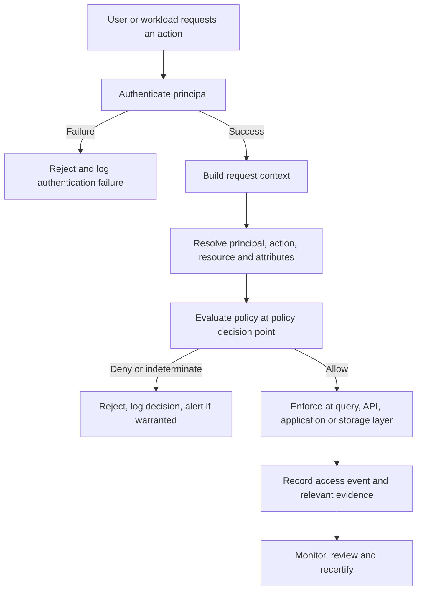
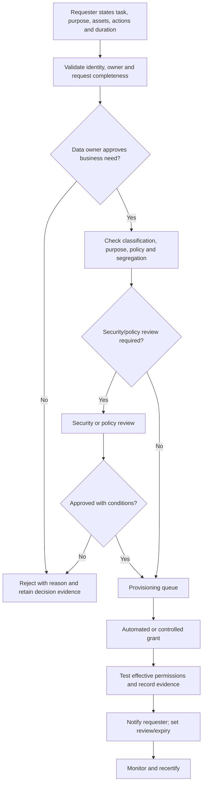

# Identity, Access Control and Least Privilege

**Repository target:** `Stage 2D — Data Architecture/10-Data-Governance-Security-Privacy-and-Compliance/03-identity-access-control-and-least-privilege.md`  
**Level:** Beginner → Intermediate → Advanced  
**Estimated study time:** 7–9 hours, consistent with the module roadmap  
**Case study:** Northbridge Bank (fictional); all records and values are synthetic  
**Status of details:** The module roadmap defines the scope, progression, core exercises, deliverables, common mistakes, mastery criteria, and completion gate. The roadmap explicitly says this topic file was empty when the roadmap was written. The detailed examples, policies, diagrams, matrices, and acceptance checks in this lesson are recommended teaching material, not claims about previously existing repository content or universal requirements.

> **Educational and legal boundary:** This is an architecture learning document, not legal advice, a compliance certification, or a claim that a particular control is sufficient for a particular organisation. Validate applicable obligations and risk decisions with the appropriate security, privacy, legal, risk, and business owners.

---

## 1. Topic overview

Access control answers: **who or what may perform which action on which resource, under which conditions?** Identity provides a representation of the person, service, or workload making a request. Authentication establishes confidence in that identity. Authorization evaluates whether the authenticated principal may perform the requested action on the requested resource in the current context.

Least privilege is the practice of granting only the permissions needed for an approved task, only to the appropriate identity, and only for as long as necessary. It includes limiting data scope, operations, environments, time, and administrative power—not merely avoiding a role named `admin`.

### 1.1 Learning objectives

By the end of this lesson, you should be able to:

1. Distinguish identity, authentication, authorization, principal, role, group, permission, policy, resource, and action.
2. Distinguish human, external, service, and workload identities and explain why pipelines should not use a person's credentials.
3. Compare role-based access control (RBAC), attribute-based access control (ABAC), and hybrid models.
4. Design least-privilege permissions at platform, dataset, table, column, row, and operation levels.
5. Separate business approval, policy ownership, technical provisioning, enforcement, and independent review.
6. Design access request, approval, provisioning, review, expiry, mover, leaver, emergency, and revocation workflows.
7. Control service-to-service access, privileged access, tenancy boundaries, and cross-domain sharing.
8. Identify inheritance conflicts, direct-storage bypasses, privilege escalation, stale grants, and confused-deputy risks.
9. Produce a role and access matrix with justifications, approvers, review cadence, and revocation expectations.
10. Define evidence and metrics that show whether access controls operate as designed.

### 1.2 Prerequisites and learning order

The module roadmap identifies prerequisites as **Sequence 1–2** and **P8: `../08-Cloud-Hybrid-and-Multi-Cloud-Data-Architecture/05-networking-identity-and-private-connectivity.md`**. In practical terms, be comfortable with the governance operating model and data classification before designing access. Review the networking/identity prerequisite for identity federation, private connectivity, and trust boundaries.

Recommended learning order:

- **Beginner:** terminology, authentication versus authorization, identity types, and RBAC/ABAC foundations.
- **Intermediate:** role design, fine-grained data access, approvals, least privilege, service identities, privileged access, review, and revocation.
- **Advanced:** policy precedence, multi-platform consistency, bypass analysis, threat modelling, purpose-based access, policy evaluation and cache risks, metrics, exceptions, and an architecture decision record (ADR).

### 1.3 Why this matters in production

A data platform may contain public reference data, internal operational metrics, confidential commercial information, and restricted personal or financial data. If permissions are broad or inconsistent, the result may be data exposure, fraud, privacy harm, operational disruption, untraceable changes, or an inability to demonstrate who accessed data.

A network boundary does not authorize a request. A valid identity is not automatically entitled to all data. Encryption does not replace authorization. Even a properly authorized user or service can misuse legitimate access; purpose restrictions, monitoring, minimization, separation of duties, and response procedures remain important.

---

## 2. Core vocabulary

| Term | Meaning | Example |
|---|---|---|
| **Identity** | A representation of a person, service, device, or workload | Employee identity `analyst-042` (synthetic) |
| **Principal** | The identity or security subject evaluated by a policy system | A user, workload identity, or federated partner |
| **Authentication (AuthN)** | Establishing confidence that a principal is who it claims to be | Sign-in with a strong authenticator |
| **Authorization (AuthZ)** | Deciding whether a principal may perform an action on a resource | Allow read of a masked customer view |
| **Group** | A collection of identities managed together | `risk-analysts` |
| **Role** | A named bundle of permissions or duties | `RiskAnalystRead` |
| **Permission** | An allowed operation on a defined scope | `SELECT` on a specified view |
| **Action** | The operation requested | Read, write, delete, export, administer |
| **Resource** | The object being accessed | Catalog, dataset, table, column, row, file, key, or job |
| **Policy** | Rules that determine allow, deny, or additional conditions | Only allow approved purpose and domain |
| **Entitlement/grant** | A permission assigned to a principal or role | Read access to a masked view |
| **Policy decision point (PDP)** | Component that evaluates the policy | Authorization service or policy engine |
| **Policy enforcement point (PEP)** | Component that applies the decision | Query engine, API, storage gateway, application |
| **Identity provider (IdP)** | System that authenticates identities and may issue claims | Corporate identity service |
| **Federation** | Trust relationship allowing one identity system to be accepted by another | Workload exchanges an identity assertion for a scoped credential |
| **Privileged access** | Access with elevated control or broad impact | Change permissions, administer platform, access key-management settings |
| **Access review/recertification** | Periodic confirmation that existing access is still needed and appropriate | Owner reviews analyst grants quarterly |
| **JIT access** | Just-in-time elevation granted for a limited task and duration | Approved 45-minute incident investigation session |
| **Break-glass access** | Exceptional emergency access path when normal workflow is unavailable | Restricted emergency account, monitored and reviewed afterward |

A **user** is not the same thing as a **role**. A person may hold multiple roles; a role may be assigned to a managed group; and the effective permissions are the result of all applicable grants, policies, resource boundaries, and contextual conditions.

### 2.1 Authentication versus authorization

Authentication asks, “Who is making this request, and how do we know?” Authorization asks, “Given the identity and context, may this request proceed?”

| Aspect | Authentication | Authorization |
|---|---|---|
| Main input | Credentials, authenticators, identity assertions | Principal, action, resource, context, policy |
| Main output | Authenticated identity/session/claims or failure | Permit, deny, or indeterminate (with a reason where supported); a policy may separately require step-up authentication before retrying |
| Typical failure | Invalid credential, expired assertion, failed MFA | Missing grant, prohibited purpose, denied classification, policy conflict |
| Common mistake | Treating a successful sign-in as universal permission | Checking role membership but ignoring resource scope or context |

**Worked example — synthetic Northbridge Bank**

1. A fictional analyst signs in through the bank's corporate identity provider.
2. The identity provider validates the authentication factors and issues a short-lived identity assertion.
3. The analyst requests `SELECT` on `risk.customer_case_masked`.
4. The query service identifies the principal, requested action, target asset, declared purpose, and relevant attributes.
5. The authorization policy checks group/role membership, the data owner's approved access, classification, environment, and whether the masked view is allowed for the stated purpose.
6. If every required condition passes, the query engine permits that operation. Otherwise it denies the request and records a suitable decision event.
7. The query engine—not the user's successful sign-in—enforces the data operation.

Authentication does not mean authorization. If policy requires stronger authentication, complete that step and then evaluate authorization again; step-up authentication is not itself an authorization grant. Authorization also does not guarantee that the use is ethical or within all business rules. The platform needs controls and evidence around both.

---

## 3. Identity types and lifecycle

### 3.1 Human identities

Human identities represent employees, contractors, analysts, administrators, auditors, and other people. Prefer unique, attributable identities and managed groups over shared accounts. Workforce identity should normally originate from the organisation's approved identity lifecycle and federation process.

**Why it matters:** individual attribution supports access reviews, incident investigation, and prompt removal when a person changes role or leaves.

**Common errors:** shared analyst logins, long-lived local accounts outside central lifecycle, using a personal account for production pipelines, and leaving access after a contractor engagement ends.

### 3.2 External and partner identities

External identities represent approved vendors, business partners, or other organisations. Use explicit trust boundaries, narrow scopes, expiration, and a named internal sponsor. Do not assume that a partner's identity assertions or security posture are equivalent to internal workforce identities.

### 3.3 Service accounts and workload identities

A **service account** is a non-human principal used by software. A **workload identity** is an identity bound to a running workload or execution environment. Terminology varies between platforms; the architectural requirement is to give software a distinct, attributable identity with narrowly scoped permissions and a managed lifecycle.

For a pipeline, prefer workload identity federation or another approved mechanism that obtains short-lived credentials over embedding static secrets in source code, notebooks, container images, or configuration files.

**Example:** `nb-risk-daily-aggregate` may read a specifically approved set of source tables and write to `risk_mart.daily_aggregate`. It does not need account administration, unrestricted storage access, or permission to read raw identity documents.

Do not reuse one all-powerful identity across twenty unrelated jobs. Separate identities by workload, environment, and trust boundary where the blast-radius reduction justifies the operational overhead.

### 3.4 Non-human identity lifecycle

A recommended lifecycle:

1. **Request:** workload owner states business purpose, source and target assets, operations, environment, schedule, and owner.
2. **Review:** data owner approves data access; platform/security reviews identity design and risk as appropriate.
3. **Create:** platform automation provisions a unique identity and the minimum necessary grants.
4. **Bind:** workload receives identity through the approved runtime mechanism; credentials are not copied into source code.
5. **Monitor:** record authentication and authorization events; detect unusual access and failures.
6. **Review:** recertify ownership, scope, and continued use on a risk-based cadence.
7. **Change:** revise grants when the workload, purpose, or data flow changes.
8. **Retire:** revoke grants and disable the identity when the workload is removed; verify dependent jobs do not still rely on it.

Required metadata should include a stable identity ID, owner, purpose, environment, approved resources/actions, creation date, last-used signal where available, review date, expiry or retirement condition, and links to the request/evidence. Avoid placing secrets in the identity inventory.

### 3.5 Why pipelines must not use a person's credentials

A pipeline running as an employee inherits the employee's access and lifecycle. It can fail when that employee leaves, overreach into unrelated data, and make audit events ambiguous. A dedicated workload identity provides job-level scope, clearer attribution, independent revocation, and a smaller blast radius.

---

## 4. Least privilege and related principles

### 4.1 Least privilege

Grant the minimum permissions required to perform an explicitly approved task, on the smallest useful scope, for the shortest reasonable duration.

Apply least privilege across multiple dimensions:

- **Principal:** which user or workload?
- **Resource:** which catalog, dataset, table, column, row, file, key, or environment?
- **Action:** read, write, append, update, delete, export, share, or administer?
- **Context:** purpose, domain, device or workload trust, environment, and risk signals where relevant?
- **Time:** standing or time-bound; expiry and review conditions?
- **Volume and route:** whether bulk export, direct storage, or replication is allowed?
- **Administration:** can the principal change policies, grants, keys, or audit settings?

Start from no access and add justified grants. “It may be useful later” is not a valid justification. A role with no grants is safer than a broad default role.

### 4.2 Need-to-know and purpose limitation

**Need-to-know** means access is limited to information necessary for a legitimate task. A person who can investigate aggregate portfolio risk may not need raw customer identifiers. Purpose-based access adds a condition that data use must align with a declared and approved purpose. Purpose claims must be meaningful, auditable, and not freely self-asserted when the risk requires stronger validation.

### 4.3 Default deny

Default deny means a request is denied unless a policy explicitly permits it. It reduces accidental exposure when a new dataset or principal appears. It must be implemented consistently: if one layer defaults to deny but a direct file path remains publicly readable, the overall system is not default deny.

**Trade-off:** strict deny can interrupt valid work when metadata or policy dependencies fail. Define safe failure behavior, operational alerting, and a documented emergency process. Do not quietly turn unknown metadata into broad access.

### 4.4 Separation of duties

Separate incompatible responsibilities where the risk warrants it. Typical separations include:

- Requester ≠ approver.
- Data owner approves business access; platform operator provisions and enforces it.
- Developer cannot unilaterally approve their own production deployment.
- Platform administrator does not automatically receive permission to read business data.
- Policy author and independent reviewer are distinct for high-impact policy changes.
- Auditor can inspect evidence but should not silently modify the controls being audited.

Small teams may not support perfect separation. Record the compensating control, independent review, and residual risk rather than pretending the conflict does not exist.

### 4.5 Administrative access versus data access

Control-plane permissions manage the platform: identities, policies, compute, network, storage configuration, or audit settings. Data-plane permissions read or alter the data itself. These are different powers.

An administrator may need to operate infrastructure without routine access to raw customer records. Conversely, a data analyst may need read access to a curated view without permission to change storage policy or create new principals.

---

## 5. Authorization flow

The following is a conceptual flow. Real systems may combine components or use different names, but the responsibilities should remain clear.

### 5.1 Responsibilities in the flow

- **Authentication layer:** verifies the principal and issues a trustworthy identity/session assertion.
- **Context resolution:** obtains resource metadata, classification, owner, environment, purpose, and trusted identity attributes.
- **Policy decision point:** evaluates policy and returns a decision with a reason or policy identifier where supported.
- **Policy enforcement point:** actually blocks or permits the operation. A policy document or catalogue label alone does not enforce anything.
- **Audit/monitoring:** records decisions and relevant successful access, protects logs from tampering, and routes suspicious activity for investigation.

**Production implication:** ensure enforcement covers every route to the data. If row filters exist only in a BI tool, users with direct warehouse or object-storage access may bypass them. If a query engine applies column restrictions but raw files can be read directly, the architecture has a policy bypass.

### 5.2 Failure and indeterminate decisions

A policy engine may return “indeterminate” if a required attribute, policy, or dependency is unavailable. For sensitive data, the safe default is usually to deny or fail closed, while producing an operational alert. There may be availability-sensitive cases where an approved fallback is needed, but it must be explicitly designed, bounded, monitored, and risk-accepted—not an accidental “allow if policy service fails.”

---

## 6. RBAC, ABAC, and hybrid authorization

### 6.1 Role-based access control (RBAC)

RBAC assigns permissions to roles and assigns users or workloads to those roles. A role should represent a coherent job function or responsibility, not a convenience bundle.

Example:
- `RiskAnalystMaskedRead`: read approved masked risk views.
- `RiskDataEngineerPipeline`: read named source tables and write named risk outputs.
- `DataPlatformOperator`: administer approved platform components but not automatically read restricted business data.
- `AuditEvidenceReader`: read access logs and control evidence without changing policy.

**Strengths:** understandable, familiar, easier to review, and useful for stable job functions.

**Weaknesses:** roles can become broad, role combinations can create unexpected effective permissions, and large numbers of domain × classification × action combinations can cause “role explosion.”

The roadmap illustrates this with 6 domains × 4 classification levels × 3 actions = 72 roles if every combination becomes a role. This is an illustration, not a universal prediction.

### 6.2 Attribute-based access control (ABAC)

ABAC evaluates attributes of the principal, resource, action, and context. Example attributes include:

- Principal: team, job function, clearance, employment status, workload identity, approved purpose.
- Resource: owner domain, classification, environment, asset type, permitted purposes.
- Action: read, write, export, administer.
- Context: time window, request origin, incident state, or other trusted signal.

Illustrative policy intent:

> Permit a read of a masked dataset when the principal is active, belongs to an approved analytics team, has an approved purpose, and the asset's classification and domain rules permit that access. Deny raw restricted-field access unless a separate explicit policy and approval apply.

This is a policy statement, not executable syntax. Real implementations must define trusted attribute sources, missing-value behavior, precedence, test cases, and enforcement points.

**Strengths:** fine-grained rules can scale better when attributes are well governed and change frequently.

**Weaknesses:** policy complexity, attribute quality, test burden, debugging difficulty, and potentially opaque decisions. If users can forge attributes such as `approved=true`, ABAC is not trustworthy. Attributes must come from reliable, controlled sources.

### 6.3 Hybrid model

A hybrid model uses RBAC for coarse eligibility and ABAC for fine-grained constraints. For example, membership in `RiskAnalyst` makes a principal eligible to request risk data; ABAC then checks the dataset, classification, purpose, environment, and row/column conditions.

A recommended pattern is **role as a starting boundary, attributes as additional constraints**—not “the role allows it, so ignore all other conditions.”

### 6.4 Choosing a model

| Criterion | RBAC often fits when… | ABAC often fits when… | Hybrid often fits when… |
|---|---|---|---|
| Job functions | Stable and clear | Roles vary too much | Stable broad roles with variable data scope |
| Data attributes | Few fine-grained conditions | Classification/domain/purpose drive decisions | Both role and data context matter |
| Auditability | Simple grant review is priority | Attributes and decisions can be logged/tested | Role membership plus policy reason are captured |
| Change rate | Role changes are infrequent | Attribute rules adapt to frequent changes | Some changes belong to roles, others to attributes |
| Operational maturity | Role lifecycle is manageable | Attribute governance and policy testing are mature | Team can govern both layers and precedence |

Do not choose ABAC simply because it sounds more advanced. Choose the least complex model that correctly expresses requirements and can be tested, operated, and audited.

### 6.5 Policy precedence and conflicts

An architecture must define how policies combine. One conservative pattern is:
1. An explicit prohibition or hard boundary blocks the request.
2. All mandatory conditions must pass.
3. A grant permits only the named action and scope.
4. Missing required attributes cause denial or an explicit indeterminate result.
5. Conflicts are logged and routed to the policy owner; no broad implicit allow is created.

This is a recommended design pattern, not a universal rule for every authorization product. Document exact precedence, inheritance, exception handling, and safe failure behavior in an ADR. Test combinations of direct grants, group membership, inherited permissions, denies, resource policies, and emergency exceptions.

---

## 7. Model roles, permissions, resources, and attributes

### 7.1 Scope permissions precisely

A permission should be expressible as a tuple:

`(principal or role, action, resource scope, conditions, duration, approval reference)`

For example:

`(RiskAnalystMaskedRead, SELECT, risk.customer_case_masked, approved-purpose=case-analysis, standing-with-quarterly-review, REQ-1042)`

This is a human-readable design record, not a claim about any vendor's syntax.

Avoid vague grants such as “access to risk data.” Specify whether it means list metadata, query a view, read raw storage objects, export results, write tables, create credentials, administer policies, or decrypt using a key.

### 7.2 Synthetic role-permission matrix

Northbridge Bank's example roles below are illustrative. They must be tailored to actual business duties, asset classifications, and platform capabilities.

| Role / identity | Masked curated view | Raw restricted identifiers | Write approved mart | Change access policy | Read audit evidence | Default review |
|---|---|---|---|---|---|---|
| Marketing analyst | Read, approved marketing scope | Deny | Deny | Deny | Deny | Quarterly |
| Risk analyst | Read, approved risk scope | Deny by default; time-bound exception if justified | Deny | Deny | Limited own-access evidence if needed | Quarterly |
| Risk pipeline workload | Read named inputs; no interactive browsing | Only specifically approved fields if the job requires them | Write named output only | Deny | Emit its own operational logs; no alteration | Per release and quarterly owner review |
| Data steward | Read metadata and approved quality samples | Masked by default; raw access separately approved | Deny by default | Propose metadata changes, not grant access | Read relevant lineage/quality evidence | Quarterly |
| Platform operator | Administer assigned platform components | Deny by default | Operational duties only | Provision approved changes through controlled workflow | Read operational logs as needed | Monthly or risk-based |
| Security operator | Security telemetry and policy evidence | No routine business-data read | Deny | Manage security controls under separation of duties | Read security audit evidence | Monthly or risk-based |
| Internal auditor | Read approved evidence and logs | Raw data only if explicitly scoped for audit and approved | Deny | Deny | Read | Engagement-based and periodic |
| Emergency responder | Only scoped emergency permissions | Only if necessary for incident | Only if necessary for recovery | Time-limited as authorized | Record and review afterward | Every use plus periodic account review |

**Interpretation notes:**
- “Deny by default” means no grant is present unless a specific approved path exists.
- The matrix is not a complete policy; each grant must name actual assets and actions.
- “Administer platform” does not automatically include reading business records.
- If a platform cannot enforce a requested granularity, document the gap and add compensating controls or choose another design.
- No wildcard grants are included. Wildcards may be technically possible but require exceptional justification and risk review; they are not the baseline.

### 7.3 Identity and access inventory

Track human and non-human identities. Suggested fields:

| Field | Example (synthetic) | Purpose |
|---|---|---|
| Identity ID | `workload-nb-risk-daily-v1` | Stable unique reference |
| Type | Workload | Lifecycle and control design |
| Owner | Risk Data Engineering | Accountability |
| Purpose | Build daily risk aggregate | Scope justification |
| Environment | Production | Boundary |
| Approved resources | Named source tables and one target mart | Scope |
| Actions | Read named sources; write target | Least privilege |
| Authentication method | Federated workload identity | Credential approach |
| Approver/reference | Risk data owner; `REQ-1042` | Evidence |
| Created / last used | Synthetic timestamps | Lifecycle review |
| Review / expiry | Quarterly; retirement on job removal | Recertification |
| Status | Active | Lifecycle state |

Do not store passwords, access tokens, private keys, recovery codes, or other secrets in this inventory.

---

## 8. Fine-grained data access

Authorization can be applied at different layers. Each layer has a distinct purpose, and controls must be consistent across all paths.

### 8.1 Platform and dataset level

Examples:
- Only the data engineering team can create objects in a production raw zone.
- Marketing can query its approved curated datasets, not every dataset in the warehouse.
- A partner can access one shared data product, not the whole internal catalog.

Dataset-level grants are easy to reason about but may be too coarse when a table contains fields with different sensitivity or rows belonging to different tenants.

### 8.2 Table and operation level

Distinguish operations:
- `SELECT` / read
- `INSERT` / append
- `UPDATE` / modify
- `DELETE` / remove
- `CREATE` / create objects
- `ALTER` / change schema
- `EXPORT` / move data outside the controlled environment
- `GRANT` / change permissions
- `ADMIN` / manage platform resources

A read-only analyst should not receive write, delete, export, or grant permissions merely because the interface groups them into one “data access” permission.

### 8.3 Column-level restrictions

Synthetic table `customer_profile`:

| Column | Illustrative label | Analyst default | Rationale |
|---|---|---|---|
| `customer_segment` | Internal | Read in approved context | Needed for segmentation |
| `region_code` | Internal | Read in approved context | Lower-granularity analysis |
| `customer_token` | Confidential | Read only in approved-purpose views | Stable token may still enable linkage |
| `national_id` | Restricted | Deny or use masked/tokenized representation | High impact if exposed |
| `account_balance` | Confidential/Restricted depending on scheme | Aggregated or explicitly scoped access | Financial detail and misuse impact |

These labels are examples, not a legal taxonomy. The actual level should follow the classification scheme and assessed risk.

Implement column restrictions with a policy-capable query layer, curated views, masking, or another enforceable mechanism. Do not assume hiding a column in a dashboard prevents access through SQL, APIs, exports, or direct files.

### 8.4 Row-level restrictions

Rows may be scoped by business domain, tenant, region, case assignment, or another approved attribute. For example, a risk analyst may read only the synthetic cases assigned to their approved team:

`permit row when row.owner_team = principal.approved_team AND purpose = "case-analysis"`

This is illustrative policy logic, not executable syntax. Define how attributes are sourced and how missing or conflicting values behave.

Row-level security must be enforced where queries execute and must be tested for alternate access paths, joins, exports, and cached results. Do not rely solely on a UI filter that the user can remove.

### 8.5 Direct-storage bypass

A query engine may enforce row filters and column masking while the underlying files remain readable to a broad storage group. A user or workload could bypass the query engine and read the files directly.

Mitigations include:
- Restrict direct object/file access to narrowly scoped platform identities.
- Route users through controlled query/serving layers.
- Align storage policies with the intended access model.
- Test direct path, export, replication, notebook, and backup access.
- Record the enforcement boundary and known limitations.

This is a key architecture review item, not an optional implementation detail.

---

## 9. Ownership, approval, provisioning, and enforcement

These responsibilities must not be conflated.

| Responsibility | Typical accountable function | What it decides or does |
|---|---|---|
| Business data ownership | Data owner | Whether access fits business need, permitted use, and data risk |
| Policy ownership | Governance/security policy owner | Defines common policy standards and precedence |
| Identity lifecycle | Workforce IAM / workload owner | Creates, disables, and maintains identity records |
| Technical provisioning | Platform/IAM operator or automation | Implements an approved grant |
| Policy enforcement | Query engine, API, application, storage, or policy gateway | Applies allow/deny and fine-grained restrictions |
| Monitoring and response | Security operations / platform operations | Detects unusual behavior and investigates |
| Independent assurance | Audit or designated independent reviewer | Tests whether control design and operation are evidenced |

The same organisation may combine some roles, but high-risk changes should have explicit checks against self-approval and uncontrolled administration.

### 9.1 Access request and approval workflow

The diagram shows the default request-and-approval route. An organisation may also define pre-approved standard entitlements for low-risk requests; that path must be explicitly documented, limited to eligible identities/assets/actions, enforced by policy, logged, and periodically reviewed. It must not become an informal bypass of ownership or policy. The exact path depends on classification, operation, duration, purpose, and risk. Do not force a new human approval for every low-risk action if the approved policy model already authorizes it; do require meaningful review for high-impact or exceptional access.

### 9.2 Example access request

**Synthetic request `REQ-1042`**
- Requester: Risk analyst group member.
- Task: Investigate an anomaly in synthetic case data.
- Asset: `risk.customer_case_masked`.
- Action: Read/query only; no export.
- Purpose: `case-analysis`.
- Duration: 5 business days.
- Owner decision: Approve masked view; raw identifiers not required.
- Security/policy review: Not required for this pre-approved low-risk role under the example's assumptions.
- Provisioning: Add user to a managed group or grant equivalent scoped entitlement.
- Validation: Test that masked view is readable and raw identifier table is denied.
- Expiry: Remove grant at the end of five business days; send confirmation and record evidence.
- Evidence: Request record, approval, before/after effective permission snapshot, expiry job result, and access logs.

This is a worked design example, not a universal approval rule.

### 9.3 Joiner–mover–leaver lifecycle

- **Joiner:** establish identity, assign baseline role only, and grant additional access through approved request.
- **Mover:** reassess the old and new role; do not simply add the new role. Remove permissions no longer needed.
- **Leaver:** disable identity and revoke sessions/credentials/grants according to a defined response target; verify downstream systems and cached credentials.
- **Contract end:** use the end date to trigger disablement and access review.
- **Workload retirement:** revoke its permissions, disable identity, remove trust bindings, and verify no scheduled job still uses it.

A revocation target must be stated and justified. For example, Northbridge might choose a synthetic target of 4 hours for ordinary workforce offboarding and 15 minutes for a confirmed high-risk credential compromise. These are illustrative internal targets, not regulatory requirements. Measure actual time from trigger to effective denial, not just the time the ticket was closed.

### 9.4 Access review and recertification

A review should confirm:
1. Does the identity still exist and have a valid owner?
2. Is the purpose still current?
3. Are the resource and operation scopes still required?
4. Are sensitive columns, rows, export routes, and direct storage paths controlled?
5. Is the grant standing, temporary, or expired?
6. Are there conflicting or inherited grants?
7. Is the role still the right role, or has the person accumulated several?
8. Is the evidence complete, and are exceptions within expiry?
9. Does the actual effective permission match the approved record?

Recommended workflow:
- Build a complete snapshot of effective access, not only direct grants.
- Group grants by owner and risk to make review practical.
- Ask owners to approve, reduce, or revoke each meaningful entitlement.
- Escalate unreviewed high-risk grants; do not treat silence as approval.
- Apply changes and validate effective access.
- Retain the review decision, evidence, exceptions, and remediation dates.

Cadence should be risk-based. The example matrix uses quarterly reviews for many data roles and more frequent review for privileged access; actual cadence is an organisation decision based on risk and obligations.

---

## 10. Temporary, privileged, emergency, and break-glass access

### 10.1 Temporary and just-in-time access

Use time-bound access when the task is temporary, sensitive, or infrequent. Include a specific task, resource scope, approved actions, start/end time, approver, monitoring, and automatic expiry. Verify that expiry removes effective access across inherited groups, caches, tokens, and downstream systems where applicable.

Temporary does not mean harmless. A five-minute grant with broad export rights may still cause irreversible data loss.

### 10.2 Privileged access

Privileged access can change policies, create principals, disable logging, administer keys, or access broad data scopes. Recommended controls include:
- Separate privileged identities or elevation paths from ordinary use.
- Just-in-time elevation with a ticket or incident reference.
- Strong authentication and step-up for high-risk operations.
- Time limit and narrow action scope.
- Approval and, where appropriate, session recording.
- Alerts for policy changes, bulk exports, grant creation, and audit-log changes.
- Independent review after the operation.

Avoid giving permanent global administration to an engineer because it is convenient. Platform administration should not automatically imply permission to query restricted business data.

### 10.3 Break-glass access

Break-glass is a tightly controlled emergency path for cases where normal approval or identity infrastructure is unavailable and delay would materially increase harm. It is not a workaround for ordinary friction.

Design requirements:
- Explicit emergency use criteria and named custodians.
- Strongly protected credentials or emergency identity; no secrets in documentation.
- Minimum emergency scope and an expiry/disablement plan.
- Monitoring and alerting on every use.
- A reason, incident reference, start/end time, actions taken, and data accessed.
- Prompt post-event review by someone other than the user where feasible.
- Rotation or reset of emergency credentials after use when applicable.
- A test plan that does not expose real secrets or disrupt production.

Emergency access must not silently bypass audit logging. If a logging dependency fails, define the allowed fallback and ensure independent evidence is captured.

---

## 11. Service-to-service authorization

A service identity should receive access for a single workload's declared function, not the union of every developer's privileges.

### 11.1 Example: daily risk aggregate

Synthetic workload `workload-nb-risk-daily-v1`:
- **Owner:** Risk Data Engineering.
- **Purpose:** produce daily aggregated risk metrics.
- **Read scope:** two named approved source views.
- **Write scope:** one named target mart.
- **Denied:** interactive human sign-in, grant administration, raw identity-document access, unrestricted export, access to unrelated domains.
- **Authentication:** approved workload identity mechanism that produces short-lived credentials.
- **Review:** owner review after a material code/data-flow change and periodic recertification.
- **Retirement:** disable identity and remove grants when the job is decommissioned.
- **Monitoring:** successful/failed authorization, source and target access, unusual volume, changes in schedule or deployment identity.

The design intentionally avoids specifying a vendor or a credential value. Never embed a real secret in a code sample or documentation.

### 11.2 Confused-deputy risk

A **confused deputy** occurs when a service with broad authority is tricked into using that authority on behalf of a caller who should not have it. For example, an AI retrieval service may have access to every domain, then return a restricted document to a user who is not entitled to it.

Mitigations:
- Carry the caller's authenticated identity or a verifiable delegated context.
- Authorize each requested resource against the caller's permissions and purpose.
- Scope service credentials to the minimum data needed.
- Avoid trusting user-supplied identity or classification attributes.
- Log both the caller and the service identity, plus the authorization decision.
- Test cross-tenant and cross-domain requests.
- Do not let a broad service entitlement silently override the caller's restrictions.

For AI, notebooks, feature stores, and retrieval systems, **retrieval must respect the caller's permissions**, not merely the service's maximum permissions.

---

## 12. Tenancy, environments, and cross-domain sharing

### 12.1 Tenancy boundaries

For multi-team or multi-tenant platforms, decide whether isolation is logical, policy-based, physical, or a combination. Identify the tenant/domain in the principal context and resource metadata, and enforce the boundary at every route.

A row filter is not a sufficient tenant boundary if the user can access the raw table or object store. For high-impact tenants, consider separate resources or stronger isolation where the threat model warrants it.

### 12.2 Environment separation

Development, test, and production should have explicit identity and permission boundaries. Developers generally should not need unrestricted production data access to test code. Use synthetic or appropriately transformed data for non-production whenever possible, and make any production access exceptional, scoped, and auditable.

Separate:
- principals and credentials;
- resources and data stores;
- policy administration;
- deployment permissions;
- secrets and key access;
- audit evidence and monitoring.

A “test” identity should not accidentally have production permissions because roles were copied without environment conditions.

### 12.3 Cross-domain data sharing

A sharing workflow should record:
- source and receiving domain/organisation;
- data owner and recipient sponsor;
- specific data product and fields;
- purpose and permitted uses;
- classification and handling requirements;
- allowed operations, environment, and delivery route;
- duration, onward-sharing constraints, and revocation conditions;
- audit evidence and accountable contacts.

Use a curated, minimized data product or view when possible rather than granting direct access to a source system. Confirm that the recipient's access path cannot bypass masking, row restrictions, retention controls, or monitoring.

---

## 13. Integrating classification, privacy, encryption, and retention

Access policy depends on the classification and ownership metadata established in earlier topics.

| Input or control | How it influences access | Example |
|---|---|---|
| Classification | Determines eligible roles, required restrictions, and review intensity | Restricted identifiers denied to ordinary analyst role |
| Data owner | Approves business need and permitted access | Risk owner approves access to risk case view |
| Purpose limitation | Constrains the intended use | Data available for fraud investigation, not unrelated marketing |
| Consent or other permitted-use state | May affect whether a personal-data use is allowed; specialist interpretation may be needed | Policy checks a trusted purpose/eligibility attribute |
| Masking/tokenization | Reduces exposure for routine use | Analysts receive tokenized customer IDs |
| Encryption/key access | Restricts access to ciphertext through controlled key use | Storage reader still cannot decrypt without key authorization |
| Retention/deletion | Limits duration and continued availability | Deleted/expired dataset must not remain accessible in replicas |
| Audit evidence | Makes decisions and operations reviewable | Record request, approval, policy version, and access decision |
| Monitoring | Detects unusual or prohibited behavior | Alert on bulk access or repeated denied attempts |

**Important:** encryption does not replace authorization. An identity may be authorized to reach a storage system but not permitted to use a decryption key; conversely, access to a key does not itself justify reading every dataset encrypted under it. Keep key-use authorization and data authorization aligned.

Likewise, a classification label alone does not enforce a restriction. It must be consumed by policy logic and enforced by the query engine, API, application, storage system, or other relevant control point. Test that the label is present, interpreted correctly, propagated, and enforced.

---

## 14. Policy inheritance, conflicts, and privilege escalation

### 14.1 Effective permissions

A principal's effective access may come from direct grants, group membership, nested groups, role assignments, inherited resource permissions, policy conditions, temporary elevation, and service delegation. Reviewing only direct grants can miss dangerous access.

A role that seems narrow can become broad when combined with another role. For example, a user might have read permission on a masked view plus a separate storage-read permission that enables access to the underlying raw files.

### 14.2 Common failure patterns

| Failure | Why it matters | Detection / mitigation |
|---|---|---|
| **Privilege accumulation** | Old role grants remain after team changes | Recompute effective permissions; mover workflow removes old grants |
| **Overbroad role** | One role gives more data or actions than needed | Split by function/scope; justify every permission |
| **Stale identity** | Former employee or retired job retains access | Lifecycle triggers, periodic inventory reconciliation, disablement tests |
| **Shared account** | Actions cannot be attributed reliably | Individual or workload identities |
| **Self-approval** | Requester can grant themselves access | Separation of duties and independent approval |
| **Direct-storage bypass** | Query restrictions can be bypassed | Restrict storage paths and test alternate access |
| **Policy conflict** | Different systems return different decisions | Central intent, explicit precedence, conformance tests |
| **Stale cache/token** | Revoked access remains effective temporarily | Define revocation SLO, shorten token/cache lifetimes where justified, test propagation |
| **Attribute spoofing** | Caller forges team, purpose, or tenant | Trust only controlled attributes; validate provenance |
| **Confused deputy** | Broad service uses its authority for a restricted caller | Delegated context, caller-aware authorization, scoped service identity |
| **Audit tampering** | Administrator can hide unauthorized changes | Protect logs separately, alert on log/policy changes, independent retention |
| **Fail-open dependency** | Policy service outage accidentally permits access | Explicit fail mode, safe fallback, monitoring and tested recovery |

### 14.3 Threat analysis

| Threat actor / event | Attack path | Potential impact | Controls to consider | Evidence |
|---|---|---|---|---|
| Compromised analyst account | Use valid session to export more data than needed | Confidentiality loss | Least privilege, export controls, step-up, anomaly monitoring | Session, decision, export, and alert records |
| Malicious or careless insider | Legitimate query used for unrelated purpose | Misuse of authorized access | Purpose constraints where enforceable, minimization, audit, oversight | Query/access history and review outcome |
| Compromised pipeline | Workload token used outside its intended job | Bulk data access or alteration | Per-job identity, scoped grants, short-lived credentials, deployment integrity | Identity issuance and access logs |
| Privilege escalation | User can alter grants or assume a broader role | Broad unauthorized access | Separate admin roles, change approvals, deny privilege mutation to data roles | Grant-change events and approvals |
| Tenant boundary failure | Missing tenant condition in one path | Cross-tenant data exposure | Server-side tenant enforcement, isolated resources where needed, negative tests | Test results and denied cross-tenant attempts |
| Authorization service outage | Enforcement point allows on dependency failure | Uncontrolled access | Defined fail-closed/controlled fallback, health alerts, resilience tests | Failure-mode test and incident records |

Controls reduce risk; they do not guarantee zero misuse. Threat models should consider likelihood, impact, detection, response, and residual risk.

---

## 15. Access logging, reviews, metrics, and evidence

### 15.1 What to log

Subject to minimization and applicable policy, record enough to reconstruct important decisions:

- timestamp and correlation/request ID;
- principal ID and identity type;
- caller and service identity for delegated calls;
- action and resource identifier;
- purpose/context attributes used for the decision, avoiding unnecessary sensitive payloads;
- allow/deny/indeterminate outcome and reason/policy version where supported;
- source application or workload, environment, and relevant origin signal;
- data volume or export event when material;
- elevation, approval, policy change, grant/revocation, and break-glass events.

Do not log passwords, bearer tokens, private keys, or full sensitive rows just to prove access occurred. Logs themselves may be sensitive and require access controls, retention rules, integrity protection, and monitoring.

### 15.2 Evidence plan

| Control objective | Example evidence | Validation |
|---|---|---|
| Only approved users can query a restricted view | Approved request, effective permission snapshot, policy configuration | Negative test using an unapproved principal |
| Column masking is applied | View/policy definition and test output with synthetic data | Compare authorized and unauthorized result sets |
| Row restriction isolates domains | Policy definition and synthetic cross-domain tests | Attempt cross-domain read and confirm denial |
| Workload scope is narrow | Identity inventory, grant list, job manifest | Confirm source and target allowlist; test denied unrelated asset |
| Access is reviewed | Review snapshot, owner decision, remediation tickets | Check completion, overdue grants, and post-review effective access |
| Revocation works | Trigger timestamp, disablement result, test request after revocation | Measure effective denial time across relevant paths |
| Emergency access is governed | Break-glass event, incident reference, review and reset evidence | Verify each use receives a post-event review |
| Policy changes are controlled | Change request, approval, version, deployment evidence | Confirm separation and rollback path |

### 15.3 Metrics

Metrics should drive action rather than merely report activity. Define numerator, denominator, owner, period, target, and response when a threshold is missed.

| Metric | Definition (recommended) | Why it matters |
|---|---|---|
| On-time access review rate | Reviewed in time ÷ grants due for review | Shows whether recertification is operating |
| Unowned active identities | Active identities without a valid owner | Highlights accountability gaps |
| Orphaned/stale grants | Grants whose principal, role, job, or purpose is no longer valid | Finds accumulated access |
| Revocation time | Time from valid revocation trigger to effective denial across relevant enforcement paths | Tests lifecycle controls |
| Age of standing access | Elapsed time since a standing grant was approved or last substantively recertified; report median and high-percentile values by risk tier | Surfaces old entitlements that may no longer be justified |
| Temporary grant expiry success | Expired temporary grants actually removed ÷ temporary grants due | Detects broken expiry automation |
| Privileged sessions | Count, duration, and reason for elevated sessions | Supports monitoring and review |
| Broad grant count | Count of wildcard or unusually broad permissions, with approved exceptions separated | Highlights blast radius |
| Denied policy decisions | Count and trend by reason/resource/principal class | Can reveal attacks or misconfiguration |
| Direct-storage bypass findings | Number of discovered alternate paths that bypass intended policy | Measures architecture gaps |
| Policy consistency failures | Failed cross-platform conformance tests | Finds drift between storage, query, API, and BI layers |
| Exception overdue rate | Active exceptions past expiry ÷ exceptions due | Shows governance breakdown |

Avoid setting arbitrary universal targets. Set internal risk-based targets and document why they are appropriate.

---

## 16. Practical design procedure

Use this procedure for a new data asset or access request.

1. **Identify the task:** state the business outcome, user/workload, purpose, and duration.
2. **Identify assets and ownership:** name datasets, tables, columns, rows/tenants, outputs, and the accountable data owner.
3. **Read classification metadata:** determine sensitivity, criticality, permitted use, and required handling.
4. **Define the action:** read, write, update, delete, export, share, administer, decrypt, or grant.
5. **Choose the smallest useful scope:** curated view before raw table; needed columns before full table; specific tenant/domain before all rows.
6. **Choose the authorization model:** RBAC for stable job eligibility; ABAC for context/data conditions; hybrid where appropriate.
7. **State conditions and precedence:** trusted attributes, missing-data behavior, explicit denies, expiry, and fail mode.
8. **Separate approval and implementation:** data owner approves the business need; security/policy review is added when risk calls for it; platform automation provisions.
9. **Test positive and negative cases:** authorized request succeeds; unauthorized action, resource, field, row, tenant, environment, and direct path fail.
10. **Record evidence:** request, approval, policy version, effective grant, test result, review date, and expiry.
11. **Monitor and recertify:** watch for unusual access and reassess when role, purpose, classification, pipeline, or asset changes.
12. **Revoke and verify:** remove the grant and test that effective access has ended across relevant paths.

### 16.1 Least-privilege review checklist

- [ ] Is each principal uniquely attributable and actively owned?
- [ ] Is the business purpose explicit and approved?
- [ ] Is the target asset and operation named precisely?
- [ ] Can a masked/aggregated/curated asset meet the need instead of raw data?
- [ ] Are sensitive columns and row/tenant scope restricted?
- [ ] Are read, write, delete, export, policy administration, and key use separated?
- [ ] Is access limited to the correct environment?
- [ ] Are inherited and combined permissions included in the review?
- [ ] Is the grant time-bound when the task is temporary?
- [ ] Is the approver distinct from the requester where needed?
- [ ] Is the identity prevented from granting itself broader access?
- [ ] Are direct storage, notebook, API, BI, export, and replication paths considered?
- [ ] Are missing attributes and policy-service failure handled safely?
- [ ] Is revocation timing defined and tested?
- [ ] Is access logged without exposing secrets or unnecessary payloads?
- [ ] Is there an owner, review date, expiry, and evidence reference?
- [ ] Are exceptions approved, mitigated, and time-limited?
- [ ] Have both allow and deny test cases been validated?

---

## 17. Architecture decision record (ADR): RBAC with ABAC constraints

**Status:** Proposed teaching example  
**Decision owner:** Northbridge Data Platform Architecture (fictional)  
**Context:** Northbridge has multiple data domains, mixed classification levels, analysts, engineers, stewards, operators, auditors, and batch workloads. Some access decisions depend on purpose, environment, classification, and tenant/domain.

### Decision

Use a hybrid model: RBAC establishes broad job-function eligibility; ABAC and resource-level policies further constrain access by asset, classification, domain/tenant, purpose, environment, and duration. Enforce the decision at the query/API layer and restrict underlying storage so users cannot bypass fine-grained controls. Keep control-plane administration separate from business-data access.

### Reasons

- Roles remain understandable and reviewable.
- Attributes avoid creating a separate role for every domain × classification × operation combination.
- Data classification and ownership can inform fine-grained decisions.
- Resource-layer enforcement can provide row/column controls where supported.
- A central policy intent and conformance tests reduce policy drift across services.

### Consequences and trade-offs

- Attribute quality and provenance become critical.
- Policies require automated tests and understandable decision logs.
- Multiple enforcement points create consistency and operational overhead.
- Revocation delay can be affected by cached claims, tokens, and policy caches.
- Some platform features may not support every desired granularity; gaps require compensating controls or architectural changes.

### Policy precedence

1. Hard tenant/environment boundaries and explicit prohibitions cannot be overridden by ordinary role membership.
2. Required owner approval and purpose conditions must be satisfied.
3. Role membership alone is insufficient for restricted data.
4. Missing required attributes produce deny/indeterminate and an operational signal.
5. Exceptions are explicit, scoped, approved, time-limited, and reviewed after use.

### Validation and revisit conditions

- Run positive and negative tests across warehouse, storage, APIs, notebooks, and BI.
- Review when a new domain, data classification, platform, external sharing path, or policy engine is introduced.
- Revisit if policy evaluation latency, attribute quality, or maintenance cost becomes unacceptable.
- Keep the decision and test evidence with the architecture documentation.

---

## 18. Industry scenarios and trade-offs

| Scenario | Options | Recommended teaching decision | Trade-off / revisit condition |
|---|---|---|---|
| Analyst needs customer-level data for a short investigation | Standing raw access; time-bound raw access; masked view | Start with masked view; request narrow time-bound raw access only if necessary | Masking may block a legitimate task; revisit with evidence of need |
| Pipeline reads multiple domains | One shared identity; one identity per job/domain | Prefer per-job scoped identities | More lifecycle objects to operate, but lower blast radius |
| Data steward needs to inspect quality | Broad raw read; metadata and masked sample; narrowly approved raw access | Metadata and masked sample by default | Rare quality problems may require time-bound exception |
| Platform operator troubleshoots production | Permanent access to all data; control-plane access plus approved data path | Separate control-plane and data-plane permissions | May slow incident response; create a monitored emergency path |
| Cross-domain report | Grant all source tables; curated data product | Share only the required curated product | Requires product ownership and refresh contract |
| Authorization service unavailable | Fail open; fail closed; approved bounded fallback | Sensitive access defaults to deny, with monitored recovery procedure | Availability pressure may require explicit risk decision |
| Policy must work across several engines | Hand-maintained independent rules; central intent with distributed enforcement | Central policy intent plus automated conformance tests | Centralization can be complex; do not claim one engine magically enforces every layer |
| Approval operating model | Central approval for every request; delegated approval within guardrails | Delegate routine low-risk decisions to accountable domain owners or approved policy paths; reserve central security/governance review for defined high-risk cases | Delegation improves throughput but needs common criteria, evidence, escalation, and periodic consistency checks |

---

## 19. Exercise A — Northbridge role and access matrix

### Scenario and inputs

Northbridge's fictional analytics platform has six core personas: Marketing Analyst, Risk Analyst, Data Scientist, Domain Engineer, Platform Administrator, and Pipeline Workload. An Auditor is included as an additional persona to test evidence separation.

Synthetic assets:
- `marketing.customer_segment_masked` — curated masked segmentation view.
- `risk.case_summary` — curated risk case view.
- `risk.customer_identity_raw` — raw identity fields, Restricted in this teaching scheme.
- `risk.daily_aggregate` — aggregated mart.
- `platform.audit_events` — security/access evidence.
- `storage.raw_zone` — underlying files for approved ingestion pipelines.

All names and classifications are illustrative. The exact scheme is defined by the previous classification topic in the module; if your classification register differs, use that register and explain differences rather than inventing a universal taxonomy.

### Tasks

1. Define the purpose and allowed actions for each persona.
2. Specify resources and scope; avoid generic “all data” grants.
3. Decide whether each access should use RBAC, ABAC, or hybrid rules.
4. Name the data owner/approver and the technical provisioning/enforcement point.
5. State review cadence, expiry where relevant, and revocation target.
6. Identify row-, column-, and tenant-level restrictions.
7. Include explicit denies for unnecessary access.
8. Test direct-storage access and administrative/data access separation.

### Expected deliverable

A matrix with at least these columns:

| Persona/identity | Asset | Action | Scope/conditions | Justification | Model | Approver | Enforcer | Review/expiry | Evidence |
|---|---|---|---|---|---|---|---|---|---|

### Example rows

| Persona/identity | Asset | Action | Scope/conditions | Justification | Model | Approver | Enforcer | Review/expiry | Evidence |
|---|---|---|---|---|---|---|---|---|---|
| Marketing Analyst | `marketing.customer_segment_masked` | Read | Approved marketing purpose; masked fields only | Segmentation analysis | Hybrid | Marketing data owner | Query layer and storage boundary | Quarterly | Request, approval, effective grants, test |
| Risk Pipeline Workload | Named risk source views | Read | Job identity only; production runtime | Daily aggregate job | ABAC/hybrid | Risk data owner | Query/storage policy | Review after material change; quarterly owner review | Identity inventory, job manifest, access logs |
| Platform Administrator | Platform configuration | Administer | Assigned environment; no default raw-data read | Operate platform | RBAC plus explicit boundaries | Platform/security change process | Platform control plane | Monthly/risk-based | Change ticket and admin logs |
| Auditor | `platform.audit_events` | Read | Approved audit scope; no alteration | Independent review | RBAC with engagement scope | Audit lead / evidence owner | Audit store | Engagement-based | Evidence access log |

### Validation criteria

- No wildcard grants.
- Every grant has a business justification, resource scope, owner/approver, and review/expiry.
- Requester and approver are separated where appropriate.
- Platform administration does not imply business-data read.
- Restricted raw identity data is denied to ordinary analyst roles by default.
- The workload can write only its named output and cannot administer grants.
- Direct-storage access cannot bypass intended query restrictions.
- Every access has an evidence path and a revocation expectation.

### Common mistakes

- Giving the domain engineer broad data access simply because they maintain the pipeline.
- Letting the pipeline inherit a human developer's credentials.
- Omitting `EXPORT`, `GRANT`, or `DELETE` from the operation model.
- Recording approval but not validating the effective permissions.
- Reviewing only direct grants and ignoring nested groups or inherited policies.

---

## 20. Exercise B — Access review and revocation

### Scenario

A synthetic data scientist moves from the Risk team to Marketing. They previously had access to risk case views, a temporary restricted-data exception, a feature-development workspace, and a pipeline identity used for an experiment.

### Tasks

1. Identify all identity, group, role, resource, notebook, API, storage, and token grants associated with the person.
2. Remove Risk access that is no longer needed; do not simply add Marketing permissions.
3. Review whether the temporary restricted-data exception has expired and whether it left cached sessions or exports.
4. Assign only the Marketing access needed for the new role.
5. Determine whether the pipeline identity should remain; if it is a workload, it should have its own owner and lifecycle, not be treated as the employee's personal entitlement.
6. State revocation target, evidence, and escalation if any system cannot revoke in time.
7. Run negative tests after revocation.

### Expected deliverable

A mover/revocation procedure documenting trigger, systems queried, owner decisions, grants removed, sessions/tokens invalidated where applicable, completion timestamps, validation, evidence, and unresolved risks.

### Validation criteria

- Old Risk grants are removed unless a new documented need justifies them.
- The temporary exception is not silently converted into standing access.
- Effective access is tested across the warehouse, object storage, notebooks, APIs, BI, and other relevant paths.
- The new Marketing grant is purpose- and scope-limited.
- A numeric revocation target is stated and justified as an internal design choice.
- Evidence records the trigger time and the time access actually became ineffective.
- Remaining risks and failed revocations have owners and deadlines.

---

## 21. Exercise C — Threat and policy conflict review

### Inputs

A query engine masks `national_id` for analysts. A storage group inherited by analysts also permits direct reads of the underlying raw files. A policy cache can retain role claims for up to 60 minutes. A pipeline identity has write access to several unrelated domains.

### Tasks

1. Explain the direct-storage bypass.
2. Identify the effective permission conflict.
3. Reduce the pipeline identity to named sources and targets.
4. Propose a revocation and cache strategy; define acceptable delay as an explicit internal risk decision.
5. Define negative tests and evidence for each fix.
6. State which actions require a data owner, security, platform operator, and independent reviewer.
7. Record residual risk and the condition under which the design should be revisited.

### Expected outputs

- A threat table with asset, threat, path, impact, mitigation, owner, and evidence.
- A revised role/workload matrix with no unnecessary wildcard access.
- A policy-precedence statement.
- A test plan with positive and negative cases.
- A time-bound remediation plan and risk/exception record.

### Validation criteria

The solution must block direct raw-file access for ordinary analysts, narrow the pipeline identity, define a safe response to missing policy attributes, and measure effective revocation—not merely the update of a ticket.

---

## 22. Common mistakes and misconceptions

| Mistake or misconception | Why it is wrong | Better practice |
|---|---|---|
| “They authenticated, so they can access the data.” | AuthN and AuthZ are different decisions | Evaluate principal, action, resource, context, and policy |
| “The network is private, so access is safe.” | Network location does not establish business entitlement | Enforce identity and authorization at each relevant boundary |
| “Encryption replaces access control.” | Authorized key use and data permission are different controls | Align key policy, data policy, and monitoring |
| “A role named Analyst is least privilege.” | The role may contain broad data/export/admin rights | Inspect effective permissions and scope every grant |
| “Admin access is just another data role.” | Control-plane privileges can alter or bypass controls | Separate admin and data access; review privileged actions |
| “The query layer masks everything.” | Raw files, APIs, exports, or notebooks may bypass it | Restrict direct paths and test every access route |
| “ABAC automatically solves role explosion.” | Poor attributes and complex policies can create opaque failures | Govern attributes, test rules, log decisions, and simplify |
| “Temporary access is safe by definition.” | Broad short-lived access can still cause irreversible harm | Minimize scope and verify expiry/revocation |
| “No review response means approval.” | Silence can leave stale permissions indefinitely | Escalate overdue high-risk reviews; define default action |
| “One service identity can run every job.” | It expands blast radius and blurs accountability | Use per-workload identities and scoped permissions |
| “An access matrix is enforcement.” | Documentation does not itself block a request | Link grants to technical controls and test evidence |
| “Authorized use cannot be harmful.” | An authorized user can misuse access or violate purpose | Minimize data, constrain purpose where possible, monitor and respond |

---

## 23. Mastery criteria and completion gate

### 23.1 Mastery criteria

You should be able to:

- Explain authentication versus authorization and identify a failure mode for each.
- Distinguish user, group, role, service account, workload identity, resource, action, and permission.
- Compare RBAC, ABAC, and hybrid approaches using scale, change rate, auditability, and operational maturity.
- Produce a role and access matrix with no wildcard grants, explicit justifications, and named approvers.
- Design separation of duties, privileged access, emergency access, access reviews, and revocation.
- Design service-to-service access without embedded secrets or unnecessary broad permissions.
- Apply table-, column-, row-, operation-, environment-, and tenant-level restrictions.
- Explain direct-storage bypass and test policy consistency across enforcement points.
- State policy precedence, missing-attribute behavior, and the safe failure mode.
- Define metrics and evidence for review completion, stale grants, privileged sessions, and revocation time.

### 23.2 Completion checklist

- [ ] Reviewed prerequisites: Sequence 1–2 and P8 networking/identity material.
- [ ] Can explain every core term without relying on unexplained acronyms.
- [ ] Completed Exercise A role and access matrix.
- [ ] Completed Exercise B mover, access-review, and revocation procedure.
- [ ] Completed Exercise C threat and policy conflict review.
- [ ] Documented RBAC/ABAC choice and policy precedence in an ADR.
- [ ] Included human and workload identity inventories.
- [ ] Separated approval, provisioning, enforcement, monitoring, and audit responsibilities.
- [ ] Tested allowed and denied cases, including raw storage, sensitive fields, tenant boundaries, and revoked access.
- [ ] Defined revocation timing and justified it.
- [ ] Included evidence sources and owners for each key control.
- [ ] Recorded exceptions, residual risks, and review/expiry dates.
- [ ] Reviewed the design against classification, purpose, encryption/key access, masking, retention, and governance-by-design topics.

### 23.3 Completion gate

The roadmap's Topic 03 completion gate is met when the matrix, review procedure, and ADR have been reviewed; direct-storage bypass has been considered; revocation delay is stated and justified; and an over-broad role has been split and its permissions re-justified.

Do not mark the gate complete just because the document exists. The design must be internally consistent, testable, and supported by evidence or clearly identified as a proposed design awaiting implementation.

---

## 24. Further study and hand-off to adjacent topics

This topic is part of a connected control system:

- **Topic 01 — Governance operating model and accountability:** defines who owns the asset, approves use, sets policy, and resolves exceptions.
- **Topic 02 — Data classification, sensitivity and criticality:** provides the labels and impact context used by access policies.
- **Topic 04 — Encryption, key management and secrets:** protects data and credentials, with key use separately authorized and audited.
- **Topic 05 — PII masking, tokenization and de-identification:** reduces exposure for routine analytical tasks.
- **Topic 06 — Consent, purpose limitation and data residency:** constrains the intended uses and locations of data.
- **Topic 07 — Retention, deletion, legal holds and auditability:** defines when access and stored copies should cease, and what evidence remains.
- **Topic 08 — Regulatory controls and evidence design:** maps applicable obligations to controls and evidence, with specialist interpretation where needed.
- **Topic 09 — Governance by design and policy enforcement:** automates policy application and validates that control intent is enforced across the architecture.

The core engineering principle is that an access policy is only as reliable as its identity attributes, resource metadata, enforcement coverage, lifecycle automation, and evidence. Design these as a coherent system rather than a list of permissions.
