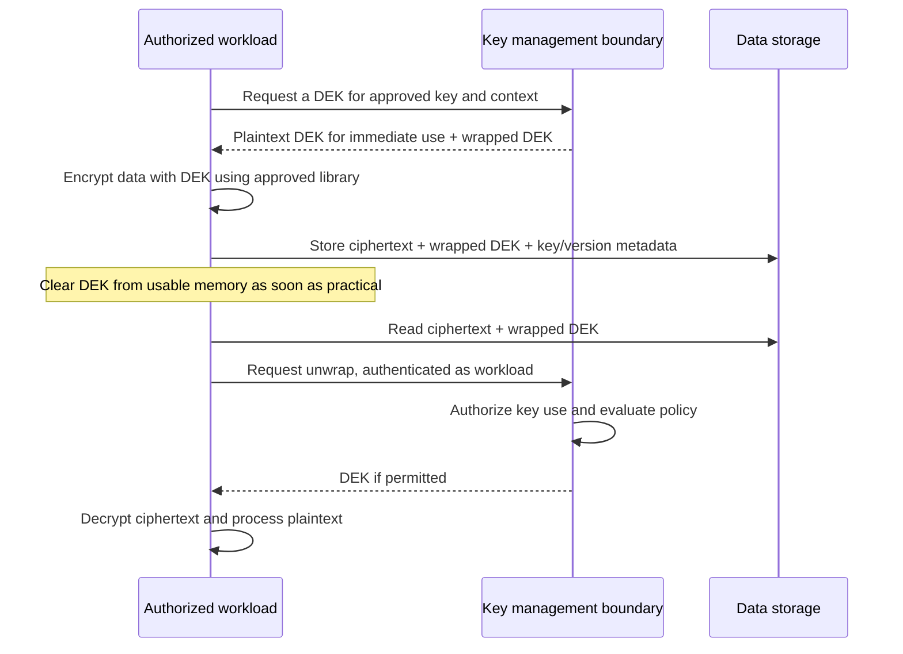
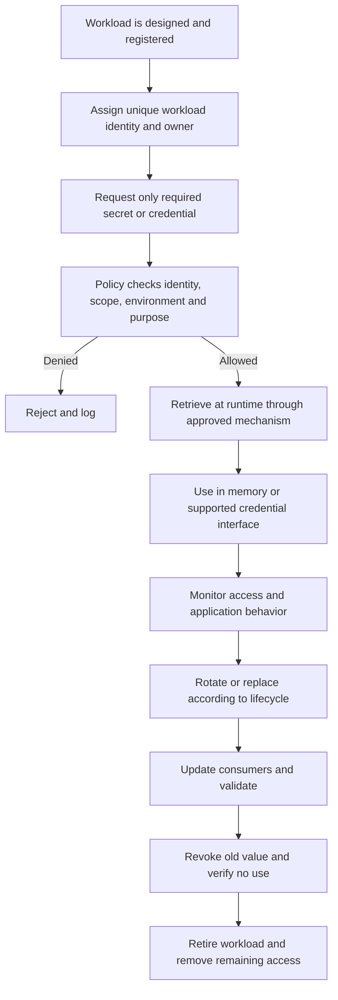

# Encryption, Key Management and Secrets

**Repository target:** `Stage 2D — Data Architecture/10-Data-Governance-Security-Privacy-and-Compliance/04-encryption-key-management-and-secrets.md`  
**Level:** Beginner → Intermediate → Advanced  
**Suggested study time:** 7–9 hours  
**Case study:** Northbridge Bank (fictional); all examples use synthetic names and data.

> **Scope note:** The module-specific roadmap is the authority for this topic's sequence, learning outcomes, deliverables, and completion gate. The roadmap states that topic files were empty when it was authored. This lesson's examples, tables, diagrams, exercises, and recommended operating practices are instructional elaborations—not claims that the empty topic file previously contained those details. This is vendor-neutral educational material, not legal advice, a compliance certification, or a guarantee of security.

---

## 1. Overview and learning objectives

Encryption and secrets management help protect data and the credentials and cryptographic material used to access it. They are related but different disciplines:

- **Encryption** transforms readable data into ciphertext using a cryptographic algorithm and key.
- **Key management** governs the generation, protection, authorization, use, rotation, recovery, revocation, and destruction of cryptographic keys.
- **Secrets management** governs sensitive values such as passwords, API tokens, private keys, connection strings, and other credentials used by people, applications, and workloads.
- **Authorization** decides whether a principal may perform an action, including whether it may use a key or retrieve a secret.

Encryption is one layer of a larger security architecture. It does not decide whether a person is authorized to read a dataset, and it cannot prevent every form of misuse by an identity that legitimately receives plaintext. A complete design combines identity, authorization, minimization, network and application controls, key/secret lifecycle, monitoring, recovery, and incident response.

### 1.1 Learning objectives

By completing this lesson, you should be able to:

1. Explain confidentiality, integrity, authenticity, and availability in relation to cryptographic controls.
2. Compare encryption at rest, in transit, and application-level encryption.
3. Distinguish symmetric encryption, asymmetric cryptography, keys, certificates, passwords, tokens, and secrets.
4. Explain data-encryption keys (DEKs), key-encryption keys (KEKs), and envelope encryption.
5. Design a key lifecycle with accountable owners, authorization, rotation, recovery, revocation, destruction, and evidence.
6. Design a secrets lifecycle integrated with human and workload identities.
7. Prevent common secret-exposure paths in source control, logs, configuration, backups, and deployment artifacts.
8. Separate environments and responsibilities and avoid granting broad key-use permissions.
9. Assess operational risks including key loss, key-service outage, rotation failure, compromise, and recovery dependencies.
10. Produce an architecture decision record and an operational exercise with explicit expected outputs.

### 1.2 Prerequisites and sequence

This topic follows **Identity, Access Control and Least Privilege**. Before proceeding, understand principals, authentication, authorization, workload identities, least privilege, separation of duties, access review, and revocation.

The important dependency is that a key or secret is itself a protected resource. A workload must authenticate, and policy must authorize it to use the key or retrieve the secret. A valid identity alone does not grant that permission.

Recommended progression:

- **Beginner:** security objectives, basic cryptographic terms, encryption locations, keys versus credentials/secrets.
- **Intermediate:** key hierarchy, envelope encryption, centralized key management, secrets lifecycle, environment separation, access and audit design.
- **Advanced:** rotation and recovery failure modes, blast-radius reduction, cryptographic dependency risk, incident response, operational metrics, and architecture trade-offs.

### 1.3 Industry relevance

Data platforms copy information through ingestion, staging, object storage, warehouses, lakehouses, streaming systems, notebooks, backups, exports, and analytics products. Every copy and access path creates potential exposure. Encryption can reduce risk if storage or transport is exposed, but plaintext may still exist in application memory, query results, logs, temporary files, or authorized clients. Key and secret lifecycle failures can also cause outages, unrecoverable data, or unauthorized access.

---

## 2. Foundational security and cryptographic terminology

### 2.1 Security objectives

| Objective | Meaning | Cryptographic contribution | What cryptography alone does not solve |
|---|---|---|---|
| **Confidentiality** | Only authorized parties can read information | Encryption can make data unreadable without the required key | Does not determine who should be authorized; plaintext may leak elsewhere |
| **Integrity** | Detect unauthorized or unintended modification | Authenticated encryption, message authentication, and digital signatures can help detect tampering | Does not ensure business correctness or prevent every authorized bad change |
| **Authenticity** | Establish that a message, artifact, or identity assertion came from the expected source and was not altered | Certificates, signatures, and authenticated protocols can support verification | Depends on trust configuration, key protection, validation, and lifecycle |
| **Availability** | Data and services are usable when needed | Redundant key services, tested recovery, and resilient architecture support availability | Lost keys, expired certificates, unavailable key services, or broken policies can make encrypted data unusable |
| **Accountability** | Actions can be attributed and reviewed | Signed events and protected audit records may strengthen evidence | Requires identity, logging, access control, retention, and monitoring beyond cryptography |

Confidentiality, integrity, authenticity, and availability are related but not interchangeable. A system can encrypt data correctly and still fail because the key is unavailable, access policy is too broad, logs contain plaintext, or an authorized user exports data.

### 2.2 Plaintext, ciphertext, algorithm, and key

- **Plaintext:** data in its readable or usable form.
- **Ciphertext:** transformed data produced by encryption.
- **Cryptographic algorithm:** the defined mathematical method used to encrypt, decrypt, sign, verify, or derive keys.
- **Key:** cryptographic material that controls an operation such as encryption, decryption, signing, verification, or key wrapping.
- **Nonce/IV:** a value used by certain cryptographic constructions. Requirements differ by algorithm; uniqueness and handling rules matter. Do not invent your own scheme or reuse values contrary to the algorithm's requirements.
- **Authenticated encryption:** an encryption approach that provides confidentiality and detects certain forms of tampering when used correctly.
- **Hash:** a one-way digest; hashing is not encryption and normally does not allow recovery of the original input.
- **Digital signature:** a private-key operation verified with a corresponding public key; it can support authenticity and integrity, not secrecy.
- **Key derivation:** producing a cryptographic key from other material using a defined derivation function and appropriate parameters.

Do not implement custom cryptographic algorithms. Use well-reviewed, maintained cryptographic libraries and platform capabilities, with parameters appropriate to the use case and current guidance from qualified security specialists.

### 2.3 Symmetric and asymmetric cryptography

**Symmetric encryption** uses the same secret key, or closely related secret material under the defined algorithm, to encrypt and decrypt. It is efficient for large data volumes and is commonly used for data encryption.

**Asymmetric cryptography** uses a mathematically related public/private key pair. Public-key operations can support encryption in certain designs, key establishment, or digital signatures. The private key must be protected; the public key is generally distributable, but its authenticity and intended use must be established.

| Aspect | Symmetric | Asymmetric |
|---|---|---|
| Typical strength | Efficient for large data | Useful for key establishment, signatures, and certain trust models |
| Secret distribution | Secret key must be securely shared or accessed | Public key may be distributed; private key remains protected |
| Common architecture use | Encrypt data with a DEK | Protect or establish key material; sign artifacts or assertions |
| Main operational challenge | Protecting and controlling the shared secret key | Protecting private keys and validating public-key trust/certificates |

These approaches often work together. Envelope encryption typically uses symmetric encryption for data and a protected key-management mechanism to wrap the DEK.

---

## 3. Encryption placement: at rest, in transit, and application-level

### 3.1 Encryption at rest

Encryption at rest protects stored data on media or storage services. Examples include encrypted object storage, database storage, disks, snapshots, and backups.

**How it works:** the storage or database layer encrypts data before persistence and decrypts it for an authorized operation. The exact boundary depends on the service and architecture.

**Use when:** protecting against storage media exposure, unauthorized access to copied storage, and certain infrastructure-level threats.

**Trade-offs and limits:**
- May be operationally simple when the storage platform manages encryption.
- Does not necessarily protect data from a principal who already has permission to query or export plaintext.
- May not cover application logs, caches, temporary files, local downloads, or exports unless those are included.
- If a principal can access both ciphertext and a usable key, storage encryption alone may not prevent misuse.

### 3.2 Encryption in transit

Encryption in transit protects data while it travels between components, such as a client and API, an ingestion service and a broker, or a pipeline and a database.

**How it works:** a secure transport protocol negotiates cryptographic parameters and establishes protected communication. Certificate and peer identity validation are essential parts of many transport designs.

**Use when:** data crosses networks, service boundaries, private connectivity, or external trust boundaries. Internal traffic should not be assumed trustworthy merely because it remains inside a corporate network.

**Trade-offs and limits:**
- Requires certificate issuance, validation, renewal, and expiry monitoring where certificates are used.
- Misconfigured trust validation can undermine protection.
- Transport encryption ends at an endpoint; plaintext may be present in endpoint memory and logs.
- Mutual authentication can strengthen service identity assurance where warranted, but increases certificate and trust lifecycle complexity.

### 3.3 Application-level encryption

Application-level encryption encrypts selected fields or payloads within an application or data-processing layer before they reach a lower storage or service layer. Decryption is available only to components authorized and designed to perform it.

**Use when:** the threat model requires separation between the storage operator and access to particular fields, or when selected values need protection beyond the underlying storage boundary.

**Trade-offs and limits:**
- Can reduce exposure at lower layers, but complicates search, joins, indexing, analytics, debugging, and data recovery.
- Key access and plaintext handling move into the application design.
- Deterministic or searchable encryption patterns have specialised leakage and threat considerations; do not adopt them without a reviewed threat model.
- The application must prevent plaintext from leaking to logs, traces, error messages, caches, and exports.

### 3.4 Encryption in use: scope and limits

Data is often decrypted in application or query-engine memory while it is processed. Conventional encryption at rest and in transit does not, by itself, keep plaintext hidden from the component that must process it. Where the threat model requires protection from some infrastructure or privileged software layers during processing, specialised approaches such as confidential-computing enclaves or encrypted-computation techniques may be evaluated. These approaches have workload, compatibility, attestation, operational, and residual-risk limits; they are not a universal default and require specialist threat modelling and validation. They do not remove the need for identity, authorization, key controls, secure application design, and monitoring.

### 3.5 Comparison

| Property | At rest | In transit | Application-level |
|---|---|---|---|
| Protects primarily | Persisted storage | Network communication | Selected data before lower-layer storage or transfer |
| Typical enforcement point | Storage/database/platform | Client, gateway, broker, service connection | Application or data-processing code |
| Plaintext still exists | At authorized endpoints and in other uncovered copies | At endpoints before/after transport protection | At components that encrypt/decrypt or legitimately process it |
| Main lifecycle dependency | Storage encryption configuration and key availability | Protocol configuration, certificates, trust and renewal | Application key use, field/payload design, plaintext controls |
| Operational complexity | Often lower with managed platform support | Moderate; certificates and endpoint configuration matter | Often higher; application changes and analytics constraints |
| Does it replace authorization? | No | No | No |

A mature architecture often uses multiple layers. Avoid claiming that enabling a single encryption setting protects every copy and use of the data.

---

## 4. Data-protection architecture

The following is a conceptual Northbridge Bank pattern. It is vendor-neutral; actual components may be combined or separated.

```mermaid
flowchart LR
    A[Source systems] --> B[Ingestion service]
    B --> C[Encrypted transport]
    C --> D[Data platform storage]
    D --> E[Query and processing layer]
    E --> F[Curated data products]
    D --> G[Encrypted backups and replicas]
    H[Workload identity] --> I[Authorization policy]
    I --> J[Key management service / hardware-backed protection]
    J --> K[Key use decision and key wrapping]
    K --> D
    K --> E
    L[Secrets manager] -->|Short-lived retrieval or secret reference| B
    L -->|Scoped secret or identity configuration| E
    M[Audit and monitoring] <-- B
    M <-- D
    M <-- E
    M <-- J
    M <-- L
```

**How to read it:**
- Data travels over protected connections where transport encryption is configured and validated.
- Storage and backups are encrypted according to the architecture's protection requirements.
- Workloads authenticate with an approved identity mechanism.
- Authorization controls whether a workload can use a key or retrieve a secret.
- Key-management and secrets-management events are recorded and monitored.
- The diagram is not a guarantee that any specific platform encrypts every path automatically. Verify actual coverage and enforcement.

**Design question:** Where can plaintext exist? For every arrow and component, identify whether the component sees plaintext, ciphertext, a DEK, a wrapped DEK, a KEK, or a secret. This data-flow analysis often reveals missing controls.

---

## 5. Keys, credentials, certificates, and secrets

### 5.1 Comparison table

| Item | What it is | Typical purpose | Main protection concern |
|---|---|---|---|
| **Encryption key** | Cryptographic material used by an encryption algorithm | Encrypt/decrypt data | Unauthorized use, exposure, loss, lifecycle failure |
| **Key-encryption key (KEK)** | Key used to protect/wrap another key | Protect DEKs in envelope encryption | Broad wrapping/unwrapping authority; recovery and rotation dependencies |
| **Data-encryption key (DEK)** | Key used to encrypt a data object, file, or payload | Efficiently encrypt data | Exposure can reveal the associated ciphertext if usable for decryption |
| **Password** | Human-chosen or system-assigned authentication value | Authenticate a user or service in some systems | Reuse, phishing, weak storage, leakage |
| **Credential** | Information used to prove or establish identity | Password, token, certificate/private key, or other authenticator | Theft and impersonation |
| **API token/access token** | A credential representing a scoped or time-bound authorization context | Call an API | Scope, audience, lifetime, revocation, leakage |
| **Certificate** | Signed statement binding an identity or name to a public key and metadata | Establish trust in a public key and support secure protocols | Expiry, incorrect validation, compromised issuing authority/private key |
| **Private key** | Secret half of an asymmetric key pair | Sign, decrypt, or perform other private-key operations | Disclosure or unauthorized use |
| **Secret** | Broad operational term for sensitive values that must be controlled | Credentials, tokens, connection strings, private keys, webhook signing keys | Exposure, stale copies, excessive retrieval, missing rotation |
| **Secret reference** | Identifier or path pointing to a secret stored in a controlled system | Allow a workload to retrieve a value without embedding it in source | Reference itself may reveal architecture; access to referenced value must still be authorized |
| **Hash** | One-way digest, not a secret key by definition | Integrity checks, password-verifier constructions, content addressing | Weak algorithm or incorrect use; hash is not reversible encryption |

A key may itself be a secret, but not every secret is an encryption key. A certificate often contains public information; its corresponding private key is the sensitive item. A token can grant access without being an encryption key. Treat each item according to its role and threat model rather than storing all of them under one vague “password” category.

### 5.2 Password storage is not data encryption

Systems should not store human passwords as plaintext or as reversibly encrypted values merely to verify login. Password verification normally uses a purpose-built password-hashing scheme with unique salts and suitable work factors, selected and configured according to current security guidance. This differs from encrypting data that must later be decrypted.

Do not invent a password-hashing algorithm, reuse a general-purpose fast hash without a suitable design, or attempt to recover a user's original password.

### 5.3 Secrets versus configuration

Configuration can be non-sensitive (such as a feature flag or a service name) or sensitive (such as a password or token). A connection string may be a secret if it embeds credentials. Keep ordinary configuration in versioned configuration systems and keep sensitive values in an approved secrets manager or equivalent protected mechanism.

---

## 6. Envelope encryption and key hierarchy

### 6.1 Why envelope encryption is used

Encrypting every data object directly with one long-lived central key can create operational and blast-radius problems. Envelope encryption separates the key used for data from the key used to protect that data key.

- A **DEK** encrypts the data.
- A **KEK** protects (wraps) the DEK.
- The encrypted data and wrapped DEK can be stored together, subject to the system's metadata and integrity requirements.
- To decrypt, an authorized component requests unwrapping of the DEK using the KEK, then uses the DEK to decrypt the data.
- The KEK can remain inside a key-management boundary; the DEK may be present in the authorized workload's memory during use and must be protected there.

### 6.2 Envelope-encryption flow



The exact API may return or wrap key material differently. The essential architectural properties are separation of data encryption from key protection, controlled key use, and secure handling of any plaintext DEK.

### 6.3 Worked synthetic example

Northbridge stores a synthetic file `risk/daily-aggregate-2026-10-20.parquet`.

1. An approved ingestion workload obtains a DEK through an approved cryptographic library or managed encryption workflow.
2. The workload encrypts the file using a reviewed, authenticated encryption mechanism with appropriate parameters.
3. The key-management system wraps the DEK using a KEK.
4. Storage contains ciphertext, the wrapped DEK, and metadata identifying the key/version and required algorithm parameters.
5. A permitted analytics workload authenticates using its workload identity.
6. Policy authorizes that workload to use the specific KEK for the intended operation.
7. The workload receives the ability to unwrap the DEK, decrypts the file, and processes the data.
8. Key-use events and relevant access decisions are logged. The plaintext DEK and plaintext data are not written to logs.

The wrapped DEK is not itself the plaintext key, but it should still be protected against tampering and inappropriate copying. The ciphertext and metadata also need integrity and lifecycle controls.

### 6.4 Key hierarchy and blast radius

A platform may use a hierarchy such as:
- a root or hardware-protected key-management boundary;
- KEKs scoped by domain, environment, application, or classification;
- DEKs scoped to objects, data sets, or encryption operations.

The appropriate scope depends on volume, performance, recovery, and isolation requirements. One global KEK can simplify administration but increases blast radius and the impact of policy errors. Very granular KEKs improve isolation but increase inventory, policy, rotation, and recovery complexity.

### 6.5 Key rotation and re-encryption

Rotating a KEK and rotating a DEK are not necessarily the same operation:

- **KEK rotation:** a new key version may be used to rewrap DEKs. Depending on the design, data ciphertext may not need to be decrypted and re-encrypted.
- **DEK rotation:** data may need to be re-encrypted under a new DEK, or a data system may use a defined object/version strategy.
- **Credential rotation:** replaces a password, token, or private key used for authentication; it does not automatically re-encrypt stored data.

A personnel change normally triggers identity, entitlement, and ownership review. Rotate a shared credential or cryptographic key when the change affects access to it, the material may have been exposed, policy requires rotation, or the threat assessment otherwise justifies it; do not assume every staff departure requires re-encrypting all data.

Document what each rotation means in the chosen architecture. A key version change alone does not prove all old ciphertext, replicas, exports, or backups have been migrated.

---

## 7. Centralized key management and hardware-backed protection

### 7.1 Centralized key management

A key-management service (KMS or equivalent) provides controlled interfaces and lifecycle operations for cryptographic keys. Depending on the implementation, it may generate keys, store or protect them, wrap/unwrap DEKs, perform cryptographic operations, enforce policies, and emit audit events.

**Benefits:**
- Central policy and key inventory.
- Separation between data operators and key administrators.
- Standardized audit events and lifecycle procedures.
- Easier control over key-use permissions and versioning.
- Reduced need to distribute raw key material.

**Trade-offs:**
- Availability and latency become dependencies for encryption/decryption workflows.
- Misconfigured policy can affect many workloads.
- Centralization can create a high-value control plane.
- Cross-region and recovery design can be complex.
- API quotas, network connectivity, and service outages can affect data availability.

A centralized service is not automatically secure. Restrict its administration, protect audit evidence, separate environments, test recovery, and monitor changes.

### 7.2 Hardware-backed key protection

Hardware security modules (HSMs) or equivalent hardware-backed facilities can protect selected key material and perform cryptographic operations within a protected boundary. Whether hardware protection is required depends on threat model, risk, operational constraints, and applicable requirements.

Hardware protection can reduce exposure of certain keys, but does not prevent an authorized workload from misusing a permitted operation. Policy, identity, configuration, application security, audit, and operational processes remain necessary.

### 7.3 Key access is an authorization decision

A key has an owner, purpose, allowed operations, scope, environment, and lifecycle. Separate permissions such as:
- view key metadata;
- encrypt or wrap;
- decrypt or unwrap;
- sign or verify;
- rotate or create versions;
- change key policy;
- disable or destroy.

Do not assume that permission to manage key metadata implies permission to decrypt data, or that permission to use a key should imply permission to alter its policy. Keep key-administration authority distinct from routine key use where practical.

### 7.4 Separation of duties

A recommended split:
- **Data owner:** defines the business need and data-use requirements.
- **Security/cryptography owner:** defines key policy, algorithms/parameters standards, and risk controls.
- **Key administrator:** manages key lifecycle and access policy under change control.
- **Workload owner:** requests and operates a narrowly scoped identity.
- **Platform operator:** integrates the platform with the approved key service.
- **Auditor/independent reviewer:** checks evidence and exceptions.

The exact organisational roles vary. If a small team must combine duties, record the conflict and add compensating review for high-impact operations.

---

## 8. Key lifecycle matrix

The following matrix is a recommended operating model, not a universal control standard.

| Lifecycle stage | Key action | Accountable owner / operator | Controls | Example evidence |
|---|---|---|---|---|
| Design | Define purpose, scope, algorithm/library, environment, recovery, and threat model | Security/cryptography owner with data/platform owners | Design review; approved implementation approach | ADR, threat model, key specification |
| Generate | Create key through approved mechanism | Key-management service or authorized administrator | Approved entropy/source and key type; no homemade key generation | Key ID, version, creation event |
| Store/protect | Keep key in approved key-management boundary | Key administrator/service | Strong access policy; separation of duties; protected backups where supported | Configuration snapshot, policy review |
| Authorize | Grant narrowly scoped key operations | Key/policy owner; implemented by authorized operator | Workload identity, least privilege, approval and negative tests | Request, approval, grant diff, test output |
| Use | Encrypt/decrypt/wrap/unwrap/sign as approved | Workload owner and platform | Authenticate caller; authorize action and context; protect plaintext in memory/logging | Key-use event, application correlation ID |
| Monitor | Detect unusual or prohibited key activity | Security operations | Alerts for policy changes, denied/abnormal use, bulk operations | Alert, investigation record |
| Rotate | Create new version or rewrap/re-encrypt as designed | Key owner and service operator | Compatibility plan, staged rollout, rollback and coverage checks | Rotation ticket, old/new version inventory |
| Recover | Restore approved key capability or use recovery procedure | Key owner and continuity/security functions | Tested recovery, dual control where appropriate, access logging | Exercise record, restore validation |
| Revoke/disable | Stop new use after compromise or policy change | Authorized key administrator | Incident approval path; assess service/data impact | Incident ticket, disable event, denial test |
| Retire/destroy | Remove key material when no longer needed and safe to do so | Key owner under retention/recovery policy | Confirm dependencies, backups, legal/operational holds as applicable, approval | Destruction record, dependency check |
| Review | Reassess owners, scope, usage, exceptions, and key versions | Independent reviewer/key owner | Periodic and event-triggered review | Review record, remediation tickets |

### 8.1 Key destruction and cryptographic erasure

Destroying a key can make ciphertext inaccessible, but it is not a casual deletion operation. Before destruction:
- identify every dependent dataset, replica, backup, export, archive, and recovery process;
- verify retention, legal hold, and business continuity constraints with the responsible functions;
- confirm that no still-required data depends on the key;
- document approval and the expected effect;
- verify the destruction event and the resulting inability to decrypt where appropriate.

**Cryptographic erasure** is a design in which data becomes inaccessible by securely destroying the relevant key material. Its effectiveness depends on the completeness of key copies, wrapped DEKs, backups, replicas, caches, and alternate plaintext copies. Do not claim data has been erased merely because one key version was deleted.

---

## 9. Secrets management lifecycle

### 9.1 Why a secrets manager is used

A secrets manager provides a controlled place to store, retrieve, version, rotate, and audit sensitive operational values. It reduces the need to copy secrets into source code and deployment artifacts. It does not remove the need to authorize retrieval or protect a secret after it is delivered to a workload.

### 9.2 Recommended workflow



A recommended lifecycle is:
1. **Create:** generate or issue the secret using an approved system.
2. **Store:** save only in a protected secret store or approved equivalent.
3. **Authorize:** scope retrieval to a workload identity, secret path, environment, and purpose.
4. **Retrieve:** obtain at runtime or use a platform-supported secret reference/injection mechanism.
5. **Use:** keep the value out of logs, exceptions, command-line arguments, and diagnostic dumps where possible.
6. **Rotate:** issue a replacement, update dependent workloads, verify the new value works, and revoke the old value.
7. **Revoke:** invalidate immediately when compromise or misuse is suspected, following the incident procedure.
8. **Review:** check owner, last-use signals, scope, age, and continuing need.
9. **Retire:** remove unused values and references; verify dependent jobs are not still using them.

### 9.3 Safe configuration examples

Prefer a reference to a secret, not the value itself.

**Example of ordinary non-secret configuration:**

```yaml
service:
  name: risk-aggregate
  environment: production
  output_dataset: risk.daily_aggregate
```

**Example of a secret reference (illustrative schema, not a real vendor format):**

```yaml
service:
  name: risk-aggregate
  environment: production
  database_credential_ref: "secret://production/risk-aggregate/database-credential"
```

The reference does not grant access by itself. The workload identity must be authorized to retrieve that secret, and the platform must enforce the policy. Do not place the actual password, token, or private key in this file.

**Example of a safe environment-variable reference in pseudocode:**

```python
# Illustrative pseudocode: secret retrieval is provided by an approved SDK.
# The secret value is never printed or written to logs.
credential = secret_store.get(
    reference="secret://production/risk-aggregate/database-credential",
    workload_identity=current_workload_identity(),
)
connect_using_credential(credential)
```

This is illustrative pseudocode, not executable code: `secret_store`, `current_workload_identity`, and `connect_using_credential` represent application/platform interfaces that must be supplied by the chosen implementation. Do not copy it as a complete runnable program.

### 9.4 Secret injection options and trade-offs

| Pattern | How it works | Advantages | Risks / considerations |
|---|---|---|---|
| Runtime API retrieval | Workload calls secret manager with its identity | Fine-grained access and auditable retrieval | Application must handle errors, caching, and rotation |
| Platform-mounted secret | Platform exposes a secret through a protected mount or file | Avoids embedding values in image/source | File permissions, refresh behavior, and accidental file copying matter |
| Environment-variable injection | Platform injects a value at process start | Simple for some applications | May leak through diagnostics, crash dumps, child processes, or process inspection |
| Short-lived credential issuance | Workload obtains a limited-lifetime credential | Reduces stale-secret window | Requires identity federation, clock/lifecycle handling, and renewal behavior |
| Static long-lived secret | Workload repeatedly uses the same fixed value | Sometimes needed for legacy dependencies | Larger exposure window and difficult rotation; use only with explicit justification and controls |

Prefer workload identity and short-lived credentials where supported and operationally suitable. If a static credential is unavoidable, document owner, scope, storage, rotation, monitoring, and emergency revocation.

### 9.5 Secret exposure paths

| Exposure path | Example failure | Recommended prevention/detection |
|---|---|---|
| Source control | Token committed to a repository | Secret scanning, pre-commit checks, rapid revoke/rotate; removing a line does not erase history |
| Configuration files | Password in a checked-in YAML file | Use a secret reference and runtime retrieval |
| Logs and traces | Request headers or connection string logged | Redaction, structured logging, tests, restricted log access |
| CI/CD output | Deployment prints a secret | Masking is helpful but not sufficient; avoid printing values and restrict pipeline permissions |
| Container/image artifacts | Secret copied into build layer or image environment | Keep secrets out of build context and images; scan artifacts |
| Backups and snapshots | Secret or plaintext export included in backup | Encrypt and control backups; define retention and deletion; scan where appropriate |
| Notebooks | Credential left in a cell or output | Secret manager, notebook scanning, output clearing, restricted notebook access |
| Command line/process args | Secret appears in process listing or shell history | Use supported secure input channels or secret APIs |
| Crash dumps | Memory includes plaintext credentials | Limit dump access and retention; avoid collecting secrets where possible |
| Developer workstation | Secret copied to local file | Reduce direct secret access; endpoint controls, scoped credentials, rotation |
| Chat/ticket/document | Secret pasted into a support thread | Never request secrets in tickets; redact and revoke if exposed |

If a secret is exposed, assume it may have been copied. Delete or redact the visible copy where possible, but **revoke or rotate the secret** and investigate its use; source-control history, logs, caches, backups, and forks may retain copies.

---

## 10. Environment separation

Development, test, staging, and production should have distinct identity and key/secret boundaries appropriate to the risk.

Recommended principles:
- Separate identities and permissions by environment.
- Avoid using production keys or credentials in development.
- Use synthetic data for development and test where possible.
- Scope secrets to the workload and environment; do not let a development workload retrieve production secrets.
- Separate key administration from routine data operations.
- Restrict who can promote configuration and change production key policy.
- Use environment-specific secret references and policy tests.
- Prevent deployment artifacts from carrying secret values from build to runtime.
- Define a safe rotation and rollback strategy for each environment.

A copied secret reference can still be dangerous if the destination workload is authorized to retrieve the referenced secret. Validate identity, secret policy, and environment conditions—not just the string value in configuration.

---

## 11. Classification-driven encryption decisions

Encryption choices should follow data classification, threat model, access needs, and operational requirements. Classification labels inform controls; they do not implement controls by themselves.

| Data or use case (synthetic) | Potential protection approach | Key questions |
|---|---|---|
| Public product catalogue | Transport protection for service connections; storage encryption based on platform baseline | What risks remain if copied or altered? |
| Internal operational metrics | At-rest and in-transit protection; controlled service identities | Do logs or exports contain sensitive operational details? |
| Confidential customer analytics | Storage and transport encryption; narrowly authorized key use; masking or curated views | Who can decrypt/query? Are copies and backups covered? |
| Restricted identity fields | Consider field/application-level protection in addition to platform encryption; strict access and key separation | Which workloads need plaintext? Can tokenization or minimization meet the need? |
| Backups and archives | Encryption and access controls; documented recovery keys and restore tests | Can recovery work without weakening separation of duties? |
| High-volume streaming events | Protected transport, broker/storage protection, restricted consumer identities, careful dead-letter handling | Do failed events, replay logs, or diagnostic payloads expose plaintext? |

These are illustrative options, not mandated controls or legal categories. The appropriate solution depends on threat model and architecture. Do not use stronger-looking encryption as a substitute for reducing data collected, limiting access, or preventing plaintext leakage.

### 11.1 Questions for a threat model

- What is the asset and why is it sensitive?
- Which threats are in scope: stolen storage, network interception, compromised workload, malicious insider, privileged administrator, leaked token, key-service outage, or lost key?
- Where does plaintext exist, including memory, logs, caches, temporary files, backups, and exports?
- Who can authorize key use, and can that identity also change policy or disable logging?
- Is the key shared across unrelated workloads or domains?
- What is the impact of a lost or disabled key?
- How quickly must compromise be contained?
- Can recovery be performed without bypassing controls?
- Which controls are preventive, detective, and recovery-oriented?
- What residual risks remain and who accepts them?

---

## 12. Key and secret authorization

### 12.1 Authorization to use a key

A workload should authenticate through an approved identity mechanism, then request a defined key operation. The key-management policy evaluates the principal, action, key, and any trusted context. The service then allows or denies the operation and records an event.

Examples of distinct operations:
- encrypt data;
- decrypt data;
- wrap a DEK;
- unwrap a DEK;
- sign a payload;
- rotate a key version;
- change a key policy;
- disable or destroy a key.

A workload that only encrypts outbound data may not need decrypt permission. A reporting service may need to unwrap keys for a defined dataset but should not be able to administer keys or create new identities. Do not grant `decrypt` simply because an application uses `encrypt`.

### 12.2 Authorization to retrieve a secret

Secret retrieval should be scoped to:
- the workload's unique identity;
- a specific secret or narrow secret path;
- the correct environment;
- a documented purpose;
- an expiry/review policy where applicable.

Avoid broad permissions such as “read all secrets in production.” A compromised workload should not automatically gain every database password, signing key, and external API token in the organisation.

### 12.3 Separation between key and secret control planes

Keys and secrets may be managed by separate systems, but their permissions and lifecycles must be coordinated. For example, a workload might use a secret to authenticate to a legacy database and a DEK to encrypt a file. Compromise of either can have a different impact. Inventory both dependencies, rotate them independently when required, and coordinate recovery to avoid locking out the workload.

---

## 13. Operational risks and failure modes

### 13.1 Key loss and availability

If a required key is irrecoverably lost or destroyed, encrypted data may become permanently unavailable. A backup of ciphertext without the corresponding usable key is not a complete recovery plan.

Controls to consider:
- documented key dependencies and ownership;
- protected recovery mechanisms with access separation;
- tested restore procedures and recovery objectives;
- multi-region or high-availability designs where justified;
- controlled access to recovery material;
- alerts for key-service health and unusual failure rates;
- periodic recovery exercises.

Do not create unmanaged copies of key material as a shortcut to availability. Recovery copies themselves need authorization, protection, inventory, and testing.

### 13.2 Key-management service outage

A key service may be unavailable because of network issues, service failure, policy mistakes, quota limits, expired trust configuration, or regional disruption. Depending on the design, existing encrypted data may remain stored but unavailable to workloads that need key operations.

Design decisions:
- Can the application continue using a short-lived cached data key? If so, what is the security and revocation trade-off?
- What operations must fail closed?
- How will the system alert and recover?
- Are retries bounded and safe?
- Is there a tested alternate route that does not bypass authorization?
- What is the recovery objective for data processing?

Caching a plaintext DEK can improve availability but extends its exposure window and may delay the effect of a key-policy change. Define the trade-off explicitly and minimize caching duration and scope where appropriate.

### 13.3 Rotation failures

Rotation may fail because a workload still expects the old version, a replica was missed, an application caches a credential, a secret was updated before consumers were ready, or a rollback path was not tested.

Recommended pattern:
1. Inventory consumers and dependencies.
2. Plan overlap where safe and supported.
3. Introduce the new key version or credential.
4. Update a controlled subset of consumers.
5. Validate encryption/decryption or authentication and monitor errors.
6. Roll forward or roll back according to the approved plan.
7. Update all remaining consumers and verify coverage.
8. Revoke the old credential or retire the old key version only when safe.
9. Record completion and remaining exceptions.

Rotation semantics vary by key and secret type. Never assume that changing a key policy, creating a new key version, rewrapping a DEK, and re-encrypting data are the same operation.

### 13.4 Compromise and revocation

If a key or secret may be compromised:
- open an incident and identify the affected identity, secret/key, assets, and time window;
- revoke or disable the credential/key operation according to the response plan;
- issue replacement material through an approved process;
- update dependent workloads and verify successful operation;
- inspect key-use, secret-retrieval, authentication, data-access, export, and deployment logs;
- identify possible plaintext and ciphertext copies, replicas, and backups;
- determine whether data must be re-encrypted or whether key rewrapping is sufficient;
- assess whether exposed ciphertext can be decrypted using the compromised material;
- retain evidence and document residual risk;
- verify old material is no longer accepted or used.

A compromised key can require different remediation than a compromised API token. Follow the key's role and affected data dependencies; do not blindly rotate every item without an impact assessment, but do not delay urgent containment when ongoing misuse is likely.

### 13.5 Crypto agility and dependency risk

Cryptographic algorithms, libraries, protocols, and certificates can become unsuitable or unsupported over time. Design for **crypto agility**: inventory algorithms and key types, track dependencies and versions, keep implementations maintained, and plan migrations without improvising new cryptography.

Avoid hard-coding assumptions about a single algorithm or key length throughout application code. Use approved libraries and managed interfaces, keep cryptographic parameters configurable through reviewed policy where appropriate, and test migration paths. Do not claim a design is future-proof.

---

## 14. Monitoring, audit, and governance

### 14.1 Events worth monitoring

- key creation, rotation, disablement, policy change, and destruction;
- decrypt/unwrap/sign operations, especially unusual volume or unexpected principals;
- repeated denied key operations or secret retrieval;
- access to secrets outside expected workload/environment;
- secret version changes and failed rotations;
- certificate expiry, validation failures, and trust changes;
- changes to audit logging or monitoring policy;
- key-service availability, latency, quota, and error rates;
- recovery and break-glass events;
- secret scanning findings and confirmed exposures.

Audit logs should not contain plaintext keys, tokens, passwords, or sensitive payloads. Restrict access to logs and protect their integrity; logs can themselves reveal sensitive metadata.

### 14.2 Evidence plan

| Control objective | Evidence examples | Validation question |
|---|---|---|
| Key is owned and scoped | Key inventory, owner, purpose, environment, approved operations | Does every active key have a valid owner and use? |
| Only authorized workloads use a key | Key policy, identity binding, key-use logs, negative tests | Can an unrelated workload decrypt/unwrap? |
| Data is encrypted at rest | Platform configuration, storage inventory, backup settings | Are all relevant stores, replicas, and backups covered? |
| Transport protection is configured | Connection policy, certificate/trust settings, test records | Are peers validated and insecure routes disabled? |
| Secrets are not embedded in artifacts | Secret-scanning reports, image/build scans, repository checks | Are findings triaged and confirmed exposures revoked? |
| Rotation is effective | Rotation ticket, consumer inventory, success metrics, old-value revocation evidence | Are all consumers migrated and the old value rejected? |
| Recovery is viable | Exercise plan, restore logs, recovered sample validation | Can the service restore without uncontrolled key access? |
| Destruction is safe | Dependency inventory, approval, destruction event, follow-up check | Are remaining copies and dependencies understood? |
| Separation of duties works | Role assignments, approvals, policy-change events | Can one actor request, approve, execute, and hide the same change? |

### 14.3 Operational metrics

| Metric | Definition (recommended) | Purpose |
|---|---|---|
| Active keys without owners | Count of active keys missing a valid accountable owner | Finds governance gaps |
| Key-use denials | Count/trend by workload, operation, and key | Detects misuse or policy misconfiguration |
| Unusual decrypt/unwrap volume | Operations outside defined workload baselines or policy | Detects possible compromise |
| Rotation completion rate | Planned rotations completed and validated by due date ÷ rotations due | Shows lifecycle reliability |
| Secret age / overdue rotation | Active secrets past their approved rotation date | Identifies stale credentials |
| Confirmed secret exposure response time | Time from confirmed exposure to containment/revocation | Measures incident responsiveness |
| Recovery exercise success | Exercises meeting stated recovery objectives ÷ exercises run | Tests operational continuity |
| Key-service availability and latency | Service indicators against internal SLOs | Shows processing dependency health |
| Unencrypted-copy findings | Confirmed in-scope copies missing required protection | Finds coverage gaps |
| Expired certificate incidents | Count and duration of certificate-related outages | Measures trust lifecycle quality |
| Destruction exceptions | Retired keys/secrets not fully removed by target date | Tracks residual exposure |

Targets must be set based on the organisation's threat model, architecture, and operational needs. Metrics are signals, not proof that controls are effective by themselves.

---

## 15. Architecture decision record: managed envelope encryption versus application-managed keys

**Status:** Proposed teaching example  
**Decision owner:** Northbridge Data Platform Architecture (fictional)  
**Context:** The platform stores confidential analytics and restricted fields. Workloads need encryption at scale, and the organisation must balance security, operational complexity, availability, performance, recovery, and analytics requirements.

### Option A — Platform-managed storage encryption

**Description:** Use the storage/database platform's supported at-rest encryption with controlled key configuration.

**Advantages:**
- Lower application complexity.
- Broad storage coverage may be easier to operate.
- Platform handles many low-level details.

**Limitations:**
- May not provide per-object or per-field isolation.
- Authorized platform/data users may still receive plaintext.
- Application and direct-storage paths require separate review.

### Option B — Centralized envelope encryption

**Description:** Encrypt data with DEKs and protect those keys through a centralized key-management boundary; authorize unwrap operations by workload and scope.

**Advantages:**
- Separation of data encryption from key protection.
- Fine-grained key-use policy and audit evidence.
- Potentially narrower blast radius through key scoping.
- KEK rotation may allow DEK rewrapping without re-encrypting all data, depending on design.

**Limitations:**
- Key service becomes an availability and latency dependency.
- More metadata, lifecycle automation, and recovery design.
- Plaintext DEKs exist in authorized execution contexts.
- Requires careful key inventory, authorization, and rotation testing.

### Option C — Application-level encryption for selected fields

**Description:** Encrypt selected fields or payloads in the application/data-processing layer before lower-layer storage.

**Advantages:**
- Can limit exposure to lower layers and some operators.
- Useful where only a small set of components should process plaintext.

**Limitations:**
- Application changes and key handling become more complex.
- Search, joins, indexing, and analytics may be constrained.
- Plaintext can still leak at authorized endpoints.
- Must be supported by a specific threat model and tested implementation.

### Decision (illustrative)

Use platform-supported at-rest encryption and transport protection as baseline controls, then use centralized envelope encryption or application-level protection for data whose threat model requires stronger separation. Scope key-use permission to workloads and operations, and restrict raw-storage paths so fine-grained access is not bypassed. Keep separate keys/policies for production and non-production.

### Consequences and revisit conditions

- Maintain a complete key, secret, and dependency inventory.
- Test recovery and key-service outage behavior.
- Define rotation semantics for each key type.
- Measure latency and operational burden.
- Revisit when data classification, threat model, platform, sharing route, or regulatory interpretation changes.
- Record residual risks and compensating controls.

This ADR is an example to teach decision-making, not a universal architecture recommendation.

---

## 16. Exercise A — Key lifecycle and access design

### Scenario and inputs

Northbridge stores synthetic risk aggregates in object storage. An ingestion workload writes encrypted files, an analytics workload reads them, and a platform administrator maintains the storage service. The data owner approves the business use. All identities and asset names are fictional.

### Tasks

1. Choose an encryption placement for storage and transport; explain whether application-level encryption is warranted.
2. Define DEK and KEK responsibilities and where each may exist.
3. Create a key lifecycle matrix with owner, purpose, environment, allowed operations, rotation, recovery, revocation, and destruction conditions.
4. Define the permissions needed by ingestion, analytics, platform administration, and audit roles.
5. Separate permission to use a key from permission to administer its policy.
6. Identify where plaintext and plaintext DEKs may exist.
7. Define monitoring events and evidence.
8. List the negative tests that show unrelated workloads cannot decrypt data.

### Expected deliverable

A data-protection diagram, key inventory record, key-use policy description, lifecycle matrix, and test plan.

### Validation criteria

- Each key has an owner, purpose, scope, environment, and lifecycle.
- Workloads use distinct identities and only the required operations.
- Key administration is separated from routine data use where practical.
- The design covers backups, replicas, exports, and direct-storage access.
- Plaintext and DEK exposure locations are explicitly identified.
- Recovery and rotation are testable, and old material is not retired before dependencies are validated.
- No custom cryptographic algorithm or hard-coded key is proposed.

---

## 17. Exercise B — Secret exposure and rotation

### Scenario

A developer discovers that a synthetic API token was committed to a repository and may also appear in CI logs. The token is used by a production workload to call an external data provider.

### Tasks

1. Define immediate containment actions and the responsible incident owner.
2. Revoke or rotate the exposed token; do not rely on deleting the visible line.
3. Inspect repository history, forks or copies where relevant, CI logs, build artifacts, deployment configuration, and workload logs.
4. Create a replacement credential in the approved secret system or replace the static token with workload federation/short-lived credentials if supported.
5. Update the workload, verify successful calls, and prove the old token is rejected.
6. Inspect provider audit logs and internal data access for potential misuse.
7. Record scope, timeline, evidence, remediation, and residual risk.
8. Define a prevention plan for future commits and builds.

### Expected deliverable

An incident timeline, exposure scope, containment/revocation record, replacement and validation steps, evidence list, and preventive actions.

### Validation criteria

- The old token is revoked, not merely removed from source.
- The replacement is not committed or printed.
- Relevant logs and artifacts are reviewed and access is restricted.
- The workload is tested with the new credential and old credential rejection is confirmed where supported.
- Impact assessment and residual risk have an owner.
- Prevention includes scanning and safe retrieval, not only developer awareness.

---

## 18. Exercise C — Key loss and recovery

### Scenario

A synthetic production data set is encrypted using envelope encryption. A key-management policy change blocks the analytics workload from unwrapping its DEK. The ciphertext is intact, but the daily reporting job is failing.

### Tasks

1. Distinguish key-service/policy unavailability from permanent key loss or compromise.
2. Identify the affected key, workload, datasets, replicas, backups, and dependency chain.
3. Decide whether the incident requires rollback of policy, restoration of service, or a controlled emergency procedure.
4. Confirm the change requester, approver, operator, and independent reviewer.
5. Restore only the minimum required key-use permission and test a scoped decrypt operation.
6. Verify that unrelated workloads remain denied.
7. Record recovery time, data integrity checks, and whether the job output was rebuilt safely.
8. Propose a prevention action: policy test, staged rollout, dependency monitoring, or recovery exercise.

### Expected outputs

- Incident timeline and severity rationale.
- Key/asset/dependency inventory.
- Approved recovery steps and evidence.
- Positive test for the authorized workload and negative test for an unrelated workload.
- Root-cause analysis and corrective actions.
- Recovery objectives and residual risk.

### Validation criteria

The exercise must not solve the problem by granting broad key administration or disabling authorization. It must restore only the required operation, preserve audit evidence, validate data correctness, and demonstrate that the failure mode will be detected earlier next time.

---

## 19. Common mistakes and misconceptions

| Mistake | Why it is unsafe or incomplete | Better practice |
|---|---|---|
| “Encryption means nobody can read the data.” | Authorized endpoints decrypt it; plaintext may leak elsewhere | Map plaintext locations and enforce access at each boundary |
| “A key is the same as a password.” | They have different roles and lifecycle needs | Inventory keys, credentials, certificates, and secrets distinctly |
| “A certificate is the private key.” | Certificates commonly carry public-key identity information; private keys are separate | Protect private keys and validate certificate trust and expiry |
| “If storage is encrypted, access control is unnecessary.” | Authorized users may still read/export plaintext | Combine encryption with identity, authorization, minimization, and monitoring |
| “The key administrator should also have unrestricted data access.” | It collapses control-plane and data-plane separation | Separate key administration from routine key use |
| “Rotation is just changing a version number.” | Consumers, wrapped keys, ciphertext, backups, and replicas may still depend on old material | Define rotation semantics and validate all dependencies |
| “Deleting a secret from a file fixes exposure.” | Copies may remain in history, logs, artifacts, or caches | Revoke/rotate, investigate copies, and validate old-value rejection |
| “A secret reference is safe for everyone.” | The reference may be readable but retrieval still depends on authorization | Restrict retrieval to the intended identity and environment |
| “A backup of ciphertext is enough.” | Recovery also requires usable key material and correct permissions | Test full recovery with controlled key access |
| “Hardware-backed keys prevent misuse.” | An authorized operation can still be misused | Keep narrow authorization, monitoring, and application controls |
| “Key destruction always means data is erased.” | Other keys, copies, plaintext exports, or backups may remain | Verify dependencies and every relevant copy before making an erasure claim |
| “One key for everything is simpler and therefore better.” | It increases blast radius and couples unrelated workloads | Scope keys to domains/environments based on risk and operating cost |

---

## 20. Mastery criteria and completion checklist

### 20.1 Mastery criteria

You should be able to:
- Explain confidentiality, integrity, authenticity, and availability and describe what cryptography does not solve.
- Compare at-rest, in-transit, and application-level encryption.
- Distinguish DEKs, KEKs, passwords, credentials, tokens, certificates, private keys, and secret references.
- Explain envelope encryption and the difference between KEK rotation, DEK rotation, and credential rotation.
- Design a key lifecycle matrix with owners, allowed operations, evidence, recovery, and destruction conditions.
- Design a secrets lifecycle that uses workload identity and avoids hard-coded values.
- Explain how key-use authorization follows identity and least-privilege principles.
- Identify plaintext locations and secret-exposure paths across logs, source control, CI/CD, notebooks, storage, and backups.
- Analyse key-service outage, key loss, rotation failure, and suspected compromise.
- Produce an ADR with options, trade-offs, consequences, and revisit conditions.
- Complete the recovery/incident exercises with positive and negative validation tests.

### 20.2 Completion checklist

- [ ] Reviewed the preceding identity, access control, and least-privilege topic.
- [ ] Can explain the core cryptographic vocabulary without conflating encryption, hashing, signing, and authentication.
- [ ] Compared encryption at rest, in transit, and application-level protection.
- [ ] Created the Northbridge data-protection architecture diagram.
- [ ] Documented DEK/KEK roles and an envelope-encryption flow.
- [ ] Created a key inventory and lifecycle matrix.
- [ ] Specified key-use permissions separately from key-administration permissions.
- [ ] Created a secrets inventory/lifecycle and workload-access workflow.
- [ ] Separated development, test, staging, and production identities and key/secret scopes.
- [ ] Identified plaintext, key, and secret exposure paths.
- [ ] Defined rotation, revocation, recovery, and destruction conditions.
- [ ] Completed the key design, secret exposure, and key recovery exercises.
- [ ] Included evidence and metrics for key use, secret retrieval, rotation, and recovery.
- [ ] Recorded residual risks and operational dependencies.
- [ ] Reviewed the design against data classification, identity authorization, masking, retention, auditability, and governance-by-design topics.

### 20.3 Completion gate

The roadmap's completion gate should be judged against the actual module roadmap. For this lesson, the recommended evidence package is a reviewed data-protection diagram, key/secret lifecycle matrix, access policy description, incident/recovery exercise outputs, and ADR. Confirm that the deliverables are consistent, the controls are enforceable, and the operational recovery path is tested before treating the design as production-ready.

Do not claim that controls were implemented or tested merely because a design document exists.

---

## 21. Connections to adjacent governance topics

- **Governance operating model and accountability:** identifies the owners and approvers for data, keys, secrets, and exceptions.
- **Data classification, sensitivity and criticality:** helps decide which assets need which protection and review intensity.
- **Identity, access control and least privilege:** determines which principals may use keys, retrieve secrets, decrypt data, or administer policies.
- **Masking, tokenization and de-identification:** can reduce the need for routine plaintext access.
- **Purpose limitation and data residency:** constrain how data may be processed and where it may be stored or decrypted.
- **Retention, deletion, legal holds and auditability:** govern how long data and key dependencies must remain available and what evidence must be retained.
- **Governance by design and policy enforcement:** connects declared requirements to enforceable configuration, tests, monitoring, and remediation.

The engineering principle is simple: protect the data, protect the keys that protect the data, protect the credentials that authorize key and data use, and continuously validate the boundaries between them. None of those controls replaces the others.
