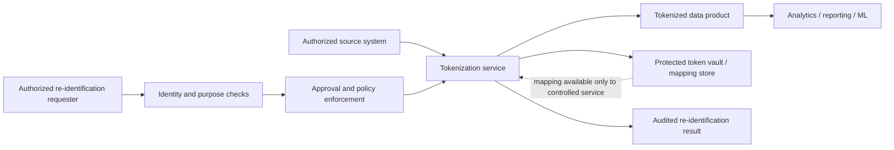

# PII Masking, Tokenization and De-identification

**Repository target:** `Stage 2D — Data Architecture/10-Data-Governance-Security-Privacy-and-Compliance/05-pii-masking-tokenization-and-de-identification.md`  
**Level:** Beginner → Intermediate → Advanced  
**Suggested study time:** 7–9 hours  
**Case study:** Northbridge Bank (fictional); all sample records and identifiers below are synthetic.

> **Scope note:** The module-specific roadmap is the primary authority for topic scope, sequencing, learning outcomes, exercises, deliverables, and completion gates. It identifies topic files as empty when the roadmap was authored. This lesson's worked examples, decision matrices, and implementation suggestions are instructional elaborations, not claims that the target file previously contained them. This material is educational and is not legal advice or a guarantee that a technique satisfies any particular law or standard.

---

## 1. Topic overview

Data protection is not only about preventing unauthorised access. It is also about collecting and exposing less personal information in the first place. Masking, tokenization, pseudonymisation, anonymisation, and synthetic data can reduce exposure, but they are not interchangeable and none is automatically appropriate for every use case.

This topic builds on:
- **Data classification:** understand the sensitivity and criticality of fields and datasets.
- **Identity, access control, and least privilege:** determine who can see original values, protected values, or mapping services.
- **Encryption, key management, and secrets:** protect token mappings, encryption keys, and the credentials used to access protection services.

It supports later governance topics by reducing unnecessary data exposure, making purpose restrictions practical, improving retention/deletion design, providing evidence for reviews, and enabling policy enforcement in data pipelines.

### 1.1 Learning objectives

By the end of this lesson, you should be able to:

1. Explain personal data, PII, direct identifiers, indirect identifiers, quasi-identifiers, and sensitive attributes.
2. Apply data minimization and classification when designing a data product.
3. Distinguish masking, redaction, substitution, generalization, suppression, tokenization, pseudonymisation, anonymisation, and synthetic data.
4. Explain token-vault architecture, mapping protection, token generation, and token lifecycle.
5. Evaluate linkage and re-identification risk even after direct identifiers are removed.
6. Choose a protection technique based on use case, threat model, access permissions, utility needs, and residual risk.
7. Follow protected values through ingestion, transformations, derived datasets, exports, logs, backups, analytics, and AI/ML workflows.
8. Define who may access original values or perform re-identification, and how that authority is approved and audited.
9. Create a protection matrix, test plan, evidence plan, and documented residual-risk decision.

### 1.2 Recommended progression

- **Beginner:** terminology, direct/indirect identifiers, minimization, basic masking, tokenization, pseudonymisation versus anonymisation.
- **Intermediate:** technique selection, token vaults, field-level protection, downstream propagation, analytics/test/export patterns, and access design.
- **Advanced:** linkage attacks, utility/privacy trade-offs, mapping-service threats, re-identification governance, drift monitoring, and architecture decisions.

The detailed examples below are recommended learning content. Follow the module roadmap's own prerequisite sequence and completion gate when tracking the repository.

---

## 2. Foundational terminology

### 2.1 Personal data and PII

**Personal data** is information that relates to an identified or identifiable person under the relevant context and applicable definition. **Personally identifiable information (PII)** is a term commonly used for information that can identify or help identify a person. The precise scope of these terms varies by context and jurisdiction; do not assume that one universal field list determines every legal outcome.

Examples of **direct identifiers** in a synthetic customer system include:
- full name;
- government-issued identifier;
- email address or phone number;
- account or customer number when it directly identifies a person in that system;
- an address or another unique identifier.

Examples of **indirect identifiers** or **quasi-identifiers** include:
- date of birth or age;
- postal area or region;
- employer or occupation;
- a combination of location, event time, and transaction characteristics;
- rare combinations of attributes.

An indirect identifier may not identify someone alone, but combinations can distinguish a person or allow a record to be linked to another dataset.

**Sensitive attributes** are fields that may cause significant harm or require stronger handling in a given context, such as financial details, health information, precise location, credentials, or other highly personal information. Whether a field is sensitive depends on the data, use, context, and governing requirements—not just its column name.

### 2.2 Identifier, quasi-identifier, and sensitive attribute

| Term | Meaning | Synthetic example | Why it matters |
|---|---|---|---|
| Direct identifier | Can directly identify a person in a context | `customer_email` | Often requires restricted access or removal from general-purpose outputs |
| Quasi-identifier | May identify or link a person when combined with other data | `birth_year`, `region`, `occupation` | Removing names may not prevent re-identification |
| Sensitive attribute | Information whose disclosure or misuse may harm a person or require extra controls | `account_balance`, `risk_flag` | May need suppression, aggregation, access restriction, or minimization |
| Linkage key | A value used to join records across systems | Stable customer number or persistent token | Can enable tracking across datasets |
| Derived attribute | A value calculated from source data | `age_band`, risk score, segment | Can still reveal personal or sensitive information |

One field can occupy more than one category. A stable token may not reveal a person's name by itself, but it can become a linkage key across datasets. A risk score is derived, yet may remain sensitive.

### 2.3 Data minimization

Data minimization means using only the information reasonably necessary for a defined purpose. It is often the most effective first control because data that is never collected or shared cannot leak from that processing path.

Ask:
- Do we need person-level data at all?
- Would aggregates, ranges, or cohorts meet the need?
- Do we need the exact value, or only a flag or category?
- Can the analysis run in a controlled environment without exporting raw data?
- Can the data be deleted after the purpose ends?
- Is a persistent cross-dataset identifier necessary?

**Trade-off:** removing detail can reduce analytical utility or prevent legitimate case investigation. Document the purpose and the minimum necessary granularity rather than automatically retaining all fields “just in case.”

---

## 3. Synthetic Northbridge Bank dataset

The following records are invented for this lesson and do not represent real people.

| synthetic_customer_id | customer_name | email | birth_year | region | occupation | account_balance | risk_flag |
|---|---|---|---:|---|---|---:|---|
| NB-C001 | Avery Example | avery.example@invalid.test | 1987 | North | Engineer | 1240.50 | Review |
| NB-C002 | Morgan Sample | morgan.sample@invalid.test | 1974 | West | Teacher | 8230.00 | Clear |
| NB-C003 | Riley Demo | riley.demo@invalid.test | 1991 | East | Analyst | 450.25 | Review |
| NB-C004 | Casey Fiction | casey.fiction@invalid.test | 1987 | North | Engineer | 3175.75 | Clear |
| NB-C005 | Jordan Mock | jordan.mock@invalid.test | 1965 | South | Retired | 9820.10 | Review |

All names, identifiers, emails, balances, and risk flags are synthetic. The `.test` email domain is reserved for testing purposes. Even synthetic examples should not be copied into production as if they were actual customer records.

### 3.1 Illustrative field classification

This is a teaching scheme, not a legal taxonomy. Reconcile labels with the organisation's actual classification register.

| Field | Illustrative classification | Identifier type | Typical protection concern |
|---|---|---|---|
| `synthetic_customer_id` | Confidential | Direct/internal linkage identifier | Stable joins can track a record across outputs |
| `customer_name` | Restricted | Direct identifier | Direct identification |
| `email` | Restricted | Direct identifier/contact data | Identification, phishing, unwanted contact |
| `birth_year` | Confidential | Quasi-identifier | Linkage with external data |
| `region` | Internal/Confidential depending on context | Quasi-identifier | Linkage when combined with other attributes |
| `occupation` | Confidential depending on context | Quasi-identifier | Rare combinations may distinguish records |
| `account_balance` | Confidential/Restricted depending on scheme | Sensitive financial attribute | Financial harm or inference |
| `risk_flag` | Confidential/Restricted depending on impact | Sensitive/derived attribute | Stigma, unfair treatment, or business misuse |

The label is an input to protection design. It does not itself mask a field, prevent a join, or enforce a policy.

---

## 4. Protection techniques: what they do and do not do

### 4.1 Comparison table

| Technique | What it does | Can the original value be recovered? | Typical use | Main limitation |
|---|---|---|---|---|
| **Masking** | Hides or transforms some/all visible characters or values | Sometimes; depends on whether the original remains stored and who can access it | Display, support workflows, routine analyst views | Does not automatically anonymise data; hidden parts and other fields may still identify |
| **Redaction** | Removes or irreversibly obscures selected content from an output | Usually not from that redacted output, if done correctly | Documents, logs, exports, reports | Redaction can fail if metadata, hidden layers, or alternate copies retain the content |
| **Substitution** | Replaces values with other values | May be recoverable if a mapping exists; otherwise depends on method | Test data, demos, exports | Consistent substitutes can still be linkable; fake data may be unrealistic |
| **Generalization** | Reduces precision or detail | Not usually by direct inversion, but linkage may still be possible | Analytics and public reporting | Too little generalization leaves uniqueness; too much harms utility |
| **Suppression** | Omits a field, record, or small group | Not from the suppressed output itself, but other data may reveal it | Small-cell reporting, risky fields | Repeated queries or complementary data can reveal suppressed values |
| **Tokenization** | Replaces a value with a token, often using a protected mapping or token service | Often yes for an authorized party if a mapping/vault or reversal mechanism exists | Stable joins, payment-like workflows, controlled re-identification | Mapping service becomes high-value; tokens may remain linkable and sensitive |
| **Pseudonymisation** | Replaces or separates direct identifiers while additional information can reconnect the data to a person | Re-linking is possible using separately held information | Research, analytics, controlled operational data | Pseudonymised data is not automatically anonymous |
| **Anonymisation** | Transforms data so individuals are not reasonably identifiable under a defined context and threat model | Designed not to be reversible, but risk must be assessed | Public release or broader sharing when justified | Absolute anonymity cannot be guaranteed; external data and future methods can change risk |
| **Synthetic data** | Creates artificial records rather than copying actual records directly | No direct lookup is intended, but synthetic data may leak patterns or memorise source data depending on generation | Development, testing, demos, model evaluation | “Synthetic” does not automatically mean privacy-safe or representative |

### 4.2 Static versus dynamic masking

**Static masking** transforms data into a separate protected copy, usually during a pipeline or export. The target copy contains masked or substituted values. This is useful for development, testing, data sharing, and training environments.

- **Advantages:** downstream users cannot simply toggle a display setting to reveal original values if the copy contains no originals.
- **Trade-offs:** requires refresh and lineage management; joins can break if mapping consistency is not preserved; masking rules may drift.
- **Common error:** masking a copy but leaving unprotected originals in temporary folders, staging tables, backups, or logs.

**Dynamic masking** transforms values at query or presentation time based on identity, role, or policy. The underlying stored data remains unchanged.

- **Advantages:** one source can serve users with different levels of detail; fewer duplicate transformed datasets may be needed.
- **Trade-offs:** relies on complete enforcement at every access path; users with direct storage or privileged query access may bypass the masking layer.
- **Common error:** assuming a UI mask is a security control when the underlying API or query path returns the raw value.

Choose static masking when you need a protected derivative for a separate environment or recipient. Choose dynamic masking when policy-aware views are enforceable and the use case benefits from different views over one controlled source. Both need tests and monitoring.

---

## 5. Worked transformations on the synthetic dataset

### 5.1 Redaction and masking for display

Original synthetic row:

| Field | Original synthetic value |
|---|---|
| `customer_name` | Avery Example |
| `email` | avery.example@invalid.test |
| `account_balance` | 1240.50 |

A support interface might display:

| Field | Protected display |
|---|---|
| `customer_name` | A•••• E•••••• |
| `email` | a••••.e••••••@invalid.test |
| `account_balance` | ****.** |

This is **display masking**, not anonymisation. The underlying application may still have the original values, and the visible fragments or surrounding context may help identify the person. A staff member with raw-data permission may still be able to retrieve the original elsewhere.

For a log or external export, redaction might omit the name and email entirely:

| Field | Redacted export |
|---|---|
| `customer_name` | `[REDACTED]` |
| `email` | `[REDACTED]` |
| `account_balance` | 1000–1999 (if this range is sufficient) |

A redacted output should be checked for hidden document layers, metadata, error payloads, and duplicate fields that retain the value.

### 5.2 Generalization and suppression

Original attributes for a synthetic record: `birth_year=1987`, `region=North`, `occupation=Engineer`, `account_balance=1240.50`.

Generalized version:

| Field | Original | Generalized |
|---|---|---|
| `birth_year` | 1987 | 1980–1989 |
| `region` | North | North (broad region) |
| `occupation` | Engineer | Professional |
| `account_balance` | 1240.50 | 1000–1999 |

Suppression example: if a published table contains a very small group with a rare combination, suppress the cell or combine it into a larger group. Suppression should consider complementary cells and repeated query outputs; otherwise totals may reveal the hidden value.

Generalization and suppression reduce precision, but the correct level depends on uniqueness and external information. A broad age band may still be unique when combined with location, occupation, and an unusual event.

### 5.3 Tokenization

A tokenization service might replace a synthetic customer ID with a random-looking token:

| Original synthetic ID | Tokenized ID |
|---|---|
| NB-C001 | tok_7f21a9 |
| NB-C002 | tok_4c83d0 |
| NB-C003 | tok_91b2e4 |

These tokens are illustrative strings, not generated by a production tokenization algorithm. In a real system, token generation, collision handling, entropy, format preservation, and mapping protection must be provided by a reviewed implementation.

If a vault holds the mapping, an authorized service may map `tok_7f21a9` back to `NB-C001`. Anyone with access to both the tokenized dataset and the mapping may be able to reconnect records. Tokens are therefore not automatically anonymous.

### 5.4 Pseudonymised analytics dataset

A pseudonymised dataset may replace direct identifiers with a stable token while generalizing or removing other fields:

| token_id | birth_decade | broad_region | occupation_group | balance_band | risk_flag |
|---|---|---|---|---|---|
| tok_7f21a9 | 1980s | North | Professional | 1000–1999 | Review |
| tok_4c83d0 | 1970s | West | Education | 8000–8999 | Clear |
| tok_91b2e4 | 1990s | East | Professional | 0–999 | Review |

This output is designed to support limited analysis while separating direct identifiers. It is still potentially linkable. A stable token enables longitudinal analysis but also allows tracking across datasets; risk depends on who can access the mapping and what external information is available.

### 5.5 Synthetic data

A test environment might use generated records such as:

| test_id | age_band | region | balance_band | outcome |
|---|---|---|---|---|
| TEST-001 | 30–39 | North | 1000–1999 | Review |
| TEST-002 | 50–59 | West | 8000–8999 | Clear |
| TEST-003 | 20–29 | East | 0–999 | Review |

These are fabricated test rows, not a promise of privacy. Synthetic-data generation should be evaluated for whether records were copied, whether rare source examples were memorized, whether outputs preserve sensitive individual-level patterns, and whether utility and privacy have been assessed for the intended release.

---

## 6. Tokenization architecture and mapping protection

### 6.1 Conceptual architecture

The mapping store is a high-value asset. The tokenization service should be the controlled boundary; ordinary analysts should not be able to query the mapping directly. Re-identification should require a specific approved purpose, scoped authority, and an audit trail.

### 6.2 Token generation approaches

Tokenization systems may use:
- **Random tokens with a vault:** generate a token and store a protected mapping to the original. Reversal occurs through an authorized vault operation.
- **Format-preserving tokenization:** tokens resemble the original format where a business interface requires it. This adds constraints and should use a reviewed implementation; do not design your own.
- **Deterministic tokenization:** the same input maps to the same token to support joins. This improves linkability and can reveal equality patterns.
- **Non-deterministic tokens:** the same input may receive different tokens, reducing cross-context linkability but making joins and deduplication harder.

The appropriate method depends on whether stable joins are needed, whether reversal is required, how much metadata is exposed, and the threat model. Avoid exposing token-generation keys or vault mappings to data consumers.

### 6.3 Token lifecycle

| Stage | Recommended control | Evidence |
|---|---|---|
| Design | Define purpose, scope, token properties, reversibility, and linkage requirements | ADR and threat model |
| Generate | Use a reviewed service/library with collision handling and controlled entropy | Service configuration and test evidence |
| Map/store | Protect mapping separately from tokenized datasets | Vault access policy and audit events |
| Use | Authorize token creation, lookup, and reversal as distinct operations where possible | Principal, action, purpose, resource, decision |
| Share | Share only tokenized outputs needed for the recipient's task | Data contract and approval |
| Rotate/version | Define behavior when token keys or mapping formats change | Migration plan and compatibility tests |
| Re-identify | Require explicit purpose, approval, and scoped access | Request, approval, result log |
| Revoke/retire | Remove unnecessary mapping access; handle data and mapping retention consistently | Revocation test and retention evidence |
| Review | Reassess owners, recipients, access, and linkability | Periodic review record |

Token rotation is not necessarily as simple as changing a key. If tokens are persisted in many downstream systems, migration may require dual mappings, backfills, or compatibility logic. Plan how old tokens are retired without breaking referential integrity.

### 6.4 Tokenization threat model

| Threat | Attack path | Impact | Controls to consider |
|---|---|---|---|
| Mapping disclosure | Unauthorized user reads vault | Re-identification of many records | Separate vault boundary, least privilege, encryption, audit, independent review |
| Token predictability | Weak or improperly designed token generation | Guessing or correlating original values | Use reviewed tokenization implementation; avoid homemade schemes |
| Deterministic linkage | Same token appears across domains | Cross-domain profiling | Domain-scoped tokens or non-deterministic mapping where practical |
| Re-identification misuse | Authorized operator reverses tokens for an unrelated purpose | Privacy breach or insider misuse | Purpose-bound request, approval, time limit, dual control for high-risk cases, monitoring |
| Vault outage | Token service unavailable | Join or operational workflow failure | Availability plan, tested recovery, bounded failure behavior |
| Stale mapping | Old mappings persist beyond need | Continued ability to reconnect identities | Retention rules, lifecycle review, deletion validation |
| Token leakage in logs | Token and context reveal identity through linkage | Tracking or inference | Log minimization, restricted log access, context reduction |

Tokenization can reduce exposure, but it does not remove the need for classification, authorization, encryption, retention, and monitoring.

---

## 7. Pseudonymisation versus anonymisation

### 7.1 Pseudonymisation

Pseudonymisation replaces direct identifiers or keeps identifying information separately so the working dataset cannot readily identify a person without additional information. That additional information may be a token vault, mapping file, or protected lookup system.

**Use when:** longitudinal analysis, research, model development, or operational workflows need stable records but routine users should not see direct identifiers.

**Limitations:**
- The dataset may remain identifiable through the mapping or linkage.
- Stable pseudonyms enable cross-record tracking.
- Quasi-identifiers may identify people even without a mapping.
- Re-identification authority and mapping access must be governed.
- The precise legal meaning and obligations vary by jurisdiction and context.

### 7.2 Anonymisation and the meaning of de-identification

**Anonymisation** is the goal of reducing identifiability so that individuals are not reasonably identifiable in a defined context, considering available data and plausible means of linkage. It is a risk assessment, not a magic operation or a guarantee that no future attack can ever succeed.

**De-identification** is often used as an umbrella term for processing that reduces direct identifiability. Depending on the method and context, a de-identified dataset may still be linkable, reversible, or otherwise relate to an identifiable person. Therefore, *de-identified* is not automatically synonymous with *anonymised* or with a particular legal status. State the transformation performed and assess the resulting risk rather than relying on the label.

**Use when:** sharing or publishing information where individual-level identification is not needed and the residual risk is acceptable under the applicable governance process.

**Limitations:**
- Removing names alone is not enough.
- Rare combinations and small groups can remain unique.
- External datasets and future auxiliary information can increase risk.
- Repeated releases or query access can enable differencing and reconstruction.
- A dataset assessed as low risk in one environment may become risky when combined with another source.

Do not label a dataset “anonymous” solely because direct identifiers were removed. Record the threat model, transformations, intended recipient, release context, known auxiliary data, risk assessment, and review date.

### 7.3 Why masking is not anonymisation

Masking often changes only the display, not the stored data. Even static masking may preserve stable identifiers, rare values, or linkable combinations. Anonymisation requires assessment of the entire released dataset and context, not simply the presence of a masking function.

---

## 8. Re-identification, linkage attacks, and uniqueness

### 8.1 Linkage attack

A linkage attack combines a target dataset with another source to infer who a record describes. The auxiliary source may be public, commercially available, internal, or otherwise accessible to an attacker. The attacker may not need a direct identifier if a rare combination of attributes is enough.

Example: a dataset contains `birth_year`, `region`, `occupation`, and an unusual event date. A second source contains an event with a person's location and occupation. Joining on the shared attributes may single out a record even if name and email were removed.

### 8.2 Uniqueness and quasi-identifiers

A combination of attributes can be unique within a dataset. Uniqueness is not the same as guaranteed identification, but it increases linkage risk. Measure:
- uniqueness of individual attributes and combinations;
- small group sizes;
- rare values and outliers;
- stability of identifiers across releases;
- overlap with likely auxiliary sources;
- risk from repeated queries and differencing.

Generalization and suppression can reduce uniqueness. They should be evaluated against the actual release, not selected by intuition alone.

### 8.3 Re-identification threat model

| Threat actor | Capability | Example risk | Possible mitigations |
|---|---|---|---|
| External recipient | Has public or commercial auxiliary data | Link a supposedly de-identified dataset to named records | Reduce precision, suppress rare combinations, assess release context |
| Internal analyst | Can join multiple internal datasets | Link tokenized customer activity across domains | Domain-scoped tokens, access separation, purpose limits, query monitoring |
| Vault operator | Can access mapping and tokenized data | Re-identify a broad population | Separate approval and execution, narrow queries, dual control where justified, audit |
| Model consumer | Can query a trained model or outputs repeatedly | Infer membership or sensitive patterns | Evaluate leakage, limit outputs/queries, use privacy-enhancing methods when appropriate |
| Accidental recipient | Receives an export with hidden metadata or extra columns | Identify records through retained fields | Schema allowlists, export scans, release review, reproducible transformation |

### 8.4 Group-based privacy models and limits

Group-size analysis is a useful first screen, not a complete privacy assessment. The following example uses the five synthetic Northbridge records from Section 3. For this calculation, treat `(birth decade, region, occupation group)` as quasi-identifiers and map `Engineer` and `Analyst` to `Professional`, `Teacher` to `Education`, and `Retired` to `Retired`.

| Synthetic customer | Birth decade | Region | Occupation group | Group size for this combination |
|---|---|---|---|---:|
| NB-C001 | 1980s | North | Professional | 2 |
| NB-C004 | 1980s | North | Professional | 2 |
| NB-C002 | 1970s | West | Education | 1 |
| NB-C003 | 1990s | East | Professional | 1 |
| NB-C005 | 1960s | South | Retired | 1 |

The minimum group size is 1, so this illustrative output is **not 2-anonymous** for these quasi-identifiers. The result is a property of this dataset and these selected fields; changing the fields or generalization changes the calculation. It does not prove that a unique record will be identified, and passing a group-size threshold does not establish anonymity.

Related concepts at awareness level:

- **k-anonymity:** each combination of selected quasi-identifiers appears in at least *k* records. It addresses a form of singling-out risk, but does not by itself prevent sensitive-attribute disclosure or all linkage attacks.
- **l-diversity:** adds a requirement for diversity of sensitive attributes within each quasi-identifier group. It can still be weak when the values are semantically similar or the population distribution is skewed.
- **t-closeness:** compares the sensitive-attribute distribution within a group with the overall distribution under a chosen distance measure. Results depend on the measure, threshold, and data context.
- **Differential privacy:** provides a formal bound on how much a person's participation can affect a released statistic or mechanism, when correctly designed and accounted for. It requires choices about contribution bounds, query design, composition, and a privacy budget; it is not a generic anonymization switch for arbitrary row-level data.

These methods have different assumptions and threat models. None should be treated as a universal guarantee; select, implement, and evaluate them for the release and use case.

### 8.5 Re-identification authority

A role allowed to use tokenized data should not automatically be allowed to reverse tokens. Define:
- permitted reasons for re-identification;
- who requests and approves it;
- which records/fields can be resolved;
- duration and scope;
- whether a second approver is needed for high-risk cases;
- what is logged and how alerts are generated;
- how the result is delivered and deleted;
- how misuse is investigated.

Separation of duties matters because an authorised operator may still misuse a legitimate capability. Controls should constrain and evidence the purpose, not merely confirm that the operator had a role.

---

## 9. Technique selection by use case

### 9.1 Decision matrix

| Use case | Typical candidate approach | Why | Risks / validation needed |
|---|---|---|---|
| Customer support display | Dynamic masking | Staff see enough to locate a case without full values | Verify raw API and export paths cannot bypass the mask |
| Development/test database | Static masking or high-quality synthetic data | Keeps production originals out of non-production | Validate joins, referential consistency, rare-value leakage, and test realism |
| Analytics requiring longitudinal joins | Pseudonymisation or controlled tokenization | Stable token enables joins without routine direct identifiers | Stable tokens are linkable; restrict mapping and cross-domain reuse |
| Public aggregate reporting | Aggregation, generalization, suppression, release review | Individual rows may not be necessary | Small cells and repeated releases can reveal values |
| External partner sharing | Minimized curated dataset with suitable masking/tokenization/generalization | Limits recipient access to needed fields | Consider recipient's auxiliary data, onward sharing, and re-identification risk |
| Model training | Minimize fields; pseudonymise/tokenize if appropriate; synthetic data where fit | Reduces unnecessary direct identifiers | Sensitive attributes and model leakage may remain; validate utility and risk |
| Fraud investigation | Restricted source access with audited re-identification when justified | Investigation may require identity resolution | Narrow scope, approved purpose, time limit, audit, and post-use review |
| Operational logs | Redaction or allowlisted fields; avoid raw identifiers/secrets | Logs are copied widely and retained | Ensure traces, error payloads, and debug logs are also covered |
| Small-cohort dashboard | Generalization and suppression | Reduces risk from unique combinations | Complementary cells and filters can disclose suppressed groups |

No row is a universal rule. Choose based on data classification, purpose, recipients, access controls, threat model, retention, and required analytical utility.

### 9.2 Protection matrix

The following sample is a recommended design, not a mandatory standard.

| Original field | Illustrative classification | Selected technique | Authorized use | Residual risk |
|---|---|---|---|---|
| `customer_name` | Restricted | Remove from analytics; display-mask in support UI | Support role sees partial value; analytics gets no name | Other context may identify a person |
| `email` | Restricted | Suppress or replace with non-production synthetic value in test | Test workflows only | Bad transformation may preserve domain/local-part patterns |
| `synthetic_customer_id` | Confidential | Domain-scoped tokenization | Approved joins within risk analytics | Stable token remains linkable in that domain |
| `birth_year` | Confidential | Generalize to decade or age band | Cohort analysis | Combined quasi-identifiers may remain unique |
| `region` | Internal/Confidential | Generalize when group is small | Regional reporting | Small groups or external data may permit linkage |
| `account_balance` | Confidential/Restricted | Use bands or aggregates | Portfolio analytics | Outlier bands may still reveal an individual |
| `risk_flag` | Confidential/Restricted | Minimize, aggregate, or restrict by role/purpose | Risk model development | Sensitive inference can remain in derived outputs |
| Token-to-original mapping | Restricted | Separate vault, strict access, encryption, audited resolution | Approved re-identification service only | Vault compromise may re-identify many records |
| Logs | Context-dependent | Allowlist and redact identifiers | Operations and security monitoring | Correlation fields may still link events to a person |
| Model outputs | Context-dependent | Output controls and leakage evaluation | Approved inference use | Outputs may reveal training data patterns |

---

## 10. Protection across the data lifecycle

### 10.1 Ingestion

- Identify personal and sensitive fields at source.
- Avoid ingesting fields that have no approved purpose.
- Apply approved tokenization or masking before broad landing zones when feasible.
- Restrict raw landing data to the smallest set of workload identities.
- Ensure dead-letter queues, retries, rejected records, and diagnostic logs do not retain raw values unnecessarily.
- Capture lineage and transformation metadata.

**Failure mode:** the main pipeline masks a field but the rejected-record table stores the original row with unrestricted access.

### 10.2 Storage and transformation

- Keep original and protected assets separate when the access model requires it.
- Define whether each transformation preserves or changes identifiers and linkage.
- Track classification and protection metadata into derived tables, files, features, and data products.
- Test joins, aggregates, and window calculations for leakage of sensitive information.
- Protect temporary tables, caches, notebooks, and intermediate files.
- Ensure access policies apply to direct storage paths and query interfaces.

**Failure mode:** a downstream join reintroduces the original email or a stable token shared across domains.

### 10.3 Exports and sharing

- Use a schema allowlist for approved fields.
- Run export scans for direct identifiers, sensitive attributes, and unexpected columns.
- Check hidden document metadata and workbook tabs where relevant.
- Assess uniqueness and linkage in the recipient's context.
- Record recipient, purpose, approval, fields, transformations, retention, and onward-sharing constraints.
- Keep an evidence record of the final released artifact and transformation version.

**Failure mode:** a dashboard is masked, but a CSV export exposes raw values.

### 10.4 Logs, monitoring, and backups

- Redact or avoid sensitive values in logs, traces, exception messages, and metrics labels.
- Use stable correlation identifiers only when necessary and consider whether they enable cross-system tracking.
- Restrict log access and define retention.
- Include backups and snapshots in transformation and deletion planning.
- Do not assume deletion from a primary table removes older exports or backups.
- Avoid placing original identifiers or token mappings in monitoring labels.

### 10.5 Derived data and machine learning

Derived data remains in scope for protection assessment. Examples include:
- customer segments;
- risk scores;
- embeddings and vector-store records;
- feature tables;
- model training samples;
- predictions and explanations;
- cohort metrics and dashboards.

A derived field may reveal sensitive attributes even when it contains no name. Embeddings and model outputs can retain or reveal source information depending on the system and attack model. Do not automatically classify them as anonymous.

Recommended AI/ML controls:
1. Minimize source fields and record the purpose.
2. Separate training, validation, and inference access.
3. Use pseudonymized/tokenized identifiers where stable linkage is necessary.
4. Prevent raw identifiers from appearing in prompts, debug traces, experiment trackers, and model outputs unless explicitly justified.
5. Evaluate membership inference, memorization, or other leakage risks where relevant to the model and release context.
6. Restrict model artifacts, vector stores, feature stores, checkpoints, and evaluation datasets.
7. Record transformation lineage and protection metadata.
8. Validate utility after transformations and document residual risk.

Synthetic data can support development, but it must be evaluated for fidelity, bias, and leakage; it is not automatically safe simply because records look artificial.

---

## 11. Integration with governance controls

| Related topic | Dependency or contribution |
|---|---|
| Data classification | Determines field sensitivity, handling expectations, and review intensity |
| Identity and access control | Limits who can see original values, protected datasets, mapping vaults, or re-identification results |
| Encryption and key management | Protects stored/transmitted data and token mappings; access to keys must be separately authorized |
| Purpose limitation | Restricts transformation and use to an approved objective; pseudonymisation is not permission for any use |
| Retention and deletion | Applies to original values, token mappings, protected copies, derived data, exports, and backups |
| Audit evidence | Captures request, approval, transformation version, access, release, and re-identification events |
| Governance by design | Turns protection labels and rules into pipeline checks, enforcement points, release gates, and monitoring |

A classification label alone does not perform a transformation. A masking function alone does not enforce who can use the original. A token alone does not eliminate obligations. The control system must connect metadata, transformation, authorization, enforcement, monitoring, and evidence.

---

## 12. Monitoring, evidence, and governance

### 12.1 Recommended evidence

| Control objective | Evidence | Validation question |
|---|---|---|
| Only necessary fields are collected | Approved schema, purpose record, data contract | Can every field be justified? |
| Masking is applied consistently | Transformation definition, version, test results | Do query, API, export, and logs all respect the intended protection? |
| Token mapping is protected | Vault policy, access logs, owner and approver records | Can ordinary analytics users access or reverse mappings? |
| Re-identification is governed | Request, purpose, approval, scope, output, post-use review | Is each resolution justified and attributable? |
| De-identification risk is assessed | Uniqueness/linkage analysis, threat model, release decision | Are plausible auxiliary data and recipient context considered? |
| Test data is protected | Data-generation/masking pipeline, scans, review | Are originals absent from non-production and artifacts? |
| Derived data inherits appropriate protection | Lineage and metadata, policy tests | Can a derived output reveal information its source controls should protect? |
| Retention is followed | Deletion jobs, mapping lifecycle, backup/replica evidence | Do protected copies and mappings follow the same lifecycle requirements? |
| Exports are reviewed | Schema allowlist, scan output, approval, artifact hash/version | Does the released file match the approved transformation? |

### 12.2 Metrics

| Metric | Suggested definition | Why it matters |
|---|---|---|
| Unprotected sensitive-field rate | In-scope sensitive fields without the required protection ÷ fields due for control | Finds coverage gaps |
| Masking test failure rate | Failed tests ÷ masking tests run | Detects drift or broken enforcement |
| Token vault access anomalies | Unusual or denied vault operations by principal, volume, or purpose | Highlights misuse or misconfiguration |
| Re-identification approvals | Count by purpose, requester, approver, and scope | Enables review of exceptional resolution activity |
| Re-identification review completion | Uses reviewed after completion ÷ uses requiring review | Checks accountability |
| Export scan findings | Sensitive-field findings by system and severity | Finds accidental disclosures |
| High-uniqueness groups | Counts of records/cohorts above a defined uniqueness risk threshold | Supports release review |
| Non-production source-data findings | Confirmed production originals or prohibited fields in test assets | Measures test-data protection |
| Derived-asset coverage | Derived assets with reviewed classification/protection metadata ÷ assets in scope | Measures propagation |
| Overdue mapping/asset retention | Mappings and protected copies beyond approved retention/expiry | Detects lifecycle gaps |

Define thresholds based on risk and intended use. Metrics are indicators, not proof of anonymity or compliance.

---

## 13. Architecture decision record: tokenization versus masking versus synthetic data

**Status:** Proposed teaching example  
**Decision owner:** Northbridge Data Platform Architecture (fictional)

### Context

Risk analysts need longitudinal joins across synthetic customer activity. Developers need realistic test data. Support staff need to locate cases without routinely viewing full contact details. A separate approved workflow may occasionally need to reconnect a token to an original record.

### Options

**Option A — Dynamic masking**
- Best suited to different display views over a controlled source.
- Low duplication, but depends on complete enforcement and may be bypassed by raw access.
- Does not meet the need for an independent test copy.

**Option B — Tokenization with a protected vault**
- Supports stable joins and controlled reversal.
- Requires strong vault isolation, key/secret management, authorization, monitoring, and mapping lifecycle.
- Tokens remain linkable and the vault creates a high-value target.

**Option C — Static masking or generalization**
- Creates a protected derivative for a defined consumer or environment.
- Easier to distribute than raw data, but refreshes and joins must be managed.
- Residual linkage risk remains if rare combinations or stable identifiers persist.

**Option D — Synthetic data**
- Can reduce reliance on actual customer records for testing.
- May not represent all production edge cases; generated data must be evaluated for leakage, bias, and utility.
- “Synthetic” is not a blanket privacy guarantee.

### Decision (illustrative)

- Support UI: dynamic masking for routine display, with raw access restricted to an approved path.
- Risk analytics: domain-scoped tokenization only where stable joins are needed, with the mapping vault separated from analysts.
- Development/test: prefer synthetic data; use static masking when fidelity to production distributions or relationships is required and risk has been assessed.
- External/public reporting: minimize fields and use aggregates, generalization, and suppression with a release-specific linkage assessment.

### Consequences and revisit conditions

- Maintain field-level classification, transformation lineage, and a protection register.
- Test direct access, exports, logs, and derived outputs.
- Define who can re-identify and require purpose-bound approval.
- Reassess if recipients, auxiliary data, joinability, or the business purpose changes.
- Document residual risk rather than claiming absolute anonymity.

---

## 14. Exercise A — Build a protection matrix

### Inputs

Use the synthetic Northbridge dataset in Section 3. The intended outputs are:
1. a customer support interface;
2. a risk analytics dataset for longitudinal joins;
3. a development/test dataset;
4. an external aggregate report.

### Tasks

1. Classify each field as a direct identifier, quasi-identifier, sensitive attribute, linkage key, or derived attribute as appropriate.
2. Choose masking, redaction, substitution, generalization, suppression, tokenization, pseudonymisation, anonymisation assessment, or synthetic data for each output.
3. State whether original values remain accessible and which identities can access them.
4. Identify mapping/vault access and re-identification approval requirements.
5. Document residual linkage risk and utility loss.
6. Define tests for query results, exports, logs, and derived assets.

### Expected deliverable

A matrix with columns:

| Source field | Classification | Output/use | Technique | Transformation rule | Authorized users | Original/mapping access | Residual risk | Test/evidence |
|---|---|---|---|---|---|---|---|---|

### Validation criteria

- Every field has a stated purpose or is excluded.
- Direct identifiers are not copied into test or external outputs without a documented reason.
- Stable tokens are treated as linkable, not automatically anonymous.
- Quasi-identifiers and small groups are assessed for uniqueness.
- Re-identification is separated from ordinary analytics.
- The matrix covers derived datasets, exports, logs, and backups where applicable.
- Utility loss and residual risk are recorded explicitly.

---

## 15. Exercise B — Token vault and re-identification threat model

### Scenario

A risk analyst can query tokenized customer events. A separate operational team maintains a tokenization service. A fraud investigation occasionally requires resolving a token to the original synthetic customer ID.

### Tasks

1. Draw the tokenization architecture and mark trust boundaries.
2. Define separate permissions for token creation, token lookup, and reversal.
3. Specify requester, approver, purpose, scope, expiry, and post-use review for re-identification.
4. Identify attacks involving vault compromise, deterministic linkage, unauthorized lookup, and token leakage in logs.
5. Define audit events and alerts.
6. Describe recovery if the vault is unavailable, without granting analysts direct access to its mapping.
7. Explain how token rotation or migration affects downstream joins.

### Expected deliverables

- Architecture diagram and trust-boundary notes.
- Role/permission matrix for token service and vault.
- Re-identification workflow and sample evidence record.
- Threat table with mitigations and residual risk.
- Test cases for allowed and denied token operations.

### Validation criteria

- Analysts cannot directly read the mapping store.
- Re-identification requires a specific approved purpose.
- Tokenization and reversal are attributable to distinct actions.
- Logs avoid unnecessary original values and secrets.
- Failure recovery does not create a broad mapping-access bypass.
- Rotation/migration preserves referential integrity or documents planned backfill.

---

## 16. Exercise C — De-identification and linkage-risk review

### Scenario

Northbridge proposes sharing a dataset containing `birth_year`, `region`, `occupation`, `balance_band`, and `risk_flag`, after removing name, email, and customer ID. A reviewer notes that some combinations are rare and the recipient has access to other demographic information.

### Tasks

1. Explain why removing direct identifiers does not prove anonymisation.
2. Identify likely quasi-identifiers and sensitive attributes.
3. Assess uniqueness and plausible linkage paths in the recipient's context.
4. Propose generalization, suppression, aggregation, field removal, or synthetic-data alternatives.
5. Evaluate utility loss for the intended reporting question.
6. Define release approval, evidence, review date, and conditions that trigger reassessment.

### Expected deliverable

A release-risk assessment documenting:
- intended purpose and recipient;
- data fields and transformations;
- threat actors and auxiliary-data assumptions;
- uniqueness/linkage findings;
- selected mitigations;
- utility impact;
- residual risk and accountable decision;
- validation and release evidence.

### Validation criteria

- No absolute anonymity claim is made.
- The analysis considers combinations of fields and external information.
- Small groups and repeated-release risks are considered.
- The selected transformations preserve only the utility needed for the purpose.
- Residual risk and release context are documented.
- The decision is revisited if recipient access or auxiliary data changes.

---

## 17. Common mistakes and misconceptions

| Mistake | Why it fails | Better practice |
|---|---|---|
| Removing names means data is anonymous | Quasi-identifiers and auxiliary data can re-identify records | Assess linkage risk in context |
| Masking the UI protects the database | Raw query/API/storage paths may still expose originals | Enforce at all relevant access paths |
| Tokenized data is anonymous | Stable tokens and mapping enable linkage or reversal | Treat tokens as protected, linkable data |
| One token can be shared across every domain without consequence | Cross-domain tracking becomes easier | Scope tokens by purpose/domain where feasible |
| Pseudonymisation equals anonymisation | Additional information can reconnect records | State reversibility and residual linkage risk |
| Synthetic data is automatically safe | Generators may copy or memorize rare source patterns | Evaluate generation process and leakage risk |
| Generalization alone is enough | Other fields or repeated outputs may still distinguish people | Assess uniqueness, suppression, and differencing |
| Redaction is just drawing a black box over text | Hidden layers, metadata, or underlying text may remain | Use a verified redaction process and inspect output |
| Masking one table protects all derivatives | Joins, exports, logs, features, and model artifacts can reintroduce information | Track lineage and test propagation |
| Re-identification is just a technical lookup | It can create a high-impact privacy event | Require purpose, approval, least privilege, and audit |
| Token vault access is just another database role | The vault can reconnect a broad population | Separate vault boundary and restrict reversal |
| “Privacy-safe” is a permanent property | New data sources and releases change risk | Reassess as context and auxiliary data change |

---

## 18. Mastery criteria and completion checklist

### 18.1 Mastery criteria

You should be able to:
- Distinguish direct identifiers, quasi-identifiers, sensitive attributes, linkage keys, and derived attributes.
- Explain masking, redaction, substitution, generalization, suppression, tokenization, pseudonymisation, anonymisation, and synthetic data.
- Explain static versus dynamic masking and their bypass/refresh risks.
- Design a tokenization service and protected mapping/vault boundary.
- Describe how re-identification is approved, scoped, monitored, and reviewed.
- Assess linkage and uniqueness risk beyond removing direct identifiers.
- Choose a protection technique based on use case, classification, utility, access model, and threat model.
- Track protection through ingestion, storage, transformations, derived assets, exports, logs, backups, and AI/ML workflows.
- Produce a protection matrix, threat model, release-risk assessment, and evidence plan.
- Document residual risk without making absolute anonymity guarantees.

### 18.2 Completion checklist

- [ ] Reviewed prerequisites: classification, identity/access control, and encryption/key management.
- [ ] Can explain direct and indirect identifiers and why combinations matter.
- [ ] Completed the synthetic-data transformations.
- [ ] Built a field-level protection matrix for support, analytics, test, and external reporting.
- [ ] Defined token generation, mapping protection, and token lifecycle.
- [ ] Separated tokenized-data access from mapping/re-identification authority.
- [ ] Considered static and dynamic masking and tested alternate access paths.
- [ ] Evaluated uniqueness, linkage, small-cell, and repeated-release risks.
- [ ] Assessed synthetic data for utility and potential leakage rather than assuming safety.
- [ ] Covered derived datasets, exports, logs, backups, features, embeddings, and model outputs where relevant.
- [ ] Defined monitoring, evidence, retention, and review controls.
- [ ] Completed all exercises and validation criteria.
- [ ] Recorded residual risk and the conditions that trigger reassessment.

### 18.3 Completion gate

Use the module roadmap's actual completion gate when recording progress. The recommended evidence package for this lesson is a field-level protection matrix, tokenization/re-identification architecture, threat model, and a release-risk assessment with validation criteria. Completion requires a coherent design that distinguishes reversible from non-reversible transformations, tests plausible linkage paths, and documents residual risk.

A document, label, or transformation function alone is not evidence that a dataset is anonymous or that a control is enforced.

---

## 19. Handoff to adjacent topics

- **Classification and criticality** establish the sensitivity and handling context for each field.
- **Identity and access control** restrict who can access originals, token mappings, and re-identification functions.
- **Encryption and key management** protect stored data, communications, and mapping systems, while key-use permissions remain separate authorization decisions.
- **Purpose limitation** constrains why data is transformed and used.
- **Retention and deletion** must cover originals, mappings, tokenized copies, exports, backups, and derived data.
- **Audit evidence** supports review of transformations, releases, and re-identification.
- **Governance by design** makes classification-aware transformations, export checks, and release gates repeatable.

The central design principle is to minimize what is collected and exposed, choose transformations based on a defined use and threat model, protect any mapping or reversal capability, and continuously test the entire data lifecycle. No single technique eliminates all privacy risk.
