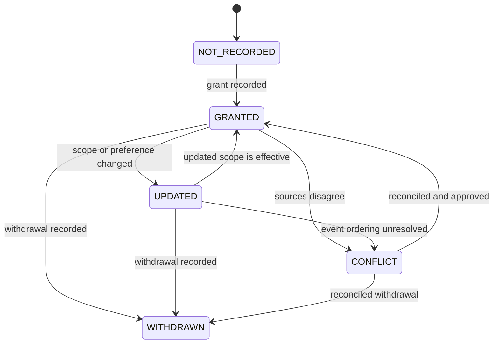
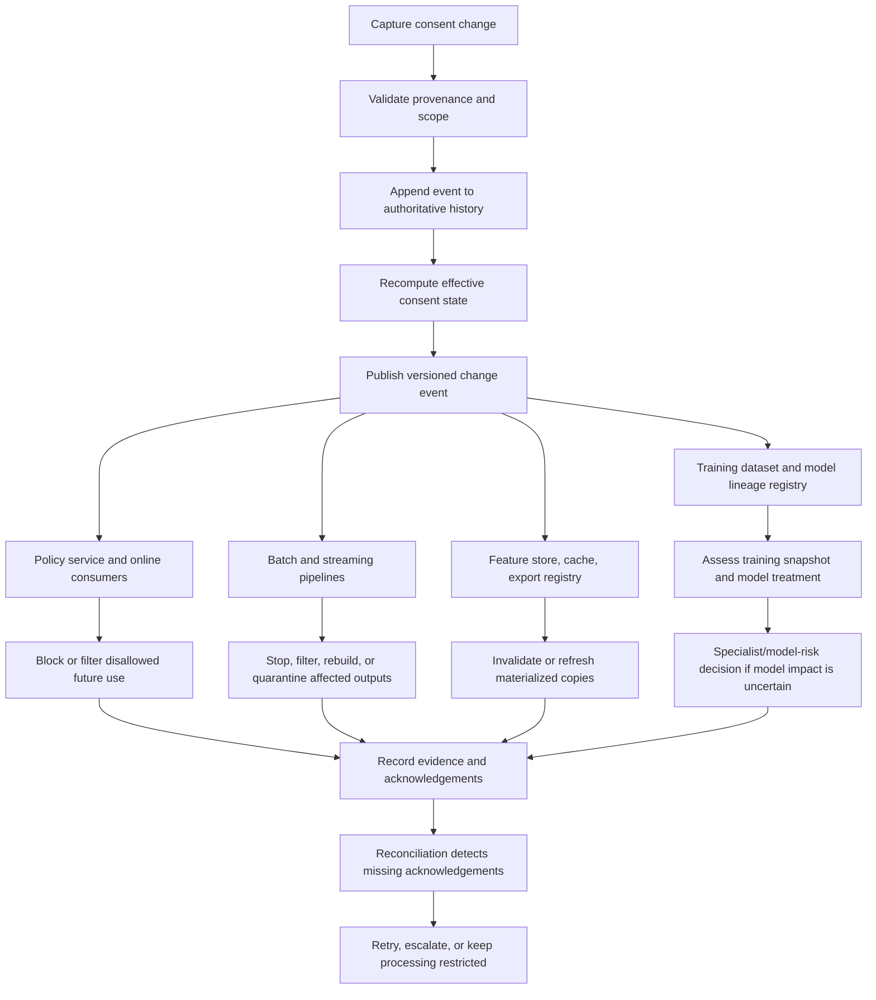
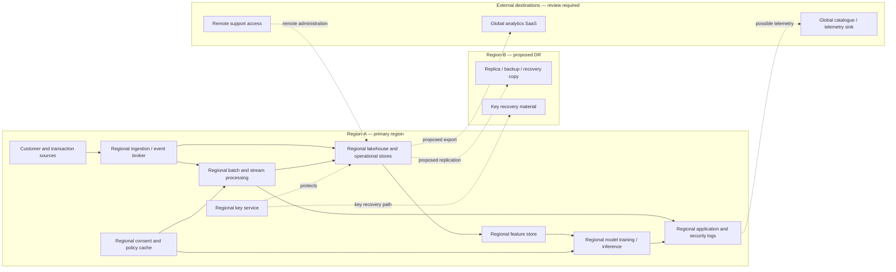

# Consent, Purpose Limitation and Data Residency

> **Module:** Stage 2D — Data Architecture  
> **Folder:** `10-Data-Governance-Security-Privacy-and-Compliance/`  
> **Sequence:** Topic 06 of 09 · **Recommended effort:** 6–8 hours  
> **Prerequisites:** Topics 01–05 in this module; foundational lineage/contracts and cloud-region concepts from Stage 2D  
> **Primary deliverables:** Purpose register and consent data model; policy rules; consent-change propagation design; residency register and remediation list; specialist-confirmation list; architecture decision record (ADR)

> **Educational and legal boundary.** This document teaches privacy-aware data architecture and control design. It is **not legal advice**, does not determine which law or legal basis applies, and does not certify any design as compliant. Requirements vary by jurisdiction, sector, data category, contract, transfer mechanism, and organizational circumstances. Qualified privacy, legal, security, risk, and compliance specialists must confirm applicable requirements. All organizations, systems, regions, people, identifiers, purposes, records, dates, and numbers in this lesson are fictional or synthetic.

## 1. Why this topic matters

Earlier topics established who is accountable, what data are, who can access them, how sensitive fields are protected, and how encryption and keys work. This topic adds two constraints that cut across the data lifecycle:

- **Why may this data be used?** Purpose, permitted-use, consent (where relevant), and other applicable permissions.
- **Where may the data be stored, processed, accessed, replicated, or transferred?** Residency and transfer constraints.

A platform can authenticate a user correctly, encrypt a table, and mask identifiers while still using data for an unapproved purpose or moving a copy into an unapproved location. These are separate control problems. A production architecture must express them as metadata, decisions, enforceable controls, lineage, and operational evidence—not merely as policy text.

### Learning progression

| Level | Focus | Evidence of learning |
|---|---|---|
| Beginner | Understand consent, purpose, minimisation, residency, and processing location | Explain concepts and classify synthetic uses without claiming a legal conclusion |
| Intermediate | Model purpose and consent metadata; make policy decisions; inventory data flows | Produce registers, a decision matrix, and a withdrawal propagation design |
| Advanced | Design regional data flows, enforce restrictions through pipelines and AI/ML, reconcile changes, and document exceptions | Produce a reviewed architecture, evidence plan, ADR, and explicit specialist-confirmation list |

## 2. Learning objectives

By completing the lesson, you should be able to:

1. Explain purpose limitation and data minimisation and distinguish them from consent.
2. Distinguish consent from other possible bases, permissions, obligations, or documented authorizations without deciding which applies in a particular jurisdiction.
3. Define purposes precisely enough for a policy engine and data contract.
4. Record purposes and link them to data assets, fields, processing activities, and derived outputs.
5. Model consent scope, status, provenance, timestamps, notice/version, updates, withdrawal, and propagation.
6. Design a fail-safe response for missing, ambiguous, stale, or conflicting purpose/consent metadata.
7. Distinguish storage region, processing location, access location, and cross-border transfer paths.
8. Inventory primary storage, replicas, backups, disaster recovery, logs, telemetry, metadata, keys, exports, third parties, and operational support paths.
9. Trace purpose and residency restrictions through batch, streaming, analytics, sharing, and AI/ML pipelines.
10. Translate policy statements into data contracts, policy decisions, workflow gates, technical controls, and evidence.
11. Design exception handling, ownership, conflict resolution, and auditability.
12. Deliver the purpose and residency map required by the module roadmap, including unknowns requiring specialist confirmation.

## 3. Prerequisites and relationship to adjacent topics

The module roadmap places this topic after governance/accountability, classification, access control, encryption, and PII protection. That order matters:

- **Topic 01 — Governance and accountability:** establishes who owns a data asset and who approves decisions.
- **Topic 02 — Classification:** establishes sensitivity and handling needs.
- **Topic 03 — Identity and access:** provides authentication, authorization, and attribute-based access control patterns.
- **Topic 04 — Encryption and key management:** protects data at rest and in transit but does not authorize a purpose.
- **Topic 05 — Masking, tokenization, and de-identification:** reduces exposure but does not automatically remove purpose or residency constraints.
- **Stage 2D lineage and data contracts:** provide traceability and interfaces through which restrictions can be declared and propagated.
- **Stage 2D cloud and streaming architecture:** provide region selection, replication, event retention, replay, and operational deployment controls.

If any prerequisite is weak, complete a focused review exercise before treating this lesson's design as production-ready. Do not assume a masked, tokenized, aggregated, or model-derived dataset is automatically free of restrictions; that conclusion requires a context-specific assessment.

## 4. Glossary

| Term | Working definition for architecture | Important caveat |
|---|---|---|
| **Purpose** | A defined reason for collecting or processing data, such as detecting suspicious transactions | Labels such as `analytics` or `business use` are often too vague to enforce |
| **Purpose limitation** | A control principle that constrains use to stated, compatible, and authorized purposes | The applicable interpretation depends on relevant rules and context |
| **Primary/original purpose** | The purpose communicated or otherwise established when data were collected or obtained | Verify from authoritative records; do not infer it from a table name |
| **Secondary use** | A proposed use beyond, or materially different from, the original use | It needs assessment; it is not automatically allowed or forbidden |
| **Consent** | An individual's recorded choice for a specified processing activity, where consent is used as the relevant basis or permission | A consent record alone does not establish that every processing activity is lawful |
| **Consent scope** | The subjects, data categories, purposes, channels, or activities covered by a consent record | Scope must be explicit enough to avoid treating one choice as blanket permission |
| **Withdrawal** | A recorded change indicating that a previously given consent is no longer active for its specified scope | Operational effects and treatment of earlier processing require an approved policy |
| **Other basis/permission** | A distinct justification, authority, obligation, contract, or documented permission that may support processing in some circumstances | Names and availability differ by context; this lesson does not select one |
| **Lawful/authorized use** | A use that has passed the required legal, policy, contractual, and organizational decision process | A technical engine enforces a decision; it cannot independently make a complete legal determination |
| **Data minimisation** | Collecting, exposing, and retaining only the data reasonably needed for a defined task | It is not merely masking fields after collecting everything |
| **Data subject / individual** | The person to whom personal data relate | Use a synthetic subject key in exercises, not a real identity |
| **Data residency** | An organization's or applicable rule's constraint about where data are stored or kept | Not synonymous with every possible data-localization obligation |
| **Data localization** | A broader category of requirements that may concern local storage, processing, access, or other conditions | Exact obligations depend on the applicable context |
| **Storage location** | Physical/logical region where a persisted copy is held | Include replicas, snapshots, archives, caches, and backup media where applicable |
| **Processing location** | Region or environment where computation reads, transforms, queries, or otherwise processes data | A job may process data somewhere other than the source storage region |
| **Access location** | Location from which a person, service, or support operator accesses data | Remote access may matter even when bytes are not copied to the operator's location |
| **Cross-border data flow** | Movement, replication, access, or processing that crosses a defined geographic or jurisdictional boundary | The boundary and significance of each flow need context-specific review |
| **Data lineage** | Trace of source-to-target relationships and transformations across systems | Lineage must be sufficiently complete and current to support decisions |
| **Derived data** | Data created from other data, including aggregates, features, embeddings, scores, and model artifacts | Derivation does not automatically remove restrictions |
| **Policy decision** | A recorded allow, deny, or review outcome for a proposed operation under defined inputs and policy versions | A decision is only as reliable as its metadata, rules, and evaluation context |
| **Policy enforcement point (PEP)** | Component that blocks, allows, filters, or gates an operation based on a decision | A policy engine without effective enforcement is advisory, not preventive |
| **Policy decision point (PDP)** | Component/service that evaluates rules and returns a decision | It may need current consent, purpose, region, identity, classification, and lineage inputs |
| **Purpose creep** | Gradual expansion of data use beyond defined or assessed purposes | Prevent with explicit purpose registration and change review |
| **Reconciliation** | Comparison of authoritative state with downstream state to detect and repair missed updates | Event delivery alone does not prove every consumer applied a change |

## 5. Core concepts

### 5.1 Consent is not the same as purpose limitation

Consent is one possible basis or permission for a defined processing activity in some contexts. Purpose limitation is a broader constraint on why data are used. A processing activity may require a purpose definition even when consent is not the basis relied upon. Conversely, a consent record may be too broad, stale, incorrectly scoped, or disconnected from the actual processing job to provide useful authorization.

A robust system answers distinct questions:

1. **Purpose:** What task is the processing intended to perform?
2. **Authority/basis:** What approved basis, permission, obligation, or decision supports this use in this context?
3. **Consent state:** If consent is relevant, what is the current authoritative state and scope?
4. **Compatibility:** Is the proposed use within the documented and reviewed scope?
5. **Minimisation:** Are all fields and records needed for this task?
6. **Location:** Are storage, processing, access, and movement locations permitted?
7. **Enforcement:** Which component blocks or filters the operation if a required condition fails?
8. **Evidence:** Can the organization reconstruct what was decided, using which inputs and policy version?

**Critical distinction:** recording consent does not, by itself, establish that every processing activity is lawful. A consent flag cannot replace purpose definition, assessment of other applicable requirements, data minimisation, access control, or residency/transfer review. Similarly, a system must not assume that absence of consent means all processing is prohibited: other bases or permissions may exist in some contexts, but their applicability must be confirmed by qualified specialists and represented in approved policy.

### 5.2 Consent versus other possible bases or permissions

The following are conceptual categories, not a legal checklist and not a statement that any category applies to Northbridge Bank.

| Category | What it means at an architectural level | System design implication |
|---|---|---|
| Consent | A documented choice for a defined scope, where consent is the relevant basis | Preserve scope, source, notice version, event history, and withdrawal state |
| Contract- or service-related authorization | A use may be tied to providing a requested service or fulfilling a documented agreement | Link processing to a specific service purpose and approved decision; do not assume every useful activity is necessary |
| Legal or regulatory obligation | A processing activity may be required by an applicable obligation | Record the obligation reference and owner supplied by specialists; avoid inventing legal citations |
| Legitimate organizational or public-interest rationale | Some contexts recognize other grounds or authorizations subject to conditions | Require a documented assessment and approval; do not encode a generic `legitimate_interest=true` as self-approval |
| Vital, emergency, or other exceptional basis | Some frameworks recognize narrow exceptional contexts | Keep exceptional pathways explicit, reviewed, and auditable |
| Contractual or partner permission | A contract may constrain or permit a data exchange | Record purpose scope, onward-use constraints, expiry/review date, and accountable owner |

The labels and legal meaning of these categories vary. Treat them as a design vocabulary for capturing an approved decision, not as advice on which ground is valid. A technical service should consume a reviewed policy record rather than decide the legal question from a generic field.

### 5.3 Purpose limitation and secondary-use assessment

A purpose definition should be narrow enough to guide design and testing.

- Weak: `analytics`
- Better: `monitoring aggregate service latency to improve platform reliability`
- Better: `detecting potentially fraudulent card transactions for case investigation`
- Too broad for reliable enforcement: `all business improvement and AI`

A purpose record should state at least: purpose ID, human-readable statement, business owner, data categories needed, allowed processing activities, prohibited uses, authorized consumers, output constraints, region constraints, approval status, review date, and policy version.

A secondary use is a proposed use that differs from the original purpose or from the current approved use envelope. Examples include using transaction records collected for account servicing to personalize marketing, using support transcripts to train a general-purpose model, or sending a regional dataset to a global analytics workspace. Do not automatically approve or reject it from the label alone.

**Recommended secondary-use workflow:**

1. Describe the proposed outcome and actual processing steps.
2. Identify source assets, fields, individuals/categories affected, and original purpose records.
3. State the proposed purpose and explain what changed.
4. Assess compatibility and applicable authority/permission with privacy/legal specialists and the accountable data owner.
5. Check minimisation, sensitivity, consent scope if relevant, retention, access, residency, contracts, and onward sharing.
6. Select controls and decide whether the use is approved, denied, or held for review.
7. Record the decision, approvers, evidence, conditions, expiry/review date, and policy version.
8. Implement the controls and verify that runtime matches the approved design.

A proposed use can be **approved with controls**, **rejected**, or **pending clarification**. “Pending” must not silently behave like “approved.”

### 5.4 Data minimisation as an architecture property

Minimisation is strongest when applied before data enters broad-access storage and at each interface, rather than as a late cleanup step.

- Drop fields that are not needed at ingestion.
- Prefer aggregates or purpose-specific views over broad raw-table access.
- Use scoped feature sets and short-lived extracts for defined jobs.
- Separate identifiers from analytical attributes when justified.
- Avoid copying entire tables into notebooks, debugging logs, test environments, or third-party tools.
- Define output controls for joins, small groups, free-text fields, and repeated queries where disclosure risk may arise.
- Review whether data volume, precision, history, or refresh frequency can be reduced.

Trade-offs include reduced flexibility for future exploratory analysis, additional data-product design, and more explicit change requests. That friction is deliberate: a new use should be assessed rather than automatically inheriting all available fields.

### 5.5 Purpose as metadata

Purpose must be attached to the processing contract, not only to a human-readable dataset description. A dataset can serve multiple purposes, but each job or consumer should declare its intended purpose and be checked against approved use.

```yaml
request_id: job-fraud-score-2026-10-20-001
requesting_service: fraud-scoring-pipeline
purpose_id: P-FRAUD-01
processing_activity: score_transaction_for_fraud_review
input_assets:
  - transaction-events-regional
requested_fields:
  - transaction_id
  - amount
  - merchant_category
  - event_time
region: region-a
output_asset: fraud-risk-features-region-a
policy_version: purpose-policy-v3
```

This is illustrative YAML, not a universal schema. The policy service must validate the request against authoritative asset metadata, approved purpose records, identity, consent where applicable, location policy, and current rules. A caller must not be allowed to self-declare a purpose and thereby grant itself permission.

### 5.6 Example purpose-to-processing decision matrix

The entries below are **synthetic architecture assumptions for learning**, not legal conclusions. A production decision requires context-specific review.

| Proposed activity | Declared purpose | Consent relevance in this example | Preliminary design decision | Required checks and controls |
|---|---|---|---|---|
| Score an incoming transaction for fraud review | `P-FRAUD-01` | The example does not assume consent is the basis; specialist decision required | **Conditional allow** only if approved policy covers it | Purpose registration, minimum fields, approved regional processing, access control, audit event |
| Produce monthly service availability aggregates | `P-SERVICE-02` | May or may not be relevant depending on source and context | **Review then allow** if source purpose and minimisation assessment support it | Remove unnecessary identifiers, aggregate, document small-group risk, retain lineage |
| Send customer offers based on transaction history | `P-MARKETING-03` | Consent may be relevant; inspect current scope and other requirements | **Hold for review** until purpose, applicable basis, consent if required, and region are verified | Purpose/consent check, withdrawal propagation, suppression list, export controls |
| Train a reusable language model on support transcripts | `P-MODEL-04` | Consent is not presumed; other constraints may apply | **Deny by default pending assessment** | Review source purpose, content sensitivity, provider terms, residency, minimisation, memorisation risk, retention, mitigation plan |
| Export a regional dataset to global SaaS analytics | `P-ANALYTICS-05` | Consent alone does not resolve location/transfer requirements | **Hold** until every data and metadata flow is reviewed | Storage/processing/access region, support access, contracts, transfer assessment, output minimisation |

A decision matrix is a design artifact. It does not replace specialist decision-making or runtime enforcement.

## 6. Purpose register and synthetic data-purpose mapping

### 6.1 Synthetic data-purpose register

| Asset ID | Synthetic asset | Classification assumption | Original/collection purpose | Approved purposes (illustrative) | Prohibited or not-yet-approved uses | Owner | Residency tag |
|---|---|---|---|---|---|---|---|
| A-001 | `txn_events_region_a` | Confidential; may contain personal data | Process and monitor customer transactions | `P-FRAUD-01`; `P-SERVICE-02` after approval | Marketing targeting; general-model training | Payments Data Owner | `RES-A` |
| A-002 | `customer_contact_region_a` | Restricted personal data | Account communication and service | `P-SERVICE-02` within approved fields | Unreviewed marketing; external model prompts | Customer Data Owner | `RES-A` |
| A-003 | `fraud_case_features_region_a` | Restricted derived data | Fraud investigation and scoring | `P-FRAUD-01` | Unrelated credit decisions; advertising | Fraud Analytics Owner | `RES-A` |
| A-004 | `service_metrics_aggregated` | Internal; re-identification review required | Reliability monitoring | `P-SERVICE-02` | Individual customer targeting | Platform Metrics Owner | `RES-A` |
| A-005 | `marketing_audience_candidate` | Restricted until approved | Proposed campaign audience | None until review is complete | Campaign export before approval | Marketing Data Owner | `RES-A` |
| A-006 | `model_training_snapshot` | Restricted; derived from source assets | Proposed model development | None until approved for a specific model purpose | General-purpose model training by default | ML Data Product Owner | `RES-A` |

`RES-A` means a fictional region constraint whose exact requirements are intentionally unspecified. The tag must resolve to an approved policy definition; it is not a legal conclusion. “Approved purposes” are illustrative. Real systems need purpose versions, effective dates, owners, approval references, and a method for superseding decisions.

### 6.2 Recommended metadata model

| Entity | Example attributes | Purpose |
|---|---|---|
| `PurposeDefinition` | `purpose_id`, `name`, `statement`, `owner`, `status`, `version`, `effective_from`, `review_by`, `approved_activities`, `prohibited_uses` | Defines a reviewed purpose and its scope |
| `AssetPurposeBinding` | `asset_id`, `purpose_id`, `field_scope`, `permitted_operations`, `approval_ref`, `valid_from`, `valid_to` | Links an asset or field set to a purpose |
| `ProcessingActivity` | `activity_id`, `purpose_id`, `inputs`, `outputs`, `processor`, `region`, `transfer_paths`, `owner`, `contract_ref` | Describes a concrete operation |
| `ConsentRecord` | `subject_key`, `purpose_id`, `scope`, `state`, `captured_at`, `effective_at`, `source`, `notice_version`, `record_version` | Represents consent where relevant |
| `ConsentEvent` | `event_id`, `subject_key`, `purpose_id`, `event_type`, `event_time`, `ingested_at`, `source_sequence`, `idempotency_key` | Preserves an auditable change history |
| `ResidencyPolicy` | `residency_id`, `data_categories`, `allowed_storage_regions`, `allowed_processing_regions`, `access_constraints`, `replication_constraints`, `backup_constraints`, `transfer_review_required`, `policy_version` | Expresses location constraints |
| `DataLocation` | `asset_id`, `copy_id`, `copy_type`, `region`, `environment`, `operator`, `retention_class`, `last_verified_at` | Inventories actual or intended copies |
| `LineageEdge` | `source_asset`, `target_asset`, `transformation_id`, `run_id`, `created_at`, `policy_context` | Traces source-to-derived relationships |
| `PolicyDecision` | `decision_id`, `request_id`, `result`, `reason_codes`, `policy_version`, `input_snapshot_ref`, `decided_at`, `enforcement_point` | Explains an allow/deny/review decision |
| `ExceptionRecord` | `exception_id`, `scope`, `reason`, `approvers`, `controls`, `expires_at`, `review_status` | Controls a narrowly scoped exception |

Use stable identifiers rather than relying on free-text labels. Version definitions; do not silently overwrite a prior purpose or policy. Restrict access to subject-level consent records, and avoid copying direct identifiers into general-purpose metadata. Retain only the evidence needed under the approved evidence/retention policy.

### 6.3 Data contract example

```yaml
asset_id: txn_events_region_a
schema_version: "2.4"
classification: confidential
purpose_bindings:
  - purpose_id: P-FRAUD-01
    permitted_operations: [read, transform, score]
    fields: [transaction_id, amount, merchant_category, event_time]
  - purpose_id: P-SERVICE-02
    status: conditional
    approval_ref: "APPROVAL-TO-BE-CONFIRMED"
    fields: [event_time, service_code]
residency_policy_id: RES-A
lineage_required: true
unknown_policy_behavior: deny_or_quarantine
owner: Payments Data Owner
```

The contract is an example, not a normative standard. Validate syntax, referenced IDs, policy status, expiry, field existence, lineage requirements, and allowed values in CI/CD and at runtime. A `conditional` binding must not be interpreted as approved unless its approval reference resolves to an active, authoritative decision.

## 7. Consent lifecycle and state model

### 7.1 Example consent states



This diagram is intentionally simplified. Real implementations may need `PENDING_VERIFICATION`, `EXPIRED`, `SUPERSEDED`, `INVALIDATED`, or `UNKNOWN`, depending on the approved operating model. `UPDATED` is often better represented as a new version/event plus a current effective state rather than as a long-lived terminal state.

| State/event | Meaning | Operational behavior (illustrative) |
|---|---|---|
| `NOT_RECORDED` | No authoritative consent record is available | If consent is required for the operation, do not proceed; route to review or an approved alternative |
| `GRANTED` | A consent event is recorded for a defined scope | Permit only the scoped purpose/activity when all other checks pass |
| `UPDATED` | Scope or preference changed | Re-evaluate effective scope; invalidate stale cached decisions |
| `WITHDRAWN` | Consent was withdrawn for the defined scope | Deny new processing that depends on that consent within the withdrawn scope; propagate and reconcile downstream state. Any different basis/permission must be separately assessed and approved, never inferred as a fallback |
| `EXPIRED` (optional) | The organization's approved policy says the recorded permission is no longer current | Treat according to policy; do not infer universal expiry rules |
| `CONFLICT` (operational state) | Authoritative sources disagree or event ordering is unresolved | Fail closed for consent-dependent uses and send to a governed reconciliation queue |

### 7.2 Fields to record

A consent event may need:

- Synthetic subject or account key; avoid spreading direct identifiers.
- Purpose ID and scope (including channel, data category, activity, or other dimensions if relevant).
- Event type (`GRANTED`, `UPDATED`, `WITHDRAWN`).
- Time asserted by the source and time received by the platform, with timezone/clock semantics defined.
- Source channel/system and authenticated capture provenance.
- Notice or wording version presented at the time.
- Event ID, source sequence/version, idempotency key, and correction/supersession reference.
- Current effective state derived from the event history.
- Processing/propagation status for downstream consumers, without exposing unnecessary subject detail in broad logs.

**Do not collapse event time and ingestion time.** Events can arrive late, be duplicated, or be reordered. The authoritative resolution logic should be deterministic and auditable. If two sources conflict, do not guess which state is correct; route the conflict to the defined owner/workflow.

### 7.3 Withdrawal is a distributed-systems problem

A central consent store may be authoritative, but downstream jobs can use cached snapshots, event streams, lakehouse tables, feature stores, caches, extracts, notebooks, and model training sets. A successful API response from the consent store does not prove that every downstream copy has stopped using the old state.

**Scope guardrail:** a withdrawal affects the consent-dependent processing and scope to which it applies; it must not be interpreted as a universal stop signal for every use of the person's data, nor as permission to switch automatically to another basis. If a separate basis or permission may support a distinct activity, require a separately reviewed, recorded policy decision before that activity continues. Never use that possibility to bypass the withdrawal for the consent-dependent activity itself.

Design for:

1. **Authoritative event capture:** validate the event and preserve its provenance.
2. **Durable publication:** publish a versioned event through a reliable mechanism.
3. **Consumer handling:** each consumer applies the event idempotently and records its applied version.
4. **Immediate guardrails:** query-time checks or short-lived authorization decisions prevent stale state from silently authorizing new work where required.
5. **Targeted remediation:** identify active jobs, materialized views, exports, features, caches, and training artifacts derived from the affected subject/purpose.
6. **Reconciliation:** compare authoritative state/version with downstream acknowledgements and inventories.
7. **Exception handling:** route unavailable consumers or irreconcilable histories to an owned queue; define whether affected processing pauses.
8. **Evidence:** retain event IDs, policy versions, affected asset IDs, action status, timestamps, retries, and unresolved exceptions.

Choose and document an explicit propagation service-level objective (SLO) based on risk and operational capability. Any example latency is an engineering assumption, not a legal deadline. A design may use event-driven updates plus scheduled reconciliation; neither alone guarantees that every copy is correct.

### 7.4 Workflow: consent change through downstream processing



The workflow must distinguish **stopping future processing** from **deciding what to do with outputs already produced**. Treatment of historic outputs, trained models, or previously shared data depends on applicable requirements, the approved policy, technical feasibility, and specialist decisions. The architecture should preserve lineage and support an auditable decision; it should not claim that a model can always be “untrained” by deleting a row.

### 7.5 Limitations of the state model

- A state value does not establish that capture was valid, informed, authentic, or sufficiently scoped.
- A single boolean cannot express purpose-specific scope, channels, notice versions, or history.
- A withdrawal must block the consent-dependent operation in its scope; a possible alternative basis requires a separate reviewed decision and cannot be inferred by the runtime service.
- Consent may not be the applicable basis for every processing activity.
- An event may be delayed or lost at a consumer; state must be reconciled.
- The subject key can be incorrectly linked or duplicated across systems.
- Withdrawal may not automatically resolve treatment of historic outputs, legal/contractual retention, or model artifacts.
- State freshness and cache TTLs must be designed around risk; a cached grant can become stale.
- “No consent record” and “consent denied” are not the same data-quality condition, though both may prevent a consent-dependent use.

## 8. Purpose compatibility and policy decisions

### 8.1 Compatibility is a governed decision, not a string comparison

Two purposes with similar names are not necessarily compatible. A policy engine can check structured attributes and approved rules, but human review may be needed to assess context, expectations, risk, contracts, or applicable legal interpretations.

Minimum decision inputs commonly include:

- Requesting service and authenticated workload identity.
- Declared purpose ID and concrete processing activity.
- Source asset IDs, fields, classification, original-purpose metadata, and lineage.
- Applicable authority/basis/approval record and its status.
- Consent state and scope if consent is required for this use.
- Region of storage, execution, access, and all planned destinations.
- Data minimisation and output constraints.
- Policy version, time of decision, and any exception.
- Whether source metadata is complete, current, and authoritative.

### 8.2 Decision outcomes

| Outcome | Meaning | Required runtime behavior |
|---|---|---|
| `ALLOW` | All required policy conditions have been satisfied | Execute only the approved operation, fields, purpose, and locations; emit decision evidence |
| `DENY` | A required condition fails or the use is explicitly prohibited | Block the operation; record a reason code and provide a safe remediation path |
| `REVIEW` | Human/specialist decision or missing evidence is required | Do not treat as allow; quarantine, pause, or route to an approved review workflow |
| `ERROR` | Policy service or required metadata could not be evaluated reliably | Apply documented fail-safe behavior; do not silently bypass the control |

For high-impact or consent-dependent processing, a common safe default is to fail closed or quarantine when required metadata is missing. The exact availability-versus-safety behavior should be risk-assessed and documented. A fail-open path must never be an accidental consequence of a timeout.

### 8.3 Example policy decision for a proposed secondary use

**Request:** The marketing team proposes to use `txn_events_region_a` to build individualized product-offer audiences. The current register lists fraud detection as an approved purpose; marketing is not approved. The example consent store contains no verified marketing scope for a synthetic subject. The target campaign platform is outside `RES-A`.

**Decision:** `REVIEW` / no execution. This is a synthetic architecture decision, not a legal conclusion.

**Reason codes:**

- `PURPOSE_NOT_APPROVED`: proposed marketing purpose is not bound to the source asset.
- `CONSENT_SCOPE_UNVERIFIED`: consent has not been established for this use in the example policy.
- `DESTINATION_REGION_UNREVIEWED`: target region and onward access have not been approved.
- `MINIMISATION_NOT_DEMONSTRATED`: no field-level specification shows that all proposed fields are needed.

**Required next steps:**

1. Marketing Data Owner defines the specific purpose and intended outcome.
2. Privacy/legal specialists assess the applicable basis/permissions and purpose compatibility.
3. Consent is evaluated only if relevant under the approved assessment; do not use missing consent as a proxy for all legal analysis.
4. Data owner documents the minimum fields, outputs, retention, recipients, and prohibited uses.
5. Residency/transfer review covers storage, processing, support access, subprocessors, logs, backups, and onward transfers.
6. Policy and data contract are updated only after approval.
7. CI and runtime tests verify the rule blocks the request before approval and allows only the reviewed scope after approval.
8. Evidence records the decision, approvers, conditions, policy version, and test results.

## 9. Data residency, processing location, and cross-border flows

### 9.1 Keep location concepts separate

| Dimension | Question | Example control |
|---|---|---|
| Primary storage | Where is the canonical dataset persisted? | Region-constrained storage policy and configuration test |
| Replica storage | Where are read replicas, mirrors, snapshots, and materialized copies? | Explicit replication allowlist; inventory and periodic verification |
| Backup/archive | Where do backups, snapshots, archives, and recovery copies live? | Backup-region policy, restore tests, retention and deletion coordination |
| Processing | Where does compute execute and where are intermediate files written? | Region-aware scheduler, data-local execution, temporary-storage controls |
| Access | From which locations can staff, vendors, or support personnel view or administer data? | Identity-aware access policy, just-in-time access, approval, session logging |
| Transfer/movement | Which paths move data to another region, jurisdiction, or organization? | Egress controls, transfer approval workflow, destination allowlist |
| Metadata | Where do catalogues, lineage, query history, schema registries, and job metadata reside? | Metadata classification and location policy |
| Logs/telemetry | Where are application logs, traces, crash dumps, metrics, and support bundles sent? | Redaction, regional routing, bounded payloads, telemetry destination controls |
| Keys/secrets | Where are keys, key replicas, secrets, and recovery material stored or operated? | Key-location policy, access restrictions, documented key administration path |
| Third parties | Where can a SaaS provider or subprocessor store, process, or access data? | Contract and architecture inventory; approved subprocessor and region configuration |
| Model/AI path | Where are prompts, retrieval context, training data, features, checkpoints, artifacts, and inference logs handled? | Model-serving region policy, approved provider path, data minimisation and lineage |

**Residency is not identical to every possible data-localization obligation.** Some requirements may concern storage, others processing, access, copies, transfer mechanisms, or local availability. The organization must translate the actual applicable requirement into explicit policy attributes after specialist review. A region label alone cannot express every obligation.

### 9.2 Synthetic Northbridge Bank regional architecture

**Scenario assumption:** Northbridge Bank operates a fictional customer and transaction platform in `Region-A`. A second region, `Region-B`, is available for disaster recovery. A global analytics SaaS product is proposed. No real jurisdiction or legal regime is implied. The architecture team has a provisional `RES-A` policy that allows primary storage and processing in Region-A; whether Region-B, remote support, global metadata, or SaaS processing is allowed remains **to be confirmed**.



The dashed paths are **proposed flows, not approvals**. The architecture review must decide whether each is allowed, conditionally allowed, or blocked. Even if payloads stay in Region-A, remote access, control-plane metadata, support bundles, query text, logs, and key administration paths still need assessment.

### 9.3 Residency and data-transfer inventory

Use this inventory for each asset and each operational copy. A single row for “the lakehouse” is not enough.

| Flow/copy ID | Data or metadata | Source → destination | Storage region | Processing/access location | Movement type | Purpose | Current status | Evidence / remediation |
|---|---|---|---|---|---|---|---|---|
| F-01 | Raw transaction events | Source → regional broker → lakehouse | Region-A | Region-A | Ingestion | `P-FRAUD-01` | Candidate allowed under `RES-A` assumption | Broker/storage configuration; policy test |
| F-02 | Fraud features | Lakehouse → feature store | Region-A | Region-A | Derived write | `P-FRAUD-01` | Candidate allowed if lineage and field scope pass | Lineage edge; feature-store location check |
| F-03 | Backup snapshot | Lakehouse → DR vault | Region-B | Restore may run in Region-B | Backup/DR replication | Recovery | **Review required** | Confirm allowed recovery region, key path, access and restore conditions |
| F-04 | Query history and job logs | Regional compute → observability sink | Unknown until configured | Potentially global operator access | Telemetry | Operations | **Unknown / block sensitive payloads** | Inspect sink, payload schema, support access, retention, and routing |
| F-05 | Catalogue and lineage metadata | Regional platform → global catalogue | Global or unknown | Global operators may access | Metadata replication | Discovery/governance | **Review required** | Classify metadata; test for subject identifiers or sensitive query text |
| F-06 | Marketing audience export | Region-A → campaign SaaS | External / unknown | SaaS and subprocessors | Export | `P-MARKETING-03` | **Blocked pending purpose and transfer approval** | Approval record, destination allowlist, minimisation, contract and audit trail |
| F-07 | Support bundle | Region-A → vendor support | Vendor-controlled / unknown | Potentially remote | Support transfer/access | Troubleshooting | **Review required** | Redact payloads, just-in-time access, ticket linkage, approved destination |
| F-08 | Model training snapshot | Lakehouse → training environment | Region-A by design | Region-A by design | Dataset copy | `P-MODEL-04` | **Not approved until specific model purpose is assessed** | Dataset manifest, lineage, purpose approval, residency checks |
| F-09 | Encryption key metadata | Regional key service → central operations | Unknown | Key administrators may be elsewhere | Control-plane replication/access | Key operations | **Review required** | Map key material vs metadata, admin access, recovery process |
| F-10 | Stream replay/archive | Event broker → retained event archive | Region-A intended | Replay worker location must be verified | Replay/copy | Recovery/reprocessing | **Not approved until verified** | Confirm broker retention, archive and replay-worker locations, consumer region, and purpose/consent re-check before enabling replay |

For every row, record an accountable owner, evidence source, last verified time, policy version, and open questions. Distinguish **known permitted**, **known prohibited**, **pending review**, and **unknown**. An unknown must not be disguised as an approved flow.

### 9.4 Regional architecture patterns and trade-offs

| Pattern | How it works | Benefits | Costs and limitations | Use when |
|---|---|---|---|---|
| Regional silos | Data, compute, keys, and operational stores stay within each approved region | Strong isolation and simpler regional boundaries | Duplicated platform, operational overhead, local skills and support burden | Region boundaries are strict or independent operation is required |
| Regional data with global metadata | Data remains regional while a central catalogue stores selected metadata | Central discovery and governance | Metadata can itself reveal personal or confidential facts; central control plane may be cross-border | Metadata is minimised, classified, and its location/access is approved |
| Federated queries | Data stays in place while approved queries execute against regional sources | Avoids bulk data movement; supports local control | Query text/results can still disclose information; network and latency complexity | Queries can be constrained and outputs controlled |
| Regional processing with aggregate export | Compute locally and export reviewed aggregates | Limits raw data movement | Aggregates may still be sensitive or re-identifiable; aggregation threshold alone is not a universal guarantee | Outputs pass a documented disclosure and purpose review |
| Tokenization with local mapping | Identifiers are replaced with tokens; mapping remains protected in-region | Reduces identifier exposure in shared systems | Tokenized data can remain linkable; tokenization does not automatically remove purpose or residency constraints | Linkage is needed but direct identifiers should be isolated |
| Federated learning / distributed training | Training computation is distributed and only selected updates or outputs move | May reduce central raw-data movement | Gradients, updates, model artifacts, and telemetry may leak information; orchestration remains complex | A risk-reviewed design demonstrates meaningful benefits over alternatives |

No pattern is inherently compliant. Evaluate the entire path, including access, support, logs, keys, backups, metadata, derived outputs, and provider operations.

## 10. Translating policy into enforceable controls

### 10.1 Policy-to-control mapping

| Policy statement (example) | Metadata/input | Preventive control | Detective/recovery control | Evidence |
|---|---|---|---|---|
| A job may use an asset only for an approved purpose | Purpose ID, asset-purpose binding, approval status | CI contract validation and runtime PDP/PEP check | Scan job logs for undeclared purposes; review exceptions | Decision record, job ID, policy version |
| Consent-dependent marketing must reflect current scope | Consent event version, subject/purpose scope | Query-time check or current scoped audience build; block stale state | Reconcile audience against consent changes; suppression tests | Event ID, applied version, affected audience rebuild |
| Data tagged `RES-A` may not be copied to an unapproved region | Residency policy, destination region | Region allowlist, egress controls, deployment policy, replication guardrail | Inventory scans, cloud configuration drift checks, transfer alerts | Deployment attestation, replication config, scan result |
| Only necessary fields may enter a model training snapshot | Purpose-specific field allowlist, data contract | Projection/allowlist at ingestion into training dataset | Dataset manifest and schema diff review | Manifest, approved field list, run ID |
| Logs must not contain raw customer fields | Log schema and data classification | Structured logging, redaction, payload limits | DLP/secret scans, sample review, incident workflow | Scan report, logging configuration version |
| Derived assets inherit restrictions unless reassessed | Lineage edges, inherited tags, transformation metadata | Tag propagation in pipeline templates; block unclassified outputs | Orphan-lineage scans and policy reconciliation | Lineage graph snapshot, policy test results |

A policy document is not enforcement. A pipeline should not be able to bypass controls simply by using a different notebook, exporting a file manually, or creating a new destination outside the approved deployment template.

### 10.2 Reference policy evaluation

```text
evaluate(request):
    authenticate(request.workload_identity)
    require(request.purpose_id)
    require(request.input_assets)
    require(current_policy_version)

    metadata = resolve_authoritative_metadata(request.input_assets)
    if metadata missing, stale, or conflicting:
        return REVIEW or ERROR according to risk policy

    if purpose not approved for all inputs and operations:
        return DENY

    if required authority/approval is missing or expired:
        return REVIEW

    if consent is required by the approved policy:
        state = resolve_current_scoped_consent(request.subjects, request.purpose_id)
        if state is withdrawn for this scope:
            return DENY
        if state is missing, stale, or conflicting:
            return REVIEW or ERROR according to the documented fail-safe policy
        if state is granted or updated:
            require current effective scope to cover this exact operation

    if any requested field is outside the minimum approved field set:
        return DENY

    if storage, compute, access, replica, backup, or destination region is not allowed:
        return DENY or REVIEW

    if lineage, destination, or evidence requirements are not satisfied:
        return REVIEW

    emit decision record with reasons, policy version, and evaluated inputs
    return ALLOW with scoped obligations
```

This pseudocode is a conceptual pattern, not production-ready code. Production implementations need threat modeling, identity integration, policy testing, error semantics, performance design, tamper-resistant evidence, and safe handling of partial failures. A returned `ALLOW` should bind to the specific request scope and policy version; it should not become a reusable blanket grant.

### 10.3 Enforcement points across the lifecycle

- **Ingestion:** reject or quarantine missing purpose, classification, provenance, or region metadata; drop unnecessary fields early.
- **Schema registry and data contracts:** require purpose bindings, residency tags, owners, lineage expectations, and change-review metadata.
- **Orchestration/CI/CD:** validate job declarations, source/destination regions, service identities, and approved output locations before deployment.
- **Batch jobs:** apply purpose-specific projections, filters, and current consent state where relevant; record run-level policy context.
- **Streaming:** propagate versioned consent/purpose changes, handle duplicates and out-of-order events, re-check at replay, and define quarantine behavior.
- **Query and serving layers:** enforce identity and purpose attributes, limit fields, and avoid stale authorization caches for sensitive operations.
- **Exports and sharing:** require destination registration, owner approval, purpose binding, minimisation, location review, and traceable transfer records.
- **AI/ML:** validate training dataset manifests, source purpose compatibility, consent-related constraints where relevant, model/provider location, feature lineage, retrieval filters, and artifact treatment.
- **Observability:** redact sensitive values, route logs to approved destinations, and monitor policy errors and unapproved movement.
- **Backups and DR:** apply the same location constraints, document restore execution region, and verify that restored systems re-enforce current policies before serving data.

## 11. Lineage and propagation of restrictions

### 11.1 Restriction inheritance

When a dataset is derived from restricted inputs, assume the output inherits relevant purpose and residency restrictions **unless a documented assessment establishes a different treatment**. A transformation does not automatically remove restrictions.

Examples of derived data that need lineage consideration:

- Filtered and joined tables.
- Aggregates and small-group reports.
- Search indexes, vectors, and embeddings.
- Feature-store values and online caches.
- Fraud scores, risk scores, and customer segments.
- Model training snapshots, checkpoints, adapters, and model artifacts.
- Query results, CSV extracts, notebook outputs, temporary files, and support bundles.
- Data quality samples and observability payloads.

A derived asset should record its source assets, transformation/run IDs, purpose, region, policy version, field-level transformations where material, and any reviewed restriction changes. If lineage is missing, do not silently assume the output is unrestricted.

### 11.2 Batch and streaming considerations

**Batch pipelines**
- Bind each run to a declared purpose and policy version.
- Re-check policy at execution time, not only when a DAG is first created.
- Record input snapshot IDs and output asset IDs.
- Ensure retries, backfills, and historical reprocessing re-evaluate current applicable restrictions.
- Quarantine or rebuild outputs if source policy changes make the old result invalid under the approved decision.

**Streaming pipelines**
- Version consent/purpose events and process them idempotently.
- Define event ordering and conflict resolution; ingestion timestamp alone may not establish the correct state.
- Consider broker retention, replay, dead-letter queues, compacted topics, and consumer offsets.
- Prevent stale consumers from continuing indefinitely; monitor last-applied version and lag.
- Apply restrictions to both new events and replays.
- Include replay and disaster recovery in the location inventory.

### 11.3 Analytics and exports

Before releasing an analytical output, evaluate purpose, minimum fields, group sizes, joins, destination, recipient, region, onward sharing, retention, and evidence. Aggregation can lower risk but does not prove that an output is non-personal or unrestricted in every context.

An export workflow should include:
1. Registered destination and accountable recipient.
2. Purpose and source-asset approval.
3. Field and row minimisation.
4. Region/transfer assessment, including provider and support paths.
5. Output inspection and approved format.
6. Expiry/revocation or refresh behavior where appropriate.
7. Transfer log, policy decision, and reconciliation with the recipient.

### 11.4 AI/ML-specific restrictions

AI pipelines create copies and artifacts beyond conventional tables. Review each stage separately:

| Stage | Questions to answer |
|---|---|
| Dataset selection | Are the source purposes approved for this model purpose? Are consent-dependent restrictions represented? |
| Preprocessing | Which identifiers, free-text values, rare attributes, or unnecessary fields are removed? |
| Training | Where do compute, temporary files, checkpoints, logs, and experiment trackers run? |
| Feature engineering | Do features inherit restrictions and have complete lineage? |
| Model registry | Are source datasets, purpose approvals, region, policy version, and intended use recorded? |
| Evaluation | Are test datasets permitted for this use and environment? |
| Inference | Can retrieval and feature access be filtered by the caller's permissions and purpose? |
| Third-party model APIs | What is sent, where is it processed, who can access it, how is it retained, and what terms apply? |
| Model outputs | Could outputs reveal or encode restricted data? What review and monitoring are required? |
| Withdrawal or changed purpose | What happens to source snapshots, features, embeddings, checkpoints, models, and served predictions? Who decides? |

Do not promise that a trained model can always be fully unlearned, or that embeddings and gradients are harmless. Preserve dataset-to-model lineage and make a documented, specialist-reviewed treatment decision for affected artifacts.

## 12. Exceptions, conflict resolution, and governance

### 12.1 Roles and responsibilities

| Role | Typical responsibility in this topic |
|---|---|
| Data owner | Accountable for asset purpose, approved use, and data-product decisions |
| Data steward | Maintains definitions, purpose bindings, classification, and metadata quality |
| Privacy/legal specialist | Interprets applicable obligations and assesses basis, compatibility, and transfer questions |
| Security team | Defines identity, egress, logging, encryption, and incident controls |
| Platform/data engineering | Implements policy checks, lineage, event propagation, location constraints, and evidence |
| ML/model owner | Owns model-purpose declaration, training-data lineage, model artifacts, and downstream impact assessment |
| Cloud/platform operations | Verifies regions, replication, backup, support paths, and configuration drift |
| Governance council/risk owner | Resolves material conflicts and accepts risk within delegated authority |
| Internal audit or independent reviewer | Tests control design and operation independently |

Separate the person who proposes a new use from the roles required to review or approve it. A developer must not self-approve an exception simply by editing a YAML file.

### 12.2 Exception record

An exception should include:

- Unique ID, owner, and business rationale.
- Exact assets, fields, purpose, processing activities, destinations, and identities in scope.
- Risk assessment and alternatives considered.
- Required specialist decisions and references.
- Compensating controls and monitoring.
- Start and expiry dates; no silent indefinite exceptions.
- Approvers and separation-of-duty evidence.
- Implementation location and policy version.
- Validation tests, evidence links, and rollback/exit plan.
- Review status, incident triggers, and closure evidence.

An exception cannot override a requirement that the organization has no authority to waive. The workflow must route that question to qualified specialists rather than treating a risk acceptance as permission.

### 12.3 Conflict and ambiguity handling

| Condition | Recommended behavior | Owner/workflow |
|---|---|---|
| Purpose is vague (`general analytics`) | `REVIEW`; require a precise purpose and operations | Data owner + steward |
| Asset has no purpose binding | Quarantine or deny use until classified and bound | Steward + platform owner |
| Consent sources disagree | Treat state as conflicting for consent-dependent use; reconcile authoritative event history | Consent service owner + privacy |
| Consent event arrives out of order | Resolve with defined event/version semantics; preserve history | Consent service owner |
| Residency tag is missing or destination is unknown | Block movement or use an approved quarantine path | Platform/cloud owner |
| Region policy conflicts with DR design | Do not enable replication until the conflict is resolved | Architecture + privacy/legal + resilience owner |
| A model contains data with a changed restriction | Freeze affected retraining/export path; use lineage to scope review | ML owner + privacy/legal |
| Business urgency conflicts with a control | Use a formal, time-bounded exception workflow if permissible; otherwise do not proceed | Risk owner + designated approvers |
| Policy service is unavailable | Follow documented fail-safe behavior; never silently bypass | Platform/security owner |

### 12.4 Evidence and operational metrics

Useful evidence includes:

- Versioned purpose register and asset-purpose bindings.
- Approval records and specialist-confirmation items.
- Consent event history and downstream applied-version acknowledgements.
- Policy decisions with request, reason codes, input snapshot references, and policy version.
- Data contracts, CI validation results, deployment configuration, and region policy checks.
- Lineage graph for source assets, derived datasets, exports, and model artifacts.
- Region inventory for storage, compute, replicas, backups, logs, metadata, keys, support, and third parties.
- Reconciliation results, exception records, incident tickets, and remediation closure.
- Tests proving that an unapproved purpose or destination is blocked.

Example operational metrics (set targets through risk assessment; no numeric target is prescribed here):

- Percentage of in-scope assets with an owner, purpose binding, and residency tag.
- Percentage of processing jobs declaring an approved purpose.
- Number and age of unknown/unreviewed data locations.
- Consent-change propagation lag and percentage of consumers acknowledging the latest version.
- Number of unresolved consent conflicts or stale caches.
- Number of blocked unapproved transfers and policy bypass attempts.
- Percentage of derived assets with complete lineage.
- Percentage of AI/ML artifacts with source dataset and purpose provenance.
- Exception count, expiry breaches, and mean time to remediation.

Metrics do not prove compliance by themselves. They help demonstrate whether controls are operating and where evidence or remediation is missing.

## 13. Common failures and their remedies

| Failure | Why it fails | Better design |
|---|---|---|
| Consent is a boolean column in one customer table | Loses scope, version, history, provenance, and downstream propagation | Versioned event history plus authoritative effective state |
| Any absent consent record means all processing is prohibited | Confuses consent with all possible bases or permissions | Apply a reviewed policy that explicitly states when consent is required |
| Any absent consent record means consent is not required | Unsafe implicit bypass | Missing required state returns deny/review |
| Purpose is free-text and unvalidated | Cannot be reliably tested or enforced | Stable purpose IDs, controlled definitions, versioned approvals |
| A job declares its own purpose and is trusted | Caller can self-authorize | Authenticate workload identity and validate approved bindings |
| Region is checked only for the primary database | Ignores replicas, backups, logs, metadata, support, and model artifacts | Full copy/flow inventory and automated drift checks |
| A global catalogue is assumed harmless | Metadata can expose sensitive query text or identifiers | Classify and minimise metadata; review location and access |
| “Aggregated” means unrestricted | Small groups and joins may still expose individuals or restricted insights | Review re-identification, purpose, and destination risk |
| Event published means withdrawal complete | Consumers can be down, lagging, or stale | Acknowledgements, reconciliation, retry, escalation, and processing guardrails |
| Training data deleted means model impact is resolved | Checkpoints, embeddings, replicas, and model behavior may remain | Track artifacts and obtain a documented model-treatment decision |
| Backups are omitted because they are not online | Recovery copies still hold data and may restore stale permissions | Include backup location, retention, restore policy, and post-restore reconciliation |
| Logs are excluded from the data inventory | Debug payloads and query text may contain sensitive data | Structured logging, redaction, regional routing, scanning |
| Hard-coded policies are copied into every pipeline | Rules diverge and updates are unreliable | Central versioned policy definitions with enforcement at multiple layers |
| A risk exception is treated as a legal authorization | Organizational risk acceptance cannot replace external requirements | Require specialist review and clearly bounded approval authority |

## 14. Industry scenarios and architectural trade-offs

### Scenario A — Fraud detection versus marketing

Northbridge Bank uses transaction events for fraud detection. A marketing team wants customer-level campaign features.

- **Risk:** purpose expansion, consent-scope assumptions, over-collection, new recipients, and a possible new destination.
- **Options:** reject the request; hold for review; create a narrowly scoped purpose-specific data product after approval; use minimised aggregates if they meet the business need.
- **Trade-off:** a separate product and policy path adds engineering effort but reduces accidental reuse and makes testing more precise.
- **Decision principle:** do not reuse the fraud dataset merely because the team can access it.

### Scenario B — Region-A primary platform with Region-B disaster recovery

Operations proposes a warm standby in Region-B to improve recovery time.

- **Risk:** the DR copy, key recovery material, restore-time processing, and operators may be outside the permitted boundary.
- **Options:** keep DR in Region-A; use a reviewed Region-B design; keep encrypted backups locally with a separately reviewed recovery path; or use an alternative resilience pattern.
- **Trade-off:** local redundancy may cost more or provide less geographic resilience; cross-region DR may improve recovery but introduce additional constraints.
- **Decision principle:** resilience targets and residency policy must be designed together. Do not assume a region is allowed because the cloud provider offers it.

### Scenario C — Global analytics SaaS

A vendor promises that the main dataset is hosted in Region-A, but support, logs, metadata, subprocessors, or control-plane operations may be global.

- **Risk:** reviewing only the advertised primary storage region misses other flows.
- **Options:** approve only after complete flow and contract review; use a regional deployment; export a minimised reviewed dataset; or keep queries local and return reviewed aggregates.
- **Trade-off:** a regional product may have fewer features or higher cost; local processing may require more engineering.
- **Decision principle:** inventory where data are stored, processed, accessed, and moved—not just the vendor's headline storage region.

### Scenario D — Model training and consent withdrawal

A training snapshot includes records for which a consent-dependent purpose later changes.

- **Risk:** source tables may be updated while training snapshots, feature tables, embeddings, checkpoints, and deployed models remain.
- **Options:** stop future use; rebuild affected datasets; invalidate or regenerate features/embeddings; assess model artifact treatment with privacy/legal and model-risk specialists; record why each artifact was retained or changed.
- **Trade-off:** rebuilding is expensive and may affect model quality or service availability.
- **Decision principle:** preserve source-to-model lineage so impact can be scoped; do not claim automatic unlearning.

## 15. Practical exercises

Use synthetic records only. Do not use real customer data, real consent records, production exports, or confidential architecture diagrams.

### Exercise A — Purpose and consent mapping

**Scenario:** Northbridge wants to use transaction data for fraud detection, service improvement, and marketing.

**Tasks**
1. Create at least five purpose definitions with IDs, descriptions, owners, allowed activities, prohibited uses, and review dates.
2. Create a purpose register for the six synthetic assets in Section 6.1.
3. Define which example purposes are approved, conditional, pending, or prohibited; label all assumptions.
4. Design consent fields and state transitions for a consent-dependent marketing activity.
5. Define policy behavior for missing, withdrawn, conflicting, and stale consent state.
6. Draw the path for a withdrawal through source systems, batch/stream pipelines, feature store, exports, and model artifacts.
7. Specify idempotency, ordering, acknowledgements, reconciliation, and an assumed propagation SLO.
8. Create one policy decision for a proposed secondary use.

**Expected outputs**
- Purpose register and purpose definitions.
- Consent schema and state/event model.
- Purpose-to-processing decision matrix.
- Withdrawal propagation diagram and reconciliation plan.
- Policy decision record and specialist-confirmation list.

**Validation criteria**
- Every in-scope asset has a purpose binding or an explicit `TO_BE_CONFIRMED` status.
- Each job declares a purpose and cannot self-approve it.
- Consent is checked only where the reviewed policy requires it, but is never bypassed where required.
- Missing or conflicting state cannot silently produce `ALLOW`.
- Withdrawal impact reaches every copy and derivative in the diagram.
- The design distinguishes stopping future processing from treatment of prior outputs/models.
- All legal interpretations are explicitly marked for specialist confirmation.

### Exercise B — Residency map

**Scenario:** Northbridge runs its main platform in Region-A, proposes DR in Region-B, and uses a global analytics SaaS tool.

**Tasks**
1. Draw the full data flow from source to ingestion, storage, processing, serving, backups, logs, catalogue, keys, support, exports, and AI/ML.
2. Complete the residency and data-transfer inventory from Section 9.3.
3. Mark every flow as known permitted, known prohibited, pending review, or unknown.
4. Identify at least five hidden flows (for example, logs, support access, metadata, backups, keys, stream replay, or model checkpoints).
5. Recommend controls for each unresolved flow and identify the accountable owner.
6. Document one regional architecture decision in an ADR.

**Expected outputs**
- Annotated regional data-flow diagram.
- Residency register and remediation list.
- Region/destination allowlist and control proposal.
- ADR with alternatives, trade-offs, assumptions, and open specialist questions.

**Validation criteria**
- Every storage, processing, access, and movement path has a location or an explicit unknown.
- Replicas, backups, DR, logs, telemetry, metadata, keys, support, and derived artifacts are included.
- No pending or unknown path is described as approved.
- Proposed controls include both preventive enforcement and detective evidence.
- The ADR does not make a legal or compliance guarantee.

### Exercise C — Map restrictions to pipeline controls and evidence

**Scenario:** A new batch pipeline joins regional transaction events to customer attributes, writes fraud features, emits operational logs, and publishes a model-training snapshot.

**Tasks**
1. Define a contract for the input and output assets.
2. List the minimum fields for fraud scoring and justify each field.
3. Add purpose ID, residency policy ID, classification, owner, lineage requirements, and approval references to metadata.
4. Specify CI checks and runtime checks for purpose, consent where relevant, source lineage, output region, and destination.
5. Define how the pipeline behaves if metadata is missing or the policy service is unavailable.
6. Define how logs are redacted and where they are allowed to go.
7. Trace a synthetic withdrawal event through the batch pipeline and explain whether the training snapshot must be stopped, rebuilt, or reviewed.
8. Specify evidence and reconciliation metrics.

**Expected outputs**
- Data contract and field-level minimisation matrix.
- Pipeline control matrix mapping policy → metadata → enforcement → evidence.
- Failure-mode and exception table.
- Test cases and expected results.
- Lineage and consent propagation design.

**Validation criteria**
- CI rejects an unregistered purpose, unknown destination, missing residency tag, or unapproved field.
- Runtime policy checks bind the decision to the actual request, policy version, and inputs.
- The pipeline does not treat a timeout or missing metadata as implicit approval.
- Derived features and snapshots carry source lineage and relevant restrictions.
- Log payloads do not contain unnecessary raw personal fields.
- Withdrawal processing is idempotent and reconciled; unresolved consumers trigger an owned escalation.
- The artifact-treatment decision for a trained model is not invented by the pipeline.

### Exercise D — Secondary-use review and exception design

**Scenario:** A business unit requests a new use that is not present in the purpose register and asks for an urgent production release.

**Tasks**
1. Complete a secondary-use assessment with purpose, source, fields, recipients, destination, retention, and output.
2. Identify which facts require privacy/legal, security, contract, or data-owner review.
3. Create a `REVIEW` policy decision with reason codes.
4. Design a time-bounded exception record and state who can approve what.
5. Add tests that prove the unapproved use is blocked and the approved use is constrained to its scope.

**Expected outputs**
- Secondary-use assessment.
- Decision record and review workflow.
- Exception template with expiry and rollback.
- Positive and negative policy tests.

**Validation criteria**
- Business urgency is not treated as approval.
- The request cannot self-approve by changing its purpose ID.
- Exceptions are scoped, time-bounded, reviewed, and owned.
- The design identifies non-waivable questions for specialist confirmation.
- Test evidence proves both blocking and bounded allowed behavior.

## 16. Architecture decision record template

Use this template for a purpose/residency decision. Replace placeholders with reviewed, synthetic exercise values.

```markdown
# ADR: [Decision title]

- Status: Proposed / Accepted / Rejected / Superseded
- Date:
- Decision owner:
- Reviewers:
- Related assets and purposes:
- Policy version:

## Context
Describe the business outcome, source data, processing activities, and constraints.

## Assumptions and confirmed facts
Separate verified facts from illustrative assumptions and unknowns.

## Options considered
For each option, describe data movement, processing location, purpose scope,
consent dependencies where relevant, risks, operational cost, and alternatives.

## Decision
State the selected option and the exact scope it covers.

## Controls
List preventive controls, detective controls, enforcement points, and evidence.

## Lineage and downstream impact
Identify derived datasets, replicas, backups, exports, features, and models.

## Specialist confirmation required
List specific questions, responsible specialists, and decision references.

## Risks and trade-offs
Describe residual risk, operational cost, latency, resilience, and failure modes.

## Validation and rollback
Define tests, success criteria, monitoring, rollback, and exception expiry.
```

## 17. Suggested implementation and test checklist

This checklist is a learning aid. It is not a universal legal or compliance checklist.

### Purpose and consent
- [ ] Purpose definitions use stable IDs, specific statements, owners, versions, and review dates.
- [ ] Each data asset and processing activity links to approved purposes.
- [ ] A request declares purpose; the requester cannot self-authorize.
- [ ] The approved policy states whether consent is required for the activity.
- [ ] Consent scope, source, notice version, timestamps, event IDs, and history are recorded where relevant.
- [ ] Withdrawal/update events are idempotent, versioned, propagated, acknowledged, and reconciled.
- [ ] Missing, stale, conflicting, or ambiguous metadata follows an explicit fail-safe path.
- [ ] Secondary use has a recorded assessment and approval decision before execution.

### Residency and movement
- [ ] Primary data, replicas, caches, backups, archives, DR copies, and restores are inventoried.
- [ ] Compute, temporary files, stream replay, notebooks, feature stores, and model environments are inventoried.
- [ ] Logs, telemetry, traces, crash dumps, query history, catalogues, lineage, keys, and secrets are reviewed.
- [ ] Staff, vendor, and support access locations are considered.
- [ ] SaaS providers, subprocessors, exports, partners, and onward-transfer paths are reviewed.
- [ ] Unknown destinations are blocked or quarantined pending review.
- [ ] Deployment and runtime controls enforce approved region/destination policy.
- [ ] Configuration drift and unauthorized movement are detected.

### Lineage, AI/ML, and evidence
- [ ] Derived datasets, aggregates, features, embeddings, checkpoints, model artifacts, and exports carry lineage.
- [ ] AI/ML data use has an approved purpose and a documented source-data assessment.
- [ ] Consent/purpose changes trigger a scoped downstream impact workflow.
- [ ] The design distinguishes source-data updates from decisions about existing models and outputs.
- [ ] Policy decisions include reason codes, version, evaluated context, and enforcement point.
- [ ] Evidence and exception records have owners, timestamps, and review status.
- [ ] Specialist-confirmation questions are specific and remain open until resolved.

## 18. Mastery criteria and completion gate

You have demonstrated mastery when you can:

1. Explain purpose limitation, consent, other possible bases/permissions, and minimisation without conflating them.
2. Create a purpose register with explicit allowed uses, prohibited uses, owners, and unresolved approvals.
3. Design consent state/history and a withdrawal path with idempotency, reconciliation, and clear treatment of unresolved consumers.
4. Map residency across storage, processing, movement, access, metadata, keys, backups, logs, support, and AI/ML.
5. Translate policy into data contracts, policy decisions, preventive controls, detective controls, and evidence.
6. Trace restrictions through ingestion, storage, transformation, sharing, analytics, and AI/ML.
7. Explain trade-offs among regional silos, global metadata, federation, aggregate export, and tokenization.
8. Produce an ADR and identify precise questions that require qualified specialist confirmation.

### Completion gate

- [ ] Purpose, consent, and residency designs have been reviewed.
- [ ] Purpose register and consent data model are complete for the synthetic scenario.
- [ ] Policy rules combine purpose, consent where relevant, classification, and residency.
- [ ] Withdrawal propagation reaches every copy and derivative in the architecture diagram, or unresolved destinations are explicitly blocked and assigned.
- [ ] Residency register covers storage, processing, movement, access, metadata, keys, logs, backups, support, and third parties.
- [ ] Unknowns and specialist-confirmation items are specific, owned, and not misrepresented as approved.
- [ ] Both core exercises (purpose/consent mapping and residency map) meet their validation criteria.
- [ ] An ADR records alternatives, trade-offs, controls, evidence, and open questions.
- [ ] A reviewer has checked the artifacts; gaps are recorded and closed or explicitly carried forward.

## 19. Key takeaways

- Purpose answers **why**; consent records a scoped choice **where relevant**; other bases or permissions may also exist and must be reviewed; residency constrains **where and how data may be stored, processed, accessed, or moved**.
- A consent record alone does not establish that every processing activity is lawful.
- Residency is not synonymous with every possible localization or transfer obligation.
- Policies become operational only when purpose, consent, location, and lineage metadata connect to enforceable controls.
- Withdrawal is a distributed change-management problem: propagate, acknowledge, reconcile, and preserve evidence.
- Derived data, logs, backups, metadata, features, embeddings, model artifacts, and exports must be included in the design.
- When information is missing, ambiguous, stale, or conflicting, do not silently infer approval.
- Keep legal and regulatory interpretations context-specific and send unresolved questions to qualified specialists.

## 20. Further study and source alignment

This lesson follows the module roadmap's Topic 06 progression: beginner foundations; intermediate purpose/consent metadata, policy enforcement, minimisation, residency layers, downstream effects, and evidence; advanced propagation, AI/ML, regional architecture patterns, third-party sharing, and cost/complexity trade-offs.

Related Stage 2D topics:
- `03-identity-access-control-and-least-privilege.md` — identity, authorization, and ABAC inputs.
- `04-encryption-key-management-and-secrets.md` — keys, secrets, and regional key paths.
- `05-pii-masking-tokenization-and-de-identification.md` — protection transformations and their limitations.
- `07-retention-deletion-legal-holds-and-auditability.md` — lifecycle, backups, deletion, and audit evidence.
- `08-regulatory-controls-and-evidence-design.md` — obligation-to-control-to-evidence mapping.
- `09-governance-by-design-and-policy-enforcement.md` — automated workflows and policy enforcement.
- `../09-Streaming-and-Real-Time-Data-Architecture/` — event delivery, replay, ordering, and retention.
- `../11-Metadata-Lineage-Quality-and-Master-Data/` — metadata and end-to-end lineage.
- `../12-Reliability-Resilience-and-Disaster-Recovery/` — recovery objectives and DR architecture.

**Source-of-truth note:** The module roadmap is the authoritative learning sequence and scope source. It states that topic files were empty when the roadmap was authored, so the examples, metadata schemas, exercises, and additional implementation patterns in this lesson are instructional elaborations and illustrative assumptions—not claims that those details already existed in the source topic file. Keep this document aligned if the roadmap or project specification is later updated.
