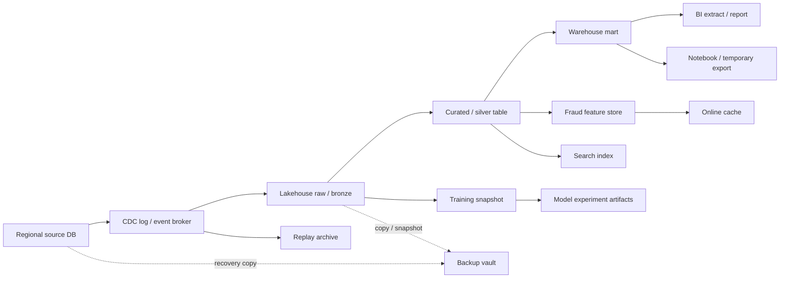
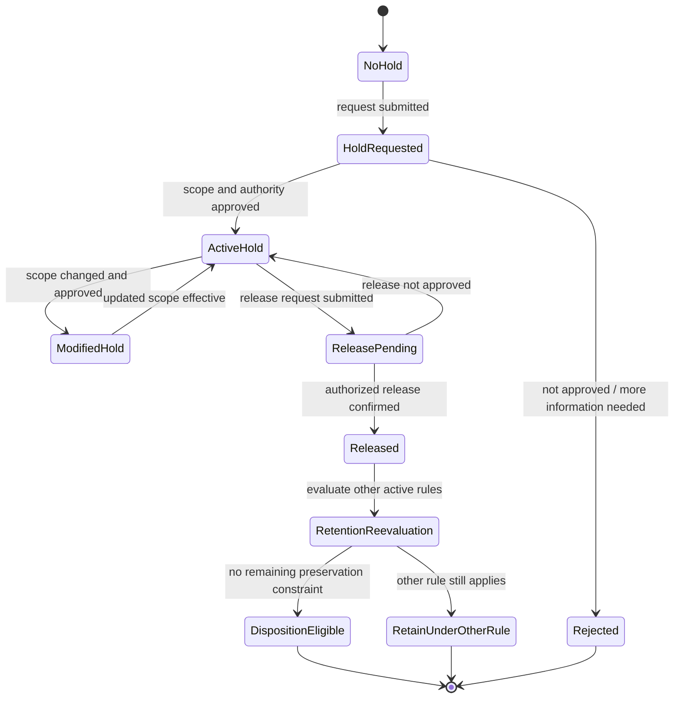
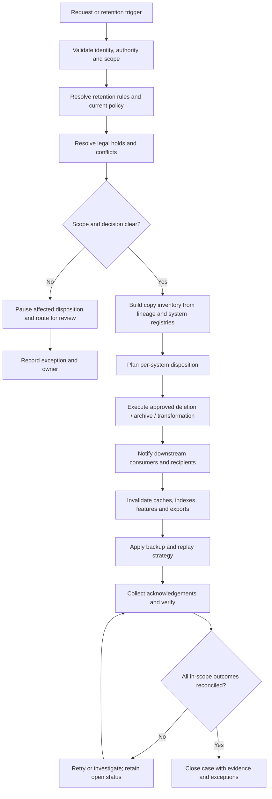

# Retention, Deletion, Legal Holds and Auditability

> **Module:** Stage 2D — Data Architecture  
> **Topic:** 07 of 09 — Data Governance, Security, Privacy and Compliance  
> **Recommended effort:** 7–9 hours  
> **Prerequisites:** Module sequence 2 and 4–6; P5 (as named in the module roadmap)  
> **Required deliverable:** Lifecycle control matrix and deletion/hold evidence procedure

> **Legal and educational boundary:** This is an engineering learning document, not legal advice. Retention periods, deletion duties, legal holds, preservation, and evidence requirements depend on applicable laws, contracts, business needs, data categories, and organizational circumstances. The periods and records in this lesson are clearly illustrative synthetic assumptions, not legal requirements. Qualified legal, privacy, records-management, compliance, and risk specialists must confirm actual requirements. No example here establishes or certifies compliance.

## 1. Why lifecycle controls matter

Data governance is incomplete if an organization can explain how data are collected, classified, protected, and used but cannot explain how long they should exist, how copies are handled, when deletion is paused, and what evidence proves the control operated.

The module roadmap defines the core principle: data must be **kept as long as required** and **removed when no longer needed or required to be kept**, except where an applicable legal hold requires preservation. The difficult part is that a logical dataset often exists in many places: source databases, CDC logs, lakehouse layers, warehouse tables, replicas, caches, exports, backups, feature stores, search indexes, and AI/ML artifacts.

**Deleting one record from one table does not prove all copies and derivatives are handled.** A production design must map the lifecycle, identify every copy, define the deletion semantics of each system, account for holds, and reconcile results.

### 1.1 Learning progression

| Level | Focus | Evidence of learning |
|---|---|---|
| Beginner | Lifecycle, retention schedule, triggers, disposition, holds, audit trail | Draw one asset's lifecycle and identify its copies |
| Intermediate | Retention rules, deletion methods, backup behavior, lineage, downstream propagation | Produce a lifecycle control matrix for ten systems |
| Advanced | Conflicts, immutable/distributed systems, holds at scale, restore/re-delete, AI/ML, evidence and reconciliation | Produce an ADR, deletion workflow, hold procedure, and synthetic reconciliation report |

### 1.2 Learning objectives

By completing this lesson, you should be able to:

1. Define a retention schedule with drivers, owners, triggers, dispositions, and reviews.
2. Distinguish minimum retention, maximum retention, operational retention, archival, and disposal.
3. Find copies and derivatives using inventories and lineage.
4. Design deletion across databases, warehouses, lakehouses, object stores, caches, indexes, replicas, logs, exports, and derived data.
5. Explain logical deletion, physical removal, tombstones, versioning, compaction, immutable stores, and cryptographic erasure limitations.
6. Design backup expiry and restore-time deletion replay.
7. Define legal-hold scope, placement, notification, release, and conflict resolution.
8. Propagate deletion to downstream consumers without silently deleting held records.
9. Handle analytics, features, training datasets, embeddings, indexes, and models without promising universal deletion.
10. Produce auditable deletion evidence and reconciliation results.
11. Assign operational ownership and define exception handling.
12. Deliver a reviewed lifecycle control matrix and evidence plan.

## 2. Prerequisites and relationship to adjacent topics

This topic follows the module's sequence: accountability → classification → identity/access → encryption → PII protection → purpose/residency → retention/deletion → regulatory controls/evidence → governance by design.

- **Governance and accountability:** who owns a retention decision, who approves an exception, and who operates deletion.
- **Classification:** how sensitivity and criticality influence storage, access, and disposition.
- **Identity/access:** who can request, approve, execute, and verify deletion or a hold.
- **Encryption and keys:** how key lifecycle and cryptographic erasure might support a reviewed disposition strategy.
- **PII protection:** masking or tokenization may reduce exposure but are not automatically equivalent to deletion.
- **Purpose/residency:** why the data are used, where copies may exist, and which processing constraints persist.
- **Metadata and lineage:** how to locate downstream copies and derived assets.
- **Database/storage architecture:** partition lifecycle, object versioning, table compaction, backup, archive, and restore semantics.
- **Streaming architecture:** event retention, replay, dead-letter queues, and suppression of reintroduced data.

The module roadmap identifies P5 as a prerequisite label but does not define it in the topic section excerpt. Preserve the roadmap's label in planning and confirm its meaning from the broader prerequisite section rather than guessing.

## 3. Glossary

| Term | Engineering definition | Caution |
|---|---|---|
| Retention schedule | Approved rule defining how long a data class or record is kept and how it is disposed | A period must have a documented driver and owner |
| Retention trigger | Event/date from which a retention rule is calculated | Creation, closure, contract end, or last activity are not interchangeable |
| Retention period | Duration during which data must or may be retained under a defined rule | Distinguish required minimums from organizational maximums |
| Minimum retention | A lower bound imposed by an applicable approved requirement or decision | Do not invent one; specialist confirmation may be needed |
| Maximum retention | A limit after which data should not remain for the defined purpose, subject to holds or other applicable constraints | Do not confuse with a backup schedule |
| Disposition | Approved end-of-retention action: delete, archive, anonymise, or another defined action | Archival is not deletion |
| Archive | Storage intended for longer-term preservation or infrequent access | It remains a copy subject to policy and access control |
| Logical deletion | Making a record unavailable through normal application/query behavior, e.g. a tombstone or soft-delete flag | Bytes may remain in files, versions, logs, or backups |
| Physical deletion | Removing data from the relevant storage medium or storage representation | Proving removal across all media can be difficult |
| Purge | A system-specific operation that removes eligible data from active storage or versions | Verify exactly what the product's purge semantics cover |
| Tombstone | Marker that a record was deleted or superseded, often used for replication or compaction | Tombstones themselves have retention and privacy implications |
| Compaction/rewrite | Rewriting storage files to consolidate records and potentially remove obsolete rows | Old files may remain until cleanup/retention completes |
| Cryptographic erasure | Making encrypted data inaccessible by irreversibly destroying the required key material | Only valid when all copies are protected by keys actually destroyed and no usable plaintext/key copies remain |
| Legal hold | Instruction to preserve defined data because of a matter or process requiring preservation | Scope and authority must be determined by qualified specialists |
| Hold scope | People, records, systems, dates, matters, custodians, and copies covered by a hold | An overly broad or narrow scope can create serious risk |
| Hold release | Authorized end or modification of a preservation instruction | Release must be recorded; it does not itself mean immediate deletion without checking other rules |
| Deletion replay | Re-applying deletion/suppression rules after data are restored or replayed from older copies | Must be built into restore and reprocessing workflows |
| Suppression list | Restricted record/key list used to prevent deleted or disallowed data from being reintroduced | It is itself sensitive and requires access, retention, and minimisation controls |
| Deletion evidence | Records showing request/trigger, scope, per-system outcomes, exceptions, and verification | A job's “success” status alone is insufficient |
| Reconciliation | Comparing intended deletion scope against actual systems and downstream acknowledgements | Must identify missing, failed, unknown, and held items |
| Immutable storage | Storage where records cannot be altered/deleted through ordinary operations during a configured period or policy | Holds and retention controls must be designed before writing data |
| Data lineage | Trace from source records through transformations to derived assets and models | Incomplete lineage creates unknown deletion scope |
| Backup | Recovery copy designed to restore a system after loss or corruption | Backup expiration and selective deletion are different strategies |
| Audit trail | Time-ordered evidence of relevant actions and decisions | Audit data can themselves contain personal or confidential information |

## 4. Data lifecycle from creation to disposition

### 4.1 Lifecycle diagram

```mermaid
flowchart LR
    A[Create or collect] --> B[Classify and register]
    B --> C[Assign owner, purpose and retention rule]
    C --> D[Use and transform]
    D --> E[Replicate, cache, export and derive]
    E --> F{Retention trigger reached?}
    F -- No --> D
    F -- Yes --> G[Evaluate holds and conflicting rules]
    G --> H{Applicable hold?}
    H -- Yes --> I[Preserve in scoped hold state]
    I --> J{Hold released?}
    J -- No --> I
    J -- Yes --> K[Re-evaluate all active rules]
    H -- No --> K
    K --> L[Execute disposition workflow]
    L --> M[Propagate to copies and derivatives]
    M --> N[Reconcile and collect evidence]
    N --> O{Verified or exception documented?}
    O -- No --> P[Retry, investigate, escalate]
    P --> M
    O -- Yes --> Q[Close with evidence and review]
```



This is a control lifecycle, not a claim that every storage system can physically erase data immediately. The system-specific implementation and evidence must state what was actually removed, what remains under a documented retention/hold rule, and what is still unresolved.

### 4.2 Lifecycle stages

1. **Create or collect:** capture provenance and avoid collecting fields with no approved need.
2. **Register:** assign data owner, classification, purpose, location, lineage expectations, and retention policy ID.
3. **Use and transform:** propagate retention and hold metadata through pipelines.
4. **Replicate and derive:** register every material copy, export, cache, feature, index, and model dataset.
5. **Evaluate trigger:** determine whether the retention clock has started or ended using the approved trigger semantics.
6. **Check holds and conflicts:** prevent deletion of held records; route unclear or overlapping rules to the right authority.
7. **Execute disposition:** archive, delete, anonymise, or take another explicitly approved action.
8. **Propagate:** coordinate downstream systems, retries, caches, replicas, and replayable event sources.
9. **Verify:** reconcile expected targets with actual results and collect evidence.
10. **Close:** close only when outcomes are verified or remaining exceptions are owned and transparently documented.

### 4.3 Why retention exists

Retention balances several drivers:

- **Applicable legal/regulatory requirements:** interpreted by qualified specialists for the relevant context.
- **Contractual commitments:** customer, partner, processor, or other agreements.
- **Business purpose:** data needed to deliver a service or resolve a defined matter.
- **Operational needs:** bounded recovery, troubleshooting, replay, or incident investigation.
- **Privacy/data minimisation:** avoiding indefinite retention after a defined need ends.
- **Security and audit:** retaining sufficient evidence to investigate and demonstrate control operation, without collecting unnecessary content.
- **Legal hold/preservation:** suspending normal disposition for scoped records when an applicable hold is active.

A retention policy must distinguish the driver, trigger, required period or review logic, disposition, exceptions, and accountable approver. “Keep forever” requires explicit justification and review; it is not a neutral default.

## 5. Retention schedules and policy register

### 5.1 Retention schedule fields

The module roadmap calls for these fields: **data class, owner, driver and source, minimum retention, maximum retention (privacy), disposition, review date, and systems affected.** A production schedule should also record:

- Stable policy ID and version.
- Data/record category and relevant classification.
- Trigger definition and time-zone/date semantics.
- Whether the period is an illustrative assumption or a specialist-confirmed requirement.
- Start/end calculation, paused time, and boundary handling.
- Holds and exception behavior.
- Affected systems, copies, downstream assets, and providers.
- Execution method, evidence expectations, and failure escalation.
- Approval references, effective date, review date, and superseded policy reference.

### 5.2 Synthetic retention-policy register

**All periods in this table are illustrative training assumptions only. They are not legal advice or recommended periods for a real bank.** In a real organization, a qualified owner and specialists must replace them with approved rules and document the source.

| Policy ID | Data class / asset | Illustrative driver | Trigger assumption | Illustrative period | Disposition | Systems affected | Owner / review |
|---|---|---|---|---|---|---|---|
| RET-01 | Active transaction event | Service processing and investigation | Transaction lifecycle closure | 24 months after closure | Delete eligible raw record; retain only separately approved minimal evidence if required | Source DB, CDC, lake raw/curated, replicas, features | Payments Data Owner; quarterly review |
| RET-02 | Operational application logs | Troubleshooting | Event timestamp | 90 days | Expire log partitions; redact or exclude unnecessary payload fields | Log sink, index, archive, replicas | Platform Operations; monthly review |
| RET-03 | Feature-store values | Fraud scoring operation | Feature expiry or source rule expiry, whichever approved policy specifies | 30 days after feature expiry | Purge online/offline values and invalidate caches | Feature store, cache, offline table | ML Platform Owner; monthly review |
| RET-04 | Temporary export | Approved one-time analysis | Export creation time | 7 days | Delete file and confirm recipient/transfer handling | Object store, download staging, notebook workspace | Requesting Data Owner; per export |
| RET-05 | Training dataset snapshot | Approved model experiment | Experiment closure | 180 days | Delete snapshot after artifact/hold assessment | Object store, training workspace, experiment tracker | ML Data Product Owner; per model release |
| RET-06 | Backup set | Recovery objective and approved backup design | Backup creation time | 35 days | Expire according to backup lifecycle; apply deletion replay after restore | Backup vault, replicas, restore staging | Resilience Owner; monthly review |
| RET-07 | Deletion evidence record | Accountability/audit needs | Case closure | 3 years | Restrict access; dispose according to its own approved schedule | Audit store, ticketing, evidence vault | Governance Owner; quarterly review |
| RET-08 | Held records | Scoped preservation instruction | Hold placement/release events | No fixed period in this example | Preserve only within hold scope; on release re-evaluate all other active rules | Source and copies listed in hold registry | Matter/hold owner with specialist review |

The illustrative values show that different data classes need different clocks and dispositions. Do not copy these numbers into production. Some records may have minimum retention, some maximum retention, some both, and some require case-specific review. A legal hold can override the normal disposal path for its scope, but it does not automatically justify preserving unrelated data.

### 5.3 Retention trigger design

Define triggers precisely:

- **Creation time:** when the record was first persisted or accepted.
- **Event completion:** when a transaction, case, or service lifecycle reaches an approved terminal state.
- **Contract/service end:** when the defined agreement or service relationship ends.
- **Last activity:** specify what counts as activity and how updates reset the clock.
- **Periodically assessed:** requires an owner and repeatable review.
- **Hold release:** a re-evaluation trigger, not necessarily a new retention start date.

A trigger definition should answer: which system is authoritative; which timestamp is used; how time zones and late events are handled; whether the period is inclusive; what happens when the trigger is missing; and who resolves conflicting timestamps. Missing trigger metadata should create an exception, not an arbitrary invented date.

### 5.4 Minimum and maximum retention can conflict

A record may have a minimum retention requirement for one purpose and a maximum retention policy to reduce unnecessary personal-data retention. A legal hold may require preserving a subset. Do not resolve the conflict with a hard-coded rule such as “minimum always wins” or “delete always wins.”

1. Identify the exact record class, purpose, context, and active retention drivers.
2. Separate facts from assumptions and list competing rules.
3. Ask qualified legal/privacy/records specialists to interpret the conflict.
4. Consider separating identifiers from records, restricting access, retaining a minimised representation, or placing only the relevant subset on hold.
5. Record the decision, scope, approver, review date, and required controls.
6. Encode the approved decision in the policy registry and test it before rollout.

## 6. Inventory copies and lineage before deletion

### 6.1 Why one logical dataset has many copies

A record can move through source databases, change-data-capture logs, event brokers, raw/bronze lake storage, curated/silver tables, warehouse marts, replicas, caches, materialized views, search indexes, feature stores, notebooks, exported files, backups, telemetry, and model training artifacts. Some copies are transient but persisted; some are maintained by vendors or partners; some reappear when older snapshots are restored or streams replayed.

A deletion design begins with a **copy inventory**, not a delete command.

### 6.2 Synthetic data-copy inventory and lineage

Northbridge Bank uses fictional synthetic subject key `SUBJ-042` and related synthetic transaction key `TXN-991`. No real personal data are present.



### 6.3 Copy inventory example

| Copy ID | System / copy | Data form | Update/delete mechanism | Possible stale/recovery path | Evidence required |
|---|---|---|---|---|---|
| C-01 | Source relational DB | Current row | Transactional delete or approved anonymisation | Read replica, CDC | Transaction ID, affected row count, post-check |
| C-02 | CDC log / broker | Event payload or tombstone | Topic/partition retention, compaction, suppression/replay policy | Consumer replay, retained segments | Event range, retention config, consumer offsets |
| C-03 | Lakehouse bronze | Raw files/table rows | Row delete plus format-specific rewrite/compaction | Old files, snapshots, time travel | Table commit, maintenance result, snapshot inventory |
| C-04 | Lakehouse silver | Curated row | Filter/rewrite or targeted rebuild | Backfill from bronze | Job/run ID, source lineage, query verification |
| C-05 | Warehouse mart | Joined/aggregated row | Targeted delete/recompute | Refresh from upstream | Query result, refresh ID, affected key scope |
| C-06 | Feature store | Online/offline feature | Point delete, TTL, rebuild | Feature backfill or cache fill | Feature key check, online/offline acknowledgement |
| C-07 | Cache | Cached response/value | Invalidate key or namespace | Miss repopulates from stale upstream | Invalidation acknowledgement, post-check |
| C-08 | Search/vector index | Document or embedding | Delete by source ID, index rebuild/compaction | Index rebuild from old snapshot | Index query result, generation/version |
| C-09 | BI/export/notebook | CSV/report/local copy | Owner-directed delete and recipient handling | Downloaded copies, scheduled refresh | Owner acknowledgement, destination scan where feasible |
| C-10 | Backup/DR | Snapshot or backup set | Expiry, selective restore filtering, or reviewed cryptographic strategy | Restore can resurrect data | Backup policy, restore test, deletion replay evidence |
| C-11 | Training dataset | Immutable snapshot | Rebuild or remove dataset version | Checkpoints, experiment copies | Dataset manifest and lineage status |
| C-12 | Model artifacts | Weights/checkpoints/embeddings | Case-specific assessment; retrain or other mitigation where selected | Deployed models, replicas, endpoint caches | Model owner decision and artifact inventory |
| C-13 | Audit/deletion logs | Evidence and control events | Separate approved retention/access policy | Replicated log store | Evidence retention policy, integrity checks |
| C-14 | Third-party processor | Exported copy | Contracted workflow and recipient confirmation | Subprocessors, backups, exports | Transfer ID, processor response, open exception if unverified |

The inventory must identify a responsible owner and a known/unknown status for each copy. “No known copy” is not the same as “verified no copy”; record how the conclusion was reached.

### 6.4 Lineage quality and unknown copies

Lineage should capture source assets, target assets, transformations, run IDs, dataset versions, and model artifact links. Use asset IDs and versioned manifests rather than relying only on table names. When lineage is incomplete:

- Pause automated closure for affected high-risk deletion cases.
- Query catalogues, orchestration metadata, storage inventories, export registries, and system owners.
- Mark unresolved copies `UNKNOWN`, assign an owner and due date, and escalate by risk.
- Do not claim deletion coverage is complete while a material destination is unknown.
- Improve instrumentation so future jobs register outputs and lineage automatically.

## 7. Deletion semantics by storage type

There is no universal deletion operation. The same command can have different guarantees depending on the engine, storage format, replication configuration, versioning, snapshots, caches, and backups.

### 7.1 Storage behavior matrix

| Storage type | Common deletion behavior | Limitations / failure modes | Evidence and follow-up |
|---|---|---|---|
| Relational/operational DB | Row delete, soft delete, partition drop, or approved field-level transformation | Transaction logs, replicas, snapshots, CDC, and backups may retain data | Commit/transaction ID, row-count/post-query, replication and CDC checks |
| Warehouse | Delete/merge, partition expiration, rebuild materialized tables | Time travel, clones, result caches, exports, derived marts | Query validation, snapshot/version inventory, downstream refresh evidence |
| Lakehouse/table format | Delete predicate or rewrite affected files; compact/expire snapshots as supported | Old files or snapshots can remain until maintenance; time-travel may expose prior versions | Table commit, rewrite/compaction run, snapshot expiry result, file inventory |
| Object store | Delete object or version, lifecycle expiry, prefix cleanup | Versioning, replication, object lock, multipart uploads, copies in other buckets | Version listing, delete markers and versions review, replication status, inventory scan |
| Cache | Key invalidation, TTL, namespace purge | Stale entries, delayed invalidation, cache repopulation from stale source | Invalidation acknowledgement, cache read-back, TTL/republish checks |
| Search index/vector store | Delete document by stable source ID, tombstone, rebuild index | Segment compaction delays, duplicate IDs, orphaned embeddings, old index generations | Query by source ID, index generation, rebuild and compaction evidence |
| Event broker/CDC | Retention expiry, compaction, tombstones, suppression on replay | Append-only logs and replicas may retain prior payload; tombstone semantics differ | Topic config, offset/segment status, consumer acknowledgements, replay test |
| Streaming checkpoint/state store | State deletion, checkpoint invalidation/rebuild | Checkpoints may reintroduce old state; state keys can be hard to enumerate | Checkpoint version, restart/replay test, state scan |
| Files, exports, notebooks | Delete file, workspace cleanup, managed export expiry | Downloaded local copies, version history, synced devices, recipients | File inventory, owner confirmation, access/transfer log, documented limits |
| Backups/archives | Scheduled expiry, selective filtering on restore, or key strategy | Full backup may not support per-record deletion; restored systems can resurrect deleted data | Backup expiry evidence, restore drill, deletion replay report |
| Audit logs | Retention policy, access restriction, selective redaction where supported | Deletion evidence may itself contain identifiers; immutable logs may not support row deletion | Separate log policy, access audit, minimised identifiers, integrity check |
| Feature store | Delete online/offline value, invalidate materialization, recompute | Offline history, feature backfills, online cache, training snapshots | Feature key check, offline query, rebuild/version evidence |
| ML training dataset | Delete/rebuild dataset snapshot; record dataset version | Copies may persist in workspaces, checkpoints, experiment artifacts | Manifest, dataset version retirement, storage inventory, job status |
| Model/checkpoint/embedding | Case-specific treatment: retire, rebuild, retrain, re-index, or other reviewed mitigation | No universal guarantee that a model can be made to “forget” one record | Model lineage, risk/specialist decision, validation and deployment evidence |
| Third-party/partner system | Contracted deletion workflow and recipient acknowledgement | Subprocessors, backups, exports, and evidence may be outside direct control | Transfer ID, request/response, contractual SLA reference, unresolved exception |

**Important:** table entries describe common patterns, not guaranteed product behavior. Verify the semantics of the actual storage engine and its configuration.

### 7.2 Logical deletion versus physical removal

- **Logical deletion** makes a record unavailable through normal application behavior. Examples include a `deleted=true` flag, a tombstone, or removal from an index's active query path.
- **Physical removal** removes the relevant stored representation from the storage system or media according to that system's semantics.
- **Verified disposition** is an evidence-backed conclusion that each in-scope copy reached its approved outcome. A held copy, a backup awaiting expiry, or a copy under an approved exception is a documented retained outcome—not proof that deletion or physical removal occurred. Report it separately from verified deletion.

Logical deletion is useful for fast request handling, referential integrity, and distributed propagation. It is not by itself proof that bytes are gone. Physical deletion can require file rewrites, snapshot expiry, version removal, replication, compaction, cache invalidation, and backup expiry. Both need a defined verification boundary.

### 7.3 Immutable, append-only, and versioned storage

Common patterns include:

- **Tombstone plus compaction:** publish a deletion marker so consumers stop using a key; later compaction may remove obsolete payload segments. The marker and old segments have their own retention semantics.
- **Partition expiration:** efficient for time-based retention when the partition key aligns with the retention trigger. It is less suitable for one subject scattered across many partitions.
- **Rewrite/compaction:** rewrite table files to exclude deleted rows and expire obsolete snapshots according to platform semantics. Confirm old files are no longer reachable through snapshots or versions.
- **Version deletion:** in a versioned object store, deleting the current object may only create a delete marker. Enumerate and handle prior versions according to the approved rule.
- **Append-only event history:** a record may not be editable in place. Options may include retention-limited partitions, payload minimisation/tokenisation, suppression at consumers, or reviewed key strategies.
- **Object lock/immutability:** if data are protected from deletion for a configured period, design the lifecycle and hold policy before writing them. Do not promise immediate deletion where the storage configuration prevents it.
- **Cryptographic erasure:** may be appropriate when all relevant copies are encrypted under the key material being destroyed and no plaintext or usable key copies remain. It does not remove unencrypted copies, independent keys, exported plaintext, or data outside the key boundary.

A deletion design should document exact semantics and limitations for each storage type, including how long a deleted payload might remain in non-queryable files, logs, replicas, or backups.

## 8. Legal holds and preservation workflow

### 8.1 What a hold does

A legal hold or other formal preservation instruction temporarily changes the normal disposition path for data within its defined scope. Scope may include people/custodians, matters, date ranges, record types, systems, communications, backups, and derivative records. Qualified legal or other designated specialists must determine the applicable authority and scope; the technical system implements the approved instruction rather than independently deciding the legal question.

Do not silently delete data subject to an applicable hold. Equally, do not preserve unrelated data indefinitely just because one record or matter is held. Model holds as versioned, scoped state, and make every destructive workflow consult the authoritative registry.

### 8.2 Example legal-hold state model



State names are illustrative. The registry should preserve requests, approvals, scope versions, effective times, notifications, affected systems, acknowledgements, modifications, releases, and post-release decisions.

### 8.3 Hold registry fields

- Hold/matter ID and authoritative source/reference.
- Requester, hold owner, approving authority, and specialist contact.
- State, scope version, effective timestamp, and last-reviewed time.
- Included custodians, subject keys, date ranges, record types, systems, and copies.
- Systems notified and their acknowledgement state.
- Deletion jobs or retention policies paused/modified by the hold.
- Exceptions, scope ambiguities, conflict decisions, and escalation.
- Release authorization, effective time, and downstream confirmation.
- Post-release re-evaluation outcome and disposition evidence.

Keep hold metadata access-controlled. A hold register can reveal sensitive matter information; broad exposure of its contents can itself be harmful.

### 8.4 Conflict-resolution example

**Synthetic case:** Northbridge receives a deletion request for `SUBJ-042`. The standard retention policy marks an eligible subset for deletion, but the hold registry shows that `SUBJ-042` is in scope for `MATTER-77` over a defined date range. An unrelated service log is outside that scope.

1. Validate the request and identify all records/copies through lineage and the copy inventory.
2. Resolve the active hold scope and scope version with the hold owner; do not infer scope from a free-text matter label.
3. Place in-scope records under a preservation guard that deletion jobs must check.
4. Continue disposition for records proven outside the hold scope if other rules permit it.
5. For ambiguous records, pause the disposition decision and ask the authorized specialist; do not silently delete or indefinitely expand the hold.
6. Record per-copy outcomes: `PRESERVED_UNDER_HOLD`, `DELETED`, `RETAINED_UNDER_OTHER_RULE`, `PENDING_REVIEW`, or `FAILED`.
7. Notify downstream owners and verify that hold state reaches replicas, lakehouse tables, indexes, exports, and backup/restore workflows.
8. On authorized release, re-evaluate every remaining retention rule. Release is not itself an instruction to delete immediately.
9. Produce an evidence package with decision IDs, system acknowledgements, timestamps, policy versions, and open exceptions.

**Conflict rule:** evaluate hold state and retention eligibility together at the item/copy scope. A global “skip all deletions for this customer” can over-preserve; a global “delete request wins” can destroy held data.

### 8.5 Hold-aware deletion guard

```text
for each candidate_record:
    rule = resolve_retention_policy(candidate_record)
    copies = resolve_lineage_and_copy_inventory(candidate_record)

    if rule is missing or ambiguous:
        route_to_review(candidate_record)
        continue

    hold_decision = evaluate_authoritative_hold_registry(candidate_record, copies)

    if hold_decision is ACTIVE:
        preserve_only_the_approved_held_scope()
        record(PRESERVED_UNDER_HOLD, scope_version)
        candidate_record = exclude_held_scope_from_candidate(candidate_record)
        if candidate_record is empty:
            continue
        # Continue only with separable, explicitly unheld data under the approved policy.

    if hold_decision is UNKNOWN or CONFLICT:
        block_disposition_for_affected_scope()
        route_to_hold_owner_and_specialist()
        record(PENDING_REVIEW)
        continue

    if retention_trigger_not_reached:
        retain_until_review_or_expiry()
        continue

    execute_approved_disposition_per_copy()
    verify_and_reconcile()
```

This is illustrative control flow, not a complete legal decision engine. It assumes the policy registry and hold scope are authoritative, current, and approved.

## 9. Backup retention, restore, and deletion replay

### 9.1 Why backups are different

Backups are recovery copies, not ordinary queryable datasets. They may be full snapshots, incremental chains, immutable recovery points, replicated vault copies, or archives. Selectively deleting one subject from every backup may be technically unsupported or operationally risky. A backup policy must define retention, access, location, encryption/key handling, restore procedures, and what happens when a deleted record is restored from an older recovery point.

Possible approaches, to be selected after risk and specialist review:

1. **Expire backups on a defined schedule:** operationally straightforward, but data can remain in recovery copies until expiry. The policy must accurately describe this residual period and assess whether it is acceptable.
2. **Deletion replay after restore:** restore a backup into an isolated environment, replay the authoritative deletion/suppression ledger, reconcile the result, then permit access or promotion.
3. **Selective restore filtering:** filter records during restore where the backup and restore tooling reliably support it. Test performance, edge cases, and completeness.
4. **Cryptographic erasure:** destroy dedicated key material only when the key architecture proves that all relevant copies are rendered inaccessible and no plaintext/key copies remain. This is not a generic shortcut.
5. **Hybrid approach:** combine bounded backup expiry, deletion replay, restricted restore environments, and evidence.

### 9.2 Restore scenario: deletion resurrection

**Synthetic timeline:** A Northbridge source snapshot is created on 1 October. A deletion request for `SUBJ-042` is completed in live systems on 20 October. A disaster recovery event on 25 October restores the 1 October snapshot. Without additional controls, the older record can reappear in the restored database, CDC replay, lakehouse, and feature store.

**Required recovery sequence:**

1. Restore into a restricted, non-serving environment.
2. Load the current authoritative deletion/hold ledger and policy version, not the stale state contained only in the backup.
3. Apply deletion replay and active hold rules before exposing the restored system to users or downstream jobs.
4. Replay streams with suppression/idempotency controls so older events cannot recreate the deleted record.
5. Rebuild affected derived tables, features, caches, indexes, and snapshots, or mark them unavailable until rebuilt.
6. Reconcile the restored state against the deletion ledger and copy inventory.
7. Have the recovery owner and designated verifier approve promotion; retain the restore ID, replay run ID, counts, exceptions, and test evidence.

A restore run must not be declared complete merely because the database starts successfully. Functional recovery and governance-state recovery are separate checks. If the hold registry or deletion ledger is unavailable, stale, or cannot be reconciled, keep the restored environment isolated and block promotion of the affected scope; do not guess a default that could destroy held data or reintroduce deleted data.

### 9.3 Example deletion replay pseudocode

```text
restore(snapshot, isolated_environment)
load_current_policy_and_hold_registry()
load_authoritative_deletion_ledger()

for each record_or_scoped_element in restored_scope:
    hold = evaluate_authoritative_hold_registry(record_or_scoped_element)
    if hold is UNKNOWN or hold is CONFLICT:
        quarantine_affected_scope_and_block_promotion()
    elif hold is ACTIVE:
        preserve_only_the_approved_held_scope(record_or_scoped_element)
        apply_other_approved_disposition_to_separable_unheld_scope()
    elif deletion_ledger_marks_deleted(record_or_scoped_element):
        remove_or_suppress(record_or_scoped_element)
    else:
        evaluate_current_retention_and_purpose_rules(record_or_scoped_element)(record)

rebuild_or_invalidate_derived_assets()
reconcile(restored_scope, expected_policy_state)
if unresolved_high_risk_items_exist:
    block_promotion_and_escalate()
else:
    approve_promotion_with_evidence()
```

This is illustrative control logic. Production workflows must handle partial failure, ordering, duplicate keys, conflicting timestamps, and exceptions explicitly.

## 10. Deletion request and expiry workflow

### 10.1 Workflow from trigger to verified outcome



### 10.2 Processing stages and safe behavior

1. **Intake:** authenticate the requester or verify the retention trigger; assign a request ID; avoid exposing whether unrelated records exist.
2. **Scope resolution:** identify stable subject/record keys, relevant time range, source systems, and all derived assets. Resolve ambiguous matches before destructive action.
3. **Policy evaluation:** evaluate retention schedule, purpose, classification, active holds, contractual constraints, and the approved disposition. The system must not invent a legal interpretation.
4. **Hold check:** evaluate the authoritative hold registry at the record/copy scope. If status is unknown or conflicting, block the affected deletion and route it to the authorized owner.
5. **Plan:** produce an execution manifest with target systems, operations, expected counts, dependencies, and rollback/recovery considerations.
6. **Execute:** perform idempotent operations, use bounded retries, and record per-target outcomes.
7. **Propagate:** publish versioned deletion events or instructions; consumers acknowledge applied versions and handle duplicates.
8. **Verify:** run independent checks where feasible, query active stores, inspect object versions/snapshots, and reconcile downstream acknowledgements.
9. **Exception handling:** retain unresolved targets as open exceptions with owner, reason, due date, and compensating controls. Do not label the request “complete” if material targets remain unknown.
10. **Close:** close only when each target has an outcome, evidence is retained under its own approved policy, and exceptions are explicitly documented.

### 10.3 Idempotency, retries, and ordering

Distributed deletion is prone to partial failure. A command may succeed at the source while a consumer is offline; a retry may encounter an already-removed row; an older event may arrive after a newer one; a cache may repopulate from a stale source.

Design controls:

- Use a stable deletion request ID and idempotency key per operation.
- Preserve source event time, received time, sequence/version, and applied version separately.
- Make repeated deletes safe and distinguish “already absent” from “not checked.”
- Use bounded retries with exponential backoff where appropriate, a dead-letter/quarantine queue, and owned escalation.
- Maintain consumer acknowledgements and lag metrics.
- Reconcile periodically against the authoritative ledger; delivery is not proof of application.
- Keep deletion and hold decisions versioned so late messages cannot blindly overwrite newer state.
- Re-check current holds before final destructive operations if a hold can be placed concurrently.

### 10.4 Retention and deletion control matrix

| Control objective | Policy/metadata | Preventive control | Detective control | Evidence | Owner |
|---|---|---|---|---|---|
| Apply approved retention schedule | Policy ID/version, trigger, class, driver, owner | Policy validation at registration and scheduled jobs | Scan for expired records without disposition | Policy version, run ID, candidate/result counts | Data owner + platform team |
| Protect held records | Hold ID, scope version, state | Hold-aware deletion guard; block ambiguous scope | Compare hold registry with deletion candidates and outcomes | Hold check decision, approvals, affected copy list | Hold owner + operations |
| Find all copies | Asset registry, lineage, export/processor registry | Require lineage/output registration in pipelines | Orphan asset and unregistered destination scans | Lineage snapshot, inventory query, unresolved list | Data steward + engineering |
| Delete across distributed systems | Per-copy method and operation state | Orchestrated idempotent workflows and consumer contract | Reconciliation and independent post-check | Per-target operation ID, acknowledgement, query results | Deletion service owner |
| Prevent resurrection after restore | Deletion ledger, snapshot ID, current policy version | Restore isolation and deletion replay before promotion | Post-restore reconciliation and synthetic canary checks | Restore run, replay run, exception report, promotion approval | Resilience owner |
| Handle immutable/versioned storage | Version policy, lifecycle settings, compaction rules | Approved version expiry/rewrite/key strategy | Inventory versions/snapshots and maintenance backlog | Version listing, compaction/expiry evidence | Storage owner |
| Handle derived AI/ML data | Dataset/model lineage, purpose and hold metadata | Dataset admission gate; model artifact registry | Scan manifests, feature/index registries, model release records | Dataset IDs, lineage, model-owner decision | ML data owner |
| Protect audit evidence | Evidence schedule, sensitivity, access roles | Separate store, minimised identifiers, restricted write/delete | Integrity checks and access review | Hash/sequence checks, access log, retention policy | Governance/audit owner |
| Manage exceptions | Exception ID, scope, owner, expiry, approvers | Approval workflow and expiry enforcement | Exception aging and overdue alerts | Decision record, controls, closure evidence | Risk owner + control owner |

## 11. AI/ML and derived-data deletion

### 11.1 Data and artifacts to inventory

For AI/ML, the source row is only one possible location. Track:

- Training, validation, test, and evaluation datasets.
- Snapshot manifests, data extracts, preprocessing outputs, and notebook copies.
- Offline and online features, feature history, cached feature values, and feature materializations.
- Search documents, embeddings, vector indexes, retrieval caches, and derived chunks.
- Experiment trackers, checkpoints, optimizer states, adapters, model weights, and intermediate artifacts.
- Deployed model replicas, inference caches, prompt/response logs, and evaluation reports.
- Third-party training/inference services and provider-controlled copies where relevant.

### 11.2 A safe decision process

1. Use lineage to identify which dataset versions, features, indexes, and model artifacts depend on the target records.
2. Check whether the approved disposition applies to each artifact, and whether a hold or other rule affects it.
3. Stop new ingestion/training or export from disallowed source data while the assessment is in progress, if the approved risk policy requires it.
4. Rebuild a dataset, feature, or index from eligible source records when technically and operationally appropriate.
5. For trained models, embeddings, and checkpoints, request a documented decision from the model owner and qualified privacy/legal/model-risk specialists. Options may include artifact retirement, re-training, re-indexing, targeted mitigation, or a documented reason for a different treatment.
6. Validate the selected treatment and preserve lineage/evidence.

Do not promise that deleting training rows fully removes their influence from a model. Do not assume embeddings, gradients, aggregates, or scores are automatically anonymous or unrestricted. The appropriate treatment depends on the model, data, risk, technical feasibility, and applicable requirements.

## 12. Auditability and deletion evidence

### 12.1 Evidence package

A useful deletion evidence package contains:

- Request/trigger ID, received/effective timestamps, and requester/trigger provenance.
- Scope definition and resolution method, using minimized identifiers.
- Retention policy ID/version and hold-registry version consulted.
- Copy inventory/lineage snapshot and list of targets in scope.
- Per-system outcome: deleted, archived, preserved under hold, retained under another rule, pending, failed, or unknown.
- Operation/job IDs, timestamps, affected counts, consumer acknowledgements, and retry history.
- Independent verification results and reconciliation query/report references.
- Exceptions, owner, due date, compensating controls, approval references, and an expiry/review date for any time-bounded exception.
- Backup expiry or deletion-replay strategy and any unresolved recovery-copy limits.
- Reviewer/approver identity and closure decision.

Evidence should be sufficient to show what happened without keeping unnecessary raw personal data. Prefer stable request IDs, protected subject references, counts, and hashes where they are useful and appropriate. Hashes and pseudonymous identifiers can still be linkable and must not automatically be treated as anonymous.

### 12.2 Sample deletion reconciliation report

The following results are **synthetic teaching data** for deletion case `DEL-2026-0042`, subject key `SUBJ-042`. The IDs, timestamps, counts, statuses, and query results are invented for instruction; they illustrate partial success and must not be interpreted as evidence from a real system test.

| Copy ID | Target | Expected outcome | Observed outcome | Status | Evidence / next action |
|---|---|---|---|---|---|
| C-01 | Source DB | Delete eligible row | 1 row absent; post-query confirms | `VERIFIED_DELETED` | TX-881; query check at 10:05Z |
| C-02 | CDC broker | Prevent replay/reintroduction | Tombstone published; consumer A applied; retained segment still within configured retention | `PARTIAL / RETENTION_WINDOW` | Event EV-920; record expiry date from approved config; verify replay suppression |
| C-03 | Lakehouse bronze | Remove eligible record and obsolete reachable versions per policy | Current table query returns no row; old snapshot expiry pending | `PENDING_MAINTENANCE` | Run LAKE-221; compaction/snapshot expiry task open |
| C-04 | Warehouse mart | Remove/recompute affected row | Row absent after refresh | `VERIFIED_DELETED` | Refresh WH-402; query result saved |
| C-06 | Feature store | Remove online/offline feature | Online value absent; offline table check not complete | `PENDING_VERIFICATION` | Online ack FS-88; offline query assigned to ML Platform Owner |
| C-08 | Vector index | Remove document/embedding | Search by source key returns no document in active generation | `VERIFIED_ACTIVE_INDEX` | Index generation V-17; old generation retirement pending review |
| C-10 | Backup vault | Apply approved backup strategy | Backup copy remains until scheduled expiry; restore replay procedure documented but next drill not run | `RETAINED_UNDER_BACKUP_POLICY` | Backup set BK-119; expiry per approved policy; test restore replay |
| C-09 | Export workspace | Delete export | Managed file deleted; requester has not confirmed local downloads | `OPEN_EXCEPTION` | Ticket EX-42; obtain owner/recipient confirmation or document limitation |
| C-12 | Model artifact | Assess whether affected dataset is in a model | Lineage identifies model EXP-09; model treatment decision pending | `REVIEW_REQUIRED` | ML owner and specialists assigned; no claim of model deletion |
| C-13 | Deletion evidence log | Retain evidence under its separate schedule | Evidence record stored with restricted access | `RETAINED_AS_EVIDENCE` | Evidence policy EVD-02; verify its own retention date |

**Summary:** 2 targets verified deleted at the defined active-system boundary; 1 verified in the active index with older-generation follow-up; 3 partial/pending technical outcomes (CDC retention window, lakehouse maintenance, and offline feature verification); 1 open export exception; 1 model review pending; 1 backup retained under its stated strategy; and 1 evidence record retained under its separate policy. These categories overlap in purpose and should be counted using explicit report definitions.

Example coverage metric:

```text
verified_target_coverage = targets_with_verified_outcome / targets_in_scope
```

Do not use a single percentage without defining which statuses count as verified and whether backup retention, active holds, or approved exceptions are considered expected outcomes. A target may have a valid retained status rather than a deletion status. Report unresolved/unknown targets separately; do not hide them in a success percentage. For this lesson, `VERIFIED_DELETED` means the stated deletion boundary was checked; `VERIFIED_ACTIVE_INDEX` means only the active index generation was checked; `RETAINED_UNDER_BACKUP_POLICY` and `PRESERVED_UNDER_HOLD` are retained outcomes, not deletion successes; and `PENDING_*`, `PARTIAL_*`, `OPEN_EXCEPTION`, `REVIEW_REQUIRED`, and `UNKNOWN` prevent an unqualified all-copies-deleted claim.

### 12.3 Audit-log design and retention

Deletion and access logs are themselves data assets. They can include identifiers, query text, payload fragments, matter references, and operator identities. Define a separate classification, minimisation, access, integrity, and retention policy for them.

The module roadmap gives this illustrative sizing example: 50 million access events/day × 300 bytes = 15 GB/day; over seven years, `15 GB × 365 × 7 = 38,325 GB ≈ 38.3 TB`, before replication and compression. Treat the values as a planning exercise, not a mandated retention duration. Include index overhead, replication, compression, growth, evidence immutability, retrieval needs, and cost in a real capacity model.

## 13. Ownership, approvals, and policy changes

| Role | Responsibility |
|---|---|
| Data owner | Approves business disposition rules and ensures each asset has an accountable lifecycle decision owner |
| Data steward | Maintains classification, metadata, retention register, and lineage quality |
| Records-management / privacy specialist | Helps interpret applicable retention, minimisation, and disposal constraints |
| Legal / matter owner | Determines hold authority/scope and confirms release through the approved process |
| Platform/data engineering | Implements deletion orchestration, propagation, retries, and reconciliation |
| Storage/DB owner | Documents actual delete, version, compaction, replica, and backup semantics |
| ML/model owner | Tracks dataset-to-model lineage and proposes artifact treatment for specialist review |
| Security/operations | Protects deletion/hold workflows, logs, identities, and exception queues |
| Independent reviewer/audit | Tests design and operating evidence without assuming the control works because it is documented |

A retention-policy change should be versioned and reviewed for impact before activation. Evaluate whether it affects existing records, active deletion jobs, held items, backups, contracts, regional copies, and model artifacts. Roll out with a controlled effective date, test cases, monitoring, and rollback/compensation plan. Do not retroactively change a policy version without preserving the prior decision history.

## 14. Failure scenarios and trade-offs

| Failure | Impact | Preventive/detective response |
|---|---|---|
| Deletion job ignores hold registry | Held data may be destroyed | Mandatory hold guard, race-condition tests, audit of hold checks, stop/escalate on unknown state |
| Source row deleted but CDC replay reintroduces it | Data reappears downstream | Tombstone/suppression, current deletion ledger, idempotent consumers, replay tests |
| Lakehouse row is deleted but old snapshot remains queryable | Old content may remain accessible | Snapshot/version inventory, rewrite/compaction, expiry evidence, access restriction until resolved |
| Cache invalidation fails | Stale data continues to be served | Acknowledgements, bounded TTL, origin checks, cache reconciliation |
| Backup restore bypasses deletion replay | Previously deleted data returns | Isolated restore, mandatory replay, reconciliation gate before promotion |
| Model trained on affected data is ignored | Unassessed derived artifact persists | Dataset/model lineage and explicit model-owner/specialist decision |
| Log retention is shorter than evidence need | Control history becomes unavailable | Separate evidence schedule, retention owner, integrity and retrieval tests |
| Audit logs retain excessive personal data | Logs become a secondary privacy risk | Payload minimisation, redaction, access controls, separate disposition policy |
| Retention clock uses wrong timestamp | Premature or late deletion | Authoritative trigger definition, timezone/late-event tests, missing-date exception |
| Exception never expires | Temporary risk becomes permanent | Mandatory expiry, owner reminders, overdue escalation, periodic recertification |
| One subject maps to multiple identifiers | Some copies are missed or another person's data are deleted | Governed identity resolution, confidence thresholds, review ambiguous matches |
| A third party does not confirm deletion | Outcome cannot be fully verified | Contracted workflow, recipient evidence, escalation, transparent open exception |

### 14.1 Trade-offs to explain in an ADR

- **Deletion speed vs completeness:** fast initial suppression can reduce use quickly; physical cleanup and evidence take longer.
- **Selective deletion vs rebuild:** targeted operations may be cheaper but more error-prone; rebuilds can be simpler to reason about but costly.
- **Immutable evidence vs minimisation:** tamper-resistant logs aid accountability but must avoid unnecessary payload retention and have their own policy.
- **Backup simplicity vs selective purge:** expiry-only backup design is simpler but permits a defined residual recovery window; deletion replay adds engineering and testing cost.
- **Regional resilience vs lifecycle consistency:** replicas improve recovery but expand the copy inventory and restore/reconciliation requirements.
- **Strict closure gates vs availability:** blocking promotion until deletion reconciliation improves control but can delay recovery; the risk decision must be explicit.
- **Detailed lineage vs operational overhead:** lineage increases metadata and maintenance cost but reduces unknown deletion scope and model-impact uncertainty.

## 15. Practical exercises

Use synthetic data only. Do not use real customer records, actual legal matters, production exports, or confidential system diagrams.

### Exercise A — Lifecycle control matrix

**Scenario:** Map synthetic Northbridge customer entity `SUBJ-042` across at least ten systems: source DB, CDC/event broker, lakehouse bronze, curated table, warehouse, replica, feature store, cache, export/notebook, backup, search/vector index, and training snapshot.

**Tasks**
1. Define the data class, owner, purpose, retention driver/source, trigger, illustrative period, disposition, review date, and affected systems.
2. Identify the actual or assumed deletion method for each copy.
3. Mark each period as an illustrative assumption or specialist-confirmed requirement.
4. Add hold behavior and backup handling for each target.
5. Define evidence and verification for each system.
6. Identify unknown copies and assign an owner and due date.

**Expected outputs:** lifecycle diagram; retention-policy register; ten-system lifecycle control matrix; copy inventory; gap/owner list.

**Validation criteria:** every system has a method or documented exception; triggers and periods are explicit; backups and derived data are covered; holds are checked before deletion; no illustrative period is presented as a legal requirement; unknowns are not reported as verified deletion.

### Exercise B — Deletion and legal-hold walk-through

**Scenario:** A synthetic deletion request arrives for `SUBJ-042`; the hold registry indicates one defined record subset is in scope for `MATTER-77`.

**Tasks**
1. Validate request scope and identify relevant copies with lineage.
2. Resolve the authoritative hold state and mark in-scope versus out-of-scope records.
3. Decide which non-held records are eligible for disposition under the synthetic approved policy.
4. Block disposition for held or ambiguous records and assign the correct review owner.
5. Notify downstream consumers and track acknowledgements.
6. Record per-system outcomes, exceptions, timestamps, and evidence.
7. Define what happens when the hold is later released.

**Expected outputs:** hold-state diagram; scoped deletion plan; per-copy outcome table; hold/deletion procedure; evidence template.

**Validation criteria:** held data are preserved; unrelated eligible records are not automatically held forever; ambiguous scope blocks the affected destructive action; hold release triggers policy re-evaluation rather than automatic deletion; evidence is complete and exceptions are approved/owned.

### Exercise C — Backup restore and deletion replay

**Scenario:** Restore a synthetic backup created before a deletion request. The restore could reintroduce the deleted record into live services and downstream pipelines.

**Tasks**
1. Design a restore isolation gate.
2. Define the authoritative deletion ledger and hold registry used by restore.
3. Specify replay ordering, idempotency, duplicate handling, and suppression behavior.
4. List downstream assets that must be rebuilt, invalidated, or checked.
5. Define post-restore reconciliation and promotion criteria.
6. Create a synthetic test report with at least one failed consumer and one unresolved exception.

**Expected outputs:** restore workflow; deletion replay pseudocode or procedure; reconciliation report; promotion checklist; failure/escalation path.

**Validation criteria:** restored data are not served before replay and checks complete; held data are preserved; deleted data are not silently reintroduced; failures block or restrict promotion; all unresolved items have owners and explicit status.

### Exercise D — Storage semantics and AI/ML artifacts

**Scenario:** A target record exists in a versioned object store, a lakehouse table, a vector index, a training snapshot, and a deployed model lineage chain.

**Tasks**
1. Document logical and physical deletion semantics per store.
2. Identify snapshots, versions, tombstones, compaction, cache, and replica behaviors.
3. Trace source record to features, embeddings, training dataset, and model artifacts.
4. Propose technical disposition options and list decisions requiring model/privacy/legal specialist input.
5. Define evidence that can be honestly collected and claims that cannot be made.

**Expected outputs:** storage deletion matrix; lineage graph; artifact decision record; evidence checklist; limitations statement.

**Validation criteria:** no universal deletion guarantee is made; old versions/snapshots are considered; model treatment is reviewed rather than assumed; evidence separates active-query removal from physical cleanup and unresolved copies.

## 16. Architecture decision record template

```markdown
# ADR: Retention and deletion design for [asset/process]

- Status: Proposed / Accepted / Rejected / Superseded
- Date:
- Owner and reviewers:
- Related policy IDs and versions:
- Assets, systems, regions, and models in scope:

## Context and drivers
Describe business need, data class, purpose, retention drivers, and known constraints.

## Confirmed facts and assumptions
Label each assumption and list specialist-confirmation questions.

## Options considered
Compare deletion, archive, rewrite/compaction, expiry, restore filtering,
cryptographic strategy, and rebuild options where relevant.

## Decision and scope
State the chosen disposition per system/copy, including holds and backups.

## Controls and failure behavior
Define prevention, retries, reconciliation, escalation, and restore gates.

## Evidence and verification
List per-target evidence, independent checks, and unresolved limitations.

## Downstream/AI impact
List features, indexes, datasets, embeddings, checkpoints, and model artifacts.

## Risks, trade-offs, and exceptions
State cost, latency, residual copies, exception owners, and expiry/review dates.

## Validation and rollback
Define test cases, success criteria, recovery behavior, and approvals.
```

## 17. Completion checklist and mastery criteria

### Implementation checklist

- [ ] Every in-scope asset has an owner, classification, purpose, lineage expectation, and retention policy ID.
- [ ] Retention rules include driver/source, trigger, minimum/maximum where applicable, disposition, systems affected, and review date.
- [ ] Illustrative periods are clearly separated from specialist-confirmed requirements.
- [ ] Source records, replicas, CDC/event logs, lakehouse/warehouse layers, caches, indexes, exports, backups, features, datasets, and model artifacts are inventoried.
- [ ] Each storage type has documented delete semantics and verification evidence.
- [ ] Logical deletion is not described as verified physical removal.
- [ ] Legal-hold scope, approval, notification, state changes, release, and conflict handling are defined.
- [ ] Destructive workflows block held or ambiguous items.
- [ ] Deletion propagation is idempotent, versioned, observable, and reconciled.
- [ ] Restore workflows apply current deletion/hold state before promotion.
- [ ] AI/ML artifact treatment has lineage and a reviewed decision; no universal unlearning guarantee is made.
- [ ] Audit evidence has its own classification, minimisation, access, integrity, and retention policy.
- [ ] Exceptions have owners, due dates, compensating controls, and review/expiry.
- [ ] Reconciliation reports distinguish verified outcomes from pending, failed, held, retained, and unknown outcomes.

### Mastery criteria

You demonstrate mastery when you can:

1. Explain the lifecycle and design retention schedules with precise triggers and dispositions.
2. Build a copy inventory and use lineage to find downstream copies and derivatives.
3. Explain the difference between logical deletion, physical removal, expiry, archival, and cryptographic erasure.
4. Design hold-aware deletion and resolve conflicting rules through qualified review.
5. Prevent restoration or stream replay from silently reintroducing deleted data.
6. Describe the semantics and evidence for each storage type in the architecture.
7. Scope the impact of deletion on features, indexes, datasets, embeddings, and models without overstating technical capabilities.
8. Produce a reconciliation report that is honest about partial success and unknown copies.
9. Present an ADR with trade-offs, owners, evidence, exceptions, and specialist-confirmation items.

### Completion gate

- [ ] Exercise A's lifecycle control matrix covers at least ten systems and passes its validation criteria.
- [ ] Exercise B demonstrates hold-aware disposition and a recorded release/re-evaluation path.
- [ ] Exercise C demonstrates deletion replay before restored data are promoted.
- [ ] Exercise D documents storage and AI/ML limitations without unsupported guarantees.
- [ ] Every material unknown is logged with an owner and next action.
- [ ] A reviewer checks the artifacts; gaps are closed or explicitly carried forward.

## 18. Key takeaways and source alignment

- Keep data for an approved, documented reason and remove it when the applicable retention rules permit and require disposition.
- A legal hold preserves only its defined scope; it must be checked before deletion and re-evaluated on release.
- Deleting a source row is only one step in a distributed lifecycle.
- Replicas, event logs, lakehouse snapshots, backups, exports, caches, indexes, features, embeddings, and models require explicit treatment.
- Restore and replay workflows must apply current deletion and hold state before serving data.
- Logical deletion, physical cleanup, backup expiry, cryptographic erasure, and verified disposition are different claims.
- Evidence must state what was verified, what remains, why it remains, who owns the exception, and when it will be reviewed.
- Legal and contractual obligations must be interpreted by qualified specialists; this lesson is educational and makes no compliance guarantee.

**Source alignment:** The module roadmap is authoritative for sequence, prerequisites, learning objectives, lifecycle control matrix, exercises, and completion intent. The roadmap's Topic 07 specifically calls for retention drivers/owners/dispositions, deletion across copies, hold scope/release, audit trails, backup replay, immutable/append-only stores, streaming replay suppression, AI/analytics lineage, evidence, reconciliation, and an ADR. Tables, diagrams, synthetic periods, examples, and detailed implementation patterns in this file are instructional elaborations. All periods are illustrative assumptions, not requirements. The project tree identifies this exact topic file under `10-Data-Governance-Security-Privacy-and-Compliance/`.
