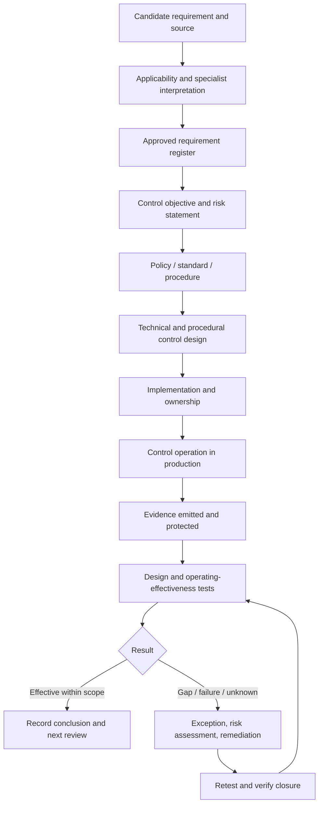
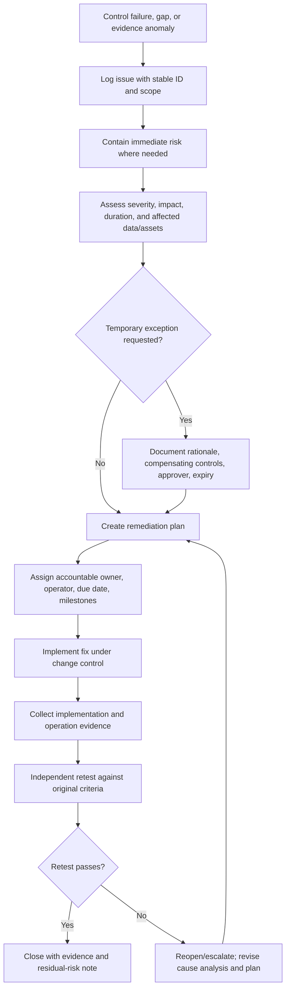

# Regulatory Controls and Evidence Design

> **Roadmap:** Applied AI Engineering Roadmap — Stage 2D, Data Architecture  
> **Module:** 10 — Data Governance, Security, Privacy and Compliance  
> **Topic:** 08 of 09  
> **Recommended effort:** 7–9 hours  
> **Prerequisites:** Topics 01–07 and prerequisite P3 (constraints and risks)  
> **Primary deliverables:** Requirement register; requirement-to-control-to-evidence map; evidence collection plan; control-test procedures; gap/remediation register; architecture decision record (ADR).

> **Scope and legal caution:** This is an engineering learning document, not legal advice. Whether a legal, regulatory, sectoral, contractual, or other obligation applies—and what would satisfy it—depends on jurisdiction, context, and facts. Qualified legal, privacy, compliance, and risk specialists must interpret real obligations. All Northbridge Bank examples and requirement statements below are synthetic training assumptions, not claims about any law or evidence of compliance.

## 1. Purpose: turning expectations into verifiable controls

An enterprise data platform needs more than policies and secure technology. It needs a traceable method for identifying applicable requirements, translating them into testable control objectives, implementing controls in systems and operating procedures, collecting trustworthy evidence, testing the controls, and resolving failures. Auditors, regulators, customers, risk teams, and platform owners may ask a simple question—“show me”—but answering it reliably requires deliberate architecture.

The module roadmap defines the chain as:

**requirements → control objectives → controls → operation → evidence**

A written policy is not necessarily an implemented control. An implemented control is not proof that it operated consistently. A log or screenshot is not automatically sufficient evidence. And a completed checklist does not, by itself, establish legal or regulatory compliance.

### 1.1 Learning objectives

By the end of this topic, you should be able to:

1. Identify and record candidate obligations with a source, owner, version, and interpretation status.
2. Translate an applicable requirement into one or more specific, testable control objectives.
3. Choose preventive, detective, and corrective controls, combining technical and procedural measures appropriately.
4. Distinguish manual, automated, and hybrid controls and assess their operational limits.
5. Assign accountable owners, operators, reviewers, and independent testers.
6. Map requirements to policies, standards, procedures, systems/configuration, operation, evidence, and tests.
7. Design evidence with source provenance, timestamps, identity attribution, integrity, access restrictions, retention, and retrieval paths.
8. Test design effectiveness and operating effectiveness, including population completeness and sampling.
9. Manage evidence gaps, control exceptions, remediation, and retesting.
10. Prioritise controls based on risk and document trade-offs in an ADR.
11. Connect controls to Topics 01–07 and prepare for Topic 09 governance-by-design and policy enforcement.

### 1.2 Beginner-to-advanced progression

| Level | Learning focus | Expected result |
|---|---|---|
| Beginner | Vocabulary, control types, the four-level chain, simple examples | Explain a synthetic requirement through policy, implementation, operation, and evidence |
| Intermediate | Registers, ownership, evidence architecture, tests, exceptions | Build a five-requirement mapping and evidence plan |
| Advanced | Many-to-many traceability, continuous monitoring, inherited controls, risk prioritisation, period-based testing | Produce a reviewed control framework approach and ADR |

## 2. Core terminology: do not collapse the layers

The terms below are related, but they are not synonyms. Organisations may define them differently in their own control framework; use the approved internal glossary when one exists.

| Term | Meaning | Example in the fictional Northbridge Bank | Common mistake |
|---|---|---|---|
| Requirement / obligation | A statement that must or should be satisfied, derived from a source that may be legal, regulatory, contractual, internal, or risk-based | “Restricted customer records must only be accessed by approved roles” — explicitly an illustrative internal requirement | Treating an unverified assumption as a confirmed legal obligation |
| Requirement source | The authoritative document, contract clause, approved policy, risk decision, or other origin from which a requirement is derived | Versioned internal standard `NB-STD-04`, fictional | Recording a requirement without a source or version |
| Policy | Approved high-level direction and boundaries | “Access to restricted data is limited to approved business purposes and roles” | Assuming policy wording proves implementation |
| Standard | Mandatory, more specific rules that implement a policy | Required access review frequency and minimum metadata fields, once approved internally | Confusing a recommended practice with a binding internal standard |
| Procedure / runbook | Steps, roles, inputs, and expected outcomes for performing an activity | Steps to review a grant, record a decision, and revoke unnecessary access | Assuming a procedure is followed just because it exists |
| Control objective | The desired risk outcome stated so it can be assessed | Unapproved principals cannot read the restricted customer dataset | Writing objectives that are too vague to test |
| Control | A mechanism or activity intended to prevent, detect, or correct a risk condition | Access policy enforcement plus alerting on denied/abnormal access | Calling a tool or dashboard a control without defining its purpose |
| Control design | How the control is structured to meet its objective | A policy checks identity, role, dataset classification, and purpose before a query is allowed | Equating good design with successful operation |
| Control operation | The actual execution of the control in its operating period | Each query is evaluated; access review runs at the defined cadence | Treating a design document as operational evidence |
| Evidence | Records that support an assessment of design, operation, outcome, or exception | Policy version, decision log, query event, reviewer decision, test result | Assuming a screenshot or success message proves the whole control worked |
| Control owner | Person accountable for the control's design, performance, and remediation | Data Access Control Owner | Assigning ownership only to a team mailbox or tool |
| Operator | Person/team or service that runs the control | Platform IAM service team | Treating operator and accountable owner as necessarily the same role |
| Reviewer/approver | Person with authority to review or approve a specific decision | Data owner approves access-review outcomes | Allowing a reviewer to approve their own request without a justified safeguard |
| Independent tester | Person/team sufficiently separate from control operation to assess design and operation objectively | Internal assurance or a separately assigned control-testing team | Asking the operator alone to declare the control effective |
| Exception | Approved or pending deviation, failure, or case requiring a controlled alternative | A missing log segment for one period | Hiding exceptions in free-text notes |
| Gap | A deficiency between the expected and actual control state | No reliable evidence that access reviews covered all active grants | Treating a gap as closed when a ticket is merely created |
| Remediation | Action to correct a gap and address its cause | Fix the export query, rerun the complete population, and retest | Closing a gap without evidence and retesting |
| Audit / control test | A structured assessment against defined criteria and scope | Test whether all active restricted-data grants were included and reviewed | Confusing an informal spot check with a scoped test |

### 2.1 The four-level chain

Use this simple sequence when explaining a control to a beginner:

1. **Policy documented:** the organisation has stated the expectation.
2. **Control implemented:** a system or procedure is capable of enforcing or checking it.
3. **Control operating:** the mechanism actually ran as intended over the relevant period and population.
4. **Evidence produced and assessed:** reliable records support a conclusion about the control's operation and limitations.

For example, a written rule to lock a door is not a lock; a lock is not proof that the door was locked; a single photograph is not proof it stayed locked all quarter. The same reasoning applies to data platforms.

## 3. Identify and interpret requirements without inventing them

### 3.1 Requirement sources

Candidate sources can include laws and regulations, sector rules, customer or processor contracts, internal policies and standards, approved risk decisions, architecture constraints, and service commitments. These sources do not all have the same authority or interpretation process.

For each candidate requirement, record:

- Stable requirement ID and plain-language statement.
- Source name, clause/section or reference, version/date, and source owner.
- Applicability status: `CONFIRMED`, `NOT_APPLICABLE`, `NEEDS_SPECIALIST_REVIEW`, or `INTERNAL_ILLUSTRATIVE_ASSUMPTION`.
- Relevant jurisdiction, business unit, product, data class, system, contract, or population—where confirmed.
- Interpretation owner and approval record.
- Effective date, review trigger, and superseded version if any.
- Risk if not met and dependency on other requirements.

Do not infer applicability from a regulation's title, a vendor feature, or a blog post. If the source material does not support a conclusion, record the gap and route it to the qualified specialist.

### 3.2 Decompose a statement into a testable requirement

A useful requirement states a subject, action or outcome, scope, conditions, and—where the source defines them—timing and exceptions. Avoid adding conditions that the source does not establish.

**Synthetic example only:** “Access to the restricted customer dataset is granted only to approved identities with an assigned business purpose.”

Break it into testable questions:

- What asset or data class is in scope?
- Which identities and access paths are included (interactive queries, service identities, exports, notebooks, APIs)?
- What makes an identity approved, and where is the approval recorded?
- How is the business purpose represented and checked?
- Which exceptions are permitted, who approves them, and how do they expire?
- Which logs allow a reviewer to reconstruct the decision?
- How is the population of grants shown to be complete?

A real legal/contractual requirement may need specialist interpretation before it can be decomposed. Keep the source wording and engineering interpretation side by side so reviewers can see what is source-derived and what is an implementation decision.

## 4. Requirement-to-control lifecycle



This diagram represents traceability, not an automatic certification pipeline. A successful test supports a conclusion only within its stated criteria, population, period, and limitations.

### 4.1 Control objective and control selection

A control objective describes the risk outcome, not the brand of tool or the implementation detail. One objective can require several controls; one control can support several objectives. Keep the mapping many-to-many rather than forcing a one-row-per-rule model.

**Example objective:** “Only authorised identities can retrieve restricted customer records, and access decisions can be reconstructed for review.”

Possible controls include:

- Preventive: central identity authentication, role/attribute policy checks, purpose-bound authorization, restricted network paths, and export approval gates.
- Detective: alerts for unusual access patterns, daily policy-denial analysis, periodic grant review, and detection of missing audit events.
- Corrective: revoke excess grants, disable compromised identities, rotate relevant credentials/keys when indicated, contain exports, and remediate policy defects.

No single measure is necessarily sufficient. Preventive controls can be bypassed or misconfigured; detective controls may alert too late; corrective controls limit impact but do not erase the original event. Layering controls is useful when the risk justifies the added complexity.

## 5. Control types and operating models

### 5.1 Preventive, detective, corrective

| Type | Goal | Data-platform example | Limitations / production considerations |
|---|---|---|---|
| Preventive | Stop or constrain an undesired action before or at execution | Authorization policy denies a query when the principal lacks approval or purpose | Depends on correct identity, metadata, policy coverage, fail-open/fail-closed choices, and coverage of every access path |
| Detective | Identify a violation, drift, or suspicious condition | Alert if a service identity accesses an unusual volume or if expected audit events stop arriving | Detection latency, false positives, alert fatigue, incomplete telemetry, and response ownership matter |
| Corrective | Restore an acceptable state or reduce ongoing impact | Revoke excessive access, quarantine a compromised export, repair policy and replay missed checks | Must preserve incident evidence, avoid unintended data loss, and confirm remediation actually worked |

Controls can have multiple functions. For example, a policy engine is preventive, while its decision logs support detective monitoring. Classify by objective and operation, not by tool name.

### 5.2 Manual, automated, and hybrid controls

| Operating model | Example | Strengths | Weaknesses / when to be careful |
|---|---|---|---|
| Manual | Data owner reviews a controlled list of access grants and records approve/revoke decisions | Handles context and judgement; low initial tooling effort | Human error, inconsistent cadence, difficult population completeness, delayed completion, weak audit trail if performed in spreadsheets |
| Automated | A policy service denies an unapproved query and emits a decision event | Consistent, scalable, repeatable, can emit evidence continuously | Bad policy or metadata can scale the wrong outcome; exceptions, drift, outages, and identity mapping need controls |
| Hybrid | Automated complete grant extract plus workflow-based human review and automated revocation of rejected grants | Combines scale and judgement; clearer accountability | Requires reliable handoffs, workflow state, deadlines, and reconciliation between decision and actual access state |

Automation does not automatically make a control effective. Test rule correctness, input quality, deployment governance, failure behavior, permissions, and evidence integrity. Manual controls can be appropriate for low-volume or judgement-heavy decisions if procedures, accountability, and evidence are strong.

### 5.3 Technical versus procedural controls

Technical controls are enforced or checked by systems: access policies, encryption configuration, masking, retention jobs, consent checks, policy-as-code tests, and audit-event collection. Procedural controls include approvals, periodic reviews, incident decisions, hold-scope confirmation, and specialist interpretation.

The best design is risk-proportionate. Use automation for repetitive, high-volume, deterministic checks where inputs are trustworthy. Preserve human judgement where context or legal interpretation is needed. A procedural approval should be linked to the technical action it authorizes; otherwise an approval may exist while access remains unchanged.

## 6. Roles, segregation of duties, and accountability

| Role | Accountable for | Should not be assumed to do alone |
|---|---|---|
| Requirement owner / specialist | Interpreting the source and confirming applicability | Designing or operating every technical control |
| Policy owner | Policy wording, scope, approvals, periodic review | Proving production operation from policy text alone |
| Control owner | Objective, design, performance, exceptions, remediation | Serving as the sole independent tester of the same control |
| Control operator | Running the process/service and handling operational alerts | Approving its own high-risk exceptions without defined safeguards |
| Data owner/steward | Data classification, purpose, access decisions, asset context | Assuming platform logs cover exports or copies outside the managed estate |
| Platform/system owner | Implementation, reliability, telemetry, change management | Interpreting legal obligations outside their competence |
| Evidence custodian | Evidence collection, integrity, access, retention, retrieval | Altering source evidence without a traceable correction process |
| Independent tester / assurance | Test scope, criteria, sampling, conclusions, issue validation | Depending solely on owner-provided summaries without examining underlying evidence |
| Risk/compliance/legal/privacy specialist | Qualified interpretation and risk advice within their remit | Being replaced by a checklist or automated policy rule |
| Senior risk acceptor | Accepting defined residual risk within delegated authority | Accepting an unknown risk without scope, rationale, expiry, and review |

Segregation should be proportionate to risk. In small teams, complete separation may be impractical; record the constraint and introduce compensating review, immutable logs, or independent second-person approval where appropriate. Do not describe an arrangement as independent if the tester materially designed, operated, and self-approved the control without safeguards.

## 7. Build a requirement register and mapping

### 7.1 Illustrative requirement register

Every row below is an **internal synthetic training assumption**, not a legal or contractual obligation.

| Req ID | Illustrative statement | Source status | Scope | Interpretation / owner | Review trigger |
|---|---|---|---|---|---|
| REQ-001 | Restricted data reads require approved identity and business purpose | `INTERNAL_ILLUSTRATIVE_ASSUMPTION` | Customer analytics dataset | Data Access Owner; policy approval required | Data class or access model changes |
| REQ-002 | Access grants are reviewed at an approved recurring cadence | `INTERNAL_ILLUSTRATIVE_ASSUMPTION` | Human and service identities with restricted access | Governance Owner; cadence to be approved internally | Risk profile, population, or policy changes |
| REQ-003 | Encryption settings and key-access permissions are monitored for drift | `INTERNAL_ILLUSTRATIVE_ASSUMPTION` | Selected restricted data stores and key paths | Security Platform Owner | Key/storage architecture changes |
| REQ-004 | Eligible deletion actions are checked against the approved hold registry and reconciled across known copies | `INTERNAL_ILLUSTRATIVE_ASSUMPTION` | Deletion workflow and registered copies | Lifecycle Control Owner; hold owner consulted | New copy path, hold model, or storage type |
| REQ-005 | Purpose/consent restrictions are enforced or routed to review before restricted processing | `INTERNAL_ILLUSTRATIVE_ASSUMPTION` | Selected data products and processing jobs | Privacy/Data Product Owner; specialist interpretation required for real obligations | Purpose, consent state, or processing changes |
| REQ-006 | Evidence records identify the control, time, source, result, and traceable run/decision | `INTERNAL_ILLUSTRATIVE_ASSUMPTION` | Control evidence repository | Evidence Platform Owner | Evidence schema or audit needs change |

The register must distinguish an unconfirmed candidate from an approved internal requirement and from a confirmed external obligation. An engineering team must not quietly upgrade an assumption to a legal requirement.

### 7.2 Requirement-to-control-to-evidence map

| Req ID | Control objective | Control(s) and type | Owner / implementation | Evidence source | Test / failure handling |
|---|---|---|---|---|---|
| REQ-001 | Unapproved identities or purposes cannot retrieve restricted data | Preventive authorization check; detective denied/abnormal access alert | Data Access Owner; policy enforcement point on query/API/export paths | Versioned policy, approval record, decision events, access logs | Test allow/deny cases for each path; missing logs trigger evidence-gap incident |
| REQ-002 | Active grants are reviewed against a complete population | Hybrid: automated grant inventory + human owner decision + automated revocation workflow | Governance Owner and IAM operator | Dated population extract, extract query/version, reviewer decisions, revocation acknowledgements | Verify population completeness; sample decisions; reconcile rejected grants to actual access |
| REQ-003 | Selected encryption and key-access settings remain within approved baseline | Automated drift check plus corrective change workflow | Security Platform Owner | Config snapshot, policy version, check result, change ticket, key-access event | Compare deployed config to approved baseline; fail/unknown becomes incident and remediation ticket |
| REQ-004 | Deletion does not bypass holds and reaches known copies or remains an owned exception | Preventive hold guard; detective reconciliation; corrective retry/escalation | Lifecycle Control Owner; hold registry and per-system adapters | Request/expiry ID, hold decision, target inventory, per-system results, reconciliation | Inject hold and partial-failure cases; block held scope; retry transient failures; escalate unknown copies |
| REQ-005 | Processing respects approved purpose/consent state or stops for review | Preventive policy gate; detective exception monitoring; corrective job quarantine | Privacy/Data Product Owner | Policy version, consent/purpose state reference, decision, job ID, exception approval | Test allowed/prohibited/unknown states; unknown must not silently pass; investigate false decisions |
| REQ-006 | Evidence can be traced to source activity and checked for integrity | Automated event envelope, restricted evidence store, integrity validation | Evidence Platform Owner | Evidence record, source event ID, hash/signature where used, ingestion/verification status | Recompute integrity check, compare source counts, test retrieval and access restrictions |

One requirement may map to multiple controls; one control may support several requirements. Maintain stable IDs and links rather than duplicating uncontrolled prose across spreadsheets. If a requirement has no control or evidence, mark the gap explicitly.

## 8. Evidence architecture: design for trust and retrieval

### 8.1 Evidence as a by-product of normal operation

Prefer evidence generated by normal platform behavior: policy decisions, configuration snapshots, access events, approval workflows, scheduled review records, deletion acknowledgements, test results, and change logs. This reduces last-minute evidence assembly and makes continuous monitoring possible.

Evidence design should answer:

1. **What claim does it support?** Link to the requirement, objective, control, test, and conclusion.
2. **Where did it originate?** Identify the system, environment, event/run, query, configuration version, and producer.
3. **When did it occur?** Record event time and collection time separately, including timezone or normalized timestamp convention.
4. **Who or what performed it?** Use stable principal/service identity and attribution fields; do not rely only on a mutable display name.
5. **What was the population and result?** Include scope, counts, filters, status, errors, and exclusions.
6. **Can it be trusted?** Protect against unauthorized modification; use access controls, integrity checks, append-only or tamper-evident mechanisms where justified, and audit changes to evidence.
7. **Can it be reproduced or independently checked?** Preserve query/config versions, source references, and validation steps where appropriate.
8. **How long is it retained and who can retrieve it?** Apply an approved evidence-retention policy, access controls, and tested retrieval paths.

### 8.2 Evidence quality criteria

| Criterion | Question to ask | Failure example | Design response |
|---|---|---|---|
| Completeness | Does evidence cover the full defined period and relevant population? | Access-review report omits service identities | Reconcile source inventory counts and identity types; document exclusions |
| Accuracy | Does it represent the event/configuration correctly? | Dashboard displays cached values from yesterday | Capture source timestamp and freshness; validate against source |
| Integrity | Can unauthorized changes be detected or prevented? | Spreadsheet decisions can be edited without history | Restrict write access; retain version history or tamper-evident records |
| Authenticity / attribution | Can the source and actor/service be identified? | Log shows only “admin” | Use stable identity, service identity, and originating system fields |
| Timeliness | Was it generated and collected close enough to operation for the intended test? | Log pipeline loses events for several days | Monitor ingestion lag and missing partitions; record event and collection times |
| Traceability | Can it be connected to requirement, control, run, and asset? | Screenshot has no control ID or date | Use stable IDs and linked metadata in every evidence envelope |
| Reproducibility | Can a tester rerun or independently verify the check? | Unversioned query pasted into a ticket | Store query/code/config version and parameters, with access restrictions |
| Confidentiality | Is evidence itself protected from unnecessary exposure? | Logs contain full sensitive payloads | Minimise payloads, restrict access, redact where appropriate |
| Retention and availability | Is evidence available for the approved review window without indefinite over-retention? | Logs expire before the review occurs | Align lifecycle schedule with approved audit needs; test retrieval |
| Independence | Can a reviewer validate the claim without relying only on the operator's assertion? | Owner provides only a summary slide | Provide source records and validation procedure to a suitably independent tester |

A hash can help detect changes relative to a trusted reference; it does not prove that the original data were accurate, complete, or honestly produced. A signed event can support authenticity but does not automatically establish the correctness of the underlying control. Evidence quality is multi-dimensional.

### 8.3 Example evidence record

The following JSON is synthetic. It demonstrates a useful event envelope, not a universal schema or proof of compliance.

```json
{
  "evidence_id": "EV-NB-2026-004218",
  "requirement_id": "REQ-001",
  "control_id": "CTL-ACCESS-004",
  "control_version": "3.2",
  "event_type": "authorization_decision",
  "event_time": "2026-10-12T09:15:22Z",
  "collected_time": "2026-10-12T09:15:24Z",
  "source_system": "synthetic-query-gateway",
  "environment": "production-synthetic",
  "actor_id": "svc-risk-analytics-17",
  "resource_id": "dataset-customer-restricted-v3",
  "decision": "DENY",
  "reason_code": "PURPOSE_NOT_APPROVED",
  "policy_id": "POL-DATA-ACCESS-02",
  "policy_version": "5.1",
  "request_id": "REQ-TRACE-9182",
  "trace_id": "TRACE-7741",
  "result_status": "RECORDED",
  "source_sequence": "seq-981271",
  "integrity_reference": "sha256:example-placeholder-not-a-real-digest",
  "integrity_method": "illustrative",
  "ingestion_status": "VERIFIED_BY_PIPELINE_CHECK",
  "retention_policy_id": "EVID-RET-01",
  "classification": "RESTRICTED_METADATA",
  "review_status": "NOT_YET_TESTED"
}
```

Field interpretation:

- `event_time` is when the decision happened; `collected_time` is when the evidence pipeline received it.
- `actor_id` should identify a stable principal or service; attribution may need identity-history context if principals can be renamed or deleted.
- `policy_version`, `control_version`, `request_id`, and `trace_id` make the event traceable to the deployed logic and request path.
- `ingestion_status` means a pipeline check passed, not that an independent control test passed.
- `integrity_reference` is deliberately a placeholder, not a real digest. In a real system, store the actual value and the trusted method used to calculate/verify it.
- `review_status` makes clear that the event has not yet been assessed by a tester.

### 8.4 Evidence store and chain of custody

**Responsibility split:** the source-system operator is responsible for producing or preserving source records; the evidence custodian is responsible for controlled collection, integrity checks, access, retention, and retrieval; the control owner explains the control and resolves operational gaps; and the reviewer/tester assesses the evidence against documented criteria. These roles may be combined only where risk and governance permit, with conflicts and compensating safeguards recorded. Collection success alone is not evidence that the control objective was achieved.

A practical evidence architecture may include source emitters, a collection/normalisation layer, a restricted evidence repository, integrity and completeness checks, an index/catalogue, and controlled retrieval workflows. Keep source evidence separate from derived summaries when necessary so reviewers can inspect the underlying records.

Controls for the evidence system itself should cover:

- Write permissions, reviewer access, privileged access, and access logging.
- Source identity and event provenance.
- Time synchronisation and timestamp semantics.
- Collection lag, dropped events, duplicate events, and sequence gaps.
- Schema evolution and backward compatibility.
- Integrity checks and controlled correction procedures; never silently overwrite evidence.
- Retention, legal hold, deletion, minimisation, and secure disposal of evidence under its own approved policy.
- Availability, backup/recovery, retrieval testing, and incident handling.

Evidence can contain sensitive data. Do not copy full payloads into audit records merely to make an evidence package appear complete. Store the minimum necessary fields and stable references, with controlled access to the source where further inspection is approved.

## 9. Evidence matrix for common governance controls

The following matrix is a design guide for the earlier topics in the module. Actual evidence must match the implemented system and approved requirements.

| Control area | Example control operation | Evidence candidates | Quality/coverage checks | Common gaps |
|---|---|---|---|---|
| Access approvals (Topic 03) | Grant is approved before activation; role/attribute policy is evaluated at access time | Approval ID, requester/approver identities, grant event, policy decision, role/attribute snapshot, revocation event | Approval precedes grant; all access paths represented; identity mapping stable | Approval ticket exists but access remains active after rejection; service accounts omitted |
| Periodic access reviews (Topic 03) | Complete active-grant population is reviewed and rejected grants are revoked | Dated population extract, extraction query/version, owner decisions, timestamps, revocation acknowledgements | Reconcile counts with authoritative grant inventory; test missing/duplicate grants and overdue reviews | Spreadsheet lacks complete population or review period |
| Classification (Topic 02) | Dataset/field has approved classification and changes propagate to dependent assets | Catalog record/version, owner approval, scan results, lineage links, policy evaluation | Check unclassified/new assets, stale labels, field-level coverage, downstream propagation | Labels exist only in a document; classification drift is unmonitored |
| Encryption/key controls (Topic 04) | Selected stores and key paths match approved baseline; drift is detected | Config snapshots, key-policy version, key-access events, drift alert, change record | Compare actual settings with approved baseline; confirm coverage of replicas and backups | “Encrypted” badge without scope or key-access evidence |
| Masking/tokenization (Topic 05) | Sensitive fields are transformed or withheld for an intended consumer | Transformation config/version, schema/field inventory, query tests, access-path test results | Test direct, export, notebook, and derived paths; validate token mapping access | Masked UI while raw export remains available |
| Purpose/consent/residency (Topic 06) | Processing checks approved purpose/consent and allowed location or routes unknown states to review | Policy version, state/reference, job/request ID, decision, location metadata, exception approval | Test allowed, denied, unknown, expired, and changed states; verify data movement paths | Consent record exists but pipeline does not check it; metadata location incomplete |
| Retention/deletion/holds (Topic 07) | Eligible deletion checks hold state, reaches known copies, and reconciles outcomes | Request/trigger ID, policy version, hold decision, copy inventory, per-system acknowledgements, reconciliation, exception record | Coverage of copies/derivatives, restore replay, retry completion, held-record protection | One source table deleted but backup, index, or export remains unknown |
| Policy enforcement (Topic 09 preview) | Policy is tested and enforced at the correct pipeline/access checkpoints | Policy-as-code version, CI tests, deployment approval, runtime decision events, drift alerts | Trace policy version to deployment and runtime; test bypass paths and fail behavior | Unit tests pass but production uses an old policy or bypass path |

## 10. Control register and ownership

A control register is the operational index of what the organisation expects to work. It is not a substitute for source requirements or underlying evidence.

### 10.1 Synthetic control register

All IDs and cadences below are illustrative design choices. Confirm real cadences and requirements through the approved governance process.

| Control ID | Objective / risk | Control implementation | Type / mode | Accountable owner and operator | Reviewer / independent tester | Frequency / trigger | Evidence | Failure handling |
|---|---|---|---|---|---|---|---|---|
| CTL-ACCESS-004 | Prevent unapproved reads of restricted data | Authorization policy at query/API/export checkpoints | Preventive, automated | Owner: Data Access Owner; operator: Platform IAM team | Reviewer: Data Owner for access decisions; tester: independent control tester | Every access decision; policy review on material change | Versioned policy, decision event, access log | Deny or route unknown state to review; alert on missing event stream; incident if bypass is found |
| CTL-REVIEW-002 | Ensure active grants are reviewed | Automated complete extract plus owner approval workflow | Detective/preventive, hybrid | Owner: Governance Owner; operator: IAM operations | Reviewer: relevant Data Owner; tester: independent control tester | Illustrative quarterly cycle; event-driven for urgent changes | Population snapshot, decisions, revocation results | Escalate overdue review; restrict high-risk unresolved grants according to approved procedure |
| CTL-CLASS-003 | Prevent unclassified sensitive assets entering approved production paths | Metadata gate plus scheduled discovery scan | Preventive/detective, hybrid | Owner: Data Governance Owner; operator: Data Platform team | Reviewer: designated Data Steward; tester: independent control tester | At onboarding/deployment and scheduled scans | Catalog record, scan results, gate decision | Quarantine or block asset; assign classification; retest before release |
| CTL-CRYPTO-005 | Detect drift from approved encryption/key baseline | Automated configuration comparison and alert workflow | Detective/corrective, automated with human approval for risky changes | Owner: Security Platform Owner; operator: Security engineering | Reviewer: Security Control Owner or delegate; tester: independent control tester | Scheduled check and config-change event | Snapshot, baseline version, drift result, change ticket | Open incident, assess exposure, remediate under change control, retest |
| CTL-PRIV-006 | Prevent processing when purpose/consent state is invalid or unknown | Runtime/job policy gate and exception workflow | Preventive/detective, hybrid | Owner: Privacy/Data Product Owner; operator: Data Product team | Reviewer: Privacy/Data Owner; tester: independent control tester with specialist input as needed | Each job/request; state-change event | State reference, policy version, decision, exception record | Stop/quarantine uncertain processing; specialist review where needed |
| CTL-LIFE-007 | Avoid deleting held data and reconcile deletion across copies | Hold guard plus per-copy workflow and reconciliation | Preventive/detective/corrective, automated + human exception handling | Owner: Lifecycle Control Owner; operator: Data Platform team; hold owner controls hold scope | Reviewer: hold owner for scope/release; tester: independent control tester | At expiry/request and on restore/replay; periodic reconciliation | Hold decision, target inventory, per-system results, reconciliation report | Block held scope; retry transient failures; escalate unknown/failed targets; retain case open |
| CTL-EVID-008 | Ensure control evidence is traceable and protected | Standard event envelope, restricted evidence repository, completeness/integrity checks | Preventive/detective, automated | Owner: Evidence Platform Owner; operator: Observability team | Reviewer: evidence consumer/control owner; tester: independent control tester | Every evidence event; daily pipeline health check | Event envelope, source IDs, integrity check, ingestion metrics | Flag missing/late events; preserve source references; open evidence-gap incident |

Every production control record should additionally include: control version; mapped requirement/objective IDs; implementation location; scope/population; assumptions; dependencies; change owner; review date; test frequency; risk rating; evidence retention policy; last test result; open issues; approval references; reviewer and independent-tester identity; and the criteria that distinguish pass, fail, and unknown. If independence is constrained, record the conflict and the compensating review rather than labelling the test independent.

## 11. Control design versus control operation

### 11.1 Design effectiveness

Design effectiveness asks whether the control, if implemented and operated as described, is reasonably capable of meeting its stated objective for the defined risk and scope.

A design review should assess:

- Is the objective clear and linked to a recorded requirement/risk?
- Does the design cover the full population and all relevant access/data paths?
- Are identity, classification, purpose, retention, and hold inputs authoritative enough?
- Are failure states explicit (missing metadata, policy outage, partial telemetry, stale configuration)?
- Are roles, approvals, escalation, and segregation clear?
- Does the control generate suitable evidence, and is that evidence protected and retained?
- Are exceptions bounded, approved, time-limited, and reviewable?
- Are dependencies and inherited/shared-responsibility controls mapped?

A design can be ineffective even if it runs reliably—for example, a perfectly scheduled review that omits service identities.

### 11.2 Operating effectiveness

Operating effectiveness asks whether the control operated as designed, by the right actor/system, at the right frequency, across the defined population and period, with exceptions handled as specified.

A test plan must define:

- Objective and control ID/version.
- Scope, environment, time period, and population.
- Criteria for pass/fail/unknown.
- Evidence sources and completeness checks.
- Test steps, sample method, sample size/rationale, and any full-population analytics.
- Independence and tester competence.
- Expected results, actual results, exceptions, limitations, and conclusion.
- Remediation and retest conditions.

A point-in-time configuration snapshot cannot establish continuous operation across six months. For period-based controls, combine configuration/change history with execution records and evidence completeness checks for the entire period.

### 11.3 Sampling and population completeness

Sampling is useful when reviewing every item is impractical, but a sample is only meaningful if the population is sufficiently complete and the method is documented. Define the population first: for an access review, does it include human users, service identities, emergency access, API tokens, direct storage access, exports, and inherited grants?

**Synthetic example:** Northbridge has 1,200 active grants in a candidate review population. The tester first reconciles the extract to the authoritative identity/access inventories and documents exclusions. The tester may then choose a risk-based sample or test the full population, depending on the control objective, risk, and approved methodology. The number 1,200 is a training example, not a real population or a prescribed sample size.

Do not select a sample size by habit alone. Document why the method can detect the relevant failure mode. Use full-population analytics when feasible, but validate the source query, filters, and data completeness; automated analysis of an incomplete population can create false assurance.

## 12. Control-testing plan

### 12.1 Synthetic test plan

| Field | Example value |
|---|---|
| Test ID | TEST-ACCESS-2026-Q4-01 |
| Control | CTL-ACCESS-004, version 3.2 |
| Objective | Unapproved identities/purposes cannot read the restricted dataset |
| Test type | Design review + operating-effectiveness test |
| Period | 2026-07-01 through 2026-09-30 UTC (illustrative) |
| Population | All access decisions and active grants for the defined dataset and access paths during the period |
| Completeness procedure | Reconcile gateway, API, export, service identity, and grant inventories; inspect event gaps and collection lag |
| Design tests | Review policy logic, default behavior, bypass paths, policy deployment, exception handling, and evidence fields |
| Operating tests | Test allowed/denied cases; inspect event records; sample access decisions and verify approval/purpose state at decision time |
| Tester | Independent control tester not responsible for day-to-day operation |
| Pass criteria | Defined scope is covered; expected decisions match policy; evidence is traceable and complete within stated criteria; exceptions handled as designed |
| Fail/unknown criteria | Any unauthorized access, unreviewed bypass, material missing population/evidence, or unresolved uncertainty that prevents a supported conclusion |
| Outputs | Test workpaper, evidence references, results, exceptions, limitations, remediation tickets, retest result |

### 12.2 Example test steps

1. Obtain the approved requirement interpretation, control objective, policy version, and test criteria.
2. Confirm the control owner, operator, reviewer, and tester roles.
3. Identify all applicable access paths and authoritative population sources.
4. Capture source extracts with query/config versions, parameters, timestamps, and row counts.
5. Reconcile counts and key sets across sources; investigate unexplained differences before sampling.
6. Review design: authorization inputs, default-deny or other approved failure behavior, exception route, deployment controls, and audit event generation.
7. Test representative positive and negative cases, including missing purpose, revoked approval, service identity, export path, stale classification, and policy service outage as applicable to the design.
8. For operating effectiveness, select the documented sample or run the approved full-population analytics across the full period.
9. Independently compare decisions to the approved policy and source approval records; confirm denied requests did not retrieve the protected payload where that is the expected behavior.
10. Check event completeness, timestamps, stable actor/resource IDs, integrity, and retrieval access.
11. Record pass, fail, or unknown for each criterion; document limitations and exceptions.
12. Assign remediation with an owner and due date; retest after the fix and preserve the before/after evidence.

A test must not be marked “pass” merely because a dashboard is green. The tester needs criteria, complete scope, source evidence, and reproducible steps. If evidence is missing, distinguish “control failed” from “operation cannot be verified”; both require attention, but they are not the same factual conclusion.

## 13. Exception, remediation, and retesting workflow



### 13.1 Minimum exception record

- Issue ID, control/requirement IDs, date detected, detector, source evidence.
- Description, affected systems/data/population, time window, and known/unknown facts.
- Risk assessment: confidentiality, integrity, availability, privacy, operational, contractual, and other relevant impacts.
- Immediate containment and whether specialist/incident escalation is needed.
- Root cause or current hypothesis, clearly labelled as confirmed or unconfirmed.
- Remediation owner, milestones, due date, validation criteria, and change record.
- Exception approver, rationale, compensating controls, start/end dates, and review frequency if risk is temporarily accepted.
- Retest evidence, closure decision, residual risk, and approval reference.

An exception is not a permanent bypass. Any accepted deviation must be within delegated authority, bounded in scope and time, periodically reviewed, and visible in risk reporting. Do not close an issue just because the ticket status changed; close it when the correction and required retest are evidenced.

## 14. Evidence gaps and false assurance

| Failure mode | Why it creates false assurance | Response |
|---|---|---|
| Policy exists, but enforcement is not deployed | Intent is mistaken for runtime behavior | Trace approved policy version to deployment and runtime decisions |
| Screenshot-only evidence | Scope, source, timestamp, and reproducibility may be absent | Retain source records, query/config versions, stable IDs, and collection metadata; use screenshots only as supplemental evidence |
| Logs expire before testing | Operation cannot be reconstructed for the required review window | Align evidence retention to an approved need and test retrieval; avoid indefinite retention by default |
| Missing or late telemetry | “No alert” may mean “no data arrived” | Monitor event lag, gaps, sequence counts, and source-to-sink reconciliation |
| Incomplete population | Sample may exclude the riskiest access path or identity type | Reconcile to authoritative inventories before sampling; document exclusions |
| Control owner self-certifies | Review lacks independence and may miss design flaws | Use a sufficiently independent tester and retain underlying evidence |
| Control tested only once | Drift and subsequent failures remain unseen | Define periodic/event-triggered tests and monitor material changes |
| Evidence is mutable without history | Past failures can be obscured | Restrict write access, track corrections, and use integrity mechanisms appropriate to risk |
| Over-collection in logs | Evidence repository becomes a new sensitive-data risk | Minimise fields, avoid raw payloads, classify evidence, and control access |
| Vendor/provider report treated as complete | Shared-responsibility boundary may be missed | Map inherited control, provider evidence, customer-owned configuration, and local monitoring |
| Control says “success” but downstream action failed | Initiation is mistaken for completion | Capture per-system acknowledgement and reconcile expected vs actual state |
| Automated check has untested logic | A bug can produce consistently wrong green results | Test the test: validate query/policy, expected cases, source completeness, and version history |
| Remediation ticket closed without retest | Fix is assumed effective | Require independent retest and linked evidence before closure |

## 15. Risk-based prioritisation and proportionality

Controls consume engineering time, compute, review capacity, and user attention. More controls do not always mean better assurance; too many overlapping controls can create fatigue, conflicting evidence, and unclear accountability. Too few leave material risks untreated.

Prioritise using factors such as:

- Sensitivity and criticality of the data and business process.
- Potential impact and likelihood of the failure mode.
- Number of users, identities, systems, and external parties in scope.
- Exposure of access paths and ability to bypass controls.
- Data movement, copies, lineage complexity, and recoverability.
- Existing control strength and evidence quality.
- Failure detectability, time to contain, and remediation complexity.
- External dependency and shared-responsibility boundaries.
- Cost and operational friction of the proposed control.

A simple qualitative model may use impact × likelihood × exposure, with a separately recorded confidence in the evidence. Do not present a numerical score as objective truth unless the scoring scale, data, assumptions, and limitations are defined. A high-impact control with poor evidence quality may deserve priority even if the number of observed failures is low.

### 15.1 Control rationalisation

A single control can support multiple requirements; multiple controls can support one objective. Map this explicitly to avoid duplicate procedures and conflicting schedules. Rationalisation must not erase distinct scope or evidence requirements. A shared control is only a valid common control if it genuinely covers all mapped systems and populations, and each consumer's dependencies are documented.

## 16. Inherited controls and shared responsibility

Some controls are provided or operated by an infrastructure or service provider; others remain with the organisation. Evidence may include provider reports, contractual descriptions, configuration exports, service status, and the organisation's own monitoring. A provider statement does not prove that the customer configured or used the service correctly.

For each inherited/shared control, record:

- What the provider asserts or operates, and the evidence period/scope.
- What the organisation must configure, monitor, or approve.
- Which systems, regions, services, and features are covered or excluded.
- How exceptions, service changes, and evidence expiry are handled.
- How the local control owner verifies continued applicability.

The roadmap points to the cloud/hybrid data architecture module for provider and shared-responsibility context. Keep the responsibility boundary in the control register and ADR.

## 17. Worked example: from illustrative requirement to reviewed evidence

### 17.1 Scenario

Northbridge Bank's fictional analytics platform stores a restricted customer dataset. The training requirement is:

> **REQ-001 — Internal illustrative assumption:** Access to the restricted customer dataset must be limited to approved identities with an assigned business purpose, and the decision should be reconstructable from controlled evidence.

This is not presented as a legal requirement. A real obligation would need a verified source and qualified interpretation.

### 17.2 Interpretation and objective

- **Source status:** `INTERNAL_ILLUSTRATIVE_ASSUMPTION`.
- **Risk statement:** An unapproved principal or purpose could expose restricted data; insufficient logs could prevent investigation.
- **Control objective:** Unapproved identities/purposes cannot retrieve restricted records, and an authorised reviewer can reconstruct access decisions for the defined scope and period.
- **Scope:** query gateway, APIs, service identities, export path, and restricted dataset version `customer-restricted-v3` in the synthetic production environment.
- **Open assumptions:** all access paths have been enumerated; identity and purpose metadata are sufficiently authoritative; emergency access is separately controlled.

### 17.3 Policy and controls

- **Policy:** restricted access must use approved identities and purposes.
- **Standard/procedure:** the approved role/purpose vocabulary, approval workflow, exception expiry, and review process are defined in versioned internal documents.
- **Preventive control:** authorization checks identity, approval state, classification, and purpose at each in-scope access path. Unknown or missing state follows the explicitly approved fail behavior rather than silently passing.
- **Detective control:** monitoring detects unusual access, policy bypasses, and missing decision events.
- **Corrective control:** revoke inappropriate access, contain any affected export, investigate the cause, and remediate the enforcement or logging defect.
- **Owner/operator:** Data Access Owner accountable; Platform IAM team operates the policy service.
- **Tester:** independent assurance resource tests the design and selected period of operation.

### 17.4 Evidence plan

| Evidence ID | Evidence item | Source and traceability | Validation |
|---|---|---|---|
| E-001 | Approved requirement and policy version | Requirement register, policy ID/version, approval reference | Confirm source status, owner, effective date, and current version |
| E-002 | Authorization configuration snapshot | Deployed policy version, environment, deployment/change ID | Compare to approved baseline; verify deployment in every in-scope path |
| E-003 | Access-decision events | Event ID, actor, resource, timestamp, policy version, decision, request/trace ID | Check completeness, event/collection time, identity attribution, and integrity |
| E-004 | Approved access grant records | Approval ID, approver identity, scope, purpose, expiry, grant ID | Confirm approval precedes grant and scope matches actual access |
| E-005 | Test execution records | Test ID, cases, input state, expected/actual results, test version | Reproduce positive/negative tests; verify fail behavior for unknown state |
| E-006 | Period population reconciliation | Source inventories, query versions, counts, differences, exclusions | Explain every material mismatch before relying on a sample |
| E-007 | Exceptions and remediation | Issue ID, impact, owner, due date, fix, retest, closure | Verify issue state matches the evidence; do not rely on ticket status alone |

### 17.5 Test and outcome

A tester verifies that the design covers all known access paths and that policy versions are traceable to deployment. For operating effectiveness, the tester obtains a complete period population, reconciles it, and performs documented negative/positive cases plus a risk-based sample or full-population analysis. The tester checks that approvals and purpose states were valid at decision time, that observed decisions match the policy, and that expected evidence events are present.

**Synthetic finding:** 2 of 500 reviewed access decisions lack the expected trace ID. This does not automatically mean the access decision was unauthorized, but it is an evidence/traceability gap. The tester records the two event IDs, determines whether source events exist, assesses whether the missing field prevents reliable reconstruction, and opens an issue. The owner fixes the event envelope, reruns the affected pipeline where possible without falsifying historical records, documents any irrecoverable gap, and the independent tester retests new operation and the stated historical limitation.

The conclusion must be scoped: for example, “The tested policy cases behaved as expected in the defined environment; two historical events lacked trace IDs and remain a documented evidence limitation.” It must not say “Northbridge is compliant.” The example demonstrates a method, not a compliance finding about any real organisation.

## 18. Integrate Topics 01–07 and prepare for Topic 09

| Earlier topic | What Topic 08 reuses | Evidence/control implication |
|---|---|---|
| 01 Governance operating model and accountability | Decision rights, ownership, approval, escalation | Every requirement and control has an owner, reviewer, and review trigger |
| 02 Classification and criticality | Data sensitivity and business impact | Control scope and priority follow the data register and criticality |
| 03 Identity and least privilege | Identity, authorization, access reviews | Evidence connects approval, grant, runtime decision, and revocation |
| 04 Encryption, keys, secrets | Encryption baseline and privileged key access | Evidence includes configuration, key policy, access events, and drift response |
| 05 PII masking/tokenization/de-identification | Field-level protection and disclosure paths | Tests include exports, notebooks, derived tables, and re-identification risks where relevant |
| 06 Consent, purpose, residency | Processing context and location constraints | Evidence records the applicable policy/state and the decision made at processing time |
| 07 Retention, deletion, legal holds | Lifecycle trigger, copy inventory, hold state, deletion reconciliation | Evidence shows per-copy outcome, hold decision, exceptions, and restore/replay handling |
| 09 Governance by design (next topic) | Policy-as-code, checkpoints, CI/CD, continuous validation | Use the traceability and evidence contracts built here to automate enforcement and testing |

Topic 08 is the bridge from individual controls to a coherent evidence architecture. Topic 09 can automate enforcement and checkpoints, but it must not turn unresolved legal interpretation into code by assumption. A human decision and specialist review may remain necessary.

## 19. Architecture decisions and trade-offs

### 19.1 Evidence strategy options

| Option | Benefits | Costs / risks | Appropriate when |
|---|---|---|---|
| Manual evidence collection | Low initial engineering effort; flexible for judgement-heavy decisions | Fragile, slow, hard to reproduce, can miss the full period/population | Small, low-frequency control with a well-defined procedure and low exposure |
| Central evidence repository | Common schema, access control, search, retention, traceability | Cost, schema governance, sensitive-data concentration, pipeline dependency | Many controls need repeatable retrieval and common review patterns |
| Distributed source evidence with central index | Avoids duplicating all raw evidence; source owners retain context | Source availability and permissions can delay retrieval; schemas differ | Systems are independently governed and a central index can preserve references and metadata |
| Continuous automated evidence | Fast detection, reproducibility, supports drift monitoring | Alert fatigue, automation bugs, false positives, reliance on telemetry completeness | High-volume deterministic controls where sources and policy versions are well managed |
| Hybrid workflow | Automation for extraction/validation and people for interpretation/approval | Workflow coordination and handoff failures | Human judgement is needed but repeatable evidence and escalation are valuable |

### 19.2 ADR template

Record at least:

- **Title/status/date/decision owner.**
- **Context:** requirements, risk, data classes, systems, operating period, and constraints.
- **Options considered:** include manual, automated, hybrid, central, and distributed options as relevant.
- **Decision:** selected control/evidence architecture and its scope.
- **Rationale:** why the option is proportionate to risk and operational need.
- **Control mapping:** requirement IDs, objective IDs, control IDs, owners, and dependencies.
- **Evidence contract:** event fields, sources, collection cadence, integrity/completeness checks, retention, access, and retrieval procedure.
- **Failure behavior:** missing evidence, policy outage, stale metadata, unknown scope, provider gap, and exception path.
- **Testing:** design review, operating test, sampling rationale, retest conditions.
- **Trade-offs and residual risk:** what is not covered and why.
- **Approval and review date:** include specialist decisions where needed and triggers for reopening the ADR.

## 20. Hands-on exercises

Use synthetic records only. For each exercise, clearly mark assumptions, unresolved interpretation, and evidence that would be needed in a real implementation.

### Exercise A — Requirement-to-control mapping

**Scenario:** Northbridge wants to show that restricted customer data access is controlled and reviewed. The following are internal training assumptions: access requires approved identity and purpose; grants are reviewed at an approved cadence; rejected grants are removed; access decisions are traceable.

**Tasks:**
1. Create five requirement-register rows with source status, owner, scope, and review trigger.
2. Define a testable control objective for each requirement.
3. Map preventive, detective, and corrective controls as appropriate.
4. Assign owner, operator, reviewer, and independent tester.
5. Identify implementation locations and evidence sources.
6. Write a gap list for any missing control, owner, evidence source, or interpretation.

**Expected deliverable:** Requirement register plus requirement-to-control-to-evidence mapping.

**Validation criteria:**
- Every requirement is labelled as a synthetic assumption unless a real source is verified.
- Every requirement maps to at least one objective and control, or has an explicit gap.
- Every control has a named accountable role, implementation location, operation frequency/trigger, evidence source, and failure path.
- Control types are correctly classified and do not rely only on policy documents.
- No claim of legal applicability or compliance is made.

### Exercise B — Evidence design and control test

**Scenario:** A reviewer requests evidence for six months of access-review operation.

**Tasks:**
1. Define the evidence envelope fields and the controlled evidence location.
2. Identify authoritative sources for the full grant population, approvals, reviewer decisions, and revocations.
3. Design population completeness checks and explain the sampling or full-population method.
4. Write separate design-effectiveness and operating-effectiveness test steps.
5. Define pass, fail, and unknown criteria.
6. Specify integrity, access control, retention, and retrieval procedures.
7. Create one synthetic finding and show its remediation and retest path.

**Expected deliverable:** Evidence collection plan, test procedure, and synthetic test workpaper.

**Validation criteria:**
- Evidence covers the full stated period and scope, or limitations are explicitly documented.
- Source, event time, collection time, actor, control version, result, and traceability are present where applicable.
- Population completeness is assessed before sampling.
- Tester independence is stated and credible.
- Missing evidence is not silently treated as a pass.
- Remediation has an owner, due date, closure criteria, and retest evidence.

### Exercise C — Evidence pipeline failure tabletop

**Scenario:** The authorization service continues to deny unauthorized requests, but the evidence collector has silently dropped events for 90 minutes.

**Tasks:**
1. Explain why “no alert” cannot be interpreted as “no violations.”
2. Design collection-lag, source-to-sink count, sequence-gap, and missing-partition detection.
3. Decide what source evidence can be recovered and what historical gap remains.
4. Define incident severity, escalation, control status, and tester communication.
5. Add a test to prevent recurrence.

**Expected deliverable:** Failure workflow, telemetry checks, exception record, and regression test.

**Validation criteria:** The design distinguishes control execution from evidence collection; it detects missing telemetry; it avoids inventing recovered events; it preserves a documented limitation when reconstruction is impossible; and it requires independent retest.

### Exercise D — Risk-based control rationalisation

**Scenario:** Five teams maintain overlapping access-review spreadsheets, while service identities and exports are inconsistently covered.

**Tasks:**
1. Map existing procedures to objectives and requirements.
2. Identify duplicate controls and unique coverage gaps.
3. Propose a shared population extraction and hybrid review workflow.
4. Map inherited/provider controls and organisation-owned responsibilities.
5. Compare cost, operational friction, evidence quality, and residual risk.
6. Write an ADR with alternatives and decision triggers.

**Expected deliverable:** Rationalisation matrix, responsibility map, ADR, and residual-risk register.

**Validation criteria:** The proposed shared control has a defined complete population and explicit coverage boundaries; no unique requirement is lost; owners and evidence remain identifiable; provider evidence does not replace customer-side configuration/operation evidence; trade-offs and assumptions are documented.

## 21. Common mistakes and corrections

| Mistake | Why it is wrong | Correction |
|---|---|---|
| “We have a policy, so we comply.” | Policy is intent, not implementation or operating evidence | Trace policy to deployed control, operation, evidence, test, and qualified interpretation |
| “The dashboard is green.” | Dashboard may hide incomplete populations, stale telemetry, or failed sources | Inspect underlying source evidence and completeness/freshness checks |
| “Automated means effective.” | Automation can consistently execute incorrect logic | Test policy/query logic, input quality, failure states, deployment versions, and bypass paths |
| “A screenshot proves the control.” | Screenshot may lack scope, provenance, period, and reproducibility | Use structured source evidence and a documented test method |
| “The control owner says it ran.” | Assertion is not independent verification | Give an independent tester access to underlying records and criteria |
| “No evidence means no incident.” | Missing telemetry is an evidence/control issue in itself | Detect gaps, assess impact, recover what is supportable, and document limitations |
| “A checklist means compliance.” | Applicability and sufficiency require context and specialist judgement | Report scoped control test conclusions; reserve compliance conclusions for qualified review |
| “One control maps to one requirement.” | Control frameworks are often many-to-many | Use stable IDs and explicit mappings without losing scope-specific evidence |
| “Keep all evidence forever.” | Evidence can contain sensitive data and create additional risk | Define and approve evidence retention, minimisation, holds, and disposal |
| “Provider report proves our configuration.” | Shared responsibility leaves customer-owned tasks | Map provider evidence and local responsibilities separately |

## 22. Mastery criteria

You have mastered this topic when you can, without relying on a template alone:

- Explain requirement, policy, standard, procedure, control objective, control, operation, evidence, test, exception, gap, and remediation with a coherent example.
- Identify candidate requirement sources and flag uncertain applicability for specialist interpretation.
- Map requirements to objectives, controls, systems, owners, evidence, tests, and remediation paths.
- Distinguish preventive/detective/corrective and manual/automated/hybrid controls.
- Design evidence that is complete for a defined population and period, attributable, traceable, protected, retrievable, and appropriately retained.
- Separate design effectiveness from operating effectiveness and justify sampling or full-population testing.
- Identify false assurance caused by stale, incomplete, mutable, or owner-only evidence.
- Design a controlled exception workflow with risk assessment, bounded approval, remediation, and independent retest.
- Explain how Topics 01–07 feed this control/evidence architecture and how Topic 09 can automate it.
- Avoid unsupported claims of legal applicability or compliance.

## 23. Completion checklist and gate

Before progressing to Topic 09, confirm:

- [ ] Requirement register contains sources, versions, owners, scope, status, and specialist-review flags.
- [ ] Synthetic assumptions are clearly distinguished from confirmed obligations.
- [ ] Each requirement maps to a control objective and one or more controls, or has a documented gap.
- [ ] Preventive, detective, corrective, technical, procedural, manual, automated, and hybrid choices are justified where applicable.
- [ ] Every control has an accountable owner, operator, implementation location, frequency/trigger, evidence source, and failure path.
- [ ] Evidence collection plan defines provenance, timestamps, identity attribution, integrity, completeness, access, retention, and retrieval.
- [ ] Design and operating-effectiveness test procedures define scope, period, population, criteria, sampling, independence, and outputs.
- [ ] Exception and remediation register includes owner, due date, risk, approvals, compensating controls where relevant, and retest criteria.
- [ ] Evidence matrix covers access approvals/reviews, classification, encryption, masking, purpose/consent, retention/deletion/holds, and policy enforcement.
- [ ] Shared-responsibility boundaries and inherited controls are recorded.
- [ ] ADR documents alternatives, trade-offs, assumptions, residual risk, and review triggers.
- [ ] Mapping, evidence plan, and test procedure have been reviewed.
- [ ] No statement claims that the organisation is compliant merely because a checklist or test passed.

**Completion gate:** The mapping, evidence plan, and test procedure are reviewed; every control has an owner and evidence source; the “policy = control” misconception is corrected by explicit implementation, operation, and evidence fields; and uncertain legal or contractual interpretations remain clearly assigned to qualified specialists.

## 24. Final engineering principle

Design controls so that the expected behaviour is enforced or checked at the point where risk arises, and design evidence so that normal operation leaves a trustworthy, traceable record. Test not only whether the control appears to work, but whether the evidence covers the right systems, people, data, period, and exceptions. When a control fails or evidence is missing, record the scope and uncertainty, contain material risk, remediate, and retest. This produces a defensible control environment; it does not replace specialist interpretation of actual obligations or independently establish legal compliance.
