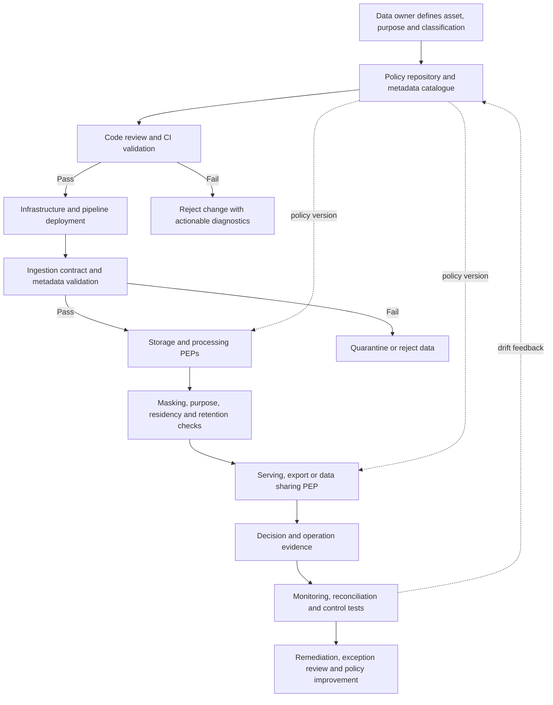
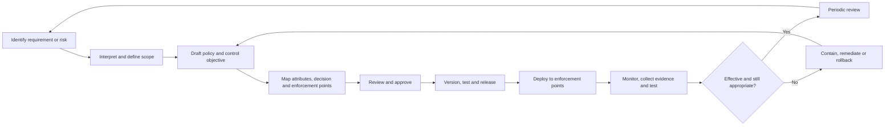
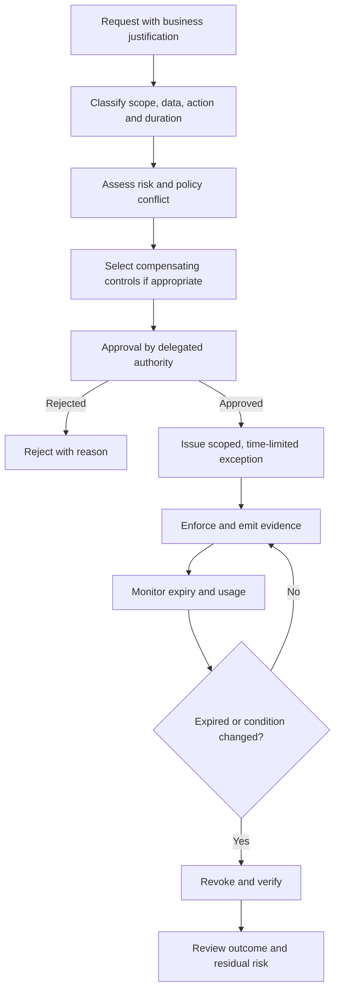

# Governance by Design and Policy Enforcement

> **Stage:** 2D — Data Architecture  
> **Module:** 10 — Data Governance, Security, Privacy and Compliance  
> **Topic:** 09 of 09  
> **Recommended effort:** 7–9 hours (illustrative planning estimate)  
> **Prerequisites:** Topics 01–08; prerequisite P7 (self-service and guardrails) and P8 (infrastructure as code and policy as code)  
> **Primary outputs:** Governance-by-design workflow, policy examples, coverage/bypass analysis, exception workflow, fail-mode decisions, governance metrics, and an architecture decision record (ADR)
> **Validation boundary:** Examples are synthetic. Code snippets are educational; no production platform, live policy service, penetration test, or external regulatory review is implied.

> **Scope and legal caution:** This lesson teaches architecture and control-design skills, not legal advice. Applicable obligations depend on jurisdiction, sector, data type, contracts, and organizational context. Qualified legal, privacy, security, records-management, and compliance specialists must interpret actual obligations. Northbridge Bank, data, identifiers, policy values, and scenarios are fictional and synthetic. Nothing here establishes that a real organization or design is compliant.

## 1. Purpose: make the safe path the easy path

Governance by design integrates governance rules into data architecture, metadata, pipelines, infrastructure provisioning, access paths, and operational workflows. Rather than relying only on a final manual review, it makes clearly prohibited actions difficult or impossible and detects suspicious or ungoverned behavior early.

A policy document states what should happen. A machine-readable policy can express a rule in a form a system can evaluate. A policy decision point (PDP) evaluates relevant attributes and returns a decision. A policy enforcement point (PEP) applies that decision at a real access or processing boundary. Monitoring and evidence show how controls behaved. These are distinct components: writing a policy file does not itself protect data.

The module roadmap's core principle is that following policy should be the easy path, violations should be prevented or detected automatically where appropriate, and not every governance decision can or should be automated.

### 1.1 Learning objectives

By completing this topic, you should be able to:

1. Distinguish a documented policy from an enforced policy.
2. Design classification-driven protection and identify policy enforcement points.
3. Embed governance checkpoints in data workflows and CI/CD.
4. Integrate metadata, contracts, and lineage with enforcement.
5. Design approval, exception, and emergency workflows.
6. Define continuous validation, drift detection, evidence, and governance metrics.
7. Decide which decisions can be automated and which require human judgment.
8. Explain centralized versus distributed enforcement, failure modes, and operational trade-offs.

### 1.2 Beginner → intermediate → advanced progression

| Level | Focus | Evidence of mastery |
|---|---|---|
| Beginner | Vocabulary, policy lifecycle, documented vs enforced rules | Diagram the policy repository, pipeline checkpoint, and platform enforcement point |
| Intermediate | Checkpoints across the data lifecycle; metadata-driven protection; approvals; monitoring | Design a data-product publication workflow and map every policy to a decision, enforcement point, and evidence |
| Advanced | Central/distributed architecture, fail modes, scale, bypass, policy tests, human/automated boundary | Produce an ADR, coverage analysis, test suite, exception workflow, and metrics |

## 2. Core terminology: from intent to enforcement

| Term | Meaning | Example | What it does not prove |
|---|---|---|---|
| Governance principle | High-level direction guiding decisions | Restricted data should receive stronger protection | That any system enforces it |
| Requirement / obligation | Stated need or constraint whose source must be identified | An approved internal requirement says Restricted columns must not be exposed to unapproved roles | That a particular legal obligation applies; specialists must confirm real obligations |
| Policy | Approved statement of what is permitted, required, or prohibited | Restricted columns are masked by default for ordinary analytics roles | That a control exists or operated |
| Standard | Mandatory technical or operational specification supporting a policy | Approved encryption and identity configurations | That every deployed resource follows it |
| Procedure / runbook | Steps people or systems follow to operate a control | How to review an exception or respond to policy-engine outage | That the procedure was followed |
| Control objective | Outcome the control must achieve | Prevent unauthorized access to Restricted fields | A particular implementation |
| Enforceable rule | Precise condition and outcome a system can evaluate | Deny export when destination region is not approved | That the check is located on every path |
| Policy information | Attributes needed to decide | Subject role, data classification, purpose, destination region, hold status | That the attributes are correct or current |
| Policy decision point (PDP) | Component that evaluates rules and returns a decision | `ALLOW`, `DENY`, or `INDETERMINATE` | That the decision was enforced |
| Policy enforcement point (PEP) | Component at the access/processing boundary that applies a decision | Query gateway denies a read | That another path cannot bypass it |
| Policy administration point (PAP) | Place/workflow where policies are authored, reviewed, approved, versioned, and published | Reviewed policy repository and release workflow | That deployed versions match approved versions |
| Policy information point (PIP) | Source of attributes used by policy evaluation | Identity provider, catalogue, purpose register, hold registry | That source metadata is accurate or fresh |
| Control operation | Actual execution of the control over time | Policy evaluation on every export request | That it was effective unless results are tested |
| Monitoring / detection | Observation of behavior and identification of violations, drift, or control failure | Alert when a storage resource loses required encryption | That the violation was prevented |
| Remediation | Restore an acceptable state and address the cause | Remove public access, investigate exposure, retest | That the initial failure never happened |
| Evidence | Traceable record of policy, decision, action, review, and result | Decision ID, policy version, attributes, timestamp, outcome | Automatic legal compliance or complete path coverage |
| Exception | Time-limited, approved deviation with rationale and controls | Temporary read access to a masked dataset for an incident | Permanent exemption or risk-free access |
| Governance by design | Governance built into architecture and delivery, with human judgment retained where needed | CI rejects an unclassified table; access gateway checks purpose | That every risk can be eliminated by automation |

### 2.1 Keep the layers separate

A useful traceability chain is:

**Source requirement → approved policy → control objective → machine-readable rule/procedure → PDP decision → PEP enforcement → operational evidence → monitoring/test → remediation or acceptance.**

A break in any link creates a gap. A rule may be correct but not deployed; a decision may say `DENY` but the application may ignore it; an audit log may omit the policy version; or a catalogue may say `Internal` when a field is actually Restricted.

### 2.2 Why a final manual gate is insufficient

A final approval gate can identify architectural problems, but it is weak as the only control when teams deploy frequently, data products change continuously, and copies are created automatically.

- **Governance as a final gate:** problems are found late; reviewers repeat checks; changes after approval may escape review; teams may treat governance as a queue.
- **Governance by design:** checks occur when metadata are authored, code is built, infrastructure is provisioned, data are ingested, access is requested, and resources drift.
- **Human review remains necessary:** ambiguous classification, novel purpose, high-risk access, legal interpretation, ethical concerns, and exceptions often need accountable human judgment.

The goal is not “automate everything.” Automate repeatable, well-defined checks and route ambiguity to the correct decision owner.

## 3. Connect Topics 01–08 into one governance architecture

| Previous topic | Policy attributes or decisions it contributes | Typical enforcement/control point | Evidence example |
|---|---|---|---|
| 01 — Governance operating model and accountability | Asset owner, policy owner, approver, steward, escalation route | Metadata registration and approval workflow | Owner assignment, approval record |
| 02 — Classification, sensitivity and criticality | Classification label, criticality, handling requirements | Contract validation, ingestion, storage, serving | Classification snapshot, rejected unlabelled field |
| 03 — Identity, access and least privilege | Subject identity, role/attributes, resource, action, context | Query/API gateway, storage IAM, service boundary | Access decision and effective grant |
| 04 — Encryption, keys and secrets | Encryption requirement, key boundary, secret handling | Infrastructure provisioning and configuration scans | Encryption configuration and key-policy result |
| 05 — PII masking, tokenization and de-identification | Field sensitivity, approved transformation, raw-data entitlement | Query projection, export, test-data creation, ML feature generation | Transformation version and output validation |
| 06 — Consent, purpose and residency | Declared purpose, consent state where applicable, processing/storage region | Job submission, query/export, replication and sharing | Purpose decision, region check, consent version |
| 07 — Retention, deletion, legal holds and auditability | Retention policy ID, expiry, hold state, deletion status | Pipeline, scheduled lifecycle job, restore/replay workflow | Retention evaluation, hold-aware disposition result |
| 08 — Regulatory controls and evidence design | Control ID, test plan, evidence source, review and exception state | CI/CD, runtime logs, scheduled control tests | Versioned evidence record, test result, remediation record |

### 3.1 Integrated data-flow example

Northbridge Bank publishes a synthetic `customer_analytics` data product. Risk analysts may need some sensitive features for an approved risk purpose; Marketing receives a masked or aggregated view only when purpose/consent rules permit it. The architecture must also ensure approved residency, encryption, retention, deletion, legal-hold behavior, and evidence.



This is a conceptual reference architecture, not a vendor prescription. Each PEP must be placed at a boundary that ordinary consumers cannot bypass.

## 4. Policy lifecycle and ownership

A policy is a maintained product, not a one-time document.



### 4.1 Lifecycle stages

1. **Identify:** capture a requirement, risk, incident, architecture decision, or business need and record its source.
2. **Interpret:** clarify applicability, data scope, affected purposes, and uncertainty. Legal or contractual interpretations go to qualified specialists.
3. **Define:** write a policy statement and measurable control objective.
4. **Model:** identify attributes, allowed/denied outcomes, precedence, missing-data behavior, enforcement points, and evidence.
5. **Approve:** obtain approval from the policy owner and relevant decision authorities.
6. **Implement:** encode rules and configure controls; maintain a link to the approved policy version.
7. **Test:** use unit, integration, negative, regression, and operational tests.
8. **Release:** promote through review and staged deployment with rollback options.
9. **Operate:** evaluate requests and pipeline actions; emit evidence and metrics.
10. **Monitor and review:** detect drift, bypass, exceptions, false positives, stale metadata, and changed requirements.
11. **Retire or supersede:** disable obsolete versions only after dependent enforcement points are migrated and evidence needs are considered.

### 4.2 Responsibilities

| Role | Accountable contribution | Separation to preserve |
|---|---|---|
| Policy owner | Defines policy intent and approves changes | Should not be assumed to operate every technical control |
| Data owner | Accountable for asset use and access decisions | Does not automatically own legal interpretation |
| Data steward / metadata owner | Maintains definitions and classification metadata | Must not silently change sensitive tags to bypass controls |
| Security/privacy/legal/compliance specialist | Interprets relevant obligations and risk, advises on policy | Advice does not replace implementation or operation |
| Platform/pipeline engineer | Implements and operates PEPs and policy integration | Should not self-approve high-risk exceptions merely because they can deploy them |
| Policy platform owner | Operates policy repository, distribution, PDP/PIP/PAP services | Must monitor the policy infrastructure itself |
| Control operator | Runs or maintains the control | Evidence should identify operator or workload |
| Reviewer/control tester | Reviews design and tests operation | Independent testing should be separated from implementation where practical |
| Risk authority / governance council | Accepts residual risk within delegated authority | Acceptance must be explicit, scoped, and time-limited where appropriate |

A person may hold several roles in a small team, but the role and conflict must be documented. Independence matters especially for high-impact controls and exceptions.

## 5. Policy architecture: decision, enforcement, information, administration

### 5.1 Core components

- **PAP — Policy Administration Point:** authoring, review, approval, versioning, testing, and publication of policy.
- **PDP — Policy Decision Point:** evaluates a request against active policy and supplied attributes.
- **PEP — Policy Enforcement Point:** blocks, allows, masks, filters, quarantines, or otherwise enforces a PDP result at the real boundary.
- **PIP — Policy Information Point:** supplies attributes such as identity, classification, purpose, residency, consent state, retention status, and hold state.
- **Evidence/monitoring plane:** records decisions and operation outcomes, detects missing evidence and drift, and supports testing and remediation.

The conceptual roles can be combined in a small system, but keeping responsibilities clear helps identify failure modes and test coverage.

### 5.2 Decision contract

Use an explicit decision contract rather than treating every unexpected response as allow:

- `ALLOW`: all required attributes are available and the request satisfies policy.
- `DENY`: policy explicitly prohibits the action.
- `INDETERMINATE`: policy cannot safely decide because an attribute is missing, stale, conflicting, or a required dependency is unavailable.
- `ERROR`: the evaluation infrastructure failed or returned an invalid result.

The PEP maps `INDETERMINATE` and `ERROR` to pre-decided behavior based on data class and action. It must never silently interpret them as `ALLOW`.

### 5.3 Policy information quality

For each attribute, define its authoritative source and owner, required format and allowed values, freshness/maximum age, revocation propagation expectation, missing/conflicting behavior, provenance/version, and whether the requester can supply it. Do not trust caller-supplied `classification="Public"` when the authoritative catalogue says `Restricted`. Bind decisions to trusted metadata and identity claims; reject contradictory state.

## 6. Metadata-driven governance

Metadata turns governance decisions into inputs that pipelines and platform controls can evaluate.

### 6.1 Recommended metadata attributes

| Attribute | Example | Purpose | Validation |
|---|---|---|---|
| `asset_id` | `dp.customer_analytics` | Stable identity for an asset | Required, unique, versioned |
| `owner_id` | `role.retail-data-owner` | Accountability | Must resolve to an active role |
| `classification` | `Restricted` | Handling requirements | Enum from approved scheme |
| `criticality` | `High` | Availability/impact treatment | Separate from sensitivity |
| `permitted_purposes` | `["fraud_detection"]` | Purpose boundary | Approved purpose registry IDs |
| `residency_policy_id` | `RES-REGION-A` | Location constraint | Must resolve to current policy |
| `retention_policy_id` | `RET-FEATURE-ILLUSTRATIVE` | Lifecycle policy reference | Approved ID; no invented legal period |
| `hold_state` | `NONE` / `ACTIVE` / `UNKNOWN` | Preservation guard | Trusted hold registry only |
| `masking_profile` | `mask.customer_id.v2` | Field protection | Versioned, tested profile |
| `encryption_profile` | `encrypt.restricted.v1` | Required protection | Approved configuration |
| `policy_version` | `gov-policy-2026.10.1` | Reproducibility | Exact deployed version |
| `lineage_id` | `lineage-4f92` | Trace transformations/copies | Link to catalogue/lineage record |

These are synthetic identifiers for teaching. A real schema should match the organization's approved metadata model.

### 6.2 Classification propagation

- Direct copies inherit the source field's classification unless an approved transformation changes the handling requirement.
- Joins inherit the strongest applicable classification when combinations increase sensitivity.
- Aggregates may have a different classification only after a documented assessment and approval; aggregation is not automatic anonymization.
- Derived fields, features, embeddings, and model datasets carry source lineage and relevant use restrictions until an approved assessment says otherwise.
- Unknown or conflicting classification is explicit; it is not equivalent to Public.

Propagation should be deterministic enough for automation while allowing review for context-dependent transformations.

### 6.3 Contract and metadata validation

A data contract should declare owner, schema, classification, permitted-use/purpose metadata, retention policy reference, residency requirements, quality expectations, and lineage/output ownership as applicable. Validate it at code review, CI, ingestion, and runtime boundaries.

**Failure behavior:** if required classification or owner is absent, do not default to Public or unrestricted purpose. Reject or quarantine the asset, emit a diagnostic, and route the gap to its owner.

## 7. Policy as code: example and limits

Policy as code expresses deterministic, testable rules in a version-controlled format. The example uses JSON for a small policy object and Python for a simplified evaluator. It is an educational reference, not a complete security product. It omits production identity verification, distribution, cache invalidation, concurrency, signed metadata, full audit transport, and integration with actual storage permissions. Production controls must enforce decisions at every relevant access path.

### 7.1 Machine-readable policy object

The following JSON is a synthetic, illustrative policy contract. Save it as `policy.json` if you want to run the Python example below. It is not an approved organizational policy and does not itself enforce access.

```json
{
  "policy_id": "NB-GOV-ACCESS-004",
  "version": "1.2.0",
  "description": "Illustrative access rule for Northbridge synthetic customer analytics",
  "resource": "dp.customer_analytics",
  "required_attributes": [
    "subject_role",
    "action",
    "resource",
    "classification",
    "purpose",
    "source_region",
    "metadata_fresh"
  ],
  "rules": {
    "deny_if_metadata_stale": true,
    "deny_if_classification_unknown": true,
    "restricted_allowed_roles": ["risk_analyst", "pii_reader"],
    "restricted_allowed_purposes": ["fraud_detection"],
    "allowed_regions": ["region-a"],
    "export_requires_same_region": true
  },
  "default_decision": "DENY",
  "owner": "role.data-governance-policy-owner",
  "approval_status": "ILLUSTRATIVE_NOT_APPROVED"
}
```

### 7.2 Attribute contract and evaluation semantics

| Attribute | Trusted source | Required when | Missing, stale, or conflicting behavior |
|---|---|---|---|
| `subject_role` | Authenticated identity and entitlement service | Every protected request | `INDETERMINATE`; PEP must not trust caller-supplied role claims without validation |
| `action` | PEP request context | Every request | Invalid action is `DENY`; absent action is `INDETERMINATE` |
| `resource` | PEP-resolved resource identifier | Every request | Missing is `INDETERMINATE`; a different resource is `DENY` for this policy |
| `classification` | Authoritative catalogue/contract registry | Every protected request | Unknown or missing is `INDETERMINATE`; never default to Public |
| `purpose` | Approved purpose registry bound to request/job | Every use requiring purpose evaluation | Missing/unregistered purpose is `INDETERMINATE`; incompatible purpose is `DENY` or routed for authorized human review |
| `source_region` | Trusted resource/runtime metadata | Every protected request in this example | Missing or untrusted is `INDETERMINATE`; a region outside policy is `DENY` |
| `destination_region` | Trusted export/job configuration | Export only | Missing/untrusted is `INDETERMINATE`; destination outside policy is `DENY` |
| `metadata_fresh` | Freshness and version check over authoritative metadata | Every protected request | Anything other than boolean `true` is `INDETERMINATE` when the policy requires freshness |

The evaluator below reads the JSON policy rather than re-encoding the policy's role, purpose, resource, and region values as unrelated hard-coded rules. `INDETERMINATE` is a decision result, not an allow. A PEP must map it to a documented fail mode for the specific action and data class. This sample uses fail-closed behavior for protected access and export.

### 7.3 Illustrative Python policy evaluator and enforcement test

Save the JSON above as `policy.json`, then save and run the following as a Python 3.9+ example. It is deliberately small and is not a production PDP or PEP. The test `enforce_at_pep` is a simulated boundary to demonstrate that a deny decision must be applied, not merely returned by a PDP.

```python
import json
from pathlib import Path
from typing import Any

with Path("policy.json").open(encoding="utf-8") as policy_file:
    POLICY: dict[str, Any] = json.load(policy_file)

ALLOWED_ACTIONS = {"read", "export", "train", "transform"}
VALID_CLASSIFICATIONS = {"Public", "Internal", "Confidential", "Restricted"}


def evaluate_policy(request: dict[str, Any], policy: dict[str, Any] = POLICY) -> str:
    """Return ALLOW, DENY, or INDETERMINATE; never performs enforcement."""
    common_required = set(policy["required_attributes"])
    if not common_required.issubset(request):
        return "INDETERMINATE"

    action = request["action"]
    if action not in ALLOWED_ACTIONS:
        return "DENY"
    if request["resource"] != policy["resource"]:
        return "DENY"

    rules = policy["rules"]
    if rules.get("deny_if_metadata_stale", True) and request["metadata_fresh"] is not True:
        return "INDETERMINATE"
    classification = request["classification"]
    if classification not in VALID_CLASSIFICATIONS:
        return "INDETERMINATE" if rules.get("deny_if_classification_unknown", True) else policy["default_decision"]

    allowed_regions = set(rules["allowed_regions"])
    if request["source_region"] not in allowed_regions:
        return "DENY"

    if action == "export":
        destination = request.get("destination_region")
        if not destination:
            return "INDETERMINATE"
        if destination not in allowed_regions:
            return "DENY"
        if rules.get("export_requires_same_region", False) and destination != request["source_region"]:
            return "DENY"

    if classification == "Restricted":
        if request["subject_role"] not in set(rules["restricted_allowed_roles"]):
            return "DENY"
        if request["purpose"] not in set(rules["restricted_allowed_purposes"]):
            return "DENY"

    return "ALLOW"


def enforce_at_pep(request: dict[str, Any], policy: dict[str, Any] = POLICY) -> str:
    """Simulate a fail-closed PEP; real PEPs must guard the actual operation."""
    decision = evaluate_policy(request, policy)
    if decision == "ALLOW":
        return "APPLIED"
    # DENY and INDETERMINATE both block this protected operation in this example.
    return "BLOCKED"


# Synthetic tests: not production credentials or proof of real-path coverage.
base = {
    "subject_role": "risk_analyst",
    "action": "read",
    "resource": "dp.customer_analytics",
    "classification": "Restricted",
    "purpose": "fraud_detection",
    "source_region": "region-a",
    "metadata_fresh": True,
}
assert evaluate_policy(base) == "ALLOW"
assert enforce_at_pep(base) == "APPLIED"

wrong_role = {**base, "subject_role": "marketing_analyst", "purpose": "marketing"}
assert evaluate_policy(wrong_role) == "DENY"
assert enforce_at_pep(wrong_role) == "BLOCKED"

cross_region_export = {**base, "action": "export", "destination_region": "region-b"}
assert evaluate_policy(cross_region_export) == "DENY"
assert enforce_at_pep(cross_region_export) == "BLOCKED"

stale_metadata = {**base, "metadata_fresh": False}
assert evaluate_policy(stale_metadata) == "INDETERMINATE"
assert enforce_at_pep(stale_metadata) == "BLOCKED"

missing_classification = {k: v for k, v in base.items() if k != "classification"}
assert evaluate_policy(missing_classification) == "INDETERMINATE"
assert enforce_at_pep(missing_classification) == "BLOCKED"

wrong_resource = {**base, "resource": "dp.other_dataset"}
assert evaluate_policy(wrong_resource) == "DENY"
assert enforce_at_pep(wrong_resource) == "BLOCKED"
```

**Expected behavior:** the approved synthetic Risk read returns `ALLOW` and the simulated PEP applies it; wrong-role/purpose, cross-region export, and wrong-resource requests return `DENY` and are blocked; stale or missing metadata returns `INDETERMINATE` and is blocked under this example's fail-closed mapping. The destination region is required for exports, not ordinary reads. These tests exercise the sample function and simulated PEP only; they do not establish real identity authenticity, storage isolation, bypass resistance, or production enforcement.

**Production limitations to address:**

- Authenticate subjects and derive entitlements from trusted identity sources.
- Bind the PEP to the actual operation and ensure the operation cannot proceed after a block or timeout.
- Verify metadata provenance, integrity, freshness, revocation behavior, and policy version distribution.
- Define precedence and conflict handling when multiple policies apply.
- Handle policy-service timeouts, invalid responses, and partial rollout explicitly.
- Avoid logging raw PII, credentials, secrets, or unnecessary sensitive attributes.
- Add decision ID, policy version, trace/correlation ID, metadata versions, and evidence transport.
- Test concurrency, cache invalidation, rollback, and direct-storage/export bypass.
- Enforce underlying permissions independently where appropriate (defense in depth).
- Add JSON-schema validation and unit tests to ensure the policy file's schema and referenced attributes remain compatible with the evaluator.

## 8. Illustrative policy evaluations across governance domains

These are synthetic examples. Final decisions must be based on approved policy and authoritative attributes.

| Request | Inputs | Decision example | Why | Enforcement and evidence |
|---|---|---|---|---|
| Access Restricted field | `marketing_analyst`, `read`, `Restricted` | `DENY` or approved masked view | Role is not entitled to raw Restricted value | Query PEP applies denial/masking; log policy version and result |
| Ingest unclassified column | Contract omits classification | Reject or quarantine | Unknown classification must not default to Public | Contract validator emits failed rule and asset/run ID |
| Encrypt new storage | IaC proposes Restricted store without required encryption profile | CI/provisioning `DENY` | Prevent insecure resource creation | Policy test output, plan/resource ID, remediation link |
| Use data for new purpose | Registered purpose is `fraud_detection`; request declares `marketing` | `DENY` or `INDETERMINATE` pending review | Purpose compatibility is not inferred from technical access | Purpose-decision record, approval reference if changed |
| Export across region | Source `region-a`, destination `region-b`, policy allows only `region-a` | `DENY` | Destination violates the configured illustrative rule | Export PEP logs source/destination, policy version, result |
| Delete record under active hold | Retention expiry reached, hold registry says `ACTIVE` | Block disposition for held scope | Hold must be respected; normal expiry does not silently override it | Hold decision ID, skipped scope, review/escalation |
| Expired retention rule, no hold | Approved trigger reached and no conflicting rule | Execute approved disposition | Eligible under current policy, subject to per-copy handling | Job ID, policy version, per-system outcomes, reconciliation |
| Missing hold service | Deletion request cannot resolve authoritative hold status | `INDETERMINATE`; pause affected destructive action | Unknown hold state is not proof of no hold | Dependency alert, queued request, owner and SLA |

Access, purpose compatibility, and legal interpretation are not the same decision. A technical policy may enforce an approved purpose registry; it should not invent the legal basis for a new use.

## 9. Enforcement checkpoints across the data lifecycle

| Stage | Preventive enforcement | Detective control | Typical evidence | Failure path |
|---|---|---|---|---|
| Design / code review | Require owner, classification, purpose and retention references in schema/contract | Scan repository for missing fields | Commit, review, policy test result | Block merge; actionable error |
| CI/CD | Fail if policy tests or metadata checks fail | Track repeated failures and overrides | Build ID, commit, policy version, test report | Stop release or require authorized exception |
| Infrastructure provisioning (IaC) | Deny public storage where prohibited; require encryption/tags/identity | Scheduled configuration drift scans | Plan result, resource ID, scan findings | Block apply or contain resource; remediate |
| Ingestion | Validate contract and metadata; reject/quarantine unclassified fields | Monitor rejected events and classification drift | Batch/run ID, contract version, rejected count | Quarantine; do not silently relabel |
| Storage | Enforce identity, encryption, tenant boundary, and allowed region | Scan configuration and effective permissions | Resource configuration, IAM evaluation, scan result | Contain resource and remediate |
| Transformation | Apply masking, minimization, purpose constraints, and tag propagation | Compare input/output metadata and lineage | Job ID, transformation version, output classification | Stop job or isolate output |
| Serving/query | Evaluate identity, action, purpose, classification, consent state if applicable | Detect denied bursts, unusual access, and bypass paths | Request ID, decision, policy version | Deny, alert, investigate |
| Export/sharing | Validate destination, purpose, classification, minimization, approval | Reconcile exports and recipient acknowledgements | Export ID, destination, approval, result | Block transfer or quarantine staging |
| Retention/deletion | Apply approved schedules and hold-aware guards | Reconcile target copies, failures, and stale assets | Policy ID, hold check, per-system outcomes | Pause affected scope; retry/escalate |
| Restore/replay | Reapply deletion, hold, purpose and residency rules before restored data are served | Scan restored state against current policy and suppression records | Restore ID, replay run, reconciliation | Keep restored environment isolated until checks pass |
| AI/ML and retrieval | Validate dataset provenance, permitted purpose, classification, access filters and approvals | Scan dataset/model lineage and retrieval access logs | Dataset manifest, model version, retrieval decision | Block training/release or restrict retrieval pending review |
| Monitoring / operations | Quarantine clearly unsafe states where safe | Detect drift, missing evidence, policy outages, stale metadata | Alert, incident, control test, remediation ticket | Contain, investigate, recover, retest |

### 9.1 Workflow: reject an invalid data product

1. Developer submits a data-product contract and infrastructure change.
2. CI validates required metadata, schema compatibility, policy references, test results, and IaC configuration.
3. The pipeline evaluates deterministic rules against declared classification and intended purpose.
4. If a required check fails, the build is blocked with a stable rule ID, affected file/asset, explanation, and remediation instruction.
5. The developer corrects the source and resubmits; an exception cannot be smuggled in as a metadata edit.
6. After approval, the pipeline deploys to a non-production stage and runs integration/negative tests.
7. Deployment publishes the policy version and resource IDs to the evidence store.
8. Runtime PEPs continue to enforce access and use rules; passing CI is not a substitute for runtime enforcement.
9. Monitoring checks deployed configuration for drift and detects bypass paths.

### 9.2 Workflow: reject an unauthorized runtime request

1. The PEP authenticates the request and binds subject, action, resource, and declared purpose to trusted context.
2. The PIP retrieves authoritative classification, ownership, purpose, region, and other relevant attributes.
3. The PDP evaluates the request against a known policy version.
4. The PEP applies `ALLOW`, `DENY`, or the configured handling for `INDETERMINATE`/`ERROR`.
5. The system emits a minimized evidence record with decision ID, policy version, source metadata versions, timestamp, and result.
6. Denials and suspicious patterns are monitored; an ordinary denial is not automatically an incident, but repeated attempts or bypass evidence may require investigation.
7. If a dependency fails, the request follows documented fail behavior; it must not silently default to allow.

## 10. Fail-closed, fail-open, and dependency failure

- **Fail-closed:** if a required policy decision cannot be obtained, deny or pause the operation. This reduces exposure but can impair availability.
- **Fail-open:** permit an operation despite policy-evaluation failure. This improves availability but can bypass governance controls.
- **Bounded fallback:** use a previously approved, signed/cached policy or narrowly scoped capability for a defined period only if freshness and revocation risks are understood and tested. This is not automatically safe.

### 10.1 Decision matrix

| Operation / data class | Illustrative default on unknown policy state | Reason | Required operational response |
|---|---|---|---|
| Read Restricted fields | Fail closed | Potential sensitive disclosure | Deny, alert on dependency health, retry safely |
| Export or cross-region transfer | Fail closed | Hard-to-reverse disclosure or movement | Block transfer; preserve request for retry |
| Create storage for Restricted data | Fail closed | Prevent unsafe resource provisioning | Block IaC apply; fix configuration |
| Ingest data with unknown classification | Quarantine/reject | Avoid treating unknown as low sensitivity | Route to owner; preserve source safely |
| Delete candidate with unknown hold status | Pause destructive action for affected scope | Avoid deleting data that may be subject to a hold | Resolve authoritative hold state; alert |
| Read Public/low-risk reference data | Potential bounded cached decision only if explicitly approved | Availability may matter for some low-risk actions | Enforce cache age, scope, expiry, and monitoring |
| Policy engine health endpoint | Fail safely without recursive policy dependency | Control-plane observability must remain available | Independent health checks and alert path |

These are design examples, not universal mandates. Select fail behavior by data classification, action reversibility, exposure impact, availability requirements, and the authority approving residual risk. Document the decision in an ADR.

### 10.2 Policy infrastructure resilience

- Deploy the decision service with appropriate redundancy and controlled upgrades.
- Monitor latency, error rate, unavailable dependencies, stale caches, and policy distribution lag.
- Version policies and publish atomically where possible; detect mixed versions across enforcement points.
- A newly started PEP should not serve sensitive requests before loading a valid policy.
- Test identity, catalogue, consent/purpose, residency, and hold-registry outages separately.
- Maintain emergency procedures with narrow scope, named approvers, time limits, audit evidence, and post-event review.
- Ensure the emergency access path does not bypass logging, and ensure monitoring does not depend entirely on the failed service.

## 11. Exceptions, emergency access, and risk acceptance

Exceptions exist because real systems encounter unusual cases. They should not become a permanent parallel path.

### 11.1 Exception workflow



### 11.2 Required exception fields

- Exception ID and linked policy/rule IDs.
- Requester and accountable business owner.
- Data assets, fields, actions, users/service identities, and environments in scope.
- Justification, business need, risk assessment, and alternatives considered.
- Approval authority and timestamp.
- Compensating controls (for example, masking, time-limited grants, additional monitoring, isolated environment).
- Start time, expiry time, review cadence, and automatic revocation behavior.
- Usage limits, evidence emitted, alert thresholds, and incident escalation.
- Residual risk and explicit risk acceptance, if authorized.
- Closure, revocation verification, and post-event review.

An exception must not override obligations or preservation constraints that the approving person has no authority to change. If a request depends on legal interpretation, route it to qualified specialists first.

### 11.3 Emergency / break-glass

1. Define emergency conditions and eligible roles.
2. Require a reason and case/incident ID.
3. Grant minimum permission for the shortest defined period.
4. Alert an independent monitoring channel.
5. Log access and actions without unnecessarily duplicating sensitive payloads.
6. Revoke automatically or at the declared expiry; verify revocation.
7. Require prompt post-event review by an independent reviewer.
8. Record the outcome and update policy if a recurring gap was exposed.

If an emergency prevents normal pre-approval, the fallback authority and retrospective review requirements must be defined in advance. Do not invent an emergency exception during an incident without an authorized procedure.

## 12. Policy testing, release, and drift detection

Policy code is production code. A correct-looking rule can still fail because of wrong attributes, precedence, caching, bypasses, or integration behavior.

### 12.1 Test layers

Policy tests must validate both the decision contract (PDP) and the actual operation outcome at each PEP. A unit test that observes `DENY` is insufficient if the request can still reach storage, export, or a downstream consumer. The examples in this lesson are synthetic; mark any test as executed only when its command, version, environment, and result are recorded.

| Test type | Question | Example |
|---|---|---|
| Static/schema validation | Is policy well-formed and does it use approved attributes? | Reject unknown classification enum |
| Unit test | Does the rule return the expected result for controlled input? | Marketing cannot read Restricted raw fields |
| Negative test | Are prohibited actions rejected? | Export to unapproved region returns `DENY` |
| Boundary test | What happens with missing, stale, conflicting, or expired metadata? | Missing hold status returns `INDETERMINATE` and blocks deletion |
| Integration test | Does the PEP actually enforce the PDP decision? | Denied query returns no Restricted values |
| Bypass test | Can another path avoid enforcement? | Direct object-store access is denied for ordinary analyst identity |
| Regression test | Did a policy change break prior expected behavior? | Re-run known decision matrix |
| Performance test | Is evaluation latency acceptable at expected load? | Measure p50/p95/p99 with representative policy context |
| Resilience test | What happens if PDP or PIP is unavailable? | Restricted access fails closed and emits alert |
| Drift test | Does deployed state match approved policy? | Detect unapproved public access or missing encryption |
| Operating-effectiveness test | Did the control operate consistently over the test period? | Sample decisions and reconcile with access logs and deployed versions |

### 12.2 CI/CD example

Illustrative shell-style workflow; command names are placeholders, not claims about a particular tool.

```text
on pull_request:
    validate_policy_schema()
    validate_required_metadata()
    run_policy_unit_tests()
    run_negative_and_boundary_tests()
    run_iac_configuration_checks()
    compare_policy_coverage_to_asset_inventory()

    if any_required_check_fails:
        fail_build_with_rule_ids_and_remediation()
    else:
        require_policy_owner_review()
        approve_for_staging()

on staging_deploy:
    verify_policy_version_loaded()
    run_pep_integration_tests()
    run_bypass_tests()
    run_failure_mode_tests()
    publish_versioned_evidence()

on production_release:
    canary_policy_to_limited_scope()
    monitor_denials_errors_latency_and_false_positives()
    promote_or_rollback_by_approved_criteria()

on scheduled_scan:
    detect_configuration_drift()
    detect_unclassified_assets()
    detect_expired_exceptions()
    detect_missing_evidence()
    create_remediation_items()
```

A CI pass only shows that the tested build met the checks included in that pipeline at that time. It does not prove every runtime path is covered, metadata are correct, or the organization complies with every applicable obligation.

### 12.3 Example test cases

| Test ID | Input condition | Expected result | Purpose |
|---|---|---|---|
| T-01 | Restricted + approved Risk role + `fraud_detection` + approved region + fresh metadata | `ALLOW` for the specifically permitted action | Positive baseline |
| T-02 | Restricted + Marketing role | `DENY` for raw access | Negative access test |
| T-03 | Protected data + unapproved destination region | `DENY` | Residency/export test |
| T-04 | Required classification absent | `INDETERMINATE`/reject or quarantine | Safe metadata failure |
| T-05 | Consent/purpose attribute stale where policy requires current state | `INDETERMINATE` or deny | Staleness test |
| T-06 | Retention expiry reached but hold state is `ACTIVE` | No deletion of held scope; record preservation decision | Hold protection |
| T-07 | Hold registry unavailable during deletion evaluation | Pause affected destructive action | Dependency failure |
| T-08 | Policy version differs between CI-approved and PEP-loaded versions | Block sensitive operation or raise critical drift | Version integrity |
| T-09 | Direct storage path bypasses query gateway | Access denied or risk explicitly contained by another control | Bypass test |
| T-10 | Exception expires | Permission revoked and revocation verified | Exception lifecycle |
| T-11 | Policy update denies previously allowed action | Regression result reviewed and staged rollout monitored | Change impact |
| T-12 | PDP timeout | Operation follows documented class/action fail mode | Resilience test |

## 13. Evidence, monitoring, and remediation

### 13.1 Evidence emitted as a by-product

At each enforcement point, capture a compact, traceable record such as:

```json
{
  "event_id": "ev-syn-00421",
  "timestamp_utc": "2026-10-20T10:15:30Z",
  "decision_id": "dec-syn-881",
  "correlation_id": "req-syn-3901",
  "policy_id": "NB-GOV-ACCESS-004",
  "policy_version": "1.2.0",
  "enforcement_point": "customer-analytics-query-gateway",
  "subject_ref": "role:risk_analyst",
  "resource_ref": "dp.customer_analytics",
  "action": "read",
  "purpose": "fraud_detection",
  "metadata_version": "catalog-syn-44",
  "decision": "ALLOW",
  "enforcement_result": "APPLIED",
  "reason_code": "RULES_SATISFIED",
  "trace_ref": "trace-syn-990",
  "evidence_schema_version": "1"
}
```

This is synthetic evidence, not proof that any real control operated. A production schema should be minimized and access-controlled; avoid logging raw data values, credentials, secrets, or unnecessary personal data. Use stable pseudonymous references when appropriate and protect re-linking mechanisms.

### 13.2 Evidence quality requirements

- **Attribution:** identify authenticated subject or workload, PEP, and operator where relevant.
- **Time:** use a consistent timestamp standard; monitor clock skew and record event time separately from ingestion time where needed.
- **Integrity:** restrict write/delete privileges, detect alteration, and use tamper-evident or immutable mechanisms where justified.
- **Traceability:** link event to policy ID/version, resource ID, request/run ID, metadata version, and change/approval reference.
- **Completeness:** reconcile expected control events with emitted events; missing logs are a control-health signal.
- **Retention:** evidence has its own approved retention and access policy. Do not retain sensitive payloads indefinitely by default.
- **Retrievability:** a reviewer should locate evidence, understand fields, and reproduce a decision using recorded policy and relevant attribute versions where feasible.
- **Review:** distinguish automatically generated evidence from evidence independently reviewed or tested.

### 13.3 Monitoring signals and example response

| Signal | Example synthetic observation | Response |
|---|---|---|
| Missing classification | 4 newly registered fields have no approved label | Quarantine affected fields; notify owner; block publication |
| Denial spike | Denials rise 5× after policy version `1.2.0` | Investigate regression and legitimate-use impact; consider rollback under release criteria |
| Stale metadata | 2% of decisions used metadata beyond approved freshness | Deny or restrict affected operations; repair catalogue sync |
| Expired exception | Exception `EX-SYN-19` remains active after expiry | Revoke, verify, investigate missed expiry mechanism |
| Policy version drift | One PEP runs `1.1.0` while approved version is `1.2.0` | Contain or update per deployment policy; record incident/change |
| Missing evidence | Successful export has no decision record | Treat as a control gap; block future export if safe, reconstruct only from trustworthy sources, remediate |
| Bypass path | Analyst identity can read raw storage directly | Remove unintended access, assess exposure, test alternate paths |
| Excessive manual exceptions | 40% of products use exceptions for a basic metadata check | Improve templates and developer experience; review root cause |

### 13.4 Remediation workflow

1. **Detect and classify:** assign severity based on data sensitivity, action, exposure, duration, and reversibility.
2. **Contain:** block or restrict affected paths where safe; avoid destructive changes that may worsen an incident.
3. **Preserve evidence:** retain relevant policy versions, logs, resource state, and decision records under approved procedures.
4. **Determine scope:** identify affected assets, consumers, copies, identities, policy versions, and time window using lineage and logs.
5. **Fix the cause:** correct policy, metadata, identity, PEP placement, deployment drift, or workflow usability.
6. **Verify:** run negative, integration, bypass, and regression tests appropriate to the issue.
7. **Review residual risk:** accountable authority approves remaining risk within delegated authority.
8. **Close with evidence:** record remediation, tester, test result, closure approval, and preventive action.
9. **Improve:** update policy tests, onboarding templates, monitoring, and training to reduce recurrence.

## 14. Centralized versus distributed enforcement

| Architecture | Advantages | Trade-offs and risks | Use when |
|---|---|---|---|
| Central policy definition, distributed PEPs | Consistent policy intent; central review; local enforcement near data; shared evidence schema | Distribution lag, policy-service availability, version mismatch, adapter complexity | Many platforms need consistent baseline rules |
| Central PDP for every request | Central visibility and quick policy updates | Network latency, bottleneck, availability dependency, context aggregation | Latency and availability requirements are acceptable or service is highly resilient |
| Local cached PDP/compiled policy | Low latency and resilience during brief outages | Stale policy, delayed revocation, cache/version risks | Cache freshness and revocation bounds are explicitly acceptable |
| Native policy per platform | Uses platform capabilities and enforces close to resource | Inconsistent semantics, duplicated policy, harder cross-platform evidence | Platform semantics differ or native controls are stronger |
| Hybrid: common baseline + platform-specific PEP | Balance of consistency and native enforcement | Requires conformance tests and ownership across layers | Enterprise with heterogeneous data platforms |

Avoid a false choice between one central engine and each team doing its own thing. A common policy model, approved baseline, shared tests, and evidence schema can coexist with platform-specific enforcement adapters.

### 14.1 Performance and scale

Design explicitly for local caching only with a defined maximum age and revocation target; batching for large jobs while preserving required semantics; consistency between policy changes and PEPs; load tests with representative rates and complexity; p50/p95/p99 latency, error rate, indeterminate rate, cache hit rate, and distribution lag; capacity for evidence storage; and control-plane/data-plane separation where it improves resilience without bypassing decisions.

## 15. Coverage and bypass analysis

A policy is effective only for paths that enforce it. Inventory:

- Governed SQL/query and API gateways.
- Direct object/database access and administrative roles.
- Notebooks, ad hoc scripts, local files, temporary staging, and exports.
- Scheduled jobs, orchestration identities, service-to-service access, and CI/CD credentials.
- Event brokers, CDC/replay paths, dead-letter queues, caches, replicas, and materialized views.
- Data-sharing interfaces and third-party processors.
- Feature stores, training pipelines, model registries, embedding/vector stores, and retrieval systems.
- Backup/restore, disaster recovery, and break-glass operations.
- Catalogue, key-management, and policy-administration access.

### 15.1 Coverage table

| Path | Required policy | PEP/control | Test | Owner | Status / risk |
|---|---|---|---|---|---|
| Query gateway | Access + classification + purpose | Query PEP | Denied query returns no raw Restricted data | Data Platform | Covered / synthetic |
| Direct object storage | Identity + classification + residency | Storage IAM/guardrail | Direct read negative test | Cloud Platform | Open until tested |
| Export workflow | Purpose + residency + minimization | Export service | Unapproved region denied | Data Product | Covered / synthetic |
| Notebook workspace | Access + masking + export restrictions | Workspace and egress controls | Raw-data bypass test | Analytics Platform | Needs validation |
| Feature store | Classification + purpose + retention | Feature serving and offline-store controls | Expiry and access tests | ML Platform | Needs validation |
| Training pipeline | Dataset purpose + lineage + approvals | Job admission gate | Unapproved dataset rejected | ML Platform | Needs validation |
| Backup restore | Holds + deletion replay + residency | Restore orchestrator | Restore-and-reconcile drill | Resilience Owner | Needs validation |
| Emergency access | Break-glass + evidence + expiry | Identity and privileged access workflow | Expiry/revocation test | Security Operations | Needs validation |

Statuses describe the teaching scenario only, not a real assessment. For each path, state whether it is tested, untested, intentionally out of scope with approved risk, or blocked pending remediation. Do not label a path “covered” based solely on a diagram.

## 16. Governance metrics and feedback

| Metric | Definition | Interpretation caution |
|---|---|---|
| Classification coverage | In-scope assets/fields with valid approved classification ÷ total in-scope assets/fields | High coverage can still be wrong classification |
| Policy enforcement coverage | In-scope paths with verified PEP/control and tests ÷ total identified paths | Inventory completeness is a prerequisite |
| CI policy failure rate | Builds failing governance checks ÷ builds evaluated | Rise may indicate regression or improved detection |
| Runtime deny rate | Denied decisions ÷ evaluated requests, segmented by rule/resource | High rate may indicate attack, stale metadata, or poor UX |
| Indeterminate/error rate | Evaluations unable to make a valid decision ÷ total evaluations | Do not hide this by treating it as allow |
| Exception count and age | Active exceptions by policy, risk, owner, and time-to-expiry | Count alone misses severity and scope |
| Exception expiry compliance | Expired exceptions revoked and verified on time ÷ exceptions due | Measure effective revocation |
| Remediation time | Time from confirmed finding to verified closure | Fast closure without verification is false progress |
| Evidence completeness | Required events with valid traceable evidence ÷ expected events | Requires independent event population/reconciliation |
| Policy distribution lag | Time from approved release to verified deployment across PEPs | Mixed versions create inconsistent decisions |
| Drift recurrence | Repeat findings after remediation | Helps identify ineffective fixes |
| Developer friction | Time to resolve policy feedback; repeated avoidable failures | Pair with safety metrics; don't relax controls solely for speed |
| Human decision share | Proportion of decisions routed to authorized humans | High rate may reflect necessary judgment or poor policy design |

Set targets using risk and baseline, not invented universal thresholds. Every metric needs a definition, owner, source, cadence, segmentation, and action when it crosses a threshold.

## 17. Common failure modes and design responses

| Failure | Why it occurs | Consequence | Design response |
|---|---|---|---|
| Policy exists only in documentation | No enforcement integration | Violations can proceed | Attach policy to explicit PEPs and tests |
| Wrong or missing metadata | Weak ownership, stale catalogues, caller-controlled tags | Wrong decision | Trusted sources, validation, freshness checks, quarantine |
| PEP bypass | Direct storage, notebooks, service identity, export path omitted | False assurance | Path inventory, negative bypass tests, layered permissions |
| Fail-open by accident | Timeout treated as allow or catch-all exception | Exposure during outage | Explicit decision contract and tested fail mode |
| Stale cached allow | Revocation or update delayed | Revoked access persists | Cache age bound, invalidation, short-lived grants, drift alert |
| Conflicting policies | No precedence or ownership | Inconsistent or permissive results | Defined conflict model and escalation |
| Everything automated | Ambiguous decisions encoded simplistically | Wrong purpose/classification decisions | Human decision boundary and accountable approval |
| Everything manual | Repeated work and inconsistent execution | Delays and omissions | Automate deterministic checks; route ambiguity |
| Permanent exceptions | Missing expiry and owner | Exceptions become normal access paths | Automatic expiry, review, revocation verification |
| CI pass mistaken for runtime security | PEPs/live configuration differ from tested source | False assurance | Runtime tests, drift scans, bypass analysis |
| Evidence omits version or actor | Logs designed only for debugging | Cannot reproduce/attribute decisions | Evidence schema and independent completeness checks |
| Logging too much | Raw values copied into audit stream | Secondary data exposure | Minimize, pseudonymize, restrict, apply evidence retention |
| Strict checks drive shadow IT | Poor feedback and no safe self-service path | Unmonitored copies and bypass | Clear diagnostics, reusable templates, reviewed exception path |
| Inconsistent policy rollout | Partial deployment or incompatible versions | Same request gets different results | Version handshake, canary, compatibility and rollback plan |
| Hold/retention state not integrated | Lifecycle controls are separate | Held data may be deleted or stale data retained | Authoritative hold registry, hold-aware guard, reconciliation |

## 18. Worked integrated example: publish a governed data product

### 18.1 Synthetic input

Northbridge's Data Science team proposes `dp.customer_risk_features_v3`. The contract declares owner `role.risk-data-owner`, classification `Restricted`, purpose `fraud_detection`, residency policy `RES-REGION-A`, retention policy reference `RET-FEATURE-ILLUSTRATIVE`, and lineage from `dp.transaction_summary`. It includes a customer identifier and derived behavioral features. These are illustrative metadata, not approved requirements.

### 18.2 Evaluation

1. **Accountability:** owner ID resolves to an active role; otherwise CI fails.
2. **Classification:** Restricted metadata is present; derived features retain applicable restrictions unless an approved assessment changes them.
3. **Access:** the serving role matrix defines which identities may read which feature columns.
4. **Encryption:** IaC validation checks the required encryption profile and key ownership reference.
5. **PII protection:** identifier handling and masking/tokenization profile are explicit; test outputs are validated.
6. **Purpose:** `fraud_detection` matches the synthetic allowed-purpose configuration. A new purpose is routed for review, not silently accepted.
7. **Residency:** job execution, storage, backups, metadata and access location are checked against the registered policy.
8. **Retention and holds:** retention policy reference resolves; deletion jobs query the authoritative hold registry before disposition.
9. **Evidence:** CI and runtime events carry asset ID, policy version, job/request ID, decision, and result.
10. **Runtime:** the serving PEP checks current policy and trusted attributes on access. CI success does not grant indefinite runtime access.
11. **Monitoring:** drift checks verify deployed settings and policy versions remain aligned.
12. **Review:** a control tester samples the path from requirement to metadata, code, runtime decision, evidence, and remediation.

### 18.3 Example rejection

Suppose the destination region is `region-b` while the illustrative policy allows only `region-a`. CI should reject the job configuration before deployment if the region constraint is statically knowable. The runtime export PEP must also enforce the restriction because runtime parameters can differ from build-time configuration. Evidence links the rejected build to the rule ID and policy version.

If residency metadata is missing, the result is not “assume region-a.” Reject or pause the operation, create an actionable diagnostic, and route the gap to the owner. If the rule itself is ambiguous, refer it to the authorized policy owner and relevant specialists.

## 19. Practical exercises

Use synthetic data and the Northbridge scenario only.

### Exercise A — Governance-by-design workflow

**Scenario:** multiple teams publish data products through a self-service platform. The platform must apply classification, access, retention, and evidence checks without relying solely on a final manual gate.

**Inputs:** synthetic asset inventory with at least six assets; classification register; role/access matrix; purpose and residency register; retention/lifecycle matrix; Topic 08 requirement-to-control map.

**Tasks:**
1. Draw the end-to-end workflow from data contract submission to runtime serving.
2. Place enforcement checkpoints at design/review, CI/CD, provisioning, ingestion, processing, access, sharing, retention, and monitoring as applicable.
3. For each policy, name its owner, required attributes, decision point, enforcement point, outcome, and evidence.
4. Mark decisions as automated, human, or hybrid and justify each choice.
5. Define what happens when classification or purpose metadata are missing.
6. Include a test for direct-storage bypass.

**Deliverables:** architecture/workflow diagram; policy register; enforcement-point inventory; evidence schema; automation-boundary note.

**Validation criteria:** every policy has a decision point, PEP, owner, and evidence source; unknown classification never defaults to Public; runtime enforcement remains after CI; every known bypass path is mitigated, tested, or explicitly risk-accepted by an authorized owner; human review is specified for ambiguous purpose/classification and high-risk exceptions.

### Exercise B — Policy examples and negative tests

**Scenario:** Restricted fields are used by Risk and Marketing. Cross-region export is prohibited by the synthetic policy.

**Tasks:**
1. Write machine-readable policy attributes and rules.
2. Define the `ALLOW`, `DENY`, and `INDETERMINATE` contract.
3. Write at least eight test cases, including valid access, wrong role, wrong purpose, missing metadata, stale consent/purpose state, cross-region export, policy dependency outage, and expired exception.
4. Include a test proving the PEP blocks a denied operation, not merely that the PDP returns `DENY`.
5. Define a regression suite and staged release plan.

**Deliverables:** policy example, test matrix, expected results, failure-mode table, release/rollback plan.

**Validation criteria:** all negative tests specify a denied or safely indeterminate result; missing or untrusted attributes never become implicit allow; the suite includes enforcement and bypass coverage; the release plan records policy version, reviewer, canary criteria, and rollback trigger.

### Exercise C — Coverage, bypass, and exceptions

**Scenario:** Developers complain that policy checks slow delivery; security suspects notebooks and direct object access bypass controls.

**Tasks:** inventory at least ten access/data-movement paths; assign PEP/control, owner, test, evidence source, and status; identify at least three bypass risks and mitigations; design exception process with justification, risk assessment, compensating controls, approver, start/end time, expiry, revocation verification, and post-review; define fail behavior for Restricted reads, exports, provisioning, and deletion with unknown hold state.

**Deliverables:** coverage/bypass analysis; exception workflow; fail-mode ADR; risk register.

**Validation criteria:** every path is marked tested, untested, intentionally excluded with approved risk, or blocked; exceptions expire automatically or have tested manual expiry; deletion with unknown hold state pauses the affected destructive action; fail-open paths are narrowly scoped, time-limited, justified, and monitored.

### Exercise D — Governance metrics and evidence review

**Scenario:** A policy release caused a spike in denials and some runtime decisions lack complete evidence.

**Tasks:** define metrics for enforcement coverage, indeterminate/error rate, evidence completeness, exception age, remediation time, policy distribution lag, and developer friction; distinguish attack, regression, stale metadata, and legitimate new use; create a synthetic evidence record and explain independent verification; design remediation and retesting.

**Deliverables:** metrics catalogue; evidence sample; investigation runbook; remediation and retest record.

**Validation criteria:** each metric has definition, source, owner, cadence, and action threshold; evidence links request/run to policy version, decision, enforcement result, and metadata version; missing evidence is a gap; closure requires retest and recorded reviewer.

### Integrated capstone — Sensitive data governance and access design

Use the module roadmap's proposed Northbridge Bank scenario and deliverables from Topics 01–08. Integrate: responsibility matrix and escalation routes; inventory and classification; least-privilege access; encryption/key/secrets design; sensitive-field protection and residual risk; purpose/consent/residency register and specialist-confirmation list; retention/deletion and hold-aware workflow; requirement-to-control map, evidence plan, test procedures; governance-by-design diagram and machine-readable policy examples; coverage/bypass analysis; exception workflow, fail-mode ADR, metrics catalogue, and validation checklist.

**Integrated acceptance criteria:** every asset has owner/classification/purpose/residency/lifecycle references or explicit unresolved status; every enforceable rule has required attributes, owner, PDP/PEP, missing-attribute behavior, tests, and evidence; identifiers/tags/purpose names are consistent; automation is separated from human decisions; bypass paths have mitigations/tests or approved residual risk; fail modes and expiry are explicit; evidence traces synthetic run to policy version, decision, enforcement result, and test; specialist-confirmation items are listed; reviewer can follow the design without undocumented assumptions.

## 20. Mastery criteria and completion checklist

You have mastered this topic when you can explain why a documented policy is not enforcement; draw checkpoints from contract to runtime; trace Topics 01–08 into enforceable controls; define PAP/PDP/PIP/PEP and evidence; write and test a simple policy without presenting it as a complete security system; demonstrate negative tests and actual enforcement; explain outages, stale metadata, fail modes and version drift; design time-limited exceptions; identify bypass paths; and define metrics that improve both effectiveness and developer experience.

### Completion checklist

- [ ] Workflow diagram and enforcement points reviewed by another person.
- [ ] Policy examples and policy lifecycle documented.
- [ ] Policy decision and enforcement components identified.
- [ ] Required metadata and lineage propagation defined.
- [ ] CI/CD, provisioning, runtime, and drift checks included.
- [ ] Negative, boundary, integration, bypass, regression, and resilience tests specified.
- [ ] Fail mode selected and justified for each high-risk operation/data class.
- [ ] Exception and emergency workflow includes expiry and verified revocation.
- [ ] Coverage/bypass analysis complete; open paths have owners and due dates.
- [ ] Evidence schema, monitoring signals, and remediation flow documented.
- [ ] Governance metrics have definitions, sources, owners, and actions.
- [ ] Human decision boundary explicitly justified.
- [ ] ADR documents policy architecture, fail modes, rollout, and trade-offs.
- [ ] No unsupported legal claim or compliance guarantee appears.
- [ ] All synthetic examples are labelled illustrative.
- [ ] Integrated capstone is reviewed and defended.
- [ ] Reviewer weaknesses are recorded as `Needs revision` until corrected.

The roadmap's completion rule is important: **reading a topic is not mastery**. Workflow, policy examples, coverage analysis, fail-mode decisions, and the human/automation boundary must be reviewed, with weaknesses corrected.

## 21. Architecture decision record (ADR) template

```markdown
# ADR: Governance-by-Design and Policy Enforcement

- Status: Proposed / Accepted / Superseded
- Date:
- Decision owner:
- Reviewers:
- Related requirements and control IDs:
- Related policy IDs and versions:

## Context
Describe platform, data classes, consumers, trust boundaries, and risks.

## Decision
Describe policy model, PDP/PEP placement, metadata sources, enforcement points,
evidence flow, exception path, and fail behavior.

## Automation boundary
List automated decisions, human decisions, and reasons.

## Alternatives considered
Include centralized, distributed, native, cached, and hybrid options as relevant.

## Failure modes
Describe PDP/PIP outage, stale metadata, conflicting policies, bypass, mixed policy
versions, evidence loss, and emergency access.

## Consequences and residual risks
State latency, availability, operating cost, usability, and unresolved risks.

## Validation
List unit, negative, integration, bypass, regression, drift, and resilience tests.

## Rollout and rollback
Describe staged deployment, success criteria, monitoring, and rollback authority.

## Evidence and review
List evidence schema, retention reference, owner, review cadence, and open actions.
```

## 22. Final engineering principles

1. **A policy document is intent; an enforced policy requires a decision and a real enforcement point.**
2. **Metadata is part of the security boundary.** Missing, stale, or untrusted metadata must have explicit behavior.
3. **CI is not runtime security.** Use preventive checks early and enforce again at serving, export, and other relevant boundaries.
4. **Unknown is not allowed by default.** Define `INDETERMINATE` and failure behavior deliberately.
5. **Policy coverage is an architecture problem.** Inventory direct access, notebooks, exports, streams, backups, and AI paths.
6. **Automate deterministic controls; retain accountable human judgment for ambiguity and high-impact exceptions.**
7. **Exceptions need authority, scope, expiry, evidence, and verified revocation.**
8. **Evidence is a product of operation.** Capture policy version, identity, resource, decision, and enforcement result while minimizing sensitive payloads.
9. **Test both decisions and enforcement.** A correct PDP result is useless if the PEP ignores it or another path bypasses it.
10. **Measure and improve.** Monitor drift, policy health, evidence completeness, exceptions, remediation, and developer friction.
11. **Keep policy adaptable.** Actual legal and contractual interpretations must be confirmed by qualified specialists and reflected through a controlled policy lifecycle.
12. **Do not claim compliance from a diagram, policy file, or successful CI run.** State exactly what was designed, implemented, tested, and independently reviewed.
