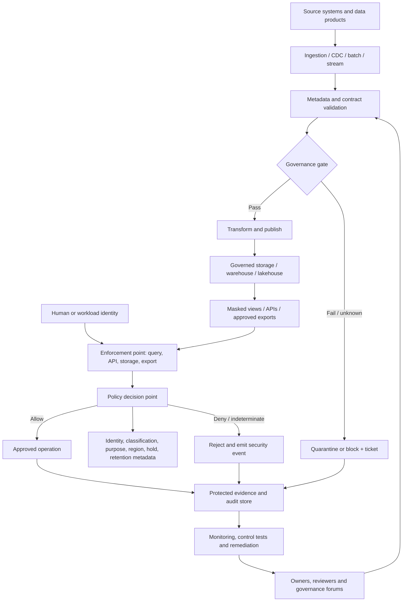

# Project 10 — Sensitive Data Governance and Access Design

> **Stage:** 2D — Data Architecture  
> **Module:** 10 — Data Governance, Security, Privacy and Compliance  
> **Project ID:** DA-10-P10  
> **Version:** 1.0.0  
> **Status:** Reference design for learning and architecture review; not an approved production design  
> **Audience:** Data architects, data engineers, platform engineers, data owners/stewards, security, privacy, risk, compliance, and technical reviewers  
> **Case study:** Northbridge Bank — fictional; all identities, records, systems, values, decisions, and targets are synthetic  
> **Recommended effort:** 18–24 hours, illustrative planning estimate  
> **Scope:** End-to-end governance and access architecture from initiation through independent review and hand-off  
> **Source alignment:** `roadmap-Data-Governance-Security-Privacy-and-Compliance.md`, Topics 01–09, and the Stage 2D roadmap structure

> **Important scope and legal boundary.** This is an educational architecture reference, not legal advice, a compliance certification, or evidence that any real control is sufficient. The roadmap is the source for this project's learning scope and completion gate. Numeric targets, fictional internal requirements, sample retention periods, sample regions, and Northbridge decisions are illustrative assumptions. Qualified legal, privacy, security, records-management, risk, and compliance specialists must determine which real obligations apply and approve the corresponding interpretations. Use synthetic data only.

---

## 0. Document control and how to use this project

### 0.1 Purpose

This project teaches how to design a coherent, reviewable governance and access architecture for sensitive data across its lifecycle. It connects accountability, classification, identity and least privilege, encryption and secrets, field protection, purpose and residency, retention and legal holds, control evidence, and policy enforcement into one traceable design.

The output is not a policy-only document and not a list of security products. It is a package that shows:

1. what data and uses are in scope;
2. who owns each decision and performs each activity;
3. how classification and business context determine handling;
4. who or what can access which data, for which action and purpose;
5. how data are protected in storage, transit, use, and derived outputs;
6. where purpose, consent, residency, retention, and legal-hold constraints apply;
7. which controls prevent, detect, or correct failures;
8. what evidence demonstrates control design and operation;
9. what remains uncertain, risky, or subject to specialist confirmation; and
10. how the architecture will be validated, operated, reviewed, and changed.

### 0.2 Learning mode and real-organisation mode

- **Learning mode:** follow the worked Northbridge example and execute the validation checks with synthetic data. The example is not a production approval.
- **Real-organisation mode:** replace every illustrative assumption with sourced facts; identify the authority and version for each requirement; confirm owners; conduct threat and privacy reviews; validate platform capabilities; and obtain the approvals required by the organisation's operating model.
- **Never** put real customer records, credentials, key material, secrets, production identifiers, or confidential architecture details into a learning exercise or public repository.

### 0.3 Scope boundaries

**In scope**

- business uses, data assets, field-level sensitivity and criticality;
- accountability and separation of duties;
- human, service, and workload identities;
- RBAC/ABAC or hybrid access design, least privilege, access lifecycle, privileged and emergency access;
- encryption boundaries, key and secret lifecycle;
- masking, tokenization, pseudonymisation, de-identification and residual re-identification risk;
- purpose, consent metadata where relevant, data minimisation, residency and transfer paths;
- retention, deletion, legal holds, backups, derived data, and verification evidence;
- requirement-to-control-to-evidence traceability;
- policy administration, decision, information, and enforcement points;
- exceptions, failure modes, risk acceptance, metrics, testing, and independent review.

**Out of scope**

- selecting a specific vendor or claiming that a product feature is enabled;
- production credentials, live deployment, real-data processing, penetration testing, or legal opinions;
- a definitive legal basis, retention period, residency determination, or compliance conclusion;
- a full disaster-recovery implementation, enterprise metadata catalogue implementation, or AI serving implementation. Those are linked to later Stage 2D modules; this project records the governance constraints they must inherit.

### 0.4 Status and evidence vocabulary

Use consistent labels throughout the package:

| Label | Meaning | Required treatment |
|---|---|---|
| `CONFIRMED` | Supported by an authoritative source or validated observation | Record source, version/date, scope, and verifier |
| `REPORTED` | Stated by a stakeholder but not independently verified | Record speaker/role, date, and validation action |
| `ASSUMPTION` | Temporary premise used to progress design | Owner, rationale, validation method, and due date |
| `DERIVED` | Calculated from explicit inputs or rules | Formula, units, input references, and reproducibility |
| `ILLUSTRATIVE` | Invented for the fictional worked example | Never present as real-world evidence |
| `UNKNOWN` | Missing, conflicting, stale, or not yet assessed | Owner and next action; do not silently fill the gap |
| `SPECIALIST_CONFIRMATION` | Requires qualified legal/privacy/security/records/compliance interpretation | Named function, question, evidence needed, and decision status |
| `APPROVED` | Approved by a role with documented decision authority | Decision ID, approver role, date, scope, expiry/review trigger |
| `REJECTED` | Explicitly declined | Reason and any safe alternative |
| `EXPIRED` | Time limit or review date passed | Fail-safe handling and reapproval path |

A label alone is not proof. Attach the evidence reference and status date. Do not describe a proposed control as operational or a design as compliant.

### 0.5 Definitions of ready and done

**Ready:** the business problem and intended uses are stated; scope and boundaries are understood; relevant module topics have been reviewed; a fictional or approved synthetic scenario is available; and known source materials have been identified.

**Done:** D1–D12 exist and are internally consistent; every in-scope asset has an accountable owner and classification/handling requirements; grants are justified and reviewable; lifecycle and privacy constraints propagate across known copies; controls have owners, tests, and evidence sources; exceptions and unknowns are explicit; the checker passes; and an independent reviewer can trace sampled requirements to evidence. A passing local checker is necessary but not sufficient.

### 0.6 Suggested effort

| Work area | Indicative effort |
|---|---:|
| Initiation, requirements and asset scope | 2–3 h |
| Governance and classification | 2–3 h |
| Access, encryption and field protection | 4–5 h |
| Purpose, residency, lifecycle and holds | 3–4 h |
| Controls, evidence and enforcement | 3–4 h |
| Integration, validation, review and hand-off | 4–5 h |
| **Total** | **18–24 h** |

Effort depends on asset count, evidence quality, stakeholder availability, and unresolved legal or platform questions. It is not a deadline or universal requirement.

---

## 1. Project overview and business problem

### 1.1 Fictional scenario

Northbridge Bank is a fictional mid-sized bank with a shared data platform supporting fraud investigation, risk reporting, customer service, regulatory reporting, and approved analytics. Source systems provide customer profiles, account records, transactions, case-management events, and employee access records. Data are copied into a lakehouse, warehouse, streaming path, analytical views, exports, and selected model-feature datasets.

The current-state problem statement is illustrative:

- teams cannot consistently determine who owns every sensitive dataset;
- some access grants have vague justifications or no review date;
- direct object-store access may bypass query-layer policies;
- raw identifiers appear in some analytical paths;
- purpose and residency restrictions are not consistently represented as metadata;
- deletion and hold status are not reconciled across backups and derived datasets;
- control evidence is spread across systems and cannot be retrieved reliably.

These are **fictional design drivers**, not claims about an actual bank. In real work, validate every current-state finding through evidence and interviews.

### 1.2 Business objective

Design a vendor-neutral, risk-proportionate governance and access architecture that enables approved data use while reducing unauthorized access, inappropriate secondary use, accidental exposure, ungoverned copies, uncontrolled retention, and inability to demonstrate control operation.

### 1.3 Success criteria

The following are illustrative project acceptance targets, not universal policy requirements:

1. 100% of in-scope assets have an owner, steward, purpose, sensitivity, criticality, and lifecycle status recorded or an explicitly owned `UNKNOWN`/`SPECIALIST_CONFIRMATION` item.
2. Every proposed access grant has a business justification, approver, least-privilege scope, review cadence, and revocation trigger.
3. Every Restricted field has a documented protection technique, raw-access authority, and residual-risk statement.
4. Each in-scope flow has an identified storage, processing, access, backup, and transfer location or a tracked unknown.
5. Retention/deletion controls cover source data, replicas, logs, exports, backups, and known derived assets, or document a scoped exception and compensating control.
6. Each control maps to a requirement/control objective, owner, enforcement location, test, evidence source, and failure/remediation path.
7. At least five realistic failure scenarios are tested; the validation plan below includes more than five.
8. The independent reviewer can trace three sample grants and three sample controls end to end.
9. No unresolved blocking finding is represented as accepted without an authorised, time-bounded risk decision.
10. No claim of legal or regulatory compliance is made from this learning artifact.

### 1.4 Primary users and decisions

| Persona | Decisions / activities | Not automatically authorised to do |
|---|---|---|
| Business/data owner | Approves asset purpose, business access, classification, and residual business risk within delegated authority | Override law, privacy requirements, or security policy |
| Data steward | Maintains definitions, metadata, classification evidence, and lineage quality | Independently approve own privileged access |
| Platform operator | Implements and operates technical controls; provides logs and operational evidence | Decide business purpose solely because they operate the platform |
| Security/IAM | Defines identity/access standards, reviews privileged paths, monitors abuse | Determine legal basis without the relevant specialists |
| Privacy/legal/compliance/records specialists | Interpret applicable obligations and advise on purpose, transfers, retention, holds, and evidence | Be assumed to have approved a design without a recorded decision |
| Risk owner | Assesses residual risk and accepts it only within delegated authority | Accept risks outside delegated authority |
| Independent reviewer/auditor | Tests design and operation with appropriate independence | Operate the control being independently assessed and then self-certify it |
| Data consumer | Requests and uses data for an approved purpose | Re-share data or change purpose without authorisation |

### 1.5 High-level architecture principles

- Data ownership, platform operation, policy ownership, access approval, and independent assurance are distinct responsibilities.
- Classification labels are metadata, not controls.
- Sensitivity and criticality are separate axes.
- Deny-by-default applies to unclassified, ambiguous, or unauthorised access paths unless an approved, risk-reviewed control design explicitly states otherwise.
- Enforce policy at every material access boundary; query-layer controls alone do not protect direct storage access.
- Prefer workload identities over shared human credentials; separate administrative control-plane rights from data-plane read access.
- Minimise raw data and prefer masked views, tokens, aggregates, or synthetic data when fit for purpose.
- Purpose and residency restrictions propagate through lineage and derived assets.
- Deletion is a distributed lifecycle process; one table-level delete is not proof of all-copy disposition.
- Controls emit evidence as a normal operational by-product, with appropriate integrity, access restrictions, retention, and retrieval.
- Exceptions are scoped, justified, approved, monitored, and time-limited.
- Automation supports, but does not replace, human legal, privacy, business, or risk judgment.

---

## 2. How to execute the project

### 2.1 Required sequence

Follow Steps 1–12 in order. Steps may iterate when validation finds a contradiction, but do not skip a step. Each step defines its purpose, inputs, actions, outputs, checks, and common failure modes. Preserve stable IDs as artifacts evolve.

### 2.2 Working package structure

The following is a **suggested working directory**, not a request to create or modify repository files other than the named project artifact:

```text
sensitive-data-governance-design/
├── 00-project-control.md
├── 01-requirements-and-assumptions.md
├── 02-asset-classification-register.md
├── 03-governance-accountability.md
├── 04-access-design.md
├── 05-cryptographic-controls.md
├── 06-field-protection.md
├── 07-purpose-residency.md
├── 08-retention-deletion-holds.md
├── 09-control-evidence-map.md
├── 10-policy-enforcement.md
├── 11-risks-exceptions-adrs.md
├── 12-validation-and-review.md
└── evidence-index.md
```

For this learning project, these logical artifacts may be represented as sections and tables in this single Markdown file. Do not create empty placeholder files merely to imitate the suggested layout.

### 2.3 Deliverable index

| ID | Deliverable | Primary step | Supporting topics | Minimum acceptance |
|---|---|---:|---|---|
| D1 | Assumptions and requirements register | 1 | 01, 08 | Sources/status/owners explicit; specialist items flagged |
| D2 | Asset inventory and classification register | 2 | 02 | Owner/steward, sensitivity, criticality, purpose, handling and propagation recorded |
| D3 | Governance responsibility and escalation matrix | 3 | 01 | One accountable role per decision; conflicts escalated |
| D4 | Identity, role and access matrix | 4 | 03 | No unexplained wildcard grants; justification, approver, review and revocation defined |
| D5 | Encryption, key and secrets design | 5 | 04 | Scope, ownership, use rights, lifecycle, recovery and evidence stated |
| D6 | Sensitive-field protection matrix | 6 | 05 | Technique chosen per field/use; raw access and residual risk documented |
| D7 | Purpose, consent and residency register | 7 | 06 | Uses, consent dependency, locations and unknowns recorded |
| D8 | Retention, deletion and legal-hold matrix | 8 | 07 | Copies, backups, derived data, holds, replay and evidence covered |
| D9 | Requirement-to-control-to-evidence map | 9 | 08 | Each requirement mapped or explicitly gapped |
| D10 | Governance-by-design workflow and policy examples | 10 | 09 | PDP/PEP, coverage, fail mode, human decisions and tests defined |
| D11 | Risk, exception and ADR register | 1–12 | 01–09 | Owner, treatment, residual risk, approval and expiry/review date |
| D12 | Integrated design summary and validation report | 12 | All | Traceable, internally consistent, limits and open decisions clear |

---

## 3. Step 1 — Understand the business problem and establish requirements

### Purpose

Define which business uses, assets, actors, boundaries, and obligations the design must support before choosing controls.

### Inputs

- business objectives and process descriptions;
- current-state inventory and architecture where available;
- data contracts, schemas, lineage, and existing policy documents;
- candidate legal, regulatory, contractual, internal-policy, and risk requirements;
- interviews with business owners, data stewards, platform/security teams, privacy/legal/compliance, and records management.

### Actions

1. Write the problem statement and intended outcomes.
2. List each processing use in specific terms. Avoid broad labels such as `analytics` or `business use`.
3. Identify data subjects, data categories, source systems, consumers, processors, third parties, environments, and output types.
4. Define in-scope and out-of-scope data flows, including exports, logs, backups, replicas, notebooks, feature stores, and model artifacts where relevant.
5. Record candidate requirements with source, version/date, interpretation status, applicability owner, and evidence needed.
6. Separate legal obligations from internal policy, contract, risk decisions, and architecture recommendations.
7. Record assumptions, dependencies, constraints, known unknowns, and decision deadlines.
8. Define success criteria and review authority.
9. Establish a change-control process for new uses, new fields, new regions, and new consumers.

### D1 — Illustrative requirements and assumptions register

| ID | Type | Statement | Source/status | Owner | Verification / next action |
|---|---|---|---|---|---|
| REQ-001 | Business | Fraud investigators need case-scoped access to transaction and customer context | `ILLUSTRATIVE` | Fraud data owner | Validate actual workflow and minimum fields |
| REQ-002 | Internal control | Restricted data must not be accessible to unapproved principals | `ILLUSTRATIVE`; fictional internal requirement | Security control owner | Define authoritative policy and test population |
| REQ-003 | Privacy | Each personal-data use must have a recorded purpose and an approved decision path | `SPECIALIST_CONFIRMATION` | Privacy/legal | Confirm applicable rules and purpose approval workflow |
| REQ-004 | Security | Direct storage access must not bypass data-plane policy | `ILLUSTRATIVE` architecture requirement | Platform security | Inventory all access paths and test deny behavior |
| REQ-005 | Lifecycle | Eligible deletion must cover known copies and prevent resurrection on restore | `ILLUSTRATIVE` | Records owner / platform | Confirm applicable retention, hold and deletion obligations |
| REQ-006 | Evidence | Every key control must have an owner, test, evidence source, and remediation route | `ILLUSTRATIVE` internal control objective | Control owner | Approve control catalogue and evidence retention |
| ASSUMP-001 | Assumption | Northbridge uses a central identity provider and a managed key service | `ILLUSTRATIVE` | Platform architect | Replace with verified platform capabilities |
| ASSUMP-002 | Assumption | Masked views can meet most routine analytics needs | `ILLUSTRATIVE` | Analytics owner | Validate utility with representative synthetic queries |
| UNK-001 | Unknown | Approved storage, processing, backup, and support regions are not yet confirmed | `UNKNOWN` | Cloud/platform owner | Inventory every path; obtain specialist confirmation |
| UNK-002 | Unknown | Required retention periods by record class are not confirmed | `SPECIALIST_CONFIRMATION` | Records/legal | Obtain authoritative schedule and source version |

**Check:** every requirement has a source or an explicit non-confirmed status; every unknown has an owner and next action. Never convert an illustrative internal requirement into a claim about law.

**Common failure:** selecting an access tool or encryption product before identifying the use, risk, requirement, and enforcement boundary.

---

## 4. Step 2 — Inventory and classify data assets and fields

### Purpose

Identify what must be governed and apply separate sensitivity and criticality assessments, then connect classifications to handling and propagation rules.

### Actions

1. Inventory source datasets, tables, streams, files, reports, views, APIs, exports, logs, backups, derived data, features, embeddings, and model artifacts where applicable.
2. Assign a stable asset ID and record owner, steward, system of record, location, lineage, purpose, consumers, and environment.
3. Define the organisation's classification scheme and scoring criteria. The example levels below are not a universal or legal taxonomy.
4. Assess **sensitivity** (harm from exposure/misuse) separately from **criticality** (harm from loss, corruption, delay, or unavailability).
5. Classify at field level where dataset-level labels would hide materially different handling needs.
6. Define handling controls for each label: access, encryption, masking, logging, sharing, retention, and review.
7. Define inheritance and propagation. A derived asset normally inherits the most restrictive relevant handling unless a documented, validated transformation and authorised review justify a change.
8. Consider aggregation and quasi-identifier combinations; a collection of low-sensitivity fields can become sensitive.
9. Mark incomplete discovery as `UNKNOWN`, not “none”.
10. Define review triggers: schema change, new purpose, new consumer, region change, incident, control drift, or periodic recertification.

### Illustrative classification scheme

| Label | Example meaning | Default handling intent (must be approved in a real organisation) |
|---|---|---|
| `PUBLIC` | Approved for public release | Integrity/provenance controls; protect non-public operational metadata |
| `INTERNAL` | Routine non-public business information | Authenticated workforce access; standard logging and lifecycle controls |
| `CONFIDENTIAL` | Material commercial, operational, or personal information | Need-to-know access, encryption, controlled non-production use, reviewable sharing |
| `RESTRICTED` | Exposure/misuse could cause severe harm or has specially constrained handling | Named/approved roles or attributes, strong access boundaries, encryption/key controls, masked default, detailed audit and explicit lifecycle/purpose handling |

### D2 — Illustrative asset and field classification register

All rows below are synthetic.

| Asset ID | Asset / field | Owner / steward | Sensitivity | Criticality | Purpose | Handling / propagation |
|---|---|---|---|---|---|---|
| AST-001 | `customer_profile.customer_id` | Retail data owner / Customer steward | `RESTRICTED` | High | Customer servicing; case investigation | Tokenized in broad analytics; raw access via approved case workflow; inherits restrictions to joins |
| AST-002 | `customer_profile.email` | Retail data owner / Customer steward | `CONFIDENTIAL` | Medium | Contact only where approved | Mask by default; raw access separately approved; no logs or free-text exports |
| AST-003 | `account.account_number` | Account data owner / Account steward | `RESTRICTED` | High | Account servicing and investigation | Tokenized or masked downstream; key/access controls; no general analytical exports |
| AST-004 | `transactions.transaction_id` | Payments data owner / Payments steward | `CONFIDENTIAL` | High | Transaction reconciliation and fraud detection | Stable ID controlled; audit writes and changes; propagate purpose/retention |
| AST-005 | `transactions.amount` | Payments data owner / Payments steward | `CONFIDENTIAL` | High | Fraud/risk analysis | Restrict raw detail; aggregate when fit; combine with customer context only for approved purpose |
| AST-006 | `risk_case.risk_reason` | Fraud data owner / Fraud steward | `RESTRICTED` | High | Fraud investigation | Case-scoped access; prevent broad export; review derived risk labels |
| AST-007 | `risk_analytics.monthly_aggregate` | Risk analytics owner / Analytics steward | `CONFIDENTIAL` pending assessment | Medium | Approved risk reporting | Assess re-identification and small-cell risk before lowering label |
| AST-008 | `access_audit.event` | Security owner / Security steward | `CONFIDENTIAL` | High | Security monitoring and control evidence | Limit log access; redact tokens/secrets; approved retention and tamper protection |
| AST-009 | `risk_features.customer_token` | Model/data product owner / Feature steward | `RESTRICTED` pending linkage assessment | High | Approved risk feature computation | Token is a linkage key; restrict joins and model use; lineage and deletion propagation |
| AST-010 | `export.file` | Exporting data owner / Export steward | `UNKNOWN` until contents inspected | Medium | Must be declared before export | Block publication until classification, purpose, destination and expiry are set |

**Check:** no asset is treated as safe because its name sounds harmless. The classification includes both axes, owner/steward, purpose, handling, and derived-data propagation. The example row `AST-010` is intentionally unresolved to demonstrate a fail-safe gate.

---

## 5. Step 3 — Define governance accountability and escalation

### Purpose

Assign distinct accountability for decisions, technical operations, policy approval, exception approval, and independent assurance.

### Actions

1. Name a business/data owner and steward for every asset or explicitly record an orphan-asset remediation owner.
2. Distinguish asset ownership, platform operation, access approval, policy ownership, risk acceptance, and independent testing.
3. Define strategic, tactical, and operational governance forums only where they add decision value.
4. Define decision rights and separation-of-duties constraints.
5. Establish an escalation path for conflicting owners, unclear purposes, missing metadata, access disputes, legal holds, and suspected incidents.
6. Require documented approval, scope, rationale, evidence, expiry, and review for exceptions.
7. Define the default when no accountable decision-maker can be found: stop or restrict the affected use and escalate; do not infer approval.

### D3 — Illustrative responsibility matrix

R = performs; A = accountable; C = consulted; I = informed. Each decision row should have exactly one A in the approved real-world matrix; this sample uses role names, not individuals.

| Decision / activity | Data owner | Steward | Platform/IAM | Security | Privacy/legal/records | Risk owner | Independent reviewer |
|---|---:|---:|---:|---:|---:|---:|---:|
| Business purpose and data use | A | R | C | C | C | C | I |
| Classification assignment | A | R | C | C | C | I | I |
| Access request business approval | A | C | R (provisioning only) | C | C when needed | I | I |
| Identity and enforcement design | C | C | R | A | C | I | I |
| Key lifecycle design | I | I | R | A | C | C | I |
| Purpose/consent interpretation | C | R (metadata) | C | C | A (specialist advice/decision per authority) | C | I |
| Retention/hold interpretation | C | R (metadata) | R (execution) | C | A (records/legal authority as applicable) | C | I |
| Risk acceptance | C | I | C | C | C | A within delegation | I |
| Control operation | I | C | R | A/control owner as assigned | C | I | I |
| Independent control testing | I | C | C | C | C | I | A/R within mandate |

### Escalation path

1. **Operational owner/steward** records the issue and limits affected processing if required.
2. **Data owner and control owner** resolve business meaning, ownership, and immediate containment.
3. **Security/privacy/records/legal specialist** interprets relevant specialist question.
4. **Risk owner or governance forum** decides residual risk only within delegated authority.
5. **Independent reviewer** verifies closure evidence where independence is required.
6. If authority or evidence remains missing, status stays open and the affected use remains blocked or restricted according to approved fail-mode policy.

**Check:** no person approves their own privileged grant or independently attests a control they alone operate without an approved compensating safeguard.

---

## 6. Step 4 — Design identity and least-privilege access

### Purpose

Define who/what can perform which action on which resource, for which purpose, under what conditions, and for how long.

### Design approach

Use a hybrid model as the illustrative baseline:

- **RBAC** for stable job functions and standard operational duties;
- **ABAC** for contextual conditions such as data classification, purpose, case assignment, region, environment, time, and approved exception;
- resource-level policies and platform-native controls to enforce at the actual data boundary;
- deny-by-default for missing, conflicting, or stale critical attributes;
- explicit precedence: explicit deny overrides allow; policy conflict or `INDETERMINATE` denies sensitive access pending remediation;
- separate identities and privileges for humans, services, jobs, administration, and emergency access.

### D4 — Illustrative role/access matrix

| Grant ID | Principal / role | Resource and scope | Action | Purpose / condition | Approver | Review / revocation |
|---|---|---|---|---|---|---|
| GR-001 | `FraudInvestigator` human group | Case-scoped masked customer/transaction view | Read | Assigned open case; approved investigation purpose | Fraud data owner | Quarterly and case closure; revoke on role change |
| GR-002 | `RiskAnalyst` human group | Aggregated risk mart | Read | Approved risk reporting; minimum group-size rule subject to review | Risk data owner | Quarterly; revoke when role/use changes |
| GR-003 | `RiskPipelineWorkload` workload identity | Specific input topics/tables and feature output | Read/write only as defined per flow | Approved job identity; environment-bound; no interactive login | Platform owner plus data owner for scope | Automated entitlement review; rotate/revoke on job retirement |
| GR-004 | `DataSteward` group | Catalogue metadata and classification fields | Read/update metadata; no unrestricted raw data | Stewardship tasks | Data owner | Quarterly |
| GR-005 | `PlatformOperator` privileged group | Platform configuration and policy deployment | Administer control plane; no data read by default | Approved change or incident ticket | Platform security owner | JIT elevation; session logging; revoke at end |
| GR-006 | `BreakGlassResponder` | Narrow emergency path to named resources | Time-limited emergency action | Incident ID, dual approval where feasible, alerting | Incident commander / delegated approver | Automatic expiry; mandatory retrospective review |
| GR-007 | `MarketingAnalyst` | Masked/aggregated customer view | Read only if purpose is approved | Marketing purpose must pass privacy/policy gate; no raw identifiers by default | Marketing data owner plus required specialist approval | Quarterly; revoke on role/purpose change |

**No wildcard grants** such as `*` over all datasets or all actions are accepted in this design. A real matrix must include platform-native effective permissions, inherited grants, storage ACLs, query permissions, BI/export paths, notebooks, and service-to-service access.

### Access lifecycle

1. Request records principal, resource, action, business justification, purpose, duration, environment, and data classification.
2. Policy checks completeness, training/role prerequisites where applicable, conflict of interest, and segregation of duties.
3. Data owner approves business need; specialist approval is obtained when required.
4. IAM/platform provisions the minimum scope and records the resulting grant ID.
5. A verification test confirms the intended access succeeds and prohibited access fails.
6. Reviews compare active grants with current roles, purposes, employment status, and usage.
7. Mover/leaver and purpose changes trigger timely revocation; stale cache/token/session behavior is included in tests.
8. Emergency access is time-limited, monitored, and retrospectively reviewed.
9. Evidence is retained under the approved evidence schedule.

### D4 acceptance checks

- Every grant has a unique ID, named accountable approver role, justification, purpose, review cadence, and revocation trigger.
- Service identities are scoped to specific jobs and resources; shared personal credentials are prohibited.
- Administrative rights do not imply data read rights by default.
- Direct storage access is blocked or independently governed and tested.
- Cross-domain access is explicit; effective permissions include inherited and indirect grants.
- Access to a token vault, raw identifier, key, or decryption operation is separately controlled.

---

## 7. Step 5 — Define encryption, key management and secrets

### Purpose

Protect data and credentials while preserving controlled, recoverable access for approved workloads.

### Architecture decisions

1. Identify encryption requirements for transport, persistent storage, backups, replicas, exports, and temporary/staging locations.
2. Use platform-supported, maintained cryptographic capabilities; do not invent algorithms.
3. Define key hierarchy and separation between data-encryption keys and key-encryption keys where envelope encryption is used.
4. Define key ownership, permitted key operations, environment separation, rotation triggers, revocation, recovery, destruction, and audit evidence.
5. Separate permission to administer a key from permission to use it, and separate key use from data authorization.
6. Retrieve secrets through an approved secret-management mechanism or workload identity; prohibit hard-coded secrets and secrets in logs, source control, or example files.
7. Test the consequences of key-service outage, lost key access, failed rotation, expired credentials, and compromised secrets.
8. Document the dependency between key recovery and data recovery; cryptographic erasure is only defensible if every usable key/plaintext copy is covered.

### D5 — Illustrative cryptographic control matrix

| Location / asset | Protection | Key/secret authority | Rotation / lifecycle | Evidence and failure response |
|---|---|---|---|---|
| Restricted source database | Encryption at rest and authenticated transport | DB workload can use required key; separate key administrators | Per approved key policy and compromise triggers | Config snapshot, key-use audit; alert and restrict on drift |
| Lakehouse/warehouse | Encryption for tables, files, snapshots and replicas | Scoped service roles; no broad human key export | Key version lifecycle with compatibility and rollback plan | Config checks, key-use events, recovery exercise |
| Data in transit | Authenticated encrypted channels between trusted endpoints | Service identities/certificates with bounded validity | Certificate/credential renewal and revocation | Handshake/config tests; fail closed for sensitive transfer |
| Token vault / mapping service | Encrypted mapping store; strict access and audit | Separate tokenization service identity and re-identification approver | Mapping/key lifecycle with deletion and incident procedures | Access log, approved request, mapping integrity checks |
| Backup/archive | Encryption and isolated access | Backup service and recovery roles separated | Key availability retained for approved recovery window | Restore test; alert on missing key or failed decrypt |
| Application secrets | Secret manager or short-lived identity-based credentials | Only named workload retrieves secret | Rotation/revocation, exposure response | Secret access audit; revoke exposed credential immediately |

The table is a design pattern, not a statement that any specific service is configured.

### Key/secret operational checklist

- key owner and purpose;
- key scope and associated data classes;
- principals allowed to encrypt/decrypt/wrap/unwrap/administer;
- key version, rotation and overlap strategy;
- backup/recovery dependency and tested recovery procedure;
- emergency access and two-person controls where proportionate;
- monitoring for unusual use and denied operations;
- revocation and incident playbook;
- destruction criteria and downstream impact;
- evidence retention and restricted evidence access;
- secret scanning in code/build/log pipelines;
- separation of dev/test/prod identities and material.

**Check:** every Restricted store and token mapping has an explicit key/secret owner and scoped-use model. A key-service recovery test is designed; no claim of a live test is made.

---

## 8. Step 6 — Design masking, tokenization and de-identification

### Purpose

Reduce exposure by minimising fields and selecting protection techniques that match the business purpose and threat model.

### Technique selection rules

- **Minimise first:** remove fields not required for the declared use.
- **Mask/redact:** expose a limited representation to a viewer; this is not anonymisation.
- **Tokenize:** replace an identifier with a surrogate and protect the mapping/tokenization service. Stable tokens may still permit linkage.
- **Pseudonymise:** replace direct identifiers while retaining a separately protected means of linkage; data may remain personal or sensitive.
- **Aggregate/generalise/suppress:** reduce detail where analytical utility allows; assess small groups and linkage.
- **Synthetic data:** use generated records for learning and testing; validate that they do not expose copied production values.
- **Anonymisation:** do not claim that data are anonymous without a context-specific re-identification assessment and qualified review.

### D6 — Illustrative sensitive-field protection matrix

| Field / asset | Category and risk | Technique for ordinary analytics | Raw-value authority | Residual risk / test |
|---|---|---|---|---|
| `customer_profile.customer_id` | Direct identifier and join key | Stable token only where linkage is necessary; otherwise remove | Approved case workflow and separately authorised mapping service | Linkage across datasets; test token reuse and access to vault |
| `customer_profile.email` | Direct identifier | Remove or mask; use contact service only for approved operational need | Customer servicing role with purpose check | Free-text/log leakage; scan outputs and logs |
| `account.account_number` | Direct financial identifier | Tokenize or mask; avoid broad exports | Named operational roles; key/mapping access separate | Correlation with transactions; test join/export paths |
| `transactions.amount` | Financial attribute | Keep only required precision; aggregate when sufficient | Approved investigation/finance roles | Small cohorts and linkage; test aggregate thresholds |
| `risk_case.risk_reason` | Sensitive case information | Case-scoped access; redact from broad reports | Assigned investigators and approved reviewers | Free-text may contain identifiers; content review and DLP-like checks as supported |
| `risk_features.customer_token` | Persistent linkage key/derived feature | Restricted token or rotating scoped token depending on use | Feature pipeline and approved investigation workflow | Cross-purpose tracking and model leakage; assess joins and outputs |
| `access_audit.event` | Security evidence may contain identifiers | Pseudonymise/redact unnecessary fields; protect event metadata | Security/audit roles | Evidence utility vs privacy; test redaction completeness |

### Re-identification and derived data review

Assess:

- direct identifiers remaining in the output;
- quasi-identifiers and rare combinations;
- persistent linkage keys;
- external datasets available to likely recipients;
- small-cell and differencing attacks;
- query repetition and cumulative disclosures;
- embeddings, features, scores, and model outputs that may reveal source data;
- who can reverse tokens and whether approval is separately enforced;
- whether transformation changes sensitivity or merely changes representation.

**Check:** each sensitive field has a technique, purpose rationale, raw access authority, and residual-risk statement. No protected representation is automatically treated as unrestricted.

---

## 9. Step 7 — Map purpose, consent and residency

### Purpose and consent

Purpose limitation and consent are related but distinct. A consent record is not a universal permission to use all data for all activities. Whether consent is relevant, sufficient, or required is a specialist determination. The architecture records the decision and enforces the approved result; it does not autonomously decide legal questions.

### D7 — Illustrative purpose and residency register

| Use ID | Asset(s) | Declared purpose | Consent/other permission dependency | Storage / processing / backup / access location | Status |
|---|---|---|---|---|---|
| USE-001 | Transactions + customer profile | Investigate a specific suspected fraud case | `SPECIALIST_CONFIRMATION` for applicable authority and scope | Approved operating region not yet verified | `UNKNOWN` pending region and purpose approval |
| USE-002 | Aggregated risk mart | Produce internal risk trend reports | Confirm compatibility and minimisation; do not assume consent is or is not required | Approved analytical region to be confirmed | `SPECIALIST_CONFIRMATION` |
| USE-003 | Customer contact fields | Send approved service communications | Consent or other applicable permission must be evaluated by qualified owner | Source and communication processor locations to be inventoried | `SPECIALIST_CONFIRMATION` |
| USE-004 | Feature dataset | Compute approved fraud-risk features | Must inherit purpose and access restrictions; assess model use and downstream outputs | Feature store, training/serving, backups and operator access to be inventoried | `UNKNOWN` |
| USE-005 | Learning/test data | Develop and test controls | Synthetic-only in this project | Local synthetic environment; no production data | `ILLUSTRATIVE` |

### Required purpose metadata

At minimum, record purpose ID, description, approved status, owner, data/field scope, permitted operations, consumer/recipient, relevant consent or other permission reference, effective date, review date, restrictions, policy version, and decision evidence.

### Required location dimensions

Do not collapse these into one `region` field:

- primary storage;
- replicas and caches;
- processing/compute location;
- backup and disaster-recovery location;
- support/administrative access location;
- logs, telemetry, catalogues, and policy/evidence stores;
- key-management location and recovery dependency;
- third-party processors and onward transfers;
- export destinations and local downloads.

### Consent/purpose change propagation

1. Record an authoritative, timestamped purpose/consent change with a stable subject/scope reference.
2. Validate source, scope, ordering, and policy version.
3. Re-evaluate active jobs, grants, downstream data products, exports, feature datasets, and relevant AI/ML artifacts.
4. Block or restrict future processing that no longer has an approved decision.
5. Queue downstream actions with idempotent identifiers and retry/reconciliation behavior.
6. Preserve required records where an approved retention/hold rule applies; do not blindly delete evidence or held data.
7. Record each target's outcome, lag, failure, and remediation owner.
8. Reconcile expected versus actual propagation; unresolved targets remain visible and escalated.

**Check:** every use has a specific purpose or an explicit `UNKNOWN`/specialist-confirmation status. All storage, processing, backup, access, and transfer paths are inventoried or assigned an owner to resolve.

---

## 10. Step 8 — Define retention, deletion and legal holds

### Purpose

Make lifecycle rules executable across the whole data estate without violating an applicable preservation requirement.

### Actions

1. Identify the authoritative retention schedule and its source/version for each record class.
2. Separate minimum retention, maximum retention, operational retention, archive retention, and backup expiry.
3. Record the trigger event, calculation method, disposition, owner, and review date.
4. Inventory copies in source stores, CDC/event logs, staging, curated layers, warehouses, replicas, caches, exports, logs, backups, feature stores, indexes, and model artifacts as applicable.
5. Define deletion semantics per technology: logical deletion, physical purge, tombstone, compaction/rewrite, object version removal, cache/index invalidation, and backup expiry.
6. Define legal-hold authority, scope, notification, conflict resolution, release, and audit records.
7. Prevent deletion of held material within the approved hold scope, while ensuring the hold does not silently expand beyond its authority.
8. Define idempotent deletion jobs, retries, ordering, partial-failure handling, reconciliation, and evidence.
9. Define restore-time deletion replay or equivalent prevention of resurrection.
10. Assess token mappings, derived features, embeddings, training datasets, model outputs, and logs separately; do not promise universal model deletion without a validated method.
11. Ensure evidence logs themselves have approved content and retention.
12. Define exception handling when a system cannot meet the target, including compensating controls and a dated remediation plan.

### D8 — Illustrative lifecycle control matrix

No period below is a legal requirement. Replace each value with an approved source-backed schedule.

| Asset/copy | Retention rule / trigger | Disposition | Hold handling | Evidence / restore behavior |
|---|---|---|---|---|
| Customer profile source | `UNKNOWN` until authoritative schedule confirmed | Approved delete/update workflow | Hold registry checked before disposition | Source event, target counts, exception list |
| Transaction ledger | Period to be confirmed by records/legal | Archive or delete only under approved schedule | Preserve in scoped hold; record conflict decision | Disposition event, immutable audit reference, reconciliation |
| Lakehouse/warehouse copies | Inherit approved source rule plus derived-data policy | Delete eligible records and rewrite/purge where required | Hold-aware filter propagated to every copy | Job run ID, policy version, target acknowledgements |
| Stream/CDC retention | Approved operational replay window plus source lifecycle requirements | Expire events; suppress reintroduction of deleted records | Preserve only if hold authority and system design require it | Offset/watermark/retention evidence; replay test |
| Exports/downloads | Purpose-bound expiry and recipient obligations to be confirmed | Revoke links, delete managed copy, notify recipient where required | Follow approved preservation instructions | Export manifest, expiry job, recipient acknowledgement if applicable |
| Backups/DR | Approved backup schedule; do not assume immediate row-level deletion is available | Expire under schedule; apply deletion ledger/replay on restore if approved | Restore process respects active holds and releases | Restore rehearsal and re-deletion reconciliation |
| Feature/index/model artifacts | Asset-specific decision based on lineage and technique capability | Rebuild, delete, suppress, retrain, or document validated limitation | Apply hold and evidence policy | Lineage-based impact list and outcome status |
| Audit/evidence records | Separate approved evidence retention | Protected expiry/disposition | Hold-aware | Integrity, access and disposition evidence |

### Legal-hold workflow

`Request → validate authority/scope → register hold → notify owners/operators → block conflicting disposition → propagate to copies → verify coverage → periodically review → authorised release → resume eligible lifecycle actions`

A hold must include a unique ID, authority/reference, scope, data subjects/assets, effective time, owner, approver, systems/copies, restrictions, review date, release authority, and evidence. Hold state is not a free-text flag.

### D8 acceptance checks

- A record cannot be deleted merely because a user requests it; the approved workflow evaluates scope, applicable retention, and holds.
- A held record is not silently purged; non-held records are not indefinitely retained merely because a broad hold exists.
- Backups, immutable stores, caches, logs, and downstream copies have explicit semantics.
- Restore cannot reintroduce deleted data without the approved replay/suppression process.
- A `COMPLETED` status requires reconciliation evidence, not merely a successful job exit code.

---

## 11. Step 9 — Map requirements to controls, tests and evidence

### Purpose

Create a traceable chain from requirement source through control operation and evidence, without confusing design documentation with proof of operation.

### Control chain

**Source requirement → approved policy → control objective → control implementation/procedure → owner/operator → operation → evidence → test → finding/remediation or risk acceptance.**

### D9 — Illustrative requirement-to-control-to-evidence map

| Req ID | Control objective | Control ID / type | Owner / operator | Enforcement / operation | Evidence | Test and failure response |
|---|---|---|---|---|---|---|
| REQ-002 | Unapproved principals cannot read Restricted data | CTRL-ACCESS-01 / preventive + detective | Security owner / IAM and platform | IAM, query engine, storage ACL, API/export boundary | Effective grant snapshot, policy version, decision logs | Negative access tests at every path; deny and open incident if bypass found |
| REQ-003 | Uses require an approved purpose decision | CTRL-PURPOSE-01 / preventive | Privacy/policy owner / policy service | Request, pipeline publish, export, runtime access | Purpose decision ID, purpose version, input attributes | Missing/stale purpose must deny or quarantine; specialist review |
| REQ-004 | No direct-store bypass | CTRL-BOUNDARY-01 / preventive + detective | Platform security / storage operator | Storage ACL/network identity plus query/API enforcement | Effective permissions, path inventory, access logs | Attempt direct read with unapproved identity; remove grant and investigate |
| REQ-005 | Eligible deletion propagates and does not resurrect | CTRL-LIFECYCLE-01 / corrective + detective | Records owner / lifecycle service | Source, downstream consumers, backups and restore path | Request ID, target acknowledgements, reconciliation report | Simulate partial failure and restore; retry idempotently and escalate |
| REQ-006 | Control operation is independently testable | CTRL-EVIDENCE-01 / detective | Control owner / evidence pipeline | Evidence collection and protected store | Population snapshot, timestamps, identity, integrity metadata | Sample completeness and integrity; report gaps and retest |
| ASSUMP-001 | Key access is scoped and recoverable | CTRL-CRYPTO-01 / preventive + recovery | Security owner / key service | Key-use policy and recovery workflow | Key configuration, access events, recovery exercise record | Deny unapproved key use; run approved recovery exercise |
| ASSUMP-002 | Routine analytics do not expose unnecessary raw identifiers | CTRL-MINIMIZE-01 / preventive | Data owner / data product pipeline | Schema contract and masked-view publication | Field inventory, query tests, output scan | Test expected fields and forbidden values; block publication |

A row that depends on an unconfirmed legal interpretation remains a candidate control until the relevant authority confirms the requirement and decision.

### Evidence quality requirements

Every evidence item should have, where applicable:

- evidence ID and control/requirement IDs;
- source system and collection method;
- collection time and period covered;
- identity/process attribution;
- policy/configuration version;
- population scope and completeness statement;
- integrity/provenance information;
- access classification and permitted viewers;
- retention/disposition rule;
- test method, result, reviewer, and exception references;
- limitations, missing intervals, and known blind spots.

A screenshot alone rarely proves complete population coverage or sustained operation. Prefer machine-generated evidence with controlled access and reproducible extraction, supplemented by human approvals where necessary.

---

## 12. Step 10 — Design governance by design and policy enforcement

### Purpose

Translate approved rules into checkpoints that evaluate attributes, enforce decisions at real boundaries, emit evidence, and handle dependency failure safely.

### Reference architecture



The diagram is logical. It does not claim that Northbridge has deployed these components. Every path to raw data, keys, exports, notebooks, object storage, backups, and third parties must be mapped separately.

### Policy decision model

The policy decision point (PDP) evaluates a request using trusted attributes. The policy enforcement point (PEP) must enforce the result. Policy administration (PAP) governs authoring, review, approval, versioning and release; policy information points (PIPs) supply identity, classification, purpose, location, hold and lifecycle attributes.

A decision contract should include:

- `decision_id`, `policy_id`, `policy_version`, and evaluation timestamp;
- principal and authenticated identity context;
- action and resource scope;
- declared purpose and approved-purpose reference;
- data classification and relevant location/hold/lifecycle attributes;
- outcome: `ALLOW`, `DENY`, or `INDETERMINATE`;
- reason code, obligations, expiry/cache boundary, and evidence reference.

Avoid recording raw personal data or secrets in policy logs unless specifically justified and approved. Use stable references and minimal necessary attributes.

### D10 — Illustrative policy pseudocode

```python
def decide(request, attributes):
    # Educational pseudocode: not a production authorization engine.
    if not request.identity_authenticated:
        return "DENY"
    if request.resource_classification is None:
        return "INDETERMINATE"
    if attributes.identity_status != "ACTIVE":
        return "DENY"
    if attributes.purpose_status != "APPROVED":
        return "DENY"
    if attributes.region_status != "APPROVED":
        return "DENY"
    if attributes.hold_status == "CONFLICT":
        return "INDETERMINATE"
    if not attributes.grant_covers(request.principal, request.resource, request.action):
        return "DENY"
    if request.resource_classification == "RESTRICTED":
        if not attributes.restricted_access_approved:
            return "DENY"
        if not attributes.required_controls_satisfied:
            return "DENY"
    return "ALLOW"
```

The snippet illustrates decision order only. The real engine must validate schema, trusted attribute provenance/freshness, error behavior, policy version, obligations, cache invalidation, and PEP enforcement. Do not use this snippet as a deployed security control.

### Enforcement checkpoints

| Checkpoint | Preventive control | Failure behavior | Evidence |
|---|---|---|---|
| Asset/schema registration | Require owner, classification, purpose, retention metadata | Block publication or quarantine pending owner resolution | Validation result, schema/policy version |
| Ingestion | Validate source identity, contract, permitted region, field handling | Reject/quarantine; do not silently drop required security metadata | Source ID, contract version, reject reason |
| Transformation | Propagate classification, purpose, lineage and lifecycle metadata | Stop publication or mark output restricted pending review | Input/output lineage and rule version |
| Query/API access | Evaluate principal, action, resource, purpose, context | Deny or indeterminate; log safely | Decision ID and policy version |
| Direct object/storage access | Restrict storage-level identity and grants | Deny; alert on attempted bypass | Effective ACL and access events |
| Export/share | Check purpose, destination, field minimisation, residency and expiry | Block or require human approval | Export manifest and approval |
| Key/secret use | Authorize key operation or secret retrieval separately | Deny; alert on anomalous use | Key/secret audit record |
| Deletion/hold | Check eligibility, hold state, target coverage and restore replay | Pause conflicting deletion; raise incomplete propagation | Request ID, target acknowledgements |
| CI/CD and policy release | Static/schema tests, policy unit tests, approval, versioned rollout | Fail build or roll back to known-good version | Test results, approval, deployed hash/version |

### Fail-open / fail-closed decisions

For sensitive data, missing identity, classification, purpose, residency, or hold state should normally yield `DENY` or `INDETERMINATE` with restricted access, not implicit allow. A system may need availability exceptions for a bounded business process; these must be explicitly risk-assessed, scoped, monitored, time-limited, and approved. Fail-closed can itself create operational risk, so define safe degradation per control and data class rather than using a universal slogan.

### D10 acceptance checks

- Every decision has an enforcement point on every known access path.
- The policy attributes have an authoritative source and freshness/expiry rule.
- `DENY` and `INDETERMINATE` outcomes are actually enforced.
- Policy changes are versioned, tested, approved, deployed, monitored, and rollback-capable.
- Exceptions have an owner, justification, compensating controls, expiry, and review.
- Monitoring detects drift, bypass, stale metadata, failed evidence collection, and repeated denials.

---

## 13. Step 11 — Consolidate architecture, risks, exceptions and ADRs

### Purpose

Integrate the artifacts into one consistent package and record the decisions, risks, and unresolved questions that matter to implementation.

### Integrated data-flow narrative

1. A source owner registers an asset with an accountable owner, steward, classification, purpose, location, and lifecycle metadata.
2. Ingestion authenticates the source and validates schema/contract plus required governance metadata.
3. Missing or conflicting high-risk metadata causes quarantine or a scoped restricted state; it does not default to unrestricted.
4. Transformations retain lineage and propagate classification, purpose, residency, and retention constraints.
5. Storage and key controls protect persisted data; access to key operations is distinct from permission to read data.
6. A consumer requests a specific resource/action for a declared purpose.
7. The PDP evaluates trusted identity, grant, classification, purpose, region, lifecycle and exception attributes.
8. The PEP enforces the decision at the query/API/storage/export boundary.
9. Routine analytics receive minimised, masked, tokenized, or aggregated representations where fit for purpose.
10. Exports and third-party transfers receive explicit destination, purpose, scope, expiry and evidence controls.
11. Retention and deletion workflows locate copies and derivatives, honour authorised holds, and reconcile outcomes.
12. Evidence records support monitoring, review, independent tests, and remediation without exposing unnecessary raw data.

### D11 — Illustrative risk and exception register

| ID | Risk / exception | Likelihood / impact | Treatment | Owner | Residual risk / status |
|---|---|---|---|---|---|
| RSK-001 | Direct storage access bypasses query policy | Medium / High | Restrict storage ACLs; inventory paths; negative-test direct reads | Platform security | Open until all paths tested |
| RSK-002 | Classification metadata is missing or stale | Medium / High | Required metadata gate, drift scans, steward recertification | Data governance owner | Reduced only after coverage and sample audit |
| RSK-003 | Consent/purpose change does not reach a downstream feature store | Medium / High | Lineage-based propagation, retry/reconciliation, deny stale purpose | Privacy and feature owner | Open pending platform capability test |
| RSK-004 | Backup restore resurrects deleted records | Medium / High | Deletion ledger/replay, restore test, hold-aware reconciliation | Platform/records owner | Open until restore exercise is evidenced |
| RSK-005 | Token vault grants permit broad re-identification | Low–Medium / High | Separate identity, purpose approval, JIT access, immutable audit | Security and data owner | Residual risk requires threat-model review |
| RSK-006 | Evidence pipeline silently misses events | Medium / High | Completeness markers, sequence/period checks, alert and backfill | Control owner | Open until missing-segment test passes |
| RSK-007 | Policy engine unavailable | Medium / High | Resilient PDP, bounded cache, safe degraded mode per use | Platform security | Trade-off recorded in ADR |
| EXC-001 | Temporary raw access for an investigation | `ILLUSTRATIVE` | Named subject, exact fields, case ID, time limit, monitoring, post-review | Data owner + security | Must expire; no standing broad grant |
| UNK-003 | Actual region/transfer requirements are unconfirmed | Unknown / High | Inventory locations; obtain specialist determination; block unapproved transfer | Privacy/legal/cloud owner | Open; no production approval |

### ADR-10-01 — Hybrid access and metadata-driven enforcement

**Status:** Illustrative proposal; not approved for a real organisation.

**Context:** Access spans multiple platforms and use cases. Static roles alone may not express case scope, purpose, region, lifecycle, and exception conditions. Query-layer enforcement alone does not cover direct storage paths.

**Options considered**

1. RBAC-only with platform-native grants.
2. ABAC-only with central policy decisions.
3. Hybrid RBAC plus contextual ABAC, enforced at each data boundary.
4. Manual approval for every read without runtime policy enforcement.

**Decision (illustrative):** use hybrid RBAC/ABAC, with explicit deny precedence and a deny/indeterminate outcome for missing high-risk attributes. Keep a central policy definition and distributed enforcement at query, API, storage, export, key-use, and lifecycle boundaries.

**Consequences:** improved context and consistency; additional metadata quality, policy latency, operational complexity, and cross-platform conformance burden. Direct-path inventory and independent negative tests remain mandatory.

**Revisit when:** platform coverage is incomplete; policy latency exceeds approved budget; metadata freshness cannot be guaranteed; a new region/processor/use is added; threat model changes; or operating evidence shows unacceptable false denials or bypass risk.

**Validation:** test allowed and denied requests across every access path; test stale/missing attributes; verify policy version in logs; test revocation and exception expiry; review by security, privacy and data owners.

### ADR-10-02 — Minimise raw identifiers in analytics

**Status:** Illustrative proposal; not approved for a real organisation.

**Context:** Many analytics use cases need linkage or aggregate trends but not raw customer identifiers.

**Options:** raw fields in all analytical layers; masked views; tokenization; aggregation/suppression; synthetic-only for development; mixed per-purpose approach.

**Decision (illustrative):** prefer minimum fields and masked/aggregated views; use scoped tokens only where stable linkage is justified; keep token mappings separately protected; use synthetic data for learning/testing; document re-identification risk for derived outputs.

**Consequences:** reduced exposure but additional mapping operations, potential loss of analytical utility, and residual linkage risk.

**Validation:** query utility tests, export scans, token-vault access tests, small-cell/combination review, and owner approval of residual risk.

### Exception record template

| Field | Required content |
|---|---|
| Exception ID / status | Unique ID; proposed, approved, expired, revoked, closed |
| Requirement/control affected | Stable IDs and affected resources |
| Business reason | Specific need and consequence of denial |
| Scope | Principal, fields, actions, purpose, environment, destination |
| Risk assessment | Threat, likelihood/impact, residual risk |
| Compensating controls | Monitoring, masking, export restriction, dual control |
| Approver | Role and delegated authority; no self-approval |
| Start / expiry / review | Explicit timestamps and auto-expiry behavior |
| Evidence | Request, decision, deployed grant, use events, review |
| Closure | Revocation confirmation, evidence, reviewer |

---

## 14. Step 12 — Validate, review and hand off

### Purpose

Demonstrate that the design is complete enough to review, test its key claims, identify gaps honestly, and define what must happen before production approval.

### 14.1 Design validation checklist

- [ ] Scope, business uses, actors, data flows, boundaries, and exclusions are explicit.
- [ ] Every requirement is sourced or clearly labelled illustrative/unknown; specialist items are assigned.
- [ ] Every in-scope asset has owner/steward, sensitivity, criticality, purpose, handling and lineage status.
- [ ] Classification propagation and aggregation/re-identification risks are addressed.
- [ ] Access grants have justification, approver, scope, review and revocation; no unexplained wildcard grants.
- [ ] Human, service, workload, privileged, emergency, and third-party identities are covered.
- [ ] Direct-storage, export, notebook, API, backup and key-use paths are considered.
- [ ] Encryption, key ownership, rotation, recovery, revocation and secret exposure controls are defined.
- [ ] Each sensitive field has a protection technique and residual-risk statement.
- [ ] Purpose/consent and location constraints cover storage, processing, backup, access, metadata, keys and transfer paths.
- [ ] Retention and deletion include replicas, logs, backups, derived data, token mappings, indexes and model artifacts where applicable.
- [ ] Legal-hold scope, authority, conflict handling, release and evidence are defined.
- [ ] Every key control has an owner, enforcement point, test, evidence source and failure response.
- [ ] PDP decisions are enforced by PEPs; `DENY`/`INDETERMINATE` behavior and policy-version evidence are defined.
- [ ] Exceptions are scoped, approved, time-limited, monitored, and reviewed.
- [ ] Metrics measure coverage, effectiveness, timeliness, and unresolved drift rather than merely document counts.
- [ ] Risks and assumptions have owners, next actions, due/review dates and residual risk.
- [ ] No claim of legal/regulatory compliance or real production operation is made.
- [ ] An independent reviewer can trace sampled grants and controls end to end.

### 14.2 Test plan

| Test ID | Scenario | Expected result | Evidence |
|---|---|---|---|
| TST-001 | Unauthenticated principal requests Restricted data | Deny; record safe decision event | Decision ID, reason, policy version |
| TST-002 | Active user lacks resource/action grant | Deny | Effective grant snapshot and decision |
| TST-003 | Grant exists but purpose is missing or unapproved | Deny or indeterminate; no data returned | Purpose attribute status and denial event |
| TST-004 | Query engine denies but user attempts direct object-store read | Storage boundary denies; alert if attempt occurs | Storage policy and access log |
| TST-005 | Classification missing on new field | Block publication or quarantine pending review | Contract-validation failure |
| TST-006 | Restricted field appears in ordinary analytics output | Publication fails or output is blocked; investigate leakage | Output scan and build result |
| TST-007 | Token vault access attempted by general analyst | Deny and log | Vault policy and access event |
| TST-008 | Key service is unavailable during sensitive read | Apply documented fail mode; no implicit unapproved plaintext path | Failure event and test record |
| TST-009 | Consent/purpose restriction changes while downstream job is queued | Job re-evaluates and blocks/restricts affected use | Change event, propagation acknowledgements |
| TST-010 | Export destination region is unknown/unapproved | Block export pending decision | Export request and policy outcome |
| TST-011 | Deletion request targets a record under active hold | Preserve held record; record conflict and authority | Hold registry, workflow outcome |
| TST-012 | Eligible deletion succeeds in primary but fails in one downstream store | Overall status remains incomplete; retry/reconcile; notify owner | Per-target outcomes and reconciliation report |
| TST-013 | Backup restore contains a previously deleted eligible record | Deletion ledger/replay suppresses or re-deletes it before access | Restore test and reconciliation |
| TST-014 | Evidence collector misses an expected time interval | Alert and mark control evidence incomplete; do not infer pass | Coverage marker and incident |
| TST-015 | Temporary exception expires | Access is revoked; subsequent request denied | Expiry event and negative test |
| TST-016 | Mover changes from Risk to Marketing | Old grants are re-evaluated/revoked; new grants require purpose approval | Access review and grant diff |
| TST-017 | Policy service returns `INDETERMINATE` | Sensitive operation denied/restricted; alert as defined | PEP event and policy health |
| TST-018 | Derived report combines multiple individually low-risk attributes | Inheritance/re-identification review triggered before label is lowered | Lineage, assessment and approval |
| TST-019 | Administrator changes a policy | Change is approved, versioned, tested, attributable and rollback-capable | Change record, test run, deployed version |
| TST-020 | Reviewer samples three grants and three controls | Each sample traces from requirement/request through decision to evidence | Reviewer worksheet and findings |

### 14.3 Quality gates

| Gate | Blocking condition | Required disposition |
|---|---|---|
| G1 — Scope and evidence | Unclear scope or unsupported critical requirement | Resolve or explicitly restrict scope; assign owner |
| G2 — Ownership/classification | Unowned Restricted asset or unclassified field used in production path | Block or quarantine affected use until controlled |
| G3 — Access | Broad unexplained grant, untested direct path, or missing revocation | Remove grant or document approved bounded exception; retest |
| G4 — Privacy/location | Purpose or residency unknown for a proposed transfer/use | Block affected use/transfer pending specialist decision |
| G5 — Lifecycle | Hold conflict or deletion coverage gap with no approved handling | Pause conflicting disposition; remediate and reconcile |
| G6 — Control/evidence | Control has no owner, test, or evidence source | Control remains unverified; do not claim effectiveness |
| G7 — Policy enforcement | Decision can be bypassed or `DENY` is not enforced | Blocking finding until boundary fixed and tested |
| G8 — Final review | Blocking findings open or specialist decisions misrepresented | Do not sign off; record limitations and next actions |

### 14.4 Review procedure

1. Freeze the version and record the review scope/date.
2. Have a reviewer who did not author the design select at least three access grants and three controls.
3. Trace each sample from requirement/request through approval, policy, enforcement, operation, evidence, and test result.
4. Reperform selected calculations and run the checker.
5. Challenge at least five architecture questions: direct-storage bypass; stale purpose metadata; token re-identification; deletion after restore; and PDP outage behavior. Add questions for region transfer, legal hold, and evidence completeness.
6. Classify findings as `BLOCKING`, `MAJOR`, or `MINOR`; assign owner, due date, risk, and closure evidence.
7. Fix findings in the artifact, rerun tests, and record retest outcomes.
8. Keep independent-review status separate from author self-review. If no independent reviewer has actually reviewed it, state `NOT PERFORMED`.

### 14.5 Handoff and operational ownership

Before any real production use, the accountable organisation must approve and operationalise:

- actual requirements and their authoritative sources;
- data-owner/steward assignments and decision rights;
- classification policy and propagation rules;
- IAM integration and complete effective-permission inventory;
- key/secret services, recovery, rotation and incident procedures;
- masking/tokenization approach and re-identification threat model;
- purpose/consent decisions and residency/transfer map;
- retention schedule, hold authority, deletion semantics and restore replay;
- control catalogue, evidence store, retention, testing and independent assurance;
- policy release process, failure behavior, exception workflow, monitoring, and rollback;
- service-level targets for revocation, propagation, evidence availability, and remediation;
- training, runbooks, ownership hand-off, periodic reviews, and change triggers.

No production approval is implied by completion of the educational design.

### D12 — Executive design summary

The proposed architecture combines clear ownership, two-axis classification, hybrid least-privilege access, separate key-use authorization, field-level minimisation, purpose/residency metadata, hold-aware lifecycle controls, requirement-to-evidence traceability, and enforcement at every material data boundary. The design prefers masked/aggregated views for routine use, requires explicit justification for raw data, and treats unknown high-risk attributes as deny/restrict conditions. Exceptions are scoped and time-limited. Control operation is supported by versioned decisions, protected evidence, negative tests, reconciliation, and independent review.

**Important limitations:** Northbridge is fictional; platform capabilities, legal interpretations, retention periods, regions, access roles, and numerical targets require real validation. This document is not proof of operational effectiveness or compliance. Production readiness requires the organisation's actual evidence, approvals, threat/privacy assessment, testing, and independent review.

---

## 15. Metrics and ongoing governance

Choose metrics with clear definitions, denominators, owners, data sources, thresholds, and response paths. Targets below are illustrative and must be approved.

| Metric | Definition | Why it matters | Example target / response |
|---|---|---|---|
| Classification coverage | In-scope assets/fields with current classification ÷ total discovered in-scope assets/fields | Detects unknown exposure | Illustrative 100% for production assets; block new unclassified publication |
| Owner coverage | Assets with active owner and steward ÷ in-scope assets | Detects orphan assets | Escalate orphan Restricted assets |
| Access review timeliness | Grants reviewed by due date ÷ grants due | Measures review operation | Threshold set by policy; overdue sensitive grants escalated |
| Revocation latency | Time from approved revocation trigger to effective denial | Measures residual access window | Set per risk class; alert on breach |
| Purpose propagation latency | Time from authoritative change to downstream enforcement | Detects stale use permissions | Define per flow; restrict affected use if stale |
| Deletion reconciliation rate | Targets with confirmed outcome ÷ expected targets | Measures end-to-end lifecycle completeness | Incomplete targets remain open and retry/escalate |
| Evidence completeness | Expected evidence intervals/population present and validated | Detects false assurance | Missing interval marks control status incomplete |
| Policy bypass findings | Confirmed access paths that bypass intended enforcement | Measures coverage gap | Zero accepted unowned bypasses; blocking remediation |
| Exception expiry compliance | Exceptions revoked or reapproved by expiry ÷ exceptions due | Prevents permanent temporary access | Automatic expiry and alert |
| Control test pass rate | Passed tests ÷ executed tests, with severity and scope | Supports effectiveness assessment | Never report only aggregate pass rate; disclose critical failures |

Review metrics regularly, but do not let a high aggregate score conceal a critical failure on a Restricted data path.

---

## 16. Practical exercises

Use synthetic data and record evidence for each exercise.

### Exercise A — Classify and propagate

- Create ten fictional fields across three assets.
- Assign owner/steward, sensitivity, criticality, purpose, and handling.
- Build a derived report using fields from at least two sources.
- Apply inheritance rules and explain any proposed downgrade.
- **Deliverable:** D2 plus a short propagation decision.
- **Pass criteria:** no blank classification without an owned remediation; all downgrades have evidence and approval.

### Exercise B — Least-privilege review

- Create six personas, including an analyst, steward, pipeline workload, platform administrator, investigator, and emergency responder.
- Assign only necessary actions and resource scope.
- Test a mover event from Risk to Marketing.
- **Deliverable:** D4 and access lifecycle workflow.
- **Pass criteria:** no wildcard grants; platform admin has no implicit data read; revocation is testable.

### Exercise C — Protection technique selection

- Select six fields with distinct risk and utility needs.
- Compare removal, masking, tokenization, aggregation, pseudonymisation, and synthetic data.
- Assess linkage and re-identification risks.
- **Deliverable:** D6.
- **Pass criteria:** raw access and residual risk are explicit; no unsupported anonymity claim.

### Exercise D — Purpose and residency

- Define three uses and enumerate storage, compute, backup, support, log, key, and export locations.
- Simulate a purpose change while a downstream job is queued.
- **Deliverable:** D7 and propagation tests.
- **Pass criteria:** unknown region or purpose is not treated as approval; affected use is blocked/restricted.

### Exercise E — Deletion and legal hold

- Create a synthetic record with source, warehouse, export, backup, and derived feature copies.
- Apply a hold to one scoped record and an eligible deletion to another.
- Simulate one downstream failure and a restore.
- **Deliverable:** D8 and reconciliation report.
- **Pass criteria:** held item is preserved within scope; eligible deletion is retried and not resurrected; status remains incomplete until reconciled.

### Exercise F — Evidence and policy bypass

- Map five synthetic requirements to controls, owners, tests, and evidence.
- Simulate a direct-storage bypass attempt and a missing evidence interval.
- **Deliverable:** D9, D10 and D11.
- **Pass criteria:** enforcement exists at the actual boundary; evidence gap is visible; exceptions expire.

---

## 17. Common failure modes and corrections

| Failure mode | Why it fails | Required correction |
|---|---|---|
| “The dataset is encrypted, therefore it is safe” | Encryption does not decide access or purpose and may not protect plaintext after authorized reads | Combine authorization, minimisation, boundary controls, monitoring and lifecycle |
| One label is used for both sensitivity and criticality | Exposure harm differs from loss/corruption/unavailability harm | Assess both axes independently |
| Classification label is treated as enforcement | Metadata alone does not block access | Map label to controls and test the PEP |
| Platform admin automatically reads all data | Breaks separation of duties and increases blast radius | Separate control-plane and data-plane privileges |
| Query-layer policy is the only boundary | Direct storage, exports, notebooks, or APIs may bypass it | Inventory and test every material path |
| Tokenized means anonymous | Stable tokens can enable linkage and mapping may be reversible | Protect mapping, assess linkage and retain restrictions |
| Consent is treated as blanket permission | Purpose, scope, context and other obligations may differ | Record specific purpose decisions and specialist confirmation |
| Region field only records primary storage | Processing, backup, support, logs, keys and exports can cross boundaries | Maintain a multi-dimensional residency map |
| Deletion is marked complete after one job succeeds | Copies and derivatives may remain | Reconcile every target and handle restore replay |
| Hold is a free-text note | Deletion engines may not enforce it or scope may be unclear | Structured registry, authority, propagation, review and release workflow |
| Evidence screenshot is accepted without coverage | It may omit population, period, provenance or failures | Record completeness, source, timestamps, identity, version and tests |
| Exception has no expiry | Temporary access becomes permanent | Enforce expiry and reapproval/revocation |
| Policy says deny but PEP ignores the result | Policy is not enforced | Negative-test the real boundary and alert on divergence |
| Unknown is silently converted to allow | Missing metadata becomes an untracked risk | Deny/restrict/quarantine according to approved failure behavior |
| Checker passes, therefore project is production-ready | Structural checks cannot validate law, platform configuration or actual control operation | Require specialist decisions, real evidence, implementation tests and independent review |

---

## 18. Self-assessment rubric and completion gate

### 18.1 Rubric

Score each dimension 0–3.

- **0 — Missing:** no usable artifact or unsupported assertion.
- **1 — Partial:** artifact exists but is incomplete, untraceable, or has major gaps.
- **2 — Reviewable:** coherent, traceable, testable, with known limitations and owned gaps.
- **3 — Strong:** evidence-backed, internally consistent, independently reviewed, and retested after findings.

| Dimension | Score (0–3) | Evidence to inspect |
|---|---:|---|
| Requirements, scope and assumptions |  | D1, source/status labels, ownership |
| Inventory and classification |  | D2, propagation and field coverage |
| Governance accountability |  | D3, decision rights and escalation |
| Access and identity |  | D4, grants, revocation and bypass tests |
| Encryption and secrets |  | D5, key lifecycle and recovery evidence |
| Field protection and re-identification |  | D6, utility and residual risk |
| Purpose and residency |  | D7, specialist decisions and locations |
| Retention, deletion and holds |  | D8, copies, backup restore and reconciliation |
| Controls and evidence |  | D9, completeness and independent tests |
| Policy enforcement |  | D10, PEP coverage and failure behavior |
| Risks, exceptions and ADRs |  | D11, expiry and accepted residual risk |
| Validation and hand-off |  | D12, findings and actual reviewer status |

Maximum score: 36. A high score does not override a blocking failure.

### 18.2 Completion gate

The project is complete only when all applicable conditions hold:

- [ ] D1–D12 exist, are versioned, and use stable identifiers.
- [ ] Every in-scope asset has an owner, classification, purpose, and handling requirements—or an explicit, owned unknown that blocks/restricts the relevant use.
- [ ] Three sampled access grants trace to a request, approver, policy decision, effective grant, review and revocation path.
- [ ] Each sensitive field's technique, raw-access authority and residual risk are explained.
- [ ] Purpose/residency and lifecycle requirements trace through known copies, derivatives and backups, with exceptions documented.
- [ ] Three sampled controls trace from requirement through implementation and operation to evidence and test.
- [ ] At least five reviewer challenge questions are answered with recorded evidence.
- [ ] All blocking findings are closed and retested, or the project is explicitly marked not approved with the affected use restricted.
- [ ] Legal/privacy/security/records/compliance questions are assigned to the appropriate specialists.
- [ ] A reviewer who did not author the design has reviewed it—or independent review is clearly marked `NOT PERFORMED`.
- [ ] The checker passes, while its limitations remain explicit.
- [ ] No real personal/confidential data or production secrets were used.
- [ ] No statement claims the design is legally compliant merely because documents or tests exist.

### 18.3 Final reviewer questions

1. Which exact boundary prevents an unapproved identity from reading raw Restricted data directly from storage?
2. What happens when purpose, classification, residency, or hold metadata is missing, stale, or contradictory?
3. How does the system prevent deletion from being undone by a restore or replay?
4. Who can re-identify a tokenized record, under what authority, and where is the action recorded?
5. How can a reviewer prove that the access-review population was complete for the whole period?
6. Which decisions require legal/privacy/records specialist confirmation rather than automation?
7. How are exceptions expired and revocation actually verified?
8. Which production facts remain unknown and what is blocked until they are resolved?

---

## 19. Cross-module hand-off

| Later Stage 2D module | This project provides | This project does not replace |
|---|---|---|
| `11-Metadata-Lineage-Quality-and-Master-Data/` | Classification, ownership, purpose and lifecycle metadata; lineage requirements | Catalogue/lineage tooling, data-quality service and master-data design |
| `12-Reliability-Resilience-and-Disaster-Recovery/` | Key recovery dependency, backup handling, deletion replay and residency constraints | Full DR strategy and recovery drills |
| `13-Performance-Scalability-and-Cost-Architecture/` | Policy latency, audit volume, encryption and lifecycle workload considerations | Capacity and cost modelling |
| `14-Data-Access-Serving-Semantic-and-AI-Data-Architecture/` | Permission-aware access, masked views, purpose-aware analytics and AI constraints | Full semantic, feature, retrieval and serving architecture |
| `15-Architecture-Documentation-Reviews-and-Operating-Model/` | Responsibility matrices, ADRs, risk/exception records and review evidence | Enterprise-wide documentation and operating model |
| `16-Enterprise-Data-Architecture-Case-Studies-and-Capstone/` | Governance/access decisions and traceability to integrate into the capstone | The capstone's integrated enterprise architecture review |

---

## Appendix A — Glossary

| Term | Working definition |
|---|---|
| ABAC | Attribute-based access control; policy uses subject, resource, action and contextual attributes |
| ADR | Architecture decision record capturing context, options, decision, consequences and validation |
| Classification | Metadata labels plus criteria and handling rules; not a control by itself |
| Criticality | Impact if data are lost, corrupted, delayed or unavailable |
| Data owner | Accountable business role for data meaning, permitted use and relevant decisions |
| Data steward | Role maintaining definitions, metadata, quality and classification processes |
| DEK / KEK | Data-encryption key / key-encryption key, where that hierarchy is used |
| Evidence | Traceable record supporting assessment of control design, operation or outcome |
| Hold | Authorised preservation instruction scoped to specified data and period |
| PEP / PDP | Policy enforcement point applies a decision; policy decision point evaluates a request |
| PIP / PAP | Policy information point supplies attributes; policy administration point governs policy lifecycle |
| PII / personal data | Terms whose precise scope depends on applicable context and jurisdiction |
| Purpose limitation | Constraint requiring data use to align with an approved, sufficiently specific purpose and applicable decision |
| RBAC | Role-based access control |
| Sensitivity | Potential harm from exposure, disclosure or misuse |
| Tokenization | Replacing a value with a surrogate while protecting the mapping/tokenization mechanism |
| Legal hold | Authorised instruction to preserve scoped data; scope and authority require confirmation |
| Residual risk | Risk remaining after proposed controls and mitigations |
| Least privilege | Minimum permissions, data scope, actions, context and duration needed for an approved task |

---

## Appendix B — Embedded consistency checker

The companion standard-library checker is available as `check_sensitive_data_governance_project.py`. It checks document structure and selected internal consistency conditions. It does **not** validate legal applicability, real platform settings, actual identity grants, key strength, cryptographic correctness, completeness of an unknown estate, or operational effectiveness.

To run:

```bash
python check_sensitive_data_governance_project.py 10-sensitive-data-governance-and-access-design.md
```

Expected output is a list of checks with pass/fail results and a non-zero exit code on failure. Run it from the directory where both files are available, or provide the Markdown path explicitly. Review every failed check and do not treat a passing result as production approval.

---

## Appendix C — Source alignment and change control

This project is based on the module roadmap and the nine topic lessons:

1. `01-governance-operating-model-and-accountability.md`
2. `02-data-classification-sensitivity-and-criticality.md`
3. `03-identity-access-control-and-least-privilege.md`
4. `04-encryption-key-management-and-secrets.md`
5. `05-pii-masking-tokenization-and-de-identification.md`
6. `06-consent-purpose-limitation-and-data-residency.md`
7. `07-retention-deletion-legal-holds-and-auditability.md`
8. `08-regulatory-controls-and-evidence-design.md`
9. `09-governance-by-design-and-policy-enforcement.md`

Update this design when a material requirement, data use, field, consumer, processor, platform boundary, region, policy, retention rule, legal hold, threat, incident, or control test changes. Preserve prior approved versions and record the reason, approver, affected assets, tests, and evidence. The module roadmap remains the authority for learning scope and completion expectations; actual legal and organisational decisions must be sourced independently.
