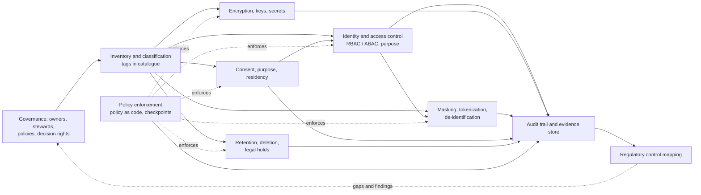

# Roadmap — Module 2D.10: Data Governance, Security, Privacy and Compliance

This is the learning roadmap for the tenth module of Stage 2D, **Data
Architecture**. It tells you **what** to learn, **in what order**, **how** to
learn each topic from beginner to advanced level, **how to prove** you have
learned it, and **how to complete** the module's final sensitive data governance
and access design project.

Earlier modules built the platform, its integration, its cloud realisation and
its real-time paths. This module asks the question that decides whether any of
it can be trusted with real data: **who is accountable, what is each piece of
data, who may use it and for what, how is it protected, how long does it live,
and how can we prove all of that?**

> **Legal caution.** This roadmap teaches **architecture and control-design
> skills**. It is educational material, **not legal advice**. Obligations vary by
> jurisdiction, sector, data type and organisational context, and must be
> interpreted by qualified legal, privacy and compliance specialists. Where this
> roadmap names a kind of regulation, it does so as an **illustration of the type
> of requirement**, not as a statement of what applies to you or what compliance
> requires. Nothing here asserts that any organisation or design is compliant.
>
> **Repository note (source-of-truth limits).** The nine topic files,
> `practice-questions.md`, `README.md`, `Projects/README.md` and
> `Projects/10-sensitive-data-governance-and-access-design.md` currently exist but
> are **empty**, as are the Stage 2D overview files. This roadmap therefore cannot
> be grounded in their contents. It is the first written statement of the
> module's scope, derived from the file names, the Stage 2D structure and the
> earlier module roadmaps. It does **not** claim that any topic file already
> contains the material below. Every exercise, template, scenario and target is a
> **recommendation**, not a documented requirement. When the topic files and the
> project file are written, their scope governs and this roadmap should be updated
> to match.
>
> **Directory name.** The prompt that requested this roadmap referred to
> `STAGE 2D - DATA ARCHITECURE/`. The actual directory is
> `Stage 2D — Data Architecture/`, and the actual name is preserved.
>
> **Illustrative and synthetic content.** Every number, system, role, dataset and
> organisation here is an **illustrative assumption**. Exercises use **fictional
> or synthetic data only**; never use real personal or confidential data in any
> exercise. The module is vendor-neutral.

---

## 1. Module overview

### 1.1 What data governance means

**Data governance** is the system of decision rights, accountabilities, policies
and processes that determine how an organisation's data are defined, owned,
protected, used and retired. It answers: who decides, who is responsible, what
are the rules, and how do we know they are followed?

### 1.2 Governance, security, privacy, risk and compliance

These overlap and are often confused.

| Concept | Core question | Typical owner | Example output |
| --- | --- | --- | --- |
| **Data governance** | Who is accountable, and what are the rules for data? | Data governance function, data owners | Operating model, policies, classification scheme |
| **Information security** | Is data protected from unauthorised access, change or loss? | Security function | Access controls, encryption, monitoring |
| **Privacy** | Are personal data collected and used fairly, for stated purposes, and with individuals' rights respected? | Privacy function / privacy officer | Purpose records, consent handling, minimisation |
| **Risk management** | What could go wrong, how likely and how bad, and what do we accept? | Risk function | Risk register, risk acceptance decisions |
| **Compliance** | Do we meet obligations from laws, regulations, contracts and standards, and can we show it? | Compliance / legal | Control mapping, evidence, audit results |

They support one another: governance sets who decides; security and privacy
provide controls; risk prioritises; compliance requires evidence. An
architecture must implement the controls and make the evidence available.

### 1.3 Why platforms need defined accountability and enforceable controls

On a shared platform with many teams (2D.7), unclear accountability produces
unowned data, inconsistent controls and unanswerable audit questions. Policies
that exist only as documents are not controls; **enforceable controls** (built
into the platform) make the compliant way the default.

### 1.4 How responsibilities are distributed

| Function | Typical responsibilities |
| --- | --- |
| **Business / data owners** | Accountable for a data asset's meaning, use and access decisions |
| **Data stewards** | Maintain definitions, quality and classification day to day |
| **Data / platform engineering** | Build and operate the platform and implement controls |
| **Security** | Define security standards, monitor, respond to incidents |
| **Privacy / legal / compliance** | Interpret obligations, advise on lawful use, assess risk |
| **Internal audit** | Independently test whether controls work |
| **Executives / governance council** | Set direction, resolve escalations, accept risk |

Distinguish four things that people merge: **owning** a data asset, **operating**
the platform it lives on, **approving** access to it, and **defining policy**
for it. One person or team may do several, but the roles should be explicit.

### 1.5 Why classification is foundational

You cannot decide how to protect data without knowing what they are and how
sensitive and important they are. Classification drives access, encryption,
masking, retention and audit decisions, so an error in classification
propagates into every later control.

### 1.6 How protection techniques fit together

| Technique | What it does | What it does not do |
| --- | --- | --- |
| Identity and access control | Decides who may do what | Protect data if storage is bypassed or keys are exposed |
| Encryption | Protects data from those without keys | Decide who is authorised, or stop misuse by authorised users |
| Masking | Hides or alters values for some viewers | Make data anonymous |
| Tokenization | Replaces values with surrogates, with a protected mapping | Remove regulatory obligations by itself |
| De-identification / anonymisation | Reduces ability to identify individuals | Guarantee zero re-identification risk |

No single control is enough. **Defence in depth** layers them.

### 1.7 Privacy and lifecycle affect architecture

Consent, purpose limitation, residency, retention and deletion are not only
legal topics. They change **where data are stored**, **how they are copied**,
**what pipelines may do**, **how long logs and backups persist**, and **what
evidence must be kept**. They shape ingestion, storage, transformation,
analytics, sharing and AI data use.

### 1.8 Regulatory controls need evidence

A **policy** says what should happen. A **control** is the mechanism that makes it
happen. **Operating** the control means it works consistently. **Evidence** is
the record that shows it did. Auditors and regulators ask for evidence, so
architecture must produce it as a by-product of operation.

### 1.9 Governance by design

Instead of a manual review at the end ("governance as a gate"), governance by
design builds controls into platform templates, pipelines and metadata so that
non-compliant paths are hard or impossible, and violations are detected
automatically. Not every decision can be automated; some need human judgement.

### 1.10 How this module builds on earlier ones

| Earlier module | Provides |
| --- | --- |
| `../01-Data-Architecture-Foundations-and-Principles/` | Ownership, governance lifecycle, decision rights |
| `../02-Requirements-Constraints-and-Architecture-Decisions/` | Constraints, risks, ADRs |
| `../04-Conceptual-Logical-and-Physical-Data-Modeling/` | Entities, attributes, data dictionary |
| `../05-Database-and-Storage-Architecture/` | Lifecycle, retention, replication, deletion in immutable stores |
| `../06-Data-Integration-and-Interoperability/` | Contracts, lineage points, reconciliation |
| `../07-Enterprise-Data-Platform-and-Lakehouse-Architecture/` | Zones, metadata, tenancy, self-service guardrails |
| `../08-Cloud-Hybrid-and-Multi-Cloud-Data-Architecture/` | Identity, private connectivity, residency, IaC and policy as code |
| `../09-Streaming-and-Real-Time-Data-Architecture/` | Retention and replay in logs, event contracts |

### 1.11 Governance and AI/analytics

Analytics, ML and AI amplify governance questions: training data may carry
personal data and purpose restrictions; models and features inherit sensitivity;
retrieval systems can expose data a user should not see; derived data and
embeddings may need deletion; lineage and consent must follow data into
training sets. These are treated where relevant in each topic and detailed in
`../14-Data-Access-Serving-Semantic-and-AI-Data-Architecture/`.

### 1.12 Terminology in plain language

| Term | Plain meaning |
| --- | --- |
| Data owner | The accountable person/role for a data asset's use and protection |
| Data steward | Looks after definitions, quality and classification |
| Classification | A label stating sensitivity/criticality and handling needs |
| PII | Information that can identify an individual, alone or combined |
| Least privilege | Give only the access needed, for only as long as needed |
| RBAC / ABAC | Access by role / access by attributes of user, data and context |
| Key | Secret value used to encrypt and decrypt |
| Secret | A credential such as a password or token used by software |
| Pseudonymisation | Replace identifiers with substitutes; re-linkable with extra information |
| Anonymisation | Irreversibly remove ability to identify individuals (hard to prove) |
| Purpose limitation | Use data only for the purposes they were collected for |
| Data residency | Rules about where data may be stored or processed |
| Legal hold | A requirement to preserve data that would otherwise be deleted |
| Control | A mechanism that implements a requirement |
| Evidence | A record demonstrating a control operated |

---

## 2. Learning outcomes

After completing the module you will be able to:

1. **Explain** a data governance operating model and accountability structure.
2. **Classify** data by sensitivity, criticality and protection requirements.
3. **Design** identity and access controls using least-privilege principles.
4. **Explain** encryption, key-management and secrets-management
   responsibilities.
5. **Distinguish** masking, tokenization, pseudonymisation and anonymisation, and
   **select** among them with stated limits.
6. **Translate** consent, purpose-limitation and residency constraints into
   architectural requirements.
7. **Design** retention, deletion, legal-hold and auditability controls.
8. **Map** applicable requirements to technical controls and auditable evidence.
9. **Integrate** governance policies into architecture and delivery workflows.
10. **Produce and defend** a sensitive data governance and access design.

Each outcome is demonstrated through exercises, deliverables and the gates in
Sections 5, 10 and 11.

---

## 3. Prerequisites and knowledge dependencies

### 3.1 Prerequisite table

| # | What you should already understand | Why it matters here | Provided by | Review if weak |
| --- | --- | --- | --- | --- |
| P1 | Business capabilities, domains, ownership; governance lifecycle and decision rights | Governance operating models extend these | `../01-Data-Architecture-Foundations-and-Principles/03-business-capabilities-domains-and-data-ownership.md`, `05-data-architecture-lifecycle-and-governance.md` | Draw a RACI for ten data decisions |
| P2 | Principles, quality attributes, exceptions | Security and privacy are quality attributes with trade-offs; exception handling | `../01-Data-Architecture-Foundations-and-Principles/04-architecture-principles-and-quality-attributes.md` | Write an exception record |
| P3 | Constraints, assumptions, risks; trade-offs; ADRs | Regulatory and risk constraints; decisions must be recorded | `../02-Requirements-Constraints-and-Architecture-Decisions/05-constraints-assumptions-dependencies-and-risks.md`, `06-architecture-trade-offs-and-decision-criteria.md`, `07-architecture-decision-records-adrs.md` | Classify 15 statements; write an ADR |
| P4 | Data models, attributes, data dictionary, naming | Classification and masking are applied to attributes | `../04-Conceptual-Logical-and-Physical-Data-Modeling/08-model-review-naming-standards-and-data-dictionaries.md`, `02-entities-relationships-cardinality-and-constraints.md` | Build a dictionary entry set for five fields |
| P5 | Lifecycle, retention, archival and tiers; replication; immutable storage and table formats | Deletion and retention must reach every copy | `../05-Database-and-Storage-Architecture/07-retention-archival-and-data-lifecycle-storage-tiers.md`, `06-replication-consistency-and-transaction-boundaries.md`, `04-warehouse-lakehouse-and-table-format-design.md` | List copies of one dataset |
| P6 | Contracts, lineage points, idempotency, reconciliation | Evidence and propagation of classification depend on these | `../06-Data-Integration-and-Interoperability/05-data-contracts-schema-registry-and-compatibility.md`, `07-idempotency-deduplication-and-reconciliation.md` | Write a contract with classification fields |
| P7 | Platform zones, layers, metadata and catalogue, tenancy, self-service guardrails | Where controls attach and how they are automated | `../07-Enterprise-Data-Platform-and-Lakehouse-Architecture/03-bronze-silver-gold-and-data-product-boundaries.md`, `05-catalogs-metastores-and-platform-metadata.md`, `06-self-service-platforms-and-developer-experience.md`, `07-multi-team-isolation-and-tenant-boundaries.md` | Define mandatory metadata fields |
| P8 | Cloud identity, networking, private connectivity, residency, IaC and policy as code | Access, keys and residency are implemented in the cloud | `../08-Cloud-Hybrid-and-Multi-Cloud-Data-Architecture/05-networking-identity-and-private-connectivity.md`, `01-cloud-data-architecture-principles.md`, `08-infrastructure-as-code-and-environment-strategy.md` | Redo the five-layer access path |
| P9 | Retention and replay in event logs; event contracts; serving stores | Sensitive data in streams and views | `../09-Streaming-and-Real-Time-Data-Architecture/05-cdc-event-backbones-and-replay.md`, `06-real-time-serving-stores-and-materialized-views.md` | Note personal data in a retained topic |

### 3.2 Essential vs concurrent

| Essential before starting | Can be learned during this module |
| --- | --- |
| P1, P3, P4, P5, P7, P8 | Jurisdiction-specific legal detail (consult specialists) |
| P2, P6, P9 (at least their gates) | Lineage and quality tooling (`../11-Metadata-Lineage-Quality-and-Master-Data/`) |
| | DR and resilience (`../12-Reliability-Resilience-and-Disaster-Recovery/`) |
| | Cost depth (`../13-Performance-Scalability-and-Cost-Architecture/`) |

Do the review exercise for a weak prerequisite before Topic 1.

---

## 4. Recommended learning sequence

All effort estimates are **recommendations** (about 6–8 hours per week assumed).

| Seq | Source file | Topic | Why at this point | Prerequisites | Concepts first | Output before progressing | Effort (rec.) |
| --- | --- | --- | --- | --- | --- | --- | --- |
| 1 | `01-governance-operating-model-and-accountability.md` | Governance operating model | Establishes who decides; every control needs an owner | P1–P3 | Owner, steward, decision rights | Responsibility matrix with gaps | 5–7 h |
| 2 | `02-data-classification-sensitivity-and-criticality.md` | Classification | Drives every later protection decision | Seq 1, P4 | Sensitivity vs criticality, inventory | Classification scheme and register | 6–8 h |
| 3 | `03-identity-access-control-and-least-privilege.md` | Identity and access | First protection control; uses classification and ownership | Seq 1–2, P8 | AuthN vs AuthZ, RBAC/ABAC, least privilege | Role and access matrix | 7–9 h |
| 4 | `04-encryption-key-management-and-secrets.md` | Encryption, keys, secrets | Protects data when access control is bypassed; needs access model for key policies | Seq 2–3 | Keys vs secrets vs credentials | Encryption and key design | 6–8 h |
| 5 | `05-pii-masking-tokenization-and-de-identification.md` | PII protection techniques | Reduces exposure for permitted users; needs classification and access | Seq 2–4 | PII, masking, tokenization, anonymisation | Sensitive-field protection matrix | 6–8 h |
| 6 | `06-consent-purpose-limitation-and-data-residency.md` | Consent, purpose, residency | Adds *why* and *where* constraints on top of *who* | Seq 1–5 | Purpose, consent state, jurisdiction | Purpose and residency map | 6–8 h |
| 7 | `07-retention-deletion-legal-holds-and-auditability.md` | Lifecycle and audit | End-of-life controls that depend on classification, purpose and copies | Seq 2, 4–6, P5 | Retention, deletion across copies, holds | Lifecycle control matrix | 7–9 h |
| 8 | `08-regulatory-controls-and-evidence-design.md` | Controls and evidence | Maps obligations to the controls designed so far and to evidence | Seq 1–7 | Control types, evidence chain | Requirement-to-control map and evidence plan | 7–9 h |
| 9 | `09-governance-by-design-and-policy-enforcement.md` | Governance by design | Integrates everything into automated, enforceable workflows | Seq 1–8, P7–P8 | Policy as code, checkpoints, exceptions | Enforcement workflow design | 7–9 h |
| — | `practice-questions.md` | Validation | After each topic and fully before the project | Seq 1–9 | — | Gap log | 3–4 h |
| — | `Projects/10-sensitive-data-governance-and-access-design.md` | Final project | Integrates all nine | All | — | Governance and access design package | 14–18 h |

**Order notes.**

- The recommended order **matches the numeric filename order**. It follows
  *accountability → what the data are → who may use them → how they are
  protected → what limits their use → how long they live → how we prove it → how
  we automate it*.
- Optional previews: skim **Topic 8 Beginner** after Topic 1 to see that
  everything ends in evidence; skim **Topic 9 Beginner** after Topic 3 to see
  where access policy is headed.
- Topic 4 (encryption) follows Topic 3 because key access policy is itself an
  access-control design.

---

## 5. Detailed beginner-to-advanced roadmap for every topic

Each topic uses the same twelve parts. Levels are cumulative. Examples use the
**illustrative** scenario of *Northbridge Bank* (Section 10.2), a fictional
mid-sized bank, and **synthetic data only**. Because the source topic files are
empty, any specific subtopic named below is a **recommended** learning focus.

---

### 5.1 Topic 01 — Governance operating model and accountability

Source: [`01-governance-operating-model-and-accountability.md`](01-governance-operating-model-and-accountability.md)

#### 5.1.1 Topic overview

A **governance operating model** says who plays which role, who makes which
decisions, how disagreements escalate, who owns policy, and how effectiveness is
measured. Without it, controls have no owner, exceptions have no approver, and
audits find no one accountable.

#### 5.1.2 Learning objectives

1. Define data owner, steward, custodian/platform operator, policy owner,
   approver and consumer.
2. Build a responsibility matrix for governance decisions.
3. Define decision rights, escalation paths and governance forums.
4. Distinguish owning an asset, operating a platform, approving access and
   defining policy.
5. Identify accountability gaps and conflicts.
6. Define governance effectiveness measures.

#### 5.1.3 Prerequisites

P1–P3 (Section 3); `../07-Enterprise-Data-Platform-and-Lakehouse-Architecture/07-multi-team-isolation-and-tenant-boundaries.md` for tenant ownership.

#### 5.1.4 Beginner level — build the foundations

- **Roles (typical; names vary):**

  | Role | Typical responsibility |
  | --- | --- |
  | Data owner | Accountable for an asset's use, protection level and access approval |
  | Data steward | Maintains definitions, quality rules, classification |
  | Data custodian / platform operator | Runs the systems; implements controls; does not decide business use |
  | Policy owner | Maintains a policy (for example the classification policy) |
  | Data governance council | Sets direction, resolves escalations |
  | Data protection / privacy officer | Advises on privacy obligations (role names and requirements vary by jurisdiction) |

- **Analogy:** a library: authors own content, librarians catalogue it, the
  building team runs the building, the board sets rules.
- **Create:** a one-page diagram of roles and the decisions each makes.
- **Questions to answer:** Who decides who may read customer addresses? Who makes
  the rule that says how addresses are classified?
- **Small exercise:** assign ten decisions (approve access, set retention,
  classify a new field, approve an exception…) to roles.

#### 5.1.5 Intermediate level — understand the architecture

- **Operating-model structure:** strategic (council), tactical (domain councils/
  working groups), operational (stewards, platform teams). Federated operating
  models align with domain ownership (2D.3 Topics 1, 4; 2D.7).
- **Decision rights:** use a RACI-style matrix for governance decisions: policy
  creation, classification, access approval, exception approval, incident
  response, retention change.
- **Policy lifecycle:** draft → review → approve → publish → implement → monitor
  → review. Policy ownership and approval authority.
- **Escalation:** time-boxed paths from steward to owner to council.
- **Accountability across functions:** business, engineering, security, privacy,
  legal. A decision with no accountable role is a gap.
- **Governance forums:** purpose, membership, cadence, decision log.
- **Failure scenarios:** "everyone owns it, nobody owns it"; the platform team
  approves access to data it does not understand; two owners conflict over a
  shared dataset.
- **Design exercise:** produce the responsibility matrix for the Northbridge
  customer domain and mark gaps.
- **Trade-offs:** centralised governance (consistency, bottleneck) vs federated
  (speed, inconsistency).

#### 5.1.6 Advanced level — make architecture decisions

- **Separation of duties:** the person requesting access should not approve it;
  the person implementing a control should not be the only one testing it.
- **Risk acceptance authority:** who may accept which level of risk (by
  classification and impact); record acceptance with expiry.
- **Federated model design:** which decisions are central (classification
  scheme, minimum controls), which are domain-level (access approvals, quality
  rules). Prevent both a central bottleneck and domain divergence.
- **Governance metrics (illustrative indicators):** percentage of critical
  assets with a named owner and steward; access-request cycle time; share of
  access reviews completed on time; open exceptions and their age; policy
  violations detected and time to remediate; classification coverage. Targets
  are assumptions.
- **Operating-effectiveness evidence:** meeting records, decision logs,
  completed reviews (links to Topic 8).
- **Scalability:** governance that works for 20 datasets may fail at 2,000;
  automate routine decisions (Topic 9).
- **Change management:** reorganisations, ownership transfers, orphaned assets
  when owners leave.
- **Cost and usability:** governance overhead is a cost; proportionate
  governance by risk (2D.1 Topic 5).
- **Document** the operating model, decision rights and exceptions policy in an
  ADR.

#### 5.1.7 Industry application and hands-on exercises

| | Exercise A — Responsibility matrix | Exercise B — Gap and conflict analysis |
| --- | --- | --- |
| Scenario | Northbridge governance is ad hoc across six domains | Two domains claim ownership of "customer contact details" |
| Problem | Define who decides what | Resolve and prevent recurrence |
| Inputs | Domain map, decision list (synthetic) | Matrix from A |
| Tasks | Build RACI for 12 decisions; define forums and escalation times | Identify gaps and conflicts; propose resolution rule and ownership; define a tie-break authority |
| Deliverables | Responsibility matrix and forum charter | Gap log and decision record |
| Validation | Each decision has exactly one accountable role; escalation has time limits | Resolution criteria stated; owner named |
| Demonstrates | You can structure governance | You can resolve accountability conflicts |

#### 5.1.8 Real-world scenarios and trade-offs

| Scenario | Context | Sensitive data | Constraints | Alternatives | Pros / cons | Security/privacy risks | Recommended (assumptions) | Would change if |
| --- | --- | --- | --- | --- | --- | --- | --- | --- |
| Shared customer dataset | Used by six domains | Personal data | No single natural owner | (a) Central owner; (b) steward council; (c) domain owner for each attribute | (a) clear, remote; (b) inclusive, slow; (c) precise, complex | Unclear approvals | (c) with a master owner for the entity | Dataset small and stable |
| Platform team approves all access | Backlog of requests | Mixed | Team lacks business context | (a) Platform approves; (b) owner approves, platform enforces | (a) single queue; (b) accountable | Over-granting | (b) | Low-risk data may be auto-approved by rule |

#### 5.1.9 Expected deliverables

- Role definitions and responsibility matrix.
- Governance forum charter (purpose, membership, cadence, decision log).
- Escalation paths with time limits.
- Governance measures list.
- ADR on the operating model.

#### 5.1.10 Common mistakes and misconceptions

| Mistake | Why problematic | How to avoid |
| --- | --- | --- |
| Governance = a committee | No operating decisions | Define roles, rights, processes |
| Platform team as owner of all data | No business accountability | Separate ownership from operation |
| Owner assigned but not resourced | Paper accountability | Confirm capacity and authority |
| Policies without owners | They decay | Name a policy owner and review date |
| No escalation timing | Disputes stall | Time-box |

#### 5.1.11 Mastery criteria

- Distinguish owning, operating, approving and policy-defining.
- Build a matrix where each decision has one accountable role.
- Identify gaps and conflicts and propose resolution rules.

#### 5.1.12 Completion gate

- [ ] Matrix, charter and gap analysis reviewed by one other person.
- [ ] You can explain the four distinct responsibilities to a non-specialist.
- [ ] Metrics are observable.
- [ ] Weakness (collapsing roles) addressed by redoing the matrix with explicit
      separation.

---

### 5.2 Topic 02 — Data classification, sensitivity and criticality

Source: [`02-data-classification-sensitivity-and-criticality.md`](02-data-classification-sensitivity-and-criticality.md)

#### 5.2.1 Topic overview

**Classification** labels data by how sensitive they are and how important they
are, so that handling rules can follow the label. **Sensitivity** is the harm
from exposure or misuse. **Criticality** is the harm from loss or unavailability.
They are different axes and need different protections.

#### 5.2.2 Learning objectives

1. Build or apply a classification scheme with defined levels.
2. Distinguish sensitivity from criticality.
3. Perform a data inventory and classify assets at field level where needed.
4. Link classification to handling requirements.
5. Describe classification propagation through pipelines and derived data.
6. Design classification review and recertification.

#### 5.2.3 Prerequisites

Seq 1; P4 (data dictionary), P7 (metadata).

#### 5.2.4 Beginner level — build the foundations

- **Terms:** data inventory, classification level, sensitivity, criticality,
  personal data, confidential, restricted, public, handling requirement.
- **Typical (illustrative, not a legal taxonomy) levels:** Public, Internal,
  Confidential, Restricted. Organisations choose their own. Do **not** treat any
  scheme as a universal legal standard.
- **Two axes:**

  | Axis | Question | Example high |
  | --- | --- | --- |
  | Sensitivity | What harm if exposed? | Customer national identifier |
  | Criticality | What harm if lost or unavailable? | Payment ledger |

  A public price list is low sensitivity but may be high criticality for the
  website; a confidential memo may be low criticality.
- **Create:** a table of ten fictional fields with sensitivity and criticality.
- **Questions to answer:** Why is "everything is Restricted" unhelpful? Who
  should classify?
- **Small exercise:** classify the fields of a synthetic customer table.

#### 5.2.5 Intermediate level — understand the architecture

- **Inventory first:** you cannot classify what you cannot find; discovery from
  catalogues and scans (2D.7 Topic 5), validated by stewards.
- **Granularity:** dataset-level vs field-level classification; derived
  datasets inherit the highest classification of their inputs unless
  transformation demonstrably lowers it (a rule to define and justify).
- **Handling requirements per level (illustrative):**

  | Level | Access | Encryption | Masking | Retention | Audit |
  | --- | --- | --- | --- | --- | --- |
  | Public | Open | In transit | None | Business need | Minimal |
  | Internal | Staff | At rest and in transit | Optional | Business need | Standard |
  | Confidential | Need to know | Required | In non-production | Defined | Detailed |
  | Restricted | Named roles, approval | Required with key controls | Required for most uses | Strict | Full |

  Contents are examples; the real values come from policy and specialists.
- **Ownership and responsibility:** the owner decides classification; the
  steward maintains it; the platform enforces it (Topic 1).
- **Propagation:** classification should travel with data through lineage and
  contracts (2D.6 Topic 5), pipelines and views.
- **Review and recertification:** periodic re-validation; triggers: schema
  change, new use, regulatory change.
- **Failure scenarios:** unclassified new column in a Restricted table; derived
  report with a weaker label than its inputs; stale classification after a use
  change.
- **Design exercise:** classify a customer data product at field level and
  define propagation rules to its derived views.
- **Trade-offs:** fine-grained classification is accurate and costly; coarse is
  cheap and over-protects.

#### 5.2.6 Advanced level — make architecture decisions

- **Scheme design:** number of levels (too many are not applied, too few do not
  discriminate); alignment with existing corporate and sector schemes; mapping
  between schemes.
- **Combination effects (aggregation):** individually low-sensitivity fields can
  become sensitive together (quasi-identifiers, Topic 5); classification rules
  should consider combinations and context.
- **Automation and assistance:** pattern-based and ML-assisted discovery has
  false positives and negatives; require steward review for Restricted.
- **Classification and criticality for architecture:** criticality drives
  availability, backup and recovery (`../12-Reliability-Resilience-and-Disaster-Recovery/`); sensitivity drives access and
  protection.
- **Propagation design:** tags in the catalogue, column-level tags enforced by
  policy engines (Topic 9); handling of unstructured data and free-text fields
  that may contain personal data.
- **AI and analytics:** training sets and features inherit classification;
  embeddings and model outputs may reveal inputs.
- **Exceptions and risk acceptance:** temporary lower classification handling,
  approved and time-limited.
- **Metrics:** classification coverage, accuracy (sample audits), time to
  classify new assets, number of unclassified assets.
- **Document** the scheme, inheritance rules and review cadence in an ADR.
- **Avoid presenting the scheme as a legal standard;** legal categories (for
  example special or sensitive personal data) must be confirmed by specialists
  and mapped to the scheme.

#### 5.2.7 Industry application and hands-on exercises

| | Exercise A — Inventory and classification register | Exercise B — Propagation and derived data |
| --- | --- | --- |
| Scenario | Northbridge has 40 synthetic tables across six domains | A risk report combines transaction, customer and location data |
| Problem | Create a defensible classification | Decide the report's classification |
| Inputs | Synthetic field list, scheme, policies | Input classifications, transformations |
| Tasks | Inventory; classify each field (sensitivity, criticality); assign owner/steward; record handling requirements | Apply inheritance rule; test whether aggregation lowers sensitivity; record justification and review date |
| Deliverables | Classification register | Propagation rules and decision record |
| Validation | Every asset has owner and level; high-level choices justified | Rule is testable; exceptions explicit |
| Demonstrates | You can classify | You can reason about derived data |

#### 5.2.8 Real-world scenarios and trade-offs

| Scenario | Context | Sensitive data | Constraints | Alternatives | Pros / cons | Risks | Recommended (assumptions) | Would change if |
| --- | --- | --- | --- | --- | --- | --- | --- | --- |
| Free-text notes | Call-centre notes in a lake | May contain personal data | Cannot inspect every note | (a) Treat all as Restricted; (b) scan and tag; (c) exclude from analytics | (a) safe, restrictive; (b) flexible, imperfect; (c) simple, loses value | Missed personal data | (a) until scanning is validated | Scanning proven accurate on samples |
| Aggregated dashboard | Counts by postcode and age band | Quasi-identifiers | Small cells may identify people | (a) Publish; (b) suppress small counts | (a) simple, risk; (b) safer | Re-identification | (b) with a minimum cell size rule | Cells always large |

#### 5.2.9 Expected deliverables

- Classification scheme with definitions and handling table.
- Data inventory and classification register.
- Propagation/inheritance rules.
- Review and recertification procedure.
- ADR.

#### 5.2.10 Common mistakes and misconceptions

| Mistake | Why problematic | How to avoid |
| --- | --- | --- |
| Confusing sensitivity with criticality | Wrong protections | Classify on both axes |
| Over-classifying everything | Controls ignored or unusable | Use risk-based granularity |
| Classifying once and forgetting | Drift | Recertify on triggers |
| Ignoring derived data | Leaks via reports | Propagate rules |
| Treating a scheme as law | Wrong legal assumptions | Map to legal categories with specialists |

#### 5.2.11 Mastery criteria

- Classify fields on both axes and justify.
- State and apply an inheritance rule.
- Explain how classification drives access, encryption, masking, retention and
  audit.

#### 5.2.12 Completion gate

- [ ] Register and rules reviewed; sample audit of ten classifications passes.
- [ ] Derived-data classification justified in writing.
- [ ] Scheme labelled as organisational, not legal.
- [ ] Weakness (single-axis thinking) addressed by re-classifying with both axes.

---

### 5.3 Topic 03 — Identity, access control and least privilege

Source: [`03-identity-access-control-and-least-privilege.md`](03-identity-access-control-and-least-privilege.md)

#### 5.3.1 Topic overview

Access control decides **who or what may do which action on which data**.
Identity establishes **who is asking**; authorisation decides **what they may
do**. **Least privilege** means granting the minimum access needed, for the
minimum time. This topic covers the models (RBAC, ABAC), the identities (people,
services, workloads), privileged access, reviews and auditing.

#### 5.3.2 Learning objectives

1. Distinguish authentication from authorisation.
2. Distinguish user, group, role, service and workload identities.
3. Compare RBAC and ABAC and their combinations.
4. Apply least privilege and separation of duties.
5. Design privileged access, access reviews and revocation.
6. Design service-to-service access and fine-grained data restrictions.
7. Produce a role and access matrix for a realistic platform.

#### 5.3.3 Prerequisites

Seq 1–2; P8 (`../08-Cloud-Hybrid-and-Multi-Cloud-Data-Architecture/05-networking-identity-and-private-connectivity.md`).

#### 5.3.4 Beginner level — build the foundations

- **Terms:** identity, authentication (who are you), authorisation (what may you
  do), role, group, permission, policy, principal, service account/workload
  identity, privileged access, access review.
- **Analogy:** a hotel: your key card proves you are a guest (authentication) and
  opens only your room and the gym (authorisation).
- **Models:**

  | Model | Decision basis | Strength | Weakness |
  | --- | --- | --- | --- |
  | RBAC | Role membership | Simple, auditable | Role explosion; coarse |
  | ABAC | Attributes of user, data and context (for example department, classification, purpose, location) | Fine-grained, scalable rules | Complex to design, test and audit |
  | Hybrid | Roles for coarse access, attributes for fine rules | Balanced | Needs clear precedence |

- **Create:** a diagram: user → identity provider → role → policy → data.
- **Questions to answer:** Why should pipelines not use a person's credentials?
- **Small exercise:** classify ten access requests (analyst reads aggregated
  sales, engineer reads production PII, pipeline writes to lake…) into
  appropriate model and least-privilege grant.

#### 5.3.5 Intermediate level — understand the architecture

- **Identity types and sources:** workforce identities from a corporate identity
  provider (with federation); service/workload identities for software, with
  short-lived credentials; external partner identities.
- **Role design.** *Illustration of role explosion:* 6 domains × 4 classification
  levels × 3 actions (read, write, admin) = 72 roles if every combination is a
  role. An attribute rule ("read if user's domain = data domain and level ≤
  clearance") replaces many roles but needs attribute quality and testing.
- **Data-level restrictions:** row-level and column-level controls, masking
  views, tag-based policies (links to Topic 5).
- **Least privilege in practice:** start from zero; grant per job function;
  time-bound access; prefer groups; separate read/write/admin; separate
  administrative (control plane) and data access.
- **Separation of duties:** requester ≠ approver; developer ≠ production
  approver; administrators cannot read data by default.
- **Privileged access:** just-in-time elevation, approval, session recording,
  break-glass accounts with after-the-fact review.
- **Access reviews and revocation:** periodic recertification by the owner;
  joiner-mover-leaver processes; automatic removal at role change.
- **Service-to-service access:** workload identity federation, no embedded
  secrets (Topic 4), scoped to the job.
- **Auditing access decisions:** log who accessed what, when, from where, and the
  decision; protect logs.
- **Failure scenarios:** access accumulates over years; shared accounts; a
  pipeline with admin rights; a leaver retains access.
- **Design exercise:** produce a role and access matrix for the Northbridge
  platform (analyst, data scientist, domain engineer, platform admin, auditor,
  pipeline identity).
- **Trade-offs:** strictness vs productivity; central vs delegated approval.

#### 5.3.6 Advanced level — make architecture decisions

- **Choosing RBAC, ABAC or hybrid:** by scale, change rate, audit needs, tooling
  support, team skills. Document the decision rule and precedence (deny
  overrides allow?).
- **Policy consistency across platforms:** the same intent expressed in multiple
  systems (warehouse, lake storage, catalogue, BI) drifts; use a central policy
  definition with distributed enforcement, or a policy engine; **direct-storage
  bypass:** fine-grained rules in a query engine do not protect files read
  directly from storage unless storage access is also restricted.
- **Purpose-based access:** include declared purpose as an attribute (links to
  Topic 6).
- **Threat modelling:** insider threat, credential theft, privilege escalation,
  confused-deputy (a service with broad rights acting on a user's behalf);
  mitigations: scoped tokens, on-behalf-of flows, anomaly detection.
- **Defence in depth:** network controls, identity controls, encryption and
  monitoring together (`../08-Cloud-Hybrid-and-Multi-Cloud-Data-Architecture/05-networking-identity-and-private-connectivity.md`); a private network does not authorise,
  and a valid identity does not make an exposed endpoint safe.
- **Scale and performance:** policy evaluation cost; caching and its staleness
  (revocation delay is a risk; state the acceptable delay).
- **Operational complexity:** role lifecycle, ownership of roles, tooling for
  access requests, evidence capture.
- **Exceptions and risk acceptance:** time-boxed, approved by the owner and
  security, recorded.
- **Metrics:** share of access reviewed on time; average access age; privileged
  sessions; orphaned accounts; time to revoke.
- **AI and analytics:** access for notebooks, feature stores, retrieval systems;
  ensure retrieval respects the caller's permissions rather than the service's.
- **Document** the access model, precedence rules and exceptions in an ADR.

#### 5.3.7 Industry application and hands-on exercises

| | Exercise A — Role and access matrix | Exercise B — Access review and revocation |
| --- | --- | --- |
| Scenario | Northbridge analytics platform with six personas | A data scientist moves from Risk to Marketing |
| Problem | Design least-privilege roles | Define what happens to access |
| Inputs | Classification register, personas (synthetic) | Joiner-mover-leaver policy |
| Tasks | Define roles, permissions, approval owners, review cycle; mark data-level restrictions; justify each grant | Design mover process, review evidence, revocation timing; identify residual access risks |
| Deliverables | Access control matrix | Review and revocation procedure |
| Validation | No wildcard grants; each grant has justification and owner; admin cannot read data by default | Revocation time stated; evidence defined |
| Demonstrates | You can design least privilege | You can maintain it over time |

#### 5.3.8 Real-world scenarios and trade-offs

| Scenario | Context | Sensitive data | Constraints | Alternatives | Pros / cons | Risks | Recommended (assumptions) | Would change if |
| --- | --- | --- | --- | --- | --- | --- | --- | --- |
| Analyst needs customer-level data | Investigation of anomalies | Restricted personal data | Short-term need | (a) Standing access; (b) just-in-time approved access; (c) masked view | (a) easy, over-grants; (b) controlled; (c) safe, may block work | Persistent access | (b) with masked default | Access is routine and low risk |
| Pipeline identity | Shared across 20 jobs | Mixed | Rotation difficulty | (a) One shared identity; (b) per-job identities | (a) simple, broad blast radius; (b) scoped, more to manage | Credential leak impact | (b) | Very small estate |

#### 5.3.9 Expected deliverables

- Access control matrix (role, asset, permission, justification, approver,
  review).
- Identity inventory (people, groups, services).
- Privileged access and break-glass design.
- Access review and revocation procedure.
- ADR on RBAC/ABAC choice.

#### 5.3.10 Common mistakes and misconceptions

| Mistake | Why problematic | How to avoid |
| --- | --- | --- |
| Granting broad access "to unblock" | Permanent over-privilege | Time-box and review |
| Shared or generic accounts | No accountability | Individual and workload identities |
| Admin = data access | Violates separation | Separate control and data access |
| Policy only in the query layer | Bypass via storage | Restrict direct access too |
| Believing network location = authorisation | Lateral movement | Identity checks every request |
| No revocation timing | Leavers keep access | Define SLA and test |

#### 5.3.11 Mastery criteria

- Distinguish authentication from authorisation and name their failures.
- Produce a least-privilege matrix with justifications.
- Choose between RBAC and ABAC with criteria.

#### 5.3.12 Completion gate

- [ ] Matrix, review procedure and ADR reviewed.
- [ ] Direct-storage bypass considered.
- [ ] Revocation delay stated and justified.
- [ ] Weakness (over-broad roles) addressed by splitting a role and re-justifying.

---

### 5.4 Topic 04 — Encryption, key management and secrets

Source: [`04-encryption-key-management-and-secrets.md`](04-encryption-key-management-and-secrets.md)

#### 5.4.1 Topic overview

**Encryption** protects data from anyone without the right key. It shifts the
problem to **key management**: who holds keys, who may use them, how they are
rotated and recovered. **Secrets management** protects the credentials software
uses. Encryption is necessary in most designs but is **not sufficient** alone.

#### 5.4.2 Learning objectives

1. Explain encryption at rest and in transit and where each applies.
2. Distinguish encryption keys, application secrets, credentials and access
   policies.
3. Explain key ownership, hierarchy and key-management services.
4. Design key rotation, revocation, recovery and access policies.
5. Design secrets handling for pipelines and applications.
6. Define monitoring and auditing of key and secret use.
7. State what encryption does not protect against.

#### 5.4.3 Prerequisites

Seq 2–3; P8.

#### 5.4.4 Beginner level — build the foundations

- **Terms:** plaintext, ciphertext, symmetric/asymmetric (conceptually),
  encryption at rest, in transit, key, key rotation, key-management service
  (KMS), hardware security module (HSM), secret, credential, certificate.
- **Analogy:** a safe (encryption) with a key (key), and a notebook holding the
  key's combination (secret) that must itself be protected.
- **Distinctions:**

  | Item | What it is | Example |
  | --- | --- | --- |
  | Encryption key | Value used to encrypt/decrypt data | Data-encryption key for a table |
  | Secret | A confidential value an application uses | Database password, API token |
  | Credential | Proof of identity | Username/password, token, certificate |
  | Access policy | Rules saying who may use a key or secret | "Role X may decrypt with key K" |

- **Create:** a diagram showing data encrypted at rest with a key stored in a
  separate service.
- **Questions to answer:** Why store keys apart from data? Why is encryption at
  rest not protection against an authorised-but-malicious user?
- **Small exercise:** list where a transaction record is encrypted from entry to
  archive (client, network, broker, storage, backup).

#### 5.4.5 Intermediate level — understand the architecture

- **Where to encrypt:** in transit (TLS between all components, including
  internal), at rest (storage, databases, backups, logs), and sometimes at the
  application or field level.
- **Key hierarchy (envelope encryption):** a master/key-encryption key protects
  many data-encryption keys; rotating the master avoids re-encrypting all data.
- **Responsibilities:** provider-managed keys (simple), customer-managed keys
  (more control and responsibility), customer-held keys outside the provider
  (strongest control, highest burden); the choice depends on risk and
  regulation (verify what each option actually provides).
- **Key policies:** who may administer keys vs who may use keys for
  encrypt/decrypt; separation of duties; no human use of production keys by
  default.
- **Rotation:** scheduled (for example every 90 days, an assumption — 4
  rotations per year), after suspected compromise, after personnel change.
  Rotation of envelope keys vs re-encryption of data.
- **Revocation and crypto-shredding:** destroying a key renders data encrypted
  with it unreadable, a possible deletion technique (Topic 7) if keys are
  scoped narrowly enough and backups of keys are controlled.
- **Secrets management:** secrets in a managed vault, not in code, images or
  configuration files; short-lived dynamic credentials; rotation; access by
  workload identity.
- **Availability and recovery:** if the key is lost, the data are lost; if the
  key service is down, data may be unreadable; plan backup of key material,
  replication across regions (subject to residency), and recovery tests.
- **Failure scenarios:** secret committed to a repository; key deleted by
  mistake; expired certificate causes an outage; key service outage stops all
  reads.
- **Design exercise:** design the key hierarchy and secrets approach for the
  Northbridge lake with three domains.
- **Trade-offs:** control vs operational burden; per-domain keys (isolation) vs
  per-platform (simplicity).

#### 5.4.6 Advanced level — make architecture decisions

- **Threat-based choice:** what are you defending against: storage theft,
  provider-side access, insider misuse, misconfiguration exposure? Encryption
  addresses some and not others. Encryption at rest does **not** protect data
  that an authorised principal can read in clear through the service.
- **Key scope and blast radius:** per-environment, per-domain, per-classification
  or per-tenant keys; narrower scope limits impact and supports crypto-shredding
  but increases key count and management load. *Illustrative:* 6 domains × 3
  environments = 18 key scopes.
- **Key access and separation of duties:** key administrators cannot decrypt;
  data users cannot change key policy; audit all key operations; dual control
  for destructive operations.
- **Performance and cost:** encryption overhead (usually small but measurable);
  key-service request quotas and cost for high-throughput decrypts (cache data
  keys carefully); latency effects in streaming paths.
- **Multi-cloud and hybrid:** key portability, external key managers, residency
  of key material (`../08-Cloud-Hybrid-and-Multi-Cloud-Data-Architecture/`); consistency of policy across providers.
- **Secrets at scale:** automated rotation without outages; leak detection
  (scanning repositories and logs); revoking compromised secrets quickly;
  emergency procedures.
- **Field-level and application-layer encryption:** protects against
  platform-level readers; breaks server-side search/aggregation; requires key
  access in applications.
- **Compliance caution:** encryption may be required by policy or regulation, but
  encryption alone does not demonstrate compliance; evidence of key management
  and access is needed (Topic 8).
- **Monitoring:** key use anomalies, failed decrypts, secret access patterns,
  rotation compliance, certificate expiry.
- **Document** key hierarchy, ownership, rotation and recovery in an ADR.
- **Do not imply encryption satisfies all security or compliance requirements.**

#### 5.4.7 Industry application and hands-on exercises

| | Exercise A — Encryption and key design | Exercise B — Secrets and rotation plan |
| --- | --- | --- |
| Scenario | Northbridge regulated customer data across lake, warehouse and streams | 40 pipelines use database passwords stored in configuration files |
| Problem | Decide where and how data are encrypted and who controls keys | Move to managed secrets safely |
| Inputs | Classification register, data flows | Pipeline inventory (synthetic) |
| Tasks | Table of data location, encryption at rest/in transit, key scope, key owner, rotation, recovery; separation of duties | Design vault use, workload identity access, rotation without downtime, leak response |
| Deliverables | Encryption and key-management design | Secrets management plan |
| Validation | Every Restricted store has key scope and owner; recovery tested on paper | No secret in code; rotation procedure has rollback |
| Demonstrates | You can design protection and key control | You can remove embedded secrets |

#### 5.4.8 Real-world scenarios and trade-offs

| Scenario | Context | Sensitive data | Constraints | Alternatives | Pros / cons | Risks | Recommended (assumptions) | Would change if |
| --- | --- | --- | --- | --- | --- | --- | --- | --- |
| Key control level | Regulator expects control over keys | Customer financial data | Operational capacity | (a) Provider-managed; (b) customer-managed in KMS; (c) externally held | (a) simple; (b) control, effort; (c) strongest, heavy | Key loss; outage | (b) for Restricted | Requirement mandates (c) |
| Right to delete across backups | Deletion obligations vs backups | Personal data | Backups immutable | (a) Wait for backup expiry; (b) per-subject keys, destroy key | (a) simple, delayed; (b) precise, complex | Orphaned keys | (a) with documented expiry unless (b) justified | Retention of backups is long |

#### 5.4.9 Expected deliverables

- Encryption map (data locations, in transit/at rest, key scope).
- Key hierarchy, ownership, rotation and recovery design.
- Secrets management plan and leak response.
- ADR on key control level.

#### 5.4.10 Common mistakes and misconceptions

| Mistake | Why problematic | How to avoid |
| --- | --- | --- |
| "We encrypt everything, so we are secure/compliant" | Authorised misuse and misconfiguration remain | Layer controls; produce evidence |
| Keys stored with data | Defeats the purpose | Separate key service |
| No key recovery plan | Permanent data loss | Backup, test recovery |
| Secrets in repositories | Leakage | Vault, scanning |
| Key admins can decrypt | No separation | Separate roles |
| Ignoring internal TLS | Lateral eavesdropping | Encrypt internal traffic |

#### 5.4.11 Mastery criteria

- Distinguish keys, secrets, credentials and policies.
- Design a key hierarchy with rotation, recovery and separation of duties.
- State what encryption does not protect against.

#### 5.4.12 Completion gate

- [ ] Encryption map and key design reviewed.
- [ ] Recovery and key-loss scenarios documented.
- [ ] No secrets in the plan's examples.
- [ ] Weakness (encryption = compliance) addressed by listing three threats it
      does not cover.

---

### 5.5 Topic 05 — PII, masking, tokenization and de-identification

Source: [`05-pii-masking-tokenization-and-de-identification.md`](05-pii-masking-tokenization-and-de-identification.md)

#### 5.5.1 Topic overview

**PII** is information that identifies, or can be used to identify, an
individual. Several techniques reduce exposure of such data: **masking**,
**tokenization**, **pseudonymisation**, **anonymisation/de-identification** and
synthetic data. They differ greatly in strength, reversibility and legal
effect. Choosing the wrong one gives a false sense of safety.

> Definitions of "personal data", "pseudonymised" and "anonymous" differ by
> jurisdiction; specialists must confirm which apply. In many regimes
> pseudonymised data **remain** personal data.

#### 5.5.2 Learning objectives

1. Identify PII and quasi-identifiers.
2. Distinguish static and dynamic masking.
3. Explain tokenization and the protection of its mapping.
4. Distinguish pseudonymisation from anonymisation.
5. Assess re-identification risk and utility trade-offs.
6. Design protection for production, analytics and test use.

#### 5.5.3 Prerequisites

Seq 2–4.

#### 5.5.4 Beginner level — build the foundations

- **Terms:** PII, direct identifier (name, account number), quasi-identifier
  (birth date, postcode, gender: identifying in combination), sensitive
  attribute, masking, tokenization, pseudonymisation, anonymisation,
  de-identification, re-identification, synthetic data, utility.
- **Technique summary:**

  | Technique | What it does | Reversible? | Typical use | Key limit |
  | --- | --- | --- | --- | --- |
  | Masking (static) | Permanently alters values in a copy (for example `****1234`) | No (in the copy) | Test/dev data | May break uniqueness/format; quasi-identifiers remain |
  | Dynamic masking | Alters values at query time depending on the viewer | Underlying data intact | Role-based views | Bypassable if underlying data are reachable |
  | Tokenization | Replaces a value with a surrogate; a protected vault holds the mapping | Yes, via the vault | Payment-like identifiers; joins on tokens | Vault becomes a high-value target |
  | Pseudonymisation | Replaces identifiers with pseudonyms; re-linking needs separately held information | Yes, with extra information | Analytics with reduced exposure | Still personal data in many regimes |
  | Anonymisation / de-identification | Removes or transforms so individuals are not identifiable | Intended not | Open release, broad analytics | Hard to achieve and prove; utility loss |
  | Synthetic data | Artificial data with similar properties | N/A | Testing, development | Can leak if generated from real data carelessly |

- **Analogy:** a name tag replaced by a number (pseudonym) vs a blank tag
  (anonymous): the first can be matched back with a list; the second cannot, but
  other clues (height, jacket) may still identify someone.
- **Create:** a table classifying ten synthetic fields as direct identifier,
  quasi-identifier, sensitive attribute or other.
- **Questions to answer:** Is a hashed email anonymous? (Usually no: it is
  linkable.) Why are birth date + postcode + gender risky together?
- **Small exercise:** apply masking and tokenization to a synthetic five-row
  table and note what remains identifying.

#### 5.5.5 Intermediate level — understand the architecture

- **Where techniques apply in the architecture:** at ingestion (tokenize early),
  in silver/gold (pseudonymise), in serving views (dynamic masking), in non-
  production (static masking or synthetic), in exports and sharing.
- **Tokenization architecture:** token service/vault, format-preserving tokens,
  deterministic (same value → same token, enables joins, leaks equality) vs
  random (no joins). Access to detokenization is a privileged operation with its
  own access control and audit (Topics 3–4).
- **Pseudonymisation design:** keyed hashing or encryption-based pseudonyms;
  keep the key/mapping separate, access-controlled and audited.
- **Masking design:** partial masks, substitution, shuffling, noise; preserve
  referential integrity when needed; dynamic policies by role and purpose.
- **Re-identification risk basics (k-anonymity concept).** A dataset is
  *k*-anonymous if every combination of quasi-identifiers appears in at least
  *k* records. *Illustrative:* group sizes for (age band, postcode area):

  | Group | Size |
  | --- | --- |
  | 30–39, AA1 | 12 |
  | 30–39, AA2 | 4 |
  | 40–49, AA1 | 1 |

  The minimum is 1, so the data are only 1-anonymous: the single 40–49/AA1
  person is unique. *k*-anonymity is one lens, not a guarantee; it does not
  protect against attribute disclosure or linkage with outside data.
- **Utility vs protection:** more generalisation = less utility.
- **Test data:** never copy production PII to test; use masked or synthetic data
  generated with care.
- **Failure scenarios:** a token vault breach; a joinable pseudonym revealing
  behaviour; masked data that still reveal individuals through unique
  combinations.
- **Design exercise:** produce a sensitive-field protection matrix for a
  synthetic customer and transaction dataset.
- **Trade-offs:** deterministic tokens enable analytics and leak patterns.

#### 5.5.6 Advanced level — make architecture decisions

- **Choose by purpose:** what is the data used for, who needs the real value,
  can the purpose be met with generalised or aggregated data, and what is the
  harm if re-identified?
- **Techniques reduce exposure; they do not by themselves remove
  obligations.** Masking, tokenization and pseudonymisation **do not** make
  data anonymous. Anonymisation must be assessed against realistic attackers and
  external data (singling out, linkability, inference); proof is difficult and
  context-dependent. Specialists must confirm legal status.
- **Advanced anonymisation concepts (awareness level):** generalisation,
  suppression, *l*-diversity, *t*-closeness, differential privacy (adds
  calibrated noise with a privacy budget). Know that each has limits and costs;
  deep implementation is outside this module.
- **Token vault design:** availability, performance (every detokenisation is a
  call), HA and DR, isolation, auditing, rate limiting, insider controls,
  residency of the vault.
- **Key and mapping separation:** the secret that re-links pseudonyms should be
  held under different controls from the data (Topic 4).
- **ML and AI:** models may memorise or reveal training data; embeddings and
  features derived from PII inherit sensitivity; pseudonymised training data
  still need purpose controls (Topic 6); synthetic data from real data may leak.
- **Pipelines and lineage:** record which fields were transformed by which
  technique, so downstream users know the protection level (metadata, Topic 9).
- **Performance and cost:** vault calls on hot paths, masking views' compute.
- **Operational complexity:** detokenisation workflows, break-glass, mapping
  lifecycle (delete mappings when no longer needed).
- **Exceptions:** requests for raw data need approval, scope, time limit,
  audit.
- **Document** technique selection per field and purpose in an ADR, including
  limits and residual re-identification risk.

#### 5.5.7 Industry application and hands-on exercises

| | Exercise A — Sensitive-field protection matrix | Exercise B — Re-identification check |
| --- | --- | --- |
| Scenario | Northbridge shares transaction data with a research team and a test environment | Researchers request age band, postcode area and merchant category |
| Problem | Choose protection per field and use | Judge residual risk |
| Inputs | Synthetic schema, uses, classification | Synthetic dataset (≈ 200 rows) |
| Tasks | For each field: category, technique, rationale, who can see raw, residual risk; define test-data approach | Compute group sizes; find unique combinations; propose generalisation or suppression; state remaining limits |
| Deliverables | Protection matrix and test-data policy | Risk check note |
| Validation | No field left unclassified; no claim of anonymity without assessment; mapping access defined | Group-size table reproducible; decisions justified |
| Demonstrates | You can select techniques | You can reason about re-identification |

#### 5.5.8 Real-world scenarios and trade-offs

| Scenario | Context | Sensitive data | Constraints | Alternatives | Pros / cons | Risks | Recommended (assumptions) | Would change if |
| --- | --- | --- | --- | --- | --- | --- | --- | --- |
| Analytics team needs per-customer behaviour | Join across datasets | Customer identifiers | Real identity not needed | (a) Raw ids; (b) deterministic tokens; (c) aggregated only | (a) easy, exposed; (b) joins, linkable; (c) safest, less detail | Token vault breach; linkage | (b) with restricted detokenisation | Aggregation meets the need |
| Test environment data | Developers need realistic data | Customer PII | No production PII allowed | (a) Copy and mask; (b) synthetic | (a) realistic, risk of leakage; (b) safer, less realistic | Residual identifiers | (b), or (a) with validated masking | Realism essential and masking validated |

#### 5.5.9 Expected deliverables

- PII and quasi-identifier inventory.
- Sensitive-field protection matrix.
- Token vault / pseudonymisation design with access control.
- Test-data policy.
- Re-identification risk note and ADR.

#### 5.5.10 Common mistakes and misconceptions

| Mistake | Why problematic | How to avoid |
| --- | --- | --- |
| "Hashing makes it anonymous" | Linkable, guessable | Treat as pseudonymisation |
| "Tokenized = out of scope" | Mapping and obligations remain | Protect mapping; confirm legal status |
| Ignoring quasi-identifiers | Re-identification by combination | Assess combinations |
| Masking but leaving raw data reachable | Bypass | Restrict underlying access |
| Copying production PII to test | Exposure | Synthetic or validated masked data |
| Treating *k*-anonymity as proof | Other attacks remain | Use multiple lenses and specialists |

#### 5.5.11 Mastery criteria

- Explain differences among the techniques and which provide stronger de-
  identification.
- Assess a small dataset's re-identification risk with a group-size check.
- Choose a technique per purpose and state its limits.

#### 5.5.12 Completion gate

- [ ] Protection matrix and risk note reviewed.
- [ ] No technique is described as guaranteeing anonymity without assessment.
- [ ] Mapping/vault access is controlled and audited in the design.
- [ ] Weakness (masking = anonymous) addressed by rewriting the matrix with
      residual risk.

---

### 5.6 Topic 06 — Consent, purpose limitation and data residency

Source: [`06-consent-purpose-limitation-and-data-residency.md`](06-consent-purpose-limitation-and-data-residency.md)

> **Legal caution.** Consent, lawful bases, purposes and cross-border rules
> differ by jurisdiction and sector. The material below teaches how to design
> *systems* that can honour such rules once specialists have stated them.

#### 5.6.1 Topic overview

Privacy rules often limit **why** data may be used (purpose), **whether** the
individual agreed (consent, where that is the basis), **how much** is collected
(minimisation) and **where** data may be stored or processed (residency/
transfer restrictions). These limits must be represented in systems and carried
through pipelines, products and AI use.

#### 5.6.2 Learning objectives

1. Explain purpose limitation and data minimisation.
2. Model consent and its lifecycle (given, scope, change, withdrawal).
3. Translate purposes and consent into data attributes and access conditions.
4. Translate residency constraints into storage, processing and movement rules.
5. Trace how restrictions affect downstream datasets, sharing and AI.
6. Define evidence to show permitted use.
7. Identify when legal specialists must confirm requirements.

#### 5.6.3 Prerequisites

Seq 1–5; P6 (lineage and contracts), P8 (regions and residency).

#### 5.6.4 Beginner level — build the foundations

- **Terms:** purpose, purpose limitation, data minimisation, consent, withdrawal,
  lawful basis (concept), data subject, residency, sovereignty, cross-border
  transfer, processing location.
- **Analogy:** lending a book for a stated purpose and to be kept in a specific
  library; you may not repurpose it or take it elsewhere without permission.
- **Create:** a table with three synthetic data uses (fraud detection, marketing,
  service improvement) and a first guess at whether each purpose is compatible
  with the original collection purpose (to be confirmed by specialists).
- **Questions to answer:** What does a system need to know to honour a consent
  withdrawal? Where could data travel without anyone deciding?
- **Small exercise:** list five places where a customer's data could cross a
  region boundary unintentionally (backups, support access, analytics SaaS,
  replication, logging).

#### 5.6.5 Intermediate level — understand the architecture

- **Purpose as data:** record the purposes for which each dataset or field may be
  used (a purpose register), and the purpose declared for each access/job.
- **Consent as data:** a consent record keyed by data subject: scope (which
  purposes), status, timestamp, source, version of notice; consent events
  (granted, changed, withdrawn) published to systems (event-driven, 2D.3 Topic
  6).
- **Enforcing purpose:** attribute-based policy using purpose and consent
  attributes (Topic 3); joins to a consent store at query time or filtering at
  ingestion; separation of datasets by permitted purpose.
- **Minimisation:** collect and retain only what is needed; drop fields at
  ingestion; aggregate early.
- **Residency design:**

  | Layer | Residency question |
  | --- | --- |
  | Storage | Which regions hold primary data, replicas, backups? |
  | Processing | Where do jobs run and where do logs go? |
  | Movement | Which links cross borders (replication, DR, partner exchange)? |
  | Access | From where may staff and support access data? |
  | Metadata and keys | Do catalogue entries and key material leave the region? |

  Cloud region choice, replication settings and support access must be set
  deliberately (`../08-Cloud-Hybrid-and-Multi-Cloud-Data-Architecture/01-cloud-data-architecture-principles.md`).
- **Downstream effects:** derived datasets, aggregates, features and models
  inherit purpose and residency constraints unless transformed in a way that
  specialists accept as removing them.
- **Evidence:** lineage showing where data went, records of consent state at time
  of use, logs of access with purpose.
- **Failure scenarios:** consent withdrawal not propagated to a training set;
  replica placed in an unapproved region; analytics job using data for a new
  purpose.
- **Design exercise:** draw the consent and purpose flow for a customer-marketing
  use case from capture to downstream datasets.
- **Trade-offs:** strict purpose enforcement (compliance, friction) vs
  flexibility.

#### 5.6.6 Advanced level — make architecture decisions

- **Consent change propagation:** withdrawal must reach all systems that hold or
  use the data (streams, lakes, features, caches, models). Define latency
  expectation (assumption), idempotent processing, reconciliation, and what
  happens to already-trained models (specialists decide; architecture must make
  the question answerable via lineage).
- **Purpose-aware processing for AI:** training sets built from data whose
  purposes allow it; recording dataset provenance and purposes in model
  metadata; retrieval systems filtering by the caller's permitted purposes.
- **Residency patterns:** regional silos (strong compliance, duplicated
  platforms), regional storage with global metadata, federation across regions
  (data stay, queries move), tokenisation to keep identifiers local while sharing
  non-identifying analytics. Evaluate with data volume, latency and legal advice.
- **Cross-border analytics:** aggregated or de-identified exports vs remote
  querying; mind that aggregates may still be restricted.
- **Operational and support access:** provider or vendor support access from
  other regions; "break-glass" controls.
- **Backups and DR:** DR region must satisfy residency; key and metadata
  replication.
- **Data sharing with third parties:** contracts, purpose binding, onward
  transfer restrictions, technical enforcement.
- **Metadata and lineage integration:** purpose and residency tags in the
  catalogue; automated checks (Topic 9).
- **Cost and complexity:** regional duplication, consent store scale and
  availability, join latency.
- **Document** the purpose, consent and residency model in an ADR and list
  items **requiring specialist confirmation**.
- **Treat interpretations as context-dependent.** The architecture must be
  flexible enough to change when interpretations or laws change.

#### 5.6.7 Industry application and hands-on exercises

| | Exercise A — Purpose and consent mapping | Exercise B — Residency map |
| --- | --- | --- |
| Scenario | Northbridge wants to use transaction data for fraud detection, service improvement and marketing | Platform spans two regions plus a SaaS analytics tool |
| Problem | Define permitted purposes and how consent changes propagate | Locate every place data and metadata may cross a border |
| Inputs | Synthetic datasets, purposes (labelled assumptions) | Architecture diagram |
| Tasks | Purpose register per dataset; consent attributes; policy rules; propagation path for withdrawal with latency and reconciliation | Table of storage, processing, movement, access, metadata, keys by region; identify violations and fixes |
| Deliverables | Purpose and consent mapping; propagation design | Residency register and remediation list |
| Validation | Every dataset has permitted purposes or "to be confirmed"; withdrawal reaches all copies in the design | Every flow located; unknowns flagged |
| Demonstrates | You can design purpose-aware systems | You can control data location |

#### 5.6.8 Real-world scenarios and trade-offs

| Scenario | Context | Sensitive data | Constraints | Alternatives | Pros / cons | Risks | Recommended (assumptions) | Would change if |
| --- | --- | --- | --- | --- | --- | --- | --- | --- |
| New analytics purpose | Team wants to use data for product analytics | Customer behaviour | Original purpose differs | (a) Proceed; (b) obtain legal/privacy assessment first; (c) use aggregated/de-identified data | (a) fast, risky; (b) safe, slower; (c) may satisfy | Purpose creep | (b) then (c) if possible | Purpose already covered |
| Global ML platform | Training in one region on data from several | Personal data | Residency rules | (a) Centralise; (b) train regionally; (c) federated approach | (a) simple, may be disallowed; (b) compliant, duplicated; (c) complex | Illegal transfer | (b) pending specialist advice | Specialists confirm (a) is permitted |

#### 5.6.9 Expected deliverables

- Purpose register and consent data model.
- Policy rules combining purpose, consent and classification.
- Consent-change propagation design.
- Residency register and remediation list.
- Items requiring specialist confirmation.
- ADR.

#### 5.6.10 Common mistakes and misconceptions

| Mistake | Why problematic | How to avoid |
| --- | --- | --- |
| Treating consent as a flag in one table | Copies elsewhere ignore it | Propagate and reconcile |
| Ignoring metadata, logs, backups in residency | Hidden transfers | Map all layers |
| Assuming derived data are free of constraints | Purpose leakage | Propagate tags |
| Treating architecture decisions as legal conclusions | Wrong basis | Flag items for specialists |
| Hard-coding rules | Cannot adapt | Policy-driven design |

#### 5.6.11 Mastery criteria

- Trace a restriction through ingestion, storage, transformation, sharing and AI.
- Design consent-change propagation with reconciliation.
- Map residency across storage, processing, movement, access, metadata and keys.

#### 5.6.12 Completion gate

- [ ] Purpose, consent and residency designs reviewed.
- [ ] Specialist-confirmation list present and specific.
- [ ] Withdrawal propagation reaches every copy in your diagram.
- [ ] Weakness (single-table thinking) addressed by drawing all copies.

---

### 5.7 Topic 07 — Retention, deletion, legal holds and auditability

Source: [`07-retention-deletion-legal-holds-and-auditability.md`](07-retention-deletion-legal-holds-and-auditability.md)

> **Legal caution.** Retention periods and deletion duties come from specific
> laws, regulations and contracts. Periods in this roadmap are illustrative.

#### 5.7.1 Topic overview

Data must be **kept as long as required** and **removed when no longer needed or
required to be kept**, except where a **legal hold** requires preservation.
Doing this is hard because data have many copies and derivatives. **Auditability**
means being able to prove what happened. This topic builds on lifecycle storage
design in `../05-Database-and-Storage-Architecture/07-retention-archival-and-data-lifecycle-storage-tiers.md`
with governance and privacy emphasis.

#### 5.7.2 Learning objectives

1. Define a retention schedule with drivers, owners and dispositions.
2. Design deletion that reaches replicas, derived datasets, logs, backups and
   downstream systems.
3. Design legal-hold scope, release and interaction with automated deletion.
4. Design audit trails and deletion evidence.
5. Handle exceptions and conflicting requirements.
6. Verify deletion by reconciliation.

#### 5.7.3 Prerequisites

Seq 2, 4–6; P5.

#### 5.7.4 Beginner level — build the foundations

- **Terms:** retention schedule, retention driver (legal, regulatory,
  contractual, business, privacy maximum), disposition (delete, anonymise,
  archive), legal hold, audit trail, deletion certificate/evidence, backup vs
  archive.
- **Analogy:** a filing room with rules on how long each folder is kept, a
  "do not shred" sticker (legal hold) and a log of what was shredded.
- **Create:** a lifecycle diagram of one data asset from creation to deletion
  marking each copy.
- **Questions to answer:** If you delete a customer from the main table, where
  else might they still be? Who can place a legal hold?
- **Small exercise:** list the copies of a synthetic customer record (source DB,
  CDC log, lake bronze, warehouse, feature store, cache, backup, report extract).

#### 5.7.5 Intermediate level — understand the architecture

- **Retention schedule fields:** data class, owner, driver and source, minimum
  retention, maximum retention (privacy), disposition, review date, system(s)
  affected.
- **Lifecycle across the platform:** raw (bronze) retention vs curated; logs and
  audit data have their own schedules; streams' retention (`../09-Streaming-and-Real-Time-Data-Architecture/02-event-brokers-topics-partitions-and-retention.md`).
- **Deletion approaches:** hard delete, soft delete then purge, partition drop
  (efficient for time-based retention), rewrite files/compaction in table formats
  (a delete may not remove physical files until maintenance runs — 2D.5 Topic 4),
  crypto-shredding (destroy keys, Topic 4), anonymisation in place.
- **Copies and derivatives:** replicas, caches, search indexes, feature stores,
  extracts, notebooks, ML training sets, models (awareness), partner copies.
  Use lineage (2D.7, 2D.6) to find them.
- **Backups and archives:** backups often outlive deletion deadlines; options:
  expire on schedule and document, selective restore filtering ("deletion
  replay" after restore), or crypto-shredding. State what you can honestly
  promise. *Illustrative:* deletion SLA 30 days; backups retained 35 days → data
  persist in backups up to 5 days beyond the SLA unless handled; the policy must
  say how this is treated (specialists confirm).
- **Legal holds:** scope (people, matters, systems, time), placement, notification,
  suspension of deletion jobs for held data, release, evidence of the hold.
- **Audit trails:** access logs, change logs, deletion logs; tamper-resistance,
  retention of the logs themselves (and the tension with deleting personal data
  within logs).
- **Failure scenarios:** deletion job deletes held data; deletion misses the
  feature store; log retention shorter than audit need.
- **Design exercise:** build the lifecycle control matrix for a synthetic
  customer entity across ten systems.
- **Trade-offs:** thorough deletion (cost, risk of over-deletion) vs speed.

#### 5.7.6 Advanced level — make architecture decisions

- **Conflicting requirements:** a minimum retention for records vs a maximum for
  personal data vs erasure requests vs legal holds. Approaches: separate data
  classes; split identifiers from records; anonymise after the minimum period;
  restrict processing of retained-but-not-needed data; document reasoning with
  specialist input.
- **Deletion verification.** Define evidence: a deletion request id; list of
  systems and copies; per-system outcome; reconciliation query results; sample
  checks; time stamps; operator or job identity.

  ```text
  deletion_coverage = systems_confirmed_deleted / systems_in_scope   (target 100% or documented exceptions)
  ```

- **Audit log volume and retention (arithmetic).** *Illustrative:* 50 million
  access events/day × 300 bytes = 15 GB/day; 7 years:

  ```text
  15 GB × 365 × 7 = 38,325 GB ≈ 38.3 TB (before replication and compression)
  ```

  Decide storage tier, immutability, and who may read.
- **Immutable and append-only stores:** how to delete from them (rewrite, key
  destruction, retention-limited partitions) and what that costs.
- **Legal hold at scale:** automation that excludes held items from deletion;
  hold registry; conflicts resolution.
- **Streaming and replay:** retained events containing personal data; short
  retention, tokenisation or key-per-subject for logs; replay after deletion must
  not reintroduce deleted data (maintain a suppression list).
- **AI and analytics:** deletion from training data and derived features; models
  trained on deleted data (specialists decide response); keep dataset versions
  and lineage to answer which models used which data.
- **Operational ownership:** who runs deletion, verifies, handles exceptions,
  reports.
- **Cost and complexity:** scanning all copies; maintaining suppression lists;
  audit storage.
- **Document** retention schedule, deletion design, legal-hold procedure and
  evidence plan in an ADR.
- **Deleting one record from one table does not prove all copies and
  derivatives are handled.**

#### 5.7.7 Industry application and hands-on exercises

| | Exercise A — Lifecycle control matrix | Exercise B — Deletion and legal-hold walk-through |
| --- | --- | --- |
| Scenario | Northbridge synthetic customer entity across ten systems | An erasure request arrives for a customer who is subject to a legal hold on one matter |
| Problem | Define retention, deletion approach and evidence per system | Decide what to do and record it |
| Inputs | System list, retention drivers (labelled assumptions) | Hold registry, deletion design |
| Tasks | Table: asset, system, retention rule, deletion method, backup handling, hold handling, evidence | Walk through the request: check holds, scope data, delete non-held, record exceptions, notify specialists, produce evidence |
| Deliverables | Lifecycle control matrix | Deletion/hold procedure and evidence template |
| Validation | Every system has a method or documented exception; backups addressed | Held data excluded; evidence complete; exceptions approved |
| Demonstrates | You can design lifecycle controls | You can operate conflicting obligations |

#### 5.7.8 Real-world scenarios and trade-offs

| Scenario | Context | Sensitive data | Constraints | Alternatives | Pros / cons | Risks | Recommended (assumptions) | Would change if |
| --- | --- | --- | --- | --- | --- | --- | --- | --- |
| Erasure vs backups | Request deadline shorter than backup expiry | Personal data | Backups immutable | (a) Wait for expiry; (b) restore-and-filter on any restore; (c) per-subject keys | (a) simple, delayed; (b) assured, process burden; (c) precise, complex | Data resurface after restore | (b) plus documented expiry | Backup retention very long |
| Lake with immutable files | Delete a customer from historical files | Personal data | Billions of rows | (a) Rewrite affected partitions; (b) key per subject; (c) tokenise at ingest and delete mapping | (a) costly; (b) elegant, complex; (c) strong if designed early | Missing partitions | (c) for new data, (a) for existing | Volume small |

#### 5.7.9 Expected deliverables

- Retention schedule with drivers and owners.
- Lifecycle control matrix.
- Deletion procedure with verification and evidence template.
- Legal-hold procedure and registry design.
- Audit-log design and volume estimate.
- ADR.

#### 5.7.10 Common mistakes and misconceptions

| Mistake | Why problematic | How to avoid |
| --- | --- | --- |
| Deleting only the primary record | Copies persist | Enumerate copies via lineage |
| Ignoring backups and logs | Hidden retention | Address explicitly |
| Automated deletion ignoring holds | Spoliation risk | Hold-aware jobs |
| No deletion evidence | Cannot prove | Evidence template |
| Treating retention periods as universal | Wrong rules | Source and owner for each |
| Audit logs holding unneeded personal data | New exposure | Minimise and protect |

#### 5.7.11 Mastery criteria

- Map a data asset's lifecycle and all copies.
- Design hold-aware deletion with verification.
- Explain how conflicting requirements are handled and documented.

#### 5.7.12 Completion gate

- [ ] Matrix, procedures and evidence template reviewed.
- [ ] Backups, logs, derived data and caches all addressed.
- [ ] Conflict handling documented with specialist-confirmation items.
- [ ] Weakness (primary-table thinking) addressed by re-enumerating copies.

---

### 5.8 Topic 08 — Regulatory controls and evidence design

Source: [`08-regulatory-controls-and-evidence-design.md`](08-regulatory-controls-and-evidence-design.md)

> **Legal caution.** Which obligations apply, and what satisfies them, depends on
> jurisdiction, sector and organisation, and requires qualified interpretation.
> This topic teaches the *method* of mapping obligations to controls and
> evidence. It does not state what any regulation requires.

#### 5.8.1 Topic overview

Regulators, auditors and customers ask: *show me*. Compliance is demonstrated
through **requirements → control objectives → controls → operation → evidence**.
A policy that is written is not a control that is implemented, which is not a
control that is operating, which is not evidence that it operated.

#### 5.8.2 Learning objectives

1. Identify and record obligations from a requirements source.
2. Define control objectives and choose preventive, detective and corrective
   controls.
3. Distinguish technical from procedural controls and assign control owners.
4. Map requirements to controls, systems and evidence.
5. Design control testing, evidence collection and exception handling.
6. Plan gap remediation.
7. Distinguish policy, implementation, operation and evidence.

#### 5.8.3 Prerequisites

Seq 1–7; P3 (constraints and risks).

#### 5.8.4 Beginner level — build the foundations

- **Terms:** obligation/requirement, control objective, control, preventive/
  detective/corrective, technical/procedural control, control owner, evidence,
  audit, control test, exception, gap, remediation.
- **Control types:**

  | Type | Purpose | Example |
  | --- | --- | --- |
  | Preventive | Stop a problem occurring | Access policy that denies unauthorised reads |
  | Detective | Detect a problem after it occurs | Alert on unusual access volume |
  | Corrective | Fix or limit damage | Revoke access and rotate keys after an incident |

- **Four levels (the chain):** *policy documented* → *control implemented* →
  *control operating consistently* → *evidence produced*.
- **Analogy:** a rule saying "lock the door" (policy), a lock fitted (control),
  the lock used every night (operation), and a signed checklist or camera log
  (evidence).
- **Create:** a table of one requirement and its four levels.
- **Questions to answer:** Is a written access policy evidence of least privilege?
  Why not?
- **Small exercise:** for five synthetic obligations (for example "access to
  restricted data must be reviewed regularly"), name a preventive, a detective
  and a corrective control.

#### 5.8.5 Intermediate level — understand the architecture

- **Requirement identification:** sources (laws and regulations, sector rules,
  contracts, internal policies, standards); decomposing into testable
  statements; assigning to specialists for interpretation; recording the source
  and version.
- **Control objectives and design:** each requirement → one or more objectives →
  controls; balance preventive and detective; mix technical (automated, more
  reliable, scalable) and procedural (human, needs discipline).
- **Control ownership and implementation location:** who is accountable; which
  system enforces it; which team operates it.
- **Evidence design:** what record shows the control worked; where it is
  produced; how it is protected and retained; who can access it; how to
  generate it automatically (logs, tickets, config snapshots, test results,
  approvals). Prefer evidence that is a **by-product of normal operation**.
- **Traceability:** requirement → policy → control → system/config → test →
  evidence, each with identifiers.
- **Control testing:** design test (is it capable?), operating test (did it work
  over the period?), sampling, automation; testing independence (not only the
  control owner).
- **Exceptions and gaps:** log, risk-assess, approve with expiry, remediation
  plan with owner and date.
- **Failure scenarios:** evidence exists only as screenshots; controls tested
  once and never again; logs deleted before audit.
- **Design exercise:** build a requirement-to-control-to-evidence mapping for
  five synthetic requirements.
- **Trade-offs:** more controls (assurance, cost, friction) vs risk-based
  selection.

#### 5.8.6 Advanced level — make architecture decisions

- **Control efficiency:** one control can satisfy several requirements (map
  many-to-many); avoid duplicate controls; rationalise across frameworks.
- **Automation and continuous monitoring:** policy-as-code checks produce
  continuous evidence (Topic 9); define thresholds and alerts; handle false
  positives.
- **Evidence quality criteria:** completeness (covers the period and population),
  accuracy, integrity (tamper-evident), timeliness, reproducibility, access
  control, retention matched to audit needs.
- **Population and sampling.** *Illustrative:* for a quarterly access review of
  1,200 grants, a procedure might sample or fully test; define population
  completeness (is the extract of grants complete?) before testing outcomes.
- **Inherited and shared-responsibility controls:** cloud providers evidence some
  controls; you evidence the rest (`../08-Cloud-Hybrid-and-Multi-Cloud-Data-Architecture/01-cloud-data-architecture-principles.md`); keep a responsibility
  map.
- **Operating effectiveness over time:** point-in-time vs period coverage; drift
  between reviews; configuration baselines.
- **Risk-based prioritisation:** focus on high-impact data and processes; accept
  residual risk formally.
- **Audit readiness:** evidence repository organisation; retrieval time;
  demonstrable chain from requirement to evidence; walk-through rehearsals.
- **Do not assert compliance from a checklist.** Compliance conclusions require
  qualified interpretation of applicable requirements and sufficient evidence of
  design and operating effectiveness.
- **AI and analytics:** controls for model training data, feature access, output
  review; evidence of lineage and approvals.
- **Cost and complexity:** evidence storage, automation effort, audit fatigue.
- **Document** the control framework approach and evidence strategy in an ADR.

#### 5.8.7 Industry application and hands-on exercises

| | Exercise A — Requirement-to-control mapping | Exercise B — Evidence design and control test |
| --- | --- | --- |
| Scenario | Northbridge must show that restricted data access is controlled and reviewed (synthetic obligations) | An auditor requests evidence for the last six months |
| Problem | Map obligations to controls | Design evidence and test a control |
| Inputs | Obligation list (labelled assumptions), platform design | Access-review control |
| Tasks | Table: requirement, objective, control(s), type, owner, location, evidence, test method; identify gaps | Define evidence items, source system, retention, integrity; write design and operating tests; plan sampling; handle an exception |
| Deliverables | Requirement-to-control mapping and gap list | Evidence plan and test procedure |
| Validation | Every requirement has controls and evidence or a gap; control owners named | Evidence covers whole period; independence of test stated |
| Demonstrates | You can map and trace | You can produce auditable evidence |

#### 5.8.8 Real-world scenarios and trade-offs

| Scenario | Context | Sensitive data | Constraints | Alternatives | Pros / cons | Risks | Recommended (assumptions) | Would change if |
| --- | --- | --- | --- | --- | --- | --- | --- | --- |
| Manual access reviews | Spreadsheet-based quarterly review | Restricted data | Audit demands period evidence | (a) Keep manual; (b) automated extracts + workflow; (c) continuous checks | (a) cheap, fragile; (b) reliable; (c) strongest | Stale evidence | (b), move to (c) for high risk | Small population |
| Provider-shared controls | Cloud provider manages some controls | Mixed | Need evidence of provider controls | (a) Rely on provider reports; (b) add own monitoring | (a) cheap; (b) more assurance | Gaps at the boundary | (a)+(b) for the boundary | Provider evidence sufficient |

#### 5.8.9 Expected deliverables

- Requirement register with sources and owners (interpretation flagged for
  specialists).
- Requirement-to-control-to-evidence map.
- Evidence collection plan.
- Control test procedures.
- Gap and remediation register.
- ADR.

#### 5.8.10 Common mistakes and misconceptions

| Mistake | Why problematic | How to avoid |
| --- | --- | --- |
| "We have a policy, so we comply" | No implementation or evidence | Four-level chain |
| Evidence assembled at audit time | Incomplete, unreliable | Design evidence by-product |
| Only technical or only procedural controls | Gaps | Combine appropriately |
| Controls without owners | Decay | Name owners |
| Testing by the control owner only | Bias | Independent testing |
| Declaring compliance without specialist interpretation | Wrong conclusions | Involve specialists |

#### 5.8.11 Mastery criteria

- Explain policy vs control vs operation vs evidence with an example.
- Map requirements to controls and evidence with owners and tests.
- Assess evidence quality against criteria.

#### 5.8.12 Completion gate

- [ ] Mapping, evidence plan and test procedure reviewed.
- [ ] Every control has an owner and an evidence source.
- [ ] No statement claims compliance; conclusions are labelled for specialists.
- [ ] Weakness (policy = control) addressed by adding implementation and evidence
      columns.

---

### 5.9 Topic 09 — Governance by design and policy enforcement

Source: [`09-governance-by-design-and-policy-enforcement.md`](09-governance-by-design-and-policy-enforcement.md)

#### 5.9.1 Topic overview

**Governance by design** builds controls into the platform and delivery process
so that following policy is the easy path and violations are prevented or
detected automatically. **Policy as code** expresses rules in machine-readable
form that systems enforce and test. The difference between a **documented
policy** and an **enforced policy** is the difference between hoping and
knowing. Not every decision can or should be automated.

#### 5.9.2 Learning objectives

1. Distinguish documenting a policy from enforcing it.
2. Design classification-driven protection and policy enforcement points.
3. Design governance checkpoints in pipelines and CI/CD.
4. Integrate metadata and lineage with enforcement.
5. Design approval and exception workflows.
6. Define continuous validation and governance metrics.
7. Decide what to automate and what needs human judgement.

#### 5.9.3 Prerequisites

Seq 1–8; P7 (self-service and guardrails), P8 (IaC and policy as code).

#### 5.9.4 Beginner level — build the foundations

- **Terms:** policy as code, policy decision point (decides), policy enforcement
  point (blocks/allows), guardrail, checkpoint, preventive vs detective
  automation, exception, continuous validation, shift left.
- **Analogy:** a railway: the rule is "trains must not exceed speed X"; signs say
  so (documented policy); automatic braking enforces it (enforced policy).
- **Create:** a diagram with a policy repository, a pipeline with a checkpoint,
  and a platform enforcement point.
- **Questions to answer:** What is the weakness of a policy that lives only in a
  document? Which governance decisions need a person?
- **Small exercise:** list ten governance rules and mark each as documented-only,
  partly enforced or fully enforced in an imagined platform.

#### 5.9.5 Intermediate level — understand the architecture

- **Enforcement points across the lifecycle:**

  | Stage | Example automated control |
  | --- | --- |
  | Design / code review | Schema or contract must declare classification and owner |
  | CI/CD | Fail build if a new table lacks owner, classification or retention tag |
  | Provisioning (IaC) | Deny public storage; require encryption and tags (policy as code) |
  | Ingestion | Validate contract; quarantine unclassified fields |
  | Processing | Apply masking/tokenization by tag; block disallowed joins |
  | Access | Evaluate attribute-based policy at query time (Topic 3) |
  | Sharing | Check purpose and residency before export |
  | Retention | Scheduled, hold-aware deletion jobs |
  | Monitoring | Detect drift, unusual access, policy violations |

- **Classification-driven protection:** tags on columns/tables drive masking,
  access, encryption scope, retention and audit automatically; a new
  Restricted column automatically becomes masked for non-privileged roles.
- **Metadata and lineage integration:** the catalogue holds classification,
  owner, purpose, retention and residency; lineage propagates tags to derived
  assets; enforcement reads from metadata (2D.7 Topic 5; 2D.11).
- **Approval and exception workflows:** requests recorded, routed to the owner,
  time-limited, expiring, evidence captured, reviewed.
- **Preventive and detective:** block what is clearly forbidden; alert on what is
  suspicious; continuous scanning for misconfiguration and unclassified data.
- **Continuous validation:** run policy checks on schedule and on change; track
  pass/fail trends.
- **Governance metrics and feedback:** policy violation rates, time to remediate,
  exception counts and age, classification coverage, automated vs manual
  decision share.
- **Failure scenarios:** policy engine outage blocks all access; tags missing so
  rules do not fire; overly strict automation drives teams to bypass.
- **Design exercise:** design a "create a new data product" workflow with
  automated governance checks.
- **Trade-offs:** strict automated blocking (safety, friction) vs advisory
  warnings (flexibility, drift).

#### 5.9.6 Advanced level — make architecture decisions

- **Policy architecture:** central policy definition with distributed enforcement
  vs per-platform native policies; policy language and testability; versioning
  and promotion of policies like code (review, test, stage, deploy, rollback);
  precedence and conflict resolution.
- **Fail-open vs fail-closed.** If the policy service is unavailable, does access
  fail closed (safe, outage) or open (available, risky)? Decide per data
  classification and document it.
- **Performance and scale:** enforcement latency, caching with revocation delay,
  policy evaluation cost at high query rates.
- **Coverage and bypass analysis:** identify paths that avoid enforcement
  (direct storage access, exports, notebooks, ad hoc scripts, new platforms);
  close or monitor them.
- **Policy testing:** unit tests for policies, simulation against sample access
  logs, canary rollout of new policies, regression suites.
- **Decide what to automate.** Automate: rule-based, high-volume, low-ambiguity
  checks (tag presence, encryption on, public exposure, retention schedules).
  Keep human: classification disputes, purpose compatibility, high-risk access
  approvals, exception approval, novel uses, ethical questions. Hybrid: automated
  triage with human decision.
- **Exception design:** time-boxed, approver identity, compensating controls,
  automatic expiry and re-review, reporting.
- **Operational resilience:** policy engine redundancy, break-glass procedures,
  monitoring of the governance tooling itself.
- **Evidence integration:** every enforcement decision and exception logs to the
  evidence store (Topic 8).
- **AI and analytics:** enforce at feature stores, notebooks and retrieval
  layers; data-use checks before training; model registry records of data
  provenance and approvals.
- **Cost and organisational fit:** tooling cost, team skills, change management.
- **Document** the policy architecture, fail modes and automation boundary in an
  ADR.
- **Do not assume every governance decision can or should be automated.**

#### 5.9.7 Industry application and hands-on exercises

| | Exercise A — Governance-by-design workflow | Exercise B — Enforcement coverage and exceptions |
| --- | --- | --- |
| Scenario | Northbridge teams publish data products through self-service | Teams complain that governance checks slow them down; security fears bypass |
| Problem | Embed classification, access, retention and evidence | Measure coverage and manage exceptions |
| Inputs | Platform design, classification register, access matrix, lifecycle matrix | Workflow from A |
| Tasks | Draw lifecycle workflow with checkpoints and enforcement points; define policies in pseudo-code; define evidence emitted | List bypass paths; define exception workflow with expiry; define fail-open/closed per class; define governance metrics |
| Deliverables | Workflow diagram and policy examples | Coverage analysis, exception workflow, metrics |
| Validation | Each policy has a decision point, enforcement point and evidence; human steps justified | Each bypass path has a mitigation or accepted risk; exceptions expire |
| Demonstrates | You can design governance by design | You can manage coverage and exceptions |

Illustrative pseudo-policy (synthetic):

```text
policy "restricted_columns_masked_by_default":
    when  column.classification == "Restricted"
    and   request.role not in ["pii_reader"]
    then  apply_mask(column, "partial")
    log   decision -> evidence_store
```

#### 5.9.8 Real-world scenarios and trade-offs

| Scenario | Context | Sensitive data | Constraints | Alternatives | Pros / cons | Risks | Recommended (assumptions) | Would change if |
| --- | --- | --- | --- | --- | --- | --- | --- | --- |
| Policy engine outage | Central service down | Restricted data | Business hours | (a) Fail closed; (b) fail open; (c) fail closed for Restricted, cached allow for Internal | (a) safe, outage; (b) risky; (c) balanced | Stale cached allow | (c) | Regulator mandates (a) |
| Mandatory checks and delivery speed | New data products blocked by review | Mixed | Delivery pressure | (a) Manual review; (b) automated checks with sampled review; (c) advisory only | (a) slow; (b) fast, controlled; (c) fast, weak | Bypass | (b) | Low-risk class can use (c) |

#### 5.9.9 Expected deliverables

- Governance-by-design workflow diagram with enforcement points.
- Policy examples (pseudo-code) and policy lifecycle.
- Coverage/bypass analysis.
- Exception workflow and fail-mode decisions.
- Governance metrics.
- ADR on automation boundary.

#### 5.9.10 Common mistakes and misconceptions

| Mistake | Why problematic | How to avoid |
| --- | --- | --- |
| Policies only in documents | Not enforced | Policy as code and enforcement points |
| Automating contested judgements | Wrong or unfair outcomes | Keep human decisions |
| No bypass analysis | Policy ineffective | Coverage review |
| Permanent exceptions | Erodes control | Expiry and review |
| Ignoring fail-open/closed | Unplanned outage or exposure | Decide per class |
| Untested policy changes | Outages | Test and stage like code |

#### 5.9.11 Mastery criteria

- Explain documented vs enforced policy.
- Design a workflow integrating classification, access, retention and evidence.
- Justify what to automate and what to keep human.

#### 5.9.12 Completion gate

- [ ] Workflow, policy examples and coverage analysis reviewed.
- [ ] Fail mode and exception expiry defined.
- [ ] Human decisions justified.
- [ ] Weakness (everything automated) addressed by listing decisions that remain
      human and why.

---

## 6. Topic-specific learning requirements

These distinctive questions supplement Section 5.

| Topic | Distinctive learning question | How to check |
| --- | --- | --- |
| 01 Governance operating model | Who owns, who operates, who approves, who defines policy? | Responsibility matrix with one accountable role per decision |
| 02 Classification | How sensitive, how critical, and what handling follows? | Register with both axes; propagation rule |
| 03 Identity and access | Who is asking, what may they do, and for how long? | Least-privilege matrix; direct-storage bypass considered |
| 04 Encryption, keys, secrets | Who holds the key, and what does encryption not protect? | Key hierarchy and exclusions list |
| 05 PII protection | Which technique, with what residual risk? | Protection matrix with re-identification check |
| 06 Consent, purpose, residency | Why may it be used and where may it live? | Purpose register; residency map; specialist-confirmation list |
| 07 Retention, deletion, holds | Where are all the copies, and how do we prove they are handled? | Lifecycle matrix; deletion evidence template |
| 08 Regulatory controls and evidence | Policy, control, operation, evidence: which do we have? | Mapping with four columns; evidence plan |
| 09 Governance by design | What is enforced automatically, what needs a human, and what happens when enforcement fails? | Workflow with enforcement points and fail modes |

---

## 7. Cross-topic integration and secure data architecture

### 7.1 End-to-end governance and protection flow

Lifecycle from discovery to deletion, with the controls from each topic:

1. **Governance ownership and accountability** — owner and steward named; policies
   owned.
2. **Data inventory and classification** — assets discovered, classified,
   tagged.
3. **Identity and access controls** — least-privilege access using classification
   and purpose attributes.
4. **Encryption, key management, secrets** — data and credentials protected;
   keys controlled.
5. **Masking, tokenization, de-identification** — exposure reduced for permitted
   uses and non-production.
6. **Consent, purpose, residency** — use and location constrained.
7. **Retention, deletion, legal holds, auditability** — lifecycle ended or
   preserved; evidence kept.
8. **Regulatory control mapping and evidence** — each requirement traced to
   controls and evidence.
9. **Governance by design and policy enforcement** — controls built into
   workflows and checked continuously.



Read the diagram: governance defines ownership and policy; classification tags
drive every control; consent/purpose feeds access decisions; policy enforcement
applies the controls consistently; everything emits evidence; evidence supports
the regulatory mapping; findings return to governance. It is a **logical** view.

**How the controls depend on one another**

| Control | Depends on | Failure if the dependency is missing |
| --- | --- | --- |
| Access | Classification, ownership, identity | Access granted without knowing sensitivity or approver |
| Encryption | Classification (scope), access model (key policy) | Keys misscoped or over-shared |
| Masking/tokenization | Classification, access (who sees raw) | Mapping exposed or masks bypassed |
| Purpose/residency | Lineage, metadata | Restrictions lost downstream |
| Retention/deletion | Lineage, copies inventory, holds | Orphaned copies |
| Evidence | Every control emitting records | "Show me" cannot be answered |
| Enforcement | Metadata quality | Rules do not fire |

### 7.2 Topic dependency matrix

| Topic | Foundational for | Depends on | Especially relevant to the project | Connecting deliverable |
| --- | --- | --- | --- | --- |
| 01 Governance | All | P1–P3 | Ownership and approvals | Responsibility matrix |
| 02 Classification | 03–09 | 01 | Inventory and register | Classification register |
| 03 Access | 04–09 | 01, 02 | Role and access matrix | Access matrix |
| 04 Encryption | 05, 07, 09 | 02, 03 | Key and secrets design | Encryption map |
| 05 PII protection | 06, 07, 09 | 02–04 | Sensitive-field matrix | Protection matrix |
| 06 Consent/purpose/residency | 07, 08, 09 | 01–05 | Purpose and residency map | Purpose register |
| 07 Retention/deletion | 08, 09 | 02, 04–06 | Lifecycle matrix | Lifecycle control matrix |
| 08 Controls and evidence | 09 | 01–07 | Requirement-to-control map | Mapping and evidence plan |
| 09 Governance by design | Project | 01–08 | Enforcement workflow | Workflow and policy examples |

### 7.3 Classification-to-control mapping exercise (recommended; not a repository requirement)

**Task.** For a **fictional dataset** — `customer_contact` (name, email,
phone, postal address, marketing preference, customer segment) — complete the
table. Use **synthetic data only**.

| Aspect | Your answer (to complete) |
| --- | --- |
| Classification and sensitivity (per field) | |
| Criticality | |
| Ownership and accountability (owner, steward, approver) | |
| Permitted access (roles/attributes) | |
| Encryption and key-management needs | |
| Masking or tokenization requirements (by consumer) | |
| Purpose and residency constraints | |
| Retention and deletion requirements (source labelled assumption) | |
| Audit evidence | |
| Enforcement mechanisms (where, automatic or human) | |

**Validation.** Every row has an answer or an item for specialist confirmation;
each answer follows from the classification; at least one field's protection
differs from the others with a reason; a reviewer can find the evidence for each
control.

### 7.4 Architecture decision questions (original, supplementary)

These are not from `practice-questions.md`.

1. Who is accountable for approving access to a restricted data asset, and who
   implements the decision?
2. How should classification influence access and protection requirements?
3. What happens when a user's role changes or access is revoked, and how quickly?
4. How are sensitive fields protected in development and test environments?
5. How can consent or purpose restrictions affect downstream datasets and models?
6. How should deletion be verified across derived data, caches and backups?
7. What evidence demonstrates that a control operated as intended over a period?
8. Which governance controls should be automated, and which require human
   judgement?
9. What does your design do when the policy service is unavailable?
10. Which interpretations in your design require legal or privacy specialist
    confirmation?

---

## 8. Practice questions and knowledge validation

### 8.1 Source status

[`practice-questions.md`](practice-questions.md) is currently **empty**. This
roadmap does not assume any question numbers, headings or categories exist and
does not modify the file. The method below is a **proposed study method** for use
once the file is populated.

### 8.2 When to attempt the questions

| When | What | Purpose |
| --- | --- | --- |
| After each topic | Questions relating to that topic, closed-book | Check against the topic gate |
| After Topics 1–3 | Mixed governance, classification, access questions | Test the foundation |
| After Topics 4–7 | Mixed protection, privacy, lifecycle questions | Test the controls |
| After Topics 8–9 | Mixed evidence and enforcement questions | Test assurance and automation |
| Before the project | The full set | Readiness check |
| After the project | Re-attempt missed questions | Close gaps |

### 8.3 Using incorrect answers

1. Mark each answer correct / partly correct / wrong with a one-sentence reason.
2. Map each wrong answer to its topic (Section 6 table) and revisit the source
   file and roadmap section.
3. Keep a **gap log**: question, topic, misconception, remedial exercise,
   re-attempt date.
4. Re-attempt after several days; two consecutive failures mean redoing the topic
   exercise.

### 8.4 Expected reinforcement map (recommended)

| Question area | Revisit |
| --- | --- |
| Roles, accountability | `01-governance-operating-model-and-accountability.md` |
| Classification | `02-data-classification-sensitivity-and-criticality.md` |
| Access control | `03-identity-access-control-and-least-privilege.md` |
| Encryption, keys, secrets | `04-encryption-key-management-and-secrets.md` |
| Masking, tokenization, de-identification | `05-pii-masking-tokenization-and-de-identification.md` |
| Consent, purpose, residency | `06-consent-purpose-limitation-and-data-residency.md` |
| Retention, deletion, holds, audit | `07-retention-deletion-legal-holds-and-auditability.md` |
| Controls and evidence | `08-regulatory-controls-and-evidence-design.md` |
| Policy enforcement | `09-governance-by-design-and-policy-enforcement.md` |
| Integrated cases | Section 7 and the project |

### 8.5 Readiness for the project

- [ ] All nine topic gates signed off.
- [ ] Average at least 85% correct on the full set (*recommended threshold*), with
      no topic below 70%.
- [ ] Classification-to-control exercise (Section 7.3) completed.
- [ ] Gap log has no unresolved items older than one week.

### 8.6 Gaps in testing design and control validation, and supplementary exercises

Definition-style questions rarely test architecture or control validation. Add
these **supplementary exercises** (recommendations; synthetic data only):

1. Given a synthetic table, classify every field on two axes and justify.
2. Given a persona list, produce a least-privilege matrix and identify three
   over-grants in a flawed one.
3. Given a dataset, judge whether a masking choice leaves re-identification
   risk using a group-size check.
4. Given a deletion request and a legal hold, produce the handling steps and
   evidence.
5. Given a requirement, show policy, control, operation and evidence, and what
   is missing.
6. Defend your design to a sceptical security lead and a sceptical privacy lead.

---

## 9. Module completion assessment

### 9.1 Status definitions

| Status | Meaning |
| --- | --- |
| **Not started** | No work done on the item |
| **In progress** | Topic read and exercises started; gate not yet met |
| **Completed** | Gate met, deliverables reviewed by another person, practice questions answered with gaps closed |
| **Needs revision** | Gate attempted but a reviewer found a weakness, or later work exposed a contradiction; redo the specific exercise |

Reading a topic file alone is **not** mastery.

### 9.2 Per-topic checklist

| Topic | Status | Capability you can demonstrate | Evidence required for Completed |
| --- | --- | --- | --- |
| 01 Governance | ☐ | Explain roles and accountability | Responsibility matrix, charter, gap analysis |
| 02 Classification | ☐ | Classify and justify | Register, propagation rules |
| 03 Access | ☐ | Design least-privilege access | Access matrix, review procedure, ADR |
| 04 Encryption | ☐ | Explain encryption, keys, secrets | Encryption map, key design, secrets plan |
| 05 PII protection | ☐ | Select and evaluate techniques | Protection matrix, risk note |
| 06 Consent/purpose/residency | ☐ | Translate constraints into architecture | Purpose register, residency map, specialist list |
| 07 Retention/deletion | ☐ | Design lifecycle, deletion, hold, audit | Lifecycle matrix, deletion/hold procedure, evidence template |
| 08 Controls/evidence | ☐ | Map requirements to controls and evidence | Mapping, evidence plan, test procedures |
| 09 Governance by design | ☐ | Integrate governance into workflows | Workflow, policy examples, coverage analysis |

### 9.3 Module-level checklist

- [ ] All nine topics **Completed**.
- [ ] You can explain governance roles and accountability.
- [ ] You can classify data and justify decisions.
- [ ] You can design least-privilege access controls.
- [ ] You can explain encryption, key management and secrets protection.
- [ ] You can select and evaluate masking, tokenization or de-identification.
- [ ] You can translate consent, purpose and residency into architecture.
- [ ] You can design retention, deletion, legal-hold and audit controls.
- [ ] You can map requirements to controls and evidence.
- [ ] You can integrate governance into architecture and delivery workflows.
- [ ] You have written at least five ADRs.
- [ ] The final project is **Completed** and defended (Section 10.8).
- [ ] No topic is in **Needs revision**.

---

## 10. Final project — Sensitive data governance and access design

Project file:
[`Projects/10-sensitive-data-governance-and-access-design.md`](Projects/10-sensitive-data-governance-and-access-design.md)
and its index [`Projects/README.md`](Projects/README.md).

> **Source status.** Both project files are currently **empty**. There is no
> existing specification to preserve. This section therefore proposes a project
> shape consistent with the file name. Everything in it (scenario, steps,
> deliverables, templates) is a **recommendation**. If the project file is later
> written with different requirements, **its content governs** and this guide
> should be adjusted to it. This section does not make any control, technology,
> legal framework or numeric retention period mandatory. **Use synthetic data
> only.**

### 10.1 Project overview

- **Objective (proposed):** design the governance model, classification, access,
  protection, privacy, lifecycle, evidence and enforcement approach for a set of
  sensitive data assets on a shared platform.
- **Problem addressed:** sensitive data are used by many teams without clear
  ownership, classification, least-privilege access or demonstrable controls.
- **Why it matters:** misuse or exposure harms individuals and the organisation,
  and regulators and auditors expect demonstrable control.
- **Skills validated:** accountability design, classification, access design,
  key/secrets design, privacy-protective techniques, lifecycle control, control
  mapping and evidence, policy enforcement.
- **Use of the nine topics:** 1 → ownership and approvals; 2 → inventory and
  classification; 3 → access; 4 → encryption and secrets; 5 → masking and
  tokenization; 6 → purpose and residency; 7 → lifecycle; 8 → control mapping and
  evidence; 9 → enforcement.
- **Required final deliverables:** to be taken from the project file when
  populated; a recommended set is in 10.5.

### 10.2 Project scenario and requirements

**Scenario (proposed assumption; not from the project file).** *Northbridge
Bank* (fictional) is launching a **customer analytics data product** combining
customer profiles, account data and transaction summaries, used by Risk,
Marketing, Finance, Data Science and Customer Service. The data are **synthetic**
for this exercise.

| Assumption (all illustrative) | Value |
| --- | --- |
| Data assets | `customer_profile` (name, national id, date of birth, address, contact, segment); `account` (balances, product, status); `transaction_summary` (amounts, merchant category, location); `consent_preference` |
| Teams | Risk analysts, marketing analysts, finance analysts, data scientists, customer-service agents, platform engineers, auditors |
| Uses | Credit-risk analytics; marketing segmentation; finance reporting; ML model training; service lookups |
| Privacy | Marketing needs consent; ML training purpose to be confirmed; in-country residency (stated jurisdiction) |
| Retention | Illustrative: transactions 7 years minimum; profile as long as customer plus a period; marketing consent records retained for evidence |
| Controls expected | Least-privilege access, encryption with key control, masking in non-production, deletion with holds, audit evidence, automated enforcement |
| Acceptance (proposed) | Every asset classified and owned; access justified; protections stated; lifecycle defined; requirements mapped to evidence; enforcement workflow designed |
| Deployment | Design only; no paid infrastructure required |

All obligations here are placeholders labelled assumptions; **specialists must
confirm actual requirements**. If you use your own scenario, label observed
facts vs assumptions and use synthetic data only.

### 10.3 Prerequisites

- [ ] All nine topic gates signed off.
- [ ] Classification-to-control exercise (Section 7.3) completed.
- [ ] Practice-question readiness met (Section 8.5).
- [ ] Prerequisites P1–P9 solid (Section 3).

### 10.4 Step-by-step project execution plan

A proposed workflow; adapt to the real project file when populated. For each
step: **purpose, tasks, output, check**.

| Step | Purpose | Tasks | Output | Check |
| --- | --- | --- | --- | --- |
| 1 — Understand the business problem | Know scope and uses | Read requirements; business objective; data assets; users, teams, intended uses; constraints, assumptions, acceptance criteria | Problem statement and assumptions register | Each use and asset listed; assumptions labelled |
| 2 — Inventory and classify the data | Know what is protected | Datasets/tables/fields/products; ownership and stewardship; apply the scheme; sensitivity, criticality, protection | Data inventory and classification register | Every field classified; owners named |
| 3 — Define governance accountability | Know who decides | Owner vs operator vs approver vs policy owner; escalation; exception handling; gaps and conflicts | Responsibility matrix and escalation paths | One accountable role per decision |
| 4 — Design identity and access | Least privilege | User groups, service identities, roles; permissions and boundaries; reviews, revocation, auditing; rationale | Role and access matrix | No wildcard grants; justifications and approvers present |
| 5 — Define encryption and secrets | Protect data and credentials | Where encryption applies; key ownership and boundaries; secrets handling; rotation, revocation, audit | Encryption and key-management design | Key scope and owner for each Restricted store |
| 6 — Design masking and de-identification | Reduce exposure | Sensitive fields; evaluate masking, tokenization, pseudonymisation, de-identification; use and limits; re-identification risk; mapping access | Sensitive-field protection matrix | No claim of anonymity without assessment |
| 7 — Map consent, purpose, residency | Constrain use and location | Permitted uses; consent and purpose rules; geographic constraints; downstream effects | Purpose and residency register | Each dataset has permitted purposes or "to confirm" |
| 8 — Define retention, deletion, legal holds | Control the lifecycle | Retention requirements; deletion workflows and verification; holds; replicas, backups, derived data; evidence | Lifecycle control matrix and procedures | All copies addressed; hold-aware |
| 9 — Map requirements to controls and evidence | Make it provable | Applicable requirements; controls; owners and locations; tests; evidence | Requirement-to-control mapping and evidence plan | Every requirement has control and evidence or a gap |
| 10 — Design governance by design | Make it enforceable | Automatable controls; policy application workflow; interactions among classification, access, retention; approvals and exceptions; automated vs human | Enforcement workflow and policy examples | Human decisions justified; fail mode stated |
| 11 — Consolidate the architecture and documentation | One consistent package | Assemble inventory, classification, access, protection, lifecycle, evidence; consistency check; link decisions to requirements; assumptions, risks, limits | Governance and access design package; ADRs | Names, tags and rules consistent across artefacts |
| 12 — Validate and review | Verify and learn | Classification of every asset; least-privilege check; encryption and masking review; purpose, residency, retention, deletion check; owners and evidence for controls; unresolved risks; specialist review | Validation report and review notes | Gaps logged; specialist-confirmation list complete |

### 10.5 Project deliverables

Required deliverables are those in the project file once populated. The
following are **recommended**; keep them proportionate and avoid duplication.

| # | Deliverable | Contents | Why needed | How to create | Supporting topics | How to validate |
| --- | --- | --- | --- | --- | --- | --- |
| D1 | Assumptions and requirements register | IDs, sources, labels | Traceability | Step 1 | 1, 8 | Items sourced; specialist items flagged |
| D2 | Data asset inventory and classification register | Assets, fields, owner, steward, classification, handling | Foundation | Step 2 | 2 | 100% fields classified; sample audit |
| D3 | Governance responsibility matrix | RACI, escalation, exceptions | Accountability | Step 3 | 1 | One accountable role per decision |
| D4 | Role and access matrix | Roles, assets, permissions, justification, approver, review | Least privilege | Step 4 | 3 | No wildcard grants |
| D5 | Encryption and key-management design | Locations, keys, owners, rotation, recovery, secrets | Protection | Step 5 | 4 | Recovery tested on paper |
| D6 | Sensitive-field protection matrix | Field, technique, rationale, raw access, residual risk | Reduced exposure | Step 6 | 5 | Residual risk stated |
| D7 | Purpose, consent and residency register | Purposes, consent attributes, residency by layer | Privacy constraints | Step 7 | 6 | Unknowns flagged for specialists |
| D8 | Retention and deletion matrix; legal-hold workflow | Per asset and system: rule, method, hold handling, evidence | Lifecycle | Step 8 | 7 | Backups and derived data covered |
| D9 | Control-to-requirement mapping and evidence plan | Requirement, objective, control, owner, evidence, test | Assurance | Step 9 | 8 | Evidence source for each control |
| D10 | Policy enforcement diagram and policy examples | Workflow, enforcement points, fail modes | Automation | Step 10 | 9 | Human steps justified |
| D11 | Risk and exception register | Risks, exceptions, owners, mitigations, residual risk | Honesty | Steps 4–12 | All | Exceptions expire |
| D12 | Final design summary and validation checklist | One to two pages; limits | Sign-off | Step 12 | All | Non-specialist can follow in ten minutes |

### 10.6 Suggested templates

**Data classification register**

| Data asset or field | Owner | Classification | Permitted use | Required protection | Review notes |
|---|---|---|---|---|---|
| `customer_profile.national_id` (synthetic) | Retail data owner | Restricted | Identity verification only | Encrypted; masked except for verified roles; tokenised in analytics | Review annually or on use change |

**Access control matrix**

| User or role | Data asset | Required permission | Justification | Approval owner | Review or revocation |
|---|---|---|---|---|---|
| Marketing analyst | `customer_profile` (masked view) | Read | Segmentation with consent | Retail data owner | Quarterly; revoke on role change |

**Requirement-to-control mapping**

| Requirement | Control objective | Implementation approach | Control owner | Evidence | Validation method |
|---|---|---|---|---|---|
| Restricted data access is reviewed periodically | Detect and remove unneeded access | Automated extract of grants and owner attestation workflow | Data owner / platform | Review records, attestation log | Independent sample test |

**Data lifecycle control matrix**

| Data asset | Retention rule | Deletion approach | Legal-hold handling | Verification evidence |
|---|---|---|---|---|
| `transaction_summary` | Assumed 7-year minimum (confirm) | Partition drop plus rewrite of affected files; backup expiry | Hold registry excludes held keys | Deletion job log, reconciliation counts |

**Risk and exception register**

| Risk or exception | Impact | Owner | Mitigation | Approval or review | Residual risk |
|---|---|---|---|---|---|
| Backup retention exceeds deletion deadline | Possible non-fulfilment | Platform lead | Document expiry; filter on restore | Privacy specialist review | Low–medium |

**Sensitive-field protection matrix (recommended addition)**

| Field | Category | Technique | Rationale | Who sees raw | Residual risk |
|---|---|---|---|---|---|

**Purpose and residency register (recommended addition)**

| Dataset | Permitted purposes | Consent dependency | Allowed regions (storage / processing / backup) | To confirm with specialists |
|---|---|---|---|---|

These are suggested templates, not replacements for templates explicitly
required by the project file.

### 10.7 Project validation checklist

Apply the items that match the (eventual) real project requirements.

- [ ] **Requirements traceability:** each design decision traces to a requirement
      or risk.
- [ ] **Data inventory completeness:** every in-scope asset and field listed.
- [ ] **Classification consistency:** both axes; inheritance rule applied to
      derived data.
- [ ] **Ownership and accountability:** one accountable role per decision; no
      orphan assets.
- [ ] **Least-privilege access design:** no broad grants; reviews and revocation
      timing; direct-storage bypass considered.
- [ ] **Encryption and key management:** key scope, owner, rotation, recovery,
      secrets handling.
- [ ] **Masking or de-identification:** technique per field with limits; mapping
      access controlled; test data approach.
- [ ] **Consent and purpose:** permitted uses recorded; propagation of changes.
- [ ] **Residency:** storage, processing, movement, access, metadata, keys.
- [ ] **Retention, deletion and legal hold:** all copies and backups addressed;
      hold-aware; evidence.
- [ ] **Regulatory control mapping:** requirement → control → owner → test →
      evidence.
- [ ] **Evidence and auditability:** period coverage, integrity, retention.
- [ ] **Governance by design:** enforcement points; automated vs human; fail
      modes.
- [ ] **Risk and exception documentation:** owners, expiry, residual risk.
- [ ] **Legal caution:** items for specialists listed; no compliance claims.
- [ ] **Synthetic data:** no real personal or confidential data used.

### 10.8 Project completion gate

The project is complete only when **all** hold:

- [ ] Deliverables required by the project file (or D1–D12 if none are specified)
      exist, are version-dated and use consistent identifiers.
- [ ] Every in-scope asset has an owner, a classification and handling
      requirements.
- [ ] Access grants are justified against business need and least privilege;
      three sampled grants can be traced to an approver and a review.
- [ ] You can explain how each sensitive field is protected and the residual
      risk.
- [ ] Privacy and lifecycle requirements trace to controls; deletion covers
      copies, derivatives and backups or documents exceptions.
- [ ] Each control has an owner, a test method and an evidence source; a sample
      of three controls can be walked from requirement to evidence.
- [ ] Assumptions, exceptions and residual risks are listed with owners; items
      needing legal or privacy confirmation are explicit.
- [ ] You have defended the design against at least five reviewer questions (for
      example from Section 7.4) using recorded evidence.
- [ ] A reviewer who did not do the work agrees the evidence supports the
      conclusions, and no statement claims the design is compliant.
- [ ] No step requires paid infrastructure, production access or real personal
      data.

Diagrams and documents alone are **not** sufficient.

### 10.9 Connection to later modules

| Later module (actual directory) | How the project prepares you | What belongs to that module |
| --- | --- | --- |
| `../11-Metadata-Lineage-Quality-and-Master-Data/` | Classification, ownership and purpose tags as metadata; lineage needed for propagation and deletion; quality of metadata | Catalogue and lineage tooling, quality services, master data and entity resolution |
| `../12-Reliability-Resilience-and-Disaster-Recovery/` | Key recovery, backup handling of sensitive data, residency of DR | DR strategies, drills, recovery validation |
| `../13-Performance-Scalability-and-Cost-Architecture/` | Cost and performance of encryption, policy evaluation, audit volume | Capacity validation, FinOps |
| `../14-Data-Access-Serving-Semantic-and-AI-Data-Architecture/` | Permission-aware serving, masked views, purpose-aware AI data use | Serving, semantic layers, feature and retrieval architectures |
| `../15-Architecture-Documentation-Reviews-and-Operating-Model/` | Responsibility matrices, ADRs, risk registers, review practice | Documentation standards, design reviews, operating model |

Do not add requirements to those modules beyond what their own files specify.

---

## 11. Where this module leads

Module 2D.11, **Metadata, Lineage, Quality and Master Data**, takes the
classification tags, ownership records, purposes and lifecycle rules defined here
and makes them discoverable, traceable and trustworthy: business, technical and
operational metadata, catalogues, end-to-end lineage, data quality dimensions,
observability, master data and entity resolution.
