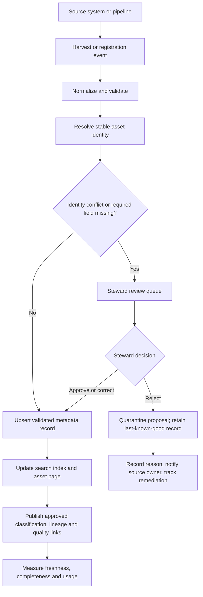

# 02 — Data Catalogues, Discovery and Classification

> **Learning path:** Stage 2D — Data Architecture / Module 2D.11 — Metadata, Lineage, Quality and Master Data  
> **Target file:** `02-data-catalogs-discovery-and-classification.md`  
> **Audience:** Beginner through advanced data engineers, data architects, stewards and platform teams  
> **Scenario:** Northbridge Bank is fictional. All records, measurements, targets and examples in this lesson are synthetic and illustrative.

## Source alignment and limits

The module roadmap is the learning-scope authority for this lesson. It says the eight topic files, module `README.md`, `practice-questions.md`, `Projects/README.md`, and `Projects/11-enterprise-metadata-and-lineage-design.md` were empty when the roadmap was written. Accordingly, this lesson follows the roadmap's Topic 02 learning plan; it does not claim to preserve requirements from those empty files. Specific templates, sample values, targets, and scenario details below are instructional recommendations, not source-file mandates. The actual directory name in the project tree is `Stage 2D — Data Architecture/`.

## 1. Purpose, scope, prerequisites and outcomes

### 1.1 Purpose

A data catalogue turns metadata into a usable experience: people can **search, browse, understand, assess, trust and request access** to data assets. It is not merely a list of tables. A useful catalogue connects technical descriptions to business meaning, ownership, classification, lineage, quality signals and governed access workflows.

Without a catalogue, people often rediscover the same datasets, ask colleagues for undocumented knowledge, use similarly named assets with different meanings, or mistake stale data for current data. These failures increase delivery time and can create material governance and decision risks.

### 1.2 Scope

This topic covers catalogue capabilities and users; the distinction between a catalogue, metadata repository, business glossary, metastore and classification mechanism; asset registration; search and browse; business terminology; classification labels; stewardship and certification; access-request integration; catalogue quality and adoption measures; security; and architecture choices.

It does **not** attempt to teach the full implementation of lineage, data-quality engineering, master data management, or policy enforcement. Those capabilities integrate with the catalogue but have their own topics and systems.

### 1.3 Prerequisites

The roadmap identifies these prerequisites:

- **Sequence 1 / Topic 01:** business, technical and operational metadata; asset inventory; metadata schema; owners and maintainers.
- **P2:** classification and propagation from the earlier governance module.
- **P6:** platform catalogues, metastores, metadata models, layers, and tenancy.

If these concepts are weak, pause and review how metadata fields are sourced and maintained, how sensitivity labels are defined, and where physical platform metadata is stored.

### 1.4 Learning outcomes

After completing this topic, you should be able to:

1. Describe catalogue capabilities and the users they serve.
2. Distinguish a catalogue from a metadata repository, business glossary, metastore and classification mechanism.
3. Design asset registration, search, browse and asset-detail experiences.
4. Show ownership, classification, quality and lineage context for an asset.
5. Measure metadata freshness, completeness, classification performance and adoption.
6. Integrate the catalogue with access-request and governance workflows.
7. Defend a catalogue topology and its trade-offs using an architecture decision record (ADR).

## 2. Beginner foundations and terminology

### 2.1 What is a data catalogue?

**What it is.** A data catalogue is a user-facing capability that organizes asset metadata so users can find and evaluate data. Assets can include datasets, tables, columns, dashboards, reports, pipelines, data products, features and models.

**Why it matters.** Storage systems expose where data are and how they are structured; they do not necessarily explain which asset is fit for a business question, who is accountable for it, whether it is certified, or how to request access.

**How it works.** The catalogue ingests or receives metadata, resolves asset identities, indexes searchable fields, presents asset pages, links related terms and dependencies, and routes curation or access tasks to responsible teams.

**When to use it.** Use catalogue capabilities when users need repeatable discovery across systems or need to judge data suitability before use.

**Trade-offs.** More context improves trust but increases collection, review and maintenance costs. A catalogue with many unreviewed records may be less useful than a smaller catalogue with clear freshness and confidence signals.

**Enterprise example.** A Northbridge risk analyst searches for customer exposure. The catalogue shows a certified exposure table, its business definition, owner, freshness, quality indicators, upstream sources and an access-request route.

### 2.2 Basic terms

| Term | Meaning | Practical example |
|---|---|---|
| **Data asset** | A tracked data object or product | `gold.customer_360` table |
| **Discovery** | Finding and evaluating an asset for a task | Search for “active customer” |
| **Asset page** | A detail view for one asset | Owner, schema, classification and freshness |
| **Search facet** | A filter over search results | Domain = Risk; certification = Certified |
| **Tag** | A label used to group or retrieve assets | `customer`, `regulatory-reporting` |
| **Business glossary term** | An approved business concept and definition | “Active customer” |
| **Classification label** | A label representing a governed property such as sensitivity | `Confidential` |
| **Steward** | Person responsible for metadata quality and business meaning | Customer-domain data steward |
| **Owner** | Accountable person or role for an asset or decision | Customer data product owner |
| **Certification / endorsement** | A controlled trust signal with defined criteria | “Approved for regulatory exposure reporting” |
| **Access request** | A request routed through a governed process | Analyst requests access to restricted columns |
| **Harvesting** | Collecting metadata from systems and pipelines | Scanner reads table schema |
| **Metadata freshness** | How recently a metadata field or record was verified | Last harvested 2026-10-20 05:00 UTC |

### 2.3 Catalogue versus related components

These responsibilities are conceptually distinct even if a product combines several of them.

| Component | Primary responsibility | Typical consumers | What it does not automatically guarantee |
|---|---|---|---|
| **Metadata repository** | Persist metadata records and relationships | Catalogues, scanners, governance tools | Human-friendly search or adoption |
| **Data catalogue** | Make assets discoverable and understandable | Analysts, engineers, stewards, auditors | Correct access enforcement |
| **Business glossary** | Maintain approved business concepts, definitions, synonyms, domain context and relationships | Business users, stewards and data teams | Complete physical asset inventory or field-level technical specification |
| **Technical data dictionary** | Describe technical fields and structures: names, types, constraints, keys, units, allowed values and field-level definitions | Engineers, analysts, modelers and platform tools | Approved business terminology across domains or access enforcement |
| **Metastore** | Store platform-specific structural metadata used by query or storage engines | Compute engines and platform services | Enterprise-wide discovery across all tools |
| **Classification mechanism** | Assign or manage labels according to a classification scheme | Governance processes and policy systems | Enforcement merely because a label is displayed |
| **Policy enforcement point** | Allow or deny an operation based on identity, policy and context | Query engines, storage systems, APIs | Correct decisions if policies or labels are wrong |
| **Lineage capability** | Represent upstream/downstream relationships and transformations | Engineers, stewards, auditors | Complete lineage where instrumentation is missing |
| **Quality/observability capability** | Evaluate rules and publish quality or operational signals | Owners, operators, consumers | Business meaning unless definitions are supplied |

**Key rule:** A catalogue may display a classification label and provide a request button, but the underlying storage or query service must still enforce access unless the catalogue is explicitly and securely designed to act as an enforcement point. Never infer enforcement from a UI badge.

### 2.4 What should a user know before choosing an asset?

At minimum, a user should be able to answer:

1. Does this asset represent the concept I need?
2. What is its grain and coverage? For example, one row per customer or one row per customer-account?
3. Who owns it, and who can answer questions?
4. How current is it, and what does “current” mean for this asset?
5. Is it certified or otherwise fit for this use?
6. What sensitivity or permitted-use restrictions apply?
7. What quality and lineage context is available?
8. How can I request access, and who approves it?

A technical name alone answers almost none of these questions.

## 3. Users, discovery journeys and information architecture

### 3.1 Design for personas, not only for tables

Different users need different routes through the same catalogue.

| Persona | Primary question | Useful catalogue capabilities | Completion evidence |
|---|---|---|---|
| Business analyst | Which dataset answers my question? | Plain-language search, glossary synonyms, grain, sample-safe preview, quality and freshness | Selects a suitable asset and explains why |
| Data engineer | What depends on this table? | Schema, stable identifier, pipeline links, lineage, last harvest, schema-change alerts | Finds affected downstream assets |
| Data steward | Which records are incomplete or wrongly classified? | Steward queue, field provenance, review status, overrides, audit history | Resolves or assigns a metadata issue |
| Risk analyst | Which customer/exposure asset is approved for my purpose? | Domain filters, certification criteria, classification, permitted-use text, access request | Identifies an appropriate asset and follows access workflow |
| Auditor | What was classified, approved and when? | Versioned labels, review evidence, approval history, access logs where authorized | Reconstructs a decision from recorded evidence |
| Data product owner | Is my asset discoverable and trustworthy? | Completeness dashboard, usage, feedback, quality signals, review reminders | Corrects gaps and maintains ownership |

### 3.2 Example discovery journeys

#### Journey A — Risk analyst finds exposure data

1. Search for `customer exposure` or the glossary term `Credit Exposure`.
2. Filter to the `Risk` domain and certified assets.
3. Compare candidate assets by definition, grain, refresh schedule, quality and permitted purpose.
4. Open the asset page and confirm owner, classification and latest harvest time.
5. Request access through the configured workflow.
6. Use the dataset only after the authoritative access-control system grants permission.

**Failure path:** if the search returns no certified asset, the catalogue should show useful alternatives or a steward contact rather than silently implying that an arbitrary table is safe.

#### Journey B — Engineer assesses a schema change

1. Search for the stable asset identifier or table name.
2. Inspect current columns, data types and last observed schema.
3. Review upstream/downstream lineage and consumers.
4. Check whether the catalogue record is stale or harvesting failed.
5. Notify affected owners or open the change workflow.
6. Update metadata through the same reviewed pipeline or registration process used for the change.

#### Journey C — Steward reviews a classification suggestion

1. Open a queue of columns flagged by an automated scanner.
2. Inspect the suggested label, evidence, confidence and field context.
3. Apply the approved classification scheme; do not expose raw sensitive values unnecessarily.
4. Confirm, downgrade, upgrade or reject the suggestion with a reason.
5. Publish the label to the catalogue and send it to the policy integration as appropriate.
6. Track overrides and false negatives to improve rules.

### 3.3 Catalogue information architecture

A useful logical navigation structure can combine:

- **Search:** global search over names, descriptions, glossary terms, tags, column names and approved synonyms.
- **Browse:** domain, data product, platform, asset type, certification and classification facets.
- **Asset pages:** context, schema, owner, steward, status, classification, freshness, lineage, quality, usage and access route.
- **Glossary:** approved terms, definitions, synonyms, domain-specific meanings and links to columns/assets.
- **Stewardship queues:** incomplete descriptions, missing owners, stale records, conflicting labels and pending approvals.
- **Governance workflows:** classification review, certification, access request, deprecation and retirement.
- **Feedback:** report an issue, suggest a synonym, request a term or flag a duplicate.

The information architecture should expose enough information for users to choose well without exposing restricted metadata to unauthorized viewers.

## 4. Metadata fields and logical catalogue model

### 4.1 Asset detail page

The following is a recommended baseline, not a claim that every field is mandatory for every asset type.

| Field | Purpose | Typical source | Suggested requirement |
|---|---|---|---|
| Stable asset ID | Identity across renames and systems | Registration service / platform ID | Mandatory |
| Display name | Human-readable name | Harvest + curation | Mandatory |
| Asset type | Table, column, report, pipeline, model, etc. | Harvester / registry | Mandatory |
| Description | Business meaning and intended use | Owner/steward | Mandatory for critical assets |
| Domain / data product | Ownership and browse context | Domain registry / curation | Mandatory for in-scope assets |
| Owner | Accountable role or team | Ownership registry | Mandatory for critical assets |
| Steward/contact | Maintenance route | Curation workflow | Mandatory for critical assets |
| Technical location | Qualified name, URI or logical location | Harvester | Mandatory where applicable; access-controlled |
| Schema / columns | Structure and types | Harvester | Required for structured assets |
| Business terms | Links to glossary terms | Steward curation / suggestions | Required for key business fields where practical |
| Classification | Sensitivity, criticality or other approved labels | Scanner + steward review | Mandatory according to governance policy |
| Permitted purpose | Supported use and restrictions | Policy/business owner | Required when use restrictions apply |
| Certification status | Trust signal and criteria | Approval workflow | Optional; never implied by mere registration |
| Last harvested | Latest successful metadata collection time | Harvester | Mandatory for harvested records |
| Last reviewed | Latest human review time | Workflow | Mandatory for curated critical metadata |
| Freshness / quality | Latest relevant indicators with timestamps | Quality/observability tools | Display when available |
| Lineage links | Related upstream/downstream assets | Lineage collector | Display coverage and gaps |
| Usage signals | Query/use counts, if permitted | Platform telemetry | Optional and privacy-reviewed |
| Lifecycle status | Active, deprecated, retired | Registry / owner workflow | Mandatory |

**Avoid false precision:** “Last harvested” means the metadata collector observed the source at that time; it does not prove the data itself was refreshed at that time. Display data-refresh time and metadata-harvest time as separate fields.

### 4.2 Asset and relationship model

A catalogue needs stable asset identities and typed relationships. A simple logical model is:

```text
Domain ──owns──> Data Product ──contains──> Dataset/Table ──contains──> Column
                                      │                      │
                                      │                      ├──maps-to──> Glossary Term
                                      │                      ├──classified-as──> Label
                                      │                      └──has-quality-signal──> Quality Result
                                      ├──produced-by──> Pipeline
                                      ├──used-by──> Report / Dashboard / Model
                                      └──upstream-of / downstream-of──> Related Asset
```

The arrows represent relationships, not necessarily physical foreign keys. Each edge should identify its source, collection time and confidence when these matter. A relationship discovered by a scanner should not silently be treated as a human-approved business relationship.

### 4.3 Example synthetic asset records

These JSON examples are illustrative metadata records, not a prescribed vendor API. They use stable IDs so a rename does not necessarily create a new identity.

```json
{
  "asset_id": "nbk:lakehouse:gold.customer_360",
  "asset_type": "table",
  "display_name": "Customer 360",
  "qualified_name": "gold.customer_360",
  "domain": "Customer",
  "description": "Curated customer-level view used for approved customer analytics; one row per canonical customer ID.",
  "owner": "Customer Data Product Owner",
  "steward": "Customer Data Steward",
  "classification": {
    "label": "Confidential",
    "status": "reviewed",
    "reviewed_at": "2026-10-19T14:00:00Z"
  },
  "certification": {
    "status": "certified",
    "scope": "Approved customer analytics",
    "approved_by": "Customer Domain Data Governance Approver",
    "approved_at": "2026-10-19T14:30:00Z",
    "criteria_version": "customer-analytics-certification-v1",
    "expires_at": "2027-04-19T00:00:00Z"
  },
  "metadata_harvested_at": "2026-10-20T05:00:00Z",
  "data_refreshed_at": "2026-10-20T04:30:00Z",
  "lifecycle_status": "active"
}
```

```json
{
  "asset_id": "nbk:lakehouse:gold.customer_360.email_address",
  "asset_type": "column",
  "parent_asset_id": "nbk:lakehouse:gold.customer_360",
  "display_name": "Email address",
  "technical_name": "email_address",
  "data_type": "STRING",
  "business_terms": ["Customer Email Address"],
  "classification": {
    "label": "Personal Data",
    "status": "pending_review",
    "suggested_by": "pattern-scanner"
  },
  "description": "Email address associated with the canonical customer record.",
  "lifecycle_status": "active"
}
```

The dataset-level `Confidential` label and column-level `Personal Data` label represent different dimensions of classification. The organisation's approved scheme must define how labels combine and propagate. Do not assume the example labels automatically map to any specific access policy.

### 4.4 Mandatory versus optional metadata

Mandatory fields improve trust and control but can create onboarding friction if too many are required before an asset can be registered.

A practical approach:

- Require identity, asset type, source/location where applicable, lifecycle status, and collection timestamp for registration.
- Require owner, classification and a meaningful description before an asset is marked **certified** or made available for a restricted/high-impact use.
- Allow noncritical or legacy assets to be registered with an explicit `incomplete` status and a remediation owner.
- Never fill unknown values with fabricated descriptions or default “Public” classification.
- Apply requirements by asset type and criticality; a dashboard, table, column and pipeline do not need identical fields.

## 5. Registration, harvesting, search and classification workflows

### 5.1 Registration and harvesting

**What it is.** Registration creates or updates a catalogue record. Harvesting collects metadata from systems, definitions, pipelines and other authoritative sources.

**Why it matters.** Manual-only registration does not scale and quickly becomes stale; automatic-only registration often lacks business meaning and accountability.

**How it works.** A robust flow commonly includes:

1. Discover source system and permitted scope.
2. Collect metadata with a read-only identity where possible.
3. Normalize names, types, namespaces and identifiers.
4. Match records to existing assets using stable IDs and qualified names.
5. Detect creates, updates, renames, deletions and collection failures.
6. Upsert metadata and record source/time/provenance.
7. Send missing or conflicting fields to a steward queue.
8. Index eligible fields for search and publish the latest status.

**Trade-offs.** Pull scans are easy to add to existing sources but can load source systems and miss changes between scans. Push events are fresher but require producer integration, event reliability and replay/idempotency handling. A hybrid approach is common.

### 5.2 Registration workflow diagram



This is a logical flow, not a product-specific deployment diagram. Rejected proposals must not overwrite an approved record; retain the last-known-good record with its prior provenance, mark the proposed change as rejected, and create an actionable issue. If no prior record exists, quarantine the proposal from trusted search or display it explicitly as unverified according to the visibility policy. A production design should define retry behavior, dead-letter handling, audit events, permissions, idempotency and reconciliation.

### 5.3 Stable identity, rename and deletion

Names are not reliable identities: a table can be renamed, moved or recreated. Prefer a stable source identifier or registry ID, paired with qualified names and namespace information.

When a name changes:

- Preserve the asset identity if the source confirms it is the same asset.
- Record the old qualified name as an alias when useful.
- Update lineage and search indexes.
- Notify owners and affected consumers when the change is material.

When an asset disappears from a scan, do not immediately delete its record. Distinguish a confirmed deletion from a temporary source outage, permission failure or incomplete scan. Use tombstones or a pending-retirement state until reconciliation confirms the lifecycle transition.

For planned retirement, use an explicit owner-approved lifecycle workflow: mark the asset deprecated, communicate the effective date and replacement where available, notify known consumers, review downstream dependencies and retention/audit requirements, and then mark it retired after the source or owner confirms the transition. Preserve identity, lineage and decision history according to policy; remove it from default active search without erasing evidence. Do not revoke data access merely because a catalogue record changed state—retirement and entitlement revocation must be coordinated with the authoritative platform and verified separately.

### 5.4 Search and browse

Search should cover more than physical names. Useful searchable fields include display names, technical names, descriptions, glossary terms, synonyms, column names, tags and permitted-purpose text.

Useful facets include:

- Domain and data product
- Asset type and platform
- Certification status
- Classification, subject to viewer permissions
- Owner or steward
- Lifecycle status
- Freshness or last-reviewed range
- Availability of lineage and quality signals

**Ranking trade-off:** ranking by popularity alone can reinforce old or inappropriate assets. A relevance strategy can combine lexical match, glossary synonym match, domain context, certification, freshness and authorized usage signals. Explain why an asset is ranked highly when feasible.

Search should be evaluated with representative user queries, including ambiguous terms, misspellings, synonyms, no-result searches and near-duplicate names. A query returning results is not necessarily a successful discovery.

### 5.5 Business terminology and synonyms

A glossary term should have a stable identifier, approved definition, owning domain, status, synonyms, related terms and links to assets or columns. A synonym helps users find a term; it should not erase domain-specific differences.

Example:

| Term ID | Term | Definition | Synonyms | Domain |
|---|---|---|---|---|
| `term:customer:active` | Active customer | A customer meeting the approved activity rule for the stated reporting period | Engaged customer (search synonym only) | Customer |
| `term:risk:exposure` | Credit exposure | Amount measured under the bank's approved exposure methodology and reporting scope | Exposure amount | Risk |

If “active customer” has different definitions in marketing and regulatory reporting, keep distinct domain-specific terms and clearly communicate the difference. Do not merge terms solely because their names match.

### 5.6 Classification in the catalogue

Classification labels describe governed properties of an asset. Examples may include sensitivity, criticality, regulated-data category or permitted-use restrictions, according to the organisation's approved schemes.

**Classification is not authorization.** A label is metadata. Access decisions also depend on authenticated identity, roles or attributes, purpose, context, policy and enforcement at the system that serves the data. The catalogue should communicate restrictions and route requests; it must not imply that an asset is safe to use merely because it is searchable.

A practical workflow:

1. Define an approved taxonomy and label semantics with governance.
2. Detect candidate fields or assets using source metadata, patterns and context.
3. Attach a suggested label with evidence, source, timestamp and confidence where available.
4. Apply review thresholds appropriate to risk.
5. Route uncertain or high-impact cases to a steward.
6. Record decisions, overrides, approver and reason.
7. Publish approved labels to the catalogue and integrate with policy systems.
8. Reassess labels when schema, data content, purpose or policy changes.
9. Test that policy enforcement actually reflects the intended decision.

#### Classification example

| Asset/field | Suggested label | Review outcome | Catalogue display | Enforcement follow-up |
|---|---|---|---|---|
| `gold.customer_360` | Confidential | Approved by steward | Show label to authorized catalogue viewers | Confirm table-level policy |
| `email_address` | Personal Data | Pending review | Show pending status to permitted viewers; restrict details as needed | Do not assume a policy has been updated |
| `risk.exposure_report` | High Criticality | Approved by risk owner | Show criticality and certification scope | Validate report access and export controls |

The labels are synthetic examples, not a recommended universal taxonomy.

### 5.7 Automated detection: precision and recall

Automated classification can use deterministic patterns, source-system tags, schema context or statistical/ML-assisted detection. It will produce false positives and false negatives.

- **Precision** = true positives / (true positives + false positives). Of all items flagged, what fraction really belongs to the class?
- **Recall** = true positives / (true positives + false negatives). Of all items that really belong to the class, what fraction did the detector find?

Illustrative synthetic sample: a scanner flags 1,000 columns; 900 are confirmed true positives; a review/sample audit identifies 150 additional true personal-data columns that were missed.

- Precision = 900 / 1,000 = **90%**
- Recall = 900 / (900 + 150) ≈ **85.7%**

The numbers are illustrative and assume the audit found the stated missed items. In real evaluation, labels must be sufficiently reliable and the sampling design must account for class imbalance. High precision alone is not enough if missed sensitive data are costly; high recall alone is not enough if the review queue becomes unmanageable.

### 5.8 Certification and endorsement

Certification is a trust signal with explicit scope and criteria, not a decorative badge. **Endorsement** may be a lighter-weight, attributed recommendation (for example, “used by the Risk team”); **certification** should mean that a named authority checked a defined set of criteria for a stated scope and validity period. Products may use these terms differently, so define them locally and do not treat a popularity signal or informal endorsement as certification.

A certification policy should state:

- Who can approve the asset.
- Required metadata and named owner/steward.
- Applicable quality checks and freshness expectations.
- Supported business purpose and known limitations.
- Approval date, review date and expiry/re-certification rule.
- Events that suspend or revoke certification, such as failed quality checks or material schema change.

An asset can be useful without certification. Show the difference between “registered,” “reviewed,” and “certified” so users do not infer equal assurance.

### 5.9 Access-request integration

A catalogue may initiate an access request, but the authoritative workflow must evaluate it and the data-serving system must enforce the resulting decision.

A recommended request record includes request ID, asset ID, requester identity, purpose, requested scope, approver, decision, rationale, timestamps and expiry/review details where applicable. Avoid placing sensitive justification text in broadly visible asset metadata.

Workflow:

1. User opens asset page and reviews classification and permitted use.
2. User submits a purpose-specific request.
3. Workflow routes it to the designated owner or policy process.
4. Approver checks policy and business need.
5. Decision is recorded and provisioning is performed by an authorized enforcement system.
6. Requester receives status; audit evidence is retained under the applicable retention rules.
7. Access is periodically reviewed or removed according to policy.

Represent request and provisioning states separately—for example, `submitted`, `pending_approval`, `approved_pending_provisioning`, `active_verified`, `denied`, `expired`, `revoked` and `provisioning_failed`. An approval is not proof that provisioning succeeded, and a catalogue must not display access as active until the authoritative enforcement system confirms the grant. Use idempotent provisioning, bounded retries, failure alerts and reconciliation; a failed or indeterminate provisioning result must remain visible to the requester and workflow owner.

## 6. Intermediate catalogue architecture and governance integration

### 6.1 Logical architecture

```text
Metadata sources
  ├─ Databases / warehouses / lakehouse metastores
  ├─ Files, reports, BI assets and models
  ├─ Pipeline definitions and execution metadata
  ├─ Glossary and ownership registries
  └─ Classification and quality systems
            |
            v
Collection and integration
  ├─ Scanners / event consumers / APIs
  ├─ Normalization and identity resolution
  ├─ Validation, reconciliation and provenance
  └─ Retry, audit and failure queue
            |
            v
Metadata services
  ├─ Metadata repository / graph or relationship store
  ├─ Search index
  ├─ Glossary and classification references
  ├─ Lineage and quality links
  └─ Lifecycle and review state
            |
            v
User experience and workflows
  ├─ Search, browse and asset pages
  ├─ Steward and certification queues
  ├─ Access-request integration
  ├─ Feedback and notifications
  └─ Quality/adoption dashboards

Separate authoritative controls:
  Identity + policy evaluation + storage/query/API enforcement
```

This is a logical architecture. Components may be combined in a platform, but the interfaces and responsibilities should remain explicit.

### 6.2 Integration boundaries

| Integration | Catalogue responsibility | External/authoritative responsibility | Failure to handle |
|---|---|---|---|
| Metadata harvester | Display collected metadata and collection status | Source exposes permitted metadata; collector authenticates | Stale records after failed scans |
| Glossary | Link terms and show approved definitions | Glossary workflow governs definitions | Conflicting definitions or orphan links |
| Lineage | Display relationships and coverage limits | Collector/instrumentation derives lineage | False sense of completeness |
| Quality/observability | Show rule results with timestamp and scope | Quality system computes results and alerts | Old score displayed as current |
| Classification | Show labels, status and provenance | Governance defines taxonomy and review | Label mismatch or unresolved suggestions |
| Access workflow | Present request path and status | Policy workflow approves; serving layer enforces | UI indicates access when provisioning failed |
| Identity system | Apply viewer-specific visibility where supported | Identity provider establishes user identity | Metadata leak through search results |
| Notifications | Surface relevant changes | Workflow or event system emits reliable events | Duplicate/missed notifications |

### 6.3 Metadata freshness and completeness

A catalogue should expose at least two distinct clocks:

- **Harvest freshness:** how recently the catalogue successfully observed the source metadata.
- **Business review freshness:** how recently a human reviewed business definition, ownership, classification or certification.

Data freshness is a third measure: how recently the data itself was refreshed. These clocks answer different questions.

Completeness should be measured against an explicit denominator, such as all in-scope critical assets, rather than only assets that already have descriptions. Otherwise the catalogue can look complete while undiscovered assets remain invisible.

### 6.4 Recommended quality indicators

All targets below are examples to tune after a baseline; they are not source-mandated targets.

| Indicator | Example definition | Why it matters | Illustrative target |
|---|---|---|---|
| Critical asset completeness | Critical assets with all required fields / all in-scope critical assets | Finds missing ownership and meaning | ≥ 95% |
| Harvest configuration coverage | In-scope harvestable assets with an owner and configured collection interval / all in-scope harvestable assets | Prevents unconfigured assets disappearing from the freshness denominator | ≥ 98% |
| Harvest freshness | Assets successfully harvested within their configured interval / assets due for harvest in the measurement window | Exposes stale technical metadata | ≥ 98% |
| Business review freshness | Critical assets reviewed within policy window / critical assets due for review | Finds stale definitions and labels | ≥ 90% |
| Classification review coverage | Required assets/fields with reviewed labels / assets/fields requiring classification | Makes unreviewed risk visible | ≥ 98% |
| Search success rate | Eligible search sessions with user-confirmed success or a defined downstream use signal within the attribution window / eligible search sessions | Measures discovery effectiveness rather than clicks alone | Establish baseline first |
| Zero-result rate | Searches returning no relevant results / total eligible searches | Detects vocabulary or indexing gaps | Trend downward |
| Duplicate candidate rate | Candidate duplicate records unresolved / total candidate duplicates | Indicates identity/reconciliation quality | Trend downward |
| Steward queue age | Median and p95 age of pending review items, segmented by risk tier | Measures operational backlog | Define by risk tier |
| Adoption rate | Distinct active target users who used the catalogue during the period / distinct active target users in scope during that period | Measures use across the intended audience, not raw page views | Baseline then set target |
| Certification validity | Certified assets still within review window / all certified assets | Avoids expired trust signals | 100% or explicit exceptions |

**Measurement cautions:**

- Define the unit, numerator, denominator, time window, attribution window and exclusions before collecting a baseline.
- Keep the in-scope asset inventory independent of the subset with metadata; otherwise missing or undiscovered assets disappear from the denominator.
- Define a search-success event with user confirmation or a justified downstream-use signal; an asset open or click alone is not proof of success.
- Segment by domain, asset criticality and asset type, and report coverage gaps separately from freshness among configured assets.
- Track trends and unresolved gaps, not only one aggregate score.
- Do not game completeness by accepting meaningless descriptions such as “contains customer data.”

### 6.5 Security and privacy of catalogue metadata

Metadata itself can be sensitive. Table and column names may reveal projects or business activity; schemas can expose security architecture; sample values can reveal personal or confidential information; usage telemetry can reveal employee behavior.

Controls to consider:

- Restrict catalogue APIs, search results, fields and sample previews by role or attribute.
- Avoid storing sample values unless there is a clear need, approved purpose and safe handling.
- Mask or synthesize previews; do not assume a small sample is anonymous.
- Keep secrets, credentials and connection strings out of asset descriptions.
- Audit access to sensitive metadata and administrative changes.
- Apply classification to metadata records as well as the underlying data where appropriate.
- Filter search snippets and autocomplete suggestions, not just the full asset page.
- Consider whether even the asset name should be hidden or generalized for some viewers.
- Review export, bulk-download and API access paths.
- Define retention for access logs and usage telemetry.

Security should be designed across the complete request path. Hiding a button in the UI is not sufficient authorization; backend services must enforce the same permissions.

## 7. Advanced architecture decisions and trade-offs

### 7.1 Centralized catalogue versus federated catalogues

| Option | Strengths | Costs and risks | Better fit when |
|---|---|---|---|
| One central catalogue | Consistent UX, common identity and governance | Central bottleneck, migration burden, autonomy concerns | Estate is manageable and governance is mature enough for shared rules |
| Domain catalogues with global index | Domain ownership and local context; gradual integration | Duplicate records, inconsistent taxonomies, identity reconciliation | Domains have autonomy or multiple platforms must coexist |
| Hybrid | Shared minimum schema and global search, domain-managed details | Requires clear federation contracts and conflict rules | Enterprise needs global discovery but domains maintain assets |

There is no universal winner. Evaluate scale, autonomy, number of platforms, source capabilities, data residency, search expectations, support ownership, and the cost of reconciling duplicate assets.

### 7.2 Pull scans versus push events

- **Scheduled pull scans:** simple and useful for legacy systems; freshness depends on schedule and scans can load sources.
- **Push/event-based updates:** lower latency when producers emit reliable events; requires contracts, retries, replay, ordering or version handling.
- **Hybrid:** use events for routine changes and periodic scans for reconciliation.

For either approach, design idempotent updates, source provenance, failed-scan handling, stable identity, deleted-asset detection and replay.

### 7.3 Classification automation and review thresholds

Automate high-confidence suggestions and straightforward propagation where rules are reliable; require review for uncertain or high-impact decisions. A threshold is a routing rule, not proof of correctness.

Review policy should reflect asymmetric risk. Missing a sensitive column can be more harmful than temporarily over-classifying a column, but excessive false positives can block legitimate use and overwhelm stewards. Measure both precision and recall, segment results by data type and source, and sample apparently negative results to detect false negatives.

### 7.4 Certification versus freshness

An asset can be certified and still have stale operational metadata. Certification should not mask failed harvests or failed quality checks. Define suspension behavior: for example, the asset remains visible but displays “certification review required” when critical criteria fail.

### 7.5 Search relevance and usage signals

Usage can improve ranking but introduces risks: sensitive assets may become more visible, popular assets may outrank more appropriate ones, and telemetry may reveal user behavior. Use only authorized, privacy-reviewed signals. Consider domain relevance, exact business-term matches, certification, freshness and quality context alongside usage.

### 7.6 Operational scale and cost

Catalogue cost includes collection load, metadata storage, version history, search indexing, relationship traversal, classification review, notifications and stewardship labor.

For scale planning, estimate:
- Number of sources and assets by type.
- Number of columns and relationships.
- Change frequency and harvest frequency.
- Percentage of assets requiring human review.
- Retention and versioning of metadata history.
- Query/search volume and lineage traversal patterns.

Prefer incremental harvesting and change-driven updates when supported; retain periodic reconciliation to detect missed events. Keep detailed operational events for a justified retention window and aggregate older metrics where audit needs permit. Do not discard evidence required by policy or incident investigation.

### 7.7 Architecture decision record (ADR) example

**ADR-02: Use a federated catalogue with a shared enterprise search index**

- **Status:** Proposed; illustrative only.
- **Context:** Northbridge Bank has customer, cards and risk domains on different platforms. Each domain maintains local asset context, but analysts need enterprise-wide search.
- **Decision:** Use domain-owned metadata records that conform to a shared minimum schema and publish stable asset IDs, domain, owner, classification, lifecycle state and searchable descriptions to an enterprise index.
- **Alternatives considered:**
  1. Migrate all metadata into one central authoring system — consistent but costly and disruptive.
  2. Keep isolated catalogues — low integration cost but poor cross-domain discovery.
- **Consequences:** Domain teams retain responsibility for descriptions and review; enterprise search requires identity reconciliation, shared taxonomy rules and conflict handling.
- **Risks and controls:** Duplicate records; require stable IDs and reconciliation reports. Inconsistent classification; centralize taxonomy definitions and record provenance. Index exposure; apply viewer authorization before returning results and snippets.
- **Revisit triggers:** persistent duplicate rate, inability to enforce metadata visibility consistently, unacceptable search latency, or a major platform consolidation.
- **Evidence needed:** representative persona journeys, duplicate-identity tests, access-control tests, harvest-freshness results and estimated support cost.

## 8. Worked examples and hands-on exercises

### 8.1 Worked example: finding a usable customer asset

**Question:** A risk analyst needs customer-level data for an approved exposure analysis.

Candidates (all synthetic):

| Candidate | Description | Grain | Owner | Classification | Freshness | Trust signal |
|---|---|---|---|---|---|---|
| `raw.crm_customer` | Source extract from CRM | One row per CRM record | CRM platform team | Confidential | Harvest current; data time unclear | Registered |
| `silver.customer` | Standardized customer records | One row per source customer ID | Customer domain | Confidential | Refreshed today 04:00 | Reviewed |
| `gold.customer_360` | Curated canonical customer view | One row per canonical customer ID | Customer data product owner | Confidential | Refreshed today 04:30 | Certified for approved customer analytics |

**Reasoning:**

1. Search and synonyms find all three candidates.
2. Grain reveals that the raw and silver tables do not necessarily represent one canonical customer per row.
3. Ownership and descriptions indicate who can resolve questions.
4. Freshness is checked separately from harvest time.
5. Certification scope is compared with the intended use; it is not assumed to cover all purposes.
6. Classification and access-request rules are reviewed.
7. The user requests access; enforcement is handled by the authoritative platform.

**Decision:** `gold.customer_360` is the strongest candidate for the stated illustrative use, subject to the user confirming that the certified scope and business definition match the analysis.

### 8.2 Exercise A — Catalogue experience design

**Scenario:** Northbridge analysts spend days locating customer data.

**Inputs:** Topic 01 metadata schema and the personas in Section 3.

**Tasks:**
1. Choose three personas.
2. Define the first search query and at least three useful facets for each.
3. Design an asset page with owner, description, grain, classification, freshness, quality, lineage, certification and access route.
4. Write the journey steps from search to a justified asset choice.
5. List one failure or uncertainty state per journey and how the catalogue communicates it.

**Deliverable:** a catalogue capability list, asset-page design and three user journeys.

**Validation:** Each journey can be completed end-to-end; every displayed field has an identified source or is explicitly marked unavailable; no step implies that catalogue visibility grants access.

### 8.3 Exercise B — Classification review and metrics

**Synthetic scanner sample:**

| Column | Ground truth for exercise | Scanner result |
|---|---|---|
| `email_address` | Personal data | Flagged |
| `phone_number` | Personal data | Flagged |
| `customer_name` | Personal data | Flagged |
| `branch_code` | Not personal data in this exercise | Flagged |
| `product_code` | Not personal data in this exercise | Not flagged |
| `date_of_birth` | Personal data | Not flagged |
| `customer_id` | Personal data under the assumed policy | Flagged |
| `risk_band` | Not personal data in this exercise | Not flagged |

Treat the table as a complete labelled sample for this exercise only.

**Tasks:**
1. Count true positives, false positives, false negatives and true negatives.
2. Calculate precision and recall.
3. Propose which results should enter a steward queue and why.
4. Define override recording, false-negative sampling and escalation for uncertain high-risk columns.
5. Explain how an approved label is propagated to policy enforcement and how you would test that enforcement.

**Worked answer:**
- True positives: `email_address`, `phone_number`, `customer_name`, `customer_id` = 4.
- False positives: `branch_code` = 1.
- False negatives: `date_of_birth` = 1.
- True negatives: `product_code`, `risk_band` = 2.
- Precision = 4 / (4 + 1) = **80%**.
- Recall = 4 / (4 + 1) = **80%**.

This tiny sample is educational, not a reliable estimate of production performance. Production evaluation needs a representative, reviewed sample and ongoing checks for drift.

### 8.4 Exercise C — Metadata freshness and completeness

Use this illustrative inventory:

| Asset | Owner present | Description meaningful | Classification reviewed | Harvest age | Certification status | Metadata workflow state |
|---|---|---|---|---:|---|---|
| `gold.customer_360` | Yes | Yes | Yes | 1 day | Certified | Reviewed |
| `silver.customer` | Yes | Yes | Yes | 1 day | Not certified | Reviewed |
| `raw.crm_customer` | Yes | No (“CRM table”) | No | 8 days | Not certified | Registered; incomplete |
| `gold.exposure` | No | Yes | Yes | 1 day | Not certified | Registered; incomplete |

Assume all four assets are in scope and all four are critical for this exercise. The illustrative freshness rule is harvest age ≤ 2 days. `Certification status` is a trust decision; `Metadata workflow state` describes registration/review completeness. A registered or reviewed asset is not certified unless it has separately met the certification criteria.

**Tasks:**
1. Compute owner completeness.
2. Compute meaningful-description completeness.
3. Compute reviewed-classification coverage.
4. Compute harvest freshness.
5. Identify the highest-priority remediation and assign an owner.

**Worked answer:**
- Owner completeness = 3/4 = **75%**.
- Meaningful-description completeness = 3/4 = **75%**.
- Reviewed-classification coverage = 3/4 = **75%**.
- Harvest freshness = 3/4 = **75%**.
- Priority: assign an accountable owner to `gold.exposure` promptly; then improve `raw.crm_customer` description and classification review. Risk policy may change the order, so document the rationale.

### 8.5 Exercise D — Topology decision

Compare a single central catalogue with a federated catalogue and global index for a fictional acquisition involving two platforms.

Document:
- Requirements and constraints.
- Identity/namespace strategy.
- Classification and access-control visibility rules.
- Conflict and duplicate resolution.
- Search and harvest SLO assumptions.
- Steward responsibilities and operating costs.
- Revisit triggers and validation tests.

**Deliverable:** one ADR with alternatives and evidence needed to validate the choice.

## 9. Industry scenarios and failure analysis

| Scenario | Failure mode | Impact | Better design response |
|---|---|---|---|
| Legacy estate with hundreds of undocumented tables | Trying to document everything manually before publishing anything | Long onboarding delay and abandoned effort | Register automatically, prioritize critical assets, show incomplete status and steward backlog |
| Merged organizations with separate catalogues | Duplicate assets and incompatible labels | Users select wrong records; governance gaps | Shared identifiers/namespaces, global search, mapping and reconciliation |
| Search returns hundreds of near-duplicates | Weak synonyms, no grain, no certification/freshness ranking | Users lose trust and revert to informal channels | Tune relevance using representative queries and asset context |
| Classification scanner has high false-negative rate | Labels treated as complete truth | Sensitive data may be exposed | Measure recall, sample negative results, review high-risk assets and test enforcement |
| Asset is certified but stale | Certification displayed without freshness context | Users over-trust an out-of-date record | Separate certification from harvest/data freshness and suspend when criteria fail |
| Access button grants optimistic success | Catalogue records request but provisioning fails | Confusing or unauthorized access assumptions | Show request state separately from enforced entitlement; reconcile workflow and policy system |
| Sensitive table names leak through autocomplete | Only detail pages are protected | Metadata disclosure before authorization | Apply visibility controls to search, snippets, facets, autocomplete, exports and APIs |
| Deleted source is temporarily unavailable | Collector treats failed scan as deletion | Asset disappears and lineage breaks | Distinguish scan failure from confirmed retirement; reconcile before tombstoning |
| Usage ranking exposes employee behavior | Raw usage logs are widely available | Privacy and trust concerns | Minimize, aggregate and restrict telemetry; define purpose and retention |
| Steward queue grows without prioritization | All gaps treated equally | Critical assets remain unresolved | Risk-tier queues, age metrics, clear owners and escalation |

### 9.1 Design alternatives and decision criteria

Do not select a design based on feature count alone. Compare options against:

- Discovery success for the actual user journeys.
- Metadata source coverage and collection reliability.
- Stable identity and duplicate resolution.
- Ownership and stewardship workload.
- Classification quality and policy integration.
- Security of search results, previews and APIs.
- Freshness and completeness targets.
- Cross-domain interoperability.
- Operating cost, support model and reversibility.

## 10. Expected catalogue design deliverables

The Topic 02 roadmap calls for the following recommended deliverables. The empty project file may later define different requirements; if it does, follow that file and update this lesson.

| Deliverable | Required content | Validation |
|---|---|---|
| Catalogue capability list and user journeys | Personas, search/browse capabilities, asset-page fields, success and failure paths | Each persona journey is traceable end-to-end |
| Asset page and search/facet design | Logical asset fields, search fields, facets, ranking signals and visibility rules | Each field has a source; security is considered |
| Registration, certification and access workflows | Collection, validation, steward review, approval, expiry, access-request handoff and lifecycle | Owners and state transitions are explicit |
| Classification review workflow and measures | Label taxonomy reference, scanner suggestions, thresholds, overrides, precision/recall and false-negative handling | Measures computed on synthetic data; enforcement boundary stated |
| Catalogue topology ADR | Central/federated/hybrid choice, alternatives, constraints, risks and revisit triggers | Trade-offs and evidence needs are defensible |

Recommended supporting artefacts:
- A logical catalogue architecture diagram.
- An asset and relationship model.
- A metadata field dictionary with source and maintainer.
- A catalogue quality/adoption indicator register.
- A risk and assumptions register.

## 11. Common mistakes and misconceptions

| Mistake | Why it fails | Correction |
|---|---|---|
| Treating a catalogue as a spreadsheet of table names | No user journeys, context or maintenance workflow | Design search, asset pages, stewardship and feedback |
| Equating the catalogue with the metadata repository | Confuses storage with user experience | Define logical responsibilities and interfaces |
| Treating glossary synonyms as identical definitions | Hides domain-specific meaning | Use stable term IDs and domain-scoped definitions |
| Assuming labels enforce access | Catalogue display may not change entitlements | Test the authoritative policy enforcement path |
| Treating scanner output as approved classification | False positives and negatives persist | Record suggestions, evidence, review and overrides |
| Showing “last updated” without saying what updated | Confuses harvest time with data-refresh time | Name each timestamp precisely |
| Certification without scope or expiry | Badge becomes meaningless | Define criteria, scope, approver and review triggers |
| Ranking only by popularity | Popular assets may be stale or inappropriate | Combine relevance, domain, certification, freshness and quality context |
| Deleting records after one failed scan | Source outage looks like retirement | Use scan status, reconciliation and lifecycle states |
| Making every field mandatory before registration | Legacy onboarding stalls | Require by asset type and criticality; track gaps |
| Exposing sample values for convenience | Sample data can reveal sensitive information | Mask, synthesize or disable previews as appropriate |
| Measuring only catalogue visits | Visits do not prove discovery success | Measure task completion, asset use, zero-result rate and feedback |
| No named steward | Metadata becomes stale | Assign accountable roles and review queues |
| No adoption plan | Catalogue is ignored | Embed in workflows, train users and measure successful journeys |

## 12. Mastery criteria and completion gate

### 12.1 Mastery criteria

You demonstrate mastery when you can:

- Distinguish catalogue, metadata repository, glossary, metastore, classification mechanism and enforcement point.
- Design catalogue experiences for named users with measurable success criteria.
- Define asset-page fields and their authoritative sources.
- Design registration, identity reconciliation, search, classification review, certification and access-request workflows.
- Calculate classification precision/recall and explain false-negative risk.
- Measure catalogue completeness, freshness, adoption and search effectiveness with explicit denominators.
- Explain how the catalogue integrates with lineage, quality, glossary, governance and policy systems.
- Defend a central, federated or hybrid topology with trade-offs and revisit triggers.

### 12.2 Topic completion gate

Do not mark Topic 02 complete until all are satisfied:

- [ ] Catalogue design and workflows have been reviewed by another person.
- [ ] Each selected persona journey has been traced from discovery to a justified outcome.
- [ ] Classification measures have been calculated on synthetic labelled data.
- [ ] You can state precisely what the catalogue does **not** enforce and identify the enforcement point.
- [ ] You can distinguish the catalogue from a metadata repository by redrawing their responsibilities.
- [ ] Every required asset-page field has a source or an explicit unavailable/gap state.
- [ ] Freshness and completeness measures have defined units, denominators and time windows.
- [ ] Security of search results, snippets, previews and APIs has been considered.
- [ ] Risks, assumptions and open decisions are documented.

Reading the lesson alone is not mastery. The evidence is the design, calculations, review and ability to explain the boundaries.

### 12.3 Connection to the module project

Topic 02 contributes the catalogue design, user journeys, asset pages, classification workflow and topology decision to the broader enterprise metadata and lineage design. The module roadmap proposes an illustrative Northbridge Bank scenario involving customer and exposure domains, several source systems, a lakehouse and two important reports. These details are assumptions for learning; the project file governs if it is later populated with different requirements.

## 13. Revision checklist

Use this short checklist before a design review.

- [ ] I can explain the difference between a catalogue, repository, glossary, metastore, classifier and enforcement point.
- [ ] Each persona can search, evaluate, choose or escalate an asset.
- [ ] Asset records include identity, meaning, ownership, classification, lifecycle and appropriately timestamped freshness.
- [ ] Search supports business terms, synonyms, facets and no-result feedback.
- [ ] Renames, duplicates, failed scans and confirmed deletions have defined handling.
- [ ] Classification suggestions carry provenance and review status; precision and recall are measured.
- [ ] Certification has scope, criteria, approver and re-review triggers.
- [ ] Access requests are separate from authoritative access decisions and enforcement.
- [ ] Metadata visibility, previews, search snippets, APIs and exports have security controls.
- [ ] Completeness, freshness, adoption and search effectiveness have explicit definitions.
- [ ] Centralized/federated/hybrid choices are documented in an ADR with alternatives and revisit triggers.
- [ ] Deliverables and completion-gate evidence have been reviewed by another person.

---

## Further practice questions

1. Why is a metadata repository not sufficient by itself to guarantee catalogue adoption?
2. What changes when a column is renamed but the underlying asset remains the same?
3. How would you expose a restricted asset's existence without leaking sensitive project details?
4. Why can a scanner with high precision still be unsafe for classification?
5. Which signals should determine whether an asset is certified, and what should happen when one fails?
6. How would you measure search success without equating clicks with successful discovery?
7. What are the risks of ranking assets only by usage?
8. What belongs in the catalogue versus the policy enforcement system?
9. When would a federated catalogue be preferable to a central one?
10. What evidence would convince a reviewer that the catalogue is improving data discovery?
