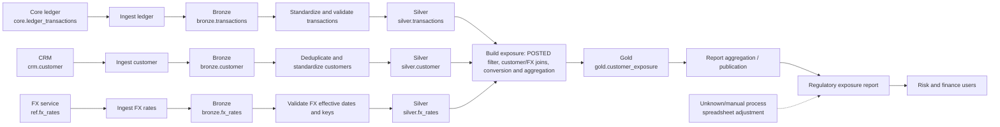
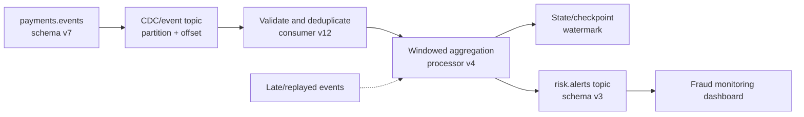

# End-to-End Lineage and Impact Analysis

> **Audience:** Beginner-to-advanced data architects, data engineers, analytics engineers, platform engineers, stewards, and technical auditors  
> **Architecture stance:** Vendor-neutral; examples use synthetic data and illustrative assumptions  
> **Purpose:** Learn to represent how data moves and changes, use lineage for safe change management and root-cause investigation, and state clearly where lineage is incomplete.

## 1. Purpose, scope, prerequisites, and learning outcomes

### 1.1 Purpose

Data lineage describes where data came from, how it moved, what transformations were applied, and which assets or consumers depend on it. **Impact analysis** traverses lineage downstream to estimate what a proposed change could affect. **Root-cause analysis** traverses upstream from a symptom to identify the earliest **demonstrated divergence** from expected data or behavior; a plausible suspect is a hypothesis until evidence supports it.

Lineage is useful only when its scope and evidence are understood. A dependency graph helps people navigate; it does not, by itself, prove what happened in a particular run. Reliable practice combines a maintained graph with transformation logic, versioned schemas, execution records, quality results, timestamps, and named owners.

### 1.2 Scope and source alignment

This lesson follows the intended scope in the module roadmap for **Topic 03 — End-to-end lineage and impact analysis**. The roadmap says the topic files are empty, so this document treats the roadmap—not an assumed pre-existing topic file—as the scope authority. Exercises and examples below are synthetic teaching material, not evidence of an existing production environment.

The roadmap's expected outputs are:
- a dataset- and field-level lineage diagram with an edge register;
- a list of blind spots and compensating controls;
- an impact analysis report for a representative change;
- a root-cause investigation note; and
- an architecture decision record (ADR) for lineage granularity and evidence levels.

The completion gate expects these artefacts to be reviewed, blind spots and compensating controls to be explicit, and the learner to explain the difference between a graph and run-level evidence.

### 1.3 Prerequisites

- **Topic 01 — Business, technical and operational metadata:** asset identity, schema, ownership, stewardship, timestamps, and metadata sources.
- **Topic 02 — Data catalogues, discovery and classification:** catalogue asset records, owners, classifications, and discovery of affected consumers.
- **P7 — Idempotency, deduplication and reconciliation** from the data integration module: useful when determining whether a defect came from duplicates, missing events, replay, or reconciliation failure.
- Related foundations: schema evolution and compatibility, governance and classification, pipeline orchestration, quality checks, and streaming event contracts. Tool-specific features are not prerequisites; concepts come first.

### 1.4 Learning outcomes

By the end, you should be able to:

1. Represent lineage at dataset/table and field/column level, and explain when process-level or record-level lineage is justified.
2. Describe source-to-target transformations, dependencies, node identity, edge types, and evidence.
3. Construct a synthetic end-to-end lineage graph and identify unknown segments rather than silently assuming completeness.
4. Perform downstream impact analysis for a schema or logic change, including affected assets, consumers, owners, risks, and migration steps.
5. Investigate a bad report value upstream using transformation versions, run evidence, and quality results.
6. Compare declared, parsed, captured/runtime, and manual lineage collection.
7. Address batch, incremental, CDC, and streaming lineage, including schema versions, event time, replay, and late data.
8. Define measurable lineage freshness, coverage/completeness, accuracy, and operational ownership.
9. Explain security, privacy, and cost trade-offs and document a justified granularity/evidence decision.

### 1.5 What a good result looks like

A reviewer can start with a changed source field or a wrong report value, use the artefacts to trace the relevant path, identify affected consumers or a plausible upstream cause, see the evidence behind each important edge, find the responsible owner, and understand what remains unknown.

---

## 2. Beginner foundations and terminology

### 2.1 The supply-chain analogy

Think of a finished product and its supply chain. A product has ingredients, suppliers, processing steps, inspections, and customers. Data has source systems, source fields, jobs, transformations, intermediate datasets, quality checks, reports, models, and consumers.

A lineage path answers questions such as:
- **Origin:** Which source and field contributed to this number?
- **Transformation:** Was the value copied, filtered, joined, converted, aggregated, or derived?
- **Dependency:** Which outputs may be affected if this input changes?
- **Evidence:** Which code version and run produced this output?
- **Accountability:** Who owns the asset or pipeline?
- **Uncertainty:** Which step is undocumented, inferred, or not observed?

### 2.2 Core terms

| Term | Meaning | Practical question |
|---|---|---|
| Data lineage | Representation of data origins, movement, and transformations | Where did this value come from? |
| Node | A tracked asset or process in a lineage model | What is being connected? |
| Edge | A typed relationship between nodes or fields | What connects them, and why? |
| Upstream | Earlier sources or transformations that contribute to an asset | What could have caused this value? |
| Downstream | Later transformations, outputs, and consumers that depend on an asset | What could this change break? |
| Dependency graph | Graph describing declared or inferred dependencies | What appears to rely on what? |
| Transformation | Logic that copies or changes data | How did input values become output values? |
| Provenance/evidence | Supporting facts about a claimed relationship or execution | How do we know this edge or output is real? |
| Impact analysis | Forward traversal to identify potentially affected assets | Who or what needs review? |
| Root-cause analysis | Backward investigation from an observed symptom | Where did the defect first arise? |
| Granularity | Detail level captured: dataset, field, process, record, or run | How much detail is useful and supportable? |
| Blind spot | A known or suspected segment not represented reliably | Where might the graph be incomplete? |
| Lineage freshness | How recently the graph was checked against the relevant source/code/run | Could this description be stale? |

### 2.3 Dataset lineage versus field lineage

Dataset-level lineage says `silver.customer` depends on `bronze.crm_customer`. It is excellent for broad navigation and orchestration dependencies, but it may not tell you which source column contributes to `gold.customer_360.risk_band`.

Field-level lineage connects source fields to target fields and records transformation logic. It is needed when assessing changes to critical data elements, investigating metric definitions, tracing sensitive data, or validating a report field. It costs more to extract, store, review, and keep current.

Process/job-level lineage records jobs, notebooks, services, stored procedures, or streaming applications that read and write assets. It answers operational questions like which job ran and which outputs it wrote. It is related to, but not identical to, a data lineage graph.

Record/value-level lineage links particular output rows or values to specific input records. This can be valuable for high-assurance audit or reconciliation, but often creates substantial storage, privacy, and runtime overhead. Do not make it the default without a clear requirement.

| Granularity | What it can answer | Limit |
|---|---|---|
| Dataset/table | Which datasets feed which outputs? | Cannot prove field-level contribution |
| Field/column | Which input fields produce a given output field? | May omit row-level filtering or conditional branches |
| Process/job | Which code or job reads/writes an asset, and when? | A job dependency does not necessarily describe each value's derivation |
| Record/value | Which input records contributed to this output record/value? | Expensive; may be infeasible for large or privacy-sensitive flows |

### 2.4 Lineage, metadata, governance, and catalogue

Lineage is a type of technical and operational metadata. A catalogue makes lineage discoverable to people, while a metadata repository stores lineage records and relationships. Governance supplies ownership, classification, purpose, retention, and decision rights. Data quality contributes test results that help validate or investigate lineage. These responsibilities can share a platform, but they are conceptually distinct.

Lineage can support policy decisions—for example, finding downstream assets derived from a restricted field—but lineage metadata is not itself an access-control mechanism. Enforcement still belongs to the designated policy enforcement points. A lineage graph also does not automatically prove deletion, consent, lawful use, or the correctness of a transformation.

**When to use:** Use lineage when provenance, change safety, debugging, compliance evidence, privacy propagation, or reproducibility matters.  
**Trade-off:** A detailed but stale graph may be more misleading than a smaller, well-maintained graph with explicit unknowns.

---

## 3. Lineage model, components, and relationship types

### 3.1 A practical logical model

A lineage record can be represented as a directed graph \(G=(V,E)\), where \(V\) is the set of nodes and \(E\) is the set of typed relationships. Edges normally point in the direction data or dependency flows: from input to transformation/output, or from source field to derived field. Root-cause traversal follows edges backwards; impact traversal follows them forwards.

A useful model distinguishes **assets**, **processes**, and **executions** rather than treating everything as one anonymous node.

| Entity | Example attributes | Why it matters |
|---|---|---|
| Asset | Stable ID, namespace, type, name, owner, domain, schema version, classification | Identifies a table, field, topic, report, model, file, or feature |
| Process | Stable ID, code location, job/service name, owner, declared inputs/outputs | Describes transformation logic or execution unit |
| Execution/run | Run ID, start/end time, status, code version, parameters, input/output versions | Connects a graph claim to what happened at a specific time |
| Edge/relationship | Source ID, target ID, type, transformation summary, evidence source, confidence, valid time | Explains a dependency or derivation |
| Evidence reference | SQL hash/version, job event, query ID, manifest, test result, reviewer, timestamp | Allows verification rather than relying on a bare arrow |
| Gap/exception | Missing segment, reason, scope, owner, compensating control, review/expiry date | Prevents unknown areas being mistaken for known lineage |

**Stable identity matters.** Names can change. Prefer identifiers scoped by namespace and environment, and track renames as identity-preserving events when the underlying asset is the same. A dropped field followed by a new field with the same name is not automatically the same asset. Record the decision and evidence.

### 3.2 Edge types and transformation semantics

Use edge types that describe the relationship, not just a generic `depends_on`. **Every directed data-lineage edge uses the same orientation: `source_id` is upstream and `target_id` is downstream.** Choose source-to-target labels so the label does not silently reverse the arrow:

- `input_to`: source asset → process that reads it.
- `output_of`: process → asset it produces.
- `copies_to` / `renames_to`: source field → target field copied or renamed.
- `filters_into`: input rows/fields → output after a stated predicate; record row-selection dependencies as well as value dependencies.
- `joins_into` / `aggregates_into`: input asset/fields → joined or aggregated output; record join keys, join type, grouping, and cardinality assumptions.
- `contributes_to`: an upstream asset or field contributes to a downstream output; the transformation summary explains how.
- `enriches_with`: reference/dimension input → enriched output.
- `publishes_to` / `consumed_by`: event/topic or service output → downstream topic/consumer.
- `feature_input_to` / `training_input_to_model`: source data → feature asset or model-training process/model.

Use separate relationship types for non-flow associations such as `documents` or `manually_attests`; do not traverse those as data dependencies unless the graph model explicitly says they represent a dependency. A platform may choose other names, but it must publish a direction convention and apply it consistently. The example edge register uses `contributes_to` for a source-to-target field relationship.

A field-level edge should record enough transformation detail to be useful. For example, `amount_local -> amount_usd` with transformation `amount_local * usd_rate` is not interchangeable with a copy edge when `usd_rate` means USD per one unit of local currency. If the rate is stored as local currency per USD, the conversion direction changes. For a join-derived field, multiple source fields and the join condition may be essential.

### 3.3 Transformation logic is not the same as dependency

Consider:

```sql
SELECT
    c.customer_id,
    SUM(t.amount_local * r.usd_rate) AS exposure_usd
FROM silver.transactions AS t
JOIN silver.customer AS c
  ON t.customer_id = c.customer_id
JOIN silver.fx_rates AS r
  ON t.currency_code = r.currency_code
 AND t.business_date = r.rate_date
WHERE t.status = 'POSTED'
GROUP BY c.customer_id;
```

Illustrative field-level interpretation:

| Target field | Source fields/assets | Transformation | Important caveat |
|---|---|---|---|
| `customer_id` | `transactions.customer_id`, `customer.customer_id` | Join keys; output key selected from `c` | Join can drop transactions without a customer match |
| `exposure_usd` | `transactions.amount_local`, `fx_rates.usd_rate` | Sum of `amount_local * usd_rate` for qualifying joined rows | Depends on rate date, join cardinality, null handling, filter and grouping |
| Row inclusion | `transactions.status`, customer/rate join matches | Keep `POSTED`; inner joins require matches | Row-level lineage differs from field-level lineage |

**Assumptions and operational semantics:** In this example, `usd_rate` is USD per one unit of local currency, so multiplication produces USD. Production logic must define decimal precision and rounding, missing/null-rate behavior, effective-date selection, duplicate-key handling, and the treatment of unmatched customer/rate rows. If `usd_rate` is stored as local units per USD, division—not multiplication—would be appropriate.

**Why the SQL matters:** A graph that only says the output depends on three tables cannot explain filtering, multiplication, aggregation, or the effects of duplicate rate records. Capture a transformation summary and a pointer to versioned logic. Static SQL parsing can often extract references and expressions, but it cannot reliably understand every dynamic identifier, user-defined function, runtime branch, external API call, or business meaning without additional context.

### 3.4 Represent unknowns honestly

Do not invent an edge to make a diagram look complete. Use a visible unknown node or gap record, such as:

- `UNKNOWN: manual spreadsheet adjustment between extract and report`
- `INFERRED: dynamic SQL reference unresolved at parse time`
- `NOT_CAPTURED: external service call not instrumented`
- `STALE: last verified before code version 42`

Each gap should have a reason, owner, impact, compensating control, and a review or expiry date. “Unknown” is a valid state; it is not a failure to draw the diagram.

### 3.5 Evidence and confidence

Keep separate fields for **evidence source**, **confidence**, and **verification status**. They answer different questions.

| Evidence category | Example | Strength | Typical limitation |
|---|---|---|---|
| Declared | Pipeline manifest declares input and output assets | Strong if deployment and runtime validate the declaration | Can drift if not enforced |
| Parsed/static | SQL parser extracts tables and column expressions | Reproducible for supported syntax | Dynamic SQL, macros, UDFs and external dependencies may be missed |
| Runtime/captured | Engine emits query/run lineage with actual inputs and outputs | Strong evidence of what was observed in that run | Requires instrumentation; may still omit field-level semantics |
| Instrumented | Application emits explicit lineage events at a boundary | Can capture application-specific behavior | Depends on correct, complete instrumentation |
| Manual | Steward documents a spreadsheet or vendor extract | Covers otherwise invisible steps | Prone to staleness and human error |
| Inferred | Relationship deduced from naming, schema similarity, or partial logs | Useful as a lead for review | Not verified; must not be presented as fact |

A proposed edge record might look like this JSON:

```json
{
  "edge_id": "edge:exposure_usd:transactions_amount",
  "source_asset_id": "warehouse://silver/transactions#amount_local",
  "target_asset_id": "warehouse://gold/customer_exposure#exposure_usd",
  "relationship_type": "contributes_to",
  "transformation_summary": "SUM(amount_local * usd_rate) after POSTED filter and joins",
  "evidence": {
    "kind": "parsed",
    "logic_version": "git:8f21c9a",
    "observed_run_id": null,
    "last_verified_at": "2026-10-18T04:00:00Z"
  },
  "confidence": "medium",
  "verification_status": "review_required",
  "limitations": [
    "Run-level execution not linked",
    "Join cardinality has not been validated"
  ]
}
```

This is an illustrative schema, not a universal standard. `source_asset_id` always identifies the upstream contributor and `target_asset_id` the downstream recipient; the relationship type must be interpreted under that direction convention. JSON syntax is valid: strings, arrays, nested objects, and `null` are used consistently. The example deliberately does not claim a runtime run was observed.

---

## 4. How lineage is collected and maintained

### 4.1 Collection approaches

Most enterprise environments need a hybrid approach. No single method captures all forms of lineage with equal accuracy and cost.

| Method | What happens | Best fit | Trade-offs and blind spots |
|---|---|---|---|
| Declared/contractual | Pipeline or data product declares inputs, outputs, and versions | Well-governed pipelines, data products | Accurate only if declarations are enforced or reconciled with runtime |
| Static parsing | Parse SQL, notebooks, code, workflow definitions, or query plans | SQL-heavy transformations and build-time checks | Dynamic SQL, reflection, UDFs, macros, procedural logic, external calls |
| Runtime/execution capture | Engine or orchestrator emits observed query/run/input/output events | Operational evidence, actual execution paths | Instrumentation and retention costs; not all engines expose column semantics |
| Application instrumentation | Code explicitly emits events for transformations or external boundaries | Services, APIs, custom processing, ML pipelines | Developers must implement and maintain events |
| Metadata harvesting | Scanners collect schemas, jobs, query history, and metadata periodically | Broad estate inventory and refresh | Polling delays, API limits, missed short-lived assets |
| Manual curation | Owner/steward documents non-machine-readable steps and validates inferred edges | Spreadsheets, external vendor files, business rules | Must have owner, evidence, review date, and expiry |

**Recommended pattern:** combine declared lineage for intended design, static parsing for code-derived relationships, runtime evidence for actual execution, and manual curation for genuine gaps. Compare these sources and flag disagreement rather than silently choosing one.

### 4.2 Static parsing, runtime metadata, and harvesting

- **Static parsing** answers: “What does this version of the code appear to reference and transform?” It can run in CI/CD and detect many breaking dependencies before deployment.
- **Execution metadata** answers: “What ran, when, with which version and parameters, and which inputs/outputs were observed?” This is especially useful for incident investigation and audit.
- **Metadata harvesting** answers: “What assets, schemas, jobs, and metadata are visible in the source platform now?” Harvesting can be scheduled or event-driven.
- **Pipeline instrumentation** captures context not recoverable from SQL alone: external APIs, business rules, branch decisions, feature computation, or application-specific identifiers.

Do not claim a generic parser can automatically infer every business transformation. Dynamic SQL assembled from strings, runtime-selected tables, stored procedures, custom UDFs, external services, spreadsheets, and manual downloads may require declarations, instrumentation, or review.

### 4.3 A practical capture lifecycle

1. **Discover assets:** scan catalogues, schemas, orchestration definitions, topics, model registries, and report inventories.
2. **Assign stable IDs:** normalize namespace/environment; resolve aliases and rename history.
3. **Extract declared and static relationships:** parse supported SQL/code; preserve source location and logic version.
4. **Capture executions:** ingest run IDs, timestamps, statuses, query IDs, schema versions, and observed input/output assets.
5. **Normalize and reconcile:** compare declared, parsed, and captured relationships; classify disagreements.
6. **Attach ownership and quality context:** connect asset owners, data contracts, quality checks, classification, and consumer subscriptions.
7. **Measure coverage and freshness:** calculate known scope and age; publish gaps.
8. **Review exceptions:** assign owners and compensating controls; expire manual claims unless reverified.
9. **Refresh on change:** schema events, deployments, job changes, asset drops, and new consumers trigger re-harvest and impact assessment.
10. **Monitor the lineage system itself:** alert when collectors fail, event lag increases, parser coverage drops, or metadata stops updating.

### 4.4 Batch, incremental, CDC, and streaming

| Flow type | Lineage considerations | Useful evidence |
|---|---|---|
| Batch | Each run has a bounded input/output set; backfills may use different code or historical partitions | Run ID, input partitions/snapshots, output partition, code version, row counts |
| Incremental | Only changed records or partitions may flow; dependencies can be conditional | Watermark, checkpoint, input range, merge/upsert rule, run status |
| CDC | Change events carry source transaction/change semantics; downstream state may be built by applying inserts/updates/deletes | Source log position/offset, transaction or event ID, schema version, apply result |
| Streaming | Continuous operators, windows, joins, state, late events, retries, and replay matter | Topic/partition/offset, event time, processing time, operator/version, checkpoint, schema ID |
| ML feature/training | Features may be derived from many tables and time windows; leakage and point-in-time correctness matter | Feature definition version, source snapshot, training window, code/container version |
| Manual/external | Files, spreadsheets, vendor drops, and external APIs may sit outside platform scanners | File hash/manifest, transfer log, reviewer attestation, reconciliation evidence |

For streaming, an edge alone is not enough to explain which events contributed to a specific result. Capture event-time versus processing-time semantics, schema versions, offsets/checkpoints, stateful operator versions, and replay history when the use case requires it. Replayed events should be linked to the replay execution, not silently merged into an earlier run record.

### 4.5 Schema changes and identity

Changes can include add, drop, rename, type change, nullability change, semantic meaning change, key change, transformation change, or change in update cadence. The same SQL type does not guarantee the same meaning: a `currency` field changing from transaction currency to reporting currency is a semantic breaking change even if it remains a string.

For each change:
- compare old and new schema versions;
- identify fields by stable IDs where possible, not name alone;
- detect changed transformations and join keys;
- traverse downstream dependencies;
- check contracts, tests, quality rules, reports, models, and consumers;
- record compatibility classification and migration plan;
- update lineage after deployment and validate actual execution.

A rename can be treated as identity-preserving only when evidence supports it. A drop and later recreation with the same name may represent a different logical field; do not reconnect lineage solely by string equality.

---

## 5. Step-by-step construction of a synthetic end-to-end flow

### 5.1 Scenario and assumptions

**Illustrative scenario:** Northbridge Bank produces a customer exposure report from synthetic ledger, customer, and foreign-exchange data. The architecture contains three source datasets, a bronze ingestion layer, curated silver datasets, a gold exposure table, and a report. The names and data are fictional.

Business question: “If the report shows the wrong exposure for customer C-104, how do we find the origin? If the source currency field changes, what might be affected?”

### 5.2 End-to-end diagram



**Reading the diagram:**
- Nodes distinguish datasets, transformation processes, the report, and consumers; the asset/process inventory below includes the represented nodes.
- Every solid arrow points from an upstream input to a downstream process or output. The dotted edge represents a known but not machine-verified manual adjustment.
- Solid edges are documented design assumptions in this synthetic scenario, not claims that a runtime execution was observed.
- The diagram is primarily dataset/process-level; it does not claim every field mapping or every run is captured.
- The unknown segment is deliberately visible: the report's final displayed value may include a spreadsheet adjustment whose detailed logic and approval still need evidence.

### 5.3 Asset and process inventory

| Stable ID | Diagram alias | Type | Role | Owner (illustrative) | Expected evidence |
|---|---|---|---|---|---|
| `src-ledger-txn` | `L` | Source dataset | Ledger transactions | Ledger platform owner | Source schema and extract manifest |
| `src-crm-customer` | `C` | Source dataset | CRM customer records | Customer platform owner | Source schema and extract manifest |
| `src-fx-rates` | `R` | Source dataset | External FX rates | Reference data owner | Provider/source version and delivery manifest |
| `proc-ingest-ledger` | `IL` | Process | Ingest ledger transactions | Data platform team | Deployment/code version and run event |
| `proc-ingest-customer` | `IC` | Process | Ingest CRM customer records | Data platform team | Deployment/code version and run event |
| `proc-ingest-fx` | `IR` | Process | Ingest FX rates | Data platform team | Deployment/code version and run event |
| `bronze-txn` | `BL` | Dataset | Raw landed transactions | Data platform team | Ingestion run and object/table version |
| `bronze-customer` | `BC` | Dataset | Raw landed customer records | Data platform team | Ingestion run and object/table version |
| `bronze-fx` | `BR` | Dataset | Raw landed FX rates | Data platform team | Ingestion run and object/table version |
| `proc-standardize-txn` | `PT` | Process | Standardize and validate transactions | Finance data engineering owner | Transformation version and quality results |
| `proc-standardize-customer` | `PC` | Process | Deduplicate and standardize customers | Customer domain steward | Matching rule version and review |
| `proc-validate-fx` | `PR` | Process | Validate FX effective dates and keys | Reference data owner | Validation version and uniqueness result |
| `silver-txn` | `ST` | Dataset | Standardized transaction records | Finance data product owner | Transformation code version and quality results |
| `silver-customer` | `SC` | Dataset | Deduplicated customer profile | Customer domain steward | Matching rule version and review |
| `silver-fx` | `SR` | Dataset | Validated FX rates | Reference data owner | Rate source, effective date, uniqueness check |
| `proc-build-exposure` | `PG` | Process | Filter, join, convert and aggregate inputs | Risk data product owner | SQL/code version, run ID and quality results |
| `gold-exposure` | `G` | Dataset | Customer exposure aggregate | Risk data product owner | SQL version, run ID, output partition |
| `proc-publish-report` | `PP` | Process | Aggregate/publish report | Regulatory reporting owner | Report logic/version and refresh event |
| `reg-exposure-report` | `REP` | Report | Regulatory exposure presentation | Regulatory reporting owner | Report version, refresh timestamp, workbook lineage |
| `manual-adjustment` | `X` | Unknown/manual process | Spreadsheet adjustment | Reporting owner (to confirm) | File hash, approver, reconciliation record |
| `risk-finance-users` | `USER` | Consumer group | Risk and finance users | Risk and finance business owners | Consumer registry/subscription or access evidence |

### 5.4 Field-level lineage example

Assume the silver transaction schema includes `customer_id`, `amount_local`, `currency_code`, `business_date`, and `status`; the FX table has `currency_code`, `rate_date`, and `usd_rate`.

| Target field | Value-producing inputs | Additional dependencies / row-selection inputs | Transformation | Validation needed |
|---|---|---|---|---|
| `gold.customer_exposure.customer_id` | `silver.customer.customer_id` (selected output value) | `silver.transactions.customer_id` participates in the join and determines which transaction rows match | Inner join on customer ID; group by selected customer ID | Orphan transactions and duplicate customer keys; verify one intended customer row per key |
| `gold.customer_exposure.exposure_usd` | `silver.transactions.amount_local`, `silver.fx_rates.usd_rate` | Transaction currency/date, FX currency/rate date, `status`, customer join key and grouping key | Filter `status='POSTED'`; inner joins on customer and currency/date; multiply by USD-per-local-unit rate; aggregate by customer | Missing rates, duplicate rates, null amounts, join cardinality, rounding, totals reconciliation |
| `reg-exposure-report.total_exposure` | `gold.customer_exposure.exposure_usd` | Report filters, grouping/display logic, refresh snapshot, and any manual adjustment | Exact aggregation or display operation must be verified from report definition/version | Reconcile report total to the same gold snapshot and separately account for manual adjustment |

These rows distinguish fields that supply an output value from fields that only control matching, filtering, grouping, or row inclusion. Those dependency roles must not be collapsed into a direct value-copy claim.

### 5.5 Construct the graph systematically

1. **Inventory the nodes:** list all datasets, processes, reports, model/feature assets, and consumers in scope.
2. **Assign IDs:** use stable namespaced IDs, record schema/version, and retain aliases for renames.
3. **Identify every process boundary:** ingestion, SQL transformation, orchestration, spreadsheet edit, report calculation, model training, API call.
4. **Record edges:** source, target, edge type, transformation summary, evidence source, confidence, last verification, and owner.
5. **Separate design from execution:** the intended pipeline may differ from what ran; store run-level evidence separately.
6. **Add unknowns:** represent undocumented/manual/external steps as explicit gap nodes or gap records.
7. **Validate paths:** choose a representative target field and trace upstream to origin; choose a source field and trace downstream to consumers.
8. **Reconcile:** compare lineage with SQL, run logs, data contracts, quality results, and owner confirmation.
9. **Version the graph:** preserve enough history to explain past outputs and changes; do not overwrite evidence needed for audit.
10. **Publish scope and limits:** state which systems, fields, job types, and time periods are included and excluded.

### 5.6 Error cases and limits

- A join key is missing from the diagram, so the analyst assumes a direct copy where a many-to-many join exists.
- A spreadsheet adjustment is omitted, so graph traversal stops too early and produces a false origin.
- `SELECT *` expands differently after a schema change; a parser that did not resolve the expansion may miss a new dependency.
- A dynamic table name is assembled at runtime and cannot be resolved statically.
- A quality result belongs to a different run or data snapshot from the report value under investigation.
- An edge has `confidence=high` but no evidence reference; confidence then becomes an unsupported opinion.

The fix is not to claim total automation. It is to combine methods, preserve provenance, test representative paths, and publish the limits.

---

## 6. Downstream impact analysis and upstream root-cause investigation

### 6.1 Forward impact analysis: repeatable procedure

Use this process before changing a schema, transformation, contract, or source system.

1. **Describe the proposed change precisely.** Include asset/field ID, old and new schema/meaning, effective date, compatibility expectation, and reason.
2. **Select the correct starting node.** A table-level change begins at the dataset; a field rename or semantic change begins at the field node and its relevant process.
3. **Traverse downstream.** Follow dependencies to intermediate datasets, reports, dashboards, models, features, extracts, APIs, and consumers. Set a depth/scope limit only when justified and record the exclusion.
4. **Assess transformation semantics.** Determine whether the field is copied, renamed, filtered, joined, cast, aggregated, used as a key, used in a predicate, or embedded in business logic.
5. **Resolve affected owners and contracts.** A list of asset names is not enough; identify who must decide or act.
6. **Classify impact.** For example: breaking, behavior-changing, no expected impact, uncertain/needs validation. These are risk classifications, not claims that all effects are automatically knowable.
7. **Assess confidence and blind spots.** Search manual scripts, dynamic SQL, external tools, subscriptions, and unregistered consumers. Document potential false negatives.
8. **Plan mitigation.** Version, dual-write/dual-read, backfill, compatibility view, staged migration, tests, rollback, or replacement depending on the change.
9. **Notify and approve.** Send scoped notices to owners and consumers; require approval for critical/regulatory paths under the organisation's change policy.
10. **Verify after deployment.** Re-harvest lineage, compare expected versus observed paths, run contract/quality/reconciliation tests, and close the change only when acceptance criteria pass.

### 6.2 Example change: rename and semantic change

**Illustrative proposed change:** `core.ledger_transactions.currency_code` is renamed to `transaction_currency`, and the source team also clarifies that it represents the original transaction currency (not the account's settlement currency). The field remains a string, but downstream code may use it for FX lookup.

| Potential downstream asset | Dependency path | Risk | Required action |
|---|---|---|---|
| `bronze.transactions` | Source schema → ingestion mapping | Ingestion may fail or silently populate nulls if mapping is name-based | Update source mapping; test schema compatibility |
| `silver.transactions` | Bronze field → standardization job | Rename breaks parsed SQL or mapping; meaning must be documented | Update code and data contract; test row counts and currency domain |
| Exposure-build process (`proc-build-exposure`) | `silver.transactions` → exposure process; `silver.fx_rates` is a separate upstream input | Rename or semantic mismatch can break or misdirect the FX join | Verify the field mapping and rate convention; test missing/duplicate rates and reconcile sample outputs |
| `gold.customer_exposure.exposure_usd` | Currency and amount → conversion → aggregate | Values can be wrong even if pipeline succeeds | Recompute sample cases; compare totals and currency distribution |
| Regulatory exposure report | Gold output → report field/total | Report numbers may change; audit trail required | Notify reporting owner; obtain sign-off and retain before/after reconciliation |
| Feature dataset/model (if any) | Silver/gold data → feature transform | Training/serving mismatch or distribution shift | Review feature definition/version; test training and serving compatibility |

This example contains both a **structural change** (rename) and a **semantic change** (meaning clarification). A type-only schema diff would miss the semantic risk. If the team only renames a field but preserves its meaning, the affected set may be similar, but the validation plan can differ.

### 6.3 Example impact report

| Report field | Affected? | Evidence | Confidence | Owner | Action / gate |
|---|---|---|---|---|---|
| Gold `exposure_usd` | Yes | Parsed SQL shows FX join; field mapping references source currency | High for dependency; medium for semantic correctness | Risk data product owner | Update mapping; reconcile sample customers and totals |
| Report `total_exposure` | Yes, transitively | Report reads gold exposure table | High if report refresh metadata is current | Regulatory reporting owner | Regression test and sign-off |
| Customer dashboard segment | Potentially | Known consumer subscription; field-level mapping incomplete | Medium | Customer analytics owner | Inspect transformation and compare distribution |
| Spreadsheet adjustment | Unknown | Manual step declared by report owner, no automated lineage | Low | Reporting owner to confirm | Capture workbook version and reconcile; do not close gate until assessed |
| Unregistered export | Unknown | Consumer inventory not complete | Low | Data product owner | Search access logs/subscriptions; communicate uncertainty |

**Interpretation:** “Unknown” is not the same as “unaffected.” For critical outputs, the change gate should not close until the manual step and likely unregistered consumers have been assessed or an accountable risk owner accepts the residual uncertainty.

### 6.4 Root-cause investigation: backward traversal

Start with a symptom and move upstream, validating each step rather than stopping at the first suspicious source.

1. **Freeze the evidence context:** report version, data timestamp/snapshot, report filters, and observed wrong value.
2. **Reproduce the symptom:** use the same report version and source snapshot where possible. Avoid comparing results from different runs as if they were equivalent.
3. **Check the immediate output:** compare report value with the gold table; determine whether the defect is in reporting logic or upstream data.
4. **Inspect the relevant run:** code version, parameters, input partitions, run status, retries/replays, and schema versions.
5. **Check quality signals:** freshness, completeness, validity, uniqueness, reconciliation, null rates, join-match rates, and row counts.
6. **Traverse upstream one edge at a time:** verify input values, transformation logic, filter predicates, joins, reference data, and expected output.
7. **Find the earliest demonstrated divergence:** the earliest node where actual data or behavior differs from the documented expectation. Do not call a plausible upstream factor the root cause until evidence supports it.
8. **Identify contributing conditions:** missing tests, stale lineage, unregistered spreadsheet edits, late events, duplicate reference rows, or schema drift.
9. **Record cause and corrective actions:** owner, immediate remediation, preventive control, evidence, and follow-up.
10. **Update lineage:** link the incident to affected run/logic versions and repair missing or incorrect edges.

### 6.5 Worked root-cause note

**Symptom:** Customer C-104's report exposure is 12% higher than the reconciled ledger estimate.  
**Evidence snapshot:** report refresh `report-run-2026-10-20-0500`; gold output partition for business date `2026-10-19`; gold transformation version `git:8f21c9a`.

| Check | Observation (illustrative) | Conclusion |
|---|---|---|
| Report versus gold | Report equals gold value plus a manually entered adjustment | Report presentation path is not the only contributing path |
| Gold transformation | SQL uses `amount_local * usd_rate`, grouped by customer | Transformation itself may be correct; validate rate input and join cardinality |
| FX quality | Two active FX rows for one currency/date key | Duplicate rate records can multiply joined transaction rows |
| Join diagnostic | Affected transactions match both FX rows | Strong evidence for duplicate-rate amplification |
| Reconciliation | Gold total falls to expected range after deduplicating effective rates in a controlled test | Supports duplicate rate data as the demonstrated cause; does not by itself explain the manual adjustment |

**Root-cause conclusion:** The duplicate FX key is the demonstrated cause of inflated gold exposure for the affected rows. The manual spreadsheet adjustment is an additional report-level discrepancy that must be investigated separately. Avoid collapsing multiple defects into one cause.

**Corrective actions:** enforce uniqueness/effective-date rules on the FX reference dataset; quarantine ambiguous rates; reprocess the affected partition with a versioned fix; reconcile affected customers and totals; document the manual adjustment and its approval; add tests and update lineage evidence.

---

## 7. Intermediate and advanced architecture decisions

### 7.1 Choosing granularity

Do not collect maximum detail everywhere by default. Decide based on business criticality, regulatory needs, debugging value, privacy, and operating cost.

| Pattern | Advantages | Disadvantages | Suitable when |
|---|---|---|---|
| Dataset-level baseline everywhere | Broad coverage, lower cost, easier operation | Weak for field-specific changes and sensitive data tracing | Large estate needs basic navigation and dependency discovery |
| Field-level for critical data elements (CDEs), regulated and high-risk fields | Better impact precision and provenance for important values | Parser complexity, more metadata, greater review burden | Regulatory reporting, financial measures, sensitive data propagation |
| Field-level for all transformations | High potential diagnostic detail | High edge volume; dynamic logic and semantic meaning still require context | Only when the value justifies cost and collection quality is demonstrable |
| Record/value-level for selected flows | Fine-grained provenance and reconciliation | Potentially very high volume, privacy exposure, runtime overhead | Specific audit, dispute, or traceability requirements with bounded scope |

The roadmap offers the illustrative multiplication **2,000 jobs × 8 input columns = 16,000 input-column references per run snapshot**. This arithmetic does **not** establish 16,000 field-level edges: an edge normally relates a source field to a target field, and one input may contribute to several outputs or only to filtering/join conditions. Estimate edge volume from actual source-to-target mappings, join/filter/grouping dependencies, branching, and the chosen edge model. Version stable lineage on code/schema changes where appropriate, while retaining run evidence for cases that require it.

### 7.2 Architecture topology

Common choices include:
- **Central collector/catalogue:** easier global search and cross-domain impact traversal; requires source connectors, central governance, and careful tenancy controls.
- **Federated domain lineage:** domains own their extraction and curation; global graph/index composes published edges; boundaries and IDs must be consistent.
- **Hybrid:** central baseline and cross-domain index, with domain-owned details for critical flows and sensitive systems.

The graph may be stored in relational tables, a graph database, or another metadata platform. The logical model matters more than the storage technology. Evaluate query patterns, edge volume, historical queries, access controls, export/interoperability, operational skills, and recovery.

### 7.3 Freshness, completeness, and accuracy measures

Metrics must define their denominator and scope. A single “lineage coverage: 95%” number is not meaningful unless the population and expected edges are specified.

| Measure | Example definition | Limitation / guardrail |
|---|---|---|
| Asset coverage | In-scope assets with an owner and at least one current lineage record ÷ all in-scope assets | Does not show whether every required edge is present |
| Expected-edge coverage | Verified expected edges present ÷ expected edges in an independently maintained test set | The expected set can itself be incomplete |
| Field-level coverage | Required CDE fields with reviewed lineage ÷ required CDE fields | Keep scope and CDE register versioned |
| Freshness | Age of last successful harvest/verification for an asset or edge | “Recently scanned” does not mean correct |
| Edge accuracy | Sampled edges confirmed correct ÷ sampled edges reviewed | Sampling bias can hide systematic gaps |
| Impact recall | Truly affected items found ÷ all truly affected items in a validated change set | False negatives are especially dangerous; truth set must be independently established |
| Impact precision | Truly affected items found ÷ all items flagged by analysis | High precision alone can still miss important consumers |
| Collector reliability | Successful capture intervals ÷ scheduled capture intervals | A collector can succeed while collecting incomplete data |
| Unknown-gap closure | High-risk lineage gaps closed or risk-accepted by due date ÷ high-risk gaps due | Avoid incentivizing teams to relabel unknowns as known |

Use a known test suite of representative changes and paths. Track false negatives, not only total edge count. For critical flows, supplement graph coverage with contract tests, reconciliation at boundaries, consumer subscriptions, and owner attestations.

### 7.4 Security, privacy, and governance

Lineage can reveal more than data values. It may expose sensitive table names, business processes, customer relationships, restricted domains, vendor integrations, and downstream uses.

Controls to consider:
- Apply access control to lineage metadata and graph queries; not every user needs the same visibility.
- Mask or omit sample values and row-level identifiers unless specifically justified.
- Treat lineage exports, screenshots, and logs as potentially sensitive artefacts.
- Propagate classification and purpose metadata to derived assets as a signal for governance review; do not assume graph propagation automatically enforces policy.
- Log who queried sensitive lineage and who exported it.
- Define retention for run-level and record-level evidence.
- Restrict access to lineage that reveals security architecture or confidential business processes.
- Avoid embedding credentials, tokens, raw personal data, or sensitive query parameters in edge descriptions.
- Review cross-tenant and cross-domain graph traversal for information leakage.

### 7.5 Use cases across the enterprise

| Use case | How lineage helps | What else is needed |
|---|---|---|
| Quality incident | Walk upstream from failed rule to source and transformation | Quality results tied to the same snapshot/run |
| Schema change | Identify affected pipelines, fields, reports, models, and owners | Contracts, tests, change approval, consumer registry |
| Audit evidence | Explain source and transformation of a reported number | Versioned logic, run-level inputs/outputs, retained evidence |
| Sensitive data propagation | Discover downstream assets that may inherit restrictions | Classification, purpose rules, policy enforcement, deletion/retention controls |
| Analytics and BI | Explain metric origins and report dependencies | Semantic definitions, report version, manual-step inventory |
| ML training and features | Trace training data and feature definitions to sources | Snapshot IDs, time windows, code version, point-in-time correctness |
| AI/RAG provenance | Trace retrieved content or indexed documents to sources and versions | Permission-aware retrieval, document versioning, source citations, access policy |
| Operational recovery | Identify jobs and downstream outputs affected by replay/backfill | Run IDs, idempotency, reconciliation and replay records |

### 7.6 Example architecture decision record (ADR)

**Title:** Lineage granularity and evidence strategy for critical analytical flows  
**Status:** Proposed (illustrative)  
**Context:** The platform needs end-to-end lineage for key reports, but source systems and processing styles vary. SQL parsing covers common transformations; spreadsheets, dynamic SQL, and some external services remain difficult to capture.

**Decision (proposed):**
1. Maintain dataset-level lineage for all in-scope production assets.
2. Require field-level lineage for critical data elements, regulated reporting fields, and selected sensitive data paths.
3. Capture run-level evidence for critical reports and production incident paths: run ID, code/schema version, timestamps, inputs/outputs, and quality results.
4. Use declared metadata, static parsing, and runtime capture together; manual attestations must include owner, evidence, verification date, and expiry.
5. Represent unknown/inferred segments explicitly and require compensating controls or risk acceptance for critical flows.
6. Publish coverage and freshness measures, and monitor collectors as production services.

**Alternatives considered:** parse-only (lower cost, higher false-negative risk); runtime-only (stronger execution evidence but uneven field detail); manual-only (broadly possible but high maintenance risk).

**Consequences:** Higher instrumentation and stewardship cost for critical flows; more trustworthy impact analysis and investigations; residual blind spots remain and must be reviewed. Revisit if new data products, regulatory needs, or collection capabilities materially change.

---

## 8. Batch and streaming examples

### 8.1 Batch lineage example

A nightly job reads `silver.transactions` for business date `D`, joins `silver.fx_rates`, and writes `gold.customer_exposure` for the same date.

Capture at least:
- source asset IDs and input snapshot/partition IDs;
- job/process ID and code version;
- run ID, start/end timestamps, status, and parameters;
- output asset/partition version;
- quality and reconciliation results;
- whether the run was a normal load, retry, backfill, or replay.

A graph may show the stable dependency once, while the run ledger records each execution. This avoids confusing “the job can read this table” with “this specific run used this specific partition and code version.”

### 8.2 Streaming lineage example



The diagram represents an illustrative streaming architecture. The dotted line highlights late or replayed events as a behavior requiring explicit handling. The `State/checkpoint` node is state maintained by the windowed processor, not a separate source of business events; model state read/write edges explicitly if state provenance is in scope. The process needs to record source topic/schema versions, partition/offset ranges, consumer and processor versions, event time and processing time, checkpoint/watermark, output topic/schema version, and replay identity where applicable.

**Why two times matter:** An event can arrive late. Event time describes when it occurred in the source domain; processing time describes when the platform processed it. A late event may revise a window or produce a correction. Lineage should connect the correction to the relevant input range and processing execution.

**Limits:** Topic-level lineage cannot by itself identify every source event contributing to an aggregate. Record-level lineage or window membership may be required for specific audit needs, but should be scoped due to volume and privacy costs.

### 8.3 CDC, replay, and deduplication

For CDC, lineage should preserve source log position/offset, source schema version, operation type, transaction/event ID where available, and the rule used to apply changes. A replay creates a new execution record. Idempotency and deduplication evidence helps explain whether the same event was applied more than once, skipped, or reconciled.

Do not equate “event seen” with “event successfully applied.” Distinguish capture, validation, application, and downstream publication states.

---

## 9. Failure scenarios, blind spots, and operational trade-offs

### 9.1 Common failure modes

| Failure | Symptom | Why lineage may mislead | Control or compensating action |
|---|---|---|---|
| Stale parsed graph | Change is missing from impact results | Code changed after last parse | Re-parse on commit/deploy; show code version and graph freshness |
| Dynamic SQL | Dependency is absent or unresolved | Table/column names selected at runtime | Instrument actual resolved inputs; use declarations and runtime query metadata |
| `SELECT *` | New field dependency appears after schema evolution | Parser did not resolve expansion against versioned schema | Expand using schema version; test schema changes in CI |
| Spreadsheet/manual edit | Report value differs from table | Manual step is outside platform collection | Register workbook owner/version/hash; reconcile and review |
| Duplicate reference keys | Aggregated values inflate | Table-level graph hides join multiplicity | Uniqueness and join-cardinality checks; record join semantics |
| Collector outage | Graph appears unchanged | Missing events may be mistaken for no changes | Monitor capture lag and collector health; mark affected time range uncertain |
| Wrong asset identity | Lineage appears broken or duplicated | Rename, recreation, or namespace collision mishandled | Stable IDs, alias history, explicit identity review |
| Cross-run evidence mix-up | Investigation reaches wrong conclusion | Quality test and report belong to different snapshots | Join evidence by run/snapshot/version; preserve timestamps |
| Unregistered consumer | Change impact list is incomplete | Access paths not connected to lineage | Consumer registry, query/access logs, contracts, owner attestation |
| Inferred edge presented as fact | False confidence | Heuristic match has no verification | Separate confidence from evidence; require review for critical edges |
| Streaming replay ambiguity | Duplicate/late output cannot be explained | Event time, offsets, checkpoint and replay identity omitted | Record offsets, schema/processor versions, watermarks and replay run |
| Ownerless asset | Nobody acts on impact alert | Graph identifies asset but not accountability | Require owner metadata and escalation path |

### 9.2 Three essential blind spots to identify

At minimum, learners should identify three specific blind spots for their scenario, not just write “lineage may be incomplete.” Examples:
1. **Manual spreadsheet adjustment:** no automated parser or runtime collector can infer an undocumented edit reliably.
2. **Dynamic SQL or external API:** static parsing cannot resolve every runtime-selected dependency.
3. **Unregistered downstream consumer:** a consumer outside the catalogue or subscription inventory may be missed.
4. **Stale collector:** graph edges may not reflect current code or schema.
5. **Field-level semantics missing:** dependency is known but join/filter/aggregation meaning is not.
6. **Streaming state and replay:** topic-level links omit which event ranges and checkpoints contributed to an output.
7. **Identity mismatch:** renamed and recreated assets are confused.
8. **Model feature transformation outside the data platform:** training or serving code applies transformations that were not harvested.

For each gap, record: description, affected critical assets, likelihood/impact, owner, compensating control, due date, and residual-risk decision.

### 9.3 Cost and maintainability

Lineage cost is driven by graph size, extraction complexity, run history retention, query depth, edge review, privacy controls, and integration maintenance. More detail is not always better. Prefer a risk-based strategy: broad dataset coverage, precise field lineage for critical/high-risk elements, and run/value-level evidence only where the use case justifies it.

Operationally:
- Make lineage capture a production capability with an owner, SLO/indicator, alerting, retry, and recovery process.
- Version collectors and parsers; measure supported syntax and extraction failures.
- Reconcile lineage after deployments and schema changes.
- Set retention policies for run-level evidence and historical graph versions.
- Do not use raw edge count as the success metric; prioritize verified paths and impact recall for important changes.
- Define what happens when lineage is unavailable: delay critical change approval, require manual review, or accept documented risk depending on severity.

---

## 10. Hands-on exercises and required deliverables

All scenarios below use synthetic data. The exercises are recommendations aligned to the module roadmap; they are not claims about pre-existing repository exercise files.

### Exercise A — Build a five-table lineage diagram

**Scenario:** `core.ledger_transactions`, `crm.customer`, and `ref.fx_rates` feed `bronze.transactions`, `silver.transactions`, and `gold.customer_exposure`, which feeds `regulatory_exposure_report`. Include the manual spreadsheet adjustment if the scenario uses one.

**Tasks**
1. Draw a dataset-level graph with at least five dataset/table nodes and one report/consumer.
2. Add process nodes or transformation labels for ingestion, standardization, joins, filters, aggregation, and report publication.
3. Add field-level edges for `customer_id` and `exposure_usd`.
4. Label each edge with relationship type and evidence source.
5. Identify three blind spots and compensating controls.
6. Trace one report field upstream and one source field downstream.

**Deliverable:** lineage diagram and edge register.

**Validation:** every edge has a type and evidence category; inferred/manual/unknown paths are visible; the diagram does not imply run-level proof when only static lineage exists.

### Exercise B — Impact analysis and root cause

**Scenario:** A source team proposes renaming `currency_code` to `transaction_currency` and clarifying its business meaning. A report is also 12% higher than expected.

**Tasks**
1. Produce the proposed-change description and old/new field mapping.
2. Traverse downstream and list datasets, jobs, reports, models/features, owners, risks, and required actions.
3. Classify effects as breaking, behavior-changing, no expected impact, or uncertain.
4. Explain the false-negative risk and list any unregistered/manual paths.
5. Write a root-cause note from the wrong report value, tying each claim to a run, snapshot, quality result, or code version.
6. Distinguish the demonstrated cause from hypotheses and secondary defects.

**Deliverable:** impact analysis report and root-cause investigation note.

**Validation:** another engineer can reproduce the affected-asset list from the graph and change definition; the root-cause note does not claim certainty unsupported by evidence.

### Exercise C — Lineage evidence and confidence

**Synthetic edge sample:**

| Edge | Source | Evidence | Last verified | Known issue |
|---|---|---|---|---|
| A → B | Declared | Pipeline manifest | Current deployment | Runtime inputs not reconciled |
| B → C | Parsed | SQL parser | Before latest code deployment | Dynamic table name in one branch |
| C → D | Manual | Steward note | 120 days ago | Spreadsheet step may have changed |
| D → E | Captured | Runtime event | Current run | Field-level mapping unavailable |

**Tasks**
1. Assign verification states (verified, inferred, stale, unknown) with reasons.
2. Do not assign a numerical confidence score unless you define a consistent scoring method.
3. State what evidence would upgrade each edge.
4. Add owner, compensating control, and review/expiry date for each gap.
5. Explain why a current runtime event still may not provide field-level derivation.

**Deliverable:** edge register plus blind-spot and compensating-control list.

**Validation:** evidence source, confidence, and verification status remain distinct; stale and unknown edges are not counted as verified coverage.

### Exercise D — Architecture decision and metrics

**Tasks**
1. Choose dataset-, field-, process-, and record-level lineage scope for a synthetic estate.
2. Write an ADR comparing central, federated, and hybrid collection.
3. Define lineage freshness, expected-edge coverage, edge accuracy, and impact recall with explicit denominators.
4. Design a collector-failure alert and an owner escalation process.
5. State how classification, privacy, and access control apply to lineage metadata.
6. Explain the cost implications of retaining per-run field-level edges versus versioning lineage on code/schema changes while retaining run evidence for critical paths.

**Deliverable:** ADR and lineage operations/metrics design.

**Validation:** every metric is measurable; the chosen granularity follows risk; cost and blind spots are explicit.

### Exercise E — Streaming and replay

**Scenario:** A streaming risk processor receives payment events, performs a windowed aggregation, and emits alerts. A late event is replayed after a bug fix.

**Tasks**
1. Draw source topic, schema version, consumer/processor, state/checkpoint, output topic, and dashboard.
2. Specify the event time, processing time, partition/offset range, checkpoint/watermark, processor version, and replay execution metadata needed to explain the output.
3. Distinguish “event captured,” “event validated,” “event applied,” and “output published.”
4. Explain what topic-level lineage cannot prove about individual events contributing to an aggregate.

**Deliverable:** streaming lineage diagram and replay evidence checklist.

**Validation:** the replay is a distinct execution; schema and processor versions are explicit; late-data behavior and limitations are documented.

### 10.1 Required deliverable pack

| Artefact | Minimum content | Review question |
|---|---|---|
| Lineage diagram | Dataset and field paths; typed edges; processes, reports, consumers; unknown segments | Can a reviewer trace an important field end to end? |
| Edge register | Stable source/target IDs, edge type, transformation, evidence, confidence/status, last verified, owner | Can every important edge be challenged and verified? |
| Blind-spot register | Gap, risk, owner, compensating control, due/expiry date | Are three or more concrete blind spots addressed? |
| Impact report | Change, affected assets/consumers, effect type, evidence, owner, action, confidence | Is the affected list reproducible and are unknowns explicit? |
| Root-cause note | Symptom, run/snapshot, checks, evidence, demonstrated cause, hypotheses, remediation | Can another person reproduce the conclusion? |
| ADR | Scope/granularity, collection methods, evidence levels, alternatives, cost/security/operations | Are trade-offs and residual limitations explicit? |
| Metrics/operations note | Coverage, freshness, accuracy, impact recall, collector health, escalation | Is lineage maintained as an operational system? |

### 10.2 Edge register template

Copy and adapt this table for your project.

| Edge ID | Source asset/field ID | Target asset/field ID | Relationship type | Transformation summary | Evidence kind/reference | Confidence | Verification status | Last verified | Owner | Limitation/next action |
|---|---|---|---|---|---|---|---|---|---|---|
| `edge-001` | `source.asset#field` | `target.asset#field` | `contributes_to` | `SUM(amount * rate)` | `parsed; code version ...` | `medium` | `review_required` | `YYYY-MM-DD` | `team/person` | Validate join cardinality |

### 10.3 Impact report template

| Field | Entry |
|---|---|
| Change ID and proposer | |
| Source asset/field and stable ID | |
| Current definition/schema/version | |
| Proposed definition/schema/version | |
| Change category | Add / drop / rename / type / semantic / transformation / cadence / other |
| Business reason and effective date | |
| Traversal scope and graph version/time | |
| Affected assets and consumers | |
| Impact classification and rationale | |
| Evidence and confidence | |
| Unknown/manual/dynamic paths | |
| Owners and required notifications | |
| Tests, reconciliation, migration and rollback | |
| Approval / risk acceptance | |
| Post-deployment verification and closure | |

---

## 11. Common mistakes and misconceptions

| Mistake | Why it is wrong | Better practice |
|---|---|---|
| Treating every arrow as proof of execution | A dependency may be declared, inferred, or stale | Keep graph relationships separate from run-level evidence |
| Capturing only table-level lineage for critical fields | Cannot trace the field that drives a regulated measure | Require field-level lineage for CDEs and critical reporting fields |
| Hiding unknown segments | Makes an incomplete path appear complete | Draw or register gaps with owner and compensating control |
| Treating a parser as omniscient | Dynamic SQL, UDFs, external calls, and business semantics can be invisible | Use hybrid collection and explicit limitations |
| Assuming a rename is merely cosmetic | It can break mappings or hide semantic change | Track stable identity, contract compatibility, and business meaning |
| Performing impact analysis without owners | No accountable party receives or acts on the result | Resolve ownership and notification routes as part of traversal |
| Assuming no downstream edge means no consumer | Consumer inventory or harvesting may be incomplete | Review contracts, subscriptions, query/access logs, and manual processes |
| Mixing evidence from different runs | Can lead to false root-cause conclusions | Join evidence by run ID, snapshot, schema, and code version |
| Confusing orchestration DAG with data lineage | Job ordering is not the same as field derivation | Link process graph and data graph without collapsing their semantics |
| Over-collecting value-level lineage | Cost and privacy exposure may exceed benefit | Scope detailed provenance to specific use cases |
| Counting edges instead of testing accuracy | A large graph may still be wrong | Sample/validate edges and test impact recall |
| Treating lineage as access enforcement | Metadata visibility does not itself restrict data use | Connect lineage to policy workflow and enforce through proper controls |
| Leaving manual records forever | Human attestations become stale | Require owner, evidence, expiry and re-verification |
| Calling the first suspicious node the root cause | Correlation is not proof | Identify earliest demonstrated divergence and separate hypotheses |

---

## 12. Mastery criteria and completion gate

### 12.1 Mastery criteria

You are ready to progress when you can:
- draw and label dataset- and field-level lineage with relationship types and evidence;
- explain how transformations, filters, joins, aggregations, and reference data affect output values;
- use downstream traversal to create an impact report with affected assets, consumers, owners, and actions;
- use upstream traversal and quality results to produce an evidence-based root-cause note;
- distinguish a dependency graph from proof of a specific execution;
- explain where static parsing, declared lineage, runtime capture, and manual curation each fail;
- identify at least three concrete blind spots and define compensating controls;
- address batch, incremental, CDC, streaming, late events, and replay where applicable;
- justify lineage granularity, freshness/coverage metrics, ownership, security, and cost.

### 12.2 Completion gate checklist

- [ ] Lineage diagram reviewed; dataset- and field-level paths are clear.
- [ ] Edge register records edge types, evidence sources, confidence/verification status, and last verification.
- [ ] Impact report for a representative schema or logic change reviewed.
- [ ] Root-cause note starts from a wrong value and uses quality results plus run/snapshot evidence.
- [ ] At least three blind spots are listed with compensating controls and owners.
- [ ] I can explain the difference between a dependency graph and evidence of what happened in a run.
- [ ] Inferred, stale, manual, and unknown segments are not presented as verified facts.
- [ ] Batch/streaming and replay concerns are addressed for the chosen scenario.
- [ ] ADR explains granularity, collection methods, evidence levels, cost, security, and operational maintenance.
- [ ] A reviewer can reproduce the affected-asset list and follow the root-cause reasoning using the artefacts alone.

**Final self-test:** If an important report value is wrong, can another engineer start from the report, identify its relevant run and snapshot, trace the value upstream, see which quality rule should have caught the problem, find the accountable owner, and distinguish verified evidence from an unresolved gap? If not, the artefacts are not yet sufficient.

---

## 13. Revision checklist

Use this before submitting or revising your lineage design.

### Scope and identity
- [ ] In-scope systems, environments, assets, time period, and exclusions are stated.
- [ ] Nodes have stable namespaced IDs; aliases and rename/recreation decisions are documented.
- [ ] Dataset, field, process, and run nodes are not confused.

### Relationships and evidence
- [ ] Every important edge has a type, direction, transformation summary, evidence source, confidence, verification status, and last-verified time.
- [ ] Transformation logic includes relevant filters, join keys, aggregation, reference data, and business semantics.
- [ ] Graph claims are separated from run-level evidence.
- [ ] Static, declared, runtime, instrumented, manual, inferred, stale, and unknown states are distinguishable.

### Impact and investigation
- [ ] Forward impact covers datasets, jobs, reports, dashboards, models/features, external outputs, and consumers.
- [ ] Affected owners, notifications, approvals, migration, tests, rollback, and post-deployment verification are specified.
- [ ] Root-cause reasoning ties report, data snapshot, run, code/schema versions, and quality results together.
- [ ] Demonstrated cause is separated from hypotheses and secondary defects.

### Operations and controls
- [ ] Batch/incremental/CDC/streaming details are included where applicable.
- [ ] Schema rename/drop/type/semantic changes and identity evolution are handled.
- [ ] Freshness, coverage, accuracy, impact recall, and collector health have defined measures.
- [ ] At least three blind spots have owners and compensating controls.
- [ ] Security, privacy, classification, retention, and access to lineage metadata are addressed.
- [ ] Lineage collection and maintenance have operational ownership and failure handling.
- [ ] The granularity decision balances business value, cost, overhead, and maintainability.

---

## 14. Further practice questions

1. Why can a dependency graph be correct at table level but wrong or incomplete at field level?
2. Which edges would you infer from a SQL query, and which require runtime or manual evidence?
3. How should a rename be represented if the underlying field is the same? What if a dropped field is recreated with the same name?
4. What makes a source-to-target transformation auditable rather than merely discoverable?
5. Which is more dangerous in impact analysis: false positives or false negatives? Does the answer change for a low-risk dashboard versus a regulatory report?
6. How would you validate impact recall using a known set of schema changes?
7. Why can a runtime lineage event be strong evidence of a dependency but weak evidence of field semantics?
8. What extra metadata is needed to investigate a late streaming event or replay?
9. How can duplicate reference keys inflate an aggregate while the pipeline still reports success?
10. What compensating control is appropriate when a manual spreadsheet step cannot immediately be automated?
11. How should classification and purpose restrictions propagate through derived datasets, and where must enforcement occur?
12. What lineage details should be retained for ML training reproducibility and point-in-time correctness?
13. What additional provenance is needed to explain which document version supported an AI/RAG response?
14. How would you choose between a central graph and federated domain lineage?
15. What should happen operationally when the lineage collector is unavailable during a critical schema change?

---

## 15. Reference alignment and limits

This lesson is aligned to the module roadmap's Topic 03 objectives, prerequisites, beginner/intermediate/advanced progression, exercises A and B, expected deliverables, common mistakes, mastery criteria, and completion gate. The integrated module project later asks for field-level lineage from three synthetic source tables through a curated customer table to two reports and an impact analysis for a renamed source column; the methods in this lesson are designed to support that work.

The roadmap is the source for learning scope. Technical patterns, table designs, SQL, JSON, diagrams, metric definitions, and synthetic scenario details in this document are instructional examples. They should be adapted to local contracts, controls, regulatory obligations, and platform capabilities rather than treated as universal requirements.

**Non-negotiable principle:** show what is known, show how it is known, show what is unknown, and assign ownership for closing or accepting the gap.
