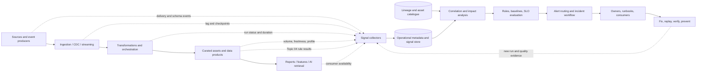

# Data Observability and Quality Service Levels

> **Module:** Stage 2D — Data Architecture  
> **Module path:** `11-Metadata-Lineage-Quality-and-Master-Data/`  
> **Topic:** 05 — Data observability and quality service levels  
> **Level:** Beginner → Intermediate → Advanced  
> **Scenario:** Northbridge Bank, a fictional organisation; all data and numbers are synthetic  
> **Status of targets:** All thresholds and service-level targets are illustrative design choices, not universal industry standards.

## 1. Purpose, scope, prerequisites, and learning outcomes

### 1.1 Purpose

Data observability helps a team discover when data or a pipeline is behaving differently from what consumers need. It combines signals about delivery, freshness, volume, distributions, schema, execution, quality, and lineage with defined ownership and response.

Traditional infrastructure monitoring can show that a worker is healthy, a database is reachable, and a job process exited successfully. It cannot, by itself, prove that the expected business data arrived, that a currency field retained its meaning, that the dataset is complete, or that a report is usable by its deadline. A technically healthy pipeline can produce late, empty, duplicated, stale, malformed, or semantically wrong data.

Quality service levels turn expectations into measurable commitments. They define what will be measured, over which population and time window, what target is expected, how a breach is identified, and who responds.

### 1.2 Scope

This topic covers:
- the distinction between observability, infrastructure monitoring, tests, profiling, and data quality management;
- freshness, delivery latency, volume, distribution, schema, lineage, pipeline execution, and quality signals;
- expected behaviour, historical baselines, seasonality, anomaly detection, and signal confidence;
- service-level indicators (SLIs), objectives (SLOs), service-level agreements (SLAs), measurement windows, exclusions, and error budgets;
- dependency-aware SLO design using upstream lineage and pipeline stages;
- alerts, escalation, incident handling, runbooks, root-cause investigation, communication, and post-incident learning;
- batch, incremental/CDC, and streaming observability;
- coverage, sampling, cardinality, retention, privacy, cost, and alert-noise trade-offs;
- observability for analytics, ML datasets/features, and AI knowledge sources.

This topic builds on Topic 03 (lineage and impact analysis), Topic 04 (quality dimensions and critical data elements), P8 (freshness, availability and SLO design), and P9 (streaming lag, replay, late events, and failure modes). It does not prescribe a particular monitoring vendor or replace the later reliability and disaster-recovery module.

### 1.3 Prerequisites and dependencies

| Prerequisite | How it is used here | Readiness check |
|---|---|---|
| Topic 03: end-to-end lineage and impact analysis | Find the first failing node, identify downstream consumers, and calculate dependency constraints | Trace a report field to its source and list unknown lineage segments |
| Topic 04: quality dimensions and CDEs | Convert quality rules into continuous signals and consumer-specific acceptance criteria | Write a testable completeness rule with population, denominator, threshold, owner, and action |
| P8: freshness, availability, and SLO design | Define time budgets and measurable promises | State an SLI, target, measurement window, and failure policy |
| P9: streaming signals and failure modes | Observe lag, watermarks, late events, replay, backpressure, and dead-letter queues | Explain event time versus processing time and idempotent replay |
| Metadata and catalogue concepts (Topics 01–02) | Find asset owners, definitions, classification, and support contacts | Identify an asset owner and classification in an asset record |

### 1.4 Learning outcomes

By the end of this topic, you should be able to:

1. distinguish observability from monitoring, testing, profiling, and quality management;
2. choose useful indicators for data and pipeline behaviour;
3. calculate freshness, delivery latency, volume deviation, quality SLIs, and error budgets correctly;
4. define SLIs/SLOs with explicit populations, units, windows, exclusions, and owners;
5. test whether an SLO is feasible given upstream dependency constraints;
6. design warning and critical alerts that are actionable and have owners;
7. investigate a data incident using execution events, quality results, and lineage;
8. account for batch, incremental, and streaming semantics;
9. balance detection coverage against cost, privacy, cardinality, retention, and noise;
10. produce an indicator register, SLO table, alert/runbook design, incident record, and ADR.

### 1.5 Roadmap alignment and source limits

The module roadmap defines Topic 05 as continuous observation of the quality and data behaviour defined in Topics 03–04. It explicitly emphasises:
- freshness, volume, distribution, schema, and pipeline status;
- collecting signals from jobs, tables, schemas, and quality-rule results as operational metadata;
- SLIs/SLOs, error budgets, alert ownership, runbooks, and incident response;
- lineage-based root-cause analysis and dependency-feasible SLOs;
- false positives, alert fatigue, missing-data alerts, monitoring-system failures, and ownerless alerts;
- seasonality-aware baselines, streaming lag/watermark/late-event/dead-letter-queue signals;
- coverage strategy, monitoring cost, security/privacy, and AI/analytics implications;
- Exercise A: indicator register and SLOs for a synthetic risk report;
- Exercise B: incident simulation in which a source change doubles null rates in a CDE;
- deliverables: indicator register, SLO table with measurement method/error budget, alerting and escalation/runbooks, incident simulation record, and an ADR.

The roadmap states that topic and project files were empty when the roadmap was written. Therefore, the roadmap is treated as intended scope; it is not evidence that an empty topic file already specified implementation details. All scenarios and targets below are illustrative recommendations.

---

## 2. Beginner foundations and terminology

### 2.1 Observability in plain language

**Data observability** is the ability to understand the health and behaviour of data assets and pipelines over time by collecting and correlating signals, detecting unexpected behaviour, and connecting it to impact and response.

It asks more than “did the job run?” It asks:
- Did the expected data arrive?
- Did it arrive early enough for the consumer?
- Is the amount of data plausible for this point in the business cycle?
- Did its schema or distribution change?
- Did quality rules pass?
- Did the right upstream inputs and transformations run?
- Which downstream products may be affected?
- Is the signal itself trustworthy, and who acts on it?

**Why it matters:** many data incidents are semantic or temporal rather than infrastructure failures. A job can complete successfully while reading an incomplete source partition, using a stale reference table, dropping a join key, or publishing a report before late events arrive.

### 2.2 Observability versus related practices

These practices overlap but have different primary purposes.

| Practice | Primary question | Typical mechanism | Example |
|---|---|---|---|
| Infrastructure monitoring | Are compute, storage, network, and services healthy? | CPU, memory, disk, service availability, process health | Worker pool is saturated |
| Pipeline/job monitoring | Did a run start, succeed, fail, or exceed its runtime budget? | Run events, duration, retries, task status | ETL run failed at transformation step |
| Data testing | Does this snapshot satisfy a known assertion now? | Assertions at build/load/release time | `customer_id` is non-null in this batch |
| Data profiling | What does the current data look like? | Counts, distinct values, null rates, quantiles, distributions | Email null rate is 4.2% |
| Data quality management | What does fitness for use mean, and how are rules, ownership, exceptions, and remediation governed? | CDE register, rules, owners, acceptance criteria | A critical currency defect blocks report publication |
| Data observability | What is changing over time, what matters, how is it connected, and who should respond? | Correlated signals, baselines, lineage, alerts, incidents | Null rate doubles after a source schema change |
| Data governance | Who has decision rights, what policies apply, and what evidence is required? | Ownership, policies, controls, approvals, audits | A data owner approves a time-bounded exception |

A one-time test can be part of an observability system if its result is collected over time and correlated with other signals. Conversely, a dashboard of job statuses is not complete data observability if it cannot detect missing data, quality drift, or downstream impact.

### 2.3 Terms

| Term | Meaning | Example |
|---|---|---|
| Signal / indicator | A measured observation of asset or pipeline behaviour | Row count, max event timestamp, null rate |
| Baseline | A reference model of expected behaviour for a comparable context | Typical weekday volume by hour |
| Anomaly | Behaviour sufficiently different from expected behaviour to investigate | Monday volume is 55% below comparable Mondays |
| Alert | A routed notification that a condition requires attention | Critical CDE null rate exceeds the agreed limit |
| Incident | A confirmed or suspected event requiring coordinated response | Exposure report cannot be published by deadline |
| Runbook | Instructions for triage, containment, diagnosis, recovery, and verification | Steps for late source partition |
| SLI | Service-level indicator: the defined measurement of service behaviour | Percentage of scheduled publication days completed by 07:00 |
| SLO | Service-level objective: target for an SLI over a stated window | At least 99% of eligible publication days meet the deadline over 90 days |
| SLA | Service-level agreement: a formal commitment, often with responsibilities and remedies | Contractual availability commitment between provider and consumer |
| Error budget | The permitted amount of SLO failure in the selected window | 1% of eligible publication opportunities may miss the target |
| MTTD | Mean time to detect an incident, under a stated incident population | Average elapsed time from incident start to detection |
| MTTR | Mean time to restore/resolve, with the chosen definition stated | Average elapsed time from detection to restored service |
| False positive | Alert fires but no actionable incident or meaningful deviation is found | Seasonal month-end increase triggers a generic volume alert |
| False negative | A meaningful incident occurs but the monitor does not alert | Missing partition is not detected because no-data is treated as zero rows |
| NOT RUN / UNKNOWN | Measurement could not be trusted or did not execute | Monitor failed before reading the source |

### 2.4 Signals versus conclusions

A signal is evidence; it is not automatically a diagnosis.

- A lower row count may mean missing data, a legitimate business decline, a changed filter, a source outage, or a delayed partition.
- A higher null rate may mean a source capture regression, a new valid category, a schema mapping failure, or a profiling query that changed its denominator.
- A schema change may be compatible or breaking depending on the contract and consumer.
- A freshness breach may be caused by an upstream source, a queue backlog, a transformation, or a schedule mismatch.

A good system combines multiple signals, compares them with context, and preserves uncertainty until evidence supports a conclusion.

### 2.5 Why infrastructure health is insufficient

Consider a synthetic daily exposure pipeline:
1. source database is available;
2. extract job succeeds;
3. transformation job succeeds;
4. target table is queryable;
5. report scheduler succeeds.

The report can still be wrong if the extract read yesterday’s partition, a join dropped 4% of counterparties, a currency mapping changed, or the target was published before late events were reconciled. Infrastructure monitoring sees healthy components; data observability connects component state to expected data behaviour and consumer outcomes.

**When to use both:** infrastructure monitoring is essential for diagnosing capacity and service failures. Data observability is essential for determining whether the delivered data are complete, current, semantically plausible, and usable. Neither replaces the other.

---

## 3. Observability signals and data failure patterns

### 3.1 Core signal families

The roadmap names five common signal families: freshness, volume, distribution, schema, and pipeline execution. In production designs, also connect quality-rule results, lineage changes, and streaming-specific signals.

| Signal family | What to measure | Typical failure pattern | Context needed |
|---|---|---|---|
| Freshness | Age of latest valid data, source-to-target lag, deadline success | Stale snapshot, delayed partition, stuck watermark | Consumer deadline, event time, timezone, schedule |
| Volume | Rows/events/files, partition counts, bytes, accepted/rejected counts | Missing batch, duplicate load, sudden drop/spike | Day-of-week, seasonality, business calendar, source completeness |
| Distribution | Null/sentinel rates, distinct counts, category mix, quantiles, ranges | Null-rate jump, category disappearance, amount drift | Cohort, schema, effective dates, product mix |
| Schema/contract | Column presence/type/nullability, version, breaking changes | Removed field, type widening/narrowing, renamed column | Contract compatibility and consumer dependency |
| Pipeline execution | Start/end, status, retries, duration, failed task, input/output IDs | Repeated retries, partial completion, silent failure | Expected schedule, dependency graph, run IDs |
| Quality rules | Rule pass/fail, numerator/denominator, severity, trend | CDE defect, uniqueness failure, reconciliation gap | Topic 04 rule definition and acceptance policy |
| Lineage/change | Upstream/downstream graph, transformation version, source deployment | Many consumers affected by one source change | Lineage coverage, evidence freshness, owner metadata |
| Streaming | Consumer lag, watermark delay, late-event rate, DLQ rate, replay count | Backpressure, late windows, duplicate effects | Event-time policy, allowed lateness, idempotency horizon |
| Consumer outcome | Report publication, feature availability, retrieval usability | User discovers missing report or stale feature | Consumer journey and actual deadline |

### 3.2 Signal contract

Every indicator should have a definition and operational contract:

- stable indicator ID and version;
- asset, pipeline, field, or consumer;
- purpose and business use;
- formula, units, population, and time window;
- expected cadence and baseline context;
- warning and critical thresholds or anomaly policy;
- source of the signal and collection success indicator;
- owner, responder, escalation route, and runbook;
- retention and access policy;
- known limitations, sampling method, and coverage.

An indicator without a defined population or owner may look useful on a dashboard but be impossible to interpret or act on reliably.

### 3.3 Monitoring the absence of data

“No rows” is ambiguous. It may mean:
- the business legitimately produced no records;
- the source file or partition is missing;
- the pipeline did not execute;
- the monitor failed;
- a filter excluded all records;
- the source watermark did not advance.

Do not encode all of these as `row_count = 0` and then mark the result healthy.

Design separate signals:
1. **Expected delivery:** did a source/file/partition/run arrive by the expected time?
2. **Monitor execution:** did the monitor itself execute and read the intended snapshot?
3. **Observed volume:** how many eligible records were present?
4. **Business plausibility:** is zero an allowed outcome for this use and period?
5. **Data completeness:** did all expected partitions/keys arrive?

If a source is expected daily, alert on missing delivery even if the downstream table remains queryable. If zero rows are valid, the delivery signal may pass while a separate volume anomaly is evaluated.

### 3.4 Event evidence and correlation

Useful evidence sources include:
- pipeline run events and task logs;
- metrics from jobs and tables;
- schema registry or contract-change events;
- quality-rule results from Topic 04;
- data asset metadata and owner records from Topic 01–02;
- lineage snapshots and transformation versions from Topic 03;
- source watermark and ingestion checkpoint records;
- deployment/change records and incident tickets;
- consumer publication or feature-serving events.

Correlate using stable IDs: asset ID, partition/window, run ID, source snapshot ID, rule ID/version, schema version, lineage reference, and incident ID. Timestamp-only correlation is fragile because clocks, retries, and concurrent runs may differ.

### 3.5 Expected behaviour and baselines

A baseline describes what is typical for a comparable context. It may be:
- a fixed expected range;
- a previous-period comparison;
- a weekday/month-end seasonal baseline;
- a statistical control limit;
- a versioned model trained on historical observations.

Use a baseline when data naturally vary. For example, Monday volume may differ from Sunday, and month-end exposure may differ from a normal weekday. Compare like with like: same business calendar, time zone, population filters, schema version, and grain.

A baseline is not a business rule. A historically bad process can become “normal” if the baseline blindly learns it. Keep hard constraints for non-negotiable requirements, and use anomaly detection as an additional signal rather than a substitute for domain rules.

### 3.6 Failure pattern taxonomy

| Pattern | Example symptom | Possible causes | First discriminating check |
|---|---|---|---|
| Missing | Expected partition absent | Source delay, scheduler failure, wrong path, permission issue | Check source delivery event and expected partition manifest |
| Late | Freshness lag exceeds budget | Upstream backlog, long query, backpressure, retry storm | Compare stage timestamps and queue/watermark lag |
| Partial | Lower count or missing key range | Incomplete extraction, partial write, filter regression | Reconcile expected partitions, source/output counts, control totals |
| Duplicate | Count spike, repeated IDs | Replay, retry without idempotency, join multiplication | Count duplicate keys and inspect run/replay IDs |
| Malformed | Schema or parsing failures | Type change, encoding, unexpected nulls | Compare schema version and rejected-record evidence |
| Semantically wrong | Rules pass but business result is wrong | Bad mapping, stale reference, unit/currency error | Compare authoritative values and transformation lineage |
| Distribution drift | Category/null/quantile shift | Real business change, source regression, mix shift | Segment by source/cohort and compare comparable windows |
| Silent monitor failure | Dashboard stale or all indicators flat | Collector stopped, credentials expired, query failure | Monitor heartbeat and expected signal arrival |
| Propagation | Several downstream products fail | Shared upstream defect or breaking schema change | Find earliest failing node in lineage |
| Consumer mismatch | Data is current but consumer still fails | Wrong grain, incompatible schema, semantic mismatch | Compare product contract and consumer expectation |

---

## 4. Freshness, volume, distribution, schema, and quality monitoring

### 4.1 Freshness and delivery latency

**Freshness** describes how current the available data are for a particular use. It can be measured as the age of the latest relevant event/snapshot or as whether a delivery was completed by a deadline.

**Delivery latency** describes elapsed time between defined stages, such as source event time and consumer availability time. It must use named timestamps and consistent units.

Common measures:
- `data_age = evaluation_time − latest_valid_data_time`;
- `delivery_latency = consumer_available_time − source_event_time`;
- `pipeline_duration = run_end_time − run_start_time`;
- `deadline_success = 1` if the eligible delivery was available by the agreed deadline, else `0`.

Do not use these interchangeably. A job can finish quickly with old data. A recent maximum timestamp can coexist with missing earlier partitions. A snapshot can be current but incomplete.

#### Worked example: freshness and stage latency

Synthetic timestamps for a daily report:

| Event | Timestamp (UTC) |
|---|---|
| Latest source event in expected scope | 05:10 |
| Source extract complete | 05:24 |
| Curated table commit | 05:42 |
| Report available to consumers | 05:50 |
| Evaluation time | 06:00 |
| Consumer deadline | 06:00 |

Calculations:
- Data age at evaluation = 06:00 − 05:10 = **50 minutes**.
- Source-event-to-consumer latency = 05:50 − 05:10 = **40 minutes**.
- Curated-to-report latency = 05:50 − 05:42 = **8 minutes**.
- Deadline status = success, because report availability 05:50 ≤ 06:00.

Units are minutes; timestamps are UTC; the measurement applies to the latest valid event within the expected reporting scope. It excludes records intentionally outside the report cut-off. This calculation does not prove the whole dataset is complete; a separate partition/key reconciliation is required.

**Trade-off:** event timestamps may be missing, incorrect, or generated by clocks that are not synchronised. Record clock source and timezone. For daily snapshots, snapshot completion time may be a more reliable SLI than maximum event timestamp alone.

### 4.2 Volume monitoring

Volume indicators include:
- total rows or events;
- files and partitions received versus expected;
- accepted and rejected rows;
- distinct key counts;
- input/output counts and control totals;
- bytes or records per source;
- count by business cohort or time bucket.

Use both absolute expectations and relative baselines where appropriate. A minimum delivery contract can catch missing batches, while a seasonal baseline can detect unusual variation within a delivered batch.

#### Worked example: volume anomaly

A synthetic customer mart has these historical counts for the same weekday and comparable filter:
- previous five comparable Mondays: 4.8M, 5.0M, 5.1M, 4.9M, 5.2M rows;
- current Monday: 2.6M rows.

For a simple teaching baseline, use the median of the five historical counts. Sorted values: 4.8M, 4.9M, 5.0M, 5.1M, 5.2M; median = **5.0M**.

Relative deviation:

\[
\text{Deviation \%} = \frac{\text{observed} - \text{baseline}}{\text{baseline}} \times 100\%
\]

\[
= \frac{2.6 - 5.0}{5.0} \times 100\% = -48\%
\]

The current count is 48% below the baseline. This is a strong investigation signal, not proof of data loss. Check whether the source population, filters, business activity, schema, and partition manifest changed. The baseline uses five synthetic comparable days and is too small for a robust production statistical model; use sufficient history and evaluate alert precision/recall before relying on it.

### 4.3 Distribution monitoring

Distribution signals can include:
- null, blank, and sentinel rates;
- distinct counts and cardinality;
- category proportions;
- numeric quantiles, min/max, mean and variance;
- key frequency/skew;
- status transitions;
- join match rates;
- cohort coverage;
- label distributions for ML;
- retrieval source mix, freshness, and duplicate content for AI knowledge systems.

Example: if the null rate of a critical `currency_code` field rises from 0.2% to 8.4%, the relative increase is large. For a critical field, use the Topic 04 rule and its hard acceptance condition; do not wait for a generic anomaly detector.

For less critical fields, a baseline may help distinguish routine variation from unexpected change. Define:
- the population and denominator;
- comparable cohorts and periods;
- baseline training window;
- minimum volume required;
- threshold and alert action;
- treatment of known business events;
- baseline drift and review process.

A distribution change can reflect legitimate business behaviour. Alert on a material signal and route it for investigation rather than automatically deleting, correcting, or rejecting all changed values.

### 4.4 Schema and contract monitoring

Track:
- expected fields, types, nullability, keys, and constraints;
- schema version and producer change events;
- added, removed, renamed, or retyped fields;
- incompatible changes for downstream consumers;
- parsing and rejected-row rates;
- changes to business meaning, not only physical representation.

A new nullable column may be backward compatible for some consumers but still require governance. A column can retain the same type while its meaning changes, which a schema-only monitor may not detect. Use data contracts, semantic tests, and lineage to assess impact.

**Recommended response:** block or quarantine an incompatible schema change at the boundary when possible; alert owners; identify affected downstream assets via lineage; test the new contract; deploy compatible transformations; then replay or backfill if needed.

### 4.5 Pipeline execution and delivery completeness

A pipeline monitor should record:
- expected schedule and actual start/end;
- status and retry count;
- input/output snapshot and partition IDs;
- row counts and rejected counts;
- source watermark and completion markers;
- task-level failure and runtime;
- partial-commit state;
- monitor/collector health.

A successful process exit does not necessarily mean a complete delivery. For example, a pipeline may skip a missing partition and still write a valid table. Compare expected inputs against observed inputs and validate the output contract before publishing.

For a multi-stage pipeline, use stage-level signals to localise the problem but preserve an end-to-end consumer SLI. A collection of green stage indicators does not guarantee the consumer receives the correct result.

### 4.6 Quality signals from Topic 04

Quality observability should reuse the governed rules from Topic 04 rather than create duplicate, inconsistent definitions. Each quality result should include:
- rule ID/version, CDE and dimension;
- asset/snapshot and population definition;
- numerator, denominator, metric and threshold;
- execution status (`PASS`, `FAIL`, `NOT_RUN`, `INCONCLUSIVE`, or `EXCEPTION_ACCEPTED`);
- severity and failure action;
- owner and issue reference;
- execution time and lineage/evidence reference.

**Important distinction:** a rule failing is a data result; a rule failing to execute is an observability/control failure. A missing result must not be treated as a pass.

### 4.7 Indicator register — synthetic example

All targets below are proposed for the fictional Northbridge risk-reporting product. The owner roles and thresholds require business approval before real use.

| Indicator ID | Asset / consumer | Signal and formula | Window / population | Warning / critical condition | Owner | Response |
|---|---|---|---|---|---|---|
| OBS-001 | `gold.risk_report` | Deadline success: complete, quality-gated report available by 06:00 UTC | Each scheduled business day; expected report dates only | Warning if not ready by 05:45 UTC; critical if unavailable at 06:00 UTC | Risk Reporting Owner | Warn upstream owners at 05:45 UTC; at 06:00 UTC declare a missed delivery, open/raise the incident, and notify consumers; do not publish an unsafe report |
| OBS-002 | `silver.customer` | Freshness age = evaluation time − latest valid source timestamp | Every 15 minutes; in-scope source records | Warning > 30 min; critical > 60 min | Customer Data Product Owner | Check source delivery, watermark, and pipeline stage lags |
| OBS-003 | `silver.customer` | Volume deviation from weekday baseline | Daily snapshot; same cohort/filter and weekday | Warning absolute deviation > 20%; critical > 40%, only after minimum volume | Customer Data Product Owner | Check expected partitions, source changes, business events, and filter version |
| OBS-004 | `silver.customer.email` | Completeness SLI from Topic 04: usable eligible values / eligible rows | Daily snapshot; eligible active customers | Warning < 99%; critical < 98% or any separately defined critical defect | Customer Domain Owner | Open quality incident; trace source schema/mapping; quarantine or restrict affected consumer |
| OBS-005 | `gold.risk_report.currency_code` | Valid currency-code rate against effective-dated reference | Every report run; published Tier 1 rows | Warning on any unexpected invalid value; critical if any material invalid row remains | Risk Reporting Owner | Block publication; inspect reference version and upstream mapping |
| OBS-006 | `stream.transactions` | Event-time-to-processing lag p99 = processing timestamp − event timestamp, in seconds; separately record consumer offset/queue lag in its native unit per partition | Rolling 5-minute windows; all assigned partitions and complete windows | Warning if event-time lag p99 > 60 seconds; critical if > 120 seconds for 2 complete windows | Payments Data Product Owner | Inspect offset/queue lag, partition skew, backpressure, source rate, watermark, and DLQ; do not compare offset counts directly with a seconds threshold |
| OBS-007 | Pipeline `customer_curate` | Successful complete runs / scheduled runs | Rolling 30-day window; eligible scheduled runs | Warning below 99%; critical below 97% or any critical missed delivery | Data Platform Operations | Inspect task failures, retries, upstream dependencies, and incomplete writes |
| OBS-008 | All critical monitors | Monitor heartbeat: successful monitor runs / expected monitor runs, plus age of last emitted result | 15-minute windows | Critical if two expected monitor heartbeats are missing or result age exceeds its contract; source-read failures emit a separate `UNKNOWN` measurement with a reason | Observability Operations Owner | Raise a meta-monitor incident for collector/heartbeat failure; route source-read failure to the source/platform owner; do not interpret stale indicator values as healthy |
| OBS-009 | `ml.customer_features` | Feature freshness and offline/online parity | Per feature group; window defined by model use | Target set per feature consumer; hard gate for critical missing feature | ML Platform Owner | Freeze affected model path or fallback; inspect feature lineage and serving parity |
| OBS-010 | `ai.knowledge_chunks` | Approved-source coverage, freshness, and ACL verification | Per source class and index build; retrievable chunks | Critical if revoked/restricted content is retrievable; freshness targets by source class | AI Knowledge Product Owner | Block retrieval/unpublish, rebuild or invalidate index, verify ACL propagation |

A register should also include indicator version, signal source, baseline method, severity rationale, runbook, escalation route, retention, access restrictions, sampling/coverage, and known blind spots. The compact table above is a teaching example, not a full production registry.

---

## 5. SLIs, SLOs, SLAs, measurement windows, and error budgets

### 5.1 Definitions

- **SLI (service-level indicator):** the exact measurement used to evaluate service behaviour.
- **SLO (service-level objective):** a target for an SLI over a defined measurement window.
- **SLA (service-level agreement):** a formal agreement between parties, often with consequences or remedies if commitments are missed.

Example:
- SLI: eligible scheduled days on which the risk report is complete and available by 06:00 UTC.
- SLO: at least 99% of eligible scheduled days over a rolling 90-day window meet that condition.
- SLA: a contractual or formally approved commitment between the provider and consumer, including responsibilities and remedies.

An internal SLO can guide engineering even if no SLA exists. Do not label an internal target an SLA unless the agreement and accountability are real.

### 5.2 Design an SLI precisely

A complete SLI definition states:
1. the service/asset and consumer;
2. the event or population being measured;
3. what counts as success and failure;
4. the numerator and denominator;
5. the unit and time window;
6. exclusions and handling of missing measurements;
7. the source of evidence and monitor-health condition;
8. the reporting cadence and owner.

**Example — report deadline SLI**

- Population: scheduled business-day publication opportunities in the last 90 days.
- Success: report is complete, quality gates pass, and the consumer-visible version is available by 06:00 UTC. The production contract must name the business timezone; UTC is used here so the worked incident timestamps are unambiguous.
- Numerator: successful eligible publication opportunities.
- Denominator: all eligible scheduled publication opportunities.
- Exclusions: only pre-approved exclusions such as a formally declared non-business day; exclude nothing after the fact merely because it failed.
- Missing measurement: treated as unknown/control failure and investigated; do not silently remove from the denominator.
- Unit: percentage of publication opportunities.
- Window: rolling 90 days.
- Owner: Risk Reporting Owner.

This is stronger than “report availability 99%” because it defines completeness, timing, population, and evidence.

### 5.3 SLI examples

| SLI | Formula | Unit | Critical design detail |
|---|---|---|---|
| Deadline success | successful eligible deliveries / eligible scheduled deliveries | % | Define complete delivery and the deadline |
| Freshness compliance | eligible evaluation points within freshness budget / eligible evaluation points | % | Define evaluation cadence and whether repeated points are independent |
| Completeness | usable required values / eligible required values | % | Use Topic 04 population and null policy |
| Quality pass | eligible expected rule evaluations passing / all eligible expected rule evaluations | % | `FAIL`, `NOT_RUN`, and `INCONCLUSIVE` do not count as passing; also report execution coverage = executed expected evaluations / all expected evaluations, so missing measurements remain visible |
| Pipeline success | complete successful runs / eligible scheduled runs | % | A successful partial write must not count as complete |
| Availability | time or eligible checks when the product is usable / total eligible time or checks | % | Define consumer-visible usability, not merely service process uptime |
| Streaming lag compliance | events or windows within lag budget / eligible events or windows | % | Choose event-level or window-level denominator; account for late events |
| Reconciliation compliance | eligible batches meeting approved reconciliation criteria / eligible batches | % | Align scope, cut-off, units, rounding, and exclusions |

Never combine incompatible SLIs into a single average without explaining the weighting and hard gates. A report may be fresh but wrong, or complete but late.

**Expected evaluations versus executed evaluations:** for an SLO, enumerate the expected evaluation opportunities from the schedule and asset contract first. Report (1) outcome compliance over all eligible expected opportunities, with `NOT_RUN`/`UNKNOWN` not silently counted as success, and (2) measurement coverage, the fraction of expected evaluations that produced trustworthy measurements. If a business agreement defines a different treatment for missing measurements, document and approve it in advance; do not change the denominator after observing failures.

### 5.4 Measurement windows and granularity

A window must fit the service and the business decision.

- **Per run:** useful for batch correctness and release gates.
- **Per scheduled day:** useful for daily report delivery.
- **Rolling 7/30/90 days:** useful for operational trends and SLO evaluation.
- **Fixed calendar month:** useful for formal reporting if the calendar boundary matters.
- **Per event or partition:** useful for streaming and incremental delivery.
- **Rolling minute windows:** useful for lag/backpressure detection, but can be noisy if each point is treated as an independent SLO event.

Use matching granularity. A target of “99% of daily runs” is not interchangeable with “99% of hourly checks.” The number of allowed failures changes with the number of eligible events.

#### Worked example: discrete error budget

Assume:
- SLO = 99% successful scheduled report days;
- window = 90 eligible scheduled days;
- each scheduled day counts as one binary opportunity;
- there are no approved exclusions.

Allowed failed opportunities:

\[
\text{Error budget} = (1 - 0.99) \times 90 = 0.9 \text{ failed days}
\]

The roadmap also uses a 30-day example: \(0.01 \times 30 = 0.3\) failed days, which likewise permits zero whole-day failures. A fractional result is an expected allowance, not a fractional incident; for binary daily opportunities, the largest integer number of failures that still meets the target is \(\lfloor N(1-S)\rfloor\), subject to the exact target comparison.

Since the unit is a whole publication day, the system cannot spend 0.9 of a failed day under this binary definition. To meet at least 99%, it can have **zero failed days** in 90 opportunities; one failure gives 89/90 = 98.89%, below target.

This does not mean a 99% SLO is always wrong. It means the indicator granularity and window must match the intended service promise. A 99% target over 365 eligible days allows 3.65 failures mathematically, so a whole-event policy must still specify how fractional budgets are handled; four failures would yield 361/365 ≈ 98.90%, below 99%, so at most three whole failures satisfy the target.

### 5.5 Worked example: quality SLI and SLO

Synthetic daily customer data:
- Eligible active customers: 50,000.
- Customers with a usable email under the Topic 04 rule: 49,250.
- Completeness SLI = 49,250 / 50,000 = **98.5%**.

Illustrative SLO: email completeness is at least 99.0% for the eligible active-customer population in each daily snapshot. This proposed target must be approved by the Customer Domain Owner and the communication consumer. If the actual business requirement is “no eligible customer may be omitted from a mandatory notification,” a percentage alone may be insufficient; a hard gate or exception process may be required.

The numerator and denominator are row counts for the defined daily snapshot, not the count of distinct emails and not the count of all customers. Blank and sentinel values are handled according to the Topic 04 usable-value policy. A zero eligible population produces an undefined rate, not 100%.

### 5.6 Exclusions and missing measurements

Exclusions must be:
- defined before the measurement period;
- narrow, reproducible, and approved;
- tied to a known business calendar or service boundary;
- visible in reporting;
- not added retroactively merely to improve results.

Examples may include an agreed maintenance window or a non-business day when no report is contractually expected. An upstream outage is generally not an automatic exclusion from the consumer SLO; it may explain the breach, but the consumer still did not receive the service. Whether an external dependency is excluded depends on the agreement and must be explicit.

If a monitor fails, the service state may be unknown. Do not treat unknown as success. Report measurement coverage and monitor health alongside the SLI.

### 5.7 SLA considerations

Use an SLA only when the parties need a formal commitment. Define:
- service boundary and eligible consumers;
- SLI and target;
- measurement method and window;
- maintenance and exclusion rules;
- notification and incident responsibilities;
- evidence source and dispute resolution;
- remedies, credits, or other consequences if applicable.

A technically precise SLO can still be a poor SLA if the provider cannot measure it reliably, the consumer has no fallback, or upstream dependencies make it infeasible. Prefer to mature internal measurement before committing externally.

### 5.8 Error budgets and burn rate

An error budget is the permitted SLO failure within a window. It helps make trade-offs explicit: if the service is consuming its budget rapidly, teams may pause risky changes, prioritise reliability work, or communicate degraded service.

For a rate-based SLO:
- target \(S\) is the desired success fraction;
- allowed error fraction is \(1-S\);
- observed error fraction is measured over the selected window.

A simple burn-rate measure is:

\[
\text{Burn rate} = \frac{\text{observed error fraction}}{\text{allowed error fraction}}
\]

If the SLO is 99% (allowed error fraction 1%) and the observed error fraction over a defined recent window is 3%, burn rate = 3% / 1% = **3×**. This means errors are occurring at three times the rate allowed by the objective over that window; it does not directly predict the future unless the rate persists.

Use burn rate when it helps prioritise incidents or release decisions. For low-volume daily products, discrete failures may make short-window burn rates unstable; report counts and binary delivery outcomes too.

### 5.9 SLO table — synthetic risk-reporting product

Targets are illustrative and require approval. Dependency feasibility must be validated against actual schedules, processing distributions, and failure modes.

| SLO ID | Consumer promise / SLI | Target and window | Hard gate / exclusions | Owner | Breach response |
|---|---|---|---|---|---|
| SLO-01 | Complete risk report available by 06:00 UTC on eligible business days | ≥ 99% over rolling 90 eligible days | Critical quality gates must pass; only pre-approved non-business days excluded | Risk Reporting Owner | Notify consumers at deadline; open incident; assess regulatory/reporting obligations |
| SLO-02 | Customer curated snapshot freshness | 99% of scheduled evaluations show age ≤ 60 minutes over rolling 30 days | Missing monitor result is not success; scheduled evaluations only | Customer Data Product Owner | Check source delivery and lineage stage lags; escalate after critical threshold |
| SLO-03 | Required customer email completeness for eligible population | ≥ 99% per daily snapshot, with a separate hard gate for mandatory contact cohorts | Zero denominator is `NOT_APPLICABLE`; no retroactive population exclusions | Customer Domain Owner | Open quality incident; identify source/mapping cause; consumer-specific restriction |
| SLO-04 | Critical currency-code validity in published report | 100% of material published rows use an approved effective-dated code | Any unresolved material invalid code blocks publication | Risk Reporting Owner | Block report; inspect reference version and upstream mapping |
| SLO-05 | Complete successful customer-curation runs | ≥ 99% of eligible scheduled runs over rolling 30 days | Partial output does not count as success; missing run counts as failure | Data Platform Operations | Incident, dependency check, controlled replay and verification |
| SLO-06 | Streaming transaction processing lag | p99 event-time-to-processing lag ≤ 120 seconds in each complete 5-minute window, 99% of eligible windows over 30 days | Define watermark and allowed-lateness policy; monitor failure is unknown | Payments Data Product Owner | Investigate backlog/backpressure; assess late-event and DLQ impact |
| SLO-07 | AI knowledge retrieval uses approved, permitted source versions | 100% of retrievable chunks have valid source/version/ACL; freshness target varies by source class | Any revoked restricted source retrievable is a hard breach | AI Knowledge Product Owner | Block affected retrieval, invalidate/rebuild index, verify permission propagation |

For every SLO, maintain the detailed formula, denominator, evaluation schedule, data source, missing-measurement treatment, baseline, owner, escalation route, and evidence retention policy. The table is a starting design, not a substitute for a feasibility review.

### 5.10 Feasibility across upstream dependencies

A consumer SLO is constrained by the upstream chain. Lineage identifies the path; operational measurements provide the stage-lag distributions and availability evidence.

For a serial path with non-overlapping stage delays:

\[
L_{\text{end-to-end}} = \sum_{i=1}^{n} L_i
\]

where \(L_i\) is elapsed delay attributable to stage \(i\), measured in the same unit and for the same event/batch. If stages overlap, adding their durations may overstate end-to-end latency; use actual event timestamps or a critical-path model.

For serial independent dependencies, an approximate availability relationship is:

\[
A_{\text{chain}} = \prod_{i=1}^{n} A_i
\]

This product is a simplifying assumption: dependencies may be correlated, and “availability” must refer to the same service boundary and window. Do not use it as a guarantee.

#### Worked dependency example

Suppose a report must be ready by 06:00 UTC. The measured planning budgets are:
- source delivery: up to 15 minutes after 05:00;
- ingest/validation: 10 minutes;
- transformation: 15 minutes;
- report publication: 5 minutes;
- contingency: 10 minutes.

Total budget = 15 + 10 + 15 + 5 + 10 = **55 minutes**, ending at 05:55 if the process starts at 05:00. The remaining five minutes to the deadline are not a broad guarantee; they are margin for unmodelled variation. The design should test p95/p99 stage durations, retries, queueing, and correlated outages, not only nominal durations.

If the source routinely arrives at 05:40 UTC, a 06:00 UTC end-to-end target may be infeasible with the current stages. Options include moving the source commitment earlier, reducing downstream work, providing provisional output, changing the deadline with consumer approval, or adding a fallback. An SLO cannot create capacity or erase dependencies.

---

## 6. Alert design, incident response, and root-cause analysis

### 6.1 Design alerts around consumer impact

An alert should answer:
- What is wrong or unknown?
- Which asset, population, and time window are affected?
- Is the issue warning or critical?
- Which consumer or decision is at risk?
- What evidence supports the alert?
- Who owns the response?
- What action is expected now?
- Where is the runbook?
- When should it escalate?

Alert on actionable symptoms rather than every low-level anomaly. For example, a small row-count deviation might create a dashboard annotation; a missing critical report at its deadline should page the responsible owner. The threshold depends on business impact, confidence, and response cost.

### 6.2 Warning versus critical

| Level | Meaning | Example | Expected response |
|---|---|---|---|
| Informational | Interesting change with no immediate action | Small expected seasonal shift | Record trend; no page |
| Warning | Risk is increasing; action may prevent a breach | Freshness exceeds 30-minute warning threshold | Create ticket or notify owner during support hours |
| Critical | Consumer promise or hard control is breached or imminent | Critical CDE invalid; report unavailable at deadline | Page/on-call route, contain, communicate, track incident |
| Unknown/control failure | Measurement cannot be trusted | Monitor failed, credentials expired, source query unavailable | Raise monitor-health incident; do not mark data healthy |

Do not use “critical” solely because a percentage crossed a line. A single critical currency defect may be severe; a 5% deviation in a low-impact exploratory dataset may not be.

### 6.3 Fixed thresholds versus dynamic baselines

| Approach | Best fit | Benefits | Risks |
|---|---|---|---|
| Fixed threshold | Hard business rules, deadlines, contractual limits | Simple, explainable, deterministic | Can be insensitive to context or seasonal patterns |
| Historical comparison | Repeated comparable cycles | Intuitive and explainable | Baseline can be stale or polluted by prior incidents |
| Statistical control limits | Stable process with enough comparable observations | Quantifies unusual variation | Assumptions may fail under seasonality or mix shifts |
| ML-assisted anomaly detection | High-dimensional signals where simpler approaches underperform | Can detect complex patterns | Opaque, drift-prone, difficult to validate; may increase noise |
| Hybrid | Hard gates plus context-aware anomalies | Combines safety with sensitivity | More design and governance effort |

A sound default is hybrid: fixed hard gates for critical rules and deadlines, plus baseline-based signals for unexpected volume/distribution changes. Require an explanation and an owner for anomaly alerts. Evaluate detection precision/recall on historical incidents and known benign changes.

### 6.4 Alert-noise management

Alert fatigue develops when responders receive too many low-value alerts. The roadmap illustrates 200 alerts per week with 90% false positives: only 20 are actionable, and the remaining noise teaches responders to ignore the system.

Ways to reduce noise:
- remove monitors that have no owner, action, or consumer impact;
- group related alerts into one incident when they share an upstream cause;
- apply a minimum-volume condition before distribution alerts;
- use seasonality-aware baselines and known-maintenance suppression;
- distinguish warning from page-worthy conditions;
- set cooldowns or persistence requirements for noisy signals;
- keep a record of suppressed alerts and review it for false negatives;
- track alert precision, actionable rate, incident source, and missed incidents;
- do not suppress hard policy or critical-CDE gates merely because they are noisy.

### 6.5 Incident severity and ownership

A practical data incident severity model:

| Severity | Typical impact | Response expectation |
|---|---|---|
| SEV-1 / Critical | Critical report blocked or materially wrong; restricted data exposed; broad production consumers affected | Immediate incident lead, contain/block, notify accountable business/control owner, frequent updates |
| SEV-2 / High | Major product degraded, material cohort missing, repeated SLO breach | Prompt owner and platform response, bounded workaround, consumer update |
| SEV-3 / Medium | Limited scope, non-critical quality drift, viable workaround | Ticket and owner, agreed resolution target, track recurrence |
| SEV-4 / Low | Low-impact anomaly or hygiene issue | Backlog and trend review |

These labels are illustrative; use the organisation’s incident taxonomy if one exists. Severity should reflect impact, scope, urgency, and risk—not merely alert volume.

Roles:
- **Data product/business owner:** decides consumer acceptance, business impact, and communications.
- **Data steward/rule owner:** validates quality semantics, population, and known exceptions.
- **Platform/pipeline operator:** diagnoses execution, retries, storage, access, and recovery.
- **Source-system owner:** corrects source capture, contracts, and upstream mappings.
- **Incident lead:** coordinates timeline, status, owners, and decision log.
- **Consumer representative:** confirms whether a workaround is safe and when service is restored.
- **Security/risk/compliance role:** joins when classification, regulatory reporting, or policy is implicated.

A team can combine roles, but decision rights must remain explicit.

### 6.6 Incident workflow

1. **Detect:** alert or consumer report arrives; record first observed symptom and monitor status.
2. **Validate:** confirm the monitor ran, the input snapshot and population are correct, and the signal is not a query/collector failure.
3. **Scope impact:** identify affected partitions, CDEs, reports, models, consumers, and time range.
4. **Contain:** block publication, quarantine data, pause downstream processing, mark output provisional, or restrict retrieval as policy requires.
5. **Communicate:** state what is known, what is unknown, affected products, next update time, and safe workarounds.
6. **Diagnose:** correlate job events, schema changes, quality results, lineage, deployments, and reference versions.
7. **Remediate:** fix the source or transformation; use controlled backfill/replay with idempotency.
8. **Verify:** rerun quality assertions, reconcile counts/control totals, confirm consumer-visible recovery, and check downstream outputs.
9. **Close:** document cause, impact, timeline, evidence, and acceptance decision.
10. **Prevent recurrence:** add or improve tests/monitors, correct ownership/contracts, and assign follow-up actions.
11. **Review:** assess detection time, restoration time, alert usefulness, consumer discovery, and unresolved risks.

### 6.7 Root-cause investigation using lineage and quality evidence

**Synthetic incident:** a risk report’s `exposure_amount` appears lower than expected and `customer_id` null rate doubles overnight.

Evidence:
- report publication job succeeded;
- source extract count is normal;
- curated customer table has a null-rate increase from 0.4% to 8.1%;
- schema event shows source field `customer_ref` changed from integer to string, and the new payload includes alphanumeric identifiers (for example, `C-1042`) rather than only digit strings;
- transformation `customer_curate_v4` still applies a numeric-only parse and maps those parse failures to null;
- lineage links `source.customer_ref` to `silver.customer.customer_id`, then to `gold.risk_report`;
- deployment occurred shortly before the first failing snapshot.

Investigation:
1. **Validate signal:** check the monitor queried the intended snapshot; confirm numerator/denominator and rule version.
2. **Establish time:** identify the first bad source snapshot and compare with deployment/schema event.
3. **Trace upstream:** use lineage to find the earliest node where null rate changed.
4. **Inspect transformation:** confirm the cast behaviour for string identifiers and whether leading zeros or non-numeric IDs are valid.
5. **Assess downstream impact:** enumerate report, reconciliation, customer analytics, and ML consumers from lineage.
6. **Contain:** block report publication or mark it unsafe because the CDE/relationship is materially affected.
7. **Fix:** update the schema contract and transformation to preserve the identifier semantics; do not silently coerce unknowns.
8. **Recover:** replay the affected snapshot/partitions idempotently, then rebuild downstream products.
9. **Verify:** confirm null rate returns to expected range, key match rate recovers, row counts reconcile, and reports pass Topic 04 quality gates.
10. **Prevent:** add a schema compatibility test, cast-failure metric, CDE null-rate monitor, and owner notification on breaking source changes.

The root cause is not “bad data” in general; the evidence points to a source schema change combined with a transformation assumption. If lineage is incomplete, mark the gap and use run IDs, code versions, and query logs to establish the path. Do not claim certainty beyond the available evidence.

### 6.8 Runbook template

A runbook should contain:
- runbook ID/version and owner;
- alert/indicator IDs and trigger conditions;
- affected asset, consumer, CDE, and severity;
- validation checks (monitor heartbeat, snapshot ID, denominator, freshness);
- safe first actions and actions that must not be taken;
- lineage/impact query or catalogue location;
- known failure patterns and discriminating tests;
- containment options and approval authority;
- source repair, replay/backfill, and idempotency steps;
- validation queries and expected results;
- consumer communication template and update cadence;
- escalation contacts or role-based routing;
- evidence to retain and access restrictions;
- closure criteria and post-incident actions.

Do not place secrets, credentials, or sensitive raw values in the runbook or broad alert payloads.

### 6.9 Incident record template

| Field | Required content |
|---|---|
| Incident ID / severity | Stable ID and severity rationale |
| Start/detection/mitigation/recovery times | Explicit timestamps and timezone |
| Symptom and signal | Indicator ID, metric, window, numerator/denominator |
| Affected scope | Assets, partitions, CDEs, consumers, lineage references |
| Monitor health | Whether the monitor and input query executed correctly |
| Timeline | Events, deployments, source changes, decisions |
| Root cause / confidence | Evidence-supported cause; unresolved hypotheses labelled |
| Containment and remediation | Actions, owners, idempotency/replay details |
| Consumer communication | Audience, message, workaround, update times |
| Verification | Quality rules, reconciliation, freshness, consumer outcome |
| Prevention | New tests/monitors, contract fixes, ownership actions |
| Follow-up | Owner, due date, closure evidence |

---

## 7. Intermediate and advanced observability architecture

### 7.1 Reference architecture

This is a logical pattern, not a vendor-specific deployment. The signal store should keep time-series/aggregate data, metadata and references to detailed evidence. Lineage and catalogue services provide ownership and impact context. Incident tools coordinate action; they do not replace data validation.

### 7.2 Signal collection design

Collect signals as close as practical to the event:
- pipeline systems emit run start/end, status, input/output IDs, and retries;
- storage/query layers provide row counts, partitions, snapshots, and profile statistics;
- schema/contract services emit version changes;
- streaming systems expose lag, watermark, late events, backpressure, and DLQ rates;
- Topic 04 rules emit versioned outcomes and counts;
- consumers emit publication, feature availability, or retrieval events.

Do not make the monitoring system depend solely on the pipeline it is meant to observe. If a job’s own logs are the only evidence that it ran, a logging failure can look like a healthy quiet period. Add independent heartbeats and expected-event checks.

### 7.3 Monitor the monitors

The observability system itself needs controls:
- expected collector heartbeat;
- successful query and metadata reads;
- freshness of the latest signal;
- expected indicator count and missing indicators;
- alert delivery test;
- owner mapping completeness;
- rule/baseline version and last update;
- clock skew and event-time sanity;
- failed/partial collection state.

If the monitor cannot query the source, report `UNKNOWN` or `NOT_RUN`, not `PASS`. A stale dashboard should show its last successful measurement time clearly.

### 7.4 Coverage strategy and criticality

The roadmap recommends deeper coverage for CDEs and critical pipelines, sampling or lighter checks elsewhere, and template-driven monitor onboarding.

A practical tiering model:
- **Tier 1:** critical CDEs, regulatory/financial outputs, high-blast-radius pipelines, restricted AI sources. Hard gates, reliable exact checks, field-level lineage, independent monitor health, strict escalation.
- **Tier 2:** important data products with material consumer impact. Automated key signals and rule checks; baseline-based anomaly detection; owner and runbook.
- **Tier 3:** exploratory/supporting assets. Lower-frequency profiles, sampled checks, and clear limitations.

Do not use sampling when a hard requirement needs exact detection (for example, no restricted source may be retrievable). Sampling may be useful for expensive exploratory profiling or manual accuracy review when uncertainty is documented.

### 7.5 Baseline governance

A baseline has a lifecycle:
1. define the metric, population, unit, and comparable cohorts;
2. choose a training window that excludes known incidents and major regime changes where possible;
3. record the baseline version and training data range;
4. evaluate historical incident detection and benign-change false positives;
5. deploy in shadow/warning mode before paging;
6. monitor baseline drift and alert usefulness;
7. review after product, source, schema, calendar, or business-process changes;
8. roll back a harmful baseline update.

Do not allow a baseline to learn a known defect as normal. Preserve incident labels and annotate known events. Explain anomaly reasons where possible (for example, “48% below comparable Monday median”) rather than emitting only an opaque anomaly score.

### 7.6 Batch, incremental/CDC, and streaming

**Batch**
- Track expected run, source files/partitions, completion marker, row counts, rejected records, and target commit.
- Treat partial writes and missing inputs as distinct states.
- Use immutable snapshots or run IDs so metrics refer to the correct data version.
- Reconcile output counts/control totals before publishing.

**Incremental / CDC**
- Track source offsets/watermarks, changed rows, delete/tombstone counts, lag, checkpoint progression, and reconciliation against periodic full snapshots.
- Detect a stalled offset even if the worker remains healthy.
- Make replay idempotent and track replay IDs.
- Account for late-arriving dimensions, out-of-order updates, and schema evolution.

**Streaming**
- Measure event-time and processing-time separately.
- Track consumer lag by partition, watermark delay, late-event rate, backpressure, retry rate, DLQ volume, duplicate effects, and end-to-end availability.
- Define allowed lateness and when windows are considered final.
- Alert on sustained impact, not every short-lived fluctuation.
- Include replay and recovery tests so a fix does not double-count downstream measures.

For all modes, distinguish source delivery from monitor execution and consumer availability.

### 7.7 Streaming worked example

Synthetic stream over one complete 5-minute window:
- 100,000 eligible events observed;
- 1,200 events processed more than 60 seconds after event time;
- 180 events arrive later than the configured allowed-lateness threshold;
- 25 events routed to the DLQ;
- consumer lag p99 = 95 seconds.

Calculations:
- Late-over-60-second rate = 1,200 / 100,000 = **1.2%**.
- Beyond-allowed-lateness rate = 180 / 100,000 = **0.18%**.
- DLQ rate = 25 / 100,000 = **0.025%**.

Each rate uses the same 100,000 eligible events in the stated 5-minute event-time window. The categories may overlap; do not add them as if mutually exclusive. The p99 lag is a latency quantile, not a percentage of events. If the SLO requires p99 ≤ 120 seconds, the p99 value passes that particular condition, but late-event and DLQ policies still need separate evaluation. Confirm that all partitions and events were observed and that the window is complete before interpreting the result.

### 7.8 Metrics, logs, traces, events, and metadata

These evidence types complement each other:

- **Metrics:** numeric time series such as lag, counts, rates, duration, and error budget.
- **Logs:** detailed records of execution, parse failures, retries, and decisions.
- **Traces:** correlated execution path across distributed tasks/services, where available.
- **Pipeline events:** start/end, commit, checkpoint, schema change, and replay events.
- **Quality results:** governed assertions and their outcomes.
- **Metadata:** asset definitions, owners, classification, schemas, and operational attributes.
- **Lineage:** relationships among source, transformation, target, and consumer.
- **Incident records:** timeline, impact, decisions, remediation, and lessons.

Avoid copying full sensitive records into logs or alerts. Prefer counts, masked identifiers, access-controlled evidence references, and minimum necessary payloads.

### 7.9 Cost, cardinality, retention, and operational overhead

Observability costs include compute for profiling and anomaly detection, storage for signal history, ingestion volume, alert routing, and human response.

Manage cost with:
- exact checks for high-criticality CDEs and targeted profiling for other assets;
- incremental or partition-level checks plus periodic full reconciliation;
- aggregated distributions rather than per-record telemetry where appropriate;
- bounded label cardinality (avoid using every customer ID as a metric label);
- tiered retention for aggregates, detailed logs, and incident evidence;
- sampling only where it is valid for the intended decision;
- lifecycle policies and explicit access controls;
- monitor templates and automated onboarding;
- review of indicators with no consumer, owner, or action.

High-cardinality labels can make metrics expensive and slow. Use stable asset IDs, source class, partition class, and rule IDs; put detailed failed keys in a restricted issue store rather than as metric labels.

### 7.10 Security and privacy

Observability itself can reveal sensitive information. A null-rate distribution by small cohort, rare category count, or failed-row sample can expose personal or commercially sensitive facts.

Controls:
- align observability data classification with source classification;
- restrict row-level evidence and incident attachments;
- aggregate small cohorts or suppress results when disclosure risk exists;
- avoid raw values in alert titles and broad chat channels;
- use access-controlled links to detailed evidence;
- set retention and deletion rules;
- audit access to incident evidence;
- verify that restricted AI source content is no longer retrievable after revocation.

### 7.11 Analytics, ML, and AI knowledge-source reliability

**Analytics and reporting**
- monitor publication deadlines, snapshot freshness, reconciliation, CDE rule outcomes, and downstream consumer impact;
- distinguish technical availability from report correctness;
- use hard gates for material errors and clear communication for provisional data.

**ML datasets and features**
- monitor source freshness, feature missingness, distribution shift, offline/online parity, label availability, cohort coverage, and training/serving skew;
- separate data drift (input distribution change) from concept drift (relationship between inputs and target changes);
- freeze dataset/feature versions for reproducibility;
- do not automatically retrain solely because a drift alert fires; investigate and validate.

**AI knowledge sources and retrieval**
- monitor approved-source coverage, source version, effective date, freshness, chunking/index build status, duplicate/contradictory content, and permission propagation;
- ensure revoked or restricted content is not retrievable;
- track retrieval failures and stale index versions;
- distinguish retrieval infrastructure uptime from answer-source reliability;
- use human review for semantic contradictions that cannot be reliably detected with simple metrics.

### 7.12 Governance and architecture decision record

SLO breaches can be evidence of control failure or operational risk. Link each critical indicator to its owner, rule, classification, lineage, incident process, and evidence-retention policy.

**ADR — observability strategy (template)**
- **Context:** which consumers and data products need dependable service?
- **Decision drivers:** business impact, CDE criticality, freshness needs, cost, privacy, and response capacity.
- **Options:** basic job monitoring only; broad profiling everywhere; tiered observability with quality/lineage correlation; anomaly detection-first.
- **Decision:** select a tiered strategy with hard gates for critical CDEs, end-to-end SLOs, owner-routed alerts, and baseline signals for unexpected behaviour.
- **Consequences:** improved impact-aware response; additional signal storage, monitor maintenance, and stewardship effort.
- **Guardrails:** monitor health, explicit unknown status, no critical failure hidden by averages, bounded cardinality, and runbook ownership.
- **Review triggers:** new consumers, source/schema changes, repeated false positives, changing business deadlines, and new privacy constraints.

---

## 8. Worked examples and practical exercises

### 8.1 Exercise A — indicator register and SLOs for the Northbridge risk report

**Scenario:** the fictional risk report is sometimes late and sometimes wrong. Inputs include a core ledger, customer domain, and currency/rates reference. The report is expected by 06:00 UTC on eligible business days for this exercise; a real SLO must name the consumer's business timezone.

Tasks:
1. Identify the report’s consumer, business decision, CDEs, and deadline.
2. Use Topic 03 lineage to map the source-to-report path and mark unknown/manual steps.
3. Use Topic 04 rules for amount accuracy, currency validity, as-of date, completeness, and referential integrity.
4. Create an indicator register with freshness, volume, schema, execution, quality, lineage/change, and monitor-health indicators.
5. Define at least three SLIs and SLOs with numerator, denominator, window, exclusions, and owner.
6. Calculate an error budget at the chosen granularity.
7. Check feasibility using upstream stage budgets and historical p95/p99 timings.
8. Define warning and critical conditions, runbooks, and consumer communications.
9. Identify one alert to remove or downgrade because it is not actionable.

**Expected deliverables**
- indicator register;
- SLO table with measurement methods and error budget;
- dependency/feasibility calculation;
- alerting and escalation design with runbooks;
- ADR on observability strategy.

**Validation criteria**
- Every SLO has an owner and explicit measurement window.
- Missing data and monitor failure cannot silently count as success.
- Hard critical-CDE gates cannot be overridden by an aggregate score.
- SLO is feasible against the dependency chain or has a documented negotiation/fallback.
- Alerts include action, ownership, and consumer impact.

### 8.2 Exercise B — incident simulation: CDE null rate doubles

**Scenario:** a source change doubles null rates in a critical customer CDE overnight.

Synthetic signal history (fixed population of 50,000 eligible rows per snapshot):
- prior 14 comparable daily snapshots: null rate between 0.2% and 0.6%; the immediately preceding snapshot had 300 nulls / 50,000 = 0.6%;
- current snapshot: 600 nulls / 50,000 = 1.2%, exactly double the immediately preceding 0.6% rate;
- source schema changed at 02:10 UTC;
- transformation deployment at 02:35 UTC;
- pipeline succeeded at 03:00 UTC;
- monitor detects the anomaly at 03:05 UTC;
- report deadline is 06:00 UTC for this exercise; all listed source, deployment, pipeline, and detection timestamps are UTC.

Tasks:
1. Confirm the metric’s numerator, denominator, population, and snapshot.
2. Check monitor health and rule version.
3. Correlate schema/deployment events with the first failing snapshot.
4. Use lineage to identify upstream and downstream assets.
5. Decide whether to block, quarantine, or publish with an approved exception.
6. Draft a consumer communication with known facts and uncertainty.
7. Propose source/transformation remediation and idempotent replay.
8. Define verification evidence and prevention actions.
9. Estimate detection time and restoration time once recovery is complete.

**Expected deliverables**
- incident timeline;
- root-cause note with evidence and confidence;
- impact assessment and consumer message;
- remediation and verification plan;
- prevention actions linked to new/updated quality rules and monitors.

**Validation criteria**
- Distinguish observed facts from hypotheses.
- Trace the first failing node rather than stopping at the final table.
- Do not auto-fill missing CDE values without authoritative evidence.
- Re-run the same rule after repair and reconcile row counts.
- Include a monitor-health check and an absence-of-data alert.

### 8.3 Exercise C — daily table expected to contain about five million rows by 07:00

Design the monitor set for a synthetic daily customer table expected to contain approximately 5 million rows by 07:00.

Include:
- a missing-delivery alert;
- a freshness SLI;
- volume baseline by weekday;
- critical schema/contract checks;
- quality results for selected CDEs;
- monitor heartbeat;
- owners and runbooks;
- warning/critical tiers;
- cost and privacy constraints.

Explain how you would respond if the volume falls to 2.6 million rows, and why the count alone does not prove that half the data is missing.

### 8.4 Exercise D — streaming delay and replay

A synthetic event stream has backpressure, late events, duplicate delivery, and replay.

Define:
- event-time and processing-time metrics;
- lag, watermark, late-event, and DLQ indicators;
- allowed lateness and finalisation;
- idempotency key and replay horizon;
- SLO and alert windows;
- how partial and replayed events are reconciled;
- how downstream consumers are notified and validated.

Deliver a failure-mode table and a runbook outline.

### 8.5 Exercise E — ML or AI observability

Choose a synthetic ML feature pipeline or AI knowledge-source index.

For ML, monitor feature freshness, missingness, cohort distribution, label availability, offline/online parity, and versioned dataset lineage. Separate data drift from concept drift.

For AI knowledge sources, monitor approved-source coverage, freshness by source class, index build version, ACL propagation, duplicate/contradictory content, and retrieval outcomes. Define a hard response for revoked restricted content.

State which signals are deterministic and which require sampling, model-based detection, or human review.

### 8.6 Required deliverable pack

| Deliverable | Minimum contents | Review question |
|---|---|---|
| Observability indicator register | ID, asset/use, formula, units, population/window, thresholds/baseline, owner, runbook, source, retention | Can the indicator be reproduced and acted upon? |
| SLO table | SLI definition, target, window, numerator/denominator, exclusions, owner, error budget, breach action | Is the promise measurable and feasible? |
| Dependency feasibility analysis | Lineage path, stage timings, critical path, availability assumptions, margins | Does the consumer target fit the upstream chain? |
| Alerting and escalation design | Severity, persistence, routing, grouping, suppression, escalation, consumer impact | Will a meaningful failure reach the right person? |
| Runbooks | Validation, containment, diagnosis, recovery, verification, communication | Can the on-call person act safely? |
| Incident simulation record | Timeline, impact, evidence, root cause, remediation, verification, prevention | Can the team learn from and reproduce the response? |
| ADR | Strategy options, cost/privacy trade-offs, coverage tiers, guardrails, revisit triggers | Are the choices defensible and revisitable? |

---

## 9. Operational trade-offs, false positives, and failure scenarios

### 9.1 Common trade-offs

| Decision | Option A | Option B | Decision factors |
|---|---|---|---|
| Threshold | Fixed hard limit | Historical baseline | Hard business requirement vs naturally variable behaviour |
| Coverage | Full scans everywhere | Tiered checks and sampling | Criticality, cost, latency, data volume, acceptable uncertainty |
| Alerting | Alert on every anomaly | Alert on consumer impact and persistence | Detection delay vs alert fatigue |
| Failure action | Block all output | Quarantine affected slice | Can valid data be safely isolated without distorting totals? |
| Measurement | Event-level | Window-level | Consumer semantics, event volume, independence, explainability |
| Retention | Keep detailed telemetry indefinitely | Tiered retention | Investigation value, privacy, cost, legal policy |
| Diagnosis | Dashboard-only | Correlated logs/events/lineage | Operational complexity vs root-cause speed |
| Recovery | Retry only | Idempotent replay plus reconciliation | Duplicate effects, late data, partial writes |
| Baseline update | Automatic learning | Reviewed versioned update | Adaptivity vs normalising defects |
| Consumer promise | One global SLO | Consumer-specific SLOs | Different freshness/quality needs and contract complexity |

### 9.2 Failure scenarios and better responses

| Scenario | Naive interpretation | Better response |
|---|---|---|
| Job is green but table is empty | Pipeline succeeded, so data are healthy | Compare expected delivery, row count, partitions, and business-allowed zero outcome |
| Latest timestamp is current but earlier partitions are missing | Freshness passes | Monitor completeness/reconciliation and expected partition manifest |
| Volume drops on a holiday | Data loss | Compare business calendar and similar holidays; retain hard delivery checks |
| Null rate doubles after schema change | Generic anomaly only | Correlate source schema/deployment, lineage, CDE rule, and affected consumers |
| Monitor fails and dashboard freezes | No new alerts means no issue | Monitor heartbeat and signal freshness; mark state unknown |
| SLO excludes every bad day retroactively | Objective appears met | Pre-approve exclusions and audit denominator changes |
| Many downstream alerts fire for one upstream issue | Many independent incidents | Group by common failing lineage node and incident |
| Baseline learns an ongoing defect | Defect becomes normal | Exclude/annotate incidents; require baseline review and hard gates |
| Late events arrive after window finalisation | Data is lost or double-counted | Define allowed lateness, reopen/reconcile policy, and idempotent replay |
| A sampled check passes | Whole dataset is proven correct | Report sampling frame, sample size, uncertainty, and exact controls still required |
| Restricted source is revoked but still indexed | Source catalogue is updated | Verify retrieval-layer ACL propagation and index invalidation end-to-end |
| Metric has one label per customer ID | More detail is better | Reduce cardinality; store record-level evidence separately under access control |
| SLO target is tighter than source can support | Team should try harder | Calculate dependency feasibility; negotiate source contract or consumer deadline |
| Alert has no owner or runbook | Someone will handle it | Do not promote it to production alert until ownership and action are assigned |
| Quality score is high while a critical CDE fails | Overall data quality is acceptable | Apply hard critical-failure gates and report per-CDE status |

### 9.3 Alert precision and recall

For historical evaluation:
- **True positive:** a meaningful incident was alerted.
- **False positive:** an alert fired without a meaningful incident/action.
- **False negative:** a meaningful incident occurred without a corresponding alert.
- **Precision** = true positives / all alerts classified as positive.
- **Recall** = true positives / all known meaningful incidents.

Use a reviewed incident set and state the observation window. If an incident has multiple duplicate alerts, decide whether the unit is alert or incident; otherwise precision can be distorted. High precision with low recall may miss incidents; high recall with very low precision may create fatigue. These metrics depend on reliable incident labels and should inform—not mechanically determine—threshold choices.

### 9.4 MTTD and MTTR

Define timestamps before calculating:
- `incident_start`: earliest evidence-supported time the service became impaired;
- `detected_at`: first reliable detection by a monitor or consumer;
- `mitigated_at`: containment restored an acceptable safe state;
- `restored_at`: service met recovery criteria.

Then:
- detection time = `detected_at − incident_start`;
- time to mitigate = `mitigated_at − incident_start`;
- restoration time = `restored_at − incident_start`.

For a set of incidents, mean time is the arithmetic average of the chosen durations. Report median and percentiles too when incidents are skewed. Do not mix detection by users with monitor detection without labelling the source; consumer-discovered incidents are evidence of an observability gap.

---

## 10. Expected indicator register, SLO table, and response-process deliverables

Use the following compact templates as the minimum reviewable package. Section 8 contains the fuller worked deliverable pack; these templates make the required fields explicit for an architecture review.

### 10.1 Indicator register template

| Field | What to record |
|---|---|
| `indicator_id`, `version` | Stable identity and change history |
| `asset_id`, `consumer`, `business_use` | What is observed and why it matters |
| `signal_family` | Freshness, volume, distribution, schema, execution, quality, lineage, streaming, monitor health |
| `formula`, `unit` | Exact calculation and unit of measure |
| `population`, `denominator`, `window` | Eligible records/events, exclusions, and evaluation period |
| `source`, `snapshot/run_id` | Evidence source and reproducible input reference |
| `baseline_method`, `thresholds` | Fixed rule or baseline method, warning/critical criteria |
| `severity`, `owner`, `escalation` | Impact level and response responsibility |
| `runbook`, `action` | First safe action and next steps |
| `retention`, `access_policy` | Evidence lifetime and authorised access |
| `limitations`, `coverage` | Sampling, missing lineage, known blind spots |

### 10.2 SLO table template

| Field | What to record |
|---|---|
| `slo_id`, service/asset | Stable SLO and product boundary |
| Consumer promise | What must be usable and by when |
| SLI definition | Success predicate, numerator, denominator, unit |
| Measurement window/cadence | Per run, per scheduled day, rolling window, event/window granularity |
| Target | Numeric target and any hard-gate override |
| Exclusions | Approved, pre-defined exclusions only |
| Unknown/missing measurement | How monitor failure or absent evidence is counted and reported |
| Error-budget method | Allowed failures at the selected granularity and fractional-budget handling |
| Dependency feasibility | Upstream lineage path, stage budgets, timing/availability assumptions |
| Owner and breach action | Accountable owner, escalation, consumer communication, runbook |
| Evidence and review trigger | Source of truth, retention, and conditions for revisiting the SLO |

### 10.3 Response-process deliverable template

1. **Detection:** indicator ID, threshold, snapshot/window, and monitor-health result.
2. **Triage:** validate denominator, source, time zone, and whether the symptom is actionable.
3. **Impact:** affected CDEs, assets, consumers, partitions, and lineage path.
4. **Severity/ownership:** severity rationale, incident lead, data owner, technical owner, and escalation.
5. **Containment:** block, quarantine, provisional output, or access restriction with decision authority.
6. **Communication:** audience, confirmed facts, unknowns, workaround, and next update time.
7. **Diagnosis:** correlated pipeline events, schema/deployment changes, quality results, and lineage evidence.
8. **Recovery:** source fix, controlled replay/backfill, idempotency, and downstream rebuild.
9. **Verification:** rerun rules, reconcile counts/totals, validate freshness, and confirm consumer outcome.
10. **Prevention/closure:** root cause, follow-up owner/date, new tests/monitors, evidence, and post-incident review.

### 10.4 Review and sign-off

A reviewer should be able to reproduce one indicator from raw evidence, calculate one SLO result from the declared denominator, identify the first failing node in a sample lineage path, and explain the safe response for a critical CDE breach. If any of these cannot be demonstrated, the package is not ready for the completion gate.

---

## 11. Common mistakes and misconceptions

| Mistake | Why it fails | Better practice |
|---|---|---|
| Equating successful job status with trustworthy data | A successful run can produce stale, partial, or semantically wrong output | Monitor delivery, quality, and consumer outcome |
| Treating testing as observability | Point-in-time tests may miss later drift or absence | Track results over time and correlate signals |
| Alerting on every anomaly | Creates fatigue and hides important incidents | Tier by impact, use persistence, group common causes |
| No alert for missing data | Silent failure looks like a quiet system | Track expected delivery and monitor heartbeat |
| SLO without denominator/window | Cannot be reproduced or compared | Define population, unit, cadence, window, and exclusions |
| Using uptime as data availability | A query endpoint can be up while the dataset is stale or incomplete | Define consumer-visible usability |
| Counting `NOT_RUN` as pass | Hides monitoring failure | Separate data outcome from execution outcome |
| Ignoring dependency constraints | Creates impossible promises | Use lineage and measured stage timing/availability |
| Retroactive exclusions | Makes SLO reporting untrustworthy | Approve exclusions in advance and audit them |
| Applying anomaly detection to hard rules | May delay response to a non-negotiable defect | Keep hard gates for critical CDEs |
| Treating anomaly as proof of defect | Real business changes can be legitimate | Investigate source, cohort, seasonality, and contracts |
| Letting baselines learn incidents | Defects become normal | Annotate incidents and govern baseline versions |
| Monitoring without owner/runbook | Alerts are not actionable | Require owner, escalation, and response instructions |
| Retaining all raw telemetry indefinitely | Cost and privacy risk | Tier retention and restrict detailed evidence |
| High-cardinality metrics | Storage/query cost and performance issues | Aggregate metrics; keep row details in a restricted store |
| One global SLO for all consumers | Different products need different freshness and quality | Define consumer-specific promises |
| Retrying without idempotency | Duplicate or inconsistent effects | Track run IDs and make replay safe |
| Reporting only averages | Tail latency and rare critical failures disappear | Report p95/p99 and hard-gate outcomes where relevant |
| Dashboard green but monitor stale | Old values are mistaken for current health | Show last successful measurement and monitor heartbeat |

---

## 12. Mastery criteria and completion gate

### 12.1 Mastery criteria

You demonstrate mastery when you can:
- explain observability versus monitoring, testing, profiling, and quality governance;
- design indicators for freshness, volume, distribution, schema, execution, quality, lineage, and monitor health;
- calculate metrics with explicit units, population, time window, denominator, and exclusions;
- define SLIs/SLOs and explain when an SLA is appropriate;
- compute a discrete error budget and interpret granularity correctly;
- show that consumer SLOs are feasible against the upstream dependency chain;
- design warning/critical alerts with ownership, runbooks, and consumer impact;
- investigate a source-change incident using quality evidence and lineage;
- explain streaming lag, watermark, late-event, replay, and DLQ monitoring;
- reduce alert noise without suppressing critical defects;
- address retention, cost, cardinality, security, and privacy;
- produce the indicator register, SLO table, incident record, and ADR.

### 12.2 Completion gate checklist

Do not mark this topic complete until all items pass review.

- [ ] Indicator register reviewed; each indicator has a formula, units, population/window, owner, threshold/baseline, and response.
- [ ] SLO table reviewed; each SLI has numerator/denominator, target, window, exclusions, and error-budget method.
- [ ] Feasibility is shown against the dependency chain using lineage and realistic stage timing assumptions.
- [ ] Missing-data/absence-of-delivery alert exists.
- [ ] Monitor-health alert exists; `NOT_RUN`/`UNKNOWN` cannot count as success.
- [ ] Warning and critical alerts have owners, escalation, and runbooks.
- [ ] Incident simulation includes timeline, consumer communication, root-cause evidence, remediation, verification, and prevention.
- [ ] Lineage is used to identify affected upstream and downstream assets; blind spots are documented.
- [ ] Alert noise is addressed through tiering, grouping, persistence, or monitor removal.
- [ ] Streaming lag/late-event/replay semantics are defined if streaming is in scope.
- [ ] Cost, cardinality, retention, security, and privacy trade-offs are recorded.
- [ ] ADR documents the observability strategy and review triggers.
- [ ] A reviewer can explain why a green job status does not prove the data product is fit for use.

### 12.3 Review rubric

| Rating | Evidence |
|---|---|
| Not ready | Metrics lack definitions, no owner exists, absence of data is not detected, or SLOs ignore dependencies |
| Developing | Basic indicators exist but denominators, alert actions, or lineage correlation are incomplete |
| Competent | Indicator register and SLOs are reproducible, actionable, and owned |
| Advanced | Dependency-feasible objectives, seasonality-aware baselines, streaming controls, and incident learning are designed |
| Production-minded | Monitor health, privacy/cost, controlled replay, evidence retention, and measurable alert effectiveness are covered |

---

## 13. Revision checklist

### Indicators and signals
- [ ] Freshness, volume, distribution, schema, pipeline, quality, lineage, and monitor health are considered.
- [ ] Each indicator has a stable ID, formula, units, population, window, source, owner, threshold/baseline, and runbook.
- [ ] Absence of expected data is explicitly detected.
- [ ] A monitor failure cannot silently produce a healthy status.
- [ ] Historical baselines use comparable populations and account for seasonality.
- [ ] Hard requirements are not delegated solely to anomaly detection.

### SLIs, SLOs, and SLAs
- [ ] SLI, SLO, and SLA are correctly distinguished.
- [ ] Numerator, denominator, units, window, exclusions, and missing-measurement treatment are explicit.
- [ ] Error budget uses matching event granularity.
- [ ] Consumer target is feasible against upstream dependencies.
- [ ] Critical quality failures remain hard gates where required.
- [ ] SLA commitments include real responsibilities and agreement terms.

### Incident response
- [ ] Alerts have an owner, severity, action, escalation route, and runbook.
- [ ] Incidents capture timestamps, scope, lineage, evidence, and consumer communication.
- [ ] Root cause is distinguished from symptoms and unverified hypotheses.
- [ ] Remediation is followed by quality rechecks, reconciliation, and consumer verification.
- [ ] Replay and backfill are idempotent.
- [ ] Prevention actions are linked to new or improved rules, contracts, or monitors.

### Architecture and governance
- [ ] Critical CDEs and pipelines receive deeper coverage than low-impact assets.
- [ ] Sampling is not used where exact detection is required.
- [ ] Metric cardinality, retention, compute, privacy, and access controls are considered.
- [ ] Baselines are versioned and reviewed after regime changes.
- [ ] Indicator register, SLO table, response process, incident record, and ADR are reviewed.
- [ ] Known lineage/coverage gaps and their compensating controls are documented.

---

## 14. Practice questions

1. Why can a successful pipeline run still produce an unusable dataset?
2. Explain the difference between testing, profiling, monitoring, and observability.
3. What is the difference between data age and source-to-consumer latency?
4. Why is a row-count drop a signal rather than proof of data loss?
5. What should a monitor do when the source query fails?
6. Define an SLI, SLO, and SLA for a daily report.
7. Why do measurement granularity and window length affect the error budget?
8. How would you make a freshness SLO feasible across a multi-stage lineage path?
9. When should a fixed threshold take precedence over an anomaly detector?
10. How can seasonality create false positives?
11. How would you investigate a doubled null rate after a schema change?
12. What is the difference between event time, processing time, watermark delay, and consumer lag?
13. Why must replay be idempotent?
14. What does it mean if a high percentage of incidents are first found by consumers?
15. How can alert grouping reduce noise without hiding independent failures?
16. Why is a green dashboard not trustworthy if its last successful measurement is stale?
17. How should observability data be protected when distributions reveal sensitive attributes?
18. Which signals matter for ML feature pipelines beyond job success?
19. Why must an AI knowledge index verify source revocation and permissions?
20. What evidence should be in an incident record before an incident is closed?

---

## 15. Summary and transition to Topic 06

The core question is not merely whether a system is running; it is whether the data product is delivering the right data, at the right time, for its intended use—and whether the team can detect and respond when it is not.

- Tests check assertions at a point in time; observability watches behaviour and correlates signals over time.
- Freshness, volume, distribution, schema, execution, quality, lineage, and monitor health provide complementary evidence.
- SLIs require precise measurement definitions; SLOs add targets and windows; SLAs formalise commitments between parties.
- Error budgets are meaningful only when the denominator and event granularity are explicit.
- Consumer promises must be feasible against upstream dependencies and real processing budgets.
- Alerts need impact context, owners, runbooks, and a defined response.
- Lineage plus quality evidence helps locate root cause and scope downstream impact.
- Batch, incremental, and streaming pipelines need explicit semantics for partial data, late events, replay, and finalisation.
- Cost, privacy, cardinality, and alert noise are architectural concerns, not afterthoughts.

**Next topic:** `06-master-data-management-and-golden-records.md` focuses on governed representations of core entities. Observability helps detect when master records, identifiers, source synchronisation, or survivorship processes drift from their intended behaviour.

---

## Source and assumption note

This document follows the intended Topic 05 scope in `roadmap-Metadata-Lineage-Quality-and-Master-Data.md`: distinguish testing and monitoring; define freshness, volume, distribution, schema and pipeline signals; design SLIs/SLOs/error budgets; build indicator registers and incident response; use lineage for troubleshooting; address alert fatigue, false positives, missing data, monitor failure, streaming signals, dependency-feasible SLOs, cost, security/privacy, and analytics/AI implications. It includes the roadmap's recommended Northbridge risk-report SLO exercise and the incident simulation involving a doubled CDE null rate.

The roadmap identifies Topics 03–04, P8 and P9 as prerequisites and lists the indicator register, SLO table, alerting/escalation/runbooks, incident simulation record, and observability-strategy ADR as expected deliverables. It also explicitly states that topic/project files were empty when the roadmap was written; the roadmap is therefore treated as intended scope, not evidence of hidden requirements. All organisations, data, values, thresholds, and examples here are synthetic and illustrative.
