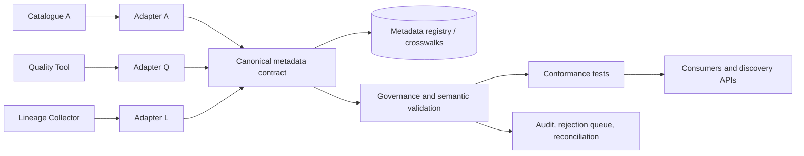

# 08 — Metadata Standards and Interoperability

> **Learning path:** Beginner → Intermediate → Advanced  
> **Module:** Stage 2D — Data Architecture / `11-Metadata-Lineage-Quality-and-Master-Data/`  
> **Recommended effort:** 6–8 hours (roadmap estimate)  
> **Scenario:** Northbridge Bank, a fictional enterprise; all systems, records, identifiers, classifications, and outcomes are synthetic and illustrative.  
> **Status:** Standards named here are examples to investigate, not mandatory roadmap requirements. Verify the applicable specification and version before adopting it.

## 1. Purpose, scope, prerequisites, and learning outcomes

### 1.1 Purpose

An enterprise may maintain metadata in a catalogue, data warehouse, pipeline orchestrator, data-quality service, lineage collector, master-data platform, governance repository, and AI/ML platform. Each system may describe the same asset differently. Interoperability is the engineered ability to exchange that information while preserving its identity, meaning, relationships, governance constraints, and relevant history.

A successful exchange is not merely a valid file transfer. A receiver must be able to determine what an asset is, which source it came from, who is accountable, how sensitive it is, how it relates to other assets, which version of the model applies, and what the receiver is permitted to do with it.

### 1.2 Scope

This topic teaches metadata models and standards, syntax versus semantics, mapping specifications, identifier conventions, schema/model versioning, lineage and quality metadata exchange, canonical and point-to-point architectures, security and governance propagation, conformance tests, round-trip tests, and operational reconciliation. It connects to Topics 01–07 without replacing them.

It does **not** prescribe a vendor, a single enterprise-wide metadata product, or one universal standard. The module roadmap says topic files were empty when it was written; this lesson follows the roadmap's learning plan and does not claim that an empty target file already specifies a tool or standard.

### 1.3 Prerequisites and sequence

Complete Topics 01–07 in the recommended order. In particular:

| Prior topic | What must carry into interoperability |
|---|---|
| 01 — Metadata foundations | Business, technical, and operational metadata; definitions, owners, stewards, identifiers |
| 02 — Catalogue and classification | Discovery, asset identity, classification, access-request context |
| 03 — Lineage and impact | Dataset/field relationships, transformation evidence, upstream/downstream links |
| 04 — Quality and CDEs | Quality dimensions, rule definitions, denominators, thresholds, severity, ownership |
| 05 — Observability and SLOs | Freshness, volume, distribution, operational measurements, response context |
| 06 — MDM and golden records | Entity identity, provenance, attribute-level survivorship, lifecycle and unmerge semantics |
| 07 — Reference data, entity resolution, identifiers | Namespaces, crosswalks, reference-data versioning, matching confidence and identifier lifecycle |
| P7 / integration foundations | Contracts, idempotency, reconciliation, event ordering and failure handling |
| P10 / portability foundations | Hybrid/multi-cloud constraints and portability-versus-lock-in trade-offs |

**Learning sequence note:** Topic 08 is the eighth numbered topic. Revisit earlier topic sections when a mapping touches their concepts; do not redefine their meaning locally just to fit a target system.

### 1.4 Learning outcomes

By the end, you should be able to:

1. Explain metadata interoperability and distinguish format compatibility from semantic compatibility.
2. Model assets, schemas, fields, owners, classifications, lineage, quality results, and identifiers with explicit relationships.
3. Specify source-to-target mappings, transformations, defaults, unsupported fields, and lossy conversions.
4. Choose and justify canonical, direct, or federated mapping approaches.
5. Design versioning, deprecation, compatibility, and migration policies.
6. Preserve classification, ownership, provenance, lineage, and quality context across exchanges.
7. Test mappings with schema validation, semantic assertions, round-trip tests, compatibility tests, and reconciliation.
8. Produce a mapping specification, test cases, conformance report, exchange design, and architecture decision record (ADR).

## 2. Beginner foundations and terminology

### 2.1 What interoperability is

**Metadata interoperability** means that two or more systems can exchange and use metadata with an agreed interpretation. It has at least four dimensions:

- **Syntactic:** the message can be parsed according to a format or schema.
- **Structural:** entities and relationships can be represented without breaking their intended structure.
- **Semantic:** fields and values mean the same thing, or a documented transformation preserves the intended meaning.
- **Operational/governance:** the exchange is secure, version-aware, monitored, owned, and actionable.

These dimensions are related but not interchangeable. A receiver may parse a JSON document successfully and still interpret `owner` as the technical operator when the sender meant the accountable business owner.

### 2.2 Key terms

| Term | Meaning | Example |
|---|---|---|
| Metadata model | Concepts, attributes, relationships, and constraints describing metadata | Asset has fields, owner, classification and upstream lineage |
| Schema | Formal representation of allowed structure and value constraints | JSON Schema for an asset record |
| Vocabulary | Agreed terms and allowed values | `Public`, `Internal`, `Confidential`, `Restricted` |
| Ontology | Formal representation of concepts and relationships, often with richer logical meaning | Concepts such as Dataset, BusinessTerm, and dependsOn |
| Mapping / crosswalk | Explicit correspondence between source and target concepts or identifiers | `catalog.asset_key` → `quality.asset_ref` |
| Namespace | Scope that makes an identifier unambiguous | `northbridge.catalog:asset:...` |
| Canonical model | Shared intermediate model used by multiple producers and consumers | Enterprise metadata envelope plus governed extensions |
| Adapter / translation layer | Component translating between a system-specific model and a shared or target model | Catalogue exporter converts native owner fields into a governed owner object |
| Conformance | Evidence that an implementation follows a stated schema, profile, or contract | Sample event passes schema and semantic assertions |
| Round-trip test | Export → transform → import or reverse-transform test that checks preserved information | Asset metadata survives A→canonical→A under declared rules |
| Lossy mapping | Conversion that discards distinctions or information | Four target classification levels mapped to three source levels |
| Unsupported attribute | A field the target cannot represent faithfully | Target has no field for a source's steward decision history |
| Provenance | Information about origin and derivation of a value or assertion | Source system, observed time, transformation and confidence |
| Compatibility | Whether versions can interact without violating contract or meaning | Consumer v1 tolerates an added optional field from producer v2 |

### 2.3 Standard, specification, vendor model, convention, and example schema

Keep these categories distinct:

- **Standard:** a formally published, approved technical or semantic reference from a standards body or recognized standards process. Its status, normative force, and conformance model depend on the issuing organization and publication.
- **Specification:** a document defining a model, format, protocol, schema, or expected behavior. It may be maintained by a standards body, an open-source project, an industry consortium, or a vendor; a specification is not automatically a formally approved standard.
- **Vendor-specific model:** the structures and semantics implemented by a particular product. A product may implement a standard, support only a profile/subset, add extensions, or use different semantics despite similar field names.
- **Internal convention:** a locally governed rule, such as an enterprise identifier namespace or a role vocabulary. It can be mandatory inside the organization but is not thereby a public standard.
- **Illustrative schema:** a teaching example. It has no external authority unless explicitly adopted, versioned, and governed.

The following are examples to investigate, **not mandatory roadmap requirements**. Version/status notes were checked against the publishers' documentation on 2026-10-21; pin the exact version/profile in a production ADR rather than relying on a live documentation page.

| Example | Accurate scope | Version/status note and official reference | What it does not establish by itself |
|---|---|---|---|
| Dublin Core Metadata Terms (DCMI) | Broad descriptive metadata terms and RDF vocabulary, including properties, classes, and encoding schemes | DCMI's terms are maintained by DCMI; the DCMI index identifies ISO 15836-2:2019 for the terms. [DCMI Metadata Terms](https://www.dublincore.org/specifications/dublin-core/dcmi-terms/) | A complete enterprise catalogue schema, identity crosswalk, or security policy |
| DCAT | RDF vocabulary for describing datasets and data services in catalogues and facilitating catalogue interoperability | DCAT Version 3 is a W3C Recommendation dated 2024-08-22; DCAT 2 deployments do not automatically need migration if they do not need DCAT 3 additions. [W3C DCAT 3](https://www.w3.org/TR/vocab-dcat-3/) | Field-level transformation semantics or complete platform-specific catalogue parity |
| OpenLineage | Extensible lineage metadata model for jobs, runs, datasets, and facets/events | The official documentation reviewed displayed version 1.54.0 on 2026-10-21. Pin the event/facet schema URL and producer compatibility for the chosen deployment. [OpenLineage specification](https://openlineage.io/docs/spec/) | A guarantee that every engine emits complete lineage or that all edges are observed at run time |
| JSON Schema | A schema language for describing and validating JSON document structure and constraints | The publisher identifies Draft 2020-12 as the current published version. Declare `$schema` and test against a validator that supports the selected dialect. [JSON Schema specification](https://json-schema.org/specification) | Semantic equivalence, identity uniqueness across systems, or business-policy correctness |
| Apache Avro | Schema-based data serialization and schema resolution for data exchange | The official specification is versioned; choose and pin the release used by the producer/consumer rather than assuming every implementation uses the same version. [Apache Avro specification](https://avro.apache.org/docs/) | Enterprise metadata semantics or universal compatibility across all schema evolution patterns |
| SKOS | RDF data model for sharing and linking knowledge organization systems such as thesauri, taxonomies, and classification schemes | W3C Recommendation dated 2009-08-18; consult the current Recommendation and errata. [SKOS Reference](https://www.w3.org/TR/skos-reference/) | A complete ontology/reasoning system or an automatic equivalence between similarly labelled concepts |

The lesson's Catalogue A and Quality Tool B schemas below are **synthetic teaching contracts**, not implementations of these standards. Do not call the mapping standards-conformant unless it is tested against a named standard/profile and a declared version.

### 2.4 Why identical field names do not guarantee identical meaning

Consider `owner` in two tools:

- Catalogue A: a single business role accountable for the dataset's purpose and quality.
- Quality Tool B: the engineer or service account responsible for fixing failed checks.

Both fields may be strings named `owner`, but mapping one directly to the other is semantically incorrect. The mapping must either target distinct concepts (`business_owner` versus `operational_owner`) or apply an explicitly approved rule. Never infer equivalence from a shared label alone.

**When this matters:** every integration between catalogues, quality platforms, lineage tools, governance systems, MDM platforms, and AI/ML metadata stores.

## 3. Metadata models and interoperability fundamentals

### 3.1 Model entities, attributes, relationships, and constraints

A practical enterprise metadata model may contain:

- **Asset:** a dataset, table, file, API, report, model, feature set, or other governed resource.
- **Schema and field:** structure, types, nullability, constraints, and stable field identifiers.
- **Person/role/team:** accountable owner, steward, technical contact, or operational owner.
- **Classification and policy:** sensitivity, criticality, permitted purposes, access restrictions, and retention constraints.
- **Process/job/run:** code or process identity, execution instance, status, and timestamps.
- **Lineage edge:** source-to-target relationship with granularity and evidence type.
- **Quality rule/result:** rule identity/version, measurement, denominator, window, status, and severity.
- **Business term/reference concept:** governed definitions and code-set version.
- **Provenance assertion:** origin, observed time, transformation, and confidence/verification where applicable.

Relationships matter as much as fields. If a source model says a dataset has columns and the target exports only a flat asset name, it may have retained some syntax while losing field-level structure. If lineage edges are exported without stable endpoint IDs, they may point to the wrong asset or nowhere at all.

### 3.2 Identity and namespace conventions

Use stable identifiers for entities, not mutable display names. An illustrative asset ID could be:

`urn:northbridge:metadata:asset:warehouse.finance.customer_exposure:v3`

This is an **internal convention**, not a claim that this exact URI form is a required standard. A useful identifier policy defines:

1. namespace authority and uniqueness boundary;
2. entity type and source/environment scope;
3. whether version is part of identity or a separate version attribute;
4. case sensitivity, encoding, normalization, and escaping rules;
5. lifecycle, alias, rename, merge, retirement, and non-reuse behavior;
6. crosswalk ownership and reconciliation rules.

A display name such as `customer_exposure` can change or be duplicated across environments. If it is used as a key, a rename can break lineage and duplicate records can be silently combined. Keep display labels separate from identifiers and maintain aliases for renamed assets.

### 3.3 Source-specific IDs versus enterprise IDs

Each platform may have a native key. Preserve it as a source-scoped identifier and map it to an enterprise metadata identity. For example:

| Namespace | Native ID | Enterprise asset ID |
|---|---|---|
| `catalog-prod` | `tbl-00482` | `urn:northbridge:metadata:asset:warehouse.finance.customer_exposure` |
| `quality-prod` | `dataset-771` | same enterprise asset ID |
| `lineage-prod` | `ds_9910` | same enterprise asset ID |

Do not assume `tbl-00482`, `dataset-771`, and `ds_9910` refer to the same asset merely because names look similar. Establish the crosswalk from authoritative identifiers, locations, schema fingerprints, ownership and steward-confirmed evidence as appropriate. Record confidence and review ambiguity.

### 3.4 Syntactic versus semantic interoperability

| Dimension | Validation question | Example failure | Useful control |
|---|---|---|---|
| Syntax | Does the payload parse? | Invalid JSON or malformed timestamp | Parser/schema validation |
| Structure | Are required entities and links present? | Column objects flattened into a name string | Relationship/shape assertions |
| Semantics | Do fields and codes mean the same thing? | `owner` role changes meaning | Definitions, controlled vocabularies, semantic tests |
| Identity | Does the same real asset retain identity? | Same asset duplicated due to different local IDs | Namespace and crosswalk tests |
| Governance | Are constraints preserved and enforced? | `Restricted` becomes `Internal` | Classification invariants, policy checks |
| Operations | Is exchange complete and recoverable? | Failed event not retried; catalogue drifts | Idempotency, retry, reconciliation and lag monitoring |

**Important:** schema validation can prove that a value is one of the permitted strings. It cannot by itself prove that the string's business meaning is correct.

## 4. Syntactic and semantic compatibility in practice

### 4.1 Example: same syntax, different semantics

System A exports:

```json
{
  "asset_id": "cat:881",
  "owner": "Risk Data Office",
  "classification": "High",
  "modified_at": "2026-10-20T10:00:00+05:30"
}
```

System B expects:

```json
{
  "id": "quality:asset:42",
  "owner": "platform-oncall",
  "sensitivity": "Confidential",
  "updated_utc": "2026-10-20T04:30:00Z"
}
```

Both are JSON, but this is not a direct field rename exercise. The owner concepts differ; `High` may describe business criticality rather than sensitivity; and the timestamp conversion needs a declared timezone/instant rule. The asset IDs are not interchangeable without a crosswalk.

### 4.2 Semantic contracts

For every shared concept, document:

- canonical name and definition;
- business purpose and accountable owner;
- allowed values and their definitions;
- granularity and cardinality (single value, list, role-qualified relationship);
- null/unknown/not-applicable/withheld semantics;
- time basis (instant, local wall-clock time, date, effective interval);
- identity and namespace rules;
- provenance and evidence expectations;
- security classification and permitted handling;
- version and deprecation policy.

**Trade-off:** richer semantic contracts take time to design and govern, but reduce silent corruption and repeated bilateral interpretation. For low-risk, short-lived exchanges, a lighter profile may suffice if its limitations and owner are explicit.

## 5. Mapping metadata across systems

### 5.1 Mapping workflow

Use a repeatable sequence:

1. **Inventory endpoints and scope.** Identify producer, consumer, metadata categories, exchange direction, frequency, latency, and authoritative sources.
2. **Define business concepts.** Agree on what asset, owner, classification, field, lineage edge, quality result, and provenance mean.
3. **Compare models.** Compare fields, types, cardinality, enums, constraints, relationships, identity and lifecycle behavior.
4. **Specify mappings.** For each source field, define target, transformation, validation, null behavior, default policy, error policy, and loss classification.
5. **Map identities and relationships.** Use namespaces and crosswalks; do not construct relationships from display names alone.
6. **Preserve governance.** Treat classification, ownership, provenance and lineage as protected attributes, not optional decoration.
7. **Version and test.** Pin schema and mapping versions; validate syntax, semantics, compatibility and round trips.
8. **Operate and reconcile.** Monitor failed events, lag, missing entities, duplicate identities, rejected values and drift.
9. **Approve and document residual loss.** The accountable owner accepts any unavoidable loss for a defined use; high-risk loss may block release entirely.

### 5.2 Worked example: two illustrative metadata schemas

Fictional Northbridge uses Catalogue A and Quality Tool B. These schemas are teaching examples, not existing product formats.

**Schema A — Catalogue A, version 1**

```json
{
  "asset_key": "cat-prod:table:00482",
  "display_name": "Customer Exposure",
  "description": "Daily customer exposure snapshot",
  "business_owner": {"team_id": "team-risk", "name": "Risk Data Office"},
  "classification": "RESTRICTED",
  "modified_at": "2026-10-20T10:00:00+05:30",
  "columns": [
    {"field_key": "col-1", "name": "customer_id", "type": "string", "nullable": false},
    {"field_key": "col-2", "name": "exposure_amount", "type": "decimal(18,2)", "nullable": false}
  ],
  "upstream_asset_keys": ["ingest-prod:table:100"]
}
```

**Schema B — Quality Tool B, version 2**

```json
{
  "dataset_ref": "quality:dataset:771",
  "label": "Customer Exposure",
  "summary": "Daily customer exposure snapshot",
  "accountable_party": "team-risk",
  "sensitivity_level": "RESTRICTED",
  "updated_utc": "2026-10-20T04:30:00Z",
  "fields": [
    {"field_ref": "quality:field:1", "field_name": "customer_id", "logical_type": "string", "required": true},
    {"field_ref": "quality:field:2", "field_name": "exposure_amount", "logical_type": "decimal", "precision": 18, "scale": 2, "required": true}
  ],
  "upstream_refs": ["quality:dataset:source-100"]
}
```

The schemas share some concepts, but their identifiers differ. Field names and type strings are not enough to establish equivalence. The enterprise crosswalk must resolve asset and field IDs. The example also demonstrates why role and classification semantics must be defined independently.

### 5.3 Field-by-field mapping specification

| Source A field | Target B field | Rule | Loss / risk | Required validation |
|---|---|---|---|---|
| `asset_key` | `dataset_ref` | Resolve via approved asset crosswalk; never copy blindly | Crosswalk may be absent or ambiguous | Exactly one active target identity; otherwise quarantine/review |
| `display_name` | `label` | Copy as display label, not identity | Case/punctuation may change presentation | Preserve source value or document normalization |
| `description` | `summary` | Copy the Unicode string exactly under this illustrative target contract | Truncation would be lossy if a deployed target imposes a length limit | Preserve exactly; if the real target has a limit, reject or retain the original in a governed sidecar—never truncate silently |
| `business_owner.team_id` | `accountable_party` | Map team ID through governed team namespace | Target stores only one string; role detail may be lost | Confirm target means accountable business owner |
| `business_owner.name` | none | Retain in sidecar/extension or mark unsupported | Human-readable name not represented | Explicit unmapped-field record; never use as sole key |
| `classification` | `sensitivity_level` | Apply approved value mapping table | Similar labels may not be semantically equivalent | Fail closed on unknown value; policy-owner approval required |
| `modified_at` | `updated_utc` | Parse offset-aware timestamp and convert to UTC | Offset-naive input cannot be safely converted without a timezone | Require timezone or reject/quarantine |
| `columns[].field_key` | `fields[].field_ref` | Resolve through a field crosswalk keyed by source asset ID, source field ID, and applicable schema version | Target IDs may change across re-registration | Verify one-to-one mapping within the asset/version and validate target parent identity |
| `columns[].name` | `fields[].field_name` | Copy display/technical name; not field identity | Renames may look like a new field | Stable field crosswalk and alias history |
| `columns[].type` | `logical_type`, `precision`, `scale` | Parse `string` as `logical_type=string`; parse `decimal(p,s)` into `logical_type=decimal`, precision `p`, and scale `s` | Unsupported or malformed type strings must not be guessed | Assert parsed type/precision/scale; reject unsupported types or preserve them in an explicitly governed extension |
| `columns[].nullable` | `fields[].required` | `required = not nullable` | Semantics must match schema-level enforcement | Boolean inversion test and nullability contract |
| `upstream_asset_keys` | `upstream_refs` | Resolve each source ID via asset crosswalk | Missing IDs break lineage | All references resolve or edge is marked unresolved, not dropped |
| Run-level lineage evidence (not present in the shown Schema A payload) | none in Schema B | If available from another source, store in a governed lineage extension/store or declare unsupported | Neither shown schema carries run ID, evidence source, observation time, or confidence | Record as out of scope/unsupported for this mapping; do not imply that `upstream_refs` preserves run-level evidence |

### 5.4 Default-value policy

Defaults can make records easier to process but can also invent meaning. Adopt these rules:

- Do not default missing classification to `PUBLIC` or another permissive value. Use a fail-closed state such as `UNCLASSIFIED_REVIEW_REQUIRED` only if the receiving model supports it and policy approves it; otherwise reject/quarantine the record.
- Do not default missing owner to a fictitious team. Use an explicit unresolved-owner state or reject according to policy.
- Do not use current time as a substitute for missing source modification time. Preserve unknownness; an ingestion timestamp is a different attribute.
- Do not replace an unmapped reference code with a “closest” value without an approved mapping and review process.
- Do not create a target identifier from a display name. Use an approved namespace and crosswalk/registry.
- Record every default, its reason, version, and impact. A default must be distinguishable from an observed source value.

### 5.5 Lossy and unsupported mappings

A mapping inventory should classify each field as one of:

- **Exact:** semantics and value are preserved.
- **Transformed but meaning-preserving:** e.g., an offset-aware timestamp converted to UTC.
- **Conditionally lossless:** safe only under a documented constraint (e.g., decimals all fit the target precision).
- **Lossy:** a distinction is collapsed or information discarded.
- **Unsupported:** no faithful target representation exists.
- **Unresolved:** mapping cannot be established from available evidence.

Lossy is not always forbidden. It must be visible, justified for a specific use, approved by the accountable owner, and accompanied by a record of residual risk. A security classification downgrade, loss of ownership, or broken lineage may be unacceptable regardless of convenience.

### 5.6 Metadata domains that need special care

| Metadata domain | Common mapping risk | Required preservation strategy |
|---|---|---|
| Dataset and column schemas | Type systems differ; nested fields flatten | Preserve structure, constraints, field IDs, schema version and explicit type conversions |
| Pipeline/job/run | A job definition is confused with one execution | Keep stable job identity separate from run identity and timestamps |
| Lineage | Static dependency confused with observed run evidence | Carry edge type, granularity, evidence source, observed time and confidence/coverage |
| Quality | Score exported without denominator or rule version | Include rule ID/version, population, numerator/denominator, time window, status and severity |
| Ownership | Business owner confused with operator or steward | Model role-qualified ownership relationships |
| Classification | Similar labels are treated as equivalent | Governed mapping, fail-closed unknown handling, policy tests |
| MDM/golden records | Source value confused with survivorship result | Preserve source provenance, master identity, attribute-level rule and lifecycle state |
| Reference data | Code overwritten without effective dates | Carry code-set ID/version, validity interval and deprecated/replacement status |
| ML/AI datasets and features | Dataset description detached from lineage and permissions | Preserve source IDs, transformation/version, permitted purpose, classification and access constraints |


### 5.7 Quality-result exchange contract

The roadmap's mapping exercise includes quality results as well as asset, owner, classification, schema, and lineage metadata. The executable example in Section 9.1 is intentionally scoped to the asset/schema/declared-lineage record; it does **not** claim to implement this separate quality-result mapping. Include the following contract in the mapping specification and implement it in an adapter before declaring the broader exchange conformant.

| Source quality-result concept | Target concept | Mapping and validation rule | Loss/failure behavior |
|---|---|---|---|
| `rule_id` + `rule_version` | `rule_ref` + `rule_version` | Resolve rule identity through a version-scoped crosswalk; keep rule version distinct from mapping/schema versions | Missing or ambiguous rule crosswalk blocks the result; do not join by display name |
| `eligible_population` | `population_definition` | Preserve the population predicate/definition and population snapshot or asset version | If the population cannot be represented, mark the result non-comparable; do not silently reuse a different denominator |
| `numerator`, `denominator` | Same concepts | Integers; denominator must be greater than zero; numerator must be between zero and denominator for a pass-ratio metric | Reject invalid counts; never exchange only a rounded percentage |
| `measurement_window.start/end` | Same concepts in UTC | Require offset-aware timestamps and `start < end`; preserve the original zone/offset in provenance if audit needs it | Reject ambiguous local times or invalid windows |
| `exclusions` | `exclusions` | Preserve the exclusion rule/version and excluded population; distinguish zero exclusions from unknown exclusions | Missing exclusion semantics makes comparison unsafe; report as unresolved |
| `threshold.metric/operator/value` | Same concepts | Preserve metric, comparator, unit and exact decimal value (for example `pass_ratio >= 0.995`); do not send a naked number | Different operator/unit is a semantic break even when the numeric value matches |
| `status`, `severity` | Same concepts under governed vocabularies | Map enums with an approved lookup; preserve rule outcome separately from incident severity | Unknown values fail closed or route to review |
| `measured_at`, `owner_team_id` | `measured_at_utc`, `owner_team_ref` | Convert only offset-aware timestamps; resolve owner identity through the team namespace | Do not substitute ingestion time for measurement time or owner display name for identity |

Minimum quality-result conformance cases: reject denominator `0`; reject numerator greater than denominator; preserve the rule ID **and** rule version; preserve the eligible population, window, exclusions and threshold comparator; reject an unknown status/severity; and verify that the reported status agrees with the measured value under the versioned rule. A result is not semantically equivalent merely because both systems store `99.2%`.

## 6. Versioning, schema evolution, and compatibility

### 6.1 Version the right things separately

A robust exchange can have several independent versions:

- **Entity version:** version of a particular asset or metadata record.
- **Schema/model version:** structure and constraints accepted by a producer/consumer.
- **Mapping version:** transformation rules between source and target models.
- **Vocabulary/reference-data version:** meaning and valid values at a point in time.
- **Producer/consumer implementation version:** software release using those contracts.

Do not overload one `version` field to mean all of these. A mapping can change even when schemas do not; a classification vocabulary can change while JSON structure stays constant.

### 6.2 Compatibility categories

| Change | Typical compatibility assessment | Conditions and cautions |
|---|---|---|
| Add optional field | Often backward-compatible for tolerant readers | Consumer must ignore or preserve unknown fields safely; semantic profile may still change |
| Add required field | Usually breaking for existing producers | Requires migration/default contract or major version strategy |
| Remove field | Breaking if any consumer depends on it | Deprecate first, measure usage, migrate, then remove |
| Rename field | Usually breaking unless alias/dual-write period exists | Use explicit alias and migration schedule |
| Narrow enum | Potentially breaking | Existing values may become invalid; historical interpretation matters |
| Add enum value | Can break closed-enum consumers | Test unknown-value handling and policy implications |
| Change field meaning | Semantically breaking even if schema unchanged | New concept/version or migration; do not reuse a name with a new meaning |
| Change ID-generation rule | Identity breaking | Preserve crosswalks and aliases; prevent duplicate entities |
| Change classification mapping | Governance-impacting | Policy review, historical audit and consumer impact assessment |

These are rules of thumb, not a universal compatibility matrix. Actual compatibility depends on the schema technology, reader behavior, validation mode, semantics, and business contract.

### 6.3 Example: schema v1 to v2

Assume v1 has `owner_team_id` and v2 adds `owner_role` while preserving the existing field. If `owner_role` is optional with a documented meaning, old readers may continue to function. But a producer that starts placing the technical support team into `owner_team_id` creates a semantic break even though the schema remains valid.

A safe rollout can be:

1. Publish v2 schema and mapping spec with a change record.
2. Add the optional field; producers populate it consistently.
3. Consumers validate and monitor both fields; unknown role values are rejected or routed for review according to policy.
4. Compare v1/v2 interpretation and resolve discrepancies.
5. Deprecate the old field only after consumer inventory and sign-off.
6. Remove it in a planned breaking version and retain migration/lineage evidence.

### 6.4 Historical interpretation and deprecation

Do not reinterpret an old record using today's vocabulary without recording that change. If `classification=INTERNAL` was mapped under vocabulary v3, the record should retain that version or the normalized historical assertion. Effective dates matter: a mapping valid from 1 January is not necessarily valid for a record effective on 15 December of the previous year.

Deprecation policy should include notice period, owner, replacement, migration guidance, consumer inventory, sunset date, exception handling, and evidence that the old form is no longer used. For assets and IDs, preserve aliases/redirects where appropriate; never silently recycle a retired identifier.

## 7. Governance, security, and preservation of meaning

### 7.1 Ownership and decision rights

Every mapping needs named accountability:

- **Business/data owner:** approves semantic meaning and acceptable loss.
- **Metadata steward:** maintains definitions, vocabularies and mapping exceptions.
- **Platform/integration owner:** operates adapters, retries, monitoring and reconciliation.
- **Security/privacy owner:** approves classification propagation, access and sensitive metadata handling.
- **Producer owner:** supplies accurate source metadata and version notices.
- **Consumer owner:** declares required fields, tolerated changes and failure behavior.

A mapping should not be approved solely by the engineer who wrote the converter when the mapping changes business or policy meaning.

### 7.2 Classification and policy propagation

Classification must not be weakened by a lossy mapping or default. If the source says `RESTRICTED` and the target supports only `PUBLIC`, `INTERNAL`, and `CONFIDENTIAL`, there is no safe implicit mapping. Options are to extend the target vocabulary, store the original classification plus a governed enforcement label, reject the exchange, or restrict the consumer until a policy-approved mapping exists. Do not automatically map `RESTRICTED` to `CONFIDENTIAL` unless the security authority explicitly determines that the target label enforces equal or stronger controls.

Metadata can itself be sensitive. Dataset names, lineage edges, owner identities, query text, table paths, feature descriptions, and incident notes may reveal regulated activities or personal information. Apply least privilege, purpose limitation, secure transport, scoped credentials, audit logs, retention rules, and redaction/minimization. “It is only metadata” is not a security classification.

### 7.3 Preserve provenance and lineage

A transformed value should remain traceable to its source and transformation. At minimum, capture relevant source identifier, source version, observation/extraction time, mapping version, transformation outcome, and validation status. For lineage, distinguish:

- static declared dependency;
- observed run-level input/output evidence;
- table-level versus column-level lineage;
- complete, partial, inferred, or unresolved lineage.

Do not mark inferred lineage as confirmed execution evidence. If the target cannot carry all evidence, maintain a linked extension/sidecar store or explicitly declare reduced fidelity and assess whether the consumer's use remains safe.

### 7.4 Quality context must travel with quality results

A number such as `99.2% valid` is not interpretable without the rule, eligible population, numerator, denominator, measurement window, exclusions, threshold, and rule version. An exchange mapping that carries only the percentage can create false confidence. Preserve the Topic 04 principles: quality is fitness for use, dimensions may overlap, and critical data elements need explicit rules and owners. Preserve Topic 05 operational context such as measurement time and freshness where relevant.

### 7.5 Failure handling and auditability

Classify errors rather than swallowing them:

- **Invalid syntax/schema:** reject and return a diagnosable error.
- **Unknown enum/reference value:** quarantine or route for approved mapping; do not guess.
- **Missing/ambiguous identity:** do not create duplicate assets by default; reconcile or steward-review.
- **Policy violation:** fail closed and alert the security/policy owner.
- **Transient transport failure:** retry with idempotency and bounded backoff.
- **Partial mapping:** persist accepted data only if the contract explicitly supports partial success and exposes missing fields.
- **Stale/out-of-order event:** use source version/event sequence or effective time; avoid overwriting newer state with older metadata.

Maintain an audit record of who approved a mapping change, which version was deployed, affected records, rejected fields, and replay/reconciliation actions.

## 8. Intermediate and advanced interoperability architecture

### 8.1 Exchange patterns

| Pattern | Best fit | Strengths | Risks and controls |
|---|---|---|---|
| API pull | On-demand discovery or low-volume reads | Simple request/response, current snapshot | Rate limits, paging, partial reads; use checkpoints and completeness tests |
| Event push | Frequent updates and lineage/run events | Low latency, decoupled producers | Ordering, duplicates, schema drift; use idempotency, versioned envelopes and replay |
| Bulk file | Initial migration, periodic reconciliation, offline exchange | Efficient large-volume transfer | Stale snapshots, partial files, duplicate ingestion; manifest, checksum, atomic publish and load audit |
| Shared registry/repository | Stable enterprise identity and governed vocabularies | Consistent cross-system references | Central dependency, governance bottleneck; define availability and ownership |
| Federated query/links | Distributed ownership and data residency needs | Metadata stays near source | Search/latency inconsistency, uneven availability; cache with freshness and provenance |

Choose based on latency, volume, failure recovery, ownership, access boundaries, and whether consumers need a snapshot or a change stream. Many enterprises use more than one pattern.

### 8.2 Canonical model versus point-to-point mappings

For `n` systems, the number of directed point-to-point mappings between every distinct pair is:

\[
M_{directed}=n(n-1)
\]

where `n` is the number of systems and each source-to-target direction is counted separately. With six systems, this is `6 × 5 = 30` mappings.

If every system maps to and from one canonical model, the rough mapping count is:

\[
M_{canonical}=2n
\]

where the two mappings per system are inbound-to-canonical and outbound-from-canonical. With six systems, this is `2 × 6 = 12` mappings.

This is a simple topology count, not a complete cost model. It assumes full bidirectional exchange, one canonical model, and no extra version-specific adapters. Canonicalization reduces pairwise mapping count but creates a shared model that must be governed and may not express every tool-specific capability. Direct mappings can be simpler for two or three systems but scale poorly as systems and versions grow.

| Approach | Prefer when | Main trade-off |
|---|---|---|
| Point-to-point | Few systems, narrow scope, distinct semantics | Quick local fit, many mappings and duplicated rules at scale |
| Canonical model | Many systems share stable concepts | Reuse and consistency, central model governance and potential loss of native richness |
| Federated model | Domains own their metadata and have legitimate local variation | Autonomy and locality, more complex discovery, cross-domain semantics and reconciliation |
| Hybrid | Shared core plus governed domain extensions | Practical balance, but extension lifecycle and conformance need discipline |

A canonical model should not become a lowest-common-denominator model that silently erases useful semantics. Keep extension points, record mapping loss, and avoid pretending every domain concept is universal.

### 8.3 Exchange architecture diagram



This is a conceptual architecture, not a mandated deployment. The canonical contract may be a logical model with distributed implementations rather than a single central service.

### 8.4 Reconciliation and operational measures

Track at least:

- source assets discovered versus assets successfully mapped;
- missing and ambiguous crosswalks;
- duplicate enterprise IDs and orphaned lineage endpoints;
- fields rejected, defaulted, transformed, or marked unsupported;
- classification/ownership invariant failures;
- event lag, retry count, dead-letter volume, and replay outcomes;
- schema/mapping version distribution across producers and consumers;
- source-to-target count deltas and sample content checks;
- stale or unconfirmed lineage and quality metadata coverage.

For a defined snapshot, a simple coverage rate is:

\[
Coverage = \frac{Mapped\ eligible\ assets}{Total\ eligible\ source\ assets}\times 100\%
\]

If 980 of 1,000 eligible source assets map to a unique enterprise identity, coverage is `980 / 1,000 × 100% = 98%`. The denominator must define eligibility and snapshot time; do not hide 20 unmapped assets by excluding them after the fact. Coverage alone does not prove correct semantics, so pair it with mapping-error and policy-invariant rates.

### 8.5 Interoperability for analytics, ML and AI

Analytics and AI consumers depend on metadata beyond names and descriptions:

- dataset identity and version;
- field definitions and data types;
- lineage and transformation versions;
- quality measurements and freshness windows;
- classification, permitted purpose and access decisions;
- reference-data versions and entity identity mappings;
- model/feature provenance and training-data snapshots where relevant.

If lineage or permissions are dropped when metadata is exported to an AI catalogue, a retrieval or feature pipeline may use an unapproved or stale source. Preserve the controls needed by downstream policy enforcement. A description or tag is not a substitute for an actual access-control decision.

## 9. Worked implementation example and validation

### 9.1 Illustrative mapping profile

The following Python is executable Python 3. It is deliberately small and is not a production connector. It demonstrates explicit transformation, strict handling of unknown classification, and no silent default for identity or timezone. It uses only the standard library.

```python
from datetime import datetime, timezone
import re

# Synthetic, policy-approved one-to-one vocabulary mapping for this exercise.
# Real deployments must obtain this mapping from the classification owner.
CLASSIFICATION_MAP = {
    "PUBLIC": "PUBLIC",
    "INTERNAL": "INTERNAL",
    "CONFIDENTIAL": "CONFIDENTIAL",
    "RESTRICTED": "RESTRICTED",
}
MAPPING_VERSION = "northbridge-catalogue-to-quality/1.0"
SOURCE_SCHEMA_VERSION = "catalogue-a/1"
TARGET_SCHEMA_VERSION = "quality-tool-b/2"

class MappingError(ValueError):
    pass

def require_nonempty_string(value, label):
    if not isinstance(value, str) or not value.strip():
        raise MappingError(f"{label} must be a non-empty string")
    return value

def parse_aware_timestamp(value: str) -> str:
    """Return ISO-8601 UTC; reject invalid or timezone-naive timestamps."""
    if not isinstance(value, str) or not value.strip():
        raise MappingError("Timestamp must be a non-empty string")
    try:
        parsed = datetime.fromisoformat(value[:-1] + "+00:00" if value.endswith("Z") else value)
    except ValueError as exc:
        raise MappingError(f"Invalid timestamp: {value!r}") from exc
    if parsed.tzinfo is None or parsed.utcoffset() is None:
        raise MappingError("Timestamp must include a timezone offset")
    return parsed.astimezone(timezone.utc).isoformat().replace("+00:00", "Z")

def parse_logical_type(source_type: str) -> dict:
    """Parse only the types supported by this teaching contract; never guess."""
    require_nonempty_string(source_type, "Column type")
    if source_type == "string":
        return {"logical_type": "string"}
    match = re.fullmatch(r"decimal\((\d+),(\d+)\)", source_type.replace(" ", ""))
    if match:
        precision, scale = map(int, match.groups())
        if precision < 1 or scale < 0 or scale > precision:
            raise MappingError(f"Invalid decimal precision/scale: {source_type!r}")
        return {"logical_type": "decimal", "precision": precision, "scale": scale}
    raise MappingError(f"Unsupported source type: {source_type!r}")

def map_catalogue_record(source: dict, asset_crosswalk: dict, field_crosswalk: dict) -> dict:
    """Map one record; field_crosswalk keys are (source_asset_key, field_key, schema_version)."""
    if not isinstance(source, dict):
        raise MappingError("Source record must be an object")
    source_id = require_nonempty_string(source.get("asset_key"), "asset_key")
    target_id = asset_crosswalk.get(source_id)
    if not isinstance(target_id, str) or not target_id.strip():
        raise MappingError("Missing or unresolved asset crosswalk")
    if sum(1 for mapped_id in asset_crosswalk.values() if mapped_id == target_id) > 1:
        raise MappingError("Multiple source assets map to one target identity; an explicit alias/merge decision is required")

    classification = source.get("classification")
    if classification not in CLASSIFICATION_MAP:
        raise MappingError("Unknown classification; policy review required")

    owner = source.get("business_owner")
    if not isinstance(owner, dict):
        raise MappingError("business_owner must be an object")
    team_id = require_nonempty_string(owner.get("team_id"), "business_owner.team_id")
    owner_name = require_nonempty_string(owner.get("name"), "business_owner.name")
    display_name = require_nonempty_string(source.get("display_name"), "display_name")
    description = source.get("description")
    if not isinstance(description, str):
        raise MappingError("description must be a string; null/missing is not silently converted")
    updated_utc = parse_aware_timestamp(source.get("modified_at"))

    columns = source.get("columns")
    if not isinstance(columns, list):
        raise MappingError("columns must be a list")
    mapped_columns = []
    seen_source_fields, seen_target_fields = set(), set()
    used_field_crosswalk = []
    for column in columns:
        if not isinstance(column, dict):
            raise MappingError("Each column must be an object")
        field_key = require_nonempty_string(column.get("field_key"), "column.field_key")
        field_name = require_nonempty_string(column.get("name"), "column.name")
        if "nullable" not in column or not isinstance(column["nullable"], bool):
            raise MappingError("Column nullable must be present and boolean")
        if field_key in seen_source_fields:
            raise MappingError(f"Duplicate source field key: {field_key!r}")
        seen_source_fields.add(field_key)
        crosswalk_key = (source_id, field_key, SOURCE_SCHEMA_VERSION)
        target_field = field_crosswalk.get(crosswalk_key)
        if not isinstance(target_field, str) or not target_field.strip():
            raise MappingError(f"Missing field crosswalk for {crosswalk_key!r}")
        if target_field in seen_target_fields:
            raise MappingError(f"Multiple source fields map to target field {target_field!r}")
        seen_target_fields.add(target_field)
        mapped_columns.append({
            "field_ref": target_field,
            "field_name": field_name,
            **parse_logical_type(column.get("type")),
            "required": not column["nullable"],
        })
        used_field_crosswalk.append({"source_field_key": field_key, "target_field_ref": target_field})

    upstream = source.get("upstream_asset_keys")
    if not isinstance(upstream, list):
        raise MappingError("upstream_asset_keys must be a list; use [] when there are no known upstream assets")
    if any(not isinstance(item, str) or not item.strip() for item in upstream):
        raise MappingError("Every upstream asset key must be a non-empty string")
    if len(upstream) != len(set(upstream)):
        raise MappingError("Duplicate upstream asset keys would duplicate lineage relationships")
    upstream_refs = []
    for upstream_id in upstream:
        upstream_ref = asset_crosswalk.get(upstream_id)
        if not isinstance(upstream_ref, str) or not upstream_ref.strip():
            raise MappingError(f"Unresolved upstream asset crosswalk: {upstream_id!r}")
        upstream_refs.append(upstream_ref)

    # The target record follows the fields in illustrative Schema B. Source-only
    # details and contract versions are preserved in an explicit audit/sidecar envelope.
    return {
        "target_record": {
            "dataset_ref": target_id,
            "label": display_name,
            "summary": description,
            "accountable_party": team_id,
            "sensitivity_level": CLASSIFICATION_MAP[classification],
            "updated_utc": updated_utc,
            "fields": mapped_columns,
            "upstream_refs": upstream_refs,
        },
        "audit": {
            "mapping_version": MAPPING_VERSION,
            "source_schema_version": SOURCE_SCHEMA_VERSION,
            "target_schema_version": TARGET_SCHEMA_VERSION,
            "source_asset_key": source_id,
            "source_business_owner_name": owner_name,
            "field_crosswalk_used": used_field_crosswalk,
            "classification_mapping_version": "northbridge-classification-map/1",
            "loss_register": [{
                "source_path": "business_owner.name",
                "status": "preserved_in_sidecar",
                "reason": "Schema B has no dedicated human-readable owner-name field",
            }],
            "lineage_scope": "Declared upstream asset relationships only; no run-level evidence is present in Schema A",
        },
    }

def reverse_map_catalogue_record(result: dict, reverse_asset_crosswalk: dict, reverse_field_crosswalk: dict) -> dict:
    """Reconstruct supported source semantics; timestamps return in normalized UTC."""
    if not isinstance(result, dict) or not isinstance(result.get("target_record"), dict) or not isinstance(result.get("audit"), dict):
        raise MappingError("Mapping result must contain target_record and audit")
    target, audit = result["target_record"], result["audit"]
    target_id = target.get("dataset_ref")
    source_id = reverse_asset_crosswalk.get(target_id)
    if not source_id or source_id != audit.get("source_asset_key"):
        raise MappingError("Reverse asset crosswalk does not preserve source identity")
    reverse_classification = {v: k for k, v in CLASSIFICATION_MAP.items()}
    sensitivity = target.get("sensitivity_level")
    if sensitivity not in reverse_classification:
        raise MappingError("Target classification has no approved reverse mapping")
    fields = target.get("fields")
    if not isinstance(fields, list):
        raise MappingError("Target fields must be a list")
    source_fields, seen_source_fields = [], set()
    for field in fields:
        if not isinstance(field, dict) or not isinstance(field.get("required"), bool):
            raise MappingError("Target field is malformed")
        target_field = field.get("field_ref")
        source_field = reverse_field_crosswalk.get((target_id, target_field, TARGET_SCHEMA_VERSION))
        if not source_field or source_field in seen_source_fields:
            raise MappingError("Missing or ambiguous reverse field crosswalk")
        seen_source_fields.add(source_field)
        logical_type = field.get("logical_type")
        if logical_type == "string":
            source_type = "string"
        elif (logical_type == "decimal"
              and isinstance(field.get("precision"), int) and not isinstance(field.get("precision"), bool)
              and isinstance(field.get("scale"), int) and not isinstance(field.get("scale"), bool)):
            precision, scale = field["precision"], field["scale"]
            if precision < 1 or scale < 0 or scale > precision:
                raise MappingError("Target decimal precision/scale is invalid")
            source_type = f"decimal({precision},{scale})"
        else:
            raise MappingError("Target field type cannot be represented in source schema")
        source_fields.append({
            "field_key": source_field,
            "name": require_nonempty_string(field.get("field_name"), "field_name"),
            "type": source_type,
            "nullable": not field["required"],
        })
    upstream_refs = target.get("upstream_refs")
    if not isinstance(upstream_refs, list):
        raise MappingError("Target upstream_refs must be a list")
    reverse_upstream = []
    for target_ref in upstream_refs:
        source_ref = reverse_asset_crosswalk.get(target_ref)
        if not source_ref:
            raise MappingError(f"Unresolved reverse lineage crosswalk: {target_ref!r}")
        reverse_upstream.append(source_ref)
    return {
        "asset_key": source_id,
        "display_name": target.get("label"),
        "description": target.get("summary"),
        "business_owner": {
            "team_id": target.get("accountable_party"),
            "name": audit.get("source_business_owner_name"),
        },
        "classification": reverse_classification[sensitivity],
        "modified_at": parse_aware_timestamp(target.get("updated_utc")),
        "columns": source_fields,
        "upstream_asset_keys": reverse_upstream,
    }
```

**Inputs:** a source dictionary matching Schema A; an approved source-asset-to-target-asset crosswalk that also resolves every declared upstream asset; and a field crosswalk keyed by `(source asset key, source field key, source schema version)`. **Output:** an envelope containing a target record shaped like Schema B plus an audit/sidecar object for mapping/schema versions, source identity, the source owner display name, and the explicit loss register. **Failure behavior:** raises `MappingError` for unresolved identities, unknown classifications, missing or invalid fields, duplicate field mappings, unsupported types, naive timestamps, duplicate upstream links, or unresolved lineage endpoints. It never silently substitutes a default.

**Important limitations:** this is a teaching mapper, not a production connector. It does not validate against a formal JSON Schema, check authorization, persist the audit envelope, implement retries/dead-letter queues, prove that target IDs belong to the correct target asset, or verify that the illustrative classification mapping is policy-approved. Those require external contract tests, registry constraints, policy-owner approval, durable audit storage, security controls, metrics, and operational recovery. The sample only supports `string` and `decimal(p,s)` field types; other types fail explicitly.

### 9.2 Round-trip and conformance testing

A round-trip test should not require byte-for-byte equality if a documented transformation changes representation, such as converting `+05:30` to `Z`. Instead compare semantic invariants and list permitted differences.

Example assertions for the synthetic mapping:

1. The target asset resolves to exactly one enterprise asset ID.
2. `RESTRICTED` never becomes less restrictive through the mapping.
3. The accountable business owner remains the same team identity.
4. `2026-10-20T10:00:00+05:30` becomes `2026-10-20T04:30:00Z` (same instant).
5. Required/nullability behavior is preserved: source `nullable=false` means target `required=true`.
6. Every source field is mapped, explicitly unsupported, or rejected; none disappears silently.
7. Every lineage reference resolves to an identity or is represented as unresolved with a reason.
8. Mapping version and source identity are retained in the output/audit trail.

A minimal test fixture (standard-library Python) can verify timestamp conversion and fail-closed behavior:

```python
# Assume the mapper above is in the same module.
source = {
    "asset_key": "cat-prod:table:00482",
    "display_name": "Customer Exposure",
    "description": "Daily customer exposure snapshot",
    "business_owner": {"team_id": "team-risk", "name": "Risk Data Office"},
    "classification": "RESTRICTED",
    "modified_at": "2026-10-20T10:00:00+05:30",
    "columns": [
        {"field_key": "col-1", "name": "customer_id", "type": "string", "nullable": False},
        {"field_key": "col-2", "name": "exposure_amount", "type": "decimal(18,2)", "nullable": False},
    ],
    "upstream_asset_keys": ["ingest-prod:table:100"],
}
assets = {
    "cat-prod:table:00482": "quality:dataset:771",
    "ingest-prod:table:100": "quality:dataset:source-100",
}
fields = {
    ("cat-prod:table:00482", "col-1", SOURCE_SCHEMA_VERSION): "quality:field:1",
    ("cat-prod:table:00482", "col-2", SOURCE_SCHEMA_VERSION): "quality:field:2",
}
reverse_assets = {target_id: source_id for source_id, target_id in assets.items()}
reverse_fields = {
    ("quality:dataset:771", "quality:field:1", TARGET_SCHEMA_VERSION): "col-1",
    ("quality:dataset:771", "quality:field:2", TARGET_SCHEMA_VERSION): "col-2",
}
result = map_catalogue_record(source, assets, fields)
target = result["target_record"]
assert target["updated_utc"] == "2026-10-20T04:30:00Z"
assert target["upstream_refs"] == ["quality:dataset:source-100"]
assert target["fields"][1]["logical_type"] == "decimal"
assert (target["fields"][1]["precision"], target["fields"][1]["scale"]) == (18, 2)
assert target["fields"][0]["required"] is True
assert result["audit"]["source_business_owner_name"] == "Risk Data Office"
assert result["audit"]["mapping_version"] != result["audit"]["source_schema_version"]
round_tripped = reverse_map_catalogue_record(result, reverse_assets, reverse_fields)
assert round_tripped["asset_key"] == source["asset_key"]
assert round_tripped["classification"] == source["classification"]
assert round_tripped["display_name"] == source["display_name"]
assert round_tripped["description"] == source["description"]
assert round_tripped["business_owner"] == source["business_owner"]
assert round_tripped["columns"] == source["columns"]
assert round_tripped["upstream_asset_keys"] == source["upstream_asset_keys"]
assert round_tripped["modified_at"] == "2026-10-20T04:30:00Z"  # same instant; normalized representation

# Negative cases must fail closed rather than inventing values or losing links.
def must_fail(call, message):
    try:
        call()
    except MappingError:
        return
    raise AssertionError(message)

assert parse_aware_timestamp("2026-10-20T10:00:00+05:30") == "2026-10-20T04:30:00Z"
must_fail(lambda: parse_aware_timestamp("2026-10-20T10:00:00"), "Naive timestamp accepted")
must_fail(lambda: map_catalogue_record({"asset_key": "unknown"}, {}, {}), "Unknown asset accepted")
bad = dict(source, classification="UNCLASSIFIED")
must_fail(lambda: map_catalogue_record(bad, assets, fields), "Unknown classification accepted")
bad = dict(source, upstream_asset_keys=["not-crosswalked"])
must_fail(lambda: map_catalogue_record(bad, assets, fields), "Unresolved lineage endpoint silently dropped")
bad = dict(source, columns=[dict(source["columns"][1], type="decimal(18,19)")])
must_fail(lambda: map_catalogue_record(bad, assets, fields), "Invalid decimal scale accepted")
bad = dict(source, columns=[dict(source["columns"][0], nullable="false")])
must_fail(lambda: map_catalogue_record(bad, assets, fields), "Non-boolean nullability accepted")
bad = dict(source, columns=[dict(source["columns"][0], type="timestamp")])
must_fail(lambda: map_catalogue_record(bad, assets, fields), "Unsupported type guessed")
bad = dict(source, columns=[source["columns"][0], dict(source["columns"][1], field_key="col-3")])
ambiguous_fields = dict(fields)
ambiguous_fields[("cat-prod:table:00482", "col-3", SOURCE_SCHEMA_VERSION)] = "quality:field:1"
must_fail(lambda: map_catalogue_record(bad, assets, ambiguous_fields), "Two source fields mapped to one target field")
must_fail(lambda: map_catalogue_record(source, {**assets, "another-source": "quality:dataset:771"}, fields), "Duplicate target asset identity accepted without alias decision")
print("mapping/conformance/round-trip fixture: PASS")
```

These are example assertions. They are not evidence of execution unless run in an actual Python environment. Conformance should name the exact schema/specification and version or profile under test. Include schema tests, semantic tests, security invariants, version compatibility, negative tests, replay/idempotency tests where applicable, and sampled human review for meaning that cannot be proven mechanically.

### 9.3 Mapping test matrix

| Test ID | Input condition | Expected result | Severity if violated |
|---|---|---|---|
| MAP-01 | Valid source asset with unique crosswalk | One target enterprise identity | Critical: duplicate/orphan identity risk |
| MAP-02 | Unknown asset key | Reject/quarantine; no guessed ID | Critical |
| MAP-03 | `RESTRICTED` classification | Equal or stronger approved protection | Critical |
| MAP-04 | Unknown classification enum | Reject or policy review; never default permissively | Critical |
| MAP-05 | Timestamp with explicit offset | Equivalent UTC instant | Major |
| MAP-06 | Timestamp without offset | Reject unless contract supplies an authoritative timezone | Major |
| MAP-07 | Missing owner | Explicit unresolved status or rejection per contract | Major/Critical by policy |
| MAP-08 | Source column has `nullable=false` | Target `required=true` | Major |
| MAP-09 | Unsupported provenance field | Loss register entry and visible warning/sidecar | Major |
| MAP-10 | Producer adds optional field | Compatible reader accepts/preserves or explicitly reports omission | Major |
| MAP-11 | Duplicate event replay | No duplicate asset or duplicate relationship | Major |
| MAP-12 | Out-of-order older update | Older state does not overwrite newer state | Major/Critical by affected metadata |
| MAP-13 | Quality result has denominator `0` or numerator greater than denominator | Reject as invalid measurement | Major/Critical for a decision-critical quality gate |
| MAP-14 | Same quality percentage but different population, window, exclusions, or threshold operator | Semantic conformance fails; mark results non-comparable | Major |
| MAP-15 | Unknown quality rule version, status, severity, or owner identity | Reject/quarantine; no display-name fallback | Major/Critical by policy |

### 9.4 Version compatibility example

Suppose producer schema v1 contains `asset_id`, `classification`, and `owner_team_id`. Version v2 adds optional `lineage_coverage` and renames `owner_team_id` to `accountable_team_id` in the published schema. Adding an optional field may be compatible for tolerant consumers, but renaming the owner field is a breaking structural change unless a transition contract supports both names. The same field meaning must not be changed merely by retaining its old name.

A transition could publish v2 with both owner fields temporarily, define precedence and consistency validation, notify consumers, measure remaining v1 usage, and remove the old field only after an agreed sunset. If both values conflict, reject or quarantine rather than silently choosing one. Mapping version and producer version should be recorded separately.

### 9.5 Decision example: canonical versus direct mappings

Northbridge has six systems that exchange asset identity, owner, classification, schema and lineage.

- **Option A — point-to-point:** up to 30 directed mappings for six systems. Best if each integration is narrow and short-lived; risk is duplicated semantics and inconsistent fixes.
- **Option B — canonical model:** about 12 inbound/outbound mappings under the simple formula. Best if shared concepts are stable and governance can maintain the model; risk is central bottleneck and loss of native detail.
- **Option C — federated/hybrid:** common identity, classification and lineage envelope, with domain-owned extensions. Best when domains need autonomy; risk is uneven conformance and extension sprawl.

**Illustrative recommendation:** Option C if the six systems have distinct domain needs but must preserve enterprise asset identity and governance attributes. Use a small governed core and versioned extensions. Reassess if there are only two systems, if no shared semantics exist, or if a central model cannot meet latency/residency requirements. Record the assumptions, rejected alternatives, ownership, loss register and exit plan in an ADR.

## 10. Practical exercises and expected deliverables

All exercises use synthetic data. Do not use real personal, customer, or confidential production metadata in a learning artifact.

### Exercise A — Metadata mapping

**Scenario:** Northbridge's catalogue and quality platform must exchange asset, owner, classification, schema and upstream lineage metadata.

**Tasks:**
1. Define two source/target models with at least eight fields and two relationships.
2. Document field-level mappings, including types, cardinality, null semantics, enum conversions and identity crosswalks.
3. Mark every field exact, transformed, conditionally lossless, lossy, unsupported or unresolved.
4. Define defaults and prove that no sensitive classification is silently downgraded.
5. Include lineage and quality context with identifiers and versions.
6. Add at least ten positive/negative test cases.

**Deliverable:** versioned metadata interoperability mapping specification and test cases.

**Validation:** every source field and relationship is mapped or explicitly marked unmappable; losses have owners and decisions; semantic differences are documented.

### Exercise B — Conformance and round-trip test

**Scenario:** Quality Tool B shows assets that Catalogue A does not know.

**Tasks:**
1. Create a small synthetic export from A and apply the mapping.
2. Validate the target schema and semantic invariants.
3. Round-trip the records where reverse mapping is defined.
4. Compare identities, relationships, classification, owner, provenance and version information.
5. Record missing, mutated, duplicated, rejected and unsupported fields.
6. Propose fixes and identify residual limitations.

**Deliverable:** conformance report, reconciliation results, and defect/follow-up log.

**Validation:** test results are reproducible; all differences are explained; unresolved high-risk loss blocks sign-off.

### 10.1 Mapping specification template

| Field | Required content |
|---|---|
| Mapping ID/version | Stable ID, semantic version or approved version convention |
| Producer/consumer | System, environment, owner and direction |
| Scope | Entity types, metadata domains, cadence and use case |
| Source concept | Field/path, definition, type, cardinality, vocabulary version |
| Target concept | Field/path, definition, type, cardinality, vocabulary version |
| Transformation | Exact rule, units/timezone conversions, lookup table and code version |
| Null/default behavior | Missing, null, unknown, not applicable, withheld and invalid values |
| Identity rule | Namespace, source key, enterprise key, crosswalk and uniqueness constraint |
| Governance behavior | Classification, owner/steward, access, retention and policy invariants |
| Loss/unsupported status | Type, reason, impact, mitigation, approval owner and expiry/review date |
| Error handling | Reject, quarantine, partial acceptance, retry, dead-letter and remediation owner |
| Compatibility | Producer/consumer schema versions, supported range and deprecation date |
| Tests | Syntax, semantic, identity, security, round-trip, negative and regression cases |
| Operations | Reconciliation, freshness, lag, counts, alert thresholds and escalation |

### 10.2 Conformance report template

| Field | Example/expected content |
|---|---|
| Report ID and timestamp | Unique report identifier and run time |
| Mapping/schema versions | Exact versions tested |
| Input snapshot | Producer, environment, source count and snapshot time |
| Output snapshot | Consumer, environment, accepted/rejected counts |
| Schema conformance | Pass/fail by schema and rule |
| Semantic conformance | Pass/fail for definitions, enumerations, cardinality and units |
| Identity integrity | Missing, duplicate, ambiguous and orphan crosswalk counts |
| Governance invariants | Classification, ownership, provenance, access-policy outcomes |
| Loss register | Field, loss type, severity, approval and mitigation |
| Round-trip results | Preserved invariants and expected representation differences |
| Compatibility results | Producer/consumer version combinations exercised |
| Reconciliation | Count deltas, checksums where appropriate, unmatched assets |
| Defects and actions | Severity, owner, due date, release blocker and retest result |
| Sign-off | Data owner, steward, platform owner, security/privacy where needed |

### 10.3 Architecture decision record (ADR) template

1. **Context:** systems, metadata domains, scale, latency, security and ownership constraints.
2. **Decision drivers:** semantic consistency, portability, completeness, cost, autonomy, latency, residency and operability.
3. **Options considered:** point-to-point, canonical, federated/hybrid, and relevant alternatives.
4. **Decision:** chosen approach and scope; explicitly state what is not canonicalized.
5. **Mapping and identity policy:** namespaces, crosswalk authority, versioning and alias lifecycle.
6. **Governance:** semantic owners, mapping approvals, security policy and deprecation process.
7. **Testing and operations:** conformance, round-trip, compatibility, reconciliation, alerts and replay.
8. **Loss and residual risks:** unsupported attributes, lossy transformations, assumptions and acceptance authority.
9. **Consequences:** benefits, costs, migration steps, lock-in and exit/export strategy.
10. **Review triggers:** number of systems, schema change, policy change, new cloud, incident, or coverage threshold breach.

## 11. Common mistakes and misconceptions

| Mistake | Why it fails | Better approach |
|---|---|---|
| “Both tools use JSON, so they interoperate” | Format says little about meaning or identity | Validate structure, semantics, relationships and operations |
| Mapping by field name only | Same names can have different definitions | Maintain concept definitions and role-qualified mapping rules |
| Using display names as IDs | Renames and collisions break links | Stable namespaced IDs and crosswalks |
| Silently dropping unsupported fields | Creates invisible loss and false confidence | Reject, sidecar, or document approved loss explicitly |
| Defaulting unknown classification to a permissive value | Can expose restricted metadata | Fail closed and route to policy review |
| Treating `null`, empty, unknown and not applicable as equal | Destroys business meaning | Define distinct states and transformations |
| Carrying quality score without denominator/rule version | Metrics cannot be interpreted or compared | Exchange the full measurement context |
| Treating declared lineage as observed execution | Overstates evidence | Label evidence type, granularity and confidence |
| Reusing IDs after rename or retirement | Historical links may point to a different entity | Non-reuse, aliases and lifecycle state |
| One version number for schema and mapping | Hides incompatible changes | Version schemas, mappings, vocabularies and records separately |
| Assuming added enum values are always compatible | Closed consumers may fail or misclassify | Test unknown-value behavior and policy effects |
| Round-trip means byte-for-byte equality | Valid transforms can change representation | Compare semantic invariants and documented differences |
| Canonical model means one universal schema | Lowest-common-denominator design loses domain detail | Shared core plus governed extensions or federation |
| Treating conformance as semantic truth | A valid schema can encode a wrong interpretation | Add semantic assertions and accountable human review |
| No reconciliation | Drift persists after apparently successful transfers | Compare counts, identities, versions and invariants |
| Metadata is assumed non-sensitive | Names and lineage can reveal sensitive business activity | Classify metadata and apply least privilege/purpose limitation |

## 12. Mastery criteria and completion gate

### 12.1 Mastery criteria

You should be able to:

- explain the difference between syntactic and semantic interoperability using a concrete example;
- define a metadata model with entities, attributes, identifiers and relationships;
- specify a mapping with transformations, defaults, null behavior, losses and unsupported fields;
- explain why JSON/field-name similarity does not prove semantic equivalence;
- preserve ownership, classification, provenance, lineage and quality context;
- calculate and explain the mapping-count trade-off for direct and canonical approaches;
- design schema/model versioning, compatibility tests and deprecation;
- build a conformance report and describe round-trip limitations;
- justify an ADR with assumptions, rejected alternatives, governance and residual risks.

### 12.2 Completion gate

- [ ] Mapping specification and conformance report are reviewed by another person.
- [ ] Every source field is mapped or marked unmappable; all lossy/conflicting cases have decisions.
- [ ] Namespace and identifier strategy prevents duplicate assets and preserves lineage endpoints.
- [ ] Classification, ownership, provenance and quality context are preserved or their loss is explicitly blocked/approved.
- [ ] Schema and mapping versions are recorded separately; compatibility range and deprecation process are documented.
- [ ] Round-trip differences are explained; semantic tests supplement schema validation.
- [ ] Exchange design includes reconciliation, failure handling, ownership and operational monitoring.
- [ ] Canonical versus point-to-point (and federated/hybrid if relevant) trade-offs are explained with counts and assumptions.
- [ ] Security/privacy constraints and metadata sensitivity are addressed.
- [ ] Residual limitations are stated honestly; no claim of full interoperability is based on format support alone.

Reading the lesson is not evidence of mastery. The gate requires a mapping specification, tests, a conformance report, and reviewed decisions.

## 13. Revision checklist

Before approving an interoperability design, confirm:

- [ ] The business purpose and intended consumers are explicit.
- [ ] Source and target definitions are understood, not inferred from names.
- [ ] Every entity and relationship has stable, namespaced identity.
- [ ] Cardinality, null semantics, enumerations, timezones, units and types are documented.
- [ ] Ownership roles are distinguished (business owner, steward, operator, service owner).
- [ ] Classification and policy constraints cannot be silently weakened.
- [ ] Provenance, lineage evidence, quality rule context and reference-data versions are preserved.
- [ ] Schema, mapping, vocabulary and record versions are not conflated.
- [ ] Unknown values and unsupported fields fail safely and are observable.
- [ ] Defaults are explicit, justified, versioned and distinguishable from source facts.
- [ ] Conformance tests include positive, negative, semantic, security and compatibility cases.
- [ ] Round-trip tests compare invariants and document expected representation changes.
- [ ] Reconciliation detects missing, duplicated, stale, orphaned and out-of-order metadata.
- [ ] Mapping ownership, change approval, deprecation, escalation and audit are assigned.
- [ ] The ADR explains trade-offs, rejected options, residual loss and review triggers.

## 14. Practice questions

1. Two tools exchange valid JSON. Give three reasons their metadata may still be semantically incompatible.
2. Explain why a dataset display name should not be the enterprise identifier.
3. Design a mapping for a source with a single business owner and a target with role-qualified owner relationships. What information is missing, and how should it be represented?
4. A source uses four sensitivity levels but the target has only three. What options are safe, and what evidence/approval is required?
5. Why is converting an offset-aware timestamp to UTC generally meaning-preserving, while converting a timezone-naive timestamp is not automatically safe?
6. For six systems, compute the simple directed mapping count for point-to-point and canonical approaches. State the assumptions behind the formula.
7. Explain why a quality percentage without a denominator, rule version, and measurement window is not a sufficient exchanged metric.
8. What is the difference between a schema version and a mapping version? Give a change that affects one but not the other.
9. Define a round-trip test for lineage metadata and identify one expected loss that should block release.
10. Describe how metadata can itself be sensitive and name three controls.
11. When would a federated approach be preferable to a single canonical model?
12. What must a conformance report contain before an owner can approve an interoperability release?

## 15. Summary

Metadata interoperability is a governed contract between systems, not a file-format checkbox. Reliable designs define concepts, stable identifiers, relationships, versions, mapping rules, loss behavior, security constraints, and operational recovery. Syntax/schema validation is necessary but insufficient; semantic assertions and accountable review are needed to ensure that the exchanged metadata still means what the producer intended. The roadmap's core proof is a mapping specification with test cases and a conformance report that explains every loss and residual limitation.
