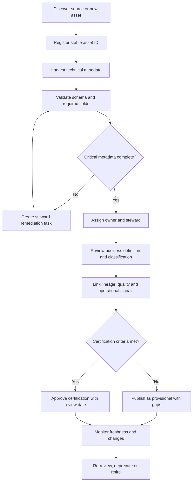
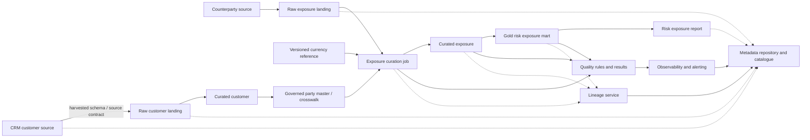
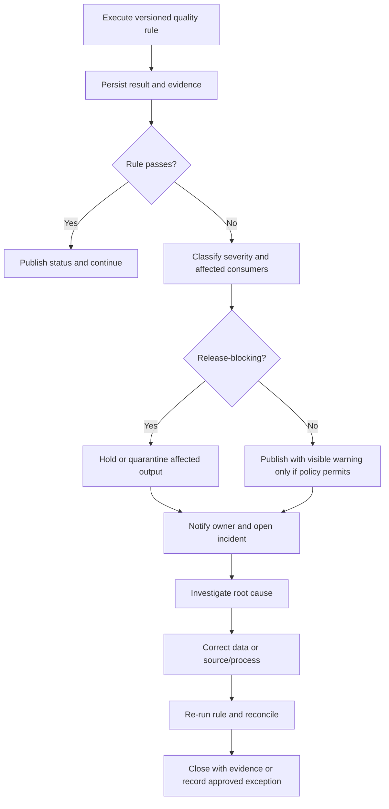
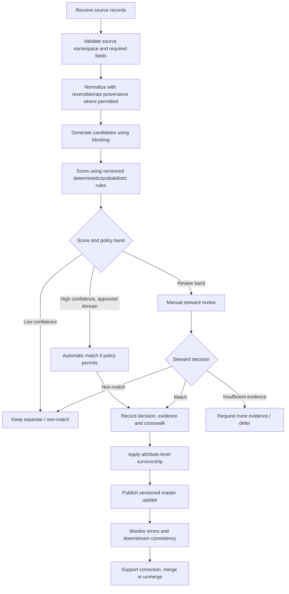
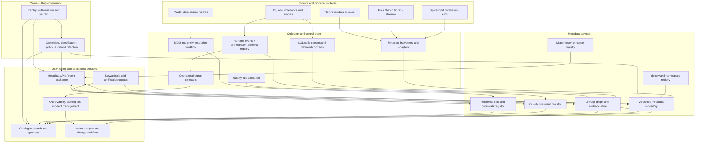

# 11 — Enterprise Metadata and Lineage Design

> **Stage:** 2D — Data Architecture  
> **Module:** 2D.11 — Metadata, Lineage, Quality and Master Data  
> **Project level:** Beginner → Intermediate → Advanced integration  
> **Scenario:** Northbridge Bank (fictional); all names, records, measurements, thresholds and system behaviours are synthetic and illustrative.  
> **Architecture stance:** Vendor-neutral. This is a design and validation exercise, not evidence of a deployed production system or legal/regulatory compliance.  
> **Version:** 1.0.0 | **Status:** Reference design for review | **Last updated:** 2026-10-22

---

## 0. How to use this project

This is the capstone for the eight lessons in `11-Metadata-Lineage-Quality-and-Master-Data/`. Complete the project in order, keep the evidence artefacts in this document or in a separately approved project workspace, and do not treat illustrative values as approved business requirements.

### 0.1 Source alignment and limitations

The supplied roadmap is the scope authority for this design. It defines a 12-step workflow and recommends deliverables D1–D12. The eight lesson files provide the concepts and patterns used here. The roadmap states that the project file and several module index files were empty when the roadmap was authored; this design therefore instantiates the roadmap’s proposed project shape rather than claiming to preserve an earlier project specification.

This project does not establish that Northbridge Bank exists, that any systems or data described here exist, or that any thresholds are industry standards. Before implementation in a real organisation, validate business requirements, applicable laws and policies, system capabilities, source contracts, security classifications, cost estimates, and operational commitments with accountable owners.

### 0.2 Project outcome

Design an enterprise capability that enables authorised people and systems to discover data, understand its meaning and sensitivity, trace its origin and transformations, evaluate quality and operational health, understand entity identity consistently, and exchange metadata between tools without silently losing meaning.

A successful design must answer:

1. What assets exist, what do they mean, and who is accountable?
2. Can users discover an appropriate asset and understand its trust and access context?
3. Can a reviewer trace a critical report field upstream and identify downstream impact?
4. Are critical data elements governed by measurable, owned, use-specific quality rules?
5. Can data freshness, volume, schema, quality and pipeline behaviour be observed with actionable responses?
6. Are master data, reference data, identifiers and match decisions governed separately but consistently?
7. Can metadata be exchanged while preserving identity, semantics, classification, lineage and provenance?
8. What evidence shows that the design meets its stated acceptance criteria, and what remains unknown?

### 0.3 Scope boundaries

**In scope**
- A logical enterprise metadata model and asset inventory.
- Catalogue/discovery journeys, classification visibility and stewardship.
- Dataset-, field-, process- and run-related lineage, with evidence and known blind spots.
- A representative change-impact analysis and a data incident/root-cause walkthrough.
- CDEs, quality rules, metrics, severity, remediation and ownership.
- Observability signals, SLIs/SLOs, alerts, runbooks and incident evidence.
- A customer/counterparty master-data example, reference-data governance, identifier policy, matching evaluation and unmerge handling.
- Metadata interoperability mapping, compatibility and round-trip tests.
- Architecture decisions, risk register, implementation plan, validation and completion gate.

**Out of scope**
- Deploying a real catalogue, lineage service, MDM hub or observability platform.
- Connecting to real bank systems or production data.
- Processing real personal, payment, account or confidential information.
- Selecting or configuring a particular vendor product.
- Making legal, regulatory, security certification or audit-compliance claims.
- Replacing the organisation’s system-of-record, identity, access-management or change-control policies.
- Claiming complete record-level lineage where the instrumentation and privacy justification are not established.

### 0.4 Learning and delivery method

For every step, record the decision, the evidence, the owner, unresolved gaps, and the acceptance check. Use synthetic data only. Mark every design value as one of:
- **Source-derived:** explicitly supported by a supplied lesson or roadmap.
- **Illustrative assumption:** selected to make the case study concrete.
- **Requires confirmation:** cannot be decided without real business, legal, platform, security or operational evidence.

### 0.5 Definition of done

The project is done only when:
- All 12 steps and D1–D12 are represented.
- Every critical design element traces to a requirement or is explicitly labelled as an assumption.
- Catalogue, metadata, lineage, quality, observability, MDM/reference data and interoperability designs agree on identifiers, ownership and semantics.
- Lineage blind spots and uncertainty are visible rather than silently filled in.
- Quality rules have populations, denominators, measurement windows, thresholds, owners, severities and responses.
- SLOs are measurable and plausible against the dependency chain.
- Entity resolution has defined thresholds, evaluation measures, manual review and an incorrect-merge recovery path.
- Metadata mapping documents lossy and unsupported fields and has compatibility/round-trip tests.
- ADRs explain alternatives, rationale, consequences and revisit triggers.
- Validation results and residual risks are recorded; a reviewer can reproduce the key calculations.
- No production access, paid infrastructure or real personal data is required to complete the exercise.

---

## 1. Step 1 — Understand requirements, business outcomes and constraints

**Roadmap output:** D1 — Requirements and assumptions register.

## 1.1 Business problem

Northbridge Bank’s synthetic data estate contains operational customer and counterparty records, reference code lists, curated analytical datasets, a risk exposure report, scheduled data pipelines, and downstream analytics. Different teams currently describe the same assets inconsistently. Users cannot always tell which dataset is approved for a particular use, whether its metadata is current, how a report field was derived, or who must respond when a source change affects a critical output.

The proposed capability is a governed metadata and lineage layer that links business meaning, technical structure, operational signals, data quality, entity consistency and metadata exchange. It supplements rather than replaces source systems and runtime access controls.

## 1.2 Business objectives and measurable outcomes

All targets below are **illustrative design assumptions** to be confirmed by business owners.

| ID | Objective | Proposed measure | Illustrative acceptance target | Accountable role |
|---|---|---|---|---|
| OBJ-01 | Make critical assets discoverable | In-scope critical assets with a complete catalogue record | ≥ 95% in pilot scope | Data governance lead |
| OBJ-02 | Make accountability explicit | Critical assets with active owner and steward | 100% in pilot scope | Domain data owners |
| OBJ-03 | Make lineage usable for change assessment | Critical report fields with reviewed source-to-target lineage | ≥ 95%, with unknown segments marked | Lineage product owner |
| OBJ-04 | Detect critical data defects before publication | Critical rules executed before report release | 100% of designated release-blocking rules | Risk data owner |
| OBJ-05 | Detect operational data incidents | Critical indicators with owner, alert and runbook | 100% in pilot scope | Data operations lead |
| OBJ-06 | Reduce identity inconsistency | Candidate matches reviewed against labelled synthetic truth | Precision/recall reported by segment; no universal target assumed | Master data owner |
| OBJ-07 | Preserve metadata meaning across systems | Mandatory mapping tests passing | 100% of release-blocking conformance tests | Metadata platform owner |
| OBJ-08 | Make design auditable | Critical requirements linked to evidence and an owner | 100% of critical requirements | Architecture review chair |

Targets are not SLAs until formally agreed and funded. Do not report these illustrative targets as current performance.

## 1.3 Stakeholders and personas

| Persona | Need | Primary workflow | Design implications |
|---|---|---|---|
| Risk analyst | Find trusted exposure data and understand suitability | Search → inspect definition, owner, freshness, quality, lineage → request access | Searchable business terms, clear certification and freshness |
| Data engineer | Assess a schema/logic change | Inspect field lineage → traverse downstream → notify owners → validate migration | Stable asset IDs, edge evidence, impact report and versioned contracts |
| Data steward | Resolve definition/classification/quality gaps | Review queue → inspect evidence → approve or reject → record decision | Decision history, ownership, confidence and review workflow |
| Data owner | Approve meaning, use, and acceptable quality risk | Review CDE/rules/SLOs and exceptions | Business decision rights and explicit exception expiry |
| Platform operator | Diagnose late or malformed data | Alert → correlate run and quality signals → inspect lineage → follow runbook | Actionable alerts, event IDs, dependencies and response ownership |
| Master-data steward | Resolve possible duplicate entities and bad merges | Review candidate pair → inspect match evidence → decide → publish/reverse | Explainable scoring, human review bands, provenance and unmerge |
| Auditor/reviewer | Understand evidence and limitations | Trace requirement → control → execution evidence → decision | Immutable or tamper-evident audit records where required; no unsupported claims |
| Metadata consumer system | Import metadata consistently | Receive versioned contract → validate → map → reconcile | Stable namespaces, schema versions, semantic tests and quarantine for invalid events |

## 1.4 Requirements register (D1)

The register below separates a design requirement from a proposed solution. `SRC` means source-derived from the module roadmap/lessons; `ASM` means illustrative assumption; `CONFIRM` means real-world validation required.

| Req ID | Requirement | Type | Priority | Acceptance evidence | Owner |
|---|---|---|---|---|---|
| REQ-001 | Represent business, technical and operational metadata distinctly and relate them to the same asset identity | SRC | Must | Schema and sample records | Metadata product owner |
| REQ-002 | Catalogue search must expose meaning, owner, classification, quality/freshness and lineage context | SRC | Must | Persona journey test | Catalogue owner |
| REQ-003 | Metadata fields must have a source, maintainer, lifecycle and freshness expectation | SRC | Must | Inventory and ownership matrix | Domain stewards |
| REQ-004 | Lineage edges must record type, source/evidence, observation time and confidence/limitations | SRC | Must | Edge register and coverage report | Lineage owner |
| REQ-005 | A representative change must have a reproducible downstream impact assessment | SRC | Must | Impact report and test | Change manager / lineage owner |
| REQ-006 | CDEs must trace to a business decision and have testable rules, owner, threshold and response | SRC | Must | CDE and rule registers | Risk data owner |
| REQ-007 | Observability must include freshness, volume, distribution, schema, pipeline and quality signals where relevant | SRC | Must | Indicator register | Data operations lead |
| REQ-008 | Critical SLOs must define measurement population/window, target, exclusions, and response | SRC | Must | SLO table and feasibility calculation | Data product owner |
| REQ-009 | Master-data decisions must preserve source identifiers, provenance, survivorship and merge/unmerge history | SRC | Must | Logical model and lifecycle tests | Master-data owner |
| REQ-010 | Reference lists must have owners, versions, effective dates and controlled mappings | SRC | Must | Reference-data register | Reference-data steward |
| REQ-011 | Match decisions must be evaluated with precision/recall and explicit review bands | SRC | Must | Synthetic evaluation report | Entity-resolution owner |
| REQ-012 | Metadata exchanges must specify semantic mappings, versions, lossy fields and tests | SRC | Must | Mapping contract and conformance results | Metadata platform owner |
| REQ-013 | Architecture decisions must document alternatives, consequences and revisit triggers | SRC | Must | ADR set | Chief/data architect |
| REQ-014 | Use synthetic records only in the learning artefact | ASM / safety constraint | Must | Data review | Project lead |
| REQ-015 | Pilot includes 15–25 assets across source, curated, report and master/reference data layers | ASM | Should | Inventory count | Project lead |
| REQ-016 | Pilot quality/observability targets and escalation times are illustrative until formally approved | CONFIRM | Must | Approval record or explicit open issue | Business/service owners |
| REQ-017 | Legal basis, retention periods and any regulatory obligations must be confirmed by the relevant control functions | CONFIRM | Must | Signed-off policy references | Legal/privacy/compliance owners |
| REQ-018 | Catalogue visibility must not be treated as data access authorization | SRC | Must | Security design and test | Security architect |

## 1.5 Assumptions, constraints and open questions

| ID | Statement | Status | Validation / decision needed |
|---|---|---|---|
| ASM-01 | Northbridge is a fictional bank with a risk reporting use case | Illustrative assumption | No external validation; case-study boundary |
| ASM-02 | Pilot includes a source CRM, counterparty reference feed, transformation pipeline, curated exposure dataset and report | Illustrative assumption | Confirm real inventory before implementation |
| ASM-03 | A central metadata service with source adapters is a starting hypothesis | Illustrative assumption | Revisit after source ownership, scale, latency and platform capabilities are known |
| ASM-04 | Asset-level lineage is required broadly; field-level lineage is prioritised for CDEs | Illustrative assumption consistent with lesson trade-offs | Validate audit/use-case granularity |
| ASM-05 | Illustrative freshness objective for the risk report is business-day delivery by 07:00 | Illustrative assumption | Business owner and dependency SLO review required |
| OPEN-01 | Which assets and consumers are in the real pilot boundary? | Requires confirmation | Inventory workshop |
| OPEN-02 | Which classifications, access policies and retention requirements apply? | Requires confirmation | Security, privacy, legal and compliance review |
| OPEN-03 | What catalogue, lineage, quality and MDM tools already exist? | Requires confirmation | Platform capability assessment |
| OPEN-04 | Which systems are authoritative for each master attribute? | Requires confirmation | Domain owner decision |
| OPEN-05 | What availability, freshness and incident response commitments are funded? | Requires confirmation | Service ownership and operations review |

## 1.6 Constraints and non-functional requirements

- **Security:** metadata can itself reveal sensitive facts (asset names, column names, usage patterns, lineage). Apply access controls to metadata views and redact/hide sensitive details where required.
- **Privacy:** do not place raw personal values in catalogues, lineage events, logs or synthetic fixtures. Store only the minimum identifiers needed for traceability.
- **Availability:** catalogue read paths may have different availability needs from metadata ingestion and policy enforcement. Catalogue outage must not bypass source-system authorization.
- **Freshness:** every harvested/observed field should have `observed_at`, source and expected refresh behaviour where applicable.
- **Integrity:** stable IDs and versioned schemas must survive renames and migrations; names are labels, not primary identity.
- **Interoperability:** syntactic parseability is insufficient; semantic mapping and loss must be explicit.
- **Cost:** prefer broad asset-level lineage and deepen to field/run/record detail only where the business case supports it.
- **Portability:** keep canonical semantics and mapping rules independent of a single vendor where feasible; document unavoidable proprietary features.
- **Auditability:** retain decision and change history according to a confirmed policy; define who may view or alter audit records.
- **Operability:** every critical alert and workflow has a named role, escalation route, runbook and fallback.

## 1.7 Step 1 acceptance gate

- [ ] Business problem and measurable outcomes are stated.
- [ ] Scope, exclusions, assumptions and open questions are explicit.
- [ ] Stakeholders and decision rights are named by role.
- [ ] Every must-have requirement has an acceptance evidence item.
- [ ] No illustrative target is represented as an approved SLA.
- [ ] Legal/security/retention obligations are marked for confirmation, not invented.

---

## 2. Step 2 — Inventory assets and design the metadata model

**Roadmap output:** D2 — Metadata inventory and metadata schema.

## 2.1 Metadata model principles

1. Separate the **asset** from the **metadata record** describing it.
2. Use a stable, namespaced `asset_id`; physical names and paths can change.
3. Distinguish business, technical and operational metadata, but link them to the same asset.
4. Track field-level metadata for critical fields, not only tables.
5. Every metadata attribute has a type, source, requiredness, maintainer, sensitivity, lifecycle and freshness policy where applicable.
6. Preserve provenance: who or what supplied the value, when it was observed, and whether it is harvested, curated or derived.
7. Keep classifications and access decisions separate: a label is not an enforcement mechanism.
8. Model uncertainty and missingness explicitly; unknown is not equivalent to false, empty or “not applicable.”
9. Avoid putting raw data values into metadata unless a specific approved need justifies it.
10. Version schema and meaning separately from asset display names.

## 2.2 Logical metadata entities

| Entity | Purpose | Key fields / relationships |
|---|---|---|
| `Asset` | Stable identity and core asset facts | `asset_id`, `asset_type`, `domain_id`, `lifecycle_status`, `created_at`, `updated_at` |
| `AssetName` | Current and historical names/aliases | `asset_id`, `name`, `namespace`, `valid_from`, `valid_to` |
| `Field` | Column/property within an asset | `field_id`, `asset_id`, `field_name`, `logical_type`, `physical_type`, `nullable` |
| `BusinessTerm` | Approved business meaning | `term_id`, `preferred_label`, `definition`, `owner_role`, `status`, `version` |
| `MetadataAttribute` | A typed fact about an asset/field | `subject_id`, `attribute_key`, `value`, `value_type`, `category`, `source_ref`, `observed_at` |
| `Responsibility` | Owner, steward and operational maintainer | `subject_id`, `role_type`, `role_ref`, `effective_from`, `effective_to` |
| `ClassificationAssertion` | Label and evidence for sensitivity/classification | `subject_id`, `scheme_id`, `label`, `basis`, `confidence`, `review_status`, `observed_at` |
| `LineageNode` | Asset/process/run node in graph | `node_id`, `node_type`, `asset_id` (if applicable), `version_ref` |
| `LineageEdge` | Typed dependency or transformation relation | `edge_id`, `from_node`, `to_node`, `edge_type`, `evidence_ref`, `confidence`, `valid_time` |
| `QualityRule` | Executable or manually assessed assertion | `rule_id`, `asset_id`, `field_id`, `dimension`, `population`, `expression_ref`, `threshold`, `severity`, `owner_role` |
| `QualityResult` | Result for a rule and defined window | `result_id`, `rule_id`, `run_id`, `observed_at`, `numerator`, `denominator`, `status`, `evidence_ref` |
| `OperationalSignal` | Freshness, volume, schema, run or distribution observation | `signal_id`, `asset_id`, `signal_type`, `value`, `unit`, `window`, `observed_at`, `source_ref` |
| `MasterEntity` | Governed enterprise entity | `master_id`, `entity_type`, `status`, `record_version`, `created_at` |
| `SourceCrosswalk` | Maps source identity to master identity | `source_system`, `source_id`, `namespace`, `master_id`, `valid_from`, `valid_to`, `decision_ref` |
| `MatchDecision` | Records candidate evidence and outcome | `decision_id`, `candidate_ids`, `score_or_rule`, `decision`, `reviewer`, `model_version`, `decision_at` |
| `ReferenceValue` | Governed code/value with temporal validity | `list_id`, `code`, `canonical_value`, `valid_from`, `valid_to`, `status`, `version` |
| `MetadataMapping` | Source-to-target exchange rule | `mapping_id`, `source_model_version`, `target_model_version`, `rule`, `lossiness`, `test_ref` |
| `ChangeEvent` | Metadata, schema, lineage or policy change | `event_id`, `subject_id`, `change_type`, `before_version`, `after_version`, `actor`, `timestamp`, `approval_ref` |

This is a logical model. Physical tables, graph storage, event schemas, search indexes and APIs depend on the selected platform and workload.

## 2.3 Metadata attribute contract

Every governed metadata field should have a field contract.

| Contract property | Meaning | Example |
|---|---|---|
| `attribute_key` | Stable schema-level key | `business_definition` |
| `category` | Business, technical or operational | Business |
| `value_type` | String, boolean, integer, timestamp, object, controlled enum | String |
| `requiredness` | Required, conditional, optional | Required for certified assets |
| `source_of_truth` | System, role or process supplying the value | Approved glossary |
| `maintenance_mode` | Harvested, curated, derived or hybrid | Curated |
| `maintainer_role` | Role responsible for freshness/correction | Domain steward |
| `validation_rule` | Constraint for acceptable values | Must not merely restate physical name |
| `freshness_expectation` | Expected refresh/review interval | Review every 180 days (illustrative) |
| `sensitivity` | Whether the metadata value itself is restricted | Internal |
| `lifecycle` | Active, deprecated, retired | Active |
| `provenance` | Source, actor, observation time, method/version | Steward review event |
| `conflict_policy` | What happens when sources disagree | Quarantine and steward review |

## 2.4 Synthetic pilot inventory

The following inventory is intentionally compact and illustrative. Replace it with the verified system inventory before implementation.

| Asset ID | Asset / field | Type / layer | Metadata focus | Owner / maintainer role | Classification assumption | Criticality |
|---|---|---|---|---|---|---|
| `urn:nb:asset:crm.customer` | CRM customer entity | Source / operational | Business definition, schema, owner | Customer domain owner / CRM platform | Restricted (assumption) | Tier 1 |
| `urn:nb:asset:crm.customer.customer_id` | Customer identifier | Field | Namespace, uniqueness, lifecycle | Customer steward / CRM platform | Restricted (assumption) | Tier 1 |
| `urn:nb:asset:crm.customer.country_code` | Country code | Field / reference link | Allowed values, version, mapping | Customer steward / reference steward | Internal (assumption) | Tier 2 |
| `urn:nb:asset:core.counterparty` | Counterparty source | Source | Authority by attribute, provenance | Counterparty owner / source team | Restricted (assumption) | Tier 1 |
| `urn:nb:asset:ref.country` | Country reference list | Reference | Version, effective dates, mappings | Reference-data owner | Internal (assumption) | Tier 2 |
| `urn:nb:asset:ref.currency` | Currency reference list | Reference | Codes, valid time, deprecation | Reference-data owner | Internal (assumption) | Tier 1 |
| `urn:nb:asset:raw.exposure` | Raw exposure extract | Landing | Source batch, counts, schema | Risk ingestion owner / pipeline | Confidential (assumption) | Tier 1 |
| `urn:nb:asset:curated.exposure` | Curated exposure | Curated | CDE rules, lineage, freshness | Risk data product owner / analytics engineering | Confidential (assumption) | Tier 1 |
| `urn:nb:asset:curated.customer` | Curated customer | Curated | Entity identity, quality, classification | Customer domain owner / data engineering | Restricted (assumption) | Tier 1 |
| `urn:nb:asset:mdm.party` | Governed party master | Master | Golden record, survivorship, crosswalk | Master-data owner / MDM operations | Restricted (assumption) | Tier 1 |
| `urn:nb:asset:gold.risk_exposure` | Risk exposure reporting mart | Gold/reporting | CDEs, SLO, certification | Risk reporting owner / data product team | Confidential (assumption) | Tier 1 |
| `urn:nb:asset:report.risk_exposure` | Risk exposure report | Consumer | Definition, publication time, lineage | Risk reporting owner | Confidential (assumption) | Tier 1 |
| `urn:nb:process:job.exposure_curate` | Exposure curation job | Process | Code version, run status, inputs/outputs | Data platform operations | Internal (assumption) | Tier 1 |
| `urn:nb:process:job.metadata_harvest` | Metadata harvesting job | Process | Scan time, source coverage, failures | Metadata platform owner | Internal (assumption) | Tier 2 |
| `urn:nb:asset:catalog.business_glossary` | Glossary terms | Governance | Definitions, synonyms, approvals | Governance lead / stewards | Internal (assumption) | Tier 2 |
| `urn:nb:asset:quality.rule_registry` | Quality rule registry | Control | Rule versions, owners, thresholds | Quality lead / data owners | Internal (assumption) | Tier 1 |
| `urn:nb:asset:lineage.graph` | Lineage graph | Control | Edges, evidence, confidence | Lineage owner / platform | Internal (assumption) | Tier 1 |
| `urn:nb:asset:observability.signals` | Observability signals | Operational | Freshness, volume, distributions | Operations lead | Internal (assumption) | Tier 1 |

Classification labels in this example are placeholders. The actual scheme and label must be set by the organisation’s approved classification policy; do not infer classification from these examples.

## 2.5 Example metadata record (JSON)

This is an illustrative record, not a claim about a running API.

```json
{
  "schema_version": "1.0.0",
  "asset_id": "urn:nb:asset:curated.exposure",
  "asset_type": "dataset",
  "display_name": "Curated Risk Exposure",
  "domain_id": "urn:nb:domain:risk",
  "lifecycle_status": "active",
  "business": {
    "definition": "Synthetic exposure records prepared for the risk reporting use case.",
    "business_terms": ["urn:nb:term:exposure", "urn:nb:term:reporting_date"],
    "owner_role": "risk_data_owner",
    "steward_role": "risk_data_steward",
    "certification": {
      "status": "proposed",
      "basis": "Required rules and lineage reviewed",
      "reviewed_at": null
    }
  },
  "technical": {
    "platform_ref": "synthetic:lakehouse",
    "logical_schema_version": "2.1.0",
    "fields": [
      {
        "field_id": "urn:nb:field:curated.exposure.amount_base",
        "name": "amount_base",
        "logical_type": "decimal",
        "nullable": false,
        "critical_data_element": true
      }
    ]
  },
  "operational": {
    "last_successful_load_at": "2026-10-21T06:40:00Z",
    "last_schema_harvest_at": "2026-10-21T06:45:00Z",
    "freshness_status": "illustrative-green",
    "last_quality_run_id": "synthetic-run-0042"
  },
  "classification": {
    "scheme": "northbridge-classification-example",
    "label": "Confidential",
    "status": "requires-owner-confirmation"
  },
  "provenance": {
    "record_origin": "project-example",
    "observed_at": "2026-10-21T06:45:00Z",
    "collection_method": "synthetic-fixture"
  }
}
```

Do not use `"illustrative-green"` as a production status value without a formal status vocabulary. In a real contract, define allowed values and separate the measurement timestamp from a derived health status.

## 2.6 Metadata collection and lifecycle

| Metadata type | Preferred source | Collection mode | Quality control | Accountable role |
|---|---|---|---|---|
| Physical schema, columns, types, keys | Database/table-format metadata | Automated harvest | Compare schema fingerprint; detect drift | Platform/source owner |
| Business definition and approved terms | Glossary/steward workflow | Curated and versioned | Review, non-empty semantic definition | Domain owner/steward |
| Owner and steward | Governance registry / approved directory | Curated or synchronized | Validate active role assignment | Governance lead |
| Classification | Approved policy + scanner suggestion + review | Hybrid | Precision/recall review; conflict queue | Classification owner |
| Lineage edges | SQL/code parser, orchestration events, declared contracts | Hybrid | Edge evidence, coverage and freshness | Lineage owner |
| Quality results | Rule execution engine | Automated | Reproducible numerator/denominator and run ID | Quality owner |
| Operational freshness/run status | Orchestrator, ingestion and quality events | Automated | Event completeness and clock/source checks | Operations lead |
| MDM provenance and match decisions | MDM/entity resolution workflow | Automated + human decision | Version, evidence, reviewer, reversibility | Master-data owner |
| Metadata mappings | Version-controlled mapping registry | Curated as code | Schema, semantic and round-trip tests | Metadata platform owner |

**Lifecycle:** register → harvest/curate → validate → publish → use/observe → review/update → deprecate → retire. Before retirement, check dependencies, retention and audit obligations, preserve necessary history, and publish a controlled change event.

## 2.7 Metadata quality indicators

| Indicator | Definition | Example measurement | Response |
|---|---|---|---|
| Required-field completeness | Required metadata fields present / required fields applicable | 92 / 100 = 92% | Queue missing fields; block certification if critical |
| Metadata freshness | Assets harvested/reviewed within their expectation / applicable assets | 18 / 20 = 90% | Re-run scanner or ask maintainer |
| Owner coverage | Critical assets with an active accountable owner / critical assets | 20 / 20 = 100% | Escalate ownerless critical assets |
| Definition quality | Reviewed definitions passing semantic review / reviewed definitions | 17 / 20 = 85% | Steward rewrite and review |
| Cross-system consistency | Compared metadata assertions that agree / comparable assertions | 96 / 100 = 96% | Reconcile source of truth; do not blindly overwrite |
| Harvest coverage | Successfully scanned in-scope sources / in-scope sources | 9 / 10 = 90% | Investigate connector/permission gap |
| Lineage edge freshness | Edges refreshed within their expected interval / edges due for refresh | 850 / 900 = 94.4% | Refresh graph and flag stale paths |

Every metric must state its population, exclusions, timestamp, calculation and owner. A high aggregate score cannot compensate for one missing owner or one untraced critical field.

## 2.8 Step 2 acceptance gate

- [ ] Each in-scope asset has a stable ID, asset type, domain, lifecycle state and owner/maintainer or a recorded gap.
- [ ] Business, technical and operational metadata are distinguishable.
- [ ] Field-level metadata exists for CDEs.
- [ ] Metadata sources, collection mode, freshness and conflict handling are stated.
- [ ] Missing and stale metadata are visible, not silently defaulted.
- [ ] The metadata schema is versioned and has requiredness and validation rules.
- [ ] The catalogue and policy enforcement responsibilities are not conflated.

---

## 3. Step 3 — Design catalogue, discovery, classification and stewardship

**Roadmap output:** D3 — Catalogue design and ownership/stewardship matrix.

## 3.1 Catalogue capabilities

The catalogue is a user-facing discovery and context capability. It may use a metadata repository, glossary, lineage service and quality service, but it does not automatically enforce access to source data.

Required capabilities for this design:
- Search by business term, asset name, domain, owner, classification, certification and freshness.
- Browse domains and related assets.
- Show asset details, field definitions, schema, CDEs, lineage, quality and operational context.
- Show classification and whether the classification is reviewed or provisional.
- Show owner, steward, support contact and lifecycle state.
- Link to a governed access-request workflow.
- Provide curation queues for missing definitions, stale records, classification conflicts and ownership gaps.
- Record endorsement/certification basis and review date.
- Expose uncertainty and known lineage gaps.
- Apply role-aware visibility and redact metadata that itself is sensitive.

## 3.2 Asset detail page contract

| Section | Fields | Source | Behaviour |
|---|---|---|---|
| Identity | Stable asset ID, display name, aliases, type, domain, lifecycle | Metadata repository / harvested system | Display ID for technical use; keep aliases after rename |
| Meaning | Definition, glossary terms, business owner, intended use, exclusions | Approved glossary/steward | Require review before certification |
| Technical | Platform/location reference, schema, fields, keys, partitions, schema version | Harvested source | Show last harvest and schema diff |
| Governance | Classification, review status, permitted-use notes, policy link | Approved classification/governance registry | Do not display as proof of authorization |
| Quality | CDEs, rule status, result timestamp, population and known limitations | Quality service | Show failed critical rule prominently with context |
| Operations | Freshness, last successful load, delivery status, SLO status | Observability/orchestration | Display event timestamp and data age |
| Lineage | Upstream/downstream assets, transformation, evidence, confidence, blind spots | Lineage service | Distinguish captured, parsed, declared and inferred edges |
| Access | Request link, approver role, access conditions | IAM/access workflow | Route request; never grant based only on catalogue display |
| Trust | Certification state, basis, expiry/review date | Stewardship workflow | “Certified” requires explicit criteria and approval |
| History | Metadata/schema changes, reviewer, before/after versions | Change history | Restrict sensitive history as required |

## 3.3 User journeys

### Journey A — Risk analyst discovers exposure data
1. Search for “risk exposure” or the approved glossary term.
2. Filter by domain, certification state and approved-use context.
3. Open an asset page.
4. Check definition, reporting date, currency, owner, freshness, quality results and lineage.
5. Confirm whether the asset is fit for the intended report; review limitations.
6. Submit an access request through the approved workflow if needed.
7. After access approval, query the source platform under its own enforcement controls.

**Pass condition:** user can identify the intended asset, accountable owner, freshness, quality limitations, lineage context and access route without assuming the catalogue grants access.

### Journey B — Engineer assesses a breaking schema change
1. Find the field by stable field ID and current physical name.
2. Review upstream/downstream lineage and edge evidence.
3. Run downstream impact traversal.
4. Identify affected CDE rules, reports, consumers and owners.
5. Create migration/test plan and notify owners.
6. Update schema contract, mapping and lineage after deployment.
7. Confirm no unreviewed critical downstream consumer remains.

**Pass condition:** impacted consumers are reproducible from graph and contract evidence; unknown edges are explicitly listed.

### Journey C — Steward reviews a classification suggestion
1. Review scanner evidence and the proposed label.
2. Check approved classification scheme, field context and permitted use.
3. Accept, reject or escalate the suggestion with reason.
4. Publish a versioned classification assertion and change event.
5. Verify downstream propagation to catalogue, policy registry and metadata exchange.
6. Confirm access enforcement is handled by the relevant enforcement point.

**Pass condition:** decision, reviewer, evidence, version and propagation status are recorded; catalogue label alone is not treated as enforcement.

## 3.4 Registration and certification workflow



## 3.5 Classification governance and measures

- Maintain an approved classification scheme and version.
- Distinguish a scanner suggestion from a reviewed classification decision.
- Track classification at asset and field level where needed.
- Propagate labels through transformations according to documented rules; where derivation is ambiguous, require review.
- Do not silently lower sensitivity when mapping between schemes.
- Use labelled synthetic samples to measure precision and recall; define the review population and ground truth.
- Record false negatives and false positives, not just overall accuracy.
- Keep classification propagation status observable across systems.

## 3.6 Ownership and stewardship matrix (RACI-style)

Legend: **A** accountable; **R** responsible for execution; **C** consulted; **I** informed. Roles are role names, not individuals.

| Activity | Domain data owner | Data steward | Platform/source owner | Metadata platform owner | Security/privacy | Operations |
|---|---|---|---|---|---|---|
| Approve business definition | A | R | C | I | C | I |
| Maintain technical schema | C | I | A/R | C | I | C |
| Harvest metadata | I | C | R | A/R | C | C |
| Approve classification | A/C by policy | R | C | C | A/C per policy | I |
| Define CDE and quality acceptance | A | R | C | I | C | C |
| Operate quality checks | A for rule meaning | C | R | C | I | R |
| Maintain lineage collectors | C | I | R | A/R | C | C |
| Approve master-data survivorship | A | R | C | I | C | I |
| Operate match workflow | A | R | C | C | C | R |
| Approve metadata mapping semantics | C | C | C | A/R | C | I |
| Respond to pipeline incident | I/C | C | R | C | I | A/R |
| Retire asset | A | R | R | C | C | C |

The actual RACI must be reconciled with the organisation’s governance operating model; one role may not be both accountable and independent reviewer for the same control.

## 3.7 Step 3 acceptance gate

- [ ] Each persona journey can be completed end to end.
- [ ] Every displayed field has a source and a maintainer.
- [ ] Certification has criteria, approver and review date.
- [ ] Classification suggestions and approved assertions are distinguishable.
- [ ] Catalogue visibility is not treated as authorization.
- [ ] Ownership gaps and restricted metadata visibility have explicit handling.

---

## 4. Step 4 — Design end-to-end lineage and evidence

**Roadmap output:** D4 — Lineage diagram and edge register.

## 4.1 Lineage scope and granularity

Use:
- **Dataset/table lineage** for broad discovery and impact.
- **Field/column lineage** for CDEs, report measures, sensitive fields and high-impact changes.
- **Process/job lineage** to identify code, orchestration and execution relationships.
- **Run-level evidence** to associate a specific output with a specific run/version.
- **Record/value-level lineage** only if a justified use case, privacy review, cost model and retention design support it; it is not the default.

A dependency graph describes a relationship. It does not alone prove what occurred in a specific run. Correlate important claims with schema versions, transformation/code versions, run IDs, timestamps, quality results and source evidence.

## 4.2 Logical lineage model

A lineage edge must have at least:

| Field | Meaning |
|---|---|
| `edge_id` | Stable unique edge identifier |
| `from_node_id`, `to_node_id` | Stable node identities |
| `edge_type` | `reads`, `writes`, `transforms_to`, `field_maps_to`, `joins`, `filters`, `aggregates`, `publishes_to`, or governed extension |
| `granularity` | Dataset, field, process, run or record |
| `transformation_ref` | Versioned code/query/contract reference where applicable |
| `evidence_type` | Declared, parsed, runtime-captured, manually-reviewed, or inferred |
| `evidence_ref` | Pointer to source metadata, parser result, run event or approved documentation |
| `confidence` | Defined ordinal or calibrated score; do not call it probability unless calibrated |
| `observed_at` | When this relationship was observed |
| `valid_from`, `valid_to` | Validity interval if the relationship changes over time |
| `source_schema_version`, `target_schema_version` | Versions needed to interpret the edge |
| `known_limitations` | Known missing branches, opaque logic or incomplete capture |
| `owner_role` | Role accountable for investigating or correcting the edge |

## 4.3 Synthetic end-to-end flow



**Diagram caveat:** arrows illustrate the intended logical flow. They do not assert that any production integration exists. Each real edge must be supported by declared, parsed or runtime evidence.

## 4.4 Synthetic lineage edge register

| Edge ID | From → to | Relationship | Granularity | Evidence | Confidence / limitation |
|---|---|---|---|---|---|
| E-001 | CRM customer → raw customer | Ingests source records | Dataset | Source contract + ingestion config (assumed) | High only after evidence is collected |
| E-002 | Raw customer → curated customer | Type/standardization transforms | Dataset + selected fields | Versioned SQL/job definition | Conditional on parser coverage |
| E-003 | Raw exposure → exposure curation job | Job reads batch | Process/run | Orchestrator run event | Run-specific |
| E-004 | Currency reference → `amount_base` | Currency conversion join/multiply | Field | SQL expression + reference version | Requires rate/date semantics |
| E-005 | Party master → curated exposure | Entity crosswalk join | Dataset/field | Join key and crosswalk version | Match errors remain possible |
| E-006 | Curated exposure → gold mart | Aggregate and filter | Dataset + CDE fields | SQL parser and code version | Branch conditions must be tested |
| E-007 | Gold mart → risk report | Report query/publication | Dataset/field | BI definition and refresh event | Manual extracts may be a blind spot |
| E-008 | Quality result → report release gate | Control dependency | Rule/process | Rule registry + release config | Must verify the gate actually blocks publication |
| E-009 | Metadata harvest job → catalogue record | Harvest updates technical metadata | Process/metadata | Scan event + source fingerprint | Failed connectors create coverage gaps |
| E-010 | Source schema change → downstream impact set | Dependency traversal | Graph-level | Lineage graph snapshot | Only as complete as current graph |

The evidence references above are required evidence types for the design; they are not evidence already collected.

## 4.5 Field-level lineage example

| Source field | Transformation | Target field | Quality control | Consumer |
|---|---|---|---|---|
| `raw.exposure.amount` | Parse decimal; reject invalid values | `curated.exposure.amount_source` | Valid decimal; null policy explicit | Exposure mart |
| `raw.exposure.currency_code` | Normalize and map against effective-dated currency list | `curated.exposure.currency_code` | Value valid for reporting date | Exposure mart |
| `curated.exposure.amount_source` + currency/rate inputs | `amount_base = amount_source × applicable_rate` under approved direction and date semantics | `curated.exposure.amount_base` | Non-null; rate exists; reconciliation tolerance approved | Risk exposure report |
| `raw.exposure.reporting_date` | Parse timezone/date contract; map to reporting calendar | `curated.exposure.reporting_date` | Valid reporting date; period rule | Risk exposure report |
| `source_counterparty_id` | Resolve through namespaced crosswalk | `master_party_id` | Crosswalk uniqueness and active validity | Exposure mart |
| `master_party_id` + `amount_base` + `reporting_date` | Aggregate under approved grain | `gold.risk_exposure.total_exposure_base` | Reconciliation, grain uniqueness and completeness | Risk report |

The formula and rules are illustrative. The domain owner must approve the applicable rate source, conversion direction, valuation date, rounding, aggregation grain and reconciliation tolerance.

## 4.6 Blind spots and compensating controls

| Blind spot | Why it occurs | Risk | Compensating control | Owner |
|---|---|---|---|---|
| Dynamic SQL not parsed | Query constructed at runtime | Missing field edges | Runtime query capture or declared contract; label uncovered paths | Pipeline owner |
| Manual spreadsheet adjustment | Out-of-band process | Report value has unrecorded origin | Controlled upload registry, file hash, approver and reconciliation | Report owner |
| External vendor transformation | Limited visibility | Unknown transformation semantics | Contract, output validation, owner attestation and explicit unknown edge | Vendor/source owner |
| BI semantic layer not harvested | Tool integration gap | Report field mapping incomplete | Export model definitions and review critical metrics manually | BI platform owner |
| Late-arriving or replayed events | Processing and event time differ | Duplicate or changed results | Event/run IDs, idempotency, watermarks, replay records and reconciliation | Streaming/data operations |
| Incomplete field-level parser | Unsupported syntax or macros | CDE lineage gap | CDE-specific manual review and tests; do not imply full coverage | Lineage owner |
| Stale graph after schema change | Collector failed or schedule lagged | Impact report omits consumers | Schema-change trigger, freshness SLO, change gate and alert | Metadata platform owner |
| Record-level provenance absent | Cost/privacy trade-off | Cannot prove an individual row’s origin | Reconciliation batches and run evidence; document the limitation | Data product owner |

## 4.7 Lineage coverage and quality measures

- **Asset lineage coverage:** in-scope assets with at least one reviewed relevant lineage path / in-scope assets requiring lineage.
- **CDE lineage coverage:** critical fields with reviewed upstream source and downstream consumer paths / CDE fields in scope.
- **Evidence coverage:** edges with evidence references / edges claimed as verified.
- **Freshness:** edges refreshed within the agreed expectation / edges due for refresh.
- **Unknown-segment count:** explicitly recorded unknown or unverified path segments.
- **Impact reproducibility:** repeated traversal on the same graph snapshot and change input returns the same affected set.

Do not label a path “complete” unless the completeness boundary, collection methods, excluded sources and validation method are stated.

## 4.8 Step 4 acceptance gate

- [ ] Graph nodes have stable IDs and types.
- [ ] Edges are typed, version-aware, timestamped and evidence-linked.
- [ ] CDEs have field-level lineage where required.
- [ ] Declared, parsed, runtime and manually reviewed lineage are distinguished.
- [ ] At least three blind spots and compensating controls are documented.
- [ ] Graph evidence is not confused with proof of a particular run.

---

## 5. Step 5 — Perform impact analysis and root-cause investigation

**Roadmap output:** D5 — Impact analysis report.

## 5.1 Representative change

**Change CHG-001 (synthetic):** the upstream field `raw.exposure.currency_code` changes from a source-provided three-character code contract to a different representation, or its meaning changes from transaction currency to reporting currency, without a corresponding target contract update.

This change is potentially breaking because the field participates in reference mapping, currency conversion, quality checks, and a critical risk report. A rename is a technical change; a meaning change is semantic and may be more dangerous even when the physical type remains unchanged.

## 5.2 Repeatable impact procedure

1. Freeze the graph snapshot/version and record the change request ID.
2. Identify the source asset and field by stable ID, not only by name.
3. Traverse downstream edges to datasets, fields, rules, reports, models and consumers.
4. Include indirect dependencies and process/run dependencies where captured.
5. Join affected assets to owners, stewards, classifications, CDEs, SLOs and quality rules.
6. Classify impact: schema compatibility, semantic correctness, privacy/classification, quality, operational timing and consumer contract.
7. Label each impact as confirmed, likely or unknown, with evidence.
8. Record test and migration actions, owners, due dates and communication.
9. Define deployment gate and rollback criteria.
10. After deployment, refresh lineage and metadata; run compatibility, quality, reconciliation and consumer tests.
11. Close only when required evidence is attached and residual unknowns accepted by the right owner.

## 5.3 Example impact report

| Impact ID | Affected asset / control | Impact | Evidence needed | Action | Responsible role | Status in this exercise |
|---|---|---|---|---|---|---|
| IMP-01 | Currency reference mapping | New source representation may not map | Source contract diff; mapping table version | Update mapping and effective-date tests | Reference-data steward | Proposed |
| IMP-02 | `curated.exposure.currency_code` | Invalid or semantically mislabelled values | Field contract and schema diff | Version contract; reject/quarantine unsupported values | Pipeline owner | Proposed |
| IMP-03 | `amount_base` conversion | Wrong rate or direction may misstate amounts | Transformation code and approved conversion rule | Add independent calculation and reconciliation tests | Risk data owner | Proposed |
| IMP-04 | CDE validity rule | Existing rule may check format but not meaning | Rule definition and rule run | Add valid-code/effective-date/meaning checks | Quality owner | Proposed |
| IMP-05 | Gold exposure mart | Aggregates may combine incompatible currencies | Field lineage and aggregation logic | Prevent publication until semantic contract passes | Risk data product owner | Proposed |
| IMP-06 | Risk exposure report | Consumer may receive wrong totals | Report field mapping and publication event | Regression and reconciliation test | Reporting owner | Proposed |
| IMP-07 | Metadata exchange | Target system may map classification or field meaning incorrectly | Mapping spec and conformance results | Run schema + semantic + round-trip tests | Metadata platform owner | Proposed |
| IMP-08 | Catalogue | Stale definition may continue to describe old meaning | Asset record history and harvest event | Mark change pending; refresh definition and review certification | Catalogue steward | Proposed |

No status above represents a real system state. In a real change request, replace “Proposed” with evidence-backed status and link the actual artefacts.

## 5.4 Root-cause investigation example

**Symptom:** a synthetic risk report’s total exposure changes unexpectedly after a pipeline run.

Do not immediately conclude that the source data are wrong. Investigate from symptom to demonstrated divergence:

1. Record report version, publication time, query/model version and affected reporting period.
2. Compare report result to the prior accepted output and a trusted reconciliation source.
3. Check run events, input batch IDs, row counts, watermarks, schema versions and code version.
4. Review quality results for the currency field, amount field, reporting date and entity key.
5. Traverse upstream lineage and find the earliest point where observed output diverges from the expected result.
6. Test hypotheses: late batch, duplicate replay, missing reference version, changed currency semantics, join-key loss, aggregation grain change, or report definition change.
7. Require reproducible evidence before naming a root cause.
8. Record immediate containment, correction, prevention, owner, verification and affected consumers.
9. If the evidence is insufficient, record “cause not yet demonstrated” and the next test rather than selecting a plausible story.

### Example incident record

| Field | Synthetic example |
|---|---|
| Incident ID | INC-SYN-001 |
| Symptom | Report total differs from the prior accepted run by 7.2% |
| Detection | Reconciliation indicator |
| Initial hypotheses | Currency mapping change; late source batch; duplicate replay; report logic change |
| Evidence to collect | Input batch IDs, row counts, code version, currency reference version, quality results, report version |
| Demonstrated divergence | To be populated only after test results identify it |
| Containment | Hold report publication if the approved critical release gate fails |
| Recovery | Reprocess from a verified input snapshot with idempotent logic; reconcile output |
| Prevention | Add the missing contract/rule/alert and test the change path |
| Closure criterion | Reproducible cause or documented residual uncertainty; corrected output reconciles; controls verified |

## 5.5 Change-control gate

Do not deploy a breaking change to a CDE path until:
- Impacted consumers and owners have been identified or missing lineage accepted explicitly by the accountable owner.
- Contract and mapping versions are compatible or a migration is approved.
- Critical quality rules and consumer regression tests pass.
- A rollback/forward-repair plan exists.
- Catalogue, lineage and metadata exchange records are refreshed after release.
- Any temporary exception has an owner, rationale, compensating control and expiry.

## 5.6 Step 5 acceptance gate

- [ ] The graph snapshot and changed field are identified.
- [ ] The affected set can be reproduced.
- [ ] Owners and control dependencies are attached to impacts.
- [ ] Confirmed findings are distinguished from hypotheses.
- [ ] A root-cause note includes evidence and limitations.
- [ ] Post-change validation and rollback criteria are explicit.

---

## 6. Step 6 — Identify CDEs and define data quality rules

**Roadmap output:** D6 — CDE register and data-quality rule inventory.

## 6.1 Quality design principles

- Quality means fitness for a stated use; it is not a universal score.
- A dimension is not a rule, a measurement, a threshold or an acceptance decision.
- Every rule defines asset/field, population, denominator, null semantics, measurement window, threshold, severity, owner, action and evidence.
- Accuracy needs external evidence, reconciliation or reviewed labels; syntax alone cannot prove truth.
- Tier controls according to business impact; do not apply the same response to every field.
- Separate prevention, detection, quarantine, correction and acceptance of exceptions.
- Keep a quality rule version and the code/configuration that produced each result.

## 6.2 CDE register

| CDE ID | Element | Business decision/use | Dimensions | Tier | Owner | Required control |
|---|---|---|---|---|---|---|
| CDE-01 | `amount_base` | Risk exposure aggregation | Completeness, validity, accuracy, consistency, timeliness | Tier 1 | Risk data owner | Blocking validation, reference-rate evidence, reconciliation |
| CDE-02 | `currency_code` | Correct currency conversion | Validity, consistency, completeness | Tier 1 | Risk data owner + reference steward | Effective-dated code validation; no silent default |
| CDE-03 | `reporting_date` | Period attribution | Validity, timeliness, consistency | Tier 1 | Reporting owner | Date contract, calendar rule, late-data gate |
| CDE-04 | `master_party_id` | Counterparty aggregation and deduplication | Uniqueness, validity, referential integrity | Tier 1 | Master-data owner | Crosswalk integrity and match decision evidence |
| CDE-05 | `source_record_id` | Idempotency and reconciliation | Completeness, uniqueness | Tier 1 | Source/pipeline owner | Duplicate and replay detection |
| CDE-06 | `country_code` | Jurisdiction reporting and segmentation | Validity, consistency | Tier 2 | Domain/reference steward | Versioned reference mapping |
| CDE-07 | `customer_display_name` | Search/display and entity resolution evidence | Completeness where needed, accuracy review | Tier 2 | Customer data owner | Provenance and restricted visibility; not sole identity key |

CDE selection is based on decisions and impact, not just column names. The owner must confirm actual business criticality and accepted residual risk.

## 6.3 Quality rule specification

Each rule definition must include:
- Stable `rule_id` and version.
- Asset and field IDs.
- Business rationale/use and quality dimension.
- Population and exclusions.
- Predicate/expression and null/sentinel policy.
- Numerator, denominator and unit.
- Threshold and critical exceptions.
- Evaluation window and expected execution point.
- Severity, response, quarantine/blocking behaviour and escalation.
- Owner, steward, technical maintainer and runbook.
- Result schema, execution/run ID, code version and timestamp.
- Known limitations, false-positive/false-negative considerations and exception expiry.

## 6.4 Rule inventory (synthetic examples)

| Rule ID | CDE / asset | Dimension | Rule | Population / denominator | Illustrative target | Severity and action |
|---|---|---|---|---|---|---|
| DQ-001 v1 | `amount_base` | Completeness | Every in-scope active exposure has a non-null amount after approved parsing | Active exposure rows; denominator = all active rows in batch | ≥ 99.9%, with any critical missing exposure individually investigated | Critical; block report if approved policy says so |
| DQ-002 v1 | `amount_base` | Validity | Amount is finite decimal within approved domain bounds | Parsed active rows | 100% critical validity | Critical; quarantine invalid rows and alert |
| DQ-003 v1 | `currency_code` | Validity | Code exists in the approved reference version and is effective on transaction/reporting date | Rows with a currency code | 100% | Critical; no silent fallback |
| DQ-004 v1 | `reporting_date` | Validity | Date parses and belongs to an allowed reporting period | Active reportable rows | 100% | Critical; hold publication |
| DQ-005 v1 | `source_record_id` | Uniqueness | No duplicate source event/record key within the agreed ingestion identity scope | Eligible batch records | 100% after idempotent deduplication; raw duplicate rate separately measured | Critical; deduplicate only under documented policy |
| DQ-006 v1 | `master_party_id` | Referential integrity | Every populated master ID resolves to an active or historically valid crosswalk/master record | Rows requiring party mapping | 100% | Critical; quarantine unresolved joins |
| DQ-007 v1 | Exposure total | Accuracy/reconciliation | Aggregate agrees with approved independent control total within approved tolerance | Defined reporting period and matching scope | Tolerance requires risk-owner approval | Critical; block or escalate |
| DQ-008 v1 | `country_code` | Validity | Code maps to canonical value using effective-dated reference list | Non-null country codes | 100% | High; quarantine or route to steward |
| DQ-009 v1 | `amount_base` | Consistency | Currency, rate version, date and conversion rule are mutually consistent | Rows requiring conversion | 100% | Critical; block publication |
| DQ-010 v1 | `customer_display_name` | Completeness | Name present only where required for the declared workflow | Population defined by use case | Use-specific | Medium; steward queue, not global rejection |

Thresholds are illustrative except for the stated control design intent. In production, use a formal approval for the threshold and define the precise population, units and exclusion semantics.

## 6.5 Measurement contract and example calculation

For a rule, define:

- \(N\): number of eligible records passing the predicate.
- \(D\): number of eligible records in the declared denominator.
- Pass rate \(= N / D \times 100\%\), when \(D > 0\).
- If \(D = 0\), result is **not applicable/insufficient population**, not 100%.
- Report both pass rate and absolute failures for critical controls.
- Publish sample size, excluded rows, window, rule version and run ID.

**Synthetic example:** 9,980 of 10,000 eligible records pass a validity rule.

\[
\text{Pass rate} = \frac{9{,}980}{10{,}000}\times100\%=99.8\%
\]

This result alone does not establish fitness for use. If a single failure can materially misstate a critical report, the business may require a zero-tolerance release gate even when the aggregate pass rate is high.

## 6.6 Accuracy and reconciliation

Accuracy cannot generally be inferred from formatting. For `amount_base`, compare the result to a trusted independent control total or approved calculation using:
- Same population and reporting cut-off.
- Same currency/rate version and effective date.
- Explicit rounding and tolerance policy.
- Reconciliation of counts and sums, plus investigation of unexplained residuals.
- Evidence identifying the independent source and its own limitations.

If no independent truth source exists, report the limitation and use review samples, cross-source corroboration or a domain-approved proxy; do not label the field “accurate” solely because it passed a type check.

## 6.7 Defect response pattern



Do not let a “warning-only” path become an unreviewed way to bypass a critical control. Exceptions require approval, rationale, expiry and compensating controls.

## 6.8 Step 6 acceptance gate

- [ ] Each CDE maps to a business decision and named owner.
- [ ] Rules define population, denominator, null handling, threshold and response.
- [ ] Accuracy/reconciliation is treated separately from syntactic validity.
- [ ] Rule results are reproducible from a versioned execution.
- [ ] Critical failures have a documented block/quarantine/escalation policy.
- [ ] Exceptions and residual risk are visible and time-bounded.

---

## 7. Step 7 — Design observability, SLOs, alerts and runbooks

**Roadmap output:** D7 — Observability indicator register and SLO table.

## 7.1 Observability model

Observe data behaviour, not only infrastructure or job exit status. The signal families include:
- Freshness and delivery latency.
- Volume and completeness.
- Distribution and anomaly behaviour.
- Schema/contract changes.
- Pipeline execution, retries and dependency state.
- Quality-rule results and reconciliation.
- Lineage freshness and coverage.
- Reference-data and MDM workflow health.
- Metadata harvest success and exchange failures.
- Absence of expected data/signals (monitor the monitor).

Each signal needs a source, unit, population/window, expected behaviour, threshold/baseline, owner, alert action and evidence retention. Use seasonality-aware baselines where appropriate and manage false positives, cardinality, cost, privacy and alert fatigue.

## 7.2 Indicator register

| Indicator ID | Signal | Measurement | Illustrative expectation | Alert condition | Owner / action |
|---|---|---|---|---|---|
| OBS-001 | Report freshness | Latest successful data timestamp vs reporting deadline | Available by 07:00 business days (assumption) | Not available by 07:15 | Operations: run freshness runbook; inform report owner |
| OBS-002 | Source batch completeness | Received expected partitions/batches | All required batches accounted for | Expected batch missing past its deadline | Ingestion owner: inspect source and batch ledger |
| OBS-003 | Volume deviation | Current eligible row count vs seasonal baseline | Within approved baseline band | Deviation outside band and minimum sample met | Data engineer: compare partitions and source counts |
| OBS-004 | CDE quality | Critical rule result | All release-blocking rules pass | Any critical rule fails | Quality owner: hold release and open incident |
| OBS-005 | Schema drift | Observed schema fingerprint vs approved contract | No unapproved breaking changes | Missing/renamed/type/semantic contract change | Source owner + metadata owner: stop or route to change gate |
| OBS-006 | Lineage freshness | Age of graph edge/path snapshot | Within agreed interval | CDE path stale or missing | Lineage owner: refresh; mark impact confidence reduced |
| OBS-007 | Metadata harvest health | Successful sources / expected sources | All critical sources harvested within window | Critical source scan fails or source disappears | Metadata platform owner: investigate connector/permission |
| OBS-008 | Reference-data freshness | Active version/effective date vs expected update | Current approved version available before dependent run | Required version missing/expired | Reference steward: block dependent conversion if required |
| OBS-009 | MDM review backlog | Pending candidate decisions by age/priority | Within approved operational capacity | High-risk review exceeds age target | Master-data owner: triage/manual review |
| OBS-010 | Exchange conformance | Valid metadata events / received events | 100% mandatory contract conformance | Mandatory field, version or semantic assertion fails | Metadata integration owner: quarantine and reconcile |
| OBS-011 | Pipeline execution | Success, duration, retries, failure stage | Within job-specific run window | Failed run or deadline risk | Operations: runbook and escalation |
| OBS-012 | Missing signal | Expected heartbeat/result absent | Signal arrives within declared cadence | No signal when one is expected | Monitoring owner: check producer and monitoring pipeline |

## 7.3 SLI/SLO definitions

A **service-level indicator (SLI)** is a measurement. A **service-level objective (SLO)** is a target over a defined window. A **service-level agreement (SLA)** is a formal commitment when agreed with the relevant parties. This project proposes SLOs only; it does not establish an SLA.

| SLO ID | SLI and formula | Scope/window | Illustrative target | Exclusions / caveats | Breach response |
|---|---|---|---|---|---|
| SLO-01 | On-time report delivery = eligible business-day publications before deadline / eligible business days | Monthly | ≥ 99% (assumption) | Approved maintenance and calendar rules must be defined | Review error budget and dependency bottleneck |
| SLO-02 | Critical rule execution coverage = critical rule executions completed before release / required critical rule executions | Each report run | 100% | No silent exclusion; failed/missing rule is not a pass | Block release and open incident |
| SLO-03 | CDE lineage freshness = CDE paths verified within freshness window / CDE paths due | Daily/weekly as appropriate | ≥ 98% (assumption) | Missing path counts as uncovered | Flag impact-analysis confidence and remediate |
| SLO-04 | Critical metadata harvest success = successful critical-source scans / expected critical-source scans | Daily | ≥ 99% (assumption) | Source not in scope must be explicitly excluded | Retry, alert and show stale metadata |
| SLO-05 | Exchange conformance = valid mandatory metadata messages / all received mandatory messages | Per release and daily | 100% for blocking assertions | Invalid events quarantined; do not drop silently | Stop bad publication, repair mapping and replay idempotently |
| SLO-06 | Master crosswalk integrity = valid active source-to-master mappings / active mappings sampled or fully checked | Daily | 100% critical constraints | Scope and sample strategy explicit | Prevent unsafe publish; steward review |
| SLO-07 | Quality evaluation latency = rule result time minus input-ready time | Per run | Must fit within publication budget | Derive from dependency budget, not arbitrary | Optimize/parallelize or adjust approved schedule |

Targets are not approved commitments. The service owner must validate target, window, denominator, calendar, maintenance exclusions, dependencies and error-budget policy before operational adoption.

## 7.4 Feasibility against dependencies

For a report deadline of 07:00, an illustrative dependency budget might be:

| Stage | Expected duration (illustrative) |
|---|---:|
| Source availability / batch completion | 20 min |
| Ingestion and reconciliation | 15 min |
| Transform and join | 20 min |
| Quality gates and reconciliation | 10 min |
| Report refresh/publication | 10 min |
| Contingency margin | 15 min |
| **Total** | **90 min** |

If the report deadline is 07:00 and the end-to-end budget is 90 minutes, the planned start/readiness point is 05:30. This arithmetic is a design illustration; use measured distributions, source SLAs and retry/recovery times to set real budgets. If upstream timing leaves no room for quality checks or contingency, the SLO is infeasible without changing the architecture, inputs or deadline.

## 7.5 Alert and escalation policy

- Alert on symptoms that require action, not every metric fluctuation.
- Define warning and critical levels separately.
- Include asset ID, run ID, reporting window, rule/signal, first observed time, evidence link, owner and runbook.
- Deduplicate correlated alerts; group downstream symptoms under a demonstrated or likely upstream incident.
- Alert on missing data and missing monitoring events.
- Ensure each alert has an on-call/response role and escalation deadline.
- Do not expose sensitive row values in alert payloads.
- Keep a record of acknowledgement, mitigation, root cause, consumer impact and post-incident action.
- Revisit noisy or low-value alerts; track false positives and incidents missed.

## 7.6 Runbook: critical quality or freshness breach

1. Acknowledge incident and record incident/run IDs.
2. Determine affected assets, reporting period and downstream consumers from the current lineage snapshot.
3. Verify the signal itself: source event, timestamp, denominator, expected batch and monitor health.
4. Check pipeline status, schema version, reference version and recent changes.
5. Hold publication if a release-blocking rule fails or required inputs are absent, according to approved policy.
6. Compare counts, partitions, keys and control totals; isolate the earliest demonstrated divergence.
7. Select a safe recovery: retry idempotently, backfill, quarantine, correct source, or restore a prior approved reference version.
8. Re-run required quality rules and reconciliation.
9. Refresh metadata/lineage and communicate corrected status to consumers.
10. Close only with evidence, root cause or explicit uncertainty, corrective action and follow-up owner.

## 7.7 Step 7 acceptance gate

- [ ] Every critical indicator has a source, formula, window, owner and action.
- [ ] SLO denominator, exclusions and target are explicit.
- [ ] SLO feasibility is checked against dependency timing.
- [ ] Missing-data and missing-signal conditions are monitored.
- [ ] Runbooks include lineage, evidence, hold/recovery and communication.
- [ ] Alert noise, privacy, cost and monitoring failure are addressed.

---

## 8. Step 8 — Design master data, reference data, identifiers and entity consistency

**Roadmap output:** D8 — Master-data/golden-record model, reference data and identifier mapping.

## 8.1 Separate the concepts

| Concept | Meaning in this design | Control |
|---|---|---|
| Metadata | Describes assets, fields, meaning, ownership, lineage and behaviour | Schema, provenance, lifecycle |
| Reference data | Governed lists of codes and mappings | Owner, version, effective dates, deprecation and validation |
| Identifier | Names an entity within a namespace and lifecycle | Uniqueness scope, stability, non-reuse policy, retirement rules |
| Entity resolution | Decides whether records refer to the same real-world entity | Evidence, blocking, scoring, thresholds, manual review and evaluation |
| Master data | Governed representation of important entities reused across processes | Domain owner, source authority, attribute survivorship, lifecycle |
| Golden record | Best governed representation for a defined purpose, with provenance | Attribute-level rules, confidence, history and correction path |

These activities interact but are not interchangeable. A high match score does not itself establish which attribute is authoritative; an identifier does not prove a record is correct; and a golden record does not erase source history.

## 8.2 MDM architecture choice

For this synthetic pilot, use a **registry/consolidation-first logical pattern**: retain source records in their systems, maintain enterprise identity and source crosswalks, govern selected golden attributes, and publish a mastered view for analytical consumers. Do not assume this is the right production pattern without assessing latency, operational ownership, source autonomy, write-back requirements, disruption, cost and governance maturity.

| Option | Strength | Trade-off / when it may fit |
|---|---|---|
| Registry / virtual | Low source disruption; links identities | Consumers may need joins; source data remain distributed |
| Consolidation / analytical | Central curated view for analytics | May not govern operational write-back; freshness depends on ingestion |
| Coexistence | Shared governance with selected source synchronization | Conflict and bidirectional synchronization are complex |
| Centralized / transactional | Strong centralized control over master creation/update | Highest process and integration disruption |
| Federated / domain-oriented | Domain autonomy with shared contracts and identity rules | Requires strong cross-domain governance and interoperability |

**Decision trigger:** if operational processes require the master service to approve and distribute updates synchronously, reassess whether a consolidation/registry pattern is sufficient.

## 8.3 Master entity and crosswalk model

Illustrative logical fields:

- `master_id`: stable, opaque enterprise identifier; never infer identity from display name.
- `entity_type`: governed type such as `party`, `customer`, or `counterparty`.
- `status`: proposed controlled lifecycle (`active`, `merged`, `retired`, `under_review`).
- `record_version`: monotonic version or event sequence.
- `attributes`: governed attributes, each with value, source, observed time, authority rule, confidence/review status where appropriate.
- `source_crosswalks`: source namespace, source ID, master ID, valid interval and match decision reference.
- `match_history`: candidate evidence, algorithm/rule version, score semantics, decision, reviewer and timestamp.
- `merge_history`: surviving identity, merged identities, reason, approver and downstream propagation status.
- `unmerge_history`: reversal event, corrected crosswalks, repaired attributes, downstream correction status.
- `audit_history`: actor/system, action, before/after versions, reason and correlation ID.

Do not store unmasked raw personal identifiers in the catalogue or this learning artefact. The actual master-data service’s security model, lawful use, encryption, access and retention requirements require separate approval.

## 8.4 Identifier policy

- Identifier = namespace + value + declared entity type/scope.
- Use an opaque enterprise `master_id` where possible; avoid embedding mutable or sensitive business attributes.
- Preserve source IDs and source namespaces in a crosswalk.
- Define whether an identifier can ever be reused; default to non-reuse for enterprise master IDs unless a documented domain policy says otherwise.
- Record assignment, activation, merge, split, retirement and correction events.
- Treat a rename as a label change, not a new identity, unless the domain decision says otherwise.
- Define duplicate key handling and idempotent processing.
- Avoid treating email, phone, name or address as universally unique identifiers.
- Keep match decisions separate from identifier assignment and attribute survivorship.

## 8.5 Reference-data register

| List ID | Reference list | Owner | Versioning / temporal rule | Example consumer control |
|---|---|---|---|---|
| REF-COUNTRY | Country/jurisdiction codes | Reference-data owner | Version + effective-from/to; historical interpretation retained | Reject or route unknown codes; do not silently map to a default |
| REF-CURRENCY | Currency codes | Reference-data owner | Version + effective dates; approved code source confirmed by owner | Validate currency on relevant business date |
| REF-STATUS | Exposure/customer lifecycle statuses | Domain owner | Controlled values and deprecation mapping | Enforce allowed status transitions |
| REF-ENTITY-TYPE | Master entity types | Master-data owner | Versioned vocabulary | Validate matching population and crosswalk |
| REF-CLASSIFICATION | Metadata classification labels | Governance/security owner | Policy version and approved mapping | Prevent unsafe downgrade during metadata exchange |

Reference list contents and standards must be validated with the accountable owner; this table defines the governance shape, not the official codes.

## 8.6 Entity-resolution workflow



Normalization can be lossy; preserve the original source record and document transformations. Candidate generation/blocking improves scale but can reduce recall. Score thresholds must be validated against labelled examples and the cost of false merges versus missed matches.

## 8.7 Synthetic matching evaluation

Use a small labelled synthetic dataset with known match/non-match pairs. The sample below illustrates calculation only; it is not a model-performance claim.

| Outcome | Count |
|---|---:|
| True positive (correct match) | 84 |
| False positive (incorrect match) | 4 |
| False negative (missed match) | 12 |
| True negative (correct non-match) | 900 |

\[
\text{Precision}=\frac{TP}{TP+FP}=\frac{84}{84+4}\approx95.45\%
\]

\[
\text{Recall}=\frac{TP}{TP+FN}=\frac{84}{84+12}=87.5\%
\]

\[
F1=2\times\frac{\text{Precision}\times\text{Recall}}{\text{Precision}+\text{Recall}}
\]

The F1 value is approximately 91.3% for this illustrative table. Precision/recall must be calculated on a defined labelled population; score is not a probability unless calibrated and validated as such. Segment results by entity type, source, language/transliteration and data-quality condition when relevant.

## 8.8 Threshold and review policy

- **Auto-match band:** only where labelled evaluation supports acceptable false-positive risk and policy permits automation.
- **Manual review band:** ambiguous or high-impact candidates; show evidence and why the candidate was generated.
- **Non-match band:** preserve separate records, but allow future re-evaluation when new evidence arrives.
- Thresholds should reflect error costs, reviewer capacity, data quality and legal/privacy constraints—not intuition alone.
- Monitor match rate, unmerge rate, false merges, missed matches, review queue age, override rate and downstream repair latency.
- For high-impact identity domains, a conservative policy and human review may be preferable to maximizing automation.

## 8.9 Merge, split and unmerge recovery

A merge must be a versioned, reviewable event, not destructive deletion. It must preserve original source IDs, prior mappings, attribute provenance and downstream consumers.

For an incorrect merge:
1. Freeze or flag the affected master identity and decision.
2. Identify all source records and crosswalks involved.
3. Determine the correct entity partition from evidence and steward review.
4. Create new/reinstated master identities according to the identifier policy; do not silently recycle IDs.
5. Rebuild attribute-level provenance and survivorship.
6. Publish correction events idempotently to consumers.
7. Reconcile downstream records, aggregates and access boundaries.
8. Record impact, affected consumers, approvals, before/after versions and residual issues.
9. Verify that no record remains attached to the wrong identity.
10. Close with evidence and monitoring for recurrence.

## 8.10 Step 8 acceptance gate

- [ ] Reference data, identifiers, entity resolution, master data and metadata are distinguished.
- [ ] Each reference list has owner, version/effective-date and deprecation rules.
- [ ] Identifier namespace, non-reuse, merge and retirement policies are explicit.
- [ ] Master attributes have attribute-level source authority and survivorship.
- [ ] Matching evaluation includes TP, FP, FN, precision and recall with denominators.
- [ ] Review bands, manual override and incorrect-merge recovery are defined.
- [ ] Privacy/access/retention are not assumed from the synthetic example.

---

## 9. Step 9 — Define metadata interoperability and standards strategy

**Roadmap output:** D9 — Metadata interoperability mapping.

## 9.1 Interoperability requirements

Interoperability is more than parsing the same file format. The receiver must preserve or deliberately transform:
- Stable asset and field identity.
- Business definitions and approved terminology.
- Owner/steward roles and their semantics.
- Classification and policy context.
- Schema and model versions.
- Lineage relationships, edge types, evidence and confidence.
- Quality rule definitions, results, denominators and windows.
- Operational timestamps and status semantics.
- Master identifiers, namespaces, crosswalks and provenance.
- Lifecycle, deprecation, historical validity and audit history.

A syntactically valid payload can still be semantically wrong. Use standards/specifications as candidates to evaluate, not automatic mandates. Validate status, version, profile and actual implementation support before adopting any external standard.

## 9.2 Canonical model strategy

Proposed starting point: a small canonical metadata envelope plus domain-specific extensions and explicit adapters. Use a canonical model where it reduces repeated mapping and supports shared semantics; keep source-specific extensions where flattening would destroy meaning. This is a hypothesis to validate through ADR-04.

Required envelope:
- `message_id` and idempotency key.
- `schema_version` and `mapping_version`.
- `producer_system`, `producer_version` and `observed_at`.
- `subject_id` with namespace and subject type.
- `change_type` and event time.
- `payload` conforming to the declared metadata model.
- `provenance` and evidence references.
- `classification`/handling context where allowed.
- Correlation/trace ID and validation status.

Do not include raw row values or secrets in metadata events.

## 9.3 Example source-to-canonical mapping

| Source concept | Canonical concept | Mapping rule | Lossiness | Required test |
|---|---|---|---|---|
| Catalogue `asset_key` | `subject.asset_id` | Map via registered namespace; preserve source key as alias | None if identity registry is correct | Identity collision test |
| Catalogue `description` | `business.definition` | Map only if definition is approved; otherwise preserve as unreviewed description | Potential semantic status loss | Review-status preservation |
| Tool `owner` | `responsibility.role_ref` | Map according to source semantics: accountable owner vs technical operator | High if roles are conflated | Role-semantics assertion |
| Tool `sensitivity` (3 labels) | `classification.label` (4 labels) | Use approved mapping table; never default a higher label downward | Potentially lossy | All-label and round-trip tests |
| Lineage `input/output` | Typed `LineageEdge` | Preserve edge type, node identity, evidence, observed time and version | High if edge type/evidence omitted | Edge semantics test |
| Quality `pass_rate` | `QualityResult` numerator/denominator | Do not transfer percentage alone if denominator is available | Lossy if denominator omitted | Recalculate rate at receiver |
| MDM `source_id` | `SourceCrosswalk.source_id` + namespace | Preserve source system and namespace | Lossy if namespace omitted | Collision test across systems |
| Observability `last_run` | `OperationalSignal.observed_at` plus run reference | Distinguish event time, processing time and collection time | Lossy if timestamps conflated | Clock/time semantics test |
| Unsupported vendor property | Extension or explicit unsupported field | Preserve if safe and defined; otherwise record omission | Explicitly lossy/unsupported | Round-trip loss report |

## 9.4 Classification mapping example

Never assume a lower-granularity classification model can safely represent a more granular source model.

| Source label | Target label | Mapping status | Policy |
|---|---|---|---|
| Public | Public | Exact | Preserve |
| Internal | Internal | Exact | Preserve |
| Confidential | Confidential | Exact only if definitions align | Validate semantics |
| Restricted | Confidential or Restricted depending on target scheme | Potentially lossy | Require security owner approval; never downgrade by default |
| Unknown / unreviewed | Unknown / unreviewed | Must remain visible | Fail closed for any control requiring a reviewed label |

The table is an illustrative mapping shape, not an approved classification taxonomy. A production mapping must use the real schemes and definitions.

## 9.5 Versioning and compatibility policy

Version separately:
- Metadata schema/model version.
- Mapping/adapter version.
- Source asset/schema version.
- Lineage collector/parser version.
- Quality rule version.
- Reference-data version.
- Match rule/model version.
- Classification policy version.

Compatibility rules:
- Additive optional field: usually backward-compatible only if consumers tolerate unknown fields.
- New required field: breaking unless staged with defaults that preserve meaning and a migration plan.
- Type or semantic change: breaking even if JSON shape remains the same.
- Rename: preserve stable ID and alias; deprecate old name with a documented window.
- Classification change: trigger policy propagation and review, not just schema migration.
- Unknown enum value: do not silently map to a less restrictive or semantically different value.
- Lossy mapping: document, test and obtain approval; reject if loss violates a critical requirement.

## 9.6 Conformance and round-trip tests

1. Schema parse/validation.
2. Required field and type checks.
3. Stable identity and namespace collision tests.
4. Semantic assertions for owner, classification, timestamps, status and edge types.
5. Unknown field/enum behaviour.
6. Export → canonical → import round-trip.
7. Version compatibility test for producer/consumer combinations.
8. Lossy/unsupported field report.
9. Idempotent replay and duplicate-message test.
10. Reconciliation of source/target counts and key metadata fields.
11. Access-control test for restricted metadata.
12. Lineage/quality/master-data provenance preservation tests.

A round-trip test need not demand byte-for-byte identity if normalization is intended; it must check preservation of the declared semantics and report approved loss.

## 9.7 Step 9 acceptance gate

- [ ] Each exchanged concept has source, target, mapping rule and semantic owner.
- [ ] Lossy and unsupported mappings are explicit.
- [ ] Versions and compatibility policy are defined.
- [ ] Classification cannot silently downgrade.
- [ ] Quality denominator and lineage evidence survive exchange.
- [ ] Round-trip, replay, semantic and access tests are specified.

---

## 10. Step 10 — Integrate the enterprise architecture

**Roadmap output:** D10 — Integrated architecture diagram.

## 10.1 Target logical architecture



This is a logical component view, not a deployment diagram. Physical boundaries, network zones, trust boundaries, tenancy, encryption, disaster recovery and vendor products require a separate implementation design.

## 10.2 Responsibilities and trust boundaries

- Source systems remain authoritative for their own operational records unless an approved domain policy assigns authority elsewhere.
- Metadata services store descriptions, relationships and evidence; they do not automatically become the source of truth for business values.
- Catalogue and search are discovery surfaces, not authorization engines.
- Policy enforcement remains at the actual data/API/storage/query enforcement point.
- Quality rules can gate publication only if the deployment pipeline actually consumes their status and has a tested blocking mechanism.
- Lineage services must distinguish observed from inferred edges.
- Master-data services own governed identity decisions within their approved domain, but source histories remain traceable.
- Metadata exchange adapters enforce schema and semantic contracts; invalid or ambiguous events are quarantined rather than silently coerced.
- Governance spans all components: ownership, classification, permitted use, retention, access, audit and change approval.

## 10.3 Data and metadata flows

1. Source adapters harvest schema, keys, source IDs and supported operational facts.
2. Identity service maps source identifiers to stable enterprise asset IDs.
3. Business stewards curate definitions, domain ownership and approved glossary terms.
4. Classification workflow records label, basis, reviewer and policy version.
5. Parsers, contracts and runtime events create lineage edges with evidence references.
6. Quality rules execute against declared populations and publish versioned results.
7. Observability correlates freshness, volume, schema, run, quality and lineage signals.
8. Master-data workflow resolves entities, maintains crosswalks and publishes versioned decisions.
9. Catalogue presents combined context and routes curation/access tasks.
10. Metadata adapters exchange versioned records; conformance checks validate semantics and reconciliation.
11. Change management uses lineage and contracts to assess impacts before deployment.
12. Audit/history services preserve decisions and change events according to approved retention.

## 10.4 Failure isolation and degradation behaviour

| Failure | Safe behaviour | Must not happen |
|---|---|---|
| Catalogue unavailable | Source authorization remains active; use documented fallback inventory/runbook | Treat outage as permission to bypass access control |
| Metadata harvest fails | Mark affected metadata stale and alert; preserve last known record with timestamp | Present old metadata as live |
| Lineage collector incomplete | Mark path incomplete and reduce confidence; use compensating review for critical changes | Claim complete impact analysis |
| Quality engine unavailable | Apply the approved release policy; critical release-blocking controls cannot be silently skipped | Treat missing result as pass |
| Reference list unavailable/expired | Hold or quarantine dependent operations if policy requires current values | Map unknown code to arbitrary default |
| MDM service unavailable | Apply documented queue/fallback policy; do not create conflicting IDs ad hoc | Invent master identities outside governance |
| Metadata event invalid | Quarantine, record error and retry/reconcile idempotently | Drop message silently or partially apply it |
| Alerting service fails | Monitor heartbeat/absence and use secondary escalation for critical signals | Assume no alert means no incident |

## 10.5 Security, privacy and audit design questions

Before deployment, specify:
- Who can read asset names, field names, lineage and usage metadata?
- Are any metadata attributes themselves confidential or personal?
- How are identities and service principals authenticated?
- Where are authorization decisions enforced?
- How are keys/secrets managed and rotated?
- How are audit records protected and accessed?
- What are approved retention/deletion periods for metadata, lineage, quality results and match evidence?
- How are data subject, legal hold and deletion obligations reflected in metadata without destroying necessary lawful audit evidence?
- How is sensitive information redacted from alerts and incident artefacts?
- How are classification changes propagated and verified?

This project does not answer jurisdiction-specific legal questions. Obtain advice from the relevant legal/privacy/security control functions.

## 10.6 Step 10 acceptance gate

- [ ] Every component has a clear responsibility and data/metadata flow.
- [ ] D2–D9 artefacts use consistent identifiers and concepts.
- [ ] Trust boundaries and authorization responsibilities are explicit.
- [ ] Failure modes have safe degradation behaviour.
- [ ] No critical control can be bypassed merely because its metadata/monitoring service is unavailable.
- [ ] Security, privacy, retention and audit decisions are recorded as requirements or open questions.

---

## 11. Step 11 — Architecture decisions, risks and implementation plan

**Roadmap output:** D11 — ADRs and risk register.

## 11.1 Architecture decision records

An ADR should include: ID, status, date, context, decision drivers, options considered, decision, consequences, evidence, assumptions, risks, and revisit triggers. The records below are proposed decisions for this synthetic exercise; they must be reviewed before real implementation.

### ADR-01 — Stable enterprise asset identity

- **Status:** Proposed.
- **Context:** Names and physical locations can change; different systems may refer to the same asset differently.
- **Decision:** Use namespaced, stable asset IDs and retain names/aliases with validity intervals.
- **Options considered:** physical path as key; source-local ID only; enterprise namespaced ID with source aliases.
- **Rationale:** stable identity improves lineage, impact analysis and metadata exchange.
- **Consequences:** identity registry and collision/reconciliation workflow required; rename history must be maintained.
- **Risks:** incorrect identity resolution can join unrelated assets.
- **Revisit when:** federated domains cannot agree on namespace rules or a platform has a well-supported equivalent identity mechanism.

### ADR-02 — Tiered lineage granularity

- **Status:** Proposed.
- **Context:** Full field/run/record lineage can be expensive and may increase privacy exposure.
- **Decision:** Dataset-level lineage broadly; field-level lineage for CDEs and critical consumer paths; run-level evidence for critical publication; record-level lineage only with a specific approved use case.
- **Options considered:** dataset only; all-field everywhere; tiered approach.
- **Rationale:** balances change safety, coverage, cost and privacy.
- **Consequences:** lineage completeness differs by tier; coverage and blind spots must be visible.
- **Risks:** an impact report may miss an undocumented dependency.
- **Revisit when:** audit, investigation or operational requirements demonstrate that more granularity is necessary and feasible.

### ADR-03 — Metadata collection uses a hybrid approach

- **Status:** Proposed.
- **Context:** Automated harvesting is good for physical facts; business meaning and some semantic relationships require accountable review.
- **Decision:** Harvest technical/operational metadata where supported; curate business definitions, policy decisions and ambiguous relationships; derive metrics from versioned evidence.
- **Options considered:** manual-only; harvest-only; hybrid.
- **Rationale:** avoids both stale manual documentation and unreviewed automated inference.
- **Consequences:** requires provenance, conflict handling and steward queues.
- **Risks:** conflicting sources or delayed curation.
- **Revisit when:** source platforms offer trustworthy governed metadata APIs or the operational cost changes materially.

### ADR-04 — Canonical metadata envelope with adapters

- **Status:** Proposed.
- **Context:** Several tools may represent identity, ownership, lineage and classification differently.
- **Decision:** Define a small canonical envelope and explicit per-system mappings; preserve source-specific extensions where semantics cannot be normalized safely.
- **Options considered:** point-to-point mappings; fully canonical model; federated exchange with no common envelope.
- **Rationale:** controls mapping sprawl while avoiding forced semantic flattening.
- **Consequences:** model governance, versioning, conformance and round-trip tests are mandatory.
- **Risks:** canonical model can become a bottleneck or over-generalized.
- **Revisit when:** number of producers/consumers is small, domain autonomy requires a different model, or the canonical layer causes unacceptable delivery friction.

### ADR-05 — CDE-focused release gates

- **Status:** Proposed.
- **Context:** Not every data defect has equal business impact.
- **Decision:** Define release-blocking rules for approved critical CDEs; route lower-severity defects through warning/steward workflows under explicit policy.
- **Options considered:** block on every defect; never block; tiered controls.
- **Rationale:** proportional risk control and clearer operational behaviour.
- **Consequences:** owners must approve CDE tiers, thresholds, exceptions and fallback.
- **Risks:** wrong CDE prioritization can let harmful defects pass.
- **Revisit when:** business use, incident evidence or regulatory obligations change the impact model.

### ADR-06 — Registry/consolidation-first MDM for the pilot

- **Status:** Proposed.
- **Context:** The pilot needs consistent identity for analytics without assuming authority to replace source operational systems.
- **Decision:** Keep source records, maintain crosswalks and governed master views, and preserve match/survivorship history.
- **Options considered:** registry, consolidation, coexistence, centralized transactional MDM, federated domain model.
- **Rationale:** lower source disruption for an analytical learning case.
- **Consequences:** freshness and crosswalk joins matter; does not provide centralized write control.
- **Risks:** stale or incorrect crosswalk can misattribute exposure.
- **Revisit when:** synchronous operational updates or source write-back become required.

## 11.2 Risk register

Scale: Likelihood and impact are qualitative for the exercise; real risk scoring needs the organisation’s approved methodology.

| Risk ID | Risk | Likelihood | Impact | Mitigation / control | Owner role | Residual / trigger |
|---|---|---|---|---|---|---|
| R-01 | Metadata appears complete but is stale | Medium | High | Field-level freshness, scan alerts, visible timestamps | Metadata owner | Reassess after repeated scan gaps |
| R-02 | Incorrect stable ID links unrelated assets | Low/Medium | High | Namespace rules, collision checks, steward review | Metadata architect | Escalate on identity conflict |
| R-03 | Catalogue visibility leaks sensitive asset context | Medium | High | Role-aware metadata access, redaction, threat review | Security architect | Review after new metadata fields |
| R-04 | Lineage graph omits manual/dynamic dependencies | High | High | Blind-spot register, CDE review, change gates | Lineage owner | Accept only with explicit owner sign-off |
| R-05 | Impact analysis misses downstream consumer | Medium | High | Graph freshness SLO, consumer registry, regression checks | Change owner | Reassess after impact miss |
| R-06 | Quality threshold masks critical single-record failure | Medium | High | Critical exception rules and absolute failure counts | Risk data owner | Review after incident or rule override |
| R-07 | Accuracy claimed without independent evidence | Medium | High | Reconciliation/source evidence; label uncertainty | Quality owner | Open issue if no trusted reference |
| R-08 | Alert noise causes missed critical incident | Medium | Medium/High | Tiering, deduplication, noise review, actionable runbooks | Operations lead | Review monthly in real operations |
| R-09 | Missing monitoring signal is interpreted as healthy | Medium | High | Heartbeat/absence alerts and independent monitor check | Observability owner | Test failure injection |
| R-10 | False entity merge causes cross-person data exposure | Low/Medium | Critical | Conservative thresholds, manual review, provenance, unmerge drill | Master-data owner | Immediate incident and review |
| R-11 | Missed match causes fragmented entity reporting | Medium | Medium/High | Recall monitoring, labelled evaluation and review queue | Entity-resolution owner | Reassess by source segment |
| R-12 | Reference-data update changes historical interpretation | Medium | High | Version/effective dates, historical mappings and replay policy | Reference steward | Review each code-list migration |
| R-13 | Mapping silently downgrades classification | Low/Medium | Critical | Fail-closed mapping, explicit loss report, security approval | Metadata integration owner | Block release on downgrade ambiguity |
| R-14 | Schema change breaks consumer silently | Medium | High | Contract compatibility, impact analysis and release gates | Source/product owner | Reassess after any untracked change |
| R-15 | Metadata exchange duplicates or drops events | Medium | High | Idempotency keys, retry, quarantine and reconciliation | Integration owner | Alert on count mismatch |
| R-16 | Retention policy conflicts with audit or deletion obligations | Medium | High | Legal/privacy review, data lifecycle matrix and holds | Privacy/legal owner | Requires jurisdiction-specific confirmation |
| R-17 | Tool-specific extension prevents portability | Medium | Medium | Canonical envelope, adapter tests and exit strategy | Architecture owner | Review at procurement/renewal |
| R-18 | Pilot targets are mistaken for approved commitments | Medium | High | Label assumptions, obtain formal SLO approval | Project sponsor | Block production sign-off until approved |

## 11.3 Implementation roadmap

| Phase | Scope | Key tasks | Exit criteria |
|---|---|---|---|
| Phase 0 — Discovery and governance | Requirements, roles, boundaries | Confirm asset scope, owners, classification, use cases, current tooling and legal/security requirements | D1 approved; open questions assigned |
| Phase 1 — Metadata foundation | Stable IDs, schema, inventory | Define model/versioning; harvest pilot sources; create owner/steward workflows | D2 complete; critical owner coverage evidenced |
| Phase 2 — Catalogue and lineage | Discovery, lineage evidence | Build persona journeys; collect dataset lineage and CDE field lineage; document blind spots | D3/D4 reviewed; lineage freshness measurable |
| Phase 3 — Quality and observability | CDE rules, indicators, SLOs | Implement rules, result schema, alerts, runbooks and dependency budget | D6/D7 tested on synthetic fixtures |
| Phase 4 — Entity/reference governance | IDs, reference lists, master view | Define crosswalk, survivorship, match review, merge/unmerge and reference versioning | D8 passes labelled synthetic tests |
| Phase 5 — Interoperability | Mapping and exchange | Build adapters/contracts, conformance suite, replay and reconciliation | D9 conformance and round-trip tests pass |
| Phase 6 — Integration and controlled pilot | End-to-end workflow | Integrate catalogue, lineage, quality, MDM and exchange; failure injection and change simulation | D10 consistent; no critical gate bypass |
| Phase 7 — Independent validation | Review and operational readiness | Execute acceptance tests, review ADRs/risks, train owners, record gaps | D11/D12 signed or gaps explicitly accepted |

Do not commit to durations or costs without actual platform, team, dependency and procurement data.

## 11.4 Step 11 acceptance gate

- [ ] At least five ADRs include alternatives and revisit triggers.
- [ ] Risks have owners and actionable mitigations.
- [ ] Assumptions and residual risks remain visible.
- [ ] Implementation phases depend on evidence-based exit criteria.
- [ ] Tool selection is not represented as settled without discovery.
- [ ] Production obligations have named approvers and are not inferred from this exercise.

---

## 12. Step 12 — Validate the design and produce the final evidence package

**Roadmap output:** D12 — Final validation checklist and summary.

## 12.1 Validation approach

Use four validation layers:

1. **Static design review:** requirements traceability, schema consistency, diagrams, roles, policy and documented gaps.
2. **Synthetic functional tests:** discovery journeys, impact traversal, quality calculations, match evaluation and metadata mapping.
3. **Failure and recovery tests:** missing signals, stale metadata, schema drift, invalid mapping, false merge and replay.
4. **Independent review:** a reviewer who did not author the design challenges the evidence, assumptions and limits.

A document or diagram alone is not proof of an operational control. In a real implementation, capture execution logs, test results, version references and approvals.

## 12.2 Acceptance test catalogue

| Test ID | Area | Setup / action | Expected result | Evidence |
|---|---|---|---|---|
| T-001 | Identity | Rename an asset without changing its stable ID | Same asset identity retained; alias/history updated | Identity test result |
| T-002 | Metadata schema | Omit required owner on a critical asset | Record is flagged; certification blocked or remediation task opened | Validation output |
| T-003 | Metadata freshness | Fail a source harvest | Last known record remains timestamped stale; alert generated | Scan event and alert |
| T-004 | Catalogue security | Unauthorised persona searches restricted asset | Details hidden/redacted according to policy; source access remains enforced | Access test |
| T-005 | Classification | Mapping cannot represent a restricted label safely | Event rejected/quarantined; no silent downgrade | Conformance report |
| T-006 | Lineage evidence | Create edge without evidence reference | Edge remains unverified or rejected per contract; not marked proven | Lineage validation |
| T-007 | Impact analysis | Change a CDE source type | Downstream rules, fields, reports and owners are returned | Snapshot and impact report |
| T-008 | Lineage blind spot | Add a known manual spreadsheet dependency | Blind spot and compensating control are visible | Reviewed edge register |
| T-009 | Quality denominator | Rule population is empty | Result is N/A/insufficient population, not 100% | Rule result |
| T-010 | Quality threshold | One critical row fails a zero-tolerance rule | Release gate blocks/holds according to approved policy | Gate event and result |
| T-011 | Accuracy | Valid-format amount fails reconciliation | Accuracy/reconciliation failure is raised despite type validity | Reconciliation evidence |
| T-012 | Observability | Expected batch is absent | Absence alert fires after declared deadline | Alert and incident record |
| T-013 | Observability | Monitoring signal itself stops | Heartbeat/absence alert detects monitor failure | Monitor-health evidence |
| T-014 | SLO feasibility | Dependency budget exceeds report deadline | Design flags objective as infeasible; no false green | Calculation and decision |
| T-015 | Reference data | Code is not valid on transaction date | Record rejected/quarantined or routed to steward; no default mapping | Rule result |
| T-016 | Identifier policy | Same source-local ID appears in two namespaces | IDs remain distinct unless an explicit mapping decision exists | Namespace test |
| T-017 | Entity resolution | High score pair is known synthetic non-match | Policy/manual review prevents unsafe auto-merge | Labelled test output |
| T-018 | Entity resolution | Low-confidence candidate is ambiguous | Routed to review/non-match per threshold; score not described as probability unless calibrated | Decision event |
| T-019 | Unmerge | Reverse an incorrect synthetic merge | Crosswalks, master IDs, provenance and downstream corrections are recorded | Unmerge audit trail |
| T-020 | Metadata mapping | Export/import a supported metadata record | Declared semantics preserved through round trip | Round-trip comparison |
| T-021 | Metadata mapping | Target cannot represent an optional source extension | Loss is reported and handled by explicit policy | Loss report |
| T-022 | Replay/idempotency | Replay same metadata event twice | No duplicate logical update; replay is observable | Event ledger and reconciliation |
| T-023 | Versioning | Consumer receives unsupported breaking schema version | Event quarantined/rejected; error includes version and reason | Conformance result |
| T-024 | Change management | Breaking change lacks an owner/rollback plan | Release gate fails or requires explicit approved exception | Change checklist |
| T-025 | Audit | Update a business definition | Before/after version, actor, timestamp and approval reference retained per policy | Audit event |
| T-026 | End-to-end | Critical report run has a failed release-blocking quality rule | Publication is held under the approved policy and owner is alerted | Run, rule and incident evidence |

## 12.3 Requirement-to-evidence traceability

| Requirement | Design artefact | Validation |
|---|---|---|
| REQ-001 | Sections 2.1–2.3 metadata model | T-001, T-002 |
| REQ-002 | Sections 3.1–3.3 catalogue and journeys | T-004, persona walkthrough |
| REQ-003 | Sections 2.3–2.7 metadata contracts/lifecycle | T-002, T-003 |
| REQ-004 | Sections 4.1–4.7 lineage model | T-006, T-008 |
| REQ-005 | Section 5 impact report and process | T-007, T-024 |
| REQ-006 | Section 6 CDE/rule inventory | T-009–T-011 |
| REQ-007 | Section 7 indicators and runbook | T-012, T-013 |
| REQ-008 | Section 7.3–7.4 SLOs/budget | T-014 |
| REQ-009 | Section 8 master/crosswalk lifecycle | T-016, T-019 |
| REQ-010 | Section 8.5 reference register | T-015 |
| REQ-011 | Section 8.7–8.8 matching evaluation | T-017, T-018 |
| REQ-012 | Section 9 mapping/versioning | T-005, T-020–T-023 |
| REQ-013 | Section 11.1 ADRs | ADR review checklist |
| REQ-014 | Synthetic-only scenario throughout | Data fixture review |
| REQ-018 | Sections 3.1 and 10.2 | T-004 |

## 12.4 Validation report template

Fill this with actual test evidence before declaring an implementation accepted.

| Field | Required entry |
|---|---|
| Validation run ID | Unique ID for this validation execution |
| Design version | Exact project/schema/mapping/ADR versions |
| Reviewer | Role/name according to approved review practice |
| Scope | Assets, sources, environments and tests included |
| Exclusions | Tests or sources not covered, with reason |
| Test results | Pass/fail/blocked/not run, evidence reference and timestamp |
| Deviations | Requirement, expected result, actual result, impact and owner |
| Open risks | Risk IDs, residual risk, decision owner and expiry/review date |
| Acceptance decision | Accepted / accepted with conditions / rejected |
| Sign-off | Required business, platform, security/privacy and operations roles |

Do not fill this report with invented pass results. The test catalogue specifies expected outcomes; execution results must come from real test runs.

## 12.5 Final validation checklist

### Metadata and catalogue
- [ ] All in-scope assets have stable IDs and a documented lifecycle.
- [ ] Metadata categories, schema, sources, maintainers and freshness are explicit.
- [ ] Catalogue user journeys are complete and access boundaries are respected.
- [ ] Certification, ownership and classification review are evidence-backed.

### Lineage and impact
- [ ] Critical field paths have evidence and version context.
- [ ] Unknown segments and blind spots are documented.
- [ ] Impact analysis is reproducible and names affected owners.
- [ ] Root-cause conclusions are based on demonstrated divergence, not speculation.

### Quality and observability
- [ ] CDEs map to decisions and rules have complete measurement contracts.
- [ ] Accuracy/reconciliation is not inferred from validity alone.
- [ ] SLOs are measurable, owned and feasible against dependencies.
- [ ] Absence of expected data and monitoring signals is detected.
- [ ] Alerts and runbooks are actionable and protect sensitive values.

### Master/reference data
- [ ] Authority and survivorship are defined per attribute.
- [ ] Reference lists are versioned and effective-dated.
- [ ] Identifier namespace and lifecycle are explicit.
- [ ] Match thresholds are supported by labelled evaluation.
- [ ] Merge/unmerge and downstream correction are tested.

### Interoperability and architecture
- [ ] Metadata schema and mapping versions are tracked.
- [ ] Semantic differences, lossy mappings and unsupported fields are documented.
- [ ] Classification, provenance, lineage and quality measurement semantics survive exchange.
- [ ] Invalid events are quarantined/reconciled; replay is idempotent.
- [ ] Architecture decisions and risks have owners, consequences and revisit triggers.

### Governance and final sign-off
- [ ] All requirements trace to artefacts and validation evidence.
- [ ] Open questions and real-world confirmation items have owners.
- [ ] Synthetic data only is used in the learning project.
- [ ] No claim of production readiness or legal compliance exceeds the evidence.
- [ ] Independent reviewer has challenged the design and recorded objections.
- [ ] D1–D12 are present and internally consistent.

## 12.6 Reviewer challenge questions

A reviewer should be able to ask and receive evidence-backed answers to at least these questions:

1. How do you know the catalogue record describes the same asset after a physical rename?
2. What prevents a stale owner or stale schema from appearing current?
3. Which edges in the lineage graph are captured versus inferred, and how do you know?
4. What happens if a critical CDE has no reliable field-level lineage?
5. Why does the quality rule’s denominator represent the intended population?
6. How can a syntactically valid value still fail accuracy or business validity?
7. Is the report deadline feasible given upstream source availability, quality gates and contingency?
8. How does the design detect the absence of a batch or of the monitoring signal itself?
9. Why is the chosen MDM pattern appropriate, and what would make you change it?
10. How do you recover from a false merge without losing source history or corrupting downstream data?
11. What happens when the target metadata system cannot represent the source classification or lineage evidence?
12. How do you prevent a metadata mapping from silently weakening a classification?
13. Which acceptance targets are approved requirements versus illustrative assumptions?
14. Which security, privacy, retention and legal decisions remain open?
15. What evidence would make you conclude that impact analysis is incomplete?

## 12.7 Final summary

The design combines a stable metadata model and catalogue experience with evidence-based lineage, CDE-focused quality controls, dependency-aware observability, governed master/reference data, and semantically validated metadata exchange. The most important architectural principle is that **identity, meaning, lineage, quality, operational state and governance must be connected but not conflated**.

The project is a complete learning reference design, not a deployed system. Before production use, confirm the actual inventory, requirements, platform choices, policies, data authority, legal/security controls, thresholds, SLOs, retention, staffing and evidence. A production decision must be based on those confirmed inputs and executed validation results.

---

## Appendix A — Deliverable index (D1–D12)

| Deliverable | Where in this file |
|---|---|
| D1 — Requirements and assumptions register | Sections 1.2–1.7 |
| D2 — Metadata inventory and metadata schema | Sections 2.1–2.8 |
| D3 — Catalogue design and ownership/stewardship matrix | Sections 3.1–3.7 |
| D4 — Lineage diagram and edge register | Sections 4.1–4.8 |
| D5 — Impact analysis report | Sections 5.1–5.6 |
| D6 — CDE register and data quality rule inventory | Sections 6.1–6.8 |
| D7 — Observability indicator register and SLO table | Sections 7.1–7.7 |
| D8 — Master data/golden record, reference data and identifier mapping | Sections 8.1–8.10 |
| D9 — Metadata interoperability mapping | Sections 9.1–9.7 |
| D10 — Integrated architecture diagram | Sections 10.1–10.6 |
| D11 — ADRs and risk register | Sections 11.1–11.4 |
| D12 — Final validation checklist and summary | Sections 12.1–12.7 |

## Appendix B — Suggested evidence folder structure

This is a recommended structure for a future implementation workspace. It does not instruct or imply that any repository folders other than the target project file have been created.

```text
evidence/
├── requirements/
│   ├── requirements-register.csv
│   └── assumptions-and-open-questions.md
├── metadata/
│   ├── inventory.csv
│   ├── metadata-schema.json
│   └── metadata-quality-results/
├── catalogue/
│   ├── persona-journeys.md
│   └── classification-review-evidence/
├── lineage/
│   ├── graph-snapshot/
│   ├── edge-register.csv
│   ├── coverage-report.md
│   └── impact-analysis/
├── quality/
│   ├── cde-register.csv
│   ├── rule-inventory.csv
│   └── execution-results/
├── observability/
│   ├── indicator-register.csv
│   ├── slo-register.csv
│   └── incident-records/
├── master-data/
│   ├── identifier-policy.md
│   ├── reference-data-register.csv
│   ├── match-evaluation/
│   └── merge-unmerge-tests/
├── interoperability/
│   ├── mapping-specification.csv
│   ├── conformance-results/
│   └── round-trip-tests/
├── decisions/
│   ├── ADR-01.md
│   ├── ADR-02.md
│   └── ...
└── validation/
    ├── acceptance-test-results.csv
    └── final-validation-report.md
```

## Appendix C — Glossary

| Term | Working definition |
|---|---|
| Asset | Data object or product that is managed and discoverable |
| Metadata | Information describing a data asset and its context |
| Business metadata | Meaning, ownership, domain and approved use context |
| Technical metadata | Structure, schema, keys, formats and physical/logical location |
| Operational metadata | Runtime state, freshness, volume, job status and quality outcomes |
| Catalogue | User-facing capability for discovering and assessing data assets |
| Lineage | Representation of data origin, movement and transformation |
| Impact analysis | Downstream assessment of assets and consumers affected by a change |
| CDE | Critical data element whose failure can materially affect a business decision or control |
| Data quality | Fitness of data for a stated use |
| Observability | Ability to detect and investigate unexpected data/pipeline behaviour over time |
| SLI / SLO / SLA | Measurement / objective / formal service commitment, respectively |
| Reference data | Governed code lists, controlled values and mappings |
| Identifier | Value distinguishing an entity within a declared namespace and lifecycle |
| Entity resolution | Evidence-based decision whether records represent the same real-world entity |
| MDM | Governance and operating capability for shared business entities |
| Golden record | Governed, purpose-specific representation with traceable attribute provenance |
| Crosswalk | Mapping between identifiers or values in different namespaces/systems |
| Survivorship | Rule deciding which candidate value becomes the mastered value for an attribute |
| Interoperability | Exchange and use of metadata while preserving intended structure and meaning |
| Conformance | Evidence that an implementation meets a stated contract/profile |
| Provenance | Evidence about the origin, derivation, observation or decision behind a value |
| ADR | Architecture decision record documenting context, options, decision and consequences |

---

**End of project file.**
