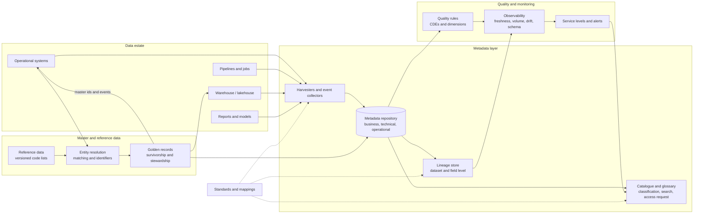

# Roadmap — Module 2D.11: Metadata, Lineage, Quality and Master Data

This is the learning roadmap for the eleventh module of Stage 2D, **Data
Architecture**. It tells you **what** to learn, **in what order**, **how** to
learn each topic from beginner to advanced level, **how to prove** you have
learned it, and **how to complete** the module's final enterprise metadata and
lineage design project.

Earlier modules built the platform, integration, cloud, streaming and governance.
This module makes all of it **understandable, traceable and trustworthy**: what
each asset is and who owns it (metadata), where it came from and what depends on
it (lineage), whether it is fit for use (quality and observability), and whether
the organisation agrees on who its customers, products and counterparties are
(master data).

> **Repository note (source-of-truth limits).** The eight topic files,
> `practice-questions.md`, `README.md`, `Projects/README.md` and
> `Projects/11-enterprise-metadata-and-lineage-design.md` currently exist but are
> **empty**, as are the Stage 2D overview files. This roadmap therefore cannot be
> grounded in their contents. It is the first written statement of the module's
> scope, derived from the file names, the Stage 2D structure and the earlier
> module roadmaps. It does **not** claim that any topic file already contains the
> material below. Every exercise, template, scenario and target is a
> **recommendation**, not a documented requirement. When the topic files and the
> project file are written, their scope governs and this roadmap should be updated
> to match.
>
> **Directory name.** The prompt that requested this roadmap referred to
> `STAGE 2D - DATA ARCHITECURE/`. The actual directory is
> `Stage 2D — Data Architecture/`, and the actual name is preserved.
>
> **Illustrative and synthetic content.** Every number, system, dataset and
> organisation here is an **illustrative assumption**. Exercises involving
> personal or sensitive information use **synthetic data only**. The module is
> vendor-neutral: capabilities are described by category, and standards are named
> only as examples to investigate, not as claims about what the source files
> cover.

---

## 1. Module overview

### 1.1 What metadata is and why it matters

**Metadata** is data about data: what an asset is, where it is, how it is
structured, who owns it, how it is used, and how it is behaving. Without
metadata, data are anonymous files and tables: nobody can find them, trust them,
secure them or safely change them. At enterprise scale, metadata is the control
system for the data estate.

### 1.2 Business, technical and operational metadata

| Category | Answers | Examples | Typical maintainer |
| --- | --- | --- | --- |
| **Business** | What does it mean, who is accountable? | Definition, business term, owner, steward, domain, classification, purpose | Business owners, stewards |
| **Technical** | How is it built and stored? | Schema, data types, location, format, keys, partitions, lineage links | Engineers, automated scanning |
| **Operational** | How is it behaving now? | Last refresh time, row counts, job run status, quality results, usage statistics | Pipelines, monitoring (largely automated) |

The three complement one another: business metadata gives meaning, technical
metadata gives structure, operational metadata gives current state. A catalogue
entry with only one of them is half useful.

### 1.3 Catalogues and discovery

A **data catalogue** helps people **find** assets (search), **understand** them
(descriptions, terms, owners, quality, lineage), **classify** them (sensitivity),
and **request access**. It is the user-facing front of the metadata estate
(2D.7 Topic 5 introduced the platform view).

### 1.4 Lineage and impact analysis

**Lineage** records how data move and change: from sources through
transformations to targets and consumers. **Impact analysis** uses lineage to
answer "if this changes, what breaks?" (downstream) and "where did this value
come from?" (upstream, for root cause).

### 1.5 Quality, observability and service levels

**Data quality** is fitness for use, assessed against **dimensions** (completeness,
validity, uniqueness, and so on) with **rules, thresholds, owners and business
impact**. **Observability** continuously watches data and pipelines for
unexpected behaviour (freshness, volume, distribution, schema, failures).
**Quality service levels** state the promise in measurable terms.

### 1.6 Master data, reference data, identifiers, entity resolution

These are related but different.

| Concept | Meaning | Example | Main question |
| --- | --- | --- | --- |
| **Master data** | Core business entities shared across systems, governed centrally or federated | Customer, product, counterparty | What is the agreed, governed view of this entity? |
| **Golden record** | The governed representation of one entity, built from several sources by rules | The best-known customer record | Which values win, and why? |
| **Reference data** | Relatively stable shared codes and value lists | Country codes, currency codes, product types | Do we all use the same codes and meanings? |
| **Identifier** | A value that distinguishes an entity | Customer number, legal entity identifier | Is it unique, stable and unambiguous? |
| **Entity resolution** | Deciding which records refer to the same real-world entity | Matching "J. Smith, 12 Elm St" with "John Smith, 12 Elm Street" | Are these the same thing, and how sure are we? |

Matching records, assigning identifiers and maintaining authoritative master
data are **three different activities**.

### 1.7 Metadata standards and interoperability

Tools and platforms hold metadata in different models. **Standards** and agreed
mappings let metadata (including lineage) move between them. Interoperability is
not achieved by sharing a file format alone: field meanings, identifiers,
versions and semantics must align.

### 1.8 How this module builds on earlier ones

| Earlier module | Provides |
| --- | --- |
| `../01-Data-Architecture-Foundations-and-Principles/` | Ownership, domains, governance lifecycle |
| `../02-Requirements-Constraints-and-Architecture-Decisions/` | Measurable targets, constraints, ADRs |
| `../03-Data-Architecture-Patterns-and-Reference-Architectures/` | Data fabric, metadata-driven architecture, data products |
| `../04-Conceptual-Logical-and-Physical-Data-Modeling/` | Data dictionary, keys, schema evolution, naming |
| `../05-Database-and-Storage-Architecture/` | Storage and table formats where technical metadata live |
| `../06-Data-Integration-and-Interoperability/` | Contracts, idempotency, reconciliation, lineage points |
| `../07-Enterprise-Data-Platform-and-Lakehouse-Architecture/` | Catalogue and metastore roles, layers, tenancy |
| `../08-Cloud-Hybrid-and-Multi-Cloud-Data-Architecture/` | Cross-environment metadata, portability, IaC |
| `../09-Streaming-and-Real-Time-Data-Architecture/` | Streaming lineage, event contracts, observability signals |
| `../10-Data-Governance-Security-Privacy-and-Compliance/` | Classification, policy enforcement, evidence, lifecycle |

### 1.9 Relevance to analytics, operations, ML and AI

| Use | What this module provides |
| --- | --- |
| Analytics | Trustworthy, discoverable, well-defined data; impact-aware change |
| Operational systems | Consistent entities and codes across applications |
| Machine learning | Dataset lineage and quality for training; feature provenance; reproducibility |
| AI applications | Permitted, well-described, quality-checked knowledge sources; entity-consistent retrieval (serving detail in `../14-Data-Access-Serving-Semantic-and-AI-Data-Architecture/`) |

### 1.10 Terminology in plain language

| Term | Plain meaning |
| --- | --- |
| Data asset | Anything worth tracking: dataset, table, column, report, model |
| Business term / glossary | Agreed definition of a business concept |
| Steward | Person who looks after an asset's definitions and quality |
| Lineage | The path data travel and the changes applied along it |
| Upstream / downstream | Earlier in the flow (sources) / later (consumers) |
| Critical data element (CDE) | A data element whose quality matters most to the business |
| Data quality dimension | A way of measuring fitness (completeness, validity…) |
| SLI / SLO | A measured indicator / a target for it |
| Survivorship | Rules deciding which source value survives in the golden record |
| Blocking | Grouping records to compare only plausible matches |
| Precision / recall | Share of proposed matches that are right / share of true matches found |
| Namespace | A prefix that keeps identifiers from clashing across systems |

---

## 2. Learning outcomes

After completing the module you will be able to:

1. **Explain** business, technical and operational metadata and **classify**
   metadata items.
2. **Design** a logical catalogue and discovery approach.
3. **Interpret and document** end-to-end data lineage.
4. **Perform** lineage-based impact analysis.
5. **Define** data quality dimensions, critical data elements and testable rules.
6. **Design** data observability measures and quality service levels.
7. **Explain** MDM approaches and golden-record concepts.
8. **Evaluate** reference data, identifier and entity-resolution approaches.
9. **Explain** metadata standards and interoperability requirements.
10. **Integrate** metadata, lineage, quality and master data into a coherent
    architecture.
11. **Complete and defend** the final project.

Each outcome is demonstrated through exercises, deliverables and the gates in
Sections 5, 10 and 11.

---

## 3. Prerequisites and knowledge dependencies

### 3.1 Prerequisite table

| # | What you should already understand | Why it matters here | Provided by | Review if weak |
| --- | --- | --- | --- | --- |
| P1 | Ownership, domains, governance roles and decision rights | Metadata needs owners and stewards; quality and master data need accountable roles | `../01-Data-Architecture-Foundations-and-Principles/03-business-capabilities-domains-and-data-ownership.md`, `../10-Data-Governance-Security-Privacy-and-Compliance/01-governance-operating-model-and-accountability.md` | Draw a responsibility matrix for ten data decisions |
| P2 | Classification and its propagation | Catalogues carry classification; lineage propagates it | `../10-Data-Governance-Security-Privacy-and-Compliance/02-data-classification-sensitivity-and-criticality.md` | Classify ten synthetic fields |
| P3 | Policy enforcement and evidence | Metadata drives enforcement; lineage and quality results are evidence | `../10-Data-Governance-Security-Privacy-and-Compliance/08-regulatory-controls-and-evidence-design.md`, `09-governance-by-design-and-policy-enforcement.md` | Map one requirement to control and evidence |
| P4 | Data dictionary, naming, keys, entities, schema evolution | Business and technical metadata are the dictionary at scale; identifiers underpin master data | `../04-Conceptual-Logical-and-Physical-Data-Modeling/08-model-review-naming-standards-and-data-dictionaries.md`, `02-entities-relationships-cardinality-and-constraints.md`, `07-schema-evolution-and-backward-compatibility.md` | Write a dictionary for five fields |
| P5 | Fabric and metadata-driven architecture; data products | The pattern view of metadata-led platforms | `../03-Data-Architecture-Patterns-and-Reference-Architectures/05-data-fabric-and-metadata-driven-architecture.md`, `04-data-mesh-principles-and-domain-data-products.md` | Compare fabric and mesh |
| P6 | Platform catalogue, metastore, metadata model, layers, tenancy | The platform context where these capabilities live | `../07-Enterprise-Data-Platform-and-Lakehouse-Architecture/05-catalogs-metastores-and-platform-metadata.md`, `03-bronze-silver-gold-and-data-product-boundaries.md` | Define mandatory metadata fields |
| P7 | Contracts, idempotency, deduplication, reconciliation, integration failure handling | Quality rules and entity matching build on these | `../06-Data-Integration-and-Interoperability/05-data-contracts-schema-registry-and-compatibility.md`, `07-idempotency-deduplication-and-reconciliation.md`, `08-integration-pattern-selection-and-failure-handling.md` | Design a reconciliation |
| P8 | Freshness, availability and SLO design | Quality and observability service levels | `../02-Requirements-Constraints-and-Architecture-Decisions/04-latency-throughput-freshness-and-availability-targets.md` | Write three SLOs |
| P9 | Streaming signals, lag, replay, failure modes | Observability and streaming lineage | `../09-Streaming-and-Real-Time-Data-Architecture/07-late-events-backpressure-and-stream-failure-modes.md`, `05-cdc-event-backbones-and-replay.md` | Build a failure-mode table |
| P10 | Cross-environment portability and IaC | Metadata portability and automation | `../08-Cloud-Hybrid-and-Multi-Cloud-Data-Architecture/07-portability-lock-in-and-multi-cloud-trade-offs.md`, `08-infrastructure-as-code-and-environment-strategy.md` | Assess one portability layer |
| P11 | Storage and table formats (where technical metadata originate) | Schemas, statistics and snapshots are technical metadata | `../05-Database-and-Storage-Architecture/04-warehouse-lakehouse-and-table-format-design.md`, `03-object-storage-and-file-format-selection.md` | Explain storage vs table format vs platform |
| P12 | Decision method and ADRs | Architecture decisions are recorded | `../02-Requirements-Constraints-and-Architecture-Decisions/06-architecture-trade-offs-and-decision-criteria.md`, `07-architecture-decision-records-adrs.md` | Write one ADR |

### 3.2 Essential vs concurrent

| Essential before starting | Can be learned during this module |
| --- | --- |
| P1, P2, P4, P6, P7, P8 | Tool-specific features of catalogue/lineage/quality products |
| P3, P5, P9, P11, P12 (at least their gates) | Reliability depth (`../12-Reliability-Resilience-and-Disaster-Recovery/`) |
| | Cost depth (`../13-Performance-Scalability-and-Cost-Architecture/`) |
| | AI serving depth (`../14-Data-Access-Serving-Semantic-and-AI-Data-Architecture/`) |

Do the review exercise for a weak prerequisite before Topic 1.

---

## 4. Recommended learning sequence

All effort estimates are **recommendations** (about 6–8 hours per week assumed).

| Seq | Source file | Topic | Why at this point | Prerequisites | Concepts first | Output before progressing | Effort (rec.) |
| --- | --- | --- | --- | --- | --- | --- | --- |
| 1 | `01-business-technical-and-operational-metadata.md` | Metadata categories | Everything else is built on metadata | P1, P4, P6 | Three categories; owner/steward | Metadata inventory distinguishing categories | 5–7 h |
| 2 | `02-data-catalogs-discovery-and-classification.md` | Catalogues, discovery, classification | Makes metadata usable by people | Seq 1, P2 | Search, glossary, classification | Logical catalogue design | 6–8 h |
| 3 | `03-end-to-end-lineage-and-impact-analysis.md` | Lineage and impact | Connects assets; needs asset inventory and technical metadata | Seq 1–2, P7 | Dataset vs field lineage; upstream/downstream | Lineage diagram and impact report | 7–9 h |
| 4 | `04-data-quality-dimensions-and-critical-data-elements.md` | Quality dimensions and CDEs | Defines what "good" means; uses ownership and lineage to find CDEs | Seq 1–3, P8 | Dimensions, CDE, rule, threshold | CDE register and rule inventory | 6–8 h |
| 5 | `05-data-observability-and-quality-service-levels.md` | Observability and service levels | Continuous monitoring of the quality defined; needs rules and lineage | Seq 3–4, P9 | Freshness, volume, distribution, SLI/SLO | Indicator register and response process | 6–8 h |
| 6 | `06-master-data-management-and-golden-records.md` | MDM and golden records | Consistent entities; uses quality, ownership, identifiers | Seq 1, 4, P1 | Master domain, golden record, survivorship | Golden-record model | 7–9 h |
| 7 | `07-reference-data-entity-resolution-and-identifiers.md` | Reference data, entity resolution, identifiers | The matching and coding foundations beneath MDM | Seq 4, 6, P4 | Identifier lifecycle, matching, thresholds | Matching rules and reference mappings | 7–9 h |
| 8 | `08-metadata-standards-and-interoperability.md` | Standards and interoperability | Exchanges everything above across tools | Seq 1–7 | Metadata models, mapping, versioning | Interoperability mapping | 6–8 h |
| — | `practice-questions.md` | Validation | After each topic and fully before the project | Seq 1–8 | — | Gap log | 3–4 h |
| — | `Projects/11-enterprise-metadata-and-lineage-design.md` | Final project | Integrates all eight | All | — | Metadata and lineage design package | 14–18 h |

**Order notes.**

- The recommended order **matches the numeric filename order**:
  *metadata foundations → catalogue and discovery → lineage → quality →
  observability → master data → reference data and resolution → standards and
  interoperability*.
- Topics 6 and 7 are tightly linked: **study Topic 7's Beginner level before
  Topic 6's Advanced level**, because golden records depend on identifiers and
  matching. Full study stays in numeric order.
- Optional preview: skim Topic 8's Beginner level after Topic 2 to see how
  catalogue metadata will be exchanged.

---

## 5. Detailed beginner-to-advanced roadmap for every topic

Each topic uses the same twelve parts. Levels are cumulative. Examples use the
**illustrative** scenario of *Northbridge Bank* (Section 10.2), a fictional
mid-sized bank, and **synthetic data only**. Because the source topic files are
empty, any specific subtopic named below is a **recommended** learning focus.

---

### 5.1 Topic 01 — Business, technical and operational metadata

Source: [`01-business-technical-and-operational-metadata.md`](01-business-technical-and-operational-metadata.md)

#### 5.1.1 Topic overview

Metadata is the descriptive layer over the data estate. This topic teaches the
three categories, how each is created and maintained, who owns it, and how they
combine to support discovery, governance, troubleshooting and operations.

#### 5.1.2 Learning objectives

1. Define business, technical and operational metadata and classify items.
2. Identify ownership and stewardship responsibilities for metadata.
3. Describe how metadata are created, collected, maintained and retired.
4. Explain how the categories support discovery, governance, troubleshooting
   and operations.
5. Build a metadata inventory and schema for a small domain.
6. Identify missing or inconsistent metadata.

#### 5.1.3 Prerequisites

P1, P4, P6.

#### 5.1.4 Beginner level — build the foundations

- **Terms:** metadata, asset, business term, definition, owner, steward, schema,
  data type, location, operational status, freshness, row count, metadata
  lifecycle.
- **Analogy:** a library record: the author and summary (business), the shelf
  location and page count (technical), the borrowing history and condition
  (operational).
- **The three categories (with examples):**

  | Business | Technical | Operational |
  | --- | --- | --- |
  | "Customer" definition; owner; domain; classification | Table name; columns and types; file format; primary key | Last load time; rows loaded; job success; quality score; query count |

- **Create:** a one-page inventory of ten metadata items for a synthetic
  `customer` table, each marked with its category.
- **Questions to answer:** Who should write the definition of "active customer"?
  Which metadata can a scanner collect automatically? Which cannot?
- **Small exercise:** classify twenty metadata items by category and say whether
  they are best collected automatically, entered by people, or both.

#### 5.1.5 Intermediate level — understand the architecture

- **Sources of metadata:** automatic harvesting from databases, files, table
  formats and pipelines (technical, much operational); human curation (business
  definitions, ownership, tags); derived metadata (usage statistics, quality
  scores).
- **Metadata model:** assets (database, schema, table, column, dashboard,
  pipeline, model) with typed attributes and relationships (column belongs to
  table; pipeline reads dataset; term describes column). A **metadata schema**
  defines mandatory and optional fields per asset type.
- **Lifecycle and maintenance:** creation at asset registration (ideally by the
  pipeline template, 2D.7 Topic 6), updates on change, review cadence,
  deprecation and retirement; **freshness** and **completeness** of metadata are
  themselves measurable.
- **Ownership:** a named owner and steward per asset; what happens when they
  leave (2D.10 Topic 1).
- **How categories combine:**

  | Need | Uses |
  | --- | --- |
  | Discovery | Business terms + technical names + usage |
  | Governance | Business classification/owner + technical location + operational access/usage |
  | Troubleshooting | Operational status + technical schema/lineage |
  | Operations | Operational metrics + technical dependencies |

- **Failure scenarios:** definitions copied from column names ("customer_id: the
  customer id"); stale operational metadata presented as current; technical
  metadata that disagrees with the real schema.
- **Design exercise:** define the metadata schema (fields, category, source,
  mandatory/optional, maintainer) for tables and columns.
- **Trade-offs:** rich mandatory metadata (value, onboarding friction) vs light
  (speed, thin value).

#### 5.1.6 Advanced level — make architecture decisions

- **Scale and volume.** *Illustrative:* 50,000 tables × 40 columns =
  2,000,000 column records; if each is versioned five times, 10,000,000 rows.
  Operational metadata (per run, per partition) grow faster than structural
  metadata; plan storage, retention and querying separately.
- **Freshness vs completeness vs cost:** harvest frequency (hourly, daily, on
  change events); event-driven metadata updates vs scheduled scans; the cost of
  scanning sources and its load on them.
- **Automation vs curation:** automate technical and operational; curate business
  meaning; use suggestions (ML-assisted descriptions, term matching) with
  steward review; measure acceptance rates.
- **Metadata quality indicators (illustrative):** completeness (percentage of
  critical assets with owner, description and classification); accuracy (sample
  audit of descriptions); timeliness (age of last harvest); consistency (same
  asset not described differently in two places). Targets are assumptions.
- **Single source of truth for metadata:** federated sources with a unifying
  layer vs one central store; conflict rules between harvested and curated
  values (curated wins? with reconciliation flag).
- **Security of metadata:** metadata can be sensitive (schema reveals what is
  held; sample values reveal data); access control on metadata (2D.10 Topic 3).
- **Metadata as code:** definitions in version control, reviewed, deployed with
  pipelines (2D.8 Topic 8).
- **Operational ownership and cost:** who maintains the metadata platform;
  stewardship workload.
- **AI relevance:** model and dataset cards, feature documentation and retrieval
  indexes need metadata of the same kinds.
- **Document** the metadata model, sources and maintenance responsibilities in an
  ADR.

#### 5.1.7 Industry application and hands-on exercises

| | Exercise A — Metadata inventory | Exercise B — Metadata schema and quality indicators |
| --- | --- | --- |
| Scenario | Northbridge cannot answer "what is in the customer mart and who owns it?" | The catalogue has descriptions for 30% of assets |
| Problem | Inventory and categorise metadata | Define what must exist and how to measure it |
| Inputs | Synthetic table list with partial information | Inventory |
| Tasks | For 15 assets record metadata by category, source, owner, maintenance; mark missing or inconsistent items | Define mandatory fields by asset type; indicators for completeness, accuracy, freshness; harvest approach; steward workflow |
| Deliverables | Metadata inventory | Metadata schema and indicator definitions |
| Validation | Every item has a category and a maintainer; gaps listed | Indicators are measurable; mandatory fields have sources |
| Demonstrates | You can distinguish and collect metadata | You can govern metadata quality |

#### 5.1.8 Real-world scenarios and trade-offs

| Scenario | Business context | Technical constraints | Alternatives | Pros / cons | Operational risks | Recommended (assumptions) | Would change if |
| --- | --- | --- | --- | --- | --- | --- | --- |
| Onboarding 500 legacy tables | Many undocumented | Few stewards | (a) Document all; (b) document critical first; (c) auto-generate descriptions only | (a) complete, slow; (b) focused; (c) fast, low quality | Wrong descriptions trusted | (b) with (c) as drafts for stewards | Regulation demands full coverage |
| Operational metadata volume | Per-run metrics for 20,000 jobs | Storage cost | (a) Keep all; (b) aggregate after 90 days | (a) detail, cost; (b) cheaper, less detail | Losing forensic detail | (b) | Audit requires detail |

#### 5.1.9 Expected deliverables

- Metadata inventory by category.
- Metadata schema (fields, category, source, mandatory/optional, maintainer).
- Metadata quality indicators.
- Ownership and stewardship matrix.
- ADR on the metadata model and maintenance.

#### 5.1.10 Common mistakes and misconceptions

| Mistake | Why problematic | How to avoid |
| --- | --- | --- |
| Treating metadata as documentation to write later | It decays and is never written | Capture at creation via templates |
| Descriptions that restate names | No value | Require meaning, not names |
| Presenting stale operational metadata as live | Misleads users | Show timestamps and freshness |
| No owner for metadata | Rots | Name owners |
| Sensitive information in open metadata | Exposure | Control metadata access |

#### 5.1.11 Mastery criteria

- Classify metadata items correctly with reasons.
- Define a metadata schema with sources and maintainers.
- Measure completeness and freshness of metadata.

#### 5.1.12 Completion gate

- [ ] Inventory and schema reviewed by one other person.
- [ ] You can explain how the three categories combine for a troubleshooting
      case.
- [ ] Indicators are measurable.
- [ ] Weakness (name-restating definitions) addressed by rewriting five.

---

### 5.2 Topic 02 — Data catalogues, discovery and classification

Source: [`02-data-catalogs-discovery-and-classification.md`](02-data-catalogs-discovery-and-classification.md)

#### 5.2.1 Topic overview

A **catalogue** turns metadata into an experience: search, browse, understand,
trust and request access. This topic covers what a catalogue must do, what
makes people use it, how classification and ownership appear in it, and how it
connects to access and governance.

#### 5.2.2 Learning objectives

1. Describe catalogue capabilities and the users they serve.
2. Distinguish catalogue, metadata repository, business glossary and
   classification mechanism.
3. Design asset registration, search and browse experiences.
4. Show ownership, classification and quality context in the catalogue.
5. Measure metadata freshness, completeness and adoption.
6. Integrate catalogue with access and governance workflows.

#### 5.2.3 Prerequisites

Seq 1; P2, P6.

#### 5.2.4 Beginner level — build the foundations

- **Terms:** catalogue, discovery, search, glossary/business term, tag,
  classification label, asset page, access request, endorsement/certification.
- **Distinctions:**

  | Concept | What it is | Used by |
  | --- | --- | --- |
  | Metadata repository | Store of metadata records | Systems and tools |
  | Catalogue | User-facing discovery and understanding layer over metadata | People |
  | Business glossary | Agreed business terms and definitions | People and tools linking terms to assets |
  | Classification mechanism | Labels and rules assigning sensitivity/criticality | Governance and enforcement |

  Products often combine them; the **responsibilities** remain distinct.
- **Analogy:** a shop's online catalogue: you search, filter, read descriptions
  and reviews, then order (request access).
- **Create:** a sketch of an asset page: name, description, owner, domain, tags,
  classification, schema, freshness, lineage link, quality score, access button.
- **Questions to answer:** What does a data analyst need to decide whether to use
  a table? What does a steward need?
- **Small exercise:** list the first five things a risk analyst would search for
  and the metadata that would answer each.

#### 5.2.5 Intermediate level — understand the architecture

- **Core capabilities:** asset registration (automatic harvesting and manual),
  search (names, descriptions, terms, tags, columns), browse by domain/product,
  asset detail pages, glossary linking, ownership and stewardship, classification
  and tagging, lineage view, quality and usage indicators, access request and
  approval integration, change notifications, user feedback and ratings.
- **User groups and journeys:** analyst finding data; engineer assessing impact
  of a change; steward curating; auditor evidencing; consumer requesting access.
  Design a journey per group.
- **Classification in the catalogue:** labels from the classification scheme
  (2D.10 Topic 2), applied by scanning and steward review; displayed prominently;
  used by access policy (2D.10 Topic 9).
- **Business terminology:** glossary terms linked to columns, with approved
  definitions and synonyms; resolving the same word with different meanings
  across domains (2D.4 Topic 6).
- **Metadata freshness and completeness:** show "last harvested" and "last
  reviewed"; surface "undocumented" assets for stewards.
- **Access and governance integration:** the catalogue shows who may request
  access and routes requests to owners; policy decisions are enforced
  elsewhere (the catalogue is not itself the enforcement point unless designed
  as one).
- **Adoption and usability:** search quality, descriptions in plain language,
  endorsed/certified assets ranked first, training, feedback loops, embedding in
  tools users already use.
- **Failure scenarios:** a catalogue nobody trusts because entries are stale;
  search returns hundreds of near-duplicates; classification labels differ from
  platform tags.
- **Design exercise:** design the logical catalogue experience for three user
  groups.
- **Trade-offs:** open discovery (reuse) vs restricting even metadata
  visibility (confidentiality).

#### 5.2.6 Advanced level — make architecture decisions

- **Catalogue topology:** one enterprise catalogue vs federated domain
  catalogues with a global index; criteria: scale, autonomy, governance maturity,
  tooling. Reconcile duplicate assets across catalogues using identifiers and
  namespaces (Topic 8).
- **Harvesting architecture:** pull-based scans vs push-based events from
  pipelines; incremental harvesting; load on sources; handling deleted assets and
  renames (a rename looks like delete+add; use stable identifiers).
- **Classification at scale:** automated pattern/ML detection has false
  positives and negatives; set review thresholds; steward queues; metrics.
  *Illustrative:* scanner flags 1,000 columns as personal data, 900 confirmed →
  precision 90%; if 150 true personal columns exist that it missed, recall =
  900 / (900 + 150) ≈ 85.7%. Both matter.
- **Search relevance:** ranking by usage, certification, freshness, domain;
  synonyms from the glossary; relevance testing with sample queries.
- **Certification and trust signals:** who may endorse an asset; criteria (owner,
  quality checks, SLO); expiry and re-certification.
- **Security:** metadata access control; masking of sample data; audit of catalogue
  access.
- **Automation vs manual curation:** automate harvest, classification
  suggestion, lineage linking; curate definitions and certification.
- **Cost and operations:** platform cost, steward workload, support; measure
  adoption (active users, searches resulting in asset use, share of critical
  assets documented).
- **AI and analytics:** catalogue as a source for dataset discovery for ML and
  retrieval-augmented systems; catalogue entries must reflect permitted use.
- **Document** catalogue scope, topology, certification and classification
  workflows in an ADR.

#### 5.2.7 Industry application and hands-on exercises

| | Exercise A — Catalogue experience design | Exercise B — Classification workflow and measures |
| --- | --- | --- |
| Scenario | Northbridge analysts spend days finding customer data | Scanner suggestions are untrusted |
| Problem | Design the discovery experience for three groups | Design suggestion, review and measurement |
| Inputs | Personas, metadata schema (Topic 1) | Scanner output (synthetic) |
| Tasks | Define asset page fields, search facets, glossary links, certification, access flow; sketch screens in Markdown tables | Define review thresholds, steward queue, precision/recall measurement, override rules |
| Deliverables | Catalogue design (fields, journeys, workflows) | Classification workflow and metrics |
| Validation | Each persona journey is completable; each field has a source | Metrics computed on a synthetic sample; false-negative handling defined |
| Demonstrates | You can design for users | You can manage automated classification |

#### 5.2.8 Real-world scenarios and trade-offs

| Scenario | Business context | Technical constraints | Alternatives | Pros / cons | Operational risks | Recommended (assumptions) | Would change if |
| --- | --- | --- | --- | --- | --- | --- | --- |
| Multiple catalogues after acquisition | Two firms merge | Different tools | (a) Migrate to one; (b) federate with global search | (a) clean, costly; (b) quick, duplicates | Conflicting entries | (b) first, (a) later | Tools unsupported |
| Hiding sensitive asset names | Some names reveal projects | Discovery vs secrecy | (a) Full visibility; (b) hide restricted assets; (c) show name only, hide details | (a) reuse; (b) secure, invisible; (c) balanced | Leakage via names | (c) | Names themselves are secret |

#### 5.2.9 Expected deliverables

- Catalogue capability list and user journeys.
- Asset page design and search/facet design.
- Registration, certification and access-request workflows.
- Classification review workflow and measures.
- Catalogue topology ADR.

#### 5.2.10 Common mistakes and misconceptions

| Mistake | Why problematic | How to avoid |
| --- | --- | --- |
| Equating catalogue with a spreadsheet of tables | Not discoverable or maintained | Design for users and workflows |
| Assuming the catalogue enforces access | It may only record | Distinguish catalogue from policy enforcement |
| No ownership of entries | Staleness | Assign stewards |
| Trusting automated classification blindly | Misses and false hits | Measure precision/recall; review |
| Launching without adoption plan | Unused | Embed and measure usage |

#### 5.2.11 Mastery criteria

- Distinguish catalogue, repository, glossary and classification.
- Design a catalogue experience for named users.
- Measure classification and metadata freshness.

#### 5.2.12 Completion gate

- [ ] Design and workflows reviewed; each persona journey traced.
- [ ] Classification measures computed on synthetic data.
- [ ] You can state what the catalogue does not enforce.
- [ ] Weakness (catalogue = repository) addressed by redrawing responsibilities.

---

### 5.3 Topic 03 — End-to-end lineage and impact analysis

Source: [`03-end-to-end-lineage-and-impact-analysis.md`](03-end-to-end-lineage-and-impact-analysis.md)

#### 5.3.1 Topic overview

**Lineage** shows how data flow and transform from sources to consumers.
**Impact analysis** reads lineage downstream to see what a change would affect;
**root-cause analysis** reads it upstream to find where a problem started. Lineage
builds trust, supports change management and provides evidence for compliance.

#### 5.3.2 Learning objectives

1. Represent lineage at dataset and field level.
2. Describe transformations and dependencies between assets.
3. Perform upstream and downstream analysis.
4. Perform impact analysis for a proposed schema or logic change.
5. Use lineage for root-cause investigation.
6. State lineage completeness limits and handle batch and streaming.
7. Distinguish a dependency graph from evidence of actual transformation.

#### 5.3.3 Prerequisites

Seq 1–2; P7 (`../06-Data-Integration-and-Interoperability/07-idempotency-deduplication-and-reconciliation.md`).

#### 5.3.4 Beginner level — build the foundations

- **Terms:** lineage, node (asset/process), edge (relationship), upstream,
  downstream, transformation, dependency, impact, root cause, granularity.
- **Granularity:**

  | Level | Shows | Typical use |
  | --- | --- | --- |
  | Dataset (table-level) | Which datasets feed which | Broad impact, orchestration |
  | Field (column-level) | Which source columns produce which target columns | Precise impact, privacy, definitions |
  | Process/job level | Which jobs read and write | Operational dependency |
  | Value-level (record) | Which source rows produced a row | Audit; rarely feasible |

- **Analogy:** a family tree for data, or a supply chain from raw material to
  product.
- **Create:** a lineage diagram of five tables with arrows.
- **Questions to answer:** If a source column is renamed, what do you need to
  check? Which view of lineage answers "where did this report number come from?"
- **Small exercise:** given a short SQL transformation, list its source and
  target columns and the transformation applied to each.

#### 5.3.5 Intermediate level — understand the architecture

- **Sources of lineage:**
  1. *Declared:* pipelines/data products state inputs and outputs (reliable if
     enforced).
  2. *Parsed:* SQL and code analysed statically (good for SQL; weaker for dynamic
     code).
  3. *Runtime/captured:* execution engines emit lineage events (most accurate
     for what happened).
  4. *Manual:* people document undeclared flows (spreadsheets, scripts).
- **Dependency graph vs evidence of transformation.** A graph of "A depends on
  B" says an edge exists; it does not prove **what** was done to the data or that
  the edge was active on a given run. Evidence of transformation includes the
  logic (SQL/code version), the run, the inputs and outputs and the time.
  Keep both: graph for navigation, run-level evidence for audit.
- **Transformation relationships:** copy, rename, filter, join, aggregate,
  derived expression, enrichment from reference data; record the type on each
  edge.
- **Pipeline and dependency graphs:** orchestration DAGs vs data lineage graphs
  (related, not identical).
- **Upstream/downstream analysis:** traverse the graph with depth limits and
  filters.
- **Impact analysis procedure:** identify the changing asset and the change type
  → traverse downstream at field level → list affected datasets, pipelines,
  dashboards, models and owners → classify the effect (breaking, behavioural,
  none) → decide notification, migration and sequencing (2D.4 Topic 7).
- **Root-cause investigation:** from the symptom (bad value) walk upstream,
  checking quality results and run evidence at each node.
- **Batch and streaming lineage:** streaming flows are continuous; record
  topics, consumers, transformation jobs and schema versions; capture versions
  and time (2D.9).
- **Failure scenarios:** lineage missing for a spreadsheet step; stale parsed
  lineage after code change; field-level lineage lost through `SELECT *`.
- **Design exercise:** build a field-level lineage for a customer exposure
  report from three sources, marking each edge's type and evidence source.
- **Trade-offs:** coverage vs accuracy vs effort.

#### 5.3.6 Advanced level — make architecture decisions

- **Granularity decision:** dataset-level everywhere, field-level for critical
  data elements and regulated data, value-level only where required. Cost grows
  quickly with granularity.
- **Scale arithmetic (illustrative).** 2,000 jobs × average 8 input columns →
  ~16,000 field-level edges per run snapshot; keep versions per change, not per
  run, unless run evidence is required.
- **Lineage reliability levels:** label each edge with confidence/source
  (declared, parsed, captured, manual) and last verified time; show unknown
  segments rather than hiding them.
- **Completeness limits:** dynamic SQL, procedural code, external tools,
  manual file handling, machine learning feature code; maintain a list of
  known blind spots and compensating controls (for example reconciliation at
  boundaries, 2D.6 Topic 7).
- **Impact analysis quality:** precision (affected items that truly are) and
  recall (truly affected items found); false negatives are the dangerous ones,
  so combine lineage with contracts and subscriptions (2D.6 Topic 5).
- **Streaming and replay:** lineage across topics, joins, state; versions of
  logic and schema; reprocessing runs create new lineage runs.
- **Propagation use cases:** classification and purpose propagation to derived
  assets (2D.10 Topics 2, 6); deletion scope discovery (2D.10 Topic 7);
  compliance evidence (Topic 8 there).
- **Interoperability:** exchanging lineage between tools (Topic 8 here);
  identifiers for assets and runs.
- **Operational ownership:** who maintains lineage collectors; failure of
  lineage capture should be monitored.
- **Cost and security:** storage, graph database or relational representation,
  query performance on deep graphs; lineage can reveal sensitive structure.
- **Automation vs manual:** automate capture; manual only for unavoidable gaps,
  with expiry/re-verification.
- **Document** lineage scope, granularity, evidence levels and blind spots in an
  ADR.

#### 5.3.7 Industry application and hands-on exercises

| | Exercise A — Lineage diagram | Exercise B — Impact analysis and root cause |
| --- | --- | --- |
| Scenario | Northbridge's exposure report combines ledger, customer and rates data | A source team plans to change a currency field's type and meaning |
| Problem | Document end-to-end lineage | Assess impact and trace an error |
| Inputs | Synthetic pipeline descriptions and SQL snippets | Lineage from A |
| Tasks | Draw dataset and field lineage; mark edge types, evidence source, confidence; list blind spots | Traverse downstream; list affected assets and owners; classify effect; propose notification and sequencing; then trace a wrong report value upstream using quality results |
| Deliverables | Lineage diagram and edge register | Impact analysis report and root-cause note |
| Validation | Every edge typed and sourced; unknowns shown | Affected list reproducible; false-negative risk discussed |
| Demonstrates | You can document lineage | You can use lineage operationally |

#### 5.3.8 Real-world scenarios and trade-offs

| Scenario | Business context | Technical constraints | Alternatives | Pros / cons | Operational risks | Recommended (assumptions) | Would change if |
| --- | --- | --- | --- | --- | --- | --- | --- |
| Regulatory report lineage | Regulator asks for field origin | Spreadsheet step in the chain | (a) Document the spreadsheet manually; (b) replace the step with a pipeline | (a) fast, fragile; (b) durable, effort | Undetected edits | (a) now, (b) planned | Regulation requires automated lineage |
| Parsed vs runtime lineage | SQL-heavy platform | Some dynamic SQL | (a) Parse only; (b) runtime events; (c) both | (a) cheap, incomplete; (b) accurate, instrumentation; (c) best | Gaps | (c) for critical flows | Engines cannot emit events |

#### 5.3.9 Expected deliverables

- Lineage diagram (dataset and field level) with edge register.
- Blind-spot list and compensating controls.
- Impact analysis report for a representative change.
- Root-cause investigation note.
- ADR on granularity and evidence levels.

#### 5.3.10 Common mistakes and misconceptions

| Mistake | Why problematic | How to avoid |
| --- | --- | --- |
| Treating the dependency graph as proof of what happened | May be outdated or imprecise | Keep run-level evidence for audit |
| Dataset-level only for regulated fields | Cannot trace fields | Field-level for CDEs |
| Hiding unknown segments | False confidence | Show unknowns |
| Impact analysis without owners | Nobody informed | Link nodes to owners |
| Lineage collected once | Drift | Automate and monitor |

#### 5.3.11 Mastery criteria

- Draw and label lineage with edge types and evidence.
- Perform impact analysis and state its limits.
- Use lineage for root cause with quality results.

#### 5.3.12 Completion gate

- [ ] Lineage, impact report and root-cause note reviewed.
- [ ] Blind spots and compensating controls listed.
- [ ] You can explain graph vs evidence.
- [ ] Weakness (assuming completeness) addressed by finding three blind spots.

---

### 5.4 Topic 04 — Data quality dimensions and critical data elements

Source: [`04-data-quality-dimensions-and-critical-data-elements.md`](04-data-quality-dimensions-and-critical-data-elements.md)

#### 5.4.1 Topic overview

**Data quality** is **fitness for use**. It is assessed along **dimensions**,
with **rules** and **thresholds**, focused on **critical data elements (CDEs)**,
where failure hurts the business most. Quality targets depend on intended use;
not every dataset needs the same controls.

#### 5.4.2 Learning objectives

1. Define the dimensions covered by the topic file (illustrated here by
   completeness, accuracy, validity, consistency, uniqueness, timeliness).
2. Identify CDEs from business impact.
3. Write testable rules with thresholds and owners.
4. Measure quality and compute scores.
5. Design assessment and remediation processes.
6. Link quality to business impact and intended use.

#### 5.4.3 Prerequisites

Seq 1–3; P8.

#### 5.4.4 Beginner level — build the foundations

- **Terms:** data quality, dimension, rule, threshold, defect, CDE, profiling,
  remediation, root cause, fitness for use.
- **Dimensions (conventional meanings; verify with the topic file):**

  | Dimension | Question | Example rule |
  | --- | --- | --- |
  | Completeness | Is required data present? | `email` not null for active customers |
  | Validity | Does it conform to format/domain? | Country code in the reference list |
  | Accuracy | Does it reflect reality? | Address matches an authoritative postal source (sample) |
  | Consistency | Do values agree across places? | Customer status same in CRM and ledger |
  | Uniqueness | Is each entity recorded once? | No duplicate customer ids |
  | Timeliness | Is it available when needed and current enough? | Balance updated within 15 minutes |

- **Analogy:** a restaurant: ingredients (completeness), within date (timeliness),
  correct item (accuracy), consistent recipe (consistency), no double-ordering
  (uniqueness), allowed ingredients (validity).
- **Create:** a table of six rules for a synthetic `customer` table, one per
  dimension.
- **Questions to answer:** Which dimension is violated if two records exist for
  one person? If a date is 2099? If a value is blank?
- **Small exercise:** classify twenty defects by dimension.

#### 5.4.5 Intermediate level — understand the architecture

- **Measuring quality (illustrative worked example).** 1,000,000 customer rows:

  ```text
  completeness(email) = (1,000,000 − 40,000 nulls) / 1,000,000 = 96.0%
  validity(email)     = (960,000 − 8,000 malformed) / 960,000  = 99.17%
  uniqueness(id)      = distinct_ids / total_rows
  ```

  State the **population** (all rows? active customers only?) and the **rule
  definition** so scores are comparable over time.
- **Identifying CDEs:** start from business processes and decisions (regulatory
  reports, credit decisions, customer communications); list the data elements
  they depend on; rank by impact of error and by use (frequency, number of
  consumers, regulatory weight); use lineage to see where each CDE originates
  and flows (Topic 3).
- **Rule design:** machine-testable, atomic, with owner, severity, threshold and
  action; implemented at the right place (source, ingestion, transformation,
  consumption).
- **Thresholds:** fixed (≥ 99.5% complete) or relative (no worse than last
  period); justified by business impact, not guessed.
- **Ownership:** CDE owner (business), rule owner (steward), remediation owner
  (source system owner) (2D.10 Topic 1).
- **Assessment and remediation:** profiling → rules → measure → triage → fix at
  source → prevent recurrence; track issues with ageing.
- **Business impact of failures:** translate defects into consequences (a
  missing email = failed notifications; wrong currency = misstated exposure).
- **Use-based quality:** the same dataset may be fit for analytics (tolerant of
  gaps) and unfit for regulatory reporting (strict).
- **Failure scenarios:** rules everywhere and no owner; thresholds so strict they
  always fail; rules that pass but data are wrong (accuracy untested).
- **Design exercise:** produce a CDE register and rule set for the Northbridge
  customer exposure report.
- **Trade-offs:** coverage vs maintenance; strictness vs false alarms.

#### 5.4.6 Advanced level — make architecture decisions

- **Prioritisation by risk:** apply deep controls to CDEs and shallow controls
  elsewhere; document what is not covered.
- **Where to place checks:** at source (prevents), ingestion (contract
  validation, quarantine), transformation (business rules), consumption
  (fitness checks); preventive vs detective (2D.10 Topic 8 types).
- **Accuracy is hardest:** needs an authoritative reference or sampling with
  manual verification; plan the cost; use proxies (consistency across systems)
  with stated limits.
- **Rule lifecycle:** versioned rules, review when business rules change,
  retirement of obsolete rules; rule coverage metric: percentage of CDEs with at
  least one rule per relevant dimension.
- **Quality scoring:** aggregate per dimension, per asset and per CDE; weighting
  needs business input; avoid single numbers that hide failures in critical
  fields.
- **False positives and negatives:** rules that fire wrongly erode trust; rules
  that never fire may be untested; test rules with seeded defects.
- **Remediation architecture:** quarantine, correction workflows, stewardship
  queues, feedback to source teams, cost of fixing downstream vs upstream.
- **Contracts:** quality expectations as part of data contracts (2D.6 Topic 5)
  and data products' SLOs (2D.7 Topic 3).
- **Scale and cost:** rule execution cost (full scans vs sampling vs incremental),
  results storage and retention (operational metadata).
- **ML and AI:** training-data quality (label quality, representativeness),
  feature drift (Topic 5), bias considerations as awareness; quality metadata
  attached to datasets and models.
- **Automation vs manual:** automate rule execution and reporting; stewardship
  decides thresholds, exceptions and root-cause fixes.
- **Document** CDE selection method, rule standards and thresholds rationale in
  an ADR.

#### 5.4.7 Industry application and hands-on exercises

| | Exercise A — CDE register and rules | Exercise B — Quality measurement and remediation |
| --- | --- | --- |
| Scenario | Northbridge exposure report is questioned | The customer table has duplicates and invalid dates |
| Problem | Decide which data matter most and how to test them | Measure, triage and fix |
| Inputs | Report definition, lineage (synthetic) | Synthetic dataset (≈ 1,000 rows) |
| Tasks | Identify CDEs from decisions; define dimensions and rules with thresholds and owners; set severity | Compute completeness/validity/uniqueness; classify defects; identify root causes; propose source fixes and prevention; compute before/after |
| Deliverables | CDE register and rule inventory | Quality report and remediation plan |
| Validation | Each CDE traces to a business decision; each rule testable | Scores reproducible; defects mapped to causes |
| Demonstrates | You can prioritise and specify quality | You can measure and remediate |

#### 5.4.8 Real-world scenarios and trade-offs

| Scenario | Business context | Technical constraints | Alternatives | Pros / cons | Operational risks | Recommended (assumptions) | Would change if |
| --- | --- | --- | --- | --- | --- | --- | --- |
| Quality gate in pipeline | Failing data should not reach reports | Delays acceptable for CDEs | (a) Block on failure; (b) load and flag; (c) quarantine failing rows | (a) safe, delays; (b) fast, risk; (c) balanced | Silent bypass | (c) for CDEs, (b) elsewhere | Regulatory reports need (a) |
| Rule explosion | 5,000 rules proposed | Few stewards | (a) Implement all; (b) rules for CDEs only; (c) auto-profile suggestions | (a) coverage, burden; (b) focused; (c) cheap, noisy | Alert fatigue | (b) with (c) as candidates | Risk appetite changes |

#### 5.4.9 Expected deliverables

- Dimension definitions and rule standards.
- CDE register with business impact and owners.
- Rule inventory with thresholds, severities, actions.
- Quality measurement report and remediation plan.
- ADR on CDE selection and thresholds.

#### 5.4.10 Common mistakes and misconceptions

| Mistake | Why problematic | How to avoid |
| --- | --- | --- |
| Identical controls for all data | Cost and noise | Tie to use and impact |
| Rules without owners or actions | Ignored failures | Assign owner and response |
| Aggregating into one score | Hides CDE failures | Report per CDE and dimension |
| Ignoring accuracy | Passing rules, wrong data | Plan authoritative checks |
| Thresholds by guess | Arbitrary | Justify by impact |
| Cleaning downstream only | Recurrence | Fix at source |

#### 5.4.11 Mastery criteria

- Define the dimensions precisely and compute scores with populations stated.
- Select CDEs from business decisions and write testable rules.
- Design remediation and prevention.

#### 5.4.12 Completion gate

- [ ] CDE register, rules and quality report reviewed; scores reproduced.
- [ ] Every rule has an owner, severity and action.
- [ ] Accuracy handling is explicit.
- [ ] Weakness (uniform controls) addressed by tiering the rules by use.

---

### 5.5 Topic 05 — Data observability and quality service levels

Source: [`05-data-observability-and-quality-service-levels.md`](05-data-observability-and-quality-service-levels.md)

#### 5.5.1 Topic overview

Testing checks data **at a point in time**; **observability** watches data and
pipelines **continuously** and flags unexpected behaviour: late data, volume
anomalies, distribution drift, schema changes, failures. **Quality service
levels** turn those signals into promises (SLIs/SLOs) with owners and responses.

#### 5.5.2 Learning objectives

1. Distinguish testing from monitoring.
2. Define observability signals: freshness, volume, distribution, schema,
   lineage, pipeline status.
3. Define SLIs/SLOs and error budgets for data.
4. Design alerting, incident handling, ownership and escalation.
5. Troubleshoot using signals and lineage.
6. Manage false positives and alert fatigue.

#### 5.5.3 Prerequisites

Seq 3–4; P8, P9.

#### 5.5.4 Beginner level — build the foundations

- **Terms:** observability, monitoring, signal, SLI, SLO, SLA, error budget,
  anomaly, alert, incident, runbook, false positive/negative.
- **Testing vs monitoring:**

  | Aspect | Testing (point in time) | Monitoring (over time) |
  | --- | --- | --- |
  | When | At build/load | Continuously |
  | Detects | Known rule violations | Known and unexpected changes |
  | Example | `email` not null today | Null rate suddenly doubles |

- **Analogy:** a car's health check once a year (test) vs dashboard warning
  lights while driving (monitoring).
- **Five common signals (illustrative):** freshness (data age), volume (row
  counts), distribution (value spread, null rates), schema (columns/types),
  pipeline (success, duration).
- **Create:** a table of signals for the customer table with expected behaviour.
- **Questions to answer:** What would you alert on for a daily table that should
  have ~5 million rows by 07:00?
- **Small exercise:** write SLIs for freshness, completeness and job success for
  one dataset.

#### 5.5.5 Intermediate level — understand the architecture

- **Signal collection:** from pipelines (run status, durations), tables
  (row counts, max timestamps, null rates), schemas (change detection), and quality
  rule results (Topic 4); stored as operational metadata (Topic 1).
- **SLI/SLO design.** Example: *SLI:* proportion of days on which the customer
  mart is complete by 07:00. *SLO:* 99% over 30 days. Error budget:

  ```text
  allowed misses = (1 − 0.99) × 30 days = 0.3 days
  ```

  If each missed day counts as one miss, 0.3 days rounds down to **zero**
  allowed misses in a 30-day window, so a single late day breaks the SLO. This
  shows why SLO design must match measurement granularity: either use a longer
  window (for example 100 days → 1 allowed miss) or a finer indicator (for
  example hourly checks).
- **Alert design:** alert on **symptoms that matter** (consumer impact), not
  every anomaly; severity tiers; route to the owner; include context (affected
  assets from lineage, recent changes, runbook link).
- **Detection methods:** fixed thresholds; relative to history (seasonality-aware);
  statistical or ML-assisted anomaly detection.
- **Incident handling:** detect → triage → communicate to consumers → mitigate
  (pause consumers, quarantine) → fix → verify (rerun tests) → review.
- **Ownership and escalation:** who owns the asset's SLO, who is on call, who
  decides to notify consumers (2D.7 Topic 8).
- **Troubleshooting:** use lineage to locate the first failing node; correlate
  with schema changes and deployments.
- **False positives and alert fatigue.** *Illustrative:* 200 alerts per week with
  90% false positives → 20 actionable; responders learn to ignore alerts. Tune
  thresholds, group related alerts, suppress known maintenance, review alert
  value regularly.
- **Failure scenarios:** monitoring job itself fails silently; no alert on
  absence of data; alerts without owners.
- **Design exercise:** produce an observability indicator register and a response
  process for freshness and completeness incidents.
- **Trade-offs:** sensitivity vs noise; monitoring cost vs coverage.

#### 5.5.6 Advanced level — make architecture decisions

- **Coverage strategy:** monitor CDEs and critical pipelines deeply; sample the
  rest; automate onboarding of monitors from templates (2D.7 Topic 6).
- **Anomaly detection design:** seasonality (weekday/month-end), baselines,
  training windows, drift of the baseline itself; evaluate with precision/recall
  on historical incidents; avoid opaque alerts without explanations.
- **Streaming observability:** lag, watermark delay, late-event rate, DLQ rate
  (2D.9 Topic 7) as data observability signals; end-to-end freshness.
- **Data SLOs across dependencies.** A consumer's freshness SLO is bounded by the
  upstream chain:

  ```text
  consumer_freshness_lag ≥ Σ stage_lags along the lineage path
  availability ≤ Π availability_i (serial dependencies)
  ```

  Use lineage to compute achievable SLOs and to negotiate upstream contracts.
- **Alert routing and automation:** ownership from the catalogue (Topic 2);
  integration with incident tools; auto-quarantine or consumer notification for
  severe cases; human decision for ambiguous ones.
- **Metrics of the monitoring system:** mean time to detect (MTTD) and resolve
  (MTTR); alert precision; incidents found by users vs by monitors (a key health
  indicator).
- **Cost:** compute for profiling and checks, storage of signal history,
  vendor pricing by asset; sampling strategies.
- **Security and privacy:** observability metrics can leak (distributions of
  sensitive attributes); apply access control and aggregation.
- **AI and analytics:** model and feature drift monitoring, data drift vs concept
  drift (awareness), training/serving skew, input quality for retrieval systems.
- **Governance link:** SLO breaches as evidence of control operation or failure
  (2D.10 Topic 8).
- **Document** the observability strategy, SLO set, alerting philosophy and
  response ownership in an ADR.

#### 5.5.7 Industry application and hands-on exercises

| | Exercise A — Indicators and SLOs | Exercise B — Incident simulation |
| --- | --- | --- |
| Scenario | Northbridge risk report is sometimes late and sometimes wrong | A source change doubled null rates in a CDE overnight |
| Problem | Define measurable promises | Detect, triage, resolve, prevent |
| Inputs | CDE register, lineage, pipeline schedule (synthetic) | Synthetic signals and lineage |
| Tasks | Define SLIs/SLOs with windows and granularity; compute error budget; define alert conditions, owners, runbooks | Walk through signals; trace root cause via lineage; draft consumer communication; define fix, verification and preventive rule |
| Deliverables | Observability indicator register and SLO table | Incident timeline, root-cause note, prevention actions |
| Validation | SLOs feasible given upstream chain; alerts have owners | Detection time and impact estimated; prevention linked to a rule |
| Demonstrates | You can define data SLOs | You can run an incident |

#### 5.5.8 Real-world scenarios and trade-offs

| Scenario | Business context | Technical constraints | Alternatives | Pros / cons | Operational risks | Recommended (assumptions) | Would change if |
| --- | --- | --- | --- | --- | --- | --- | --- |
| Alert fatigue | Team ignores alerts | Many noisy monitors | (a) Add more monitors; (b) prune and tier; (c) ML anomaly detection | (a) coverage, noise; (b) focus; (c) adaptive, opaque | Missed real incident | (b) then (c) selectively | History shows real incidents missed |
| Late data every Monday | Weekend batch finishes late | Fixed 07:00 SLO | (a) Change SLO for Mondays; (b) speed pipeline; (c) pre-warn consumers | (a) realistic; (b) costly; (c) cheap | Consumers miss notice | (a)+(c) | Business needs 07:00 Mondays |

#### 5.5.9 Expected deliverables

- Observability indicator register.
- SLO table with measurement method and error budget.
- Alerting and escalation design with runbooks.
- Incident simulation record.
- ADR on observability strategy.

#### 5.5.10 Common mistakes and misconceptions

| Mistake | Why problematic | How to avoid |
| --- | --- | --- |
| Equating tests with monitoring | Unknown failures undetected | Add continuous signals |
| Alerts without owners or actions | Ignored | Route to owner with runbook |
| SLOs that ignore dependencies | Unachievable | Compute from the chain |
| No alert on absence | Silent failure | Monitor for missing data |
| Alert on everything | Fatigue | Alert on impact |
| Users find the incidents | Monitoring ineffective | Track detection source |

#### 5.5.11 Mastery criteria

- Distinguish testing from monitoring with examples.
- Define SLIs/SLOs with matching granularity and windows.
- Design an incident response that uses lineage.

#### 5.5.12 Completion gate

- [ ] Indicator register, SLO table and incident record reviewed.
- [ ] SLO feasibility shown against the dependency chain.
- [ ] Absence-of-data alert exists.
- [ ] Weakness (alert noise) addressed by pruning and tiering a monitor set.

---

### 5.6 Topic 06 — Master data management and golden records

Source: [`06-master-data-management-and-golden-records.md`](06-master-data-management-and-golden-records.md)

#### 5.6.1 Topic overview

**Master data management (MDM)** creates and maintains consistent, governed
representations of core entities (customer, product, counterparty) used by many
systems. A **golden record** is the governed best-known representation of one
entity, assembled from several sources by explicit rules. It is a governed
view, not a claim of perfect truth for every use.

#### 5.6.2 Learning objectives

1. Identify master data domains and their authoritative sources.
2. Design a golden-record model and survivorship rules.
3. Resolve source conflicts and document the reasoning.
4. Explain MDM styles (registry, consolidation, coexistence, centralised) and
   federated approaches.
5. Design synchronisation with consuming systems and record lifecycle.
6. Define stewardship and governance and quality implications.

#### 5.6.3 Prerequisites

Seq 1, 4; P1; Topic 7 Beginner level.

#### 5.6.4 Beginner level — build the foundations

- **Terms:** master data, golden record, source of record, authoritative source,
  survivorship, merge, link, steward, domain, hub, synchronisation.
- **Master vs transactional vs reference:** master = who/what the business deals
  with (customer); transactional = events involving them (payment); reference =
  shared codes (country).
- **Analogy:** a master contact card assembled from several address books, with
  rules about which book you trust for phone numbers vs addresses.
- **Create:** a diagram of three source systems each holding a slightly different
  customer record and a hub producing one golden record.
- **Questions to answer:** Why do organisations end up with many versions of
  "customer"? Is a golden record always right?
- **Small exercise:** given three synthetic records for one person, choose the
  value for each attribute and state why.

#### 5.6.5 Intermediate level — understand the architecture

- **MDM styles (conventional categories; verify with the topic file):**

  | Style | Idea | Strength | Limit |
  | --- | --- | --- | --- |
  | Registry | Index/links across sources; data stay in sources | Light, low disruption | Weak consistency; resolves at query time |
  | Consolidation | Hub holds a merged copy for analytics; sources not updated | Good for reporting | Sources remain inconsistent |
  | Coexistence | Hub and sources both updated; synchronised | Better consistency | Complex sync and conflicts |
  | Centralised / transactional | Hub is the system of entry and record | Strongest consistency | Highest disruption |

- **Authoritative sources per attribute:** e.g., legal name from onboarding
  system, address from the most recent verified update, risk segment from the
  risk system.
- **Survivorship rules:** by source priority, recency, completeness, quality score,
  verification status, or combinations; define tie-breaks; record which source
  supplied each attribute and when (provenance).
- **Golden-record model:** entity identifier, attributes with provenance, links to
  source records, status (active/merged/retired), version/timestamps, steward
  review flags (2D.4 Topic 5 for history).
- **Conflict resolution and stewardship:** automated rules for clear cases;
  steward queue for uncertain matches or conflicting critical attributes.
- **Synchronisation with consumers:** publish changes (events, 2D.3 Topic 6),
  provide APIs, bulk feeds; consumers decide whether to adopt master values;
  handling of eventual consistency.
- **Record lifecycle:** create, update, merge, unmerge, deactivate, archive; effects
  on downstream references.
- **Centralised vs federated:** a single enterprise hub vs domain-owned master
  data with shared standards and cross-domain linking (2D.3 Topics 1, 4).
- **Governance and quality:** master data are CDEs; owners; quality rules; SLA for
  updates.
- **Failure scenarios:** a wrong merge combining two people; a survivorship rule
  that overwrites a verified value with a stale one; consumers not receiving
  updates.
- **Design exercise:** design a golden-record model and survivorship rules for
  the Northbridge customer.
- **Trade-offs:** consistency vs disruption; automation vs stewardship.

#### 5.6.6 Advanced level — make architecture decisions

- **Choosing the style:** by business need (analytics vs operations), number of
  sources, appetite for changing source systems, regulatory needs, latency of
  consistency required, cost. Document why a lighter style is or is not enough.
- **Survivorship at attribute level:** different attributes may use different
  rules; maintain history so that a value can be explained and rolled back;
  avoid "last writer wins" without safeguards.
- **Merge and unmerge:** merges must be reversible where possible (store source
  links and decisions); wrong merges can mix personal data (a privacy incident);
  unmerge cascades to downstream systems.
- **Match confidence and automation thresholds:** high confidence auto-merge, middle
  band to stewards, low band no merge (Topic 7); effect on steward workload.
  *Illustrative:* 100,000 candidate pairs; 85% auto-resolved, 12% review, 3%
  rejected → 12,000 pairs to review; at 2 minutes each = 24,000 minutes = 400
  hours. Capacity planning follows.
- **Scale and performance:** matching costs (Topic 7), real-time lookup vs batch
  consolidation, API latency for operational use.
- **Synchronisation design:** event-driven publication, idempotent consumers
  (2D.6 Topic 7), reconciliation between hub and consumers, handling consumers
  that cannot adopt master identifiers immediately.
- **Privacy, purpose and residency:** a golden record concentrates personal data;
  access control by attribute; consent/purpose attributes carried in the master
  record (2D.10 Topic 6); residency of the hub; deletion propagation (2D.10
  Topic 7).
- **Not universally authoritative:** a golden record is authoritative for the
  agreed purpose and rules; some uses (legal, fraud) may need source-level
  views.
- **Operating model:** stewardship teams, SLAs, KPIs (duplicate rate, match
  accuracy, steward backlog, time to propagate change).
- **Tooling and cost:** build vs buy, lock-in, integration effort.
- **AI and analytics:** consistent entities improve joins, features and retrieval;
  wrong merges contaminate models.
- **Document** the MDM style, survivorship, thresholds and stewardship in ADRs.

#### 5.6.7 Industry application and hands-on exercises

| | Exercise A — Golden-record model | Exercise B — Conflict resolution and sync |
| --- | --- | --- |
| Scenario | Northbridge has customer data in core, cards and CRM with conflicting addresses and names | Two sources disagree on a verified address |
| Problem | Define the golden record and rules | Resolve and propagate |
| Inputs | Synthetic records (≈ 20 rows across three systems) | Rules from A |
| Tasks | Define attributes, provenance, survivorship per attribute, status, steward flags; show sample outcomes | Apply rules to 5 conflicts; document reasons; design the change event, consumer behaviour, reconciliation and unmerge |
| Deliverables | Golden-record model and survivorship table | Conflict log, sync design, unmerge procedure |
| Validation | Every attribute has source and rule; sample outcomes explainable | Each decision traceable; wrong-merge recovery defined |
| Demonstrates | You can design a golden record | You can operate MDM |

#### 5.6.8 Real-world scenarios and trade-offs

| Scenario | Business context | Technical constraints | Alternatives | Pros / cons | Operational risks | Recommended (assumptions) | Would change if |
| --- | --- | --- | --- | --- | --- | --- | --- |
| Post-merger customer overlap | Two customer bases | Different IDs | (a) Registry linking; (b) consolidation hub; (c) full centralised migration | (a) quick, query-time cost; (b) good analytics; (c) clean, disruptive | Wrong links | (a) now, (b) next | Operations must share one customer record |
| Real-time vs batch master | Fraud needs current master | Latency target | (a) Batch daily; (b) event-driven updates; (c) query registry live | (a) simple, stale; (b) fresh, complex; (c) fresh, load | Stale decisions | (b) for fraud-relevant attributes | Batch freshness acceptable |

#### 5.6.9 Expected deliverables

- Master data domain list with authoritative sources.
- Golden-record model with provenance and status.
- Survivorship and conflict-resolution rules.
- Synchronisation and lifecycle design (merge/unmerge).
- Stewardship model and KPIs.
- ADR on MDM style.

#### 5.6.10 Common mistakes and misconceptions

| Mistake | Why problematic | How to avoid |
| --- | --- | --- |
| Assuming the golden record is always right | Wrong for some uses | State purpose and provenance |
| One survivorship rule for all attributes | Wrong outcomes | Per attribute |
| Irreversible merges | Cannot repair | Store links and decisions |
| Ignoring synchronisation | Consumers diverge | Design publication and reconciliation |
| MDM as an IT project only | No ownership | Business ownership and stewards |
| Forgetting privacy in the hub | Concentrated exposure | Access and purpose controls |

#### 5.6.11 Mastery criteria

- Explain MDM styles and choose one with reasons.
- Define survivorship per attribute with provenance.
- Design merge, unmerge and synchronisation.

#### 5.6.12 Completion gate

- [ ] Model, rules and sync design reviewed; sample outcomes explained.
- [ ] Unmerge and wrong-merge recovery defined.
- [ ] You can state where the golden record is not authoritative.
- [ ] Weakness (single rule for all) addressed by per-attribute rules.

---

### 5.7 Topic 07 — Reference data, entity resolution and identifiers

Source: [`07-reference-data-entity-resolution-and-identifiers.md`](07-reference-data-entity-resolution-and-identifiers.md)

#### 5.7.1 Topic overview

Three related capabilities: **reference data** (shared codes and controlled
vocabularies), **identifiers** (values that distinguish entities across time and
systems), and **entity resolution** (deciding which records refer to the same
real-world entity). They are the foundations beneath master data.

> Matching records, assigning identifiers and maintaining authoritative master
> data are different activities. A match is a judgement with a confidence; an
> identifier is an assigned value; master data are the governed result.

#### 5.7.2 Learning objectives

1. Manage reference data and controlled vocabularies, including versioning.
2. Distinguish business and technical identifiers, natural and surrogate keys.
3. Design identifier lifecycles and namespaces.
4. Explain deterministic and probabilistic matching.
5. Evaluate match quality (precision, recall) and thresholds.
6. Design cross-system identity resolution and review workflows.

#### 5.7.3 Prerequisites

Seq 4, 6 (Beginner); P4 (keys).

#### 5.7.4 Beginner level — build the foundations

- **Terms:** reference data, code list, controlled vocabulary, mapping/crosswalk,
  identifier, business key, surrogate key, natural key, entity resolution,
  matching, duplicate, blocking, match score, threshold.
- **Reference data examples:** country codes, currency codes, product types,
  status codes. **Why they matter:** two systems using "GB" and "UK" for the
  same country break joins and reports.
- **Identifiers:**

  | Kind | Example | Property |
  | --- | --- | --- |
  | Business/natural | Customer number, legal entity identifier | Meaningful, may change or be reused |
  | Surrogate/technical | System-generated id | Stable, meaningless |
  | Cross-system | Master id, global id | Links records across systems |

- **Analogy:** a national ID number (identifier) vs recognising someone by their
  face (matching).
- **Create:** a table of a reference list with two systems' codes mapped.
- **Questions to answer:** Why is a name a poor identifier? What goes wrong if an
  identifier is reused?
- **Small exercise:** map the country codes of two synthetic systems and list
  conflicts.

#### 5.7.5 Intermediate level — understand the architecture

- **Reference data management:** owner per list; versioning with effective dates;
  mappings between systems; distribution (APIs, tables, events); change
  approval; handling retired codes; consumers' ability to use old codes (2D.4
  Topic 7).
- **Identifier design:** stable, unique within a namespace, never reused,
  non-meaningful where practical; **namespaces** (system + type) prevent clashes
  (`crm:customer:123` vs `ledger:customer:123`); lifecycle: issue, merge
  (retire one, redirect to survivor), split (rare), retire.
- **Entity resolution pipeline:** standardise (case, punctuation, address
  parsing) → block (limit comparisons) → compare (field similarity) → score →
  classify (match / possible / non-match) → cluster → steward review → publish
  links.
- **Deterministic matching:** exact or rule-based (same national id; same email
  and date of birth). Fast, explainable, brittle to errors.
- **Probabilistic matching:** weighted similarity across fields; tolerant to typos;
  needs tuning and a threshold; scores indicate confidence.
- **Comparison cost and blocking (arithmetic).** All-pairs comparison of
  1,000,000 records:

  ```text
  pairs = n(n−1)/2 = 1,000,000 × 999,999 / 2 ≈ 5.0 × 10^11
  ```

  With blocking into 10,000 blocks of 100 records each:

  ```text
  pairs = 10,000 × (100 × 99 / 2) = 10,000 × 4,950 = 49,500,000 ≈ 4.95 × 10^7
  ```

  About 10,000× fewer comparisons, at the risk of missing matches that fall in
  different blocks.
- **Match quality measurement.** *Illustrative:* 1,000 true duplicate pairs; the
  matcher proposes 900 pairs of which 810 are true:

  ```text
  precision = 810 / 900   = 0.90
  recall    = 810 / 1,000 = 0.81
  F1        = 2 × 0.90 × 0.81 / (0.90 + 0.81) ≈ 0.853
  ```

  Measure on a labelled sample (synthetic here).
- **Thresholds and review bands:** auto-merge above T_high, steward review
  between T_low and T_high, no match below.
- **False matches vs missed matches:** false matches merge different people (harmful);
  missed matches leave duplicates (costly); choose thresholds by relative harm.
- **Failure scenarios:** identical names merged; address change causing a missed
  match; identifier reassigned after deletion.
- **Design exercise:** design matching rules for customers (deterministic keys +
  probabilistic fallback) with blocking keys.
- **Trade-offs:** precision vs recall; automation vs review workload.

#### 5.7.6 Advanced level — make architecture decisions

- **Matching strategy selection:** deterministic first (high precision), then
  probabilistic for the remainder; tune with labelled data; maintain a gold
  standard sample and regression tests.
- **Blocking design:** multiple blocking passes (phonetic name + postcode;
  email domain + date of birth) to recover recall; measure pair completeness and
  reduction ratio.
- **Cluster management:** transitive matches (A~B, B~C) can chain unrelated
  records; use cluster-level constraints and review; track cluster stability
  over time.
- **Explainability and audit:** store which rule/score produced each link; support
  challenge and correction (important where decisions affect individuals).
- **Cross-system identity:** map each system's identifier to the master id via a
  **crosswalk**; define who may assign master ids; handle merges that change
  survivor ids (redirect tables), and announce changes to consumers (events).
- **Identifier change impact:** downstream systems that stored old ids need
  redirection; impact analysis via lineage (Topic 3); design for stable external
  identifiers distinct from internal ones.
- **Reference data at scale:** multi-domain hubs; mapping maintenance burden;
  hierarchy and versioning; code-set standards (external standards may govern
  some lists; check applicable ones).
- **Privacy:** matching uses personal data; minimise fields, apply tokenisation
  or privacy-preserving linkage where appropriate (2D.10 Topic 5); bias and
  fairness awareness in matching error rates across groups.
- **Performance and operations:** batch vs near-real-time matching; incremental
  matching of new records against the existing index; re-matching when rules
  change; steward capacity.
- **ML and AI:** learned matchers need labelled data, drift monitoring and
  explainability; entity-consistent features and retrieval.
- **Cost:** compute, review labour, tooling.
- **Document** the matching approach, thresholds, identifier policy and reference
  data governance in an ADR.

#### 5.7.7 Industry application and hands-on exercises

| | Exercise A — Matching rules and evaluation | Exercise B — Identifier and reference data policy |
| --- | --- | --- |
| Scenario | Northbridge customers appear in three systems with typos and format differences | Country and product code lists differ across systems; ids get reused |
| Problem | Design and evaluate matching on synthetic data | Design identifier and reference policies |
| Inputs | 100 synthetic records with known duplicate labels | Code lists, id issuance practices |
| Tasks | Standardise; define blocking; deterministic + weighted rules; thresholds; compute precision/recall; analyse errors | Namespace scheme, id lifecycle (issue, merge, retire), crosswalk design; reference data versioning and distribution; change approval |
| Deliverables | Matching rules, evaluation table, error analysis | Identifier policy and reference data governance |
| Validation | Metrics reproduced by a reviewer; thresholds justified | Reuse prevented; mapping coverage reported |
| Demonstrates | You can design and measure matching | You can govern identifiers and reference data |

#### 5.7.8 Real-world scenarios and trade-offs

| Scenario | Business context | Technical constraints | Alternatives | Pros / cons | Operational risks | Recommended (assumptions) | Would change if |
| --- | --- | --- | --- | --- | --- | --- | --- |
| Sparse data | Records lack national id | Name/address noisy | (a) Deterministic only; (b) probabilistic with review | (a) precise, misses; (b) recall, review load | False merges | (b) with conservative auto-merge | Reliable keys available |
| Code list change | A new country code is introduced | Many consumers | (a) Overwrite; (b) versioned with effective dates | (a) simple, breaks history; (b) safe | Silent breakage | (b) | Static list |

#### 5.7.9 Expected deliverables

- Reference data inventory, ownership, versioning and mappings.
- Identifier policy and namespace/crosswalk design.
- Matching design (standardisation, blocking, rules, thresholds).
- Evaluation report (precision/recall, error analysis).
- Steward review workflow.
- ADR.

#### 5.7.10 Common mistakes and misconceptions

| Mistake | Why problematic | How to avoid |
| --- | --- | --- |
| Using names or emails as identifiers | Not unique or stable | Assign stable identifiers |
| Reusing identifiers | Historical corruption | Never reuse |
| Treating match score as certainty | Errors | Thresholds and review |
| All-pairs comparison | Infeasible | Blocking with recall measurement |
| No evaluation data | Unknown quality | Labelled sample |
| Overwriting reference codes | Breaks history | Version with effective dates |
| Conflating match, id assignment and master data | Role confusion | Separate steps and owners |

#### 5.7.11 Mastery criteria

- Distinguish matching, identifier assignment and master data maintenance.
- Design blocking and thresholds and compute precision/recall.
- Define an identifier lifecycle and reference data versioning.

#### 5.7.12 Completion gate

- [ ] Matching design and evaluation reviewed; metrics reproduced.
- [ ] Identifier policy prevents reuse and defines merge handling.
- [ ] Review bands and false-match harm discussed.
- [ ] Weakness (score = truth) addressed by adding review bands.

---

### 5.8 Topic 08 — Metadata standards and interoperability

Source: [`08-metadata-standards-and-interoperability.md`](08-metadata-standards-and-interoperability.md)

#### 5.8.1 Topic overview

Metadata live in many tools: catalogues, pipelines, engines, quality tools,
governance tools. **Standards** (common models, vocabularies, exchange formats
and APIs) and explicit **mappings** let metadata and lineage move between them.
Supporting the same format does not guarantee the same meaning.

> Standards named in this roadmap are **examples to investigate**; which ones the
> module covers is decided by the topic file. Verify current versions.

#### 5.8.2 Learning objectives

1. Explain common metadata models and why standards help.
2. Define naming, definition and identifier/namespace conventions.
3. Represent schema, contract and lineage metadata for exchange.
4. Design metadata exchange (APIs, events, files) and mapping between models.
5. Identify semantic differences and interoperability limits.
6. Plan versioning, conformance testing and standards adoption.

#### 5.8.3 Prerequisites

Seq 1–7; P10 (`../08-Cloud-Hybrid-and-Multi-Cloud-Data-Architecture/07-portability-lock-in-and-multi-cloud-trade-offs.md`), P7.

#### 5.8.4 Beginner level — build the foundations

- **Terms:** metadata model, standard, specification, vocabulary, ontology
  (awareness), schema (of metadata), mapping, crosswalk, namespace, conformance,
  interoperability, API, exchange format.
- **Why it matters:** each tool has its own model; exchanging metadata without
  agreement leads to lost or wrong meaning.
- **Kinds of standards (examples to investigate):** general descriptive metadata
  vocabularies (for example Dublin Core-style), data catalogue vocabularies (for
  example DCAT-style), open lineage specifications (for example OpenLineage-style
  event specifications), schema languages (JSON Schema, Avro-style), business
  glossary/ontology standards (for example SKOS-style), sector data standards.
  Treat as prompts to research.
- **Analogy:** languages and translators: sharing an alphabet (format) is not
  the same as sharing grammar and vocabulary (semantics).
- **Create:** a table of five metadata items (asset name, owner, description,
  classification, last updated) with how two hypothetical tools name them.
- **Questions to answer:** Why can two tools both "export JSON" and still not
  interoperate?
- **Small exercise:** list three semantic differences between two imagined
  catalogues' "owner" field.

#### 5.8.5 Intermediate level — understand the architecture

- **Common metadata model layers:** core entities (asset, schema, field, owner,
  term, job, run), attributes, relationships; extension points for tool-specific
  attributes.
- **Naming and identifiers:** global asset identifiers combining namespace +
  system + path (and version); stable across tools; avoid using display names as
  keys.
- **Schema and contract metadata:** represent fields, types, nullability,
  constraints, compatibility mode, version (2D.6 Topic 5).
- **Lineage representation:** events with job, run, inputs, outputs, facets
  (schema, quality, column-level mappings) in a standard shape; run-level
  evidence vs static edges (Topic 3).
- **Exchange patterns:** pull (APIs), push (events/webhooks), bulk (files);
  idempotency and ordering in metadata streams (2D.6 Topic 7); eventual
  consistency between catalogues.
- **Mapping between models.** Example mapping for two hypothetical systems:

  | Source concept (System A) | Target concept (System B) | Mapping rule | Compatibility concern |
  | --- | --- | --- | --- |
  | `owner` (single person) | `owners` (list with roles) | Wrap in list with role=`owner` | A lacks roles; B's `steward` has no source |
  | `sensitivity` (Low/Med/High) | `classification` (Public/Internal/Confidential/Restricted) | Lookup table | Lossy: 3→4 levels; ambiguity at boundaries |
  | `last_updated` (local time) | `modified` (UTC) | Convert with source time zone | Time zone assumptions |

- **Semantic differences:** same field name, different meaning (for example
  `owner` as business owner vs technical owner); different granularity; different
  enumerations; different handling of deleted assets.
- **Standards adoption and conformance:** declare supported version and profile;
  test with sample documents; validate against schemas; track unsupported fields.
- **Interoperability limits:** proprietary extensions, partial support, version
  skew, rate limits, access control differences.
- **Failure scenarios:** a field silently dropped in transit; classification
  mapped too permissively; duplicate assets because identifiers differ.
- **Design exercise:** design the metadata mapping between a catalogue and a
  quality tool.
- **Trade-offs:** strict standard (portable, limited) vs rich native model
  (powerful, locked in).

#### 5.8.6 Advanced level — make architecture decisions

- **Canonical model vs point-to-point mappings.** With n tools:

  ```text
  point-to-point mappings (each direction) = n × (n − 1)
  canonical model mappings                 = 2 × n   (to and from the canonical form)
  e.g. n = 6: 30 vs 12
  ```

  A canonical model reduces mapping count but adds a model to govern and may lose
  tool-specific richness.
- **Semantic interoperability:** agree on definitions of shared concepts, value
  sets (for example classification levels), time and identifier conventions;
  maintain a **mapping specification** with owners, version, test cases; treat it
  as a contract (2D.6 Topic 5).
- **Versioning and compatibility:** versioned metadata schemas; tolerant readers;
  deprecation process; contract tests between tools.
- **Lineage interoperability:** consistent asset identifiers across producers
  (pipelines, engines, catalogue) so edges connect; mapping of column-level
  facets; handling partial lineage from different collectors.
- **Open vs proprietary:** portability benefit vs capability; lock-in at the
  metadata layer (2D.8 Topic 7); exit plan includes metadata export.
- **Security and governance:** exchanged metadata inherit classification and
  access rules; secure APIs and tokens; audit of metadata changes.
- **Operations:** reconcile metadata between systems (counts, checksums of
  asset sets); monitor exchange failures and lag; ownership of integration.
- **Cost and complexity:** mapping maintenance, integration code, vendor
  connectors.
- **Automation vs manual:** automate synchronisation; manual governance of
  mappings and exceptions.
- **AI and analytics:** standard descriptions for datasets, models, features
  (cards); machine-readable metadata for agent/retrieval discovery.
- **Do not claim interoperability from format support alone.** Prove it with
  mapping specifications and round-trip tests.
- **Document** the interoperability approach, mapping governance and versioning
  in an ADR.

#### 5.8.7 Industry application and hands-on exercises

| | Exercise A — Metadata mapping | Exercise B — Conformance and round-trip test |
| --- | --- | --- |
| Scenario | Northbridge's catalogue and quality tool must exchange asset, owner, classification and quality results | The quality tool shows assets the catalogue does not know |
| Problem | Specify the mapping | Test and fix |
| Inputs | Two synthetic metadata models (fields, enumerations) | Mapping from A, sample records |
| Tasks | Map concepts, identifiers and enumerations; identify lossy mappings and semantic conflicts; define versioning; define reconciliation | Create sample exports; apply mapping; check round trip; find lost/mutated fields; record fixes and residual limitations |
| Deliverables | Metadata interoperability mapping with test cases | Conformance report |
| Validation | Every field mapped or marked unmappable; lossy cases listed | Round-trip differences explained |
| Demonstrates | You can design interoperability | You can verify it |

#### 5.8.8 Real-world scenarios and trade-offs

| Scenario | Business context | Technical constraints | Alternatives | Pros / cons | Operational risks | Recommended (assumptions) | Would change if |
| --- | --- | --- | --- | --- | --- | --- | --- |
| Six tools, one catalogue | Metadata scattered | Different models | (a) Point-to-point; (b) canonical model; (c) single vendor suite | (a) fast per pair, 30 mappings; (b) 12 mappings, governance; (c) simple, lock-in | Mapping drift | (b) | Fewer than 3 tools |
| Open lineage events from engines | Wants column-level lineage | Engines emit different facets | (a) Accept only table-level; (b) require column facet; (c) mix with parsed lineage | (a) consistent, coarse; (b) precise, limited engines; (c) practical | Inconsistent coverage | (c) with confidence labels | All engines support facets |

#### 5.8.9 Expected deliverables

- Metadata model and identifier/namespace conventions.
- Interoperability mapping specification with test cases.
- Exchange design (API/event/file) and reconciliation.
- Conformance report.
- ADR on canonical vs point-to-point.

#### 5.8.10 Common mistakes and misconceptions

| Mistake | Why problematic | How to avoid |
| --- | --- | --- |
| "Both support format X, so they integrate" | Semantics and versions differ | Mapping spec and round-trip tests |
| Using names as identifiers across tools | Duplicates and broken edges | Global identifiers with namespaces |
| Ignoring lossy mappings | Silent downgrade (for example security labels) | List and review |
| Unversioned mappings | Breakage on change | Version and test |
| Assuming standards are static | Versions evolve | Pin and track versions |
| No reconciliation of exchanged metadata | Drift unnoticed | Count/checksum asset sets |

#### 5.8.11 Mastery criteria

- Specify a mapping with rules, lossy cases and tests.
- Explain canonical vs point-to-point trade-offs with counts.
- Design versioning and conformance testing.

#### 5.8.12 Completion gate

- [ ] Mapping specification and conformance report reviewed.
- [ ] Lossy and conflicting mappings listed with decisions.
- [ ] Identifier strategy prevents duplicate assets.
- [ ] Weakness (format = interoperability) addressed by adding semantic tests.

---

## 6. Topic-specific learning requirements

These distinctive questions supplement Section 5.

| Topic | Distinctive learning question | How to check |
| --- | --- | --- |
| 01 Metadata categories | Which category is this item, and who maintains it? | Inventory with category, source, maintainer |
| 02 Catalogues and classification | Can a named user find, understand, trust and request this data? | Journeys per persona; classification measures |
| 03 Lineage and impact | If this changes, what breaks; and where did this value come from? | Lineage with evidence types; impact report; blind spots |
| 04 Quality dimensions and CDEs | What must be true of which data, for which use, and who fixes it? | CDE register; testable rules; computed scores |
| 05 Observability and service levels | How will we know before consumers do, and what do we promise? | SLO table with feasible chain; incident simulation |
| 06 MDM and golden records | Which value wins, why, and how do others learn of it? | Survivorship per attribute; sync design; unmerge |
| 07 Reference data, resolution, identifiers | Are these the same thing, how sure are we, and what do we call it? | Precision/recall; identifier policy; code versioning |
| 08 Standards and interoperability | Does the meaning survive the exchange? | Mapping with lossy cases; round-trip test |

---

## 7. Cross-topic integration and enterprise architecture

### 7.1 Integrated metadata, lineage, quality and master data architecture

How the capabilities interact:

1. **Metadata** describes assets, structures, owners and operational behaviour.
2. **Catalogues** make assets discoverable and understandable.
3. **Classification** supports appropriate handling and governance.
4. **Lineage** connects sources, transformations and consumers.
5. **Quality rules** define expected data behaviour.
6. **Observability** monitors data and pipelines over time.
7. **Master data management** maintains governed representations of key entities.
8. **Reference data and entity resolution** improve consistency across systems.
9. **Metadata standards** support exchange across tools.



Read the diagram: harvesters and collectors feed a metadata repository; the
catalogue and lineage store sit on top of it; quality rules and observability
use lineage and metadata, and feed service levels back into the catalogue;
reference data, entity resolution and golden records maintain consistent
entities and feed identifiers back to systems and to metadata; standards govern
how metadata and lineage are collected and exchanged. It is a **logical** view.

**Capability dependencies**

| Capability | Depends on | If the dependency is weak |
| --- | --- | --- |
| Catalogue | Metadata quality, classification, ownership | Stale or untrusted entries |
| Lineage | Consistent identifiers, collectors | Broken or partial graphs |
| Quality rules | CDE selection, ownership, lineage (to find origins) | Rules on the wrong data, no one fixes |
| Observability | Rules, lineage, ownership, SLOs | Noisy or silent monitoring |
| MDM | Matching, identifiers, stewardship, quality | Wrong merges, divergent copies |
| Entity resolution | Standardisation, reference data, labelled evaluation | Unmeasured error |
| Interoperability | Identifier strategy, mapping governance | Meaning lost between tools |

### 7.2 Topic dependency matrix

| Topic | Foundational for | Depends on | Especially relevant to the project | Connecting deliverable |
| --- | --- | --- | --- | --- |
| 01 Metadata | All | P1, P4, P6 | Inventory and schema | Metadata inventory |
| 02 Catalogue | 03, 05, 06, 08 | 01 | Discovery design | Catalogue design |
| 03 Lineage | 04, 05, 06, 08 | 01, 02 | Lineage model and impact | Lineage diagram, impact report |
| 04 Quality | 05, 06 | 01–03 | CDE and rules | CDE register, rule inventory |
| 05 Observability | Project | 03, 04 | Indicators and SLOs | Indicator register |
| 06 MDM | 07 (conceptually both) | 01, 04, 07 Beginner | Golden-record model | Survivorship table |
| 07 Reference/ER/ids | 06, 08 | 04, 06 | Matching and identifiers | Matching design |
| 08 Standards | Project | 01–07 | Interoperability mapping | Mapping specification |

### 7.3 Integrated practical exercise (recommended; not a repository requirement)

**Scenario (synthetic).** Catalogue a fictional `customer` dataset, define its
critical data elements, create source-to-consumer lineage and set up quality
monitoring, including entity consistency.

**Required inputs.** Three synthetic source tables (core, cards, CRM), one
curated customer table, two consuming reports, a short list of business terms.

**Tasks.**

1. Create a metadata inventory (business, technical, operational) for the
   curated table (Topic 1).
2. Design the catalogue asset page, glossary links, classification and owner
   (Topic 2).
3. Draw field-level lineage from sources to the two reports and run an impact
   analysis for renaming one source column (Topic 3).
4. Identify three CDEs; write six testable rules with thresholds and owners
   (Topic 4).
5. Define freshness and completeness SLIs/SLOs and an alert/response process
   (Topic 5).
6. Define a matching approach and survivorship for duplicate customers (Topics
   6–7).
7. Specify how this metadata would be exchanged with a second tool (Topic 8).

**Deliverables.** A 4-page design note, the lineage diagram, the rule register,
the indicator register, the survivorship table and the mapping.

**Validation criteria.** Every CDE appears in lineage and has a rule and owner;
the impact analysis lists the affected reports and owners; SLOs are feasible
given the lineage chain; match metrics are computed on synthetic data; mapping
lists lossy fields.

**Completion gate.** A reviewer can start from a wrong value in a report and, using
your artefacts alone, find the upstream cause, the owner and the rule that should
have caught it.

### 7.4 Architecture decision questions (original, supplementary)

These are not from `practice-questions.md`.

1. Which metadata should be collected automatically, and which requires
   stewardship?
2. How can lineage help identify the impact of a schema change, and where might
   it miss?
3. How should a quality failure be traced to upstream causes?
4. How can critical data elements be linked to quality rules and ownership?
5. When should conflicting records be merged into a golden record, and when
   should they be linked only?
6. How should identifier changes affect downstream systems?
7. How can metadata remain meaningful when exchanged between different tools?
8. Which SLOs are achievable given the lineage chain?
9. How would you detect that a classification tag was lost in transit between
   tools?
10. What would make you choose a registry-style over a centralised MDM approach?

---

## 8. Practice questions and knowledge validation

### 8.1 Source status

[`practice-questions.md`](practice-questions.md) is currently **empty**. This
roadmap does not assume any question numbers, headings or categories exist and
does not modify the file. The method below is a **proposed study method** for use
once the file is populated.

### 8.2 When to attempt the questions

| When | What | Purpose |
| --- | --- | --- |
| After each topic | Questions relating to that topic, closed-book | Check against the topic gate |
| After Topics 1–3 | Mixed metadata, catalogue, lineage questions | Test the foundation |
| After Topics 4–5 | Mixed quality and observability questions | Test fitness and monitoring |
| After Topics 6–8 | Mixed master data, resolution, interoperability questions | Test consistency and exchange |
| Before the project | The full set | Readiness check |
| After the project | Re-attempt missed questions | Close gaps |

### 8.3 Using incorrect answers

1. Mark each answer correct / partly correct / wrong with a one-sentence reason.
2. Map each wrong answer to its topic (Section 6 table) and revisit the source
   file and roadmap section.
3. Keep a **gap log**: question, topic, misconception, remedial exercise,
   re-attempt date.
4. Re-attempt after several days; two consecutive failures mean redoing the topic
   exercise.

### 8.4 Expected reinforcement map (recommended)

| Question area | Revisit |
| --- | --- |
| Metadata categories | `01-business-technical-and-operational-metadata.md` |
| Catalogue, discovery, classification | `02-data-catalogs-discovery-and-classification.md` |
| Lineage and impact | `03-end-to-end-lineage-and-impact-analysis.md` |
| Quality dimensions, CDEs, rules | `04-data-quality-dimensions-and-critical-data-elements.md` |
| Observability and SLOs | `05-data-observability-and-quality-service-levels.md` |
| MDM and golden records | `06-master-data-management-and-golden-records.md` |
| Reference data, identifiers, matching | `07-reference-data-entity-resolution-and-identifiers.md` |
| Standards and mapping | `08-metadata-standards-and-interoperability.md` |
| Integrated cases | Section 7 and the project |

### 8.5 Readiness for the project

- [ ] All eight topic gates signed off.
- [ ] Average at least 85% correct on the full set (*recommended threshold*), with
      no topic below 70%.
- [ ] Integrated exercise (Section 7.3) completed.
- [ ] Gap log has no unresolved items older than one week.

### 8.6 Gaps in testing lineage, quality, observability and master data decisions

Definition-style questions rarely assess design. Add these **supplementary
exercises** (recommendations; synthetic data only):

1. From a short SQL script, draw field-level lineage and mark edge types.
2. Given a proposed change, perform impact analysis and list owners to notify.
3. From a business decision, derive CDEs and write six testable rules with
   thresholds; compute scores on a small dataset.
4. Define SLIs/SLOs for a dataset and check feasibility against its upstream
   chain; identify an alert you would remove for noise.
5. Given three source records per entity, choose survivorship per attribute and
   explain.
6. Given labelled pairs, compute precision/recall for a matcher and propose a
   threshold.
7. Map two metadata models and list lossy conversions.
8. Defend your design to a sceptical data owner and a sceptical engineer.

---

## 9. Module completion assessment

### 9.1 Status definitions

| Status | Meaning |
| --- | --- |
| **Not started** | No work done on the item |
| **In progress** | Topic read and exercises started; gate not yet met |
| **Completed** | Gate met, deliverables reviewed by another person, practice questions answered with gaps closed |
| **Needs revision** | Gate attempted but a reviewer found a weakness, or later work exposed a contradiction; redo the specific exercise |

Reading a topic file alone is **not** mastery.

### 9.2 Per-topic checklist

| Topic | Status | Capability you can demonstrate | Evidence required for Completed |
| --- | --- | --- | --- |
| 01 Metadata | ☐ | Explain and classify metadata | Inventory, schema, quality indicators |
| 02 Catalogue | ☐ | Design catalogue and discovery | Catalogue design, journeys, classification workflow |
| 03 Lineage | ☐ | Create lineage and perform impact analysis | Lineage diagram, impact report, blind-spot list |
| 04 Quality | ☐ | Define dimensions, CDEs and rules | CDE register, rule inventory, quality report |
| 05 Observability | ☐ | Design observability and service levels | Indicator register, SLO table, incident record |
| 06 MDM | ☐ | Explain MDM and golden records | Golden-record model, survivorship, sync design |
| 07 Reference/ER/ids | ☐ | Evaluate matching, identifiers, reference data | Matching evaluation, identifier policy, reference mappings |
| 08 Standards | ☐ | Explain standards and design interoperability | Mapping specification, conformance report |

### 9.3 Module-level checklist

- [ ] All eight topics **Completed**.
- [ ] You can explain business, technical and operational metadata.
- [ ] You can design a logical catalogue and discovery approach.
- [ ] You can create and interpret end-to-end lineage.
- [ ] You can perform impact analysis.
- [ ] You can define CDEs and quality rules.
- [ ] You can design observability measures and quality service levels.
- [ ] You can explain MDM and golden-record design.
- [ ] You can evaluate reference data, identifiers and entity resolution.
- [ ] You can explain standards and interoperability.
- [ ] You can integrate the capabilities into one coherent architecture.
- [ ] You have written at least five ADRs.
- [ ] The final project is **Completed** and defended (Section 10.8).
- [ ] No topic is in **Needs revision**.

---

## 10. Final project — Enterprise metadata and lineage design

Project file:
[`Projects/11-enterprise-metadata-and-lineage-design.md`](Projects/11-enterprise-metadata-and-lineage-design.md)
and its index [`Projects/README.md`](Projects/README.md).

> **Source status.** Both project files are currently **empty**. There is no
> existing specification to preserve. This section therefore proposes a project
> shape consistent with the file name. Everything in it (scenario, steps,
> deliverables, templates) is a **recommendation**. If the project file is later
> written with different requirements, **its content governs** and this guide
> should be adjusted to it. This section does not make any tool, numeric quality
> target, master data workflow or deployment mandatory. **Use synthetic data
> only.**

### 10.1 Project overview

- **Objective (proposed):** design the enterprise metadata, catalogue, lineage,
  quality and master-data architecture for a defined set of data domains, with
  enough detail that a platform team could implement it.
- **Enterprise problem:** nobody can find, trust or safely change data; impact of
  changes is unknown; quality issues are found by consumers; the same customer
  exists as several records.
- **Why it matters:** change safety, regulatory evidence, analytics and AI
  reliability depend on knowing what data exist, where they came from and
  whether they are fit for use.
- **Skills validated:** metadata modelling, catalogue design, lineage and impact
  analysis, quality and observability design, master data and entity resolution,
  interoperability.
- **Use of the eight topics:** 1 → metadata inventory and schema; 2 →
  catalogue; 3 → lineage and impact; 4 → CDEs and rules; 5 → observability;
  6–7 → master data, matching and identifiers; 8 → interoperability.
- **Final artefacts:** to be taken from the project file when populated; a
  recommended set is in 10.5.

### 10.2 Project scenario and requirements

**Scenario (proposed assumption; not from the project file).** *Northbridge
Bank* (fictional) wants to establish enterprise metadata and lineage for its
**customer and exposure** domains. All data are **synthetic**.

| Assumption (all illustrative) | Value |
| --- | --- |
| Source systems | Core ledger, cards platform, CRM (customer data in all three) |
| Platform | Lakehouse with bronze/silver/gold layers; a catalogue; a quality tool; an orchestration tool |
| Data assets | ~120 tables across the three sources and layers; two critical reports (regulatory exposure report; customer 360 dashboard) |
| Users | Analysts, data scientists, stewards, engineers, auditors |
| Metadata requirements | Business, technical, operational metadata; owners and stewards; classification |
| Lineage scope | Source-to-report, field-level for CDEs; batch and one streaming feed |
| Quality | CDEs for the exposure report; rules by dimension; SLOs for freshness/completeness |
| Master data | Customer entity across three systems; duplicate rate unknown |
| Interoperability | Catalogue ↔ quality tool ↔ lineage collector exchange |
| Acceptance (proposed) | Metadata schema; catalogue design; lineage for the two reports; impact analysis for one change; CDE register and rules; observability design; master data approach; interoperability mapping; ADRs |
| Deployment | Design only; no paid infrastructure required |

If you use your own scenario, label observed facts vs assumptions and use
synthetic data only.

### 10.3 Prerequisites

- [ ] All eight topic gates signed off.
- [ ] Integrated exercise (Section 7.3) completed.
- [ ] Practice-question readiness met (Section 8.5).
- [ ] Prerequisites P1–P12 solid (Section 3).

### 10.4 Step-by-step project execution plan

A proposed workflow; adapt to the real project file when populated. For each
step: **purpose, tasks, output, check**.

| Step | Purpose | Tasks | Output | Check |
| --- | --- | --- | --- | --- |
| 1 — Understand the project requirements | Know scope | Business objective; data domains; systems and assets; assumptions, constraints, acceptance criteria | Requirements and assumptions register | Scope and exclusions stated; assumptions labelled |
| 2 — Inventory assets and metadata | Know what exists | Sources, datasets, tables, fields; business, technical, operational metadata; owners, stewards, definitions, dependencies; missing/inconsistent metadata | Metadata inventory and gap list | Every item has a category and a maintainer |
| 3 — Design the catalogue and discovery approach | Make data findable | Organisation of assets; search, classification, ownership and documentation fields; user journeys; maintenance responsibilities | Catalogue design | Each persona journey completable |
| 4 — Design the end-to-end lineage model | Trace data | Sources → transformations → targets → consumers; dataset and field level; dependencies; uncertainty and blind spots | Lineage diagram and edge register | Edges typed, sourced, confidence-labelled |
| 5 — Define impact analysis and change assessment | Make change safe | Pick a representative change; trace up/downstream; affected assets and consumers; assessment and communication process | Impact analysis report | Affected list reproducible; owners named |
| 6 — Identify CDEs and quality rules | Define "fit" | Business-critical elements; dimensions; measurable rules and validation; ownership and remediation | CDE register and rule inventory | Each CDE traces to a decision; rules testable |
| 7 — Design observability and service levels | Monitor | Freshness, quality, volume, pipeline indicators; service-level expectations; alerting, investigation, escalation; label proposals vs requirements | Indicator register and SLO table | SLO feasible against lineage chain; owners named |
| 8 — Define master data and entity consistency | Consistent entities | Entities in scope; MDM vs resolution need; authoritative sources, identifiers, matching rules; golden-record and conflict behaviour | Master data and identifier design | Match metrics on synthetic data; unmerge defined |
| 9 — Define metadata interoperability | Exchange | Tools that exchange metadata; fields, relationships, identifiers; mappings and semantic differences; versioning | Interoperability mapping specification | Lossy mappings listed; round-trip tests defined |
| 10 — Integrate the architecture | One coherent design | Connect collection, catalogue, lineage, quality, master data; responsibilities and flows; integration points; manual vs automated | Integrated architecture diagram | Every component justified; dependencies shown |
| 11 — Document decisions and trade-offs | Defensibility | Major choices; links to requirements; alternatives; assumptions, risks, limits | ADRs and risk register | Rejected alternatives with specific reasons |
| 12 — Validate the design | Verify and learn | Metadata completeness/consistency; lineage coverage; impact analysis test; rules and indicators; master data and interoperability; acceptance criteria | Validation report and checklist | Gaps logged; reviewer objections answered |

### 10.5 Project deliverables

Required deliverables are those in the project file once populated. The
following are **recommended**; keep them proportionate and avoid duplication.

| # | Deliverable | Contents | Why needed | How to create | Supporting topics | How to validate |
| --- | --- | --- | --- | --- | --- | --- |
| D1 | Requirements and assumptions register | IDs, sources, labels | Traceability | Step 1 | 1 | Items sourced |
| D2 | Metadata inventory and metadata schema | Items by category, fields, sources, maintainers | Foundation | Step 2 | 1 | Gaps listed; maintainers named |
| D3 | Catalogue design and ownership/stewardship matrix | Fields, journeys, workflows, owners | Discovery | Step 3 | 2 | Persona journeys completable |
| D4 | Lineage diagram and edge register | Dataset/field edges, types, evidence, confidence, blind spots | Traceability | Step 4 | 3 | Unknowns shown |
| D5 | Impact analysis report | Change, affected assets, owners, actions | Change safety | Step 5 | 3 | Reproducible |
| D6 | CDE register and data quality rule inventory | CDEs, impact, rules, thresholds, owners, actions | Fitness | Step 6 | 4 | Rules testable |
| D7 | Observability indicator register and SLO table | Signals, SLIs/SLOs, alerts, owners, runbooks | Monitoring | Step 7 | 5 | Feasible and owned |
| D8 | Master data / golden-record model; reference data and identifier mapping | Domains, survivorship, matching, ids, crosswalks | Consistency | Step 8 | 6, 7 | Metrics on synthetic data |
| D9 | Metadata interoperability mapping | Concepts, rules, lossy cases, tests, versions | Exchange | Step 9 | 8 | Round-trip tested |
| D10 | Integrated architecture diagram | Components, flows, responsibilities | Communication | Step 10 | All | Consistent with D2–D9 |
| D11 | Architecture decision records and risk register | ADRs; risks, owners | Defensibility | Step 11 | All | Alternatives and triggers |
| D12 | Final validation checklist and summary | Results, limitations | Sign-off | Step 12 | All | Non-specialist can follow in ten minutes |

### 10.6 Suggested templates

**Metadata inventory**

| Asset | Metadata category | Description | Owner | Source | Refresh or maintenance approach |
|---|---|---|---|---|---|
| `curated.customer` (synthetic) | Business: definition, steward | "One row per active customer…" | Retail data owner | Steward input | Quarterly review |
| `curated.customer` | Technical: schema, keys | 24 columns; key `customer_id` | Platform team | Harvested | Daily scan |
| `curated.customer` | Operational: freshness | Last load timestamp | Pipeline | Job events | Per run |

**Lineage and impact analysis**

| Source asset | Transformation | Target asset | Downstream consumers | Potential change impact |
|---|---|---|---|---|
| `core.fx_rate.rate` | Join on currency; multiply by amount | `gold.exposure.amount_base` | Regulatory exposure report | Type/meaning change would misstate exposure |

**Data quality rule register**

| Data asset or field | Quality dimension | Rule | Threshold or expectation | Owner | Response to failure |
|---|---|---|---|---|---|
| `curated.customer.country_code` | Validity | Value in current country list | 100% | Reference data steward | Quarantine rows; notify owner |

**Observability indicator register**

| Asset or pipeline | Indicator | Expected behavior | Alert condition | Response owner |
|---|---|---|---|---|
| `gold.exposure` | Freshness | Updated by 07:00 on business days | Not updated by 07:15 | Exposure data product owner |

**Metadata interoperability mapping**

| Source field or concept | Target field or concept | Mapping rule | Compatibility concern | Validation method |
|---|---|---|---|---|
| Catalogue `sensitivity` (3 levels) | Quality tool `classification` (4 levels) | Lookup table | Lossy mapping | Round-trip test with edge cases |

**Golden-record survivorship (recommended addition)**

| Attribute | Candidate sources | Rule | Tie-break | Provenance stored | Steward review trigger |
|---|---|---|---|---|---|

**Matching evaluation (recommended addition)**

| Rule set | Blocking keys | Threshold(s) | Precision | Recall | Review volume | Notes |
|---|---|---|---|---|---|---|

These are suggested templates and must not replace any templates explicitly
required by the project file.

### 10.7 Project validation checklist

Apply the items that match the (eventual) real project requirements.

- [ ] **Requirements traceability:** each design element traces to a requirement.
- [ ] **Metadata inventory completeness:** every in-scope asset has a category,
      owner and maintainer or a recorded gap.
- [ ] **Catalogue and discovery usability:** persona journeys work end to end.
- [ ] **Ownership and stewardship:** named owners and stewards for critical
      assets.
- [ ] **Lineage coverage and consistency:** both reports traced; edge types and
      confidence shown; blind spots listed.
- [ ] **Impact analysis quality:** representative change traced; owners named;
      false-negative risk discussed.
- [ ] **CDE coverage:** each CDE has lineage, a rule and an owner.
- [ ] **Quality rules and validation:** rules testable; thresholds justified.
- [ ] **Observability and service levels:** indicators measurable; SLOs feasible;
      absence alert present.
- [ ] **Master data and identifier consistency:** survivorship per attribute;
      identifier policy; match metrics.
- [ ] **Metadata interoperability:** mapping complete; lossy cases and tests.
- [ ] **Architecture decision documentation:** alternatives and revisit triggers.
- [ ] **Risks, limitations, assumptions:** listed with owners.
- [ ] **Synthetic data:** no real personal or confidential data used.

### 10.8 Project completion gate

The project is complete only when **all** hold:

- [ ] Deliverables required by the project file (or D1–D12 if none are specified)
      exist, are version-dated and use consistent identifiers.
- [ ] You can explain the overall metadata and lineage architecture in ten
      minutes to a non-specialist.
- [ ] You can show how an asset is described and discovered (one persona
      journey, end to end).
- [ ] You can trace a wrong value in a report to its upstream origin and name
      the owner and the rule that should have caught it.
- [ ] You can run the impact analysis for a representative change and list
      affected assets and owners.
- [ ] Quality expectations are measured and monitored; SLOs are feasible given
      the dependency chain.
- [ ] Master data and entity resolution decisions are justified with synthetic-
      data metrics and a wrong-merge recovery path.
- [ ] You can explain how metadata is exchanged and where meaning could be lost.
- [ ] Gaps, limitations and assumptions are listed with owners.
- [ ] You have defended the design against at least five reviewer questions (for
      example from Section 7.4) using recorded evidence.
- [ ] A reviewer who did not do the work agrees the evidence supports the
      conclusions.
- [ ] No step requires paid infrastructure, production access or real personal
      data.

Diagrams and documents alone are **not** sufficient.

### 10.9 Connection to later modules

| Later module (actual directory) | How the project prepares you | What belongs to that module |
| --- | --- | --- |
| `../12-Reliability-Resilience-and-Disaster-Recovery/` | Lineage and impact analysis for recovery order; observability signals; metadata backup and recovery | DR strategies, drills, recovery validation |
| `../13-Performance-Scalability-and-Cost-Architecture/` | Metadata volume, lineage graph size, rule execution and matching cost arithmetic | Capacity validation, FinOps, performance engineering |
| `../14-Data-Access-Serving-Semantic-and-AI-Data-Architecture/` | Catalogue and glossary feeding semantic layers; entity-consistent serving; quality and lineage for AI data | Analytical and AI serving, semantic layers, feature and retrieval architectures |
| `../15-Architecture-Documentation-Reviews-and-Operating-Model/` | Lineage and dependency diagrams, ADRs, responsibility matrices, review practice | Documentation standards, design reviews, operating model |
| `../16-Enterprise-Data-Architecture-Case-Studies-and-Capstone/` | A reusable metadata, lineage, quality and master-data design for case studies | Case-study scenarios and capstone requirements |

Do not add requirements to those modules beyond what their own files specify.

---

## 11. Where this module leads

Module 2D.12, **Reliability, Resilience and Disaster Recovery**, uses the lineage,
dependency, observability and metadata foundations built here to design for
failure: reliability objectives, failure domains and blast radius, redundancy,
backup and restore validation, recovery objectives, replay and backfill
architecture, incident response and resilience testing.
