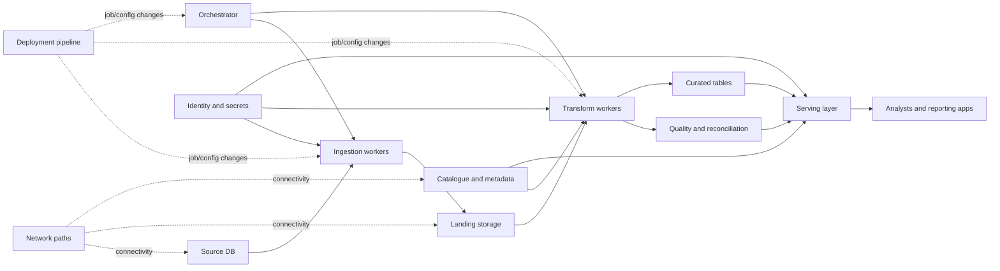

# Failure Domains and Blast Radius

> **Stage 2D — Data Architecture · Module 12: Reliability, Resilience and Disaster Recovery · Topic 02**
>
> **Document purpose:** Learn to identify how failures propagate through an enterprise data platform, quantify the scope of impact, and design containment boundaries that limit harm.
>
> **Source-of-truth note:** The supplied module roadmap states that the original topic files were empty and that its detailed topic scope, exercises, scenarios, and targets are recommendations—not requirements previously documented in those files. This lesson follows the recommended sequence and scope. The overall project tree establishes the module location and filename convention; it does not define the technical details of this lesson.
>
> **Illustrative-content note:** “Northbridge Bank,” its architecture, counts, scenarios, percentages, objectives, and impact estimates are fictional teaching assumptions. They are not production measurements, vendor guarantees, or universal benchmarks. No exercise requires live infrastructure or a real outage.

## Contents

- [1. Learning outcomes and scope](#1-learning-outcomes-and-scope)
- [2. Prerequisites and knowledge dependencies](#2-prerequisites-and-knowledge-dependencies)
- [3. Beginner foundations](#3-beginner-foundations)
- [4. Map a data pipeline and its dependencies](#4-map-a-data-pipeline-and-its-dependencies)
- [5. Failure domains across an enterprise platform](#5-failure-domains-across-an-enterprise-platform)
- [6. Trace failure propagation and business impact](#6-trace-failure-propagation-and-business-impact)
- [7. Measure blast radius correctly](#7-measure-blast-radius-correctly)
- [8. Common-cause failures and false redundancy](#8-common-cause-failures-and-false-redundancy)
- [9. Containment and isolation patterns](#9-containment-and-isolation-patterns)
- [10. Human, organisational, configuration and deployment risks](#10-human-organisational-configuration-and-deployment-risks)
- [11. Retries, backlogs and recovery interactions](#11-retries-backlogs-and-recovery-interactions)
- [12. Architecture trade-offs and evidence](#12-architecture-trade-offs-and-evidence)
- [13. Worked failure analysis: eight scenarios](#13-worked-failure-analysis-eight-scenarios)
- [14. Advanced exercise: shared catalogue and deployment pipeline](#14-advanced-exercise-shared-catalogue-and-deployment-pipeline)
- [15. Example Architecture Decision Record](#15-example-architecture-decision-record)
- [16. Practical exercises and expected deliverables](#16-practical-exercises-and-expected-deliverables)
- [17. Common mistakes and troubleshooting](#17-common-mistakes-and-troubleshooting)
- [18. Glossary](#18-glossary)
- [19. Mastery criteria and completion gate](#19-mastery-criteria-and-completion-gate)
- [20. Cross-topic references](#20-cross-topic-references)

---

## 1. Learning outcomes and scope

By completing this lesson, you should be able to:

1. Define a failure domain, dependency, single point of failure (SPOF), cascading failure, fault isolation, graceful degradation, and blast radius.
2. Inventory components and distinguish hard dependencies from soft dependencies.
3. Map upstream and downstream relationships from ingestion through storage, transformation, orchestration, metadata, and serving.
4. Identify infrastructure, software, identity, network, control-plane, operator, and process failure domains.
5. Trace a plausible trigger through direct and secondary effects to consumer and business outcomes.
6. Calculate impact percentages with an explicit numerator, denominator, and boundary; distinguish impact estimates from probabilities.
7. Recognise common-cause failures that defeat apparently independent redundancy.
8. Compare isolation mechanisms and explain their protections, costs, operating burden, and residual risks.
9. Document containment decisions and validation evidence in an ADR.

### What this topic does—and does not—decide

This topic identifies what can fail together and how to limit impact. Topic 03, **High availability and redundancy patterns**, uses this map to select availability mechanisms. Topic 04 covers backup, restore, and recovery validation. Topic 05 turns business needs into RPO/RTO and disaster-recovery strategies. Topic 06 addresses replay and backfill correctness. Topic 07 addresses incident response and postmortems. Topic 08 plans resilience testing and business continuity.

A failure-domain map is not a proof that failure is impossible. It is a model of dependencies and shared causes that must be challenged with evidence and revised as the architecture changes.

## 2. Prerequisites and knowledge dependencies

The module roadmap recommends completing Topic 01 first and reviewing platform tenancy and metadata lineage concepts.

| Prerequisite | Why it matters here | Suggested review |
|---|---|---|
| SLI, SLO, service scope and business criticality | Defines which user-visible outcomes are harmed by a failure | `01-reliability-objectives-sli-slo-and-sla.md` |
| Platform planes and tenant boundaries | Reveals shared control-plane and noisy-neighbour risks | `../07-Enterprise-Data-Platform-and-Lakehouse-Architecture/04-compute-storage-and-control-plane-separation.md`; `07-multi-team-isolation-and-tenant-boundaries.md` |
| Lineage and ownership | Helps identify downstream consumers and recovery order | `../11-Metadata-Lineage-Quality-and-Master-Data/03-end-to-end-lineage-and-impact-analysis.md` |
| Integration failure handling and idempotency | Helps reason about retries, duplicate delivery and replay | `../06-Data-Integration-and-Interoperability/07-idempotency-deduplication-and-reconciliation.md`; `08-integration-pattern-selection-and-failure-handling.md` |
| Cloud regions, zones and connectivity | Helps map physical and logical fault boundaries | `../08-Cloud-Hybrid-and-Multi-Cloud-Data-Architecture/01-cloud-data-architecture-principles.md`; `06-hybrid-connectivity-and-on-premises-integration.md` |
| Streaming lag and backpressure | Helps explain backlog growth and catch-up behaviour | `../09-Streaming-and-Real-Time-Data-Architecture/07-late-events-backpressure-and-stream-failure-modes.md` |

If a referenced file is absent or empty in a local checkout, treat its path as a roadmap reference—not evidence of content. Use the current architecture and requirements as the working evidence.

## 3. Beginner foundations

### 3.1 Start with components and dependencies

A **component** is a distinguishable part of a system: a source database, ingestion worker, object store, transformation engine, scheduler, catalogue, identity provider, or API. A **dependency** is something a component needs to perform a defined function.

Dependencies are directional. A report service may depend on a published table, which depends on a transformation, which depends on ingestion and a source. If the source cannot provide data, downstream systems may still be running while their information becomes stale.

A dependency inventory should record at least:

- component and owner;
- purpose and service or dataset served;
- upstream and downstream dependencies;
- whether the dependency is hard or soft for each workload;
- failure mode and detection signal;
- shared infrastructure, account, credential, release, or operator;
- expected degradation or containment behaviour;
- relevant SLOs and recovery procedure.

### 3.2 Key concepts, distinguished

| Concept | Meaning | Example | What it is not |
|---|---|---|---|
| **Failure domain** | Components or workloads that can be affected by one failure or common cause | Several tenants depend on one identity service | A statement that all components always fail together |
| **Blast radius** | The scope of actual or plausible impact from a particular event | 4 of 20 tenant workloads become unavailable | The probability of the event occurring |
| **Failure probability** | Likelihood of a specified event over a defined period and under stated assumptions | Estimated annual probability of a zone outage | The number of consumers affected if it happens |
| **Business impact** | Consequence for business processes, customers, decisions, money, compliance or reputation | A risk report is late and a control deadline is missed | A raw count of servers or jobs |
| **SPOF** | A component, dependency or decision path whose failure can interrupt a required function because no adequate alternative exists | One credential broker is required by every worker | Any component that has only one instance, regardless of whether it is critical or bypassable |
| **Cascading failure** | An initial failure triggers secondary failures or overload in dependent systems | Source latency causes retries, queue growth and storage saturation | Every downstream symptom of one event; the causal chain must be established |
| **Fault isolation** | Design and operational boundaries prevent one failure from spreading beyond a defined scope | Tenant-specific quotas prevent one workload exhausting shared capacity | A guarantee that a failure has no effect outside the boundary |
| **Graceful degradation** | A service preserves an explicitly useful subset of functionality when dependencies fail | Serve the last validated snapshot with a visible age warning | Silently returning stale or incorrect data as current |

A failure domain can be physical, logical, organisational, or procedural. One workload may belong to several overlapping domains: a region, an account, a network, a shared release, and a team with production write access.

### 3.3 A simple causal chain

Consider a fictional daily report pipeline:

1. The source database slows down.
2. Ingestion jobs time out and retry.
3. Retries increase connection pressure on the source.
4. The ingestion queue grows and the data arrival time slips.
5. Transformation begins late; the report is not published by its deadline.
6. A downstream consumer uses an older snapshot—or, if controls are poor, assumes stale data is current.

The initiating failure is source latency. The later queue growth and report delay are propagated impacts. A separate correctness risk exists if the consumer cannot tell that its snapshot is stale. Good analysis identifies the trigger, each propagation step, and the control that interrupts each link.

### 3.4 Fault containment is a design goal, not a label

A design is not isolated merely because services run in different containers or have different names. Ask whether the components still share a quota, account, credential, network path, scheduler, control plane, release artifact, encryption key, or operator action. A common dependency can bridge nominal boundaries.

**When to use this thinking:** during architecture design, incident analysis, tenant onboarding, platform migrations, major releases, security reviews, and resilience exercises.

**Limitations:** diagrams are simplified models. They can omit undocumented manual steps, hidden service dependencies, provider-managed control planes, or rare common causes. Validate the map with telemetry, configuration, ownership records, incident history, and controlled tests.

## 4. Map a data pipeline and its dependencies

### 4.1 Fictional scenario: Northbridge Bank

All details in this scenario are illustrative. Northbridge Bank operates a daily customer-risk report pipeline consumed by risk analysts and a reporting service. The business expectation is that a **validated, current** report is published by 07:00 on business days. “Current” means the required source partitions are present and quality checks pass; merely publishing a file is not success.

The simplified architecture includes:

- **Source DB:** customer and account records;
- **Ingestion workers:** extract or capture changes;
- **Landing/object storage:** durable raw records and manifests;
- **Orchestrator:** schedules and coordinates jobs;
- **Transform workers:** build curated tables and report data;
- **Catalogue/metadata service:** schemas, table locations, ownership and discovery;
- **Identity and secrets:** authenticate workers and grant access;
- **Quality/reconciliation checks:** validate expected counts, keys and business rules;
- **Serving layer:** publishes a report table/API;
- **Consumers:** analysts and reporting applications;
- **Network path:** connects the above services;
- **Deployment pipeline:** distributes job code and configuration.

### 4.2 Dependency map

The Mermaid graph below represents logical dependencies, not necessarily network topology or a claim that every dependency is synchronous. An arrow `A --> B` means B depends on A for the depicted path.

This map highlights several possible shared failure domains: identity and secrets affect multiple workers; the catalogue may be required to resolve table metadata; the orchestrator coordinates multiple stages; the deployment pipeline can distribute a common bad release; and a network outage can cut several otherwise healthy components off from one another.

The graph does **not** establish whether the catalogue is required at runtime for already-running jobs or only at planning/startup time. That must be discovered and recorded. Likewise, whether the serving layer can serve a last-known-good snapshot depends on implementation and business rules.

### 4.3 Hard versus soft dependencies

Dependency criticality is workload- and operation-specific. The same service can be hard for starting a job but soft for serving already-materialised data.

| Dependency | Hard dependency example | Soft dependency or degraded mode example | Evidence to collect |
|---|---|---|---|
| Catalogue | A job cannot resolve a table location or schema without it | Existing jobs use cached metadata; readers can use a known snapshot | Startup and runtime traces; cache TTL; recovery test |
| Identity provider | New authentication is required for every request and no valid token remains | Short-lived cached credentials permit a bounded continuation | Token lifetime, revocation requirements, security review |
| Orchestrator | No stage starts without scheduler/control-plane access | Running tasks continue and durable queues hold new work | Failure simulation; task state and queue semantics |
| Source database | Fresh data cannot be acquired | Consumers may read last validated data with explicit freshness status | Source SLA/SLO, data-age policy, consumer contract |
| Network | No path exists to a required store | Alternate route or buffered local writes remain available | Route inventory, failover test, queue capacity |
| Quality checks | Publishing must stop if mandatory correctness checks fail | Optional diagnostics may be delayed while mandatory checks still run | Control classification and approval by data owner |

Do not label a dependency “soft” merely because the system can return *something*. The degraded result must be useful, correctly labelled, authorised, and accepted by the consumer contract. Stale or incorrect risk data must not masquerade as current validated data.

### 4.4 Build an inventory before drawing conclusions

For each dependency, record a row with fields like these:

| Field | Example value (illustrative) |
|---|---|
| Dependency | Catalogue metadata API |
| Used by | Transform workers, serving layer |
| Purpose | Resolve schema, location and ownership metadata |
| Hard/soft | Hard for new job planning; potentially soft for existing cached reads |
| Failure modes | Unavailable, slow, stale metadata, incorrect metadata |
| Shared domain | One control-plane service used by several tenants |
| Detection | Request failures, latency, metadata freshness checks |
| User-visible consequence | Late report, failed publication, or incorrect schema interpretation |
| Containment | Cache validated metadata within bounded policy; isolate per-tenant request limits; block unsafe publish |
| Validation evidence | Catalogue outage exercise, cache-expiry test, schema mismatch test |

A catalogue can be available but serve stale or incorrect metadata. Therefore, dependency analysis should include **integrity and semantic failure**, not only binary up/down availability.

## 5. Failure domains across an enterprise platform

### 5.1 Infrastructure and location domains

| Domain | Typical trigger | Potential scope | Containment questions |
|---|---|---|---|
| Node/host | Hardware fault, kernel panic, local disk failure | Tasks on that node; data on non-redundant local storage | Are tasks rescheduled? Is state durable elsewhere? |
| Rack or power group | Shared power/cooling/network failure | Multiple nodes that appear separate | Are replicas distributed across genuinely independent power paths? |
| Availability zone | Zone network, power or control issue | Services and storage in that zone | Are dependencies and quorum spread safely? Can traffic shift? |
| Region | Regional outage or regional control-plane issue | Regional compute, storage, endpoints and possibly keys | Is another region independently operable and data-consistent? |
| Cloud account/project/subscription | Account suspension, quota, policy or administrator error | Many resources sharing account-level controls | Is recovery access independent? Can one operator delete both primary and recovery resources? |
| Network path | Routing, DNS, firewall, certificate or connectivity issue | Components separated by the affected path | Is there a genuinely independent path, and can applications tolerate partition? |
| Storage namespace or encryption key | Deletion, policy change, key loss, corruption | All data dependent on that namespace/key | Are backups protected from the same identity and key failure? |

Different zones or regions do not automatically provide independence. Shared identity, DNS, account policy, deployment artifacts, encryption keys, global control planes, or common operators can defeat geographic separation.

### 5.2 Platform and data-service domains

| Domain | Failure examples | Why broad impact is possible |
|---|---|---|
| Identity and access | IdP outage, expired shared credential, overbroad policy update | Many services cannot authenticate or access data |
| Secrets/certificate management | Rotation error, expired certificate, secret revoked everywhere | Simultaneous authentication or connectivity failures |
| Orchestrator/control plane | Scheduler outage, bad global configuration, control-plane database corruption | New work stops; state transitions may stall; recovery actions may be unavailable |
| Catalogue/schema registry | API outage, wrong schema, metadata deletion | Jobs fail to resolve data or interpret fields consistently |
| Shared storage | Quota exhaustion, bucket policy, namespace deletion, storage throttling | Ingestion, transformation and serving may all be affected |
| Shared compute pool | One tenant saturates workers, memory or concurrency slots | Unrelated workloads miss deadlines or fail |
| Deployment/release | Faulty library, image, SQL template or configuration rolled out globally | Many workloads acquire the same defect together |
| Observability/alerting | Telemetry pipeline outage, bad alert configuration | Failures may continue longer because detection and diagnosis are impaired |
| Data semantics | Shared transformation changes a key, timezone, filter or definition | Many datasets can be wrong while infrastructure remains healthy |
| Human/process | Wrong environment selected, unreviewed change, unclear incident authority | One action can affect resources across tenants or regions |

### 5.3 Physical, logical and organisational boundaries overlap

A useful map should show more than where processes run. For example, two clusters in separate regions may share:

- the same cloud account and administrator role;
- the same identity provider or emergency credential;
- the same infrastructure-as-code repository and pipeline;
- the same signed artifact or shared library;
- the same global DNS, secrets manager, or key-management dependency;
- the same operator who can execute an unscoped destructive command;
- the same monitoring system, so failure of that system hides both clusters’ condition.

These are shared causes. A fault tree, dependency graph, or failure-mode table should represent them explicitly. “Multi-region” is a location fact, not proof of independent failure domains.

## 6. Trace failure propagation and business impact

### 6.1 Use a causal chain

For each scenario, work through these steps:

1. **Trigger:** What event begins the incident? Be specific: “global role policy removes read permission,” not “security issue.”
2. **Affected component:** Which resource or process is directly affected?
3. **Dependency propagation:** Which consumers require it? Which calls, jobs, queues or state transitions fail?
4. **Secondary effects:** Do retries amplify load? Does backlog consume storage? Does stale metadata produce incorrect results?
5. **User-visible effect:** What is unavailable, late, incomplete, incorrect, or inaccessible?
6. **Business outcome:** Which decision, report, control, customer process or obligation is affected?
7. **SLO impact:** Which defined indicator could breach, and how is it measured?
8. **Containment:** What boundary prevents propagation or limits the affected set?
9. **Recovery and verification:** How is service restored, and how is data correctness demonstrated?

This sequence prevents a list of components from being mistaken for a causal analysis. Every arrow in the causal explanation should have a mechanism: a required API call, exhausted resource, shared policy, state transition, or known operational dependency.

### 6.2 Direct impact and propagated impact

- **Direct impact** is the immediate effect on the component or workload where the trigger occurs.
- **Propagated impact** is the effect transmitted through dependencies, shared resources, retries, queues, state, or human response.
- **Latent impact** may appear later, such as a missing partition discovered during reconciliation or an incorrect report used before a quality defect is detected.

A source outage can cause a freshness breach without making the serving endpoint unavailable. A schema error can leave every endpoint reachable while correctness fails. A catalogue outage can stop new jobs but leave existing consumers temporarily functional. The SLI determines what counts as a service failure; the failure-domain analysis explains why it happened and who was exposed.

### 6.3 Connect to SLOs without inventing metrics

Use the SLOs already defined for the service. If none exists, propose a candidate indicator and explicitly label it as a proposal. Examples include:

- **Availability:** fraction of eligible consumer requests that receive a valid response;
- **Freshness:** fraction of scheduled publications whose data age is within the agreed threshold;
- **Completeness:** fraction of required partitions or records present and reconciled;
- **Correctness:** fraction of outputs passing defined semantic and reconciliation checks;
- **Successful delivery:** fraction of eligible scheduled outputs delivered to the agreed destination by the deadline.

Do not combine these carelessly. A file delivered by 06:50 but containing duplicate accounts may satisfy a simplistic delivery metric while failing correctness and business intent. A reliable degraded mode must report freshness and quality state to consumers.

## 7. Measure blast radius correctly

### 7.1 Choose the unit before calculating

“Twenty percent impacted” is meaningless until the denominator is explicit. It could mean 20% of tenant teams, workloads, datasets, customers, reports, regions, or business processes. Those denominators are not interchangeable.

For a defined population and event:

\[
\text{Impact fraction} = \frac{\text{distinct affected units}}{\text{eligible units in the defined population}}
\]

\[
\text{Impact percentage} = 100 \times \text{Impact fraction}
\]

State whether the numerator counts distinct units, whether partial impact counts as affected, what time interval is used, and how the population is selected. Count each unit once for a given measurement even if several failure paths affect it.

### 7.2 Worked calculation: teams and cells

**Illustrative assumptions:** the platform serves 25 teams. A shared credential is used by all 25 teams. If that credential is compromised and must be revoked, all 25 teams lose access until each team can use a valid replacement.

- Numerator: 25 affected teams.
- Denominator: 25 teams in the platform population.
- Calculation: 25 / 25 × 100 = **100% of teams**.

Now suppose the platform has five genuinely isolated cells, each serving five teams. A failure confined to one cell affects five teams.

- Numerator: 5 affected teams.
- Denominator: still 25 platform teams.
- Calculation: 5 / 25 × 100 = **20% of platform teams**.

Within the affected cell, the impact is 5 / 5 × 100 = **100% of that cell’s teams**. Both percentages are correct because they answer different questions. The 20% result is valid only if the failure really is contained to one cell; if the cells share the compromised credential or global control plane, the assumed containment is false.

### 7.3 Impact dimensions should remain separate

A single incident may have several measures:

| Measure | Example numerator / denominator | Interpretation |
|---|---|---|
| Tenant teams affected | 5 / 25 teams | Organisational breadth |
| Workloads affected | 12 / 60 scheduled workloads | Technical breadth |
| Datasets stale | 8 / 40 critical datasets | Data-product impact |
| Reports late | 3 / 10 required reports | Consumer-facing outcome |
| Customers exposed | 4,000 / 100,000 eligible customers | Customer exposure, if reliably known |
| Business processes blocked | 2 / 7 critical processes | Business continuity impact |

Do not add these values into one aggregate percentage. A dataset, a team, and a customer are different units. If weights are used to estimate severity, state the weighting method and business owner; do not disguise a subjective score as a measured probability.

### 7.4 Scope, duration, severity and probability are different

A robust risk record separates at least:

- **Scope:** how many defined units could be affected;
- **Duration:** how long the effect lasts;
- **Severity:** consequence for those units;
- **Likelihood:** estimated chance of the initiating event in a stated period;
- **Confidence:** quality of evidence behind the estimate;
- **Detectability:** likelihood and speed that the issue will be detected;
- **Recoverability:** whether service and correct data can be restored within the agreed objectives.

A scenario affecting 100% of workloads may be rare; a frequent issue may affect one workload at a time. A large blast radius does not by itself prove high probability, and a small blast radius does not necessarily mean low business severity.

### 7.5 Estimation discipline

When exact impact is unknown, record a range and explain assumptions—for example, “3–6 of 20 critical datasets may be delayed if the shared metadata API is unavailable during job planning.” This is a **scenario estimate**, not an observed measurement. Do not present it as a probability such as “30% likely” unless a defensible likelihood method and evidence exist.

## 8. Common-cause failures and false redundancy

### 8.1 What common cause means

Two components are not independent merely because they are separate instances. A **common-cause failure** is one event or condition that disables multiple components that were expected to provide independent protection. Examples include shared power, common software, shared identity, global configuration, a common network route, or the same operator action.

Redundancy helps only to the extent that the alternate can continue the required function when the primary fails. If both paths require the same unavailable dependency, the alternate may not be usable.

### 8.2 Example A: two regions, one identity dependency

**Illustrative scenario:** primary and recovery regions each run ingestion workers. Both depend on one identity provider and one shared role policy. A faulty policy update denies access to the source database in both regions.

- Apparent redundancy: two compute regions.
- Shared cause: identity policy and authorization path.
- Failure effect: neither region can read the source.
- Containment question: can a recovery identity path be used without violating security controls, and can it be tested safely?
- Evidence: dependency graph, policy deployment history, denied-request logs, recovery exercise.

A separate identity system is not automatically the right answer; it increases security and lifecycle complexity. The architecture should decide which dependencies must remain available during a regional incident, how emergency access is controlled, and how that access is tested.

### 8.3 Example B: staged compute, one bad release

**Illustrative scenario:** jobs run on two separate clusters, but both clusters pull the same transformation image and shared SQL library. A release changes a join key from a stable customer identifier to a non-unique display field. Both clusters finish successfully but publish duplicated or misattributed records.

- Apparent redundancy: two compute clusters.
- Shared cause: common artifact and release process.
- Failure effect: correlated correctness failure rather than simple downtime.
- Containment: canary a representative workload, compare row counts and key uniqueness, enforce quality gates, keep a known-good artifact, and stop promotion when validation fails.
- Evidence: release provenance, dataset diffs, uniqueness checks, canary results, rollback/replay plan.

This is particularly important for data systems: two copies of the same bad computation do not make the output correct.

### 8.4 Common-cause review checklist

For each claimed independent path, ask:

- Does it share account, region-level service, identity, DNS, network, key, credential, quota, or control plane?
- Does it use the same image, library, schema, configuration, infrastructure module, or deployment pipeline?
- Can the same administrator or automated policy modify or delete both paths?
- Do both paths depend on the same source data or metadata truth?
- Will a defect replicate through replication, cache refresh, or replay?
- Is monitoring independent enough to detect failure of the primary monitoring path?
- Has the failure mode been exercised, or is independence only assumed from a diagram?

## 9. Containment and isolation patterns

No single pattern solves every failure mode. Select a control based on the resource to isolate, the propagation path, the desired boundary, and the residual risk.

### 9.1 Pattern comparison

| Pattern | How it works | Useful against | Costs and limitations |
|---|---|---|---|
| **Tenant/resource quotas** | Bound CPU, memory, concurrency, storage, API requests or queue use per tenant | Noisy neighbours and runaway workloads | Quota sizing and fairness tuning; too-low limits can cause avoidable SLO misses; shared control plane may remain a SPOF |
| **Bulkheads** | Partition pools or concurrency so one workload cannot consume all capacity | Resource exhaustion and cascading overload | Reserved capacity can sit idle; more pools complicate scheduling and operations |
| **Cells** | Partition tenants or workloads into relatively self-contained units with bounded dependencies | Large platform-wide failures and tenant blast radius | Duplication, routing complexity, uneven cell load, cross-cell operations and data movement |
| **Shards** | Partition data or workload ownership by key/range/tenant | Data and traffic scaling; some localized failures | Hot shards, rebalancing, cross-shard queries, skew, and shared control dependencies remain |
| **Separate accounts/projects** | Separate permissions, quotas, policies and resource administration | Accidental deletion, policy mistakes, quota and credential scope | More governance and deployment overhead; shared org-level roles or pipeline may still cross boundaries |
| **Separate zones/regions** | Place components across distinct failure areas | Location-specific faults | Cost, replication lag, consistency, failover complexity; shared global services may remain |
| **Circuit breaker** | Stop or limit calls to a failing dependency after a threshold; allow controlled probes for recovery | Repeated calls worsening dependency overload | Thresholds can be wrong; open circuit reduces functionality; not a data correctness control by itself |
| **Rate limiting** | Bound request or event rate | Overload, retry storms and abusive clients | Rejected work must be handled; static limits may not match changing capacity |
| **Durable queues/buffers** | Decouple producer from consumer and absorb bounded temporary mismatch | Short downstream outages and bursty workloads | Finite capacity, retention limits, replay semantics and ordering; backlog may still grow without bound over a long outage |
| **Canary release** | Expose a small, representative workload to a change before wider rollout | Bad releases and configuration errors | Canary must be representative and observable; shared dependencies can still create broad effects |
| **Staged rollout / feature flag** | Expand change scope gradually and provide a stop/disable mechanism | Global deployment errors | Flag state can itself be shared or misconfigured; rollback does not undo already-written bad data |
| **Read-only/degraded mode** | Preserve safe reads or a validated snapshot while blocking unsafe writes/publication | Dependency outages where stale-but-labelled data is acceptable | Requires explicit freshness labels, expiry rules, and consumer acceptance; not suitable for every risk decision |
| **Admission control/backpressure** | Slow or reject new work before capacity is exhausted | Queue overload and cascading failure | Delays work; needs prioritisation and clear client retry behaviour |
| **Independent backup/recovery path** | Keep recoverable copies and access methods outside the primary failure boundary | Deletion, corruption and major loss | Does not guarantee fast restore; keys, identities, procedures and restore validation must also survive |

### 9.2 Isolation by boundary

**Process/container boundary:** helps isolate crashes and resource limits, but does not isolate shared host, kernel, network, credentials, or account policies.

**Pool or queue boundary:** prevents one class of work from consuming all execution capacity. Ensure shared storage and orchestration are also bounded.

**Tenant boundary:** use scoped identities, separate quotas, workload priorities, data access controls, and where warranted separate accounts or cells. A label or namespace alone is not a security or resilience boundary unless policy enforcement proves it.

**Cell boundary:** assign a bounded group of tenants to a stack with limited shared runtime dependencies. Define how catalogue, identity, observability, deployment, and source connectivity cross cell boundaries. Cells can reduce blast radius but may duplicate operations and create uneven utilisation.

**Region boundary:** protect against some regional failures only when the data, control paths, identity, keys, network, deployment, and operators needed for recovery are available. Topic 03 evaluates availability patterns in detail.

### 9.3 Circuit breakers, retries and queues must cooperate

A circuit breaker prevents a failing dependency from receiving unlimited calls. A retry policy decides whether, when and how often to repeat failed work. A queue absorbs work temporarily. These controls are complementary, not substitutes.

A safe retry design typically uses bounded attempts, exponential backoff with jitter, an overall deadline, idempotent operations or deduplication, and explicit handling for permanent versus transient failures. A circuit breaker without queue limits may merely shift overload to the queue. A queue without admission control can fill storage. Retries without idempotency can duplicate records or side effects.

### 9.4 Graceful degradation rules

Define in advance:

- what capability is degraded;
- what data age or quality status is shown;
- which consumers may use the degraded result;
- how long the mode may continue;
- which operations are blocked for safety;
- who may authorise extension or override;
- how to return to normal and reconcile data.

For the Northbridge report, an approved degraded mode might expose the last **validated** report with a clear “as of” timestamp and warning, while preventing it from being represented as the current business-day report. If the consumer’s decision requires current data, the safer mode may be to block the decision rather than show a stale result.

## 10. Human, organisational, configuration and deployment risks

### 10.1 People and process are part of the architecture

An incident can span multiple technical components because of an operational action. Common examples include selecting the wrong environment, running a destructive command without a scope guard, rotating a shared secret incorrectly, applying an unreviewed global policy, or having unclear authority during failover.

Treat these as designable risks, not merely “human error.” Useful controls include:

- least-privilege access and just-in-time elevation;
- environment and account identifiers visible in tools;
- explicit confirmation for destructive or wide-scope actions;
- dry-run and plan review for infrastructure changes;
- peer review and separation of duties for high-impact changes;
- staged rollout, canaries, health gates and rollback/stop controls;
- tested break-glass access with audit logging;
- runbooks with ownership, escalation and decision rights;
- backup deletion protection and credentials outside the same administrative blast radius;
- post-incident review focused on contributing conditions and system improvements.

### 10.2 Configuration is executable architecture

A one-line global setting can widen concurrency, remove a quality gate, change retention, route all tenants to one endpoint, or grant broad permissions. Configuration should therefore have version control, validation, review, rollout boundaries, drift detection, and rollback strategy appropriate to its impact.

Rollback of configuration may not reverse effects already caused. If a bad retention policy deleted data or a bad transformation published wrong records, recovery requires restore, replay, reconciliation, or consumer correction—not just reverting the setting.

### 10.3 Deployment pipeline as a shared failure domain

The deployment pipeline may affect every workload even if compute and storage are isolated. Reduce this risk by separating build from promotion, using immutable/versioned artifacts, signing or verifying provenance where appropriate, promoting the same tested artifact, enforcing compatibility checks, limiting rollout scope, and recording exactly what version ran for each dataset.

Do not make an untested claim that canarying eliminates risk. A canary reduces exposure only when the canary workload is representative, the failure is observable before promotion, and promotion can be stopped. A defect that manifests only at scale or with rare data may pass a small canary.

### 10.4 Observability is also a dependency

If all workloads report to one monitoring pipeline, failure of that pipeline can hide broad incidents. Consider independent health probes, durable local logs, alert-path checks, and clear signals from consumer-facing measurements. Avoid creating a monitoring architecture so complex that no one can understand its own failure modes.

## 11. Retries, backlogs and recovery interactions

### 11.1 Retry storm and thundering herd

A **retry storm** occurs when many clients repeatedly retry a failing dependency and increase its load. A **thundering herd** occurs when many clients resume or request the same resource at once—for example, all jobs restart after a scheduler outage or all caches expire simultaneously.

Possible sequence:

1. Catalogue latency rises.
2. Hundreds of jobs time out at once.
3. All retry immediately.
4. Catalogue request volume increases while it is already unhealthy.
5. More requests time out; workers remain occupied and queues grow.
6. Unrelated tenants miss deadlines.

Containment includes bounded retries, jitter, exponential backoff, concurrency limits, request coalescing, circuit breakers, admission control, queue prioritisation, and staggered recovery. These controls should be tested against actual timeout and capacity assumptions.

### 11.2 Backlog arithmetic as a sanity check

**Illustrative assumptions:** a pipeline receives 12,000 records per minute and processes 15,000 records per minute under normal load. During a 20-minute outage, the consumer processes no records. Ignoring retention and burst variation, the backlog added is:

12,000 records/minute × 20 minutes = **240,000 records**.

After recovery, if incoming traffic remains 12,000 records/minute and the consumer can process 15,000 records/minute, net catch-up capacity is 3,000 records/minute. Approximate catch-up time is:

240,000 / 3,000 = **80 minutes**.

This is not a universal forecast. It assumes constant rates, no additional failures, no ordering constraints, no duplicate work, no downstream bottleneck, and that 15,000/minute is sustainable while new traffic continues. If processing capacity equals or falls below the arrival rate, the backlog will not drain under these assumptions.

### 11.3 Recovery can recreate the incident

Restarting every job simultaneously may recreate the same capacity problem. A safe recovery plan may stagger tenants, prioritise critical data products, cap replay concurrency, reserve capacity for live traffic, and validate each checkpoint before advancing. A restored service is not necessarily a recovered data product: state, offsets, schema versions, metadata, encryption keys, and data consistency must align.

### 11.4 Recovery interactions to include in the map

- A backup may share the primary account or key and be deleted or rendered inaccessible by the same event.
- A replica may replicate corruption or deletion quickly.
- Replay can duplicate records unless operations are idempotent or deduplicated.
- Backfill can starve current processing without workload isolation.
- Catalogue restoration can expose stale or incompatible metadata.
- Failover can send traffic to a region that lacks current source offsets or valid credentials.
- Monitoring may report service availability while quality reconciliation is still failing.

These topics connect directly to backup/restore, RPO/RTO, replay, incident response, and resilience testing later in Module 12.

## 12. Architecture trade-offs and evidence

### 12.1 Make trade-offs explicit

| Choice | Potential benefit | Cost or residual risk | Evidence needed |
|---|---|---|---|
| Shared platform service | Lower operating cost and consistent governance | Larger blast radius and correlated failure | Dependency inventory, failure scenarios, SLO impact |
| Per-tenant resources | Stronger isolation and predictable quotas | Higher cost, duplicated operations, more configuration | Load tests, quota tests, operational staffing estimate |
| Cell-based platform | Bounded tenant scope and staged upgrades | Cell routing, uneven utilisation, cross-cell complexity | Cell failure exercise, capacity and deployment test |
| Multi-region redundancy | Can reduce impact of location-specific failures | Data consistency, failover, cost and common global dependencies | Failure-domain review, failover and failback test |
| Cached metadata | Reduced dependence on catalogue availability | Staleness and schema incompatibility risk | Cache expiry policy, compatibility checks, outage test |
| Last-known-good serving | Preserves a bounded read capability | Data may be stale and unsuitable for some decisions | Consumer agreement, visible timestamp, max-age rule |
| Global rollout | Fast, consistent delivery | Wide common-cause exposure | Canary strategy, staged gates, rollback and data repair plan |

### 12.2 Evidence hierarchy

Use multiple evidence types, with their limitations understood:

1. **Architecture and dependency records:** show intended design, not necessarily runtime reality.
2. **Configuration and access-policy inspection:** shows declared wiring and permissions; may miss dynamic dependencies.
3. **Telemetry and traces:** show observed paths during sampled periods; may miss rare or dormant paths.
4. **Incident history:** provides real failure evidence but is biased toward events already observed and recorded.
5. **Load, fault-injection or game-day tests:** test defined scenarios under test conditions; do not prove every failure mode.
6. **Recovery exercises:** show whether a procedure works for the exercised state and scope; retest after material changes.
7. **Consumer and business-owner validation:** confirms whether the proposed impact and degraded mode match actual decision needs.

A strong design argument states which evidence supports the claim, what it does not cover, and what test will reduce uncertainty next.

### 12.3 Residual risk

No isolation boundary is perfect. Record what can still cross it: shared identity, central catalogue, global artifact, control-plane access, common source data, common operator, or insufficient capacity. Assign an owner, mitigation, detection signal, and review date to important residual risks. Do not label a risk “eliminated” because a mitigation was implemented; validate the boundary.

## 13. Worked failure analysis: eight scenarios

All scenarios and quantities below are illustrative. “Relevant SLO” refers to a candidate or previously agreed objective, not an invented claim about a real system. The impact estimate is conditional on the described trigger; it is not the probability that the trigger will occur.

| # | Trigger and failure domain | Propagation and affected components | Illustrative impact / SLO at risk | Containment and evidence |
|---|---|---|---|---|
| 1 | One worker node crashes; node domain | Tasks on node fail; orchestrator reschedules; local-only temporary state may be lost | 1 of 20 workers immediately affected (5% of workers); freshness SLO at risk only if rescheduling/capacity cannot meet deadline | Durable checkpoints, worker rescheduling, spare capacity; test node termination and state recovery |
| 2 | Zone network/power outage; zone domain | Ingestion and transform workers in the zone become unreachable; retries and queues grow | If 2 of 6 worker pools are in the zone, 2/6 = 33.3% of pools are directly affected; report freshness may breach | Spread critical replicas/pools across zones where dependencies permit; validate traffic shift and quorum behaviour |
| 3 | Shared identity policy denies source reads; identity/config domain | Ingestion workers across all cells fail authentication; freshness degrades; retries may load identity service | 25/25 teams = 100% of teams affected under the stated shared policy; freshness and successful-delivery SLOs at risk | Scoped policy rollout, policy tests, independent controlled recovery access; verify permissions and audit logs |
| 4 | Catalogue API unavailable during job planning; control-plane domain | New transformations cannot resolve schemas/locations; running jobs may continue only if they have valid cached metadata | Illustratively 8 of 20 scheduled jobs cannot start = 40% of jobs; report publication SLO at risk | Bounded cache of validated metadata, per-tenant limits, safe publish gates; exercise cold-start and cache-expiry behaviour |
| 5 | Bad shared transformation release changes join semantics; software/data-semantic domain | Multiple jobs finish but generate duplicate or misattributed records; quality gate or consumers detect issue | 6 of 30 critical datasets fail uniqueness/reconciliation = 20% of critical datasets; correctness SLO at risk, not necessarily availability | Canary, data-diff checks, immutable prior artifact, halt promotion, replay/backfill and consumer correction plan |
| 6 | One tenant runs an unbounded backfill; shared compute/storage domain | Backfill consumes workers, I/O and queue capacity; other tenants miss deadlines | 4 of 20 other tenant workloads delayed = 20% of other workloads; freshness SLOs at risk | Per-tenant quotas, reserved pools, priority and admission control; validate noisy-neighbour load test |
| 7 | Global network/DNS configuration mistake; network/config domain | Source, storage or catalogue endpoints become unreachable across multiple zones | If 15 of 25 teams depend on the affected route, 15/25 = 60% of teams exposed; availability/freshness depend on which path failed | Staged config rollout, validation, independent management path, tested rollback; inspect routing and DNS health |
| 8 | Shared deployment pipeline publishes a broken configuration to every cell; release/process domain | Orchestrator schedules jobs with wrong concurrency or removes a required quality gate; queue pressure or unsafe publication follows | 5 of 5 cells exposed (100% of cells); actual workload impact depends on whether the change activates and is detected | Separate build/promotion, staged rollout, canary and automated stop gates, explicit quality policy; test promotion failure and rollback |

### 13.1 Scenario review notes

- Scenario 1 distinguishes direct worker impact from an actual SLO breach. A failed worker may be fully masked by rescheduling and spare capacity.
- Scenario 2 counts **worker pools**, not teams. Do not describe 33.3% of pools as 33.3% of business impact without evidence.
- Scenario 3’s 100% estimate is conditional on the shared policy affecting all 25 teams and no alternative identity path. If only one permission is denied or a valid cached credential permits bounded continuation, the impact changes.
- Scenario 4 depends on catalogue behaviour. If all running and new jobs require live metadata calls, impact may be broader; if cache is valid, narrower. Verify rather than assume.
- Scenario 5 is a correctness incident. Endpoint uptime can remain high while the data product is unfit for use.
- Scenario 6 counts the four delayed **other** workloads; the backfill workload itself is excluded from that denominator by definition.
- Scenario 7 requires mapping actual route dependencies. A global DNS change might affect all or only a subset; the 15/25 count is an explicit hypothetical estimate.
- Scenario 8 describes exposure to a rollout, not proof that all cells failed. “Exposed” and “affected” must not be conflated in an incident report.

### 13.2 A compact scenario template

Reuse this template in architecture reviews and incident postmortems:

| Field | Question to answer |
|---|---|
| Scenario ID and owner | Who maintains this scenario? |
| Trigger | What specific event starts the chain? |
| Preconditions | What must be true for the impact to occur? |
| Failure domain | What can fail together? |
| Direct effect | Which component or operation fails first? |
| Propagation chain | Which dependency links carry the effect onward? |
| Affected population | Which unit is counted and what is the denominator? |
| Business impact | Which consumer or process is harmed, and how severely? |
| SLO/SLI | Which defined indicator is affected, measured where and over what window? |
| Containment | Which control interrupts propagation? |
| Residual risk | What still crosses the boundary? |
| Recovery and data validation | How is service restored and correctness proved? |
| Evidence | Which logs, tests, diagrams or records support the claim? |

## 14. Advanced exercise: shared catalogue and deployment pipeline

### Scenario

Northbridge now has **five cells**, each serving **five teams**: 25 teams total. Each cell has its own transform workers and queue. However, all cells use one shared catalogue service and one deployment pipeline. All cell jobs use the same identity provider. The catalogue stores schema and table-location metadata; the deployment pipeline can update job images and global configuration.

All values are illustrative. The task is to assess how these shared services affect containment and propose an architecture that reduces broad failure exposure without claiming total independence.

### Tasks

1. Draw the dependency map and mark cell-local versus shared dependencies.
2. Analyse at least these cases: (a) catalogue outage, (b) incorrect catalogue metadata, (c) deployment pipeline publishes a bad artifact, (d) identity policy update denies storage access, (e) one cell’s backfill saturates its own resources.
3. For each case, distinguish **exposed**, **actually affected**, and **business-impacting** populations.
4. Compute the team blast radius if a fault is truly contained to one cell: 5/25 = 20% platform teams. Also compute the affected-cell percentage: 1/5 = 20% of cells. Explain why these are different denominators even though the numeric result happens to match.
5. If all 25 teams require the catalogue to start jobs, calculate the conditional exposure: 25/25 = 100% of teams. Then describe the evidence needed to know whether running jobs, cached metadata, or serving readers are also affected.
6. Propose two containment options for the catalogue and two for deployment. Compare operational complexity, consistency, cost, and residual common causes.
7. Write a decision record with decision drivers, alternatives, rejected options, risks, rollout, and verification tests.

### Expected output

A dependency diagram, scenario matrix, explicit blast-radius calculations, a containment ADR, and a test plan. A high-quality answer does not automatically recommend duplicating every shared service. It identifies which shared services are hard dependencies, which can be cached or degraded safely, and what independent operation actually means for the selected failure scenarios.

### Validation criteria

- Each diagram arrow has a clear dependency meaning.
- Team, cell, workload, and dataset denominators are not mixed.
- Common-cause paths through identity and deployment remain visible.
- A bad catalogue value is treated as a correctness/integrity risk, not only an availability risk.
- A cell boundary is credited only for failures it can actually contain.
- Every proposed mitigation has a residual-risk statement and an evidence-producing test.

## 15. Example Architecture Decision Record

> This ADR is a fictional teaching example. It is not an approved Northbridge production decision.

### ADR-002: Bound tenant backfill impact with per-cell admission control

**Status:** Proposed — illustrative only  
**Context:** Five cells share some platform services. One tenant’s backfill can otherwise consume shared transform capacity and delay unrelated risk-report workloads. The business needs critical scheduled publications to retain priority, but replay and backfill must still make progress.

**Decision drivers**

- Limit the scope of resource exhaustion caused by one tenant.
- Preserve capacity for scheduled critical workloads.
- Keep backfill throughput sufficient to catch up after interruptions.
- Provide observable, enforceable controls that can be tested.
- Avoid claiming that compute isolation resolves shared catalogue, identity, storage, or deployment risks.

**Options considered**

1. **No isolation; rely on retries and autoscaling.** Low initial complexity, but no strong bound on noisy-neighbour impact; autoscaling can increase cost and still hit shared quotas or storage limits.
2. **Global concurrency limit only.** Simple to operate, but a single tenant may consume the limit and other tenants may remain blocked.
3. **Per-tenant admission limits and per-cell capacity reservations.** More configuration and tuning, but gives a clearer resource boundary and prioritisation model.
4. **Fully separate infrastructure per tenant.** Stronger potential isolation but much higher cost and operational burden; shared identity, catalogue, release, and operator risks may remain unless addressed separately.

**Decision**

Adopt option 3 for the illustrative target architecture: enforce per-tenant concurrency and queue limits; reserve capacity for scheduled critical workloads; cap backfill concurrency; and use admission control to delay non-critical backfill when critical capacity is under pressure. Use bounded retries with jitter and idempotent replay semantics. Make throttling and queue age visible to operators.

**Consequences and trade-offs**

- A backfill may take longer during peak scheduled periods.
- Quotas and reservations require tuning as workload shape changes.
- Unused reserved capacity may reduce utilisation.
- This decision contains resource competition only where the relevant resources are actually partitioned or controlled. It does not isolate a shared catalogue outage, identity failure, bad global release, or shared storage failure.
- Admission control can defer work but cannot create capacity; capacity planning remains necessary.

**Risks and residual risks**

- Incorrect quotas can starve a critical tenant or leave capacity unused.
- A shared quota controller can itself become a failure domain.
- Storage I/O or catalogue traffic may still be saturated even when compute is isolated.
- A bad transformation can produce wrong data in every cell if the artifact is globally promoted.

**Rollout plan**

1. Inventory tenant workload baselines and define critical versus deferrable work with business owners.
2. Add per-tenant queue, concurrency, and queue-age telemetry in report-only mode.
3. Compare observed demand to proposed limits and revise assumptions.
4. Enable limits for one representative cell; validate no unexpected starvation.
5. Expand gradually with rollback criteria and a named operational owner.
6. Document how limits are changed during an incident and how exceptions are audited.

**Verification plan**

- Load-test one tenant’s backfill while scheduled work runs.
- Confirm other tenants retain reserved capacity and meet the illustrative objective under the test load.
- Test queue saturation, throttling, bounded retry behaviour, and recovery after backfill pauses.
- Validate replay idempotency and reconcile outputs after catch-up.
- Exercise catalogue and identity failures separately to prove that the ADR does not overclaim protection.
- Review metrics, incident findings, and quota changes after rollout.

**Review triggers**

Review after material workload growth, a tenant-isolation incident, a new shared dependency, a change to criticality tiers, or a resilience test that exceeds the intended blast radius.

## 16. Practical exercises and expected deliverables

### Exercise A — Beginner: component inventory

**Task:** List at least ten components in a simple source-to-report pipeline. For each, name one upstream dependency, one downstream consumer, one plausible failure mode, and whether the dependency is hard or soft for the stated function.

**Expected output:** An inventory table and a small dependency diagram.

**Validation:** Every dependency is directional; at least one shared dependency is identified; hard/soft classification is tied to a specific operation rather than the component name alone.

### Exercise B — Intermediate: map and quantify

**Task:** Use the Northbridge diagram. Add the shared account, identity provider, deployment pipeline, and one cell boundary. Create eight scenarios using the template in Section 13.2. Calculate the blast radius for at least three different units (for example teams, jobs, datasets) and state each denominator.

**Expected output:** A dependency map, scenario matrix, calculation notes, and SLO-impact statements.

**Validation:** Percentages reproduce from numerator/denominator; “exposed” is not reported as “affected” without evidence; business impact is not inferred solely from infrastructure counts; correctness failure is included.

### Exercise C — Advanced: contain a shared control-plane failure

**Task:** Evaluate a shared catalogue outage and an incorrect metadata update. Propose a bounded cached-metadata strategy, cell-level request limits, deployment controls, and a safe publication rule. Explain what should happen when cached metadata exceeds its validated age.

**Expected output:** ADR, failure scenarios, residual-risk register, rollout and rollback plan, and a test matrix.

**Validation:** The plan distinguishes availability from integrity, never publishes unvalidated data as current, states the cache expiry/compatibility policy, and demonstrates which failure modes remain shared.

### Exercise D — Recovery interaction tabletop

**Task:** Assume a regional disruption stops ingestion for 20 minutes. Use the illustrative rate calculation in Section 11.2, then design a staggered replay plan that protects live traffic and avoids duplicate output.

**Expected output:** Backlog estimate, assumptions, replay order, concurrency cap, reconciliation checks, and an owner/escalation sequence.

**Validation:** The net catch-up rate is used rather than gross processing rate; idempotency and data correctness are verified; recovery completion is not declared based only on service health.

### Exercise review rubric

| Dimension | Meets expectations when… |
|---|---|
| Causal reasoning | Trigger, dependency path, secondary effect, and user outcome are connected explicitly |
| Scope arithmetic | Numerator, denominator, time/scope boundary, and affected-unit definition are stated |
| Architecture | Shared and isolated dependencies are represented accurately |
| Trade-offs | Cost, operational complexity, failure coverage and residual risk are compared |
| Data correctness | Freshness, completeness and correctness are not conflated with endpoint availability |
| Evidence | Each major claim has a plausible verification source or test |
| Documentation | Diagram, scenario table, ADR and checklist agree with one another |

## 17. Common mistakes and troubleshooting

| Mistake | Why it fails | Correction |
|---|---|---|
| Treating a region boundary as full independence | Shared identity, keys, control plane or deployment may span regions | Map common dependencies and test the exact failure scenario |
| Reporting “20% impact” without a denominator | The number cannot be interpreted or reproduced | State units, numerator, denominator, boundary and time window |
| Confusing likelihood with blast radius | Scope says how much is affected, not how often the event occurs | Track likelihood separately and document evidence/confidence |
| Counting exposed workloads as failed workloads | Exposure does not prove actual failure or business harm | Report exposed, affected and business-impacting populations separately |
| Counting components instead of user outcomes | Ten failed components may affect no users, while one wrong table may harm many | Link the chain to consumers, business processes and SLOs |
| Assuming separate containers imply isolation | Shared host, network, credentials, quota or control plane can cross boundaries | Identify and test the actual enforcement boundary |
| Calling a dependency soft because stale output exists | Stale data may be unsafe for the intended decision | Define accepted data age, quality label, allowed consumers and expiry behaviour |
| Assuming redundancy protects against bad data | Replication and common releases can propagate corruption | Use independent validation, versioned artifacts, quality gates and recovery controls |
| Adding every retry immediately | Retry storms can overload the failed dependency | Bound attempts, add jitter/backoff, deadlines, circuit breakers and admission control |
| Treating a queue as infinite capacity | Outage duration can exceed retention or storage capacity | Calculate backlog growth and define overflow/expiry handling |
| Assuming rollback repairs data | Already-published incorrect data remains in consumer systems | Plan reprocessing, reconciliation, correction and consumer notification |
| Assuming a backup is independent | Same account, key or administrator may delete or block both copies | Review access/failure domains and test restore through an independent path |
| Treating a diagram as runtime truth | Hidden dependencies and manual steps may be omitted | Compare diagram with telemetry, config, incident records and exercises |
| Treating “human error” as the root cause | Ignores unclear process, unsafe tooling and broad permissions | Identify system conditions and add preventive/detective controls |
| Calling a canary a guarantee | Rare data or scale-specific faults may not appear in the canary | Use representative workloads, automated gates, staged rollout and a stop mechanism |

### Troubleshooting questions

- If the catalogue is down, can already-running tasks continue? For how long, and with which metadata version?
- Can the recovery region authenticate and access its data if the primary identity or account is unavailable?
- Does a global deployment change affect every cell before health checks can stop promotion?
- Can one tenant consume all compute, queue, storage, catalogue request, or network capacity?
- What happens when a dependency recovers and thousands of clients retry simultaneously?
- Which metrics would detect a correctness defect if every job exits successfully?
- Is the backup protected from the same account, key, credential, or operator action as the primary data?
- What is the actual denominator behind the reported blast-radius percentage?
- Which test demonstrates that the proposed containment boundary works?

## 18. Glossary

| Term | Definition |
|---|---|
| Availability zone | A distinct deployment area within a region, intended to reduce some shared infrastructure failures; actual independence must be verified for the services used |
| Backpressure | Mechanism that slows or limits upstream work when downstream capacity is constrained |
| Blast radius | Scope of impact from a particular failure, measured against a defined population and unit |
| Bulkhead | Resource partition intended to stop one workload or dependency from exhausting capacity needed by others |
| Canary release | Limited initial rollout used to detect problems before wider promotion |
| Cascading failure | Secondary failures triggered by an initial failure, often through dependencies or overload |
| Cell | A bounded set of workloads and supporting components designed to limit cross-cell impact |
| Circuit breaker | Control that temporarily stops calls to a failing dependency and permits controlled recovery probes |
| Common-cause failure | One cause that affects multiple components expected to provide separate protection |
| Dependency | A resource, service, process or person required for a function to work |
| Failure domain | Components or workloads that may fail together due to shared conditions |
| Fault isolation | Limiting propagation of a failure across an intended boundary |
| Graceful degradation | Preserving safe, useful functionality when full service is unavailable |
| Hard dependency | A dependency whose absence prevents the defined function from succeeding |
| Noisy neighbour | A workload that consumes shared resources and degrades other workloads |
| Residual risk | Risk remaining after controls are applied |
| Shard | A partition of data or workload ownership, often based on a key or range |
| Single point of failure (SPOF) | A component or dependency whose failure interrupts a required function without an adequate alternative |
| Soft dependency | A dependency whose loss permits a defined, safe degraded mode or partial function |
| Thundering herd | Many clients or tasks simultaneously requesting/restarting against the same resource |

## 19. Mastery criteria and completion gate

### Mastery criteria

You have mastered this topic when you can:

- explain the difference between failure domain, blast radius, probability and business impact using a data-platform example;
- map a source-to-report pipeline including infrastructure, data, control-plane, identity, deployment, and human/process dependencies;
- distinguish hard and soft dependencies based on a defined operation and safe degraded behaviour;
- trace at least eight plausible failure scenarios to consumer impact and relevant SLOs;
- calculate blast-radius percentages with a defensible numerator and denominator;
- identify at least two common-cause failures that defeat apparent redundancy;
- compare isolation patterns with cost, complexity and residual risk;
- produce an ADR and a verification plan that can be reviewed by another architect.

### Completion checklist

- [ ] I reviewed Topic 01’s reliability objectives and the platform tenancy and lineage prerequisites.
- [ ] I produced a component inventory with at least ten components.
- [ ] I mapped upstream/downstream dependencies and marked hard versus soft dependencies.
- [ ] I included node, zone/region, account, network, identity, control-plane, catalogue, shared credential, release, and human/process failure domains.
- [ ] I documented at least eight failure scenarios with trigger, propagation, business impact, SLO, containment and evidence.
- [ ] Every blast-radius percentage has a named unit, numerator, denominator and boundary.
- [ ] I distinguished exposure, actual effect, business impact and event likelihood.
- [ ] I analysed common-cause failure and explained why nominal redundancy may not be independent.
- [ ] I compared at least four containment patterns and recorded limitations and residual risks.
- [ ] I addressed retries, thundering herd, backlog, replay and correctness validation.
- [ ] I completed the advanced shared-catalogue/deployment exercise and an ADR.
- [ ] I recorded evidence and gaps rather than claiming untested resilience.
- [ ] I attempted the module practice questions when available and recorded unresolved gaps.

**Readiness gate for Topic 03:** You are ready to evaluate high-availability and redundancy patterns when you can show which failures each proposed pattern prevents, which it only mitigates, which shared causes remain, and how the claim will be tested. The next topic is `03-high-availability-and-redundancy-patterns.md`.

## 20. Cross-topic references

The module roadmap places this topic after reliability objectives and before high availability. Use these links as repository-relative references; their presence in the project tree does not by itself verify the content or current existence of each lesson.

| Related topic | Relationship |
|---|---|
| `01-reliability-objectives-sli-slo-and-sla.md` | Establishes user-visible objectives and which failures matter |
| `03-high-availability-and-redundancy-patterns.md` | Selects redundancy and failover patterns against mapped failure domains |
| `04-backup-restore-and-recovery-validation.md` | Tests whether recoverable copies and restoration paths survive relevant failure domains |
| `05-rpo-rto-and-disaster-recovery-strategies.md` | Translates business tolerance into recovery objectives and strategy |
| `06-replay-reprocessing-and-backfill-architecture.md` | Handles state, replay, idempotency, catch-up and data correctness after disruption |
| `07-incident-response-runbooks-and-postmortems.md` | Uses scenario maps and evidence to guide response and learning |
| `08-business-continuity-and-resilience-testing.md` | Rehearses containment, recovery and business workarounds |
| `../05-Database-and-Storage-Architecture/06-replication-consistency-and-transaction-boundaries.md` | Replication and consistency may introduce shared data risks or recovery constraints |
| `../06-Data-Integration-and-Interoperability/07-idempotency-deduplication-and-reconciliation.md` | Prevents retries/replay from creating duplicates and helps verify recovered data |
| `../07-Enterprise-Data-Platform-and-Lakehouse-Architecture/07-multi-team-isolation-and-tenant-boundaries.md` | Defines tenant boundaries and shared platform services |
| `../08-Cloud-Hybrid-and-Multi-Cloud-Data-Architecture/06-hybrid-connectivity-and-on-premises-integration.md` | Maps network paths and connectivity dependencies |
| `../09-Streaming-and-Real-Time-Data-Architecture/07-late-events-backpressure-and-stream-failure-modes.md` | Explains lag, backlog, late data and overload propagation |
| `../11-Metadata-Lineage-Quality-and-Master-Data/03-end-to-end-lineage-and-impact-analysis.md` | Identifies affected datasets, consumers and recovery order |
| `../13-Performance-Scalability-and-Cost-Architecture/04-scaling-partitioning-sharding-and-hotspots.md` | Informs partitioning, hotspots and resource isolation trade-offs |
| `../15-Architecture-Documentation-Reviews-and-Operating-Model/04-architecture-decision-records-and-decision-log.md` | Provides the documentation practice for decisions and residual risks |

---

**End of lesson.** Keep the dependency map and scenario table as living architecture artifacts. Revisit them after incidents, resilience tests, material platform changes, new tenants, and changes to business-critical data products.
