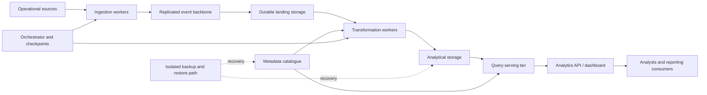

# High Availability and Redundancy Patterns

> **Module:** Stage 2D — Data Architecture / 12 — Reliability, Resilience and Disaster Recovery  
> **Lesson:** 03 — High Availability and Redundancy Patterns  
> **Audience:** Beginner through advanced data architects and data engineers  
> **Scope:** Vendor-neutral architecture, calculation, design, and validation

## Source and scope note

The project tree identifies this lesson as `03-high-availability-and-redundancy-patterns.md` in `Stage 2D — Data Architecture/12-Reliability-Resilience-and-Disaster-Recovery/`. The module roadmap identifies this topic as the next step after reliability objectives and failure-domain analysis. It recommends comparing active/passive, active/active and N+1 patterns; calculating availability with explicit assumptions; considering replication modes and failover; and validating the selected design.

The roadmap also states that the lesson files were initially empty and that its exercises, scenarios, targets and templates are recommendations—not requirements documented in an existing lesson. This document follows that recommended scope. All organisations, targets, capacities, times and numerical examples below are **illustrative assumptions**, not production measurements, vendor guarantees or universal standards.

## Contents

- [1. Learning outcomes](#1-learning-outcomes)
- [2. Prerequisites and connections](#2-prerequisites-and-connections)
- [3. Beginner foundations](#3-beginner-foundations)
- [4. Availability models and calculations](#4-availability-models-and-calculations)
- [5. High-availability patterns](#5-high-availability-patterns)
- [6. Redundancy across a data platform](#6-redundancy-across-a-data-platform)
- [7. Detection and failover control](#7-detection-and-failover-control)
- [8. Replication, consistency and state](#8-replication-consistency-and-state)
- [9. Capacity during failure and degraded operation](#9-capacity-during-failure-and-degraded-operation)
- [10. Quorum, fencing and split-brain prevention](#10-quorum-fencing-and-split-brain-prevention)
- [11. Failover, failback and recovery readiness](#11-failover-failback-and-recovery-readiness)
- [12. Redundancy is not backup](#12-redundancy-is-not-backup)
- [13. Fictional analytics-serving case study](#13-fictional-analytics-serving-case-study)
- [14. Exercises with expected outputs](#14-exercises-with-expected-outputs)
- [15. Example architecture decision record](#15-example-architecture-decision-record)
- [16. Validation checklist and testing strategy](#16-validation-checklist-and-testing-strategy)
- [17. Common misconceptions and troubleshooting](#17-common-misconceptions-and-troubleshooting)
- [18. Glossary](#18-glossary)
- [19. Mastery criteria and completion gate](#19-mastery-criteria-and-completion-gate)
- [20. Cross-topic references](#20-cross-topic-references)

## 1. Learning outcomes

After completing this lesson, you should be able to:

1. Explain availability, reliability, resilience, redundancy, failover, failback, quorum, fencing and split-brain.
2. Identify single points of failure (SPOFs) and shared failure domains in a data service.
3. Compare active/passive, active/active, N+1, multi-zone and multi-region designs.
4. Calculate serial and parallel availability while stating independence and shared-dependency assumptions.
5. Explain health checks, failure detection, timeouts, false positives and failover flapping.
6. Evaluate synchronous and asynchronous replication, replication lag, consistency and possible data loss.
7. Design for stateful recovery, in-flight work and idempotent retries.
8. Calculate N−1 capacity and decide which workloads must remain available in degraded mode.
9. Explain how quorum and fencing reduce split-brain risk—and what they do not guarantee.
10. Design and validate failover and failback procedures.
11. Distinguish redundancy from backup and recovery validation.
12. Defend an HA design using a decision record tied to user-facing objectives, failure domains, cost and operational evidence.

## 2. Prerequisites and connections

### 2.1 Prerequisite review

| Prerequisite | Why it matters here | Review prompt |
|---|---|---|
| Topic 01: reliability objectives, SLIs, SLOs and SLAs | HA is justified by a defined service outcome, not by a vague desire for “more uptime” | What user-visible indicator must remain within target? |
| Topic 02: failure domains and blast radius | Redundancy works only when replicas do not share every relevant failure cause | Which components can fail together? |
| Replication, consistency and transaction boundaries | A healthy replica may be stale or inconsistent | What is the acceptable data-loss exposure? |
| Cloud zones/regions and network paths | Placement determines which physical or logical failures are survived | Are replicas in genuinely separate failure domains? |
| Idempotency and replay | Work may be interrupted during failover and must be safely retried | Can a task run twice without duplicate or corrupt output? |

### 2.2 The relationship between objectives, failure domains and HA

The design sequence is:

1. **Topic 01:** define the service outcome and its SLO.
2. **Topic 02:** identify failure domains and the impact of their loss.
3. **Topic 03 (this lesson):** choose redundancy, detection, failover and capacity controls.
4. **Topics 04–06:** validate backup/restore, recovery objectives, replay and backfill.
5. **Topics 07–08:** operationalise incidents, rehearsals and continuity.

HA does not replace the other topics. It primarily reduces interruption from selected failures. It does not by itself guarantee correct data, recovery from logical corruption, or business continuity after a major disaster.

## 3. Beginner foundations

### 3.1 Core terms

| Term | Meaning | Data-platform example |
|---|---|---|
| **Availability** | Fraction of a defined measurement interval during which a service meets the defined usable-service condition | Analytics queries return acceptable results within the service’s latency and correctness criteria |
| **Reliability** | Ability to perform required functions correctly over time | A scheduled report is delivered on time and contains valid, reconciled data |
| **Resilience** | Ability to withstand, contain, degrade gracefully under, and recover from disruption | One zone fails; critical reports continue or recover within an agreed target |
| **Redundancy** | Additional capacity or components that can substitute for a failed component | A standby database or a second broker replica |
| **High availability (HA)** | Architecture and operations intended to minimise service interruption under specified failures | Replicated serving nodes plus detection, promotion, routing and tested recovery |
| **Failover** | Transfer of service responsibility from a failed or suspected-failed component to another | Route reads to a healthy replica after controlled promotion |
| **Failback** | Return to a preferred or recovered primary after validating it | Move traffic back after resynchronisation and controlled cutover |
| **Health check** | Signal used to determine whether a component or end-to-end service can perform its role | A probe checks query success, not merely process existence |
| **Quorum** | A sufficient voting majority or agreement condition used to make a safe decision | A majority of voting members elect a leader |
| **Fencing** | Preventing an old or stale owner from continuing to act after ownership changes | A storage lease, epoch or infrastructure control rejects writes from the former primary |
| **Split-brain** | Two nodes or sites both believe they are authoritative, potentially accepting conflicting writes | Two promoted databases accept independent updates |
| **SPOF** | A single component or dependency whose failure can make the service unavailable | One unreplicated catalogue required by every pipeline |

### 3.2 Why a second component is not automatically HA

A second instance is useful only if the system can detect the failure, decide safely which instance should serve, route traffic, preserve or recover state, and operate within capacity limits. Consider two database nodes in different zones that depend on the same identity service, network route, deployment configuration, encryption key, or control plane. A failure of that shared dependency may disable both.

A design is therefore evaluated against a **failure model**: the set of failures it claims to tolerate. “Survives one node failure” is a narrower and more testable claim than “always available.”

### 3.3 The HA chain

A typical failover path has several steps:

1. Detect a failure or loss of service health.
2. Decide whether the failure is real and whether promotion is safe.
3. Fence the former owner if it might still be active.
4. Promote or activate the replacement.
5. Recover or reconcile state and in-flight work.
6. Update routing, discovery or client connections.
7. Verify end-to-end service behaviour.
8. Notify operators and consumers, and continue monitoring.

Any step can be a bottleneck. Redundancy without a working failover path may provide no practical availability improvement.

## 4. Availability models and calculations

### 4.1 Define what “available” means first

Availability arithmetic is only meaningful when the measurement boundary is clear. For an analytics-serving service, a possible illustrative definition is:

> A request is available if it reaches the serving endpoint, completes within the agreed latency threshold, and returns data that passes required correctness and freshness checks.

This is stricter than “the process is running.” The exact definition belongs in the SLI specification from Topic 01.

### 4.2 Serial dependencies

If every component in a serial path must work, and component availability events are independent, end-to-end availability is:

\[
A_{\text{serial}}=\prod_{i=1}^{n} A_i
\]

**Illustrative example:** a report-serving request requires a gateway, query service and database. Assume each is independently available at 99.9%.

1. Convert each percentage to a fraction: \(0.999\).
2. Multiply: \(0.999 \times 0.999 \times 0.999 = 0.997002999\).
3. Convert to a percentage: \(99.7002999\%\), or approximately **99.7003%**.

This calculation assumes all three components must work and that their availability events are independent. Real components may share networks, identity, power, control planes or configuration. Correlated failures violate the independence assumption; multiplying marginal availabilities may then overstate or understate actual end-to-end availability.

### 4.3 Parallel redundancy

If either of two components can independently provide the required service, both are capable of serving the same demand, and there is no shared failure that disables both, then:

\[
A_{\text{parallel}}=1-(1-A_1)(1-A_2)
\]

**Illustrative example:** two independent serving nodes each have availability \(A=0.999\).

1. Unavailability of one node: \(1-0.999=0.001\).
2. Probability that both are unavailable, assuming independence: \(0.001 \times 0.001=0.000001\).
3. Availability of the pair: \(1-0.000001=0.999999\).
4. Percentage: **99.9999%**.

This is a theoretical component-level result, not a service guarantee. It assumes either node can handle the required traffic, routing works, health checks correctly identify failure, and the nodes do not share a relevant failure cause. If both depend on one gateway with 99.9% availability, the gateway limits the complete path; the combined path availability cannot exceed that gateway’s availability under the simple serial model.

### 4.4 Availability with a shared dependency

Suppose the redundant pair above depends on a shared gateway with illustrative availability 99.9%. Under the simplified assumption that the gateway availability event is independent of the pair’s availability:

\[
A_{\text{service}}=A_{\text{gateway}}\times A_{\text{pair}}
\]

\[
=0.999 \times 0.999999=0.998999001
\]

That is approximately **99.8999%**. The shared gateway dominates the result. In a real system, independence between gateway and nodes must also be justified rather than assumed.

### 4.5 Availability is not the same as recovery time

A service can have redundant components but still experience an interruption while the system detects a fault and promotes a replacement.

A first-order approximation is:

\[
T_{\text{interruption}} \approx T_{\text{detection}} + T_{\text{decision}} +
T_{\text{promotion}} + T_{\text{routing}} + T_{\text{state recovery}}
\]

These terms may overlap, so adding them is a conservative serial approximation unless the timing model says otherwise. A real measured interruption should come from end-to-end probes or consumer observations.

**Illustrative failover calculation:**

| Step | Assumed duration |
|---|---:|
| Detection | 12 seconds |
| Safe promotion decision and fencing | 8 seconds |
| Replica promotion / readiness | 20 seconds |
| Routing and client reconnection | 10 seconds |
| Validation before full traffic | 15 seconds |
| **Conservative total** | **65 seconds** |

Calculation: \(12+8+20+10+15=65\) seconds. This is an illustrative planning estimate, not a guarantee. It excludes any additional data reconciliation or queue catch-up that may be required. If steps overlap, actual elapsed time could be shorter; if dependencies are degraded, it could be longer.

### 4.6 Availability arithmetic guardrails

- State whether components are in series or parallel.
- State whether the service can operate with one component missing.
- State whether component failures are assumed independent.
- Identify shared dependencies and common-cause failure.
- Include detection, promotion, routing and state recovery—not only component uptime.
- Distinguish infrastructure availability from successful, correct data delivery.
- Do not infer a production SLO from simplified component arithmetic alone.

## 5. High-availability patterns

### 5.1 Active/passive (primary/standby)

**Mechanism:** one instance handles production traffic; another is ready to take over. The standby may be hot (running and synchronised), warm (partially prepared) or cold (requires substantial start-up).

**Use when:** write ownership is easier to reason about with one active leader, workloads are stateful, or active/active conflict resolution would be too complex.

**Benefits**
- Clearer write ownership and simpler conflict model.
- Potentially lower cost than fully provisioned active/active.
- Straightforward fit for a single-primary database when its replication and failover model support it.

**Limitations and failure modes**
- Failover introduces interruption.
- Standby may be stale, misconfigured, under-capacity or untested.
- Promotion can fail if the catalogue, identity system, routing or control plane is unavailable.
- A false-positive health check can promote a standby while the old primary is still active.
- Asynchronous replication may lose acknowledged-but-not-replicated data, depending on the system’s acknowledgement semantics and failure scenario.

**Operational requirements:** continuous replication monitoring, safe leader election or promotion, fencing, documented RPO/RTO assumptions, periodic drills and a tested failback process.

### 5.2 Active/active

**Mechanism:** multiple instances serve requests concurrently. For stateful systems, writes may be partitioned, coordinated or conflict-resolved; “two nodes are running” does not define the consistency model.

**Use when:** workload can be distributed safely, traffic can be routed across instances, and capacity needs justify the complexity.

**Benefits**
- Uses capacity during normal operation.
- Can reduce failover delay for stateless or appropriately partitioned workloads.
- Can serve local traffic from multiple zones or regions.

**Limitations and failure modes**
- Duplicate processing, write conflicts or inconsistent reads if state ownership is unclear.
- Shared dependencies can still disable all active instances.
- The surviving instances may be overloaded after one fails.
- Cross-region coordination can add latency and make partitions harder to handle.
- Requires careful routing, observability, deployment coordination and data semantics.

**Operational requirements:** explicit ownership/partitioning, idempotency, conflict policy, capacity tests, consistency validation, and failure drills.

### 5.3 N+1 capacity

**Mechanism:** provision enough capacity for the required workload (N) plus one spare unit. “N+1” describes capacity redundancy; it does not automatically provide data redundancy, safe leader election or fault-tolerant networking.

**Use when:** a pool of interchangeable workers or nodes can take over another’s workload.

**Illustrative example:** a service requires 2,000 requests/second. Three nodes each sustain 1,000 requests/second under the tested workload. With one node lost, two nodes provide 2,000 requests/second, just meeting demand. There is no headroom for demand spikes or degraded performance. If the target includes 25% spare capacity, the two surviving nodes must provide at least \(2,000 \times 1.25=2,500\) requests/second; each would need at least 1,250 requests/second under the relevant conditions, or the design needs more nodes/capacity.

**Limitations:** only the failure count explicitly planned for is tolerated. Shared dependencies, uneven sharding, hotspots and correlated failures may defeat the assumption that spare capacity is usable.

### 5.4 Multi-zone

**Mechanism:** distribute compute and, where supported, state across separate availability zones in a region.

**Use when:** the target failure model includes a zone outage and regional services remain usable.

**Benefits:** reduces dependence on one zone and may provide lower latency than cross-region designs.

**Limitations:** zones can share regional services, control planes, identity, network or configuration. Replication and routing still need to work. Multi-zone placement does not by itself protect against regional outages or logical corruption.

**Operational requirements:** verify the actual zone failure boundaries, test capacity after a zone loss, and inspect storage, broker, catalogue and identity dependencies.

### 5.5 Multi-region

**Mechanism:** run service and data in more than one region, with a documented traffic and data-ownership strategy.

**Common modes:**
- **Pilot light:** minimal recovery footprint; substantial scale-up is needed.
- **Warm standby:** a reduced but running environment can be expanded.
- **Hot standby:** near-ready secondary environment, with ongoing replication and cost.
- **Active/active multi-region:** multiple regions serve simultaneously, requiring explicit data consistency and ownership rules.

**Benefits:** can reduce exposure to a regional outage and support geographic requirements.

**Limitations:** higher cost, operational complexity, network latency, data-residency constraints, asynchronous replication lag, failover decision risk, and potential split-brain or stale reads. A second region is not independent if both rely on the same global identity, DNS, keys, deployment system or control plane.

**Operational requirements:** define regional ownership, routing, promotion/fencing, data loss limits, key availability, failover and failback, and recurring drills.

### 5.6 Pattern comparison

| Pattern | Main failure it addresses | Typical interruption | Data consistency concerns | Cost / complexity | Critical caveat |
|---|---|---|---|---|---|
| Active/passive | Primary instance failure | Often non-zero; depends on detection and promotion | Standby lag; safe promotion | Medium | Standby and failover path must be tested |
| Active/active | Instance failure; distributed load | Can be low if routing and capacity are ready | Conflicts, ordering, duplicate work | High for stateful systems | Multiple active nodes do not imply safe multi-writer data |
| N+1 | Loss of one capacity unit | May be low for stateless pools | State must live elsewhere or be replicated | Medium | Capacity must be sufficient after failure |
| Multi-zone | Zone-level failure | Depends on topology and failover design | Cross-zone replication and write ownership | Medium–high | Shared regional dependencies remain |
| Multi-region warm/hot standby | Regional failure | Depends on detection, promotion, routing and catch-up | Replication lag and regional consistency | High | DR readiness is proven only by rehearsals |
| Active/active multi-region | Regional failure and locality | Potentially low for supported requests | Conflict/consistency complexity | Very high | Requires clear partitioning or coordination |

## 6. Redundancy across a data platform

HA must cover the entire path and its supporting dependencies, not just compute.

| Layer | Redundancy options | Questions and failure modes to test |
|---|---|---|
| Ingestion/connectors | Multiple workers, durable source offsets, retryable ingestion | Can source rate limits, credentials or network egress block all workers? |
| Compute/transformation | Stateless workers, worker pools, checkpointed jobs, retryable tasks | Can interrupted work resume without duplicate side effects? |
| Storage/object store | Provider-defined replication or multi-zone placement, versioning, independent backups | What durability/availability guarantees actually apply? Can a deletion or bad write replicate? |
| Database/serving store | Primary/standby, replicas, sharding, zone placement | Are replicas promotable and sufficiently current? Are reads allowed to be stale? |
| Message broker | Replicated partitions, broker diversity, durable acknowledgements | What is the replication factor, acknowledgement policy, leader-election behavior and recovery time? |
| Orchestration | Redundant control services where supported, durable scheduler state, recoverable metadata | Can a control-plane outage prevent new jobs or recovery actions? |
| Catalogue/metadata | Replicated metadata store, backups, cached metadata where safe | Does every pipeline require the catalogue at runtime? Can metadata be restored consistently? |
| Networking | Multiple paths, redundant gateways, routing health checks | Are the paths actually diverse or do they share one route, firewall, DNS or identity dependency? |
| Identity and keys | Redundant access paths where supported, tested break-glass access, key recovery | Can all replicas become unreachable because credentials or keys are unavailable? |
| Deployment/configuration | Immutable artifacts, staged rollout, canary, rollback, independent recovery path | Can one faulty configuration or release break every region at once? |
| Observability | Independent probes, durable alert delivery, alternate access to logs | Will the team know the service is failing if its main monitoring plane is down? |

### 6.1 Stateless and stateful components

Stateless workers are generally easier to replace because durable state is externalised. However, state may still exist in local temporary files, process memory, offsets, checkpoints, leases or in-flight requests. Those must be accounted for.

For stateful components, document:
- Which node owns writes.
- How committed state reaches replicas.
- Whether acknowledgements imply replication.
- What happens to in-flight transactions and requests.
- How offsets, checkpoints and metadata are restored.
- Whether retries are idempotent.
- How data is reconciled after promotion.

### 6.2 Failure domains constrain redundancy

Refer to Topic 02. Two replicas do not provide meaningful protection against a failure that disables both. Map placement and dependency boundaries explicitly, including zone, region, account/project, network, identity, catalogue, key management, software release and operator/process domains.

## 7. Detection and failover control

### 7.1 Health-check design

A health check should answer a specific operational question.

| Probe | What it proves | What it does not prove |
|---|---|---|
| Process/liveness | Process exists or event loop responds | Requests can be served correctly |
| Readiness | Instance can accept its intended traffic | Upstream data is fresh or correct |
| Dependency probe | A required dependency responds | End-to-end user operation succeeds |
| Synthetic transaction | A representative user operation works | Every tenant/query path works |
| Data-quality/freshness check | Data meets defined business rules and age | Infrastructure will remain available |

Use more than one signal where appropriate. A failed dependency probe might indicate a dependency outage, not a failed node. Restarting every node because a shared dependency is down can amplify the incident.

### 7.2 Timeouts and thresholds

Timeouts that are too short can classify slow but healthy components as failed. Timeouts that are too long extend detection time. Thresholds should reflect observed latency distributions, normal jitter, failure modes and the cost of false promotion.

A production design should specify:
- Probe interval and timeout.
- Number or duration of failed probes required.
- Whether passive and active checks differ.
- How network partitions are distinguished from node failure.
- Whether failover is automatic, operator-approved or conditionally automatic.
- How repeated failovers are rate-limited.
- How a service enters a stable state after recovery.

Do not select a universal timeout value without workload and failure evidence.

### 7.3 False positives and flapping

**Flapping** means the health signal repeatedly changes between healthy and unhealthy. It can trigger repeated promotion, routing churn and overload. Mitigations include hysteresis, consecutive-failure thresholds, minimum stable periods, circuit breakers, controlled retries and operator confirmation for high-risk stateful promotion.

Automatic failover is appropriate only when the decision is safe and the mechanism is understood. Manual approval can reduce split-brain risk but increases recovery time and depends on on-call availability.

### 7.4 Failover-time budget

The service objective should account for detection, decision, promotion, routing, reconnection, in-flight work recovery and data validation. Measure from the consumer perspective, not only from an internal “primary changed” event.

## 8. Replication, consistency and state

### 8.1 Synchronous versus asynchronous replication

| Dimension | Synchronous (simplified) | Asynchronous |
|---|---|---|
| Acknowledgement | Often waits for required replica acknowledgement or commit condition | Often acknowledges before all replicas receive the write |
| Potential committed-data loss on primary failure | Can be reduced or eliminated for acknowledged writes under the exact protocol and failure assumptions | May lose writes not yet replicated |
| Latency | Usually higher because acknowledgement depends on replication path | Often lower because writes need not wait for remote replication |
| Availability coupling | A required replica/quorum may block writes when unavailable | Primary may continue accepting writes during replica lag |
| Consistency | Depends on commit protocol, quorum and read rules; “sync” alone is not a complete guarantee | Reads from lagging replicas can be stale; write ownership and promotion policy matter |
| Operational concern | Network partitions can stop writes or affect quorum | Lag monitoring, recovery point, and promotion eligibility |

The labels “synchronous” and “asynchronous” vary by technology. Read the actual acknowledgement, quorum, durability and failover semantics before deriving a recovery point objective (RPO).

### 8.2 Replication lag and promotion

If the standby is behind, promotion can expose stale data or lose recent writes. Define an acceptable lag threshold and a policy for when promotion is allowed, delayed or escalated. Lag is not always equivalent to time-based data loss: event rates and replication semantics matter.

### 8.3 In-flight work and checkpoints

When a worker or orchestrator fails:
- A task may have completed its external side effect but not recorded success.
- A checkpoint may refer to a state that has not been fully committed.
- An offset may be committed before downstream publication.
- A retry may duplicate output unless the operation is idempotent or deduplicated.

Use transactional boundaries where available, idempotent writes, deterministic output keys, checkpoints with understood semantics, and reconciliation after recovery. “Exactly once” claims must be scoped to the system boundary and protocol; they do not automatically cover arbitrary external side effects.

### 8.4 Replicas do not remove all data risk

Replication can copy accidental deletion, malicious modification or logical corruption to every replica. HA and backup serve different purposes; see [Section 12](#12-redundancy-is-not-backup).

## 9. Capacity during failure and degraded operation

### 9.1 N−1 capacity calculation

**Illustrative assumptions:**
- Three identical serving nodes.
- Each node can sustain 1,000 requests/second at the required latency and error rate.
- Normal demand is 1,800 requests/second.
- One node fails.
- Load can be distributed evenly, and there are no shared bottlenecks.

Normal aggregate capacity is \(3 \times 1{,}000 = 3{,}000\) requests/second. Normal utilisation is \(1{,}800/3{,}000=60\%\).

After one node fails, capacity is \(2 \times 1{,}000=2{,}000\) requests/second. Utilisation becomes \(1{,}800/2{,}000=90\%\). The service can theoretically handle the current demand, but it has little headroom. Latency may rise nonlinearly near saturation; capacity must be validated with load tests.

If the required operating headroom is an illustrative 25%, required surviving capacity is:

\[
C_{\text{required}}=D(1+h)=1{,}800(1.25)=2{,}250\text{ requests/s}
\]

Two nodes at 1,000 each cannot meet that requirement. The design must add capacity, lower the normal demand through admission control, or explicitly accept a degraded mode.

### 9.2 Degraded-mode policy

Define what remains available under stress:
- Prioritise regulatory or critical reporting over exploratory queries.
- Apply per-tenant quotas and concurrency limits.
- Reject or queue noncritical work before exhausting critical capacity.
- Serve explicitly labelled cached data only if its freshness and correctness are acceptable.
- Reduce optional enrichment or expensive query features if the business contract permits.
- Communicate degraded status and the expected recovery path.

Never silently return stale or incomplete data as if it were current and correct.

## 10. Quorum, fencing and split-brain prevention

### 10.1 Quorum

Quorum is a decision rule that requires enough voting members to agree. In a simple majority system with \(2f+1\) voters, a majority is \(f+1\), which can tolerate up to \(f\) unavailable voters under the model’s assumptions. This rule is not a universal recipe for every distributed database; membership changes, network partitions and protocol details matter.

For example, three voting members require two votes for a majority. If one member is isolated, the other two may form a majority. The isolated member must not independently continue authoritative writes merely because it cannot contact the others.

### 10.2 Fencing

Fencing prevents a former owner from writing after leadership has moved. Mechanisms may include monotonically increasing epochs, leases with safe expiry, storage-level write rejection, or infrastructure controls that isolate the old primary.

A lease alone is not sufficient if clocks, pauses, network partitions or lease expiry semantics are not handled correctly. The resource receiving writes must enforce the ownership/fencing rule where possible.

### 10.3 Split-brain scenario

1. Primary A loses contact with the control plane but remains reachable to some clients.
2. Standby B concludes A is unavailable and promotes.
3. If A is not fenced, both A and B can accept writes.
4. On reconnection, divergent state may be difficult or impossible to merge safely.

Preventive controls include quorum-aware leadership, fencing, explicit write ownership, conservative promotion rules and partition testing. The recovery plan must specify how divergent writes are detected and reconciled if prevention fails.

## 11. Failover, failback and recovery readiness

### 11.1 Failover runbook outline

1. Confirm the incident and affected SLOs using independent evidence.
2. Determine the failure domain and whether the primary might still accept writes.
3. Check replica lag, quorum and promotion eligibility.
4. Fence or otherwise prevent conflicting writes from the former owner.
5. Promote the replacement through the documented mechanism.
6. Verify database/metadata consistency and required dependencies.
7. Switch routing or service discovery; invalidate stale client connections if necessary.
8. Run synthetic queries and correctness/freshness checks.
9. Resume or replay interrupted work safely.
10. Confirm capacity, alert status, consumer impact and incident communication.
11. Record actual interruption and data-loss exposure for post-incident review.

### 11.2 Failback is a separate change

Do not immediately return to the old primary just because it is healthy again. First:
- Investigate the cause of the original failure.
- Rebuild or resynchronise it from the authoritative system.
- Verify replication position and data consistency.
- Confirm it cannot conflict with the current leader.
- Plan a controlled traffic or ownership change.
- Observe the system after cutover and retain a rollback path.

Failback can create a second outage if ownership, replication direction or routing is misunderstood.

### 11.3 Operational readiness

A design is not production-ready until the team can explain who may authorise failover, how the primary is fenced, how state is validated, what happens if automation fails, how consumers are notified, and how the system returns to normal. These are runbook and organisational controls, not merely infrastructure features.

## 12. Redundancy is not backup

| Capability | Main purpose | Example | What it does not guarantee |
|---|---|---|---|
| Redundancy/replication | Continue service when a component fails | Standby database | Recovery from replicated corruption or deletion |
| Backup | Preserve a recoverable point-in-time copy | Isolated, retained database snapshot | That the backup is complete or restorable |
| Restore validation | Prove that backup and dependencies can be restored | Timed restore followed by reconciliation checks | That every future recovery will meet its target |
| Disaster recovery | Restore service after major loss | Recover in another region | No data loss unless the design and measured evidence support it |

A replica is often designed to stay current, so it may quickly copy an unwanted change. Backups should have appropriate isolation, retention, access controls and recovery validation. Topics 04 and 05 develop backup/restore, RPO and RTO in detail.

## 13. Fictional analytics-serving case study

### 13.1 Scenario and requirements

**Fictional organisation:** Northbridge Bank. All values are illustrative.

A critical reporting platform publishes a risk dashboard by 07:00 on business days and serves analysts during the day. It contains ingestion, durable storage, transformation, catalogue/metadata, orchestration and a query-serving store.

Illustrative business requirements:
- The 07:00 report must be complete and pass reconciliation before it is labelled ready.
- During a single-zone outage, the query service should continue or recover within a proposed 90-second interruption budget.
- A report must not be presented as current if its freshness or correctness checks fail.
- The system must support safe replay of interrupted transformations.
- The architecture must have a separate recovery path for logical corruption and accidental deletion.

These are example design inputs, not established contractual SLOs. The actual targets would need measurement definitions, historical evidence and dependency feasibility analysis from Topic 01.

### 13.2 Logical architecture

This is a logical dependency diagram, not a deployment topology. The replicated event backbone, storage, serving tier, catalogue and orchestrator still need explicit failure-domain placement and operational guarantees. Dashed recovery paths do not imply that restoration is automatic or instantaneous.

### 13.3 Three candidate designs

| Design | Summary | Availability and recovery | Data risk | Cost and complexity | Fit |
|---|---|---|---|---|---|
| A. Single-zone primary | One serving instance and one zone | Low infrastructure cost; zone loss interrupts service until recovery | Depends on backup and restore; no fast failover | Low | Poor fit if zone-outage interruption must be short |
| B. Multi-zone active/passive | Primary in one zone, standby in another; controlled promotion | Non-zero failover interruption; test against 90-second illustrative budget | Depends on replication mode and promotion lag | Medium | Plausible if failover time, fencing and capacity are proven |
| C. Multi-zone active/active serving with a single authoritative write path | Multiple serving nodes handle reads; writes remain coordinated or partitioned; shared dependencies reviewed | Can reduce node-failure interruption; zone-loss performance depends on surviving capacity | Avoids uncontrolled multi-writer conflicts if write ownership is enforced; stale reads still possible | High | Strong candidate where read continuity justifies cost and complexity |

**Recommendation for the fictional scenario:** Design C for stateless/query-serving compute, paired with a documented authoritative state and metadata strategy, is a candidate—not an automatic winner. For a stateful serving database, active/passive may be safer if write ownership and consistency are easier to validate. Final selection depends on observed load, the true SLO, tested failover time, dependency boundaries and cost.

### 13.4 Illustrative failover budget

The 90-second interruption budget is an assumed target. The example estimate in Section 4.5 totals 65 seconds, leaving 25 seconds of nominal margin. That margin is not proof of feasibility: the component times are assumptions, not measured percentiles; worst-case dependency degradation, replica lag, data validation and routing failures can exceed them. A drill must measure end-to-end interruption and verify correct data.

### 13.5 Replication decision

For the critical report store:
- Synchronous replication may reduce acknowledged-write loss under the exact protocol, but may increase latency or make writes unavailable when required replicas/quorum cannot be reached.
- Asynchronous replication may improve write latency and availability under some failures, but the promoted copy can be behind.
- The acceptable choice depends on report correctness, acceptable data-loss exposure, write latency, and failure model—not on the label alone.

Before choosing, specify acknowledgement semantics, lag threshold, read-after-write expectations, promotion rules, and how reconciliation is performed.

## 14. Exercises with expected outputs

All exercise numbers are illustrative. They are design exercises; no production infrastructure is required.

### Exercise 1 — Beginner: identify SPOFs

**Task:** A daily report runs on one worker, reads from one database, gets credentials from one identity service, uses one catalogue, and publishes through one gateway. Identify at least five potential SPOFs and suggest one control for each.

**Expected output:**

| Potential SPOF | Possible control | Limitation to mention |
|---|---|---|
| Single worker | Replaceable worker pool and durable job state | Worker pool still needs sufficient N−1 capacity |
| Database primary | Supported replica/standby and safe promotion | Replication lag and split-brain risk remain |
| Identity service | Supported redundancy and tested recovery access | Shared global identity dependencies may remain |
| Catalogue | Replicated metadata store and restore procedure | Bad metadata can replicate; catalogue may be a control-plane dependency |
| Gateway | Redundant gateway/routing and independent probes | DNS, network or config may still be shared |
| Orchestrator | Durable scheduler state and recoverable control plane | Existing jobs may require checkpoint/reconciliation |

**Validation:** every SPOF must be connected to a failure consequence, a proposed control and a residual risk.

### Exercise 2 — Intermediate: serial versus parallel availability

**Task A:** Three independent serial components each have availability 99.9%. Calculate end-to-end availability.

**Expected answer:** \(0.999^3=0.997002999\), or approximately **99.7003%**, assuming every component is required and independent.

**Task B:** Two independent equivalent serving nodes each have availability 99.9%; either can serve the request. Calculate pair availability.

**Expected answer:** \(1-(0.001)^2=0.999999\), or **99.9999%**, assuming no shared failure and enough surviving capacity.

**Follow-up:** Add a shared gateway at 99.9% availability, independent of the pair. The simple model gives \(0.999 \times 0.999999=0.998999001\), or **99.8999%**. Explain why this still may not match real observed availability.

### Exercise 3 — Intermediate: compare three serving designs

**Task:** Compare single-zone primary, multi-zone active/passive, and multi-zone active/active serving for Northbridge Bank.

**Expected deliverable:** a table covering failure model, end-to-end availability method, interruption estimate, data-loss exposure, capacity after failure, shared dependencies, cost, operating complexity and validation evidence.

**Validation:** do not award an availability number to a design without identifying component assumptions and the service boundary.

### Exercise 4 — Intermediate: failover-time estimate

**Task:** Use these illustrative sequential steps: detection 10 s, decision/fencing 15 s, promotion 25 s, routing 10 s, validation 20 s.

**Calculation:** \(10+15+25+10+20=80\) seconds.

**Expected answer:** conservative estimated interruption is **80 seconds** if steps are sequential and the assumed durations hold. If some steps overlap, measure elapsed end-to-end time rather than blindly summing. If any step requires data catch-up, include it.

### Exercise 5 — Intermediate: replication trade-off

**Task:** A reporting service has a strict correctness requirement, but the team also wants writes to continue during a zone network partition. Compare synchronous and asynchronous replication.

**Expected output:** synchronous replication can reduce loss of acknowledged writes under the exact commit protocol, but may block writes if quorum/required replicas are unavailable; asynchronous replication may continue writes but may promote stale state. State the actual acknowledgement contract, RPO, lag threshold, consistency expectations and failover policy. Do not claim “zero data loss” without evidence and a precise failure model.

### Exercise 6 — Intermediate: N−1 capacity

**Task:** Three nodes each serve 1,000 requests/s. Demand is 1,800 requests/s. What happens after one node fails? If the design requires 25% headroom over demand, is it enough?

**Expected calculation:**
- Normal capacity: \(3 \times 1,000=3,000\) requests/s.
- After one failure: \(2 \times 1,000=2,000\) requests/s.
- Utilisation after failure: \(1,800/2,000=90\%\).
- Capacity required for 25% headroom: \(1,800 \times 1.25=2,250\) requests/s.
- **Conclusion:** the remaining capacity meets the raw demand under assumptions but does not meet the 2,250 requests/s headroom target.

### Exercise 7 — Advanced: critical reporting platform

**Task:** Propose a design for source ingestion, event backbone, durable landing, transformations, catalogue, orchestration, analytical storage and serving. State which components are active/active, active/passive, replicated or recoverable from backup.

**Expected deliverables:**
1. Deployment and dependency diagram with zones/regions and shared dependencies.
2. SLO table from Topic 01 and failure-domain map from Topic 02.
3. Serial/parallel availability calculation with assumptions.
4. Failover time budget and data-loss/replication analysis.
5. N−1 capacity calculation and degraded-mode policy.
6. Backup/restore and replay dependencies.
7. ADR, test plan and residual-risk list.

**Validation:** a diagram alone is insufficient. Each claimed protection must have an observable pass/fail test.

### Exercise 8 — Advanced: test a shared dependency

**Task:** Two serving regions are active, but both use one global identity service and one deployment pipeline. Describe the failure mode and propose containment.

**Expected answer:** the shared identity or deployment domain can disable both regions or distribute a faulty change to both. Options include supported identity recovery, break-glass access with strict controls, independent staged rollout, canarying, region-by-region promotion and a tested recovery path not dependent on the failing control plane. State residual risk and cost.

## 15. Example architecture decision record

### ADR-003: Multi-zone serving with controlled state ownership

**Status:** Proposed for the fictional Northbridge Bank scenario. Not a production approval.

**Context**

The risk dashboard is required for the business morning process. A single-zone outage could make the report unavailable. Topic 01 defines the required consumer outcomes; Topic 02 identifies zone, identity, catalogue, network and release systems as possible shared failure domains. The illustrative interruption budget is 90 seconds, pending business and operational validation.

**Decision**

Use multi-zone serving compute with sufficient N−1 capacity. Keep a clearly defined authoritative write path for stateful data; use supported replication and a controlled promotion/fencing mechanism for the serving store. Replicate or make recoverable the catalogue and orchestration state according to their semantics. Maintain isolated backups for logical corruption and deletion. Use staged, region/zone-aware deployment and independent synthetic checks.

**Alternatives considered**

1. **Single-zone primary:** lower cost but does not meet the intended zone-failure objective without a longer restore path.
2. **Multi-zone active/passive:** simpler write ownership, but requires proof that detection, fencing, promotion, routing and validation fit the interruption budget.
3. **Multi-zone active/active serving:** can improve request continuity, but requires explicit data ownership, conflict rules and enough surviving capacity.

**Consequences and trade-offs**

- Higher infrastructure and operational cost than single-zone deployment.
- Replication and failover introduce consistency, lag and split-brain concerns.
- More complex monitoring, runbooks and testing.
- Logical corruption remains a backup/restore problem, not solved by HA alone.
- SLO feasibility remains unproven until end-to-end drills and load tests are completed.

**Validation plan**

- Simulate a serving-node failure and a full-zone loss in a controlled environment.
- Measure consumer-visible interruption and request error rate.
- Verify fencing and absence of conflicting writes.
- Validate replica lag, correctness, freshness and report reconciliation after promotion.
- Verify surviving capacity under expected peak load.
- Restore from isolated backup and prove the recovery path is independent of the failed primary.
- Exercise failback and confirm that the old primary cannot write before safe rejoining.

**Rollback / reconsideration triggers**

Reconsider the design if the tested interruption exceeds the objective, data loss exceeds the approved tolerance, the remaining capacity violates latency/error targets, or the failover process depends on a failure domain that is unavailable in the scenario being tested.

## 16. Validation checklist and testing strategy

### 16.1 Before approval

- [ ] User-visible availability, freshness and correctness conditions are defined.
- [ ] The target failure model is explicit (node, zone, region, dependency, operator/configuration).
- [ ] Every critical serial dependency is identified.
- [ ] Shared failure domains are documented, including identity, catalogue, keys, network, control plane and deployment process.
- [ ] Redundant instances are in genuinely distinct relevant failure domains.
- [ ] The service can handle required demand after the planned failure(s).
- [ ] Detection, promotion, routing, state recovery and validation fit the objective based on evidence.
- [ ] Replication acknowledgement and lag semantics are documented.
- [ ] Quorum, write ownership and fencing are understood.
- [ ] In-flight work and retry idempotency are covered.
- [ ] Backups are separate from replicas and restore-tested.
- [ ] Failback is documented and tested.
- [ ] Alerts and runbooks remain accessible during the relevant control-plane outage.
- [ ] Cost, operational complexity and residual risk are accepted by accountable owners.

### 16.2 Failover drill matrix

| Test | Expected evidence | Safety condition |
|---|---|---|
| Kill one serving worker | Traffic shifts or remaining pool absorbs demand; latency and errors recorded | No uncontrolled retry storm |
| Lose one zone | Critical requests continue or recover within the approved objective | No split-brain; surviving capacity validated |
| Delay or interrupt replication | Promotion policy behaves as documented; lag is visible | No unapproved stale promotion |
| Isolate primary from control plane | Ownership and fencing behave safely | Old primary cannot continue authoritative writes after promotion |
| Make a dependency unhealthy | Correct dependency degradation is reported | Avoid restarting every node due to a shared dependency failure |
| Deploy a bad configuration in canary | Rollout stops or rolls back before broad impact | Rollback path does not rely solely on the broken component |
| Restore after logical corruption | Restore point and reconciliation checks prove data correctness | Recovery copy is not overwritten by corrupted state |
| Fail back to recovered primary | Resynchronisation, ownership and routing are verified | No conflicting writes during cutover |

### 16.3 Evidence to retain

Retain the scenario, topology version, configuration/release identifier, start and end timestamps, probe traces, replication lag, promotion/fencing events, data reconciliation results, request error and latency measurements, capacity observations, operator decisions and follow-up actions. This is what turns “we have HA” into a verifiable claim.

## 17. Common misconceptions and troubleshooting

| Misconception | Correction |
|---|---|
| “Two instances means high availability.” | Detection, routing, capacity, state and shared dependencies must also work. |
| “Parallel availability always multiplies to more nines.” | The formula assumes a valid parallel service model and independence; common causes and shared dependencies can dominate. |
| “Multi-zone protects against every outage.” | It does not necessarily protect against regional, global-control-plane, identity, configuration or logical-data failures. |
| “Synchronous replication means zero data loss in every scenario.” | The guarantee depends on protocol, acknowledgement semantics, quorum, storage durability and the failure model. |
| “A healthy replica is safe to promote.” | It may be stale, inconsistent or unable to take the workload. |
| “Failover time is just promotion time.” | Detection, decision, fencing, routing, reconnection, state recovery and correctness validation matter. |
| “Active/active is always better than active/passive.” | It can add write conflicts, consistency complexity, capacity costs and operational burden. |
| “N+1 means the service has enough capacity.” | The spare must cover real demand and headroom; uneven load and shared bottlenecks matter. |
| “Replicas protect against deletion.” | Replication may reproduce deletion or corruption; use isolated, retained backups and tested restore. |
| “Failback is simply turning the old primary back on.” | It requires resynchronisation, safe ownership transfer, routing change and validation. |
| “A health endpoint proves user success.” | Only representative end-to-end and data-quality checks reveal the complete user experience. |
| “A tested failover once proves readiness forever.” | Releases, dependencies, data volume and operating procedures change; repeat drills after material changes. |

### Troubleshooting questions

1. Which user-facing SLO is currently at risk?
2. Is the failure isolated to one component, or is a shared dependency failing?
3. Can the primary still accept writes? What fences it?
4. Is the standby sufficiently current and eligible for promotion?
5. Does the surviving system have enough capacity at the measured workload?
6. Are retries increasing load or duplicating side effects?
7. Is the service technically up but returning stale or incorrect data?
8. Can the team access logs, credentials, keys and runbooks during the outage?
9. What evidence proves failover and failback worked?
10. Which residual risks require a separate backup, DR or business-continuity control?

## 18. Glossary

- **Active/active:** multiple instances serve workload concurrently.
- **Active/passive:** one active instance with a standby that can take over.
- **Availability:** proportion of the defined interval in which the defined service condition is met.
- **Common-cause failure:** one cause disables multiple components assumed to be redundant.
- **Failback:** controlled return to a preferred recovered system.
- **Failover:** transfer of responsibility to a replacement.
- **Fencing:** mechanism that prevents a former owner from acting after ownership changes.
- **Health check:** signal about process, readiness, dependency or end-to-end service condition.
- **High availability:** design and operations that minimise interruption for specified failures.
- **N+1:** required capacity plus one additional interchangeable capacity unit.
- **Quorum:** agreement threshold required for a distributed decision.
- **Redundancy:** extra components or capacity intended to substitute for failed resources.
- **Replication lag:** delay between a source change and its availability at a replica.
- **SLO:** service-level objective for a measured user-visible behaviour; detailed in Topic 01.
- **SPOF:** single point whose failure can make a required service unavailable.
- **Split-brain:** multiple nodes act as authoritative owners at the same time.
- **Stateful service:** service whose correct operation depends on retained state, ownership, checkpoints or history.
- **Fencing token/epoch:** monotonically changing ownership value used to reject stale owners when enforced by the resource.

## 19. Mastery criteria and completion gate

You have mastered this topic when you can demonstrate all of the following without relying on memorised slogans:

- [ ] Explain availability, reliability, resilience and redundancy using one data-platform example.
- [ ] Identify at least five SPOFs and shared failure domains in a source-to-report architecture.
- [ ] Correctly calculate serial and parallel availability and state the assumptions.
- [ ] Explain why a shared gateway or control plane can dominate an otherwise redundant design.
- [ ] Compare active/passive, active/active, N+1, multi-zone and multi-region patterns with failure modes and cost.
- [ ] Produce a failover-time budget with detection, fencing, promotion, routing and validation.
- [ ] Explain synchronous/asynchronous replication and the conditions behind any data-loss claim.
- [ ] Calculate N−1 capacity and define a degraded-mode policy.
- [ ] Explain quorum, fencing and split-brain using a concrete failure sequence.
- [ ] Distinguish replication from backup and describe a validated recovery path.
- [ ] Complete an ADR that ties Topic 01 objectives to Topic 02 failure domains and names residual risk.
- [ ] Produce a failover validation checklist and identify the evidence required to approve the design.

**Completion gate:** submit the design comparison, reproducible calculations, topology/dependency diagram, ADR and drill plan for review. Log unresolved assumptions. Proceed to Topic 04 (backup, restore and recovery validation) only when you can explain which failures HA addresses and which require a separate recovery mechanism.

## 20. Cross-topic references

These are repository-relative references based on the supplied project tree. They describe related learning topics, not verified contents of every lesson file.

- `01-reliability-objectives-sli-slo-and-sla.md` — user-facing objectives, measurement boundaries and feasibility.
- `02-failure-domains-and-blast-radius.md` — common-cause failures, shared dependencies and containment.
- `04-backup-restore-and-recovery-validation.md` — recoverability after deletion, corruption and loss.
- `05-rpo-rto-and-disaster-recovery-strategies.md` — recovery point/time requirements and DR strategy.
- `06-replay-reprocessing-and-backfill-architecture.md` — safely rebuilding data after interruption.
- `07-incident-response-runbooks-and-postmortems.md` — operational roles, incident procedures and learning.
- `08-business-continuity-and-resilience-testing.md` — rehearsal, continuity and validation feedback loops.
- Stage 2D Module 05, Database and Storage Architecture — replication, consistency, transaction boundaries and lifecycle.
- Stage 2D Module 06, Data Integration and Interoperability — idempotency, deduplication and failure handling.
- Stage 2D Module 08, Cloud, Hybrid and Multi-Cloud Data Architecture — zones, regions and infrastructure strategy.
- Stage 2D Module 09, Streaming and Real-Time Data Architecture — brokers, replay, lag and stream failure modes.
- Stage 2D Module 11, Metadata, Lineage, Quality and Master Data — lineage, observability and data correctness.
- Stage 2D Module 13, Performance, Scalability and Cost Architecture — capacity headroom and cost trade-offs.
- Stage 2D Module 15, Architecture Documentation Reviews and Operating Model — ADRs and design review.

---

## Final design principle

High availability is a property of the **end-to-end service and its operating model**, not a count of replicas. Select redundancy to address named failure domains, calculate with explicit assumptions, preserve correct state, provide enough capacity after failure, prevent conflicting ownership, and prove the behaviour through repeatable drills. Keep backup, disaster recovery and business continuity as distinct but coordinated capabilities.
